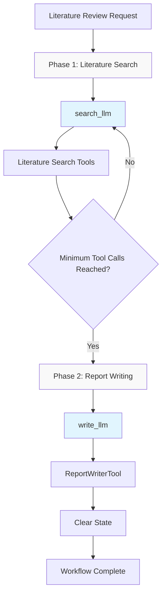
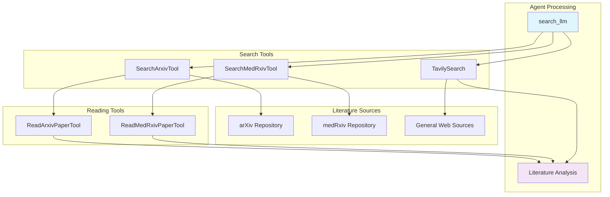
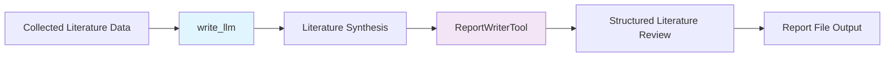
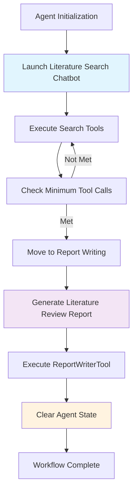

<!-- source: DeepWiki mcp.deepwiki.com · repo jarrycyx/openlens-ai · page 3.2 Literature Reviewer Agent · fetched 2026-10-27 -->

# Literature Reviewer Agent

Relevant source files

The following files were used as context for generating this wiki page:

- [modules.md](modules.md)

## Purpose and Scope

The Literature Reviewer Agent is one of five specialized agents in the OpenLens AI multi-agent system, specifically responsible for conducting comprehensive literature searches and generating academic literature review reports. This agent searches relevant academic papers from multiple sources including arXiv, medRxiv, and general web sources, then analyzes and synthesizes the findings into structured reports that inform the research process.

For information about overall agent coordination, see [Supervisor Agent](#3.1). For details about the complete multi-agent architecture, see [Multi-Agent System](#3).

## Agent Architecture Overview

The Literature Reviewer Agent operates through a two-phase architecture that separates literature discovery from synthesis and reporting.

### Two-Phase Operation Model

**Sources:** [modules.md:52-84]()

### Core Components

| Component | Purpose | Implementation |
|-----------|---------|----------------|
| `search_llm` | Literature discovery and paper retrieval | Language model optimized for search queries |
| `write_llm` | Report synthesis and writing | Language model optimized for academic writing |
| `ReportWriterTool` | Report generation and file management | Tool for writing structured literature reviews |
| Literature Search Tools | Multi-source paper discovery | Collection of specialized search tools |

**Sources:** [modules.md:66-77]()

## Literature Search Tools Architecture

The agent employs multiple specialized tools for comprehensive literature coverage across different academic repositories and search engines.

### Search Tool Ecosystem

**Sources:** [modules.md:66-73]()

## Literature Search Phase

### Search Strategy Implementation

The literature search phase uses the `search_llm` language model to formulate effective search queries and coordinate tool usage. The agent employs an iterative approach to ensure comprehensive coverage.

#### Search Process Flow

1. **Query Formulation**: The `search_llm` analyzes the research question to generate targeted search queries
2. **Multi-Source Search**: Executes searches across `SearchArxivTool`, `SearchMedRxivTool`, and `TavilySearch`
3. **Paper Retrieval**: Uses `ReadArxivPaperTool` and `ReadMedRxivPaperTool` to access full paper content
4. **Iterative Refinement**: Continues searching until minimum tool call threshold is met

#### Tool Call Management

The agent tracks tool usage to ensure adequate literature coverage before proceeding to the report writing phase. This prevents premature termination and ensures comprehensive research.

**Sources:** [modules.md:74-82]()

## Report Writing Phase

### Report Generation Workflow

Once sufficient literature has been gathered, the agent transitions to the `write_llm` for report synthesis and the `ReportWriterTool` for structured output generation.

### Report Structure and Content

The `ReportWriterTool` generates comprehensive literature reviews that include:

- **Research Context**: Background and motivation from discovered papers
- **Key Findings**: Synthesis of major results and contributions
- **Methodological Approaches**: Analysis of research methods used across papers
- **Research Gaps**: Identification of areas requiring further investigation

**Sources:** [modules.md:77-83]()

## Workflow Implementation

### Complete Agent Workflow

The Literature Reviewer Agent follows a structured workflow managed by LangGraph orchestration:

### State Management

The agent maintains state throughout the literature review process, tracking:
- Search queries executed
- Papers discovered and analyzed
- Tool call counts
- Intermediate analysis results

State is cleared upon workflow completion to ensure clean transitions between research tasks.

**Sources:** [modules.md:79-84]()

## Integration with Multi-Agent System

### Shared State Communication

The Literature Reviewer Agent communicates with other agents through the shared state managed by LangGraph. Key shared information includes:

| Shared Data | Purpose | Usage by Other Agents |
|-------------|---------|---------------------|
| Literature review reports | Research context | Used by LaTeX Writer for Related Work section |
| Key papers and citations | Reference management | Integrated into final paper bibliography |
| Research gaps identified | Planning refinement | Informs Supervisor Agent planning |
| Domain knowledge | Context building | Supports Data Analyzer and Coder agents |

### Agent Coordination

The Literature Reviewer typically executes early in the research workflow, providing foundational knowledge that informs subsequent agent activities. The Supervisor Agent coordinates the timing and ensures the literature review aligns with overall research objectives.

**Sources:** [modules.md:199-210]()

## Tool Dependencies and External Services

### External Service Integration

The Literature Reviewer Agent relies on several external services for comprehensive literature access:

- **arXiv API**: Academic paper repository access via `SearchArxivTool` and `ReadArxivPaperTool`
- **medRxiv API**: Medical preprint repository access via `SearchMedRxivTool` and `ReadMedRxivPaperTool`  
- **Tavily Search**: General web search capabilities for broader literature discovery
- **Language Models**: Both `search_llm` and `write_llm` for intelligent query formulation and report generation

### Tool Error Handling

The agent implements robust error handling for external service failures, ensuring research continuity even when individual literature sources are unavailable.

**Sources:** [modules.md:66-73](), [modules.md:215-220]()

---

