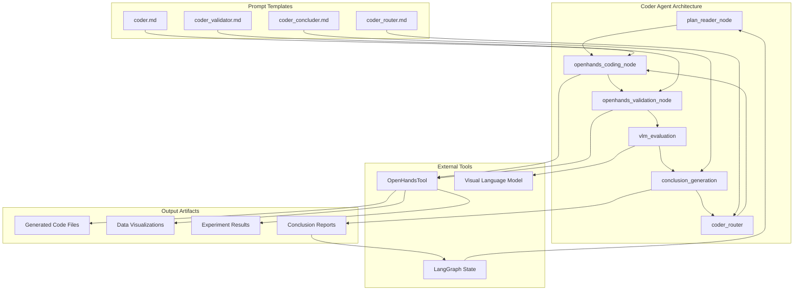
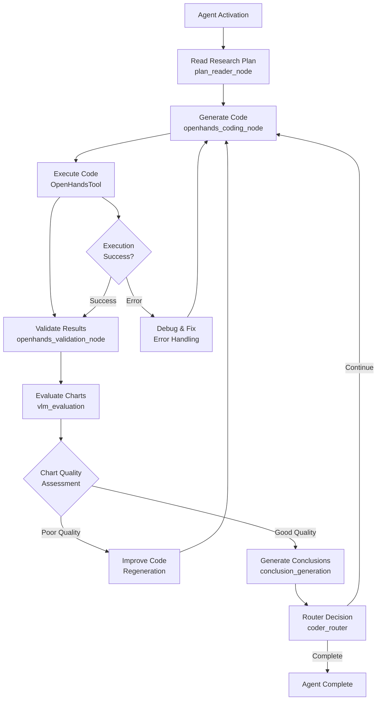
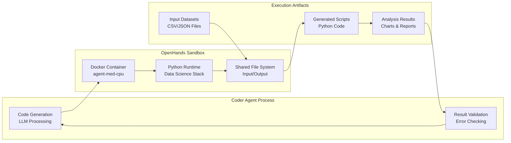
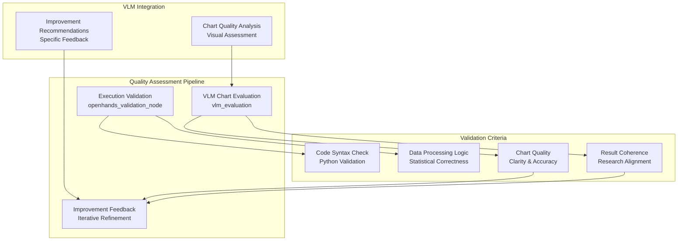
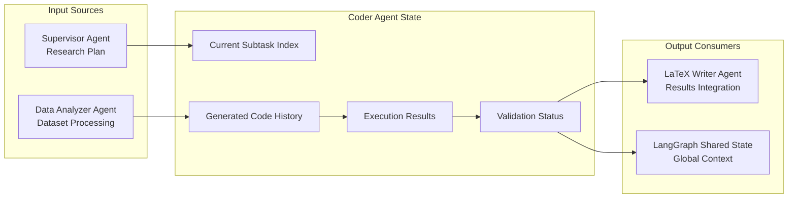
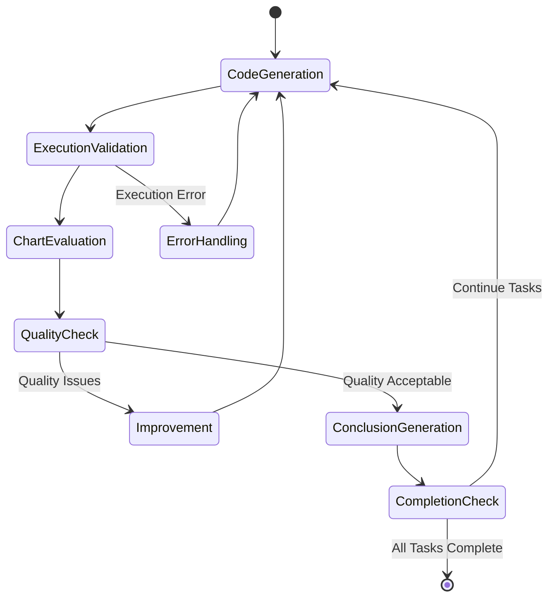

<!-- source: DeepWiki mcp.deepwiki.com · repo jarrycyx/openlens-ai · page 3.4 Coder Agent · fetched 2026-10-27 -->

# Coder Agent

Relevant source files

The following files were used as context for generating this wiki page:

- [modules.md](modules.md)

The Coder Agent is responsible for generating and executing experimental code within the OpenLens AI multi-agent research system. This agent translates high-level research plans into executable code, validates execution results, and iteratively improves code quality based on visual feedback from chart generation. The agent operates as part of the collaborative workflow orchestrated by the Supervisor Agent and provides computational results to the LaTeX Writer Agent.

For information about the overall multi-agent coordination, see [Supervisor Agent](#3.1). For details about code execution environment setup, see [OpenHands Integration](#6.1).

## Agent Architecture

The Coder Agent follows a multi-phase workflow architecture that separates code generation, execution, validation, and improvement into distinct processing stages.

### Core Components

Sources: [modules.md:120-153]()

## Code Generation Workflow

The Coder Agent implements an iterative code generation and refinement process that ensures experimental code meets research objectives and produces high-quality outputs.

### Generation Process Flow

### Prompt Template Integration

| Template File | Node Function | Purpose |
|---------------|---------------|---------|
| `coder.md` | `openhands_coding_node` | Guides initial code generation based on research plan |
| `coder_validator.md` | `openhands_validation_node` | Validates code execution results and identifies issues |
| `coder_concluder.md` | `conclusion_generation` | Synthesizes results into coherent conclusions |
| `coder_router.md` | `coder_router` | Determines next action (continue, improve, or complete) |

Sources: [modules.md:135-141]()

## Execution Environment Integration

The Coder Agent integrates tightly with the OpenHands execution sandbox to provide secure and isolated code execution capabilities.

### OpenHands Tool Integration

The `OpenHandsTool` provides the execution interface between the agent's code generation logic and the containerized execution environment. This ensures that generated code can access datasets, execute data analysis operations, and produce visualizations in a controlled environment.

Sources: [modules.md:108](), [modules.md:147-148]()

## Quality Assessment and Validation

The Coder Agent implements a multi-layered quality assessment system that combines execution validation with visual language model evaluation.

### Validation Architecture

### Quality Metrics

The agent evaluates code quality across multiple dimensions:

- **Execution Success**: Code runs without errors in the OpenHands environment
- **Data Processing Accuracy**: Statistical computations produce valid results
- **Visualization Quality**: Charts are clear, properly labeled, and scientifically accurate
- **Research Alignment**: Results support the research objectives defined in the plan

Sources: [modules.md:142](), [modules.md:149-150]()

## Inter-Agent Communication

The Coder Agent communicates with other system components through the shared LangGraph state and file-based result exchange.

### State Management

### File-Based Communication

The agent produces standardized output files that other agents can consume:

| Output File | Content Type | Consumer Agent |
|-------------|--------------|----------------|
| `experiment_results.md` | Experimental findings and statistical results | LaTeX Writer |
| `generated_code.py` | Final validated Python analysis code | Data Analyzer |
| `charts/` | Generated visualization files (PNG/SVG) | LaTeX Writer |
| `conclusions.md` | Summary of experimental conclusions | LaTeX Writer |

Sources: [modules.md:151-152](), [modules.md:202-208]()

## Router Decision Logic

The `coder_router` implements decision logic that determines agent workflow progression based on validation results and task completion status.

### Routing States

The router evaluates multiple factors including execution success, chart quality scores from the VLM, research plan progress, and available computational resources to determine the optimal next action.

Sources: [modules.md:152](), [modules.md:141]()

---

