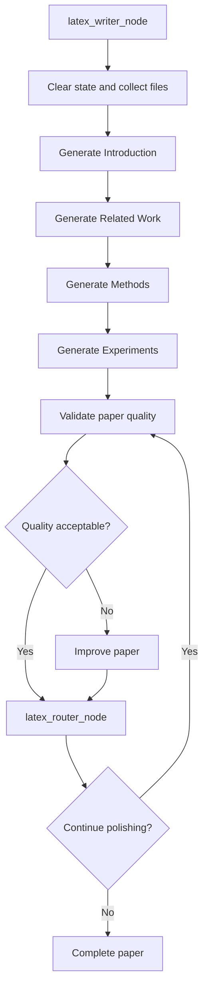
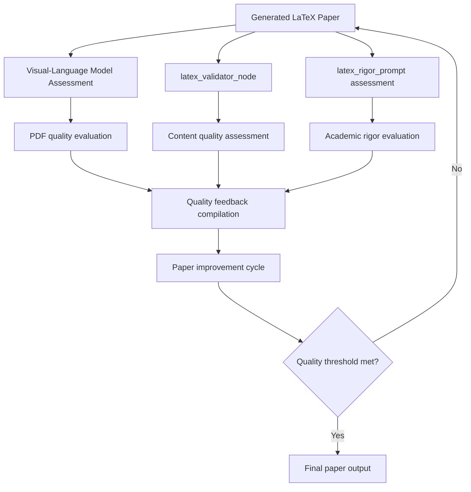
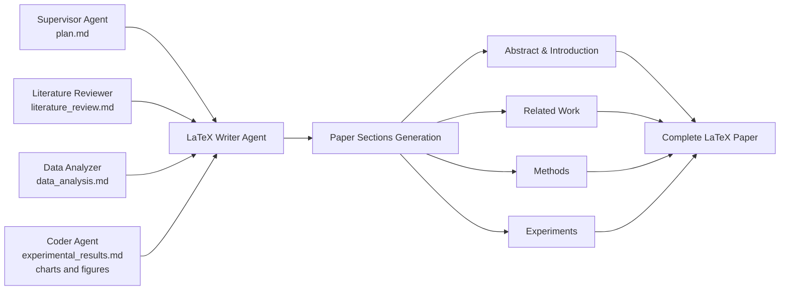
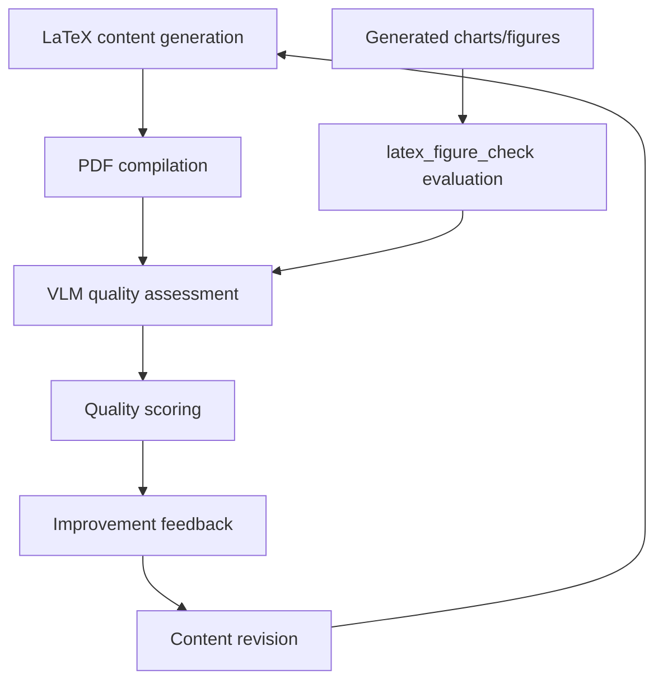

<!-- source: DeepWiki mcp.deepwiki.com · repo jarrycyx/openlens-ai · page 3.5 LaTeX Writer Agent · fetched 2026-10-27 -->

# LaTeX Writer Agent

Relevant source files

The following files were used as context for generating this wiki page:

- [modules.md](modules.md)

The LaTeX Writer Agent is responsible for synthesizing research results from all other agents into a complete academic paper in LaTeX format. This agent takes inputs from the Literature Reviewer, Data Analyzer, and Coder agents to produce publication-ready research papers with proper academic structure and formatting.

This document covers the paper generation workflow, quality assessment mechanisms, and integration patterns within the multi-agent system. For information about the overall multi-agent coordination, see [Supervisor Agent](#3.1). For details about input data processing, see [Data Analyzer Agent](#3.3) and [Coder Agent](#3.4).

## Agent Architecture and Components

The LaTeX Writer Agent operates through a sophisticated multi-stage pipeline that generates different sections of an academic paper sequentially, with quality validation and improvement cycles.

### Core Components

The agent utilizes several specialized prompt templates for different paper sections:

| Template File | Purpose | Section Generated |
|--------------|---------|-------------------|
| `latex_abstract_intro.md` | Abstract and introduction generation | Abstract, Introduction |
| `latex_related_works.md` | Literature review synthesis | Related Work |
| `latex_methods.md` | Methodology description | Methods |
| `latex_experiments.md` | Experimental results presentation | Experiments, Results |
| `latex_validator.md` | Paper quality assessment | Quality validation |
| `latex_concluder.md` | Conclusion generation | Conclusion, Discussion |

Additional specialized templates support quality improvement:

| Template File | Purpose |
|--------------|---------|
| `latex_router.md` | Workflow routing decisions |
| `latex_rigor_prompt.md` | Academic rigor enhancement |
| `latex_literature_check.md` | Reference validation |
| `latex_figure_check.md` | Chart and figure quality assessment |

Sources: [modules.md:172-183]()

## Paper Generation Workflow

The LaTeX Writer Agent follows a structured workflow that builds the paper section by section, with quality checkpoints and improvement cycles.

### Sequential Section Generation

Each section generation involves:

1. **Input Collection**: Gathering results from other agents' outputs
2. **Context Building**: Combining research plan, literature review, and experimental results
3. **Section Generation**: Using specialized prompts to generate LaTeX content
4. **Integration**: Combining new sections with existing paper content

Sources: [modules.md:186-196]()

### Quality Assessment Pipeline

The agent implements a comprehensive quality assessment system that evaluates multiple dimensions of the generated paper:

Sources: [modules.md:184, 193-194]()

## Integration with Multi-Agent System

The LaTeX Writer Agent operates as the final stage in the research pipeline, consuming outputs from all other agents in the system.

### Input Dependencies

### Shared State Integration

The agent accesses and updates the shared state managed by LangGraph, which includes:

- **Research question**: Original research query
- **Research plan**: Structured plan from Supervisor Agent
- **Literature review**: Comprehensive review from Literature Reviewer
- **Data analysis results**: Processed datasets and visualizations
- **Experimental code and results**: Generated code and execution outputs
- **Message history**: Context from previous agent interactions

Sources: [modules.md:201-208]()

## Technical Implementation Details

### Visual-Language Model Integration

The agent incorporates visual-language model (VLM) assessment to evaluate the quality of generated charts, figures, and the final PDF output:

The VLM assessment evaluates:
- **Chart clarity and readability**
- **Figure-text integration**
- **Overall PDF presentation quality**
- **Academic formatting compliance**

Sources: [modules.md:184, 182]()

### Workflow State Management

The agent uses a routing mechanism to manage the iterative improvement process:

| Router Decision | Next Action | Condition |
|----------------|-------------|-----------|
| `continue` | Return to quality validation | Quality below threshold |
| `improve` | Execute improvement cycle | Specific issues identified |
| `finish` | Complete paper generation | Quality threshold met |

The routing logic considers:
- **Quality assessment scores**
- **Number of improvement iterations**
- **Specific feedback categories**
- **User-defined quality thresholds**

Sources: [modules.md:179, 195]()

### Output Integration

The final LaTeX paper integrates multiple types of content:

- **Textual content**: Generated from prompt templates
- **Citations and references**: Derived from literature review
- **Data visualizations**: Charts and tables from experimental results  
- **Code snippets**: Relevant code examples from experimental implementation
- **Mathematical formulations**: Methodology descriptions and statistical analyses

The agent ensures proper LaTeX formatting, citation management, and figure placement throughout the document generation process.

Sources: [modules.md:163-167]()

---

