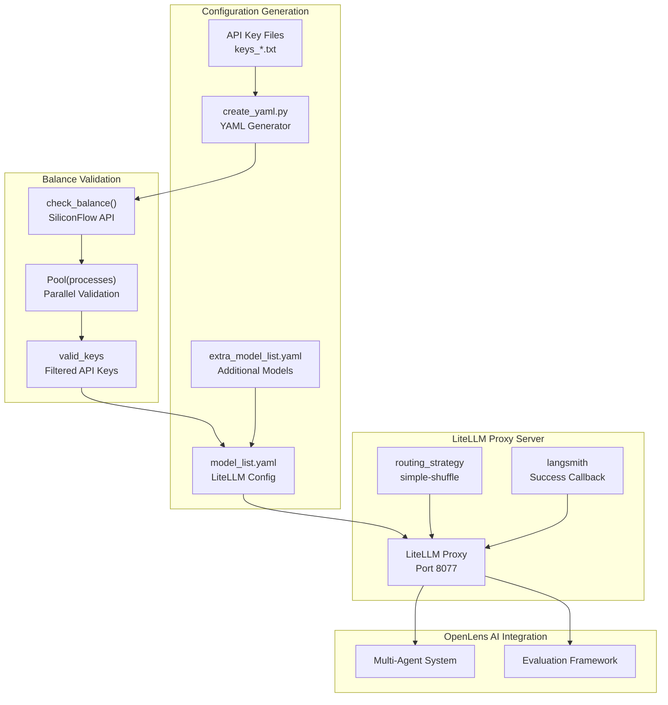
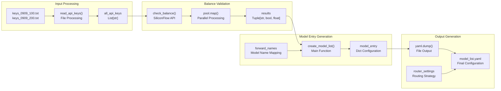
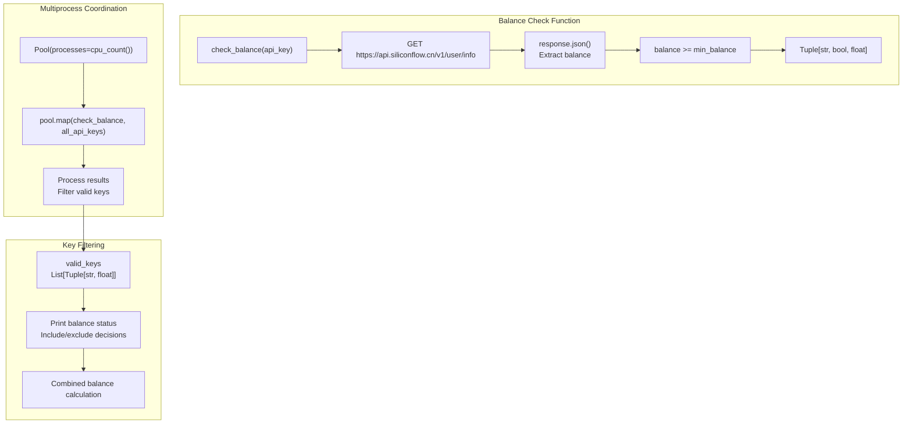

<!-- source: DeepWiki mcp.deepwiki.com · repo jarrycyx/openlens-ai · page 4 LLM Router Infrastructure · fetched 2026-10-27 -->

# LLM Router Infrastructure

<details>
<summary>Relevant source files</summary>

The following files were used as context for generating this wiki page:

- [llm_router/create_yaml.py](llm_router/create_yaml.py)
- [llm_router/proxy_update.sh](llm_router/proxy_update.sh)

</details>


The LLM Router Infrastructure provides centralized language model routing, load balancing, and API key management for OpenLens AI. This system acts as a proxy layer between the multi-agent system and external language model providers, enabling efficient distribution of requests across multiple API keys and model endpoints while maintaining high availability and performance.

For information about configuring specific models, see [Model Configuration](#4.1). For details on vLLM deployment, see [vLLM Deployment](#4.2). For performance monitoring and testing, see [Performance Testing](#4.3).

## System Architecture

The router infrastructure consists of three main components: YAML configuration generation, LiteLLM proxy server, and API key management with balance validation.

### Router Infrastructure Overview



Sources: [llm_router/create_yaml.py:1-253](), [llm_router/proxy_update.sh:1-5]()

## YAML Configuration Generation

The `create_yaml.py` script orchestrates the generation of LiteLLM configuration files by processing API key files, validating account balances, and creating model entries for each valid key-model-endpoint combination.

### Configuration Generation Workflow



Sources: [llm_router/create_yaml.py:35-56](), [llm_router/create_yaml.py:88-159]()

### Model Name Mapping

The system maintains a `forward_names` dictionary that maps internal model identifiers to simplified names used by LiteLLM:

| Internal Model Name | Forward Name |
|---------------------|--------------|
| `zai-org/GLM-4.5` | `glm-4.5` |
| `zai-org/GLM-4.5-Air` | `glm-4.5-air` |
| `zai-org/GLM-4.5V` | `glm-4.5v` |
| `Qwen/Qwen3-235B-A22B-Instruct-2507` | `qwen3-235b-a22b-instruct-2507` |
| `BAAI/bge-reranker-v2-m3` | `bge-reranker-v2-m3` |

The mapping is defined in [llm_router/create_yaml.py:20-30]() and applied during model entry generation in [llm_router/create_yaml.py:147]().

Sources: [llm_router/create_yaml.py:20-34](), [llm_router/create_yaml.py:147]()

## API Key Management and Load Balancing

The router implements sophisticated API key validation and load balancing through parallel balance checking and strategic key distribution.

### Balance Validation Process

The `check_balance()` function validates API keys by querying the SiliconFlow API endpoint and filtering keys based on minimum balance requirements:



Sources: [llm_router/create_yaml.py:58-86](), [llm_router/create_yaml.py:116-140]()

### Load Balancing Configuration

The generated configuration includes router settings that implement load balancing through `simple-shuffle` routing strategy with fallback mechanisms:

- **Routing Strategy**: `simple-shuffle` distributes requests randomly across available model instances
- **Fallbacks**: Configuration maps `glm-4.5-air` to fall back to `glm-4.5` when unavailable
- **Retry Logic**: `num_retries: 3` ensures resilience against temporary failures

The configuration is assembled in [llm_router/create_yaml.py:221-230]() and includes LangSmith integration for request tracing.

Sources: [llm_router/create_yaml.py:221-236]()

## Proxy Server Operations

The LiteLLM proxy server operates on port 8077 and serves as the central routing hub for all language model requests within OpenLens AI.

### Proxy Startup and Configuration

The `proxy_update.sh` script orchestrates the complete proxy lifecycle:

1. **Configuration Generation**: Executes `create_yaml.py` with specified API key files
2. **Proxy Launch**: Starts LiteLLM server with generated configuration
3. **Port Binding**: Binds to port 8077 for client connections

```bash
python llm_router/create_yaml.py --api-key-files llm_router/keys_0909_100.txt llm_router/keys_0909_200.txt --output llm_router/model_list.yaml
litellm --config llm_router/model_list.yaml --port 8077
```

Sources: [llm_router/proxy_update.sh:3-4]()

### Model Entry Structure

Each model entry in the generated configuration follows a standardized structure that LiteLLM uses for request routing:

```yaml
model_name: glm-4.5
litellm_params:
  model: openai/zai-org/GLM-4.5
  api_base: https://api.siliconflow.cn/v1/
  api_key: <validated_api_key>
```

This structure is generated for each combination of valid API key, model name, and API base URL in [llm_router/create_yaml.py:146-156]().

Sources: [llm_router/create_yaml.py:146-156]()

## Integration with OpenLens AI

The router infrastructure integrates seamlessly with the broader OpenLens AI system by providing a unified interface for all language model interactions.

### Client Integration Points

The router serves requests from multiple system components:

- **Multi-Agent System**: All five agents (Supervisor, Literature Reviewer, Data Analyzer, Coder, LaTeX Writer) route requests through the proxy
- **Evaluation Framework**: Parallel testing and quality assessment leverage the router for consistent model access
- **Development Environment**: Local development and testing utilize the same routing infrastructure

### Environment Configuration

The router integrates with external monitoring through environment variables:

| Variable | Purpose | Source |
|----------|---------|---------|
| `LANGSMITH_API_KEY` | Request tracing authentication | Environment |
| `LANGSMITH_PROJECT` | Project identifier for traces | Hard-coded as "litellm" |

These settings enable comprehensive request tracking and performance monitoring across the entire system.

Sources: [llm_router/create_yaml.py:231-235]()

---

