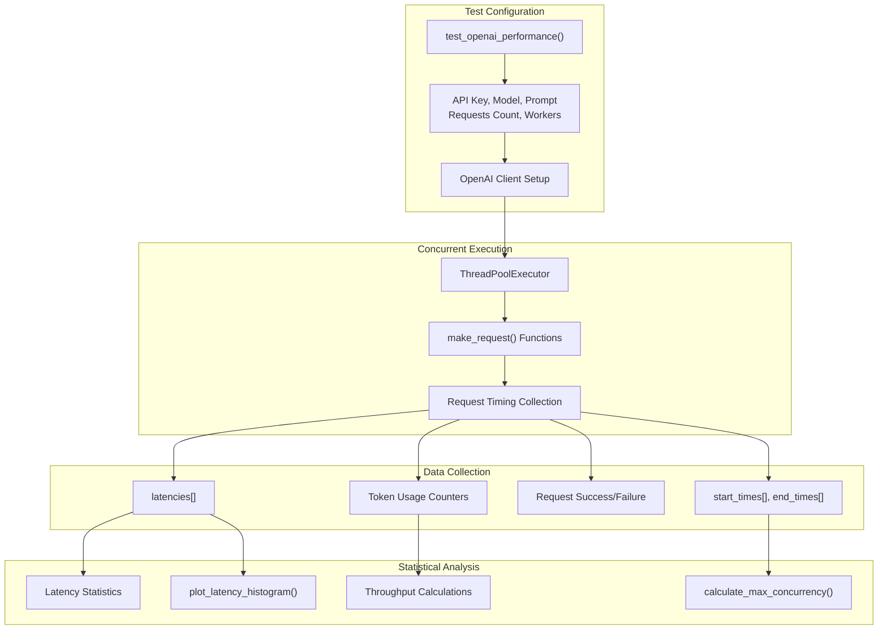
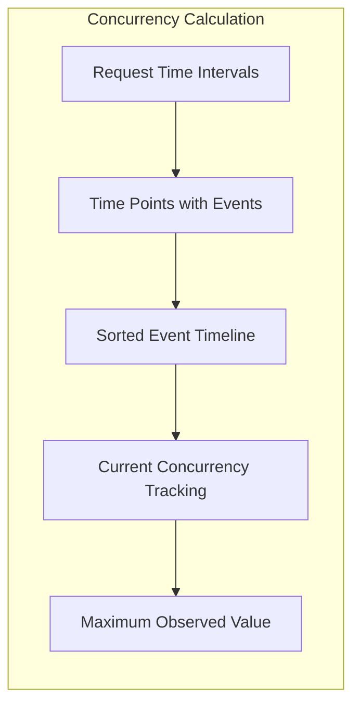
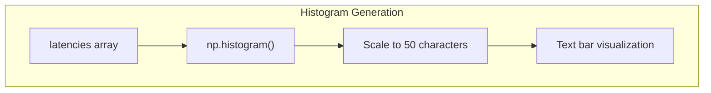

<!-- source: DeepWiki mcp.deepwiki.com · repo jarrycyx/openlens-ai · page 4.3 Performance Testing · fetched 2026-10-27 -->

# Performance Testing

<details>
<summary>Relevant source files</summary>

The following files were used as context for generating this wiki page:

- [llm_router/api_perf.py](llm_router/api_perf.py)
- [llm_router/env_api_perf.sh](llm_router/env_api_perf.sh)
- [llm_router/local_api_perf.sh](llm_router/local_api_perf.sh)

</details>


This document covers the API performance testing tools and benchmarking procedures for the LLM Router Infrastructure. The performance testing system measures latency, throughput, concurrency, and token usage statistics for OpenAI-compatible API endpoints.

For broader system evaluation and quality assessment, see [Evaluation Framework](#5). For LLM router configuration and deployment, see [Model Configuration](#4.1) and [vLLM Deployment](#4.2).

## Overview

The performance testing system provides comprehensive benchmarking capabilities for testing OpenAI-compatible API endpoints, including both external services and locally deployed vLLM instances. The testing framework measures multiple performance dimensions through concurrent request execution and statistical analysis.

## Performance Testing Workflow

The performance testing system executes concurrent API requests and collects detailed timing and usage metrics:



Sources: [llm_router/api_perf.py:8-84]()

## Key Performance Metrics

The testing framework measures comprehensive performance statistics across multiple dimensions:

### Latency Measurements

| Metric | Description | Calculation |
|--------|-------------|-------------|
| Average Latency | Mean response time | `np.mean(latencies_array)` |
| Min/Max Latency | Response time bounds | `np.min()`, `np.max()` |
| Percentile Latencies | P50, P90, P95, P99 | `np.percentile()` |

### Throughput Statistics

| Metric | Description | Formula |
|--------|-------------|---------|
| Request Throughput | Requests per second | `successful_requests / total_time` |
| Input Token TPS | Input tokens per second | `total_input_tokens / total_time` |
| Output Token TPS | Output tokens per second | `total_output_tokens / total_time` |
| Total Token TPS | Combined token throughput | `(input + output) / total_time` |

### Concurrency Analysis

The `calculate_max_concurrency()` function determines peak concurrent request handling by analyzing request overlap intervals:



Sources: [llm_router/api_perf.py:146-171](), [llm_router/api_perf.py:106-111]()

## Testing Scripts and Usage

### Environment-Based Testing

The `env_api_perf.sh` script loads configuration from environment variables:

```bash
source .env
python llm_router/api_perf.py --api-key $OPENAI_API_KEY \
    --model $MODEL \
    --base-url $BASE_URL \
    --num-requests 20 \
    --max-workers 4
```

### Local API Testing

The `local_api_perf.sh` script tests locally deployed vLLM instances:

```bash
python llm_router/api_perf.py --api-key 0 \
    --model llm \
    --base-url http://127.0.0.1:8007/v1 \
    --num-requests 20 \
    --max-workers 4
```

Sources: [llm_router/env_api_perf.sh:1-7](), [llm_router/local_api_perf.sh:1-7]()

## API Performance Testing Function

The core `test_openai_performance()` function accepts the following parameters:

| Parameter | Type | Description |
|-----------|------|-------------|
| `api_key` | str | OpenAI API authentication key |
| `model` | str | Target model name for testing |
| `prompt` | str | Test prompt content |
| `num_requests` | int | Total number of requests to send |
| `max_workers` | int | Concurrent thread pool size |
| `base_url` | str | Custom API endpoint URL |
| `api_version` | str | API version specification |
| `organization` | str | Organization identifier |

### Request Execution Process

Each request is handled by the `make_request()` function which:

1. Records start time with `time.time()`
2. Calls `client.chat.completions.create()` with specified parameters
3. Captures response timing and token usage
4. Updates global counters for statistics
5. Handles exceptions and tracks failures

Sources: [llm_router/api_perf.py:39-68]()

## Analysis and Reporting

### Statistical Output

The testing framework generates comprehensive performance reports including:

- Test duration and success rates
- Latency distribution statistics
- Throughput measurements across multiple dimensions
- Token usage analysis per request
- Maximum observed concurrency levels

### Latency Distribution Visualization

The `plot_latency_histogram()` function generates text-based histograms showing latency distribution:



Sources: [llm_router/api_perf.py:173-185](), [llm_router/api_perf.py:140-142]()

## Command Line Interface

The script provides a comprehensive CLI with the following arguments:

- `--api-key`: Required API authentication
- `--model`: Model selection (default: gpt-3.5-turbo)
- `--prompt`: Test prompt text
- `--num-requests`: Request count (default: 10)
- `--max-workers`: Concurrency level (default: 5)
- `--base-url`: Custom endpoint URL
- `--api-version`: API version specification
- `--organization`: Organization ID

Sources: [llm_router/api_perf.py:187-209]()

---

