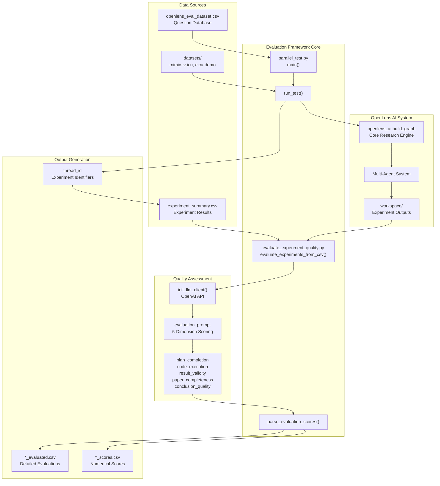
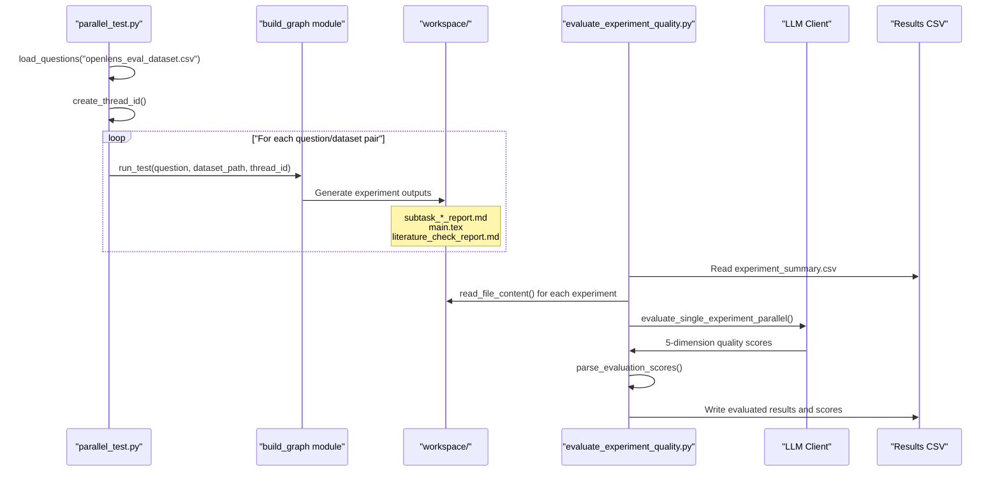
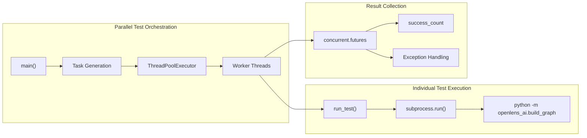
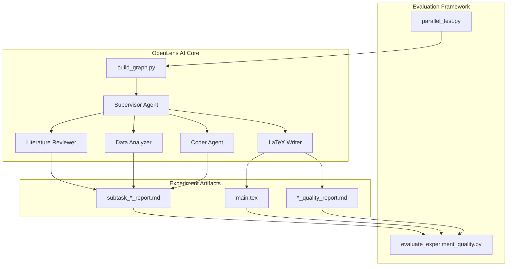

<!-- source: DeepWiki mcp.deepwiki.com · repo jarrycyx/openlens-ai · page 5 Evaluation Framework · fetched 2026-10-27 -->

# Evaluation Framework

<details>
<summary>Relevant source files</summary>

The following files were used as context for generating this wiki page:

- [exp/eval/evaluate_experiment_quality.py](exp/eval/evaluate_experiment_quality.py)
- [exp/eval/parallel_test.py](exp/eval/parallel_test.py)

</details>


The Evaluation Framework provides comprehensive testing, quality assessment, and experiment validation capabilities for the OpenLens AI system. This framework enables systematic evaluation of the multi-agent research system across multiple dimensions, datasets, and experimental conditions to ensure research quality and system reliability.

The framework consists of parallel testing infrastructure, LLM-based quality assessment, experiment tracking mechanisms, and comprehensive dataset management. For specific information about evaluation datasets, see [Evaluation Datasets](#5.1). For quality assessment methodology, see [Quality Assessment](#5.2). For parallel testing implementation, see [Parallel Testing](#5.3). For experiment tracking details, see [Experiment Tracking](#5.4).

## Architecture Overview

The evaluation framework operates as a comprehensive testing orchestration system that interfaces with the core OpenLens AI multi-agent system to validate research outputs across multiple quality dimensions.



Sources: [exp/eval/parallel_test.py:1-107](), [exp/eval/evaluate_experiment_quality.py:1-322]()

## Evaluation Workflow

The evaluation process follows a systematic pipeline that executes experiments, collects outputs, and performs multi-dimensional quality assessment.



Sources: [exp/eval/parallel_test.py:22-41](), [exp/eval/evaluate_experiment_quality.py:94-231]()

## Quality Assessment Dimensions

The framework evaluates experiments across five critical dimensions using LLM-based assessment, each scored on a 3-point scale.

| Dimension | Score Range | Assessment Focus |
|-----------|-------------|------------------|
| Plan Completion | 1-3 | Whether experimental plan was successfully executed |
| Code Execution | 1-3 | Presence of unresolved errors during code execution |
| Result Validity | 1-3 | Reasonableness and validity of experimental results |
| Paper Completeness | 1-3 | LaTeX compilation, structure, content completeness |
| Conclusion Quality | 1-3 | Effectiveness and accuracy of research conclusions |

The `parse_evaluation_scores()` function extracts these scores from LLM responses using pattern matching on structured output format:

```
1. Plan Completion Score: x/3, Reason: ...
2. Code Execution Score: x/3, Reason: ...
3. Result Validity Score: x/3, Reason: ...
4. Paper Completeness Score: x/3, Reason: ...
5. Conclusion Quality Score: x/3, Reason: ...
```

Sources: [exp/eval/evaluate_experiment_quality.py:44-91](), [exp/eval/evaluate_experiment_quality.py:160-177]()

## Parallel Execution Infrastructure

The framework implements concurrent experiment execution using Python's `concurrent.futures.ThreadPoolExecutor` to maximize throughput while maintaining system stability.



The `run_test()` function executes individual experiments by calling the main OpenLens AI system with specific parameters:

- `--question`: Research question from evaluation dataset
- `--dataset-path`: Path to medical dataset (MIMIC-IV or eICU)
- `--thread-id`: Unique identifier for experiment tracking
- `--email`: Notification email for completion alerts

Sources: [exp/eval/parallel_test.py:22-41](), [exp/eval/parallel_test.py:85-103]()

## File Structure and Data Flow

The evaluation framework operates on a structured file hierarchy that organizes experiment outputs and evaluation results.

| File Type | Purpose | Example Path |
|-----------|---------|--------------|
| Evaluation Questions | Input dataset of research questions | `exp/eval/openlens_eval_dataset.csv` |
| Experiment Summary | Tracking of completed experiments | `experiment_summary.csv` |
| Subtask Reports | Agent-specific execution reports | `workspace/subtask_*_report.md` |
| LaTeX Output | Generated research papers | `workspace/manuscript/main.tex` |
| Quality Reports | Literature and LaTeX quality assessments | `workspace/manuscript/*_quality_report.md` |
| Evaluation Results | LLM-based quality assessments | `*_evaluated.csv`, `*_scores.csv` |

The `read_file_content()` function provides robust file access with error handling for missing or corrupted experiment outputs, ensuring evaluation can proceed even with incomplete experiments.

Sources: [exp/eval/evaluate_experiment_quality.py:32-41](), [exp/eval/evaluate_experiment_quality.py:136-157]()

## Integration with Core System

The evaluation framework integrates tightly with the OpenLens AI core system through the `build_graph` module entry point, enabling systematic testing of the complete research pipeline.



The framework uses `create_thread_id()` to generate unique identifiers that combine dataset names and question identifiers, enabling precise tracking and organization of experiment results across multiple concurrent executions.

Sources: [exp/eval/parallel_test.py:43-49](), [exp/eval/parallel_test.py:74-78]()

---

