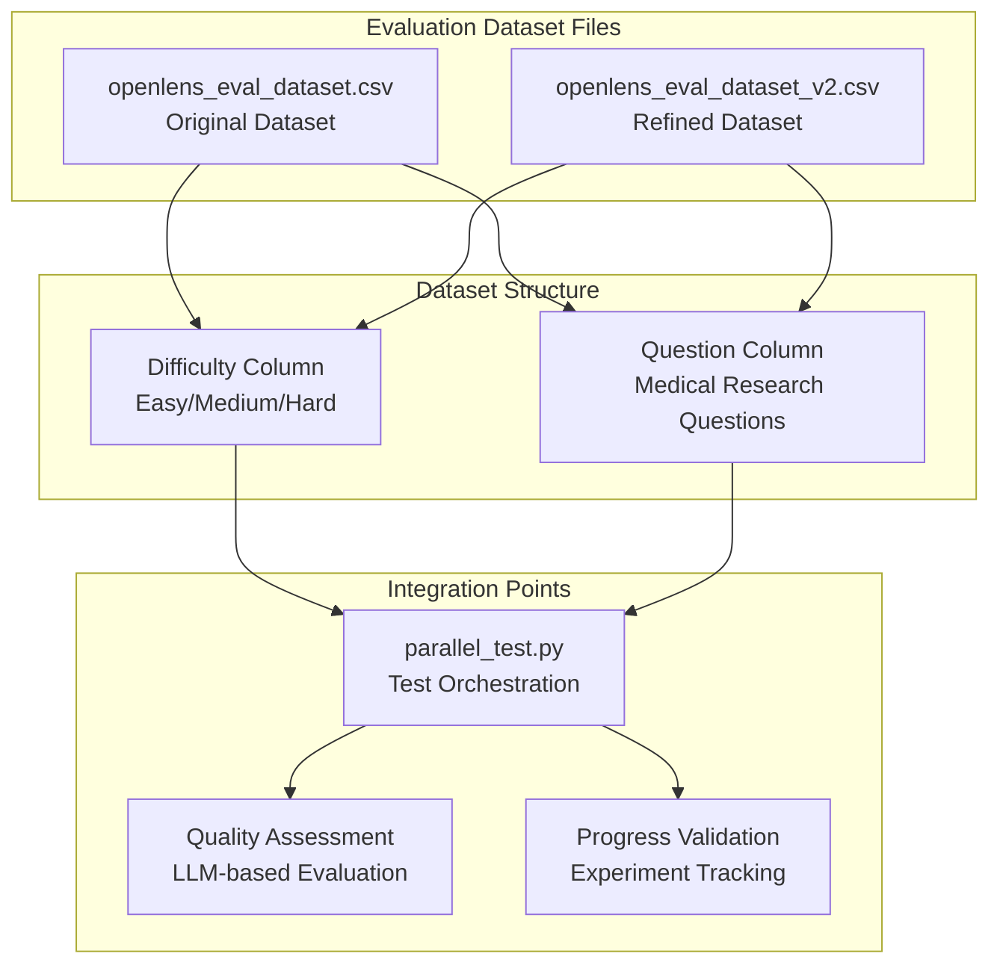
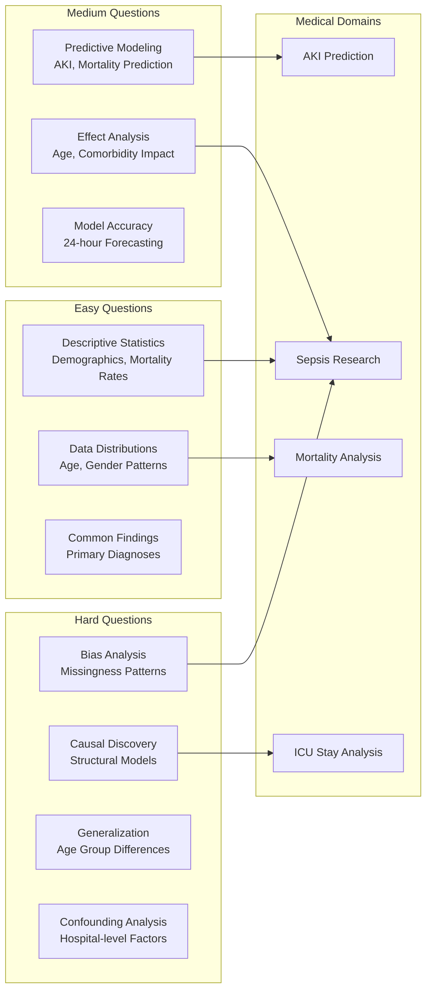
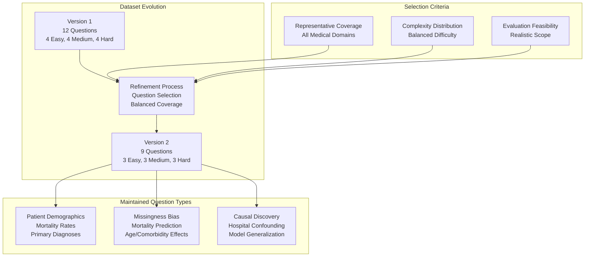
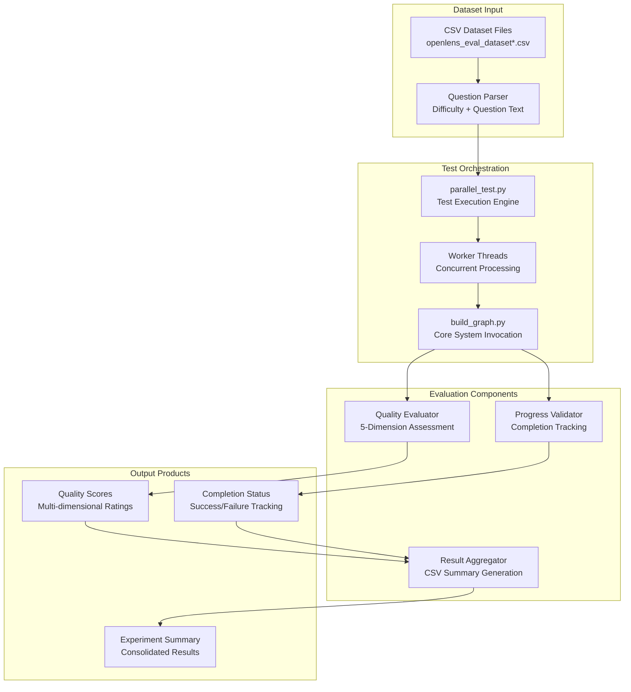
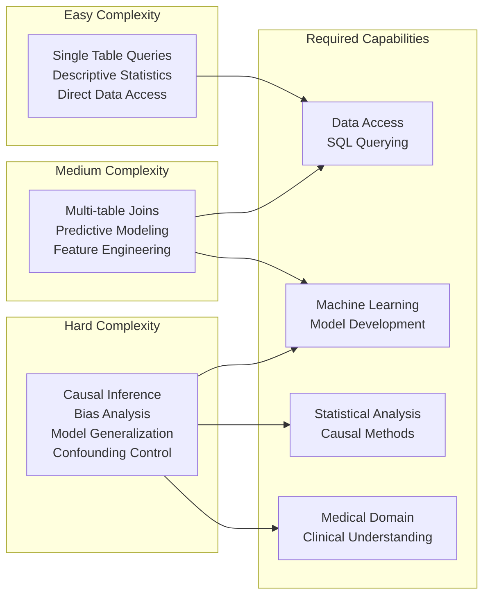

<!-- source: DeepWiki mcp.deepwiki.com · repo jarrycyx/openlens-ai · page 5.1 Evaluation Datasets · fetched 2026-10-27 -->

# Evaluation Datasets

Relevant source files

The following files were used as context for generating this wiki page:

- [exp/eval/openlens_eval_dataset.csv](exp/eval/openlens_eval_dataset.csv)
- [exp/eval/openlens_eval_dataset_v2.csv](exp/eval/openlens_eval_dataset_v2.csv)

This document covers the medical research question datasets used to evaluate OpenLens AI's autonomous research capabilities. These datasets provide structured test cases across varying difficulty levels to assess the system's ability to conduct comprehensive medical data analysis and research.

For information about how these datasets are used in quality assessment, see [Quality Assessment](#5.2). For details on parallel execution of these evaluations, see [Parallel Testing](#5.3). For experiment result tracking, see [Experiment Tracking](#5.4).

## Dataset Structure and Purpose

The evaluation datasets consist of carefully curated medical research questions designed to test different aspects of the OpenLens AI system's capabilities. These questions simulate real-world medical research scenarios and are used to validate the system's performance across multiple dimensions.

### Dataset File Organization

**Sources:** [exp/eval/openlens_eval_dataset.csv:1-14](), [exp/eval/openlens_eval_dataset_v2.csv:1-10]()

## Question Categories and Difficulty Levels

The datasets organize medical research questions into three distinct difficulty categories, each targeting different aspects of the system's analytical capabilities.

### Difficulty Classification

| Difficulty Level | Question Count (v1) | Question Count (v2) | Capability Focus |
|------------------|---------------------|---------------------|------------------|
| Easy | 4 questions | 3 questions | Basic descriptive statistics, simple queries |
| Medium | 4 questions | 3 questions | Predictive modeling, clinical outcomes |
| Hard | 4 questions | 3 questions | Causal inference, bias analysis, generalization |

### Question Type Analysis

**Sources:** [exp/eval/openlens_eval_dataset.csv:2-13](), [exp/eval/openlens_eval_dataset_v2.csv:2-9]()

## Dataset Evolution and Versions

The evaluation framework includes two versions of the dataset, reflecting iterative refinement of the evaluation criteria.

### Version Comparison

#### Original Dataset (v1)
The initial dataset contains 12 questions across three difficulty levels, providing comprehensive coverage of medical research scenarios:

**Easy Questions:**
- Average ICU length of stay for sepsis patients
- In-hospital mortality rate for pneumonia patients  
- Patient age distribution by gender
- Most common primary diagnosis at ICU admission

**Medium Questions:**
- AKI prediction accuracy using 24-hour ICU data
- 30-day mortality prediction using vital signs and lab values
- Age and comorbidity effects on sepsis mortality
- Dynamic AKI prediction using two-day historical data

**Hard Questions:**
- Lab test missingness patterns affecting sepsis prediction bias
- Generalization to older patients (>75 years)
- Causal drivers of prolonged ICU stay using structural models
- Hospital-level confounding factors in eICU mortality prediction

#### Refined Dataset (v2)
The second version reduces the question count to 9, maintaining representative coverage while streamlining evaluation:

**Sources:** [exp/eval/openlens_eval_dataset.csv:1-14](), [exp/eval/openlens_eval_dataset_v2.csv:1-10]()

## Integration with Evaluation Framework

The evaluation datasets serve as input to the broader evaluation infrastructure, enabling systematic testing of the OpenLens AI system's research capabilities.

### Evaluation Workflow Integration

**Sources:** [exp/eval/openlens_eval_dataset.csv:1-14](), [exp/eval/openlens_eval_dataset_v2.csv:1-10]()

## Medical Research Domain Coverage

The datasets comprehensively cover key areas of medical research, ensuring the evaluation framework tests diverse analytical capabilities.

### Research Domain Matrix

| Research Area | Easy Level | Medium Level | Hard Level |
|---------------|------------|--------------|------------|
| **Sepsis Analysis** | Basic mortality rates | Age/comorbidity effects | Missingness bias patterns |
| **AKI Prediction** | - | 24-hour forecasting, Dynamic prediction | - |
| **Mortality Prediction** | Pneumonia outcomes | 30-day forecasting using vitals | Generalization across age groups |
| **ICU Operations** | Length of stay statistics | - | Causal drivers of prolonged stays |
| **Demographics** | Age/gender distributions | - | - |
| **Hospital Systems** | Primary diagnoses | - | Hospital-level confounding |

### Question Complexity Characteristics

**Sources:** [exp/eval/openlens_eval_dataset.csv:2-13](), [exp/eval/openlens_eval_dataset_v2.csv:2-9]()

---

