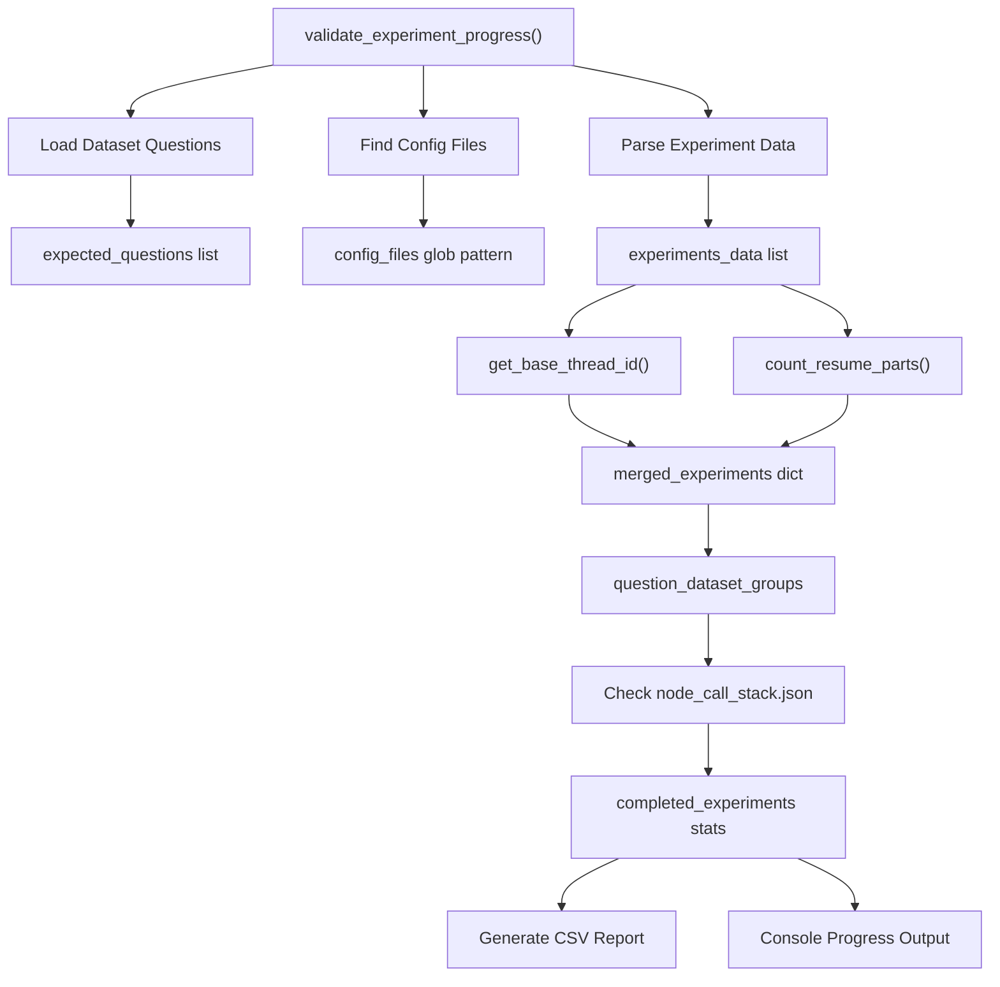
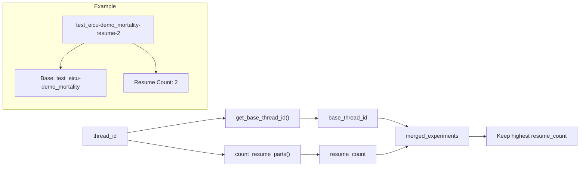
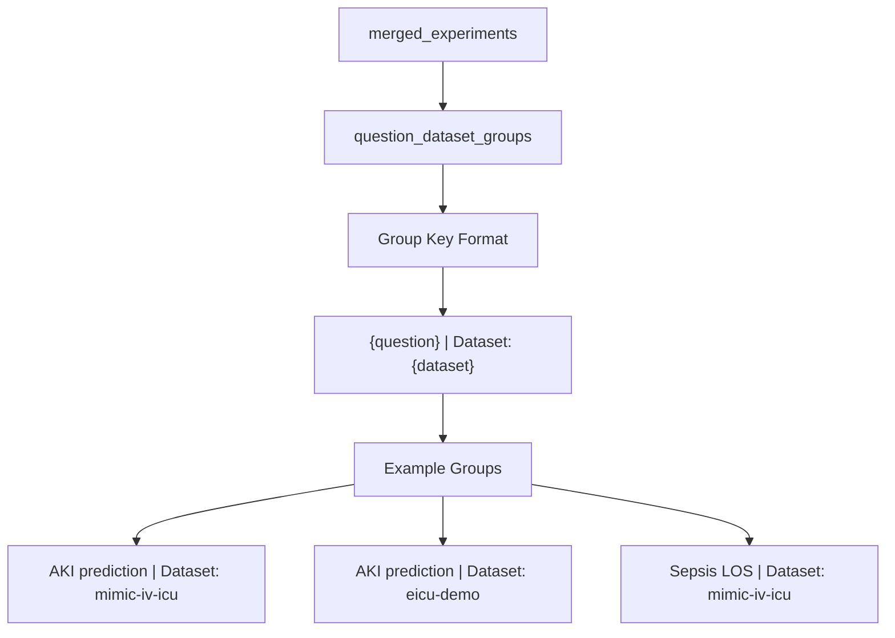
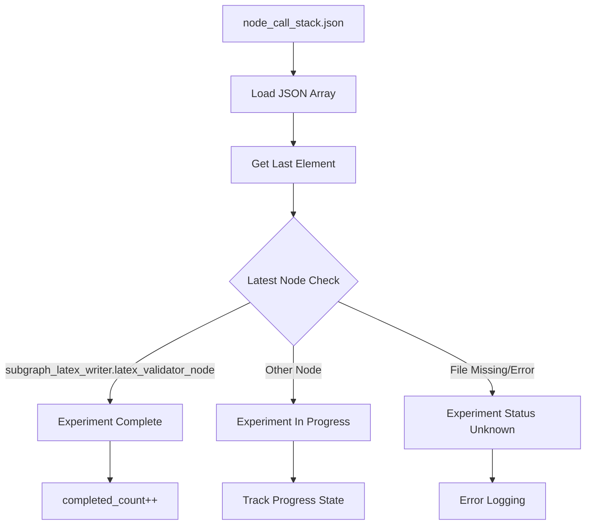
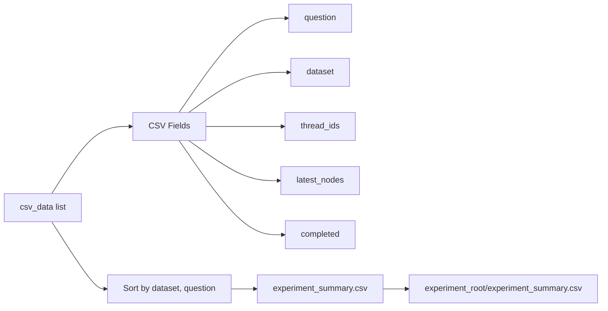
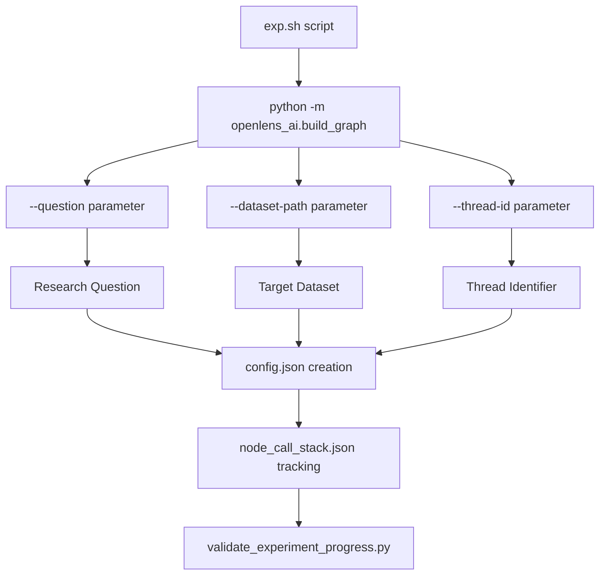

<!-- source: DeepWiki mcp.deepwiki.com · repo jarrycyx/openlens-ai · page 5.4 Experiment Tracking · fetched 2026-10-27 -->

# Experiment Tracking

<details>
<summary>Relevant source files</summary>

The following files were used as context for generating this wiki page:

- [exp/eval/validate_experiment_progress.py](exp/eval/validate_experiment_progress.py)
- [exp/exp.sh](exp/exp.sh)

</details>


This document covers the experiment tracking and progress validation system in OpenLens AI. The experiment tracking system monitors the completion status of research experiments, handles interrupted and resumed experiments, and generates comprehensive progress reports. For information about running experiments in parallel, see [Parallel Testing](#5.3). For details about experiment quality evaluation, see [Quality Assessment](#5.2).

## Purpose and Scope

The experiment tracking system provides automated monitoring and validation of research experiment progress. It tracks experiment execution across multiple datasets, handles experiment interruptions and resumptions, detects completion status, and generates detailed progress reports. The system operates on experiment outputs stored in the file system and provides both console output and CSV reports for progress analysis.

## Experiment Progress Validation

### Validation Architecture

The core validation system is implemented in the `validate_experiment_progress()` function, which orchestrates the entire tracking process.



Sources: [exp/eval/validate_experiment_progress.py:27-193]()

The validation process begins by scanning the experiment root directory for configuration files matching the pattern `**/test*/config.json`. Each configuration file contains essential experiment metadata including the research question, dataset path, and thread identifier.

### Configuration File Processing

The system extracts key information from each `config.json` file:

| Field | Purpose | Example |
|-------|---------|---------|
| `question` | Research question being investigated | "What is the prediction precision of AKI in ICU patients..." |
| `dataset_path` | Target dataset for the experiment | "datasets/mimic-iv-icu" |
| `thread_id` | Unique experiment identifier | "test_eicu-demo_How_accurately_can_30-day_mort-resume-2" |

Sources: [exp/eval/validate_experiment_progress.py:52-71]()

## Thread ID Management

### Resume Handling System

The experiment tracking system handles interrupted and resumed experiments through sophisticated thread ID parsing. When experiments are interrupted and resumed, the system appends resume suffixes to maintain execution continuity.



Sources: [exp/eval/validate_experiment_progress.py:10-24](), [exp/eval/validate_experiment_progress.py:74-80]()

The `get_base_thread_id()` function extracts the base identifier by removing resume suffixes, while `count_resume_parts()` determines how many times an experiment has been resumed. The system keeps only the most recent version of each experiment (highest resume count) to avoid duplicate tracking.

### Experiment Grouping

Experiments are grouped by the combination of research question and dataset path. This grouping enables progress tracking across different datasets for the same research question and supports comprehensive analysis of experiment coverage.



Sources: [exp/eval/validate_experiment_progress.py:81-93]()

## Completion Detection

### Node Call Stack Analysis

The system determines experiment completion by analyzing the `node_call_stack.json` file in each experiment directory. This file tracks the sequence of agent nodes executed during the research process.



Sources: [exp/eval/validate_experiment_progress.py:95-148]()

An experiment is considered complete when the latest node in the call stack is `subgraph_latex_writer.latex_validator_node`, indicating that the LaTeX writer agent has successfully validated the final research paper output.

### Progress Statistics

The system calculates completion statistics at multiple levels:

| Level | Description | Calculation |
|-------|-------------|-------------|
| Group Level | Completion within question+dataset group | `completed_count / len(experiments)` |
| Question Level | Overall progress per research question | `sum(completed_per_group) / sum(total_per_group)` |
| Dataset Level | Progress across all questions for a dataset | Aggregated from group statistics |

Sources: [exp/eval/validate_experiment_progress.py:162-181]()

## Progress Reporting

### Console Output Format

The validation system provides comprehensive console output including:

- **Execution Counts**: Number of experiments per question+dataset combination
- **Latest Node Status**: Current execution state for each experiment thread
- **Completion Summary**: Completed experiments count and percentage
- **Overall Progress**: Cross-dataset progress for each research question

Sources: [exp/eval/validate_experiment_progress.py:88-180]()

### CSV Export System

The system generates a structured CSV report containing experiment summaries:



Sources: [exp/eval/validate_experiment_progress.py:150-192]()

The CSV export includes semicolon-separated thread IDs and latest node statuses for experiments with multiple executions, enabling detailed analysis of experiment execution patterns.

## Command Line Usage

### Script Execution

The validation script can be executed directly with configurable parameters:

```bash
python exp/eval/validate_experiment_progress.py \
    --experiment-root outputs \
    --dataset-file exp/eval/openlens_eval_dataset.csv
```

### Parameter Configuration

| Parameter | Default | Purpose |
|-----------|---------|---------|
| `--experiment-root` | `outputs` | Root directory containing experiment results |
| `--dataset-file` | `exp/eval/openlens_eval_dataset.csv` | Reference dataset file for expected questions |

Sources: [exp/eval/validate_experiment_progress.py:195-211]()

The script supports flexible configuration for different experiment directory structures and dataset reference files, enabling use across various evaluation scenarios and deployment environments.

### Integration with Experiment Execution

The tracking system integrates with the experiment execution pipeline defined in shell scripts that invoke the core OpenLens AI system:



Sources: [exp/exp.sh:1-30]()

The experiment tracking system monitors the outputs generated by these execution scripts, providing comprehensive oversight of the research automation pipeline.

---

