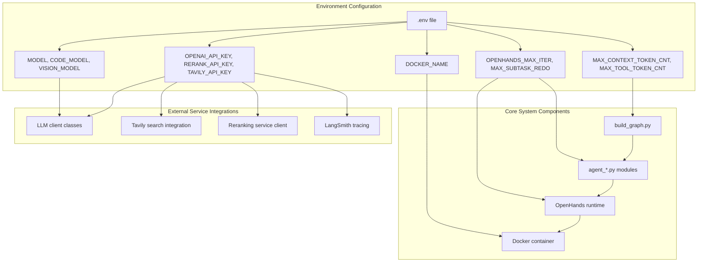
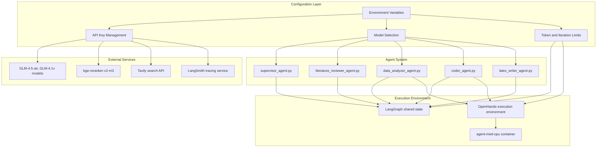

<!-- source: DeepWiki mcp.deepwiki.com · repo jarrycyx/openlens-ai · page 7 Reference · fetched 2026-10-27 -->

# Reference

Relevant source files

The following files were used as context for generating this wiki page:

- [.env.example](.env.example)
- [LICENSE](LICENSE)

This page provides comprehensive reference material for the OpenLens AI system, including configuration parameters, repository structure, and licensing information. For detailed setup instructions, see [Getting Started](#2). For specific configuration guidance during installation, see [Configuration](#2.1).

## Configuration Reference

The OpenLens AI system uses environment variables for configuration, defined in the `.env.example` template file. This section documents all available configuration parameters and their purposes.

### Core Model Configuration

The system supports multiple language models for different tasks:

| Parameter | Purpose | Example Value |
|-----------|---------|---------------|
| `MODEL` | Main language model for general tasks | `glm-4.5-air` |
| `CODE_MODEL` | Language model for code-related tasks | `glm-4.5-air` |
| `VISION_MODEL` | Vision model for image analysis | `glm-4.1v-9b-thinking` |
| `OPENAI_API_KEY` | API key for accessing language models | `<YOUR API KEY>` |
| `BASE_URL` | Base URL for model API service | `https://cloud.infini-ai.com/maas/v1/` |

Sources: [.env.example:1-5]()

### Search and Reranking Configuration

| Parameter | Purpose | Default Value |
|-----------|---------|---------------|
| `RERANK_MODEL` | Reranking model for search relevance | `bge-reranker-v2-m3` |
| `RERANK_API_KEY` | API key for reranking service | `<YOUR API KEY>` |
| `RERANK_BASE_URL` | Base URL for reranking API | `https://cloud.infini-ai.com/maas/v1/` |
| `TAVILY_API_KEY` | API key for Tavily web search | `<YOUR API KEY>` |

Sources: [.env.example:7-11]()

### Context and Token Limits

The system defines various token limits for different operations:

| Parameter | Purpose | Default Value |
|-----------|---------|---------------|
| `MAX_CONTEXT_TOKEN_CNT` | Maximum tokens for normal operations | `32000` |
| `MAX_CONTEXT_TOKEN_CNT_LARGE` | Maximum tokens for large operations | `96000` |
| `MAX_TOOL_TOKEN_CNT` | Maximum tokens in tool responses | `2000` |
| `LITERATURE_SEARCH_MIN_TOOL_CALL` | Minimum tool calls for literature search | `10` |

Sources: [.env.example:13-17]()

### Agent Execution Parameters

| Parameter | Purpose | Default Value |
|-----------|---------|---------------|
| `OPENHANDS_MAX_ITER` | Maximum OpenHands agent iterations | `100` |
| `MAX_SUBTASK_REDO` | Maximum subtask retry attempts | `2` |
| `MAX_LATEX_POLISH_ROUND` | Maximum LaTeX polishing rounds | `2` |
| `DOCKER_NAME` | Docker container name | `agent-med-cpu` |

Sources: [.env.example:19-23]()

### Optional Monitoring and Notifications

| Parameter | Purpose | Default Value |
|-----------|---------|---------------|
| `LANGSMITH_TRACING` | Enable LangSmith tracing | `true` |
| `LANGSMITH_ENDPOINT` | LangSmith service endpoint | `https://api.smith.langchain.com` |
| `LANGSMITH_PROJECT` | LangSmith project name | `openlens` |
| `LANGSMITH_API_KEY` | LangSmith API key | `<YOUR API KEY>` |
| `SMTP_SERVER` | SMTP server for notifications | `smtpdm.aliyun.com` |
| `SMTP_PORT` | SMTP server port | `25` |
| `EMAIL_USER` | Email address for notifications | `<YOUR EMAIL>` |
| `EMAIL_PASSWORD` | Email authentication password | `<YOUR EMAIL SMTP PASSWORD>` |

Sources: [.env.example:28-36]()

## Configuration to Code Entity Mapping

The following diagram shows how configuration parameters map to specific code entities in the system:

Sources: [.env.example:1-38]()

## Repository Structure Overview

The OpenLens AI repository is organized into several key directories and modules that support the multi-agent research system:

```mermaid
graph TD
    subgraph "Repository Root"
        ROOT["openlens-ai/"]
        LICENSE_FILE["LICENSE"]
        ENV_EXAMPLE[".env.example"]
        README["README.md"]
    end
    
    subgraph "Core System Modules"
        BUILD_GRAPH["build_graph.py"]
        AGENT_MODULES["agent_*.py files"]
        UTILS["utilities and helpers"]
    end
    
    subgraph "LLM Infrastructure"
        LLM_ROUTER["LLM router components"]
        MODEL_DEPLOYMENT["vLLM deployment scripts"]
        CONFIG_YAML["YAML configuration files"]
    end
    
    subgraph "Evaluation Framework"
        EVAL_SCRIPTS["evaluation scripts"]
        TEST_DATA["test datasets"]
        PARALLEL_TESTING["parallel testing tools"]
    end
    
    subgraph "Development Environment"
        DOCKER_CONFIG["Docker configurations"]
        EDITOR_CONFIG["editor settings"]
        GITHUB_CONFIG["GitHub templates and settings"]
    end
    
    ROOT --> LICENSE_FILE
    ROOT --> ENV_EXAMPLE
    ROOT --> README
    ROOT --> BUILD_GRAPH
    ROOT --> AGENT_MODULES
    ROOT --> UTILS
    ROOT --> LLM_ROUTER
    ROOT --> MODEL_DEPLOYMENT
    ROOT --> CONFIG_YAML
    ROOT --> EVAL_SCRIPTS
    ROOT --> TEST_DATA
    ROOT --> PARALLEL_TESTING
    ROOT --> DOCKER_CONFIG
    ROOT --> EDITOR_CONFIG
    ROOT --> GITHUB_CONFIG
```

Sources: [LICENSE:1-26](), [.env.example:1-38]()

## Key System Integration Points

This diagram illustrates how the major system components integrate through configuration and code entities:

Sources: [.env.example:1-38]()

## License Information

OpenLens AI is released under the MIT License, which provides broad permissions for use, modification, and distribution.

### MIT License Summary

The MIT License grants the following permissions:
- **Use**: Run the software for any purpose
- **Copy**: Make copies of the software
- **Modify**: Alter the software's source code
- **Distribute**: Share copies of the software
- **Sublicense**: Include the software in projects with different licenses
- **Sell**: Use the software commercially

### License Requirements

The license requires:
- **Copyright Notice**: Include the original copyright notice
- **License Text**: Include the full license text in substantial portions

### Disclaimer

The software is provided "AS IS" without warranty of any kind. The authors are not liable for any damages arising from the use of the software.

Sources: [LICENSE:1-26]()

## Version and Copyright Information

- **License Type**: MIT License
- **Copyright Year**: 2023
- **License File**: [`LICENSE`]()

The full license text is available in the repository root directory and must be included in any distribution of the software.

Sources: [LICENSE:1-26]()

---

