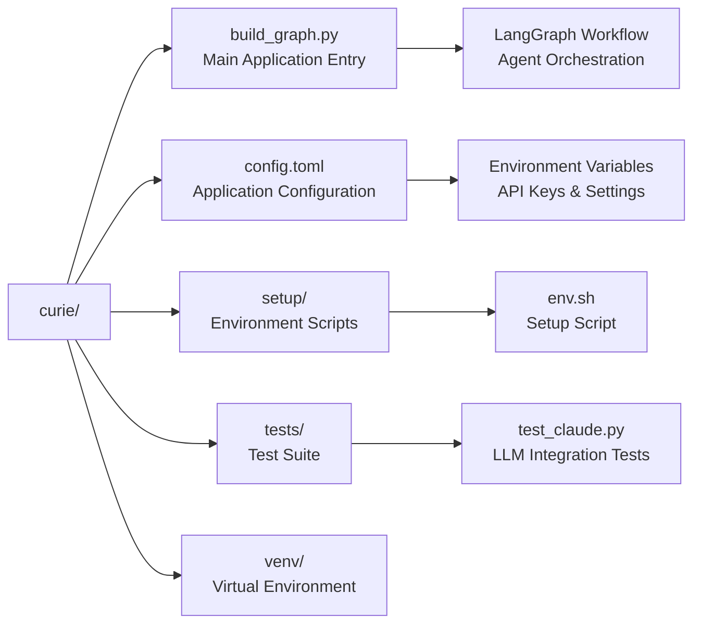
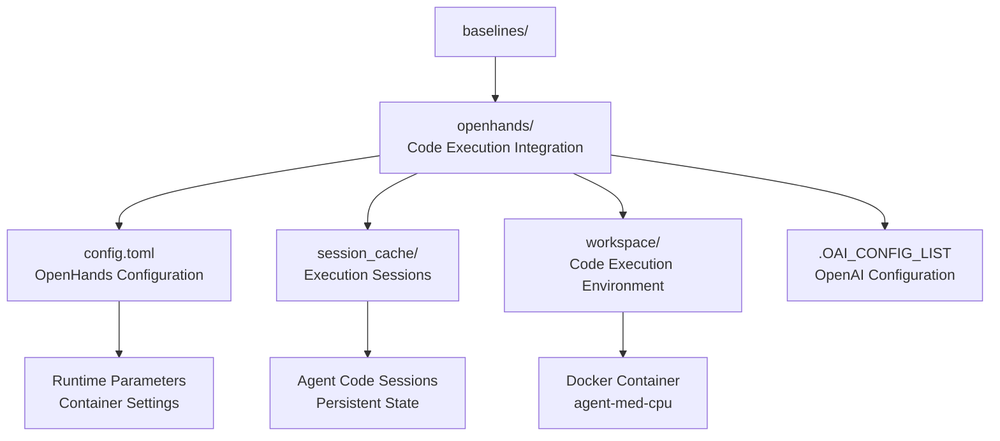
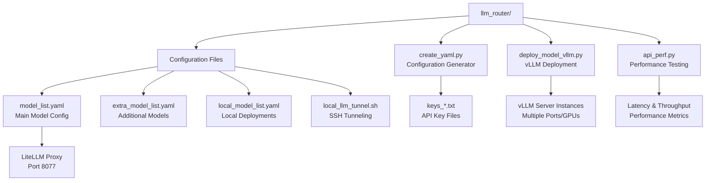
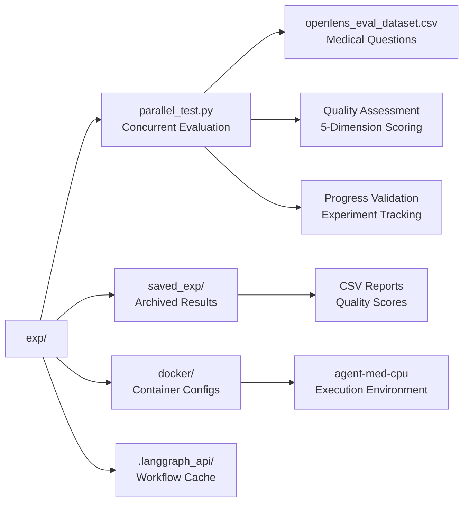
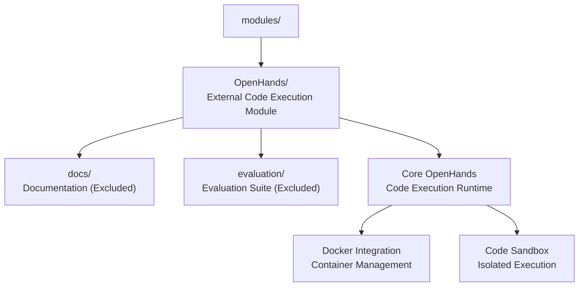
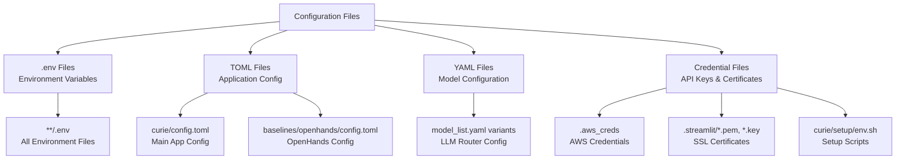
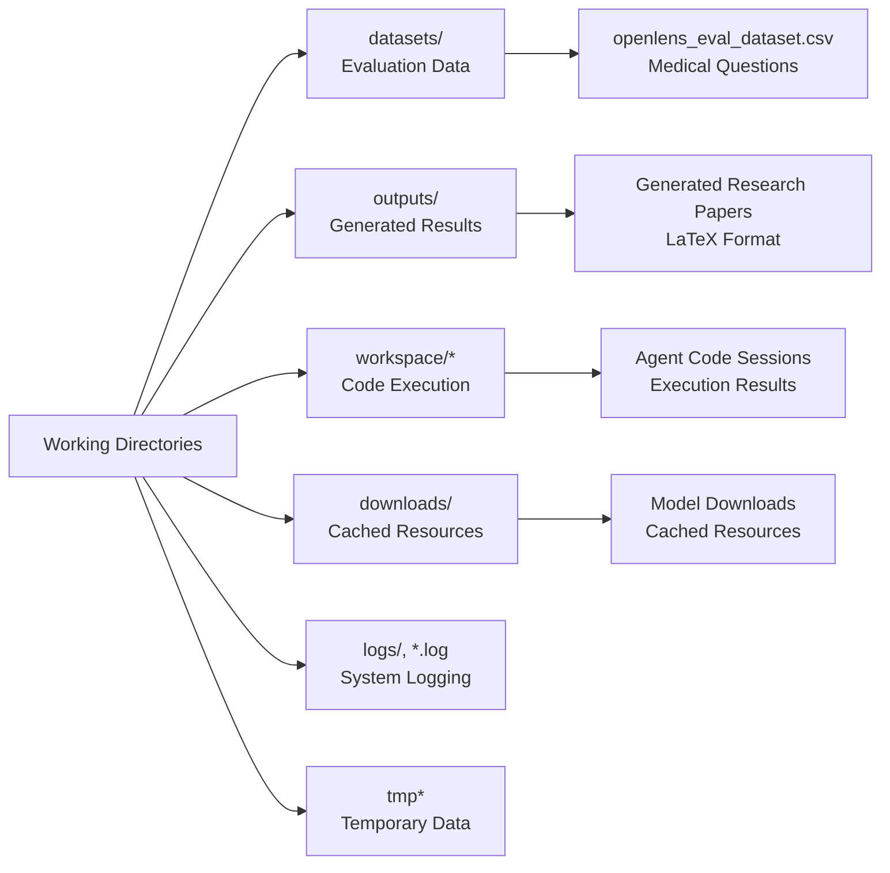
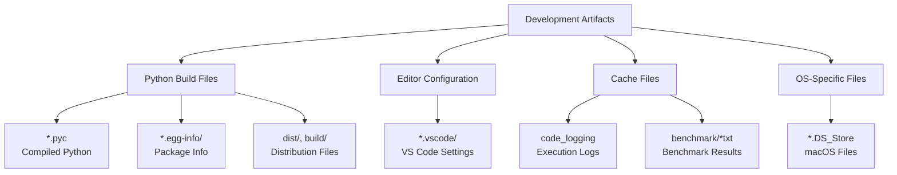
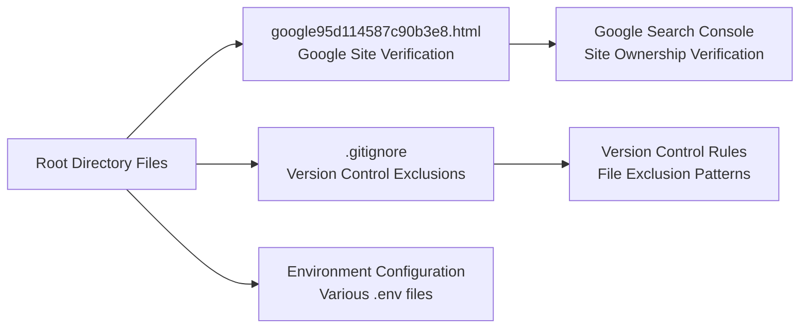

<!-- source: DeepWiki mcp.deepwiki.com · repo jarrycyx/openlens-ai · page 7.2 Repository Structure · fetched 2026-10-27 -->

# Repository Structure

Relevant source files

The following files were used as context for generating this wiki page:

- [.gitignore](.gitignore)
- [google95d114587c90b3e8.html](google95d114587c90b3e8.html)

This document provides a comprehensive reference guide to the OpenLens AI repository organization, detailing the purpose and contents of each major directory and file type. Understanding this structure is essential for navigating the codebase, contributing to development, and deploying the system.

For configuration details of specific files, see [Configuration Reference](#7.1). For development environment setup, see [Development Environment](#6).

## Directory Organization Overview

The OpenLens AI repository follows a modular architecture that separates concerns into distinct directories, each serving specific system components.

```mermaid
graph TD
    ROOT["Repository Root"] --> CURIE["curie/<br/>Main Application Package"]
    ROOT --> BASELINES["baselines/<br/>Integration Modules"]
    ROOT --> LLM_ROUTER["llm_router/<br/>Model Management"]
    ROOT --> EXP["exp/<br/>Experiments & Evaluation"]
    ROOT --> MODULES["modules/<br/>External Dependencies"]
    ROOT --> CONFIG_FILES["Configuration Files<br/>.env, .gitignore"]
    ROOT --> STREAMLIT_DIR[".streamlit/<br/>UI SSL Certificates"]
    
    CURIE --> AGENTS["Agent Implementations"]
    CURIE --> CORE["Core System Logic"]
    CURIE --> TOOLS["Integration Tools"]
    
    BASELINES --> OPENHANDS["openhands/<br/>Code Execution"]
    
    LLM_ROUTER --> DEPLOYMENT["Model Deployment Scripts"]
    LLM_ROUTER --> CONFIG_YAML["YAML Configuration Files"]
    LLM_ROUTER --> PERFORMANCE["Performance Testing"]
    
    EXP --> EVALUATION["Evaluation Scripts"]
    EXP --> DATASETS_REF["Dataset References"]
    EXP --> RESULTS["Experiment Results"]
    
    MODULES --> EXTERNAL["OpenHands Module"]
```

Sources: [.gitignore:1-62]()

## Core Application Structure

### Main Package: `curie/`

The `curie/` directory contains the primary OpenLens AI application code, implementing the multi-agent research system.

| Component | Purpose | Key Files |
|-----------|---------|-----------|
| Agent System | Multi-agent orchestration | `build_graph.py`, agent implementations |
| Configuration | Application settings | `config.toml` |
| Setup Scripts | Environment initialization | `setup/` directory |
| Test Suite | Unit and integration tests | `tests/` directory |

The `curie/` package is excluded from version control for virtual environments and build artifacts as shown in [.gitignore:12-14]().

Sources: [.gitignore:12-18]()

## Integration and Baseline Systems

### OpenHands Integration: `baselines/openhands/`

This directory contains the integration layer for OpenHands, the code execution environment used by the Coder Agent.

Key excluded files and directories from [.gitignore:19-20](), [.gitignore:28](), [.gitignore:37-38]():
- `config.toml` - Runtime configuration
- `.OAI_CONFIG_LIST` - OpenAI API credentials
- `session_cache/` - Temporary session data
- `workspace/` - Code execution workspace

Sources: [.gitignore:19-20](), [.gitignore:28](), [.gitignore:37-38]()

## LLM Router Infrastructure

### Model Management: `llm_router/`

The `llm_router/` directory implements the sophisticated language model routing and load balancing system.

Configuration files excluded from version control [.gitignore:21-24]():
- `model_list.yaml` - Primary model configuration
- `extra_model_list.yaml` - Extended model definitions
- `local_model_list.yaml` - Local model configurations
- `local_llm_tunnel.sh` - SSH tunneling script

Sources: [.gitignore:21-24]()

## Evaluation and Experimentation

### Experiment Directory: `exp/`

The `exp/` directory contains the evaluation framework, testing infrastructure, and experiment results.

| Subdirectory | Purpose | Contents |
|--------------|---------|----------|
| `saved_exp/` | Experiment archives | Historical evaluation results |
| `docker/` | Container configurations | Docker environment definitions |
| `.langgraph_api/` | LangGraph API cache | Workflow execution cache |

Excluded directories from [.gitignore:52](), [.gitignore:54-55]():
- `saved_exp/` - Experiment result archives
- `.langgraph_api/` - LangGraph API cache
- `docker/` - Docker configuration files

Sources: [.gitignore:52](), [.gitignore:54-55]()

## External Dependencies and Modules

### External Module Integration: `modules/`

The `modules/` directory contains external dependencies, primarily the OpenHands integration.

Excluded subdirectories from [.gitignore:60-61]():
- `modules/OpenHands/docs/` - Documentation files
- `modules/OpenHands/evaluation/` - Evaluation components

Sources: [.gitignore:60-61]()

## Configuration and Credentials

### Environment Configuration

The repository uses multiple configuration approaches for different components and deployment scenarios.

All environment files are excluded from version control [.gitignore:20](), [.gitignore:26-33](), [.gitignore:59]():

| File Pattern | Purpose | Location |
|--------------|---------|----------|
| `**/.env` | Environment variables | All directories |
| `.aws_creds` | AWS credentials | Repository root |
| `curie/setup/env.sh` | Setup environment script | Setup directory |
| `.streamlit/*.key, *.pem` | SSL certificates | Streamlit directory |

Sources: [.gitignore:20](), [.gitignore:26-33](), [.gitignore:59]()

## Data and Output Directories

### Working Directories

Several directories are used for runtime data, temporary files, and output generation.

| Directory | Purpose | Exclusion Reason |
|-----------|---------|------------------|
| `datasets/` | Evaluation datasets | Large data files |
| `outputs/` | Generated results | Runtime outputs |
| `workspace/` | Code execution workspace | Temporary files |
| `downloads/` | Downloaded resources | Cache files |
| `logs/`, `*.log` | System logging | Runtime logs |
| `tmp*` | Temporary files | Temporary data |

Sources: [.gitignore:1-3](), [.gitignore:7-8](), [.gitignore:39](), [.gitignore:49-53]()

## Build and Development Artifacts

### Excluded Development Files

The repository excludes various development artifacts and build outputs to keep the repository clean.

Excluded patterns from [.gitignore:6](), [.gitignore:13-14](), [.gitignore:36](), [.gitignore:40-45]():
- `*.pyc` - Compiled Python bytecode
- `curie.egg-info/`, `curie_ai.egg-info/` - Python package metadata
- `dist/`, `build/` - Build distribution files
- `*.vscode/` - VS Code configuration
- `*.DS_Store` - macOS system files
- `code_logging/` - Code execution logs

Sources: [.gitignore:6](), [.gitignore:13-14](), [.gitignore:36](), [.gitignore:40-45]()

## Special Files

### Web and Verification Files

The repository includes web-related configuration and verification files in the root directory.

The `google95d114587c90b3e8.html` file contains Google site verification for web deployment [google95d114587c90b3e8.html:1]().

Sources: [google95d114587c90b3e8.html:1](), [.gitignore:1-62]()

---

