# Page: Overview

# Overview

<details>
<summary>Relevant source files</summary>

The following files were used as context for generating this wiki page:

- [README.md](README.md)
- [modules.md](modules.md)

</details>


This document provides a comprehensive overview of OpenLens AI, a fully autonomous research agent designed for health informatics research. The system coordinates multiple specialized agents to conduct end-to-end research workflows including literature review, data analysis, experiment design, code execution, and academic paper generation.

For detailed agent implementations, see [Multi-Agent System](#3). For setup and configuration instructions, see [Getting Started](#2). For deployment and model management details, see [LLM Router Infrastructure](#4).

## Purpose and Scope

OpenLens AI transforms a single research question and dataset into complete research outputs without manual intervention. The system autonomously:

- Conducts comprehensive literature reviews across academic databases
- Analyzes medical datasets and generates statistical reports  
- Designs and executes computational experiments
- Generates publication-ready LaTeX research papers
- Manages complex workflows through multi-agent coordination

The core workflow accepts a research question string and dataset path as inputs via [openlens_ai/build_graph.py](), then orchestrates five specialized agents through LangGraph state management to produce research deliverables.

Sources: [README.md:37-40](), [modules.md:1-13]()

## System Architecture

OpenLens AI implements a multi-agent architecture where specialized agents communicate through shared state managed by LangGraph. The system integrates with external AI services, code execution environments, and academic databases to enable autonomous research workflows.

### Core System Components

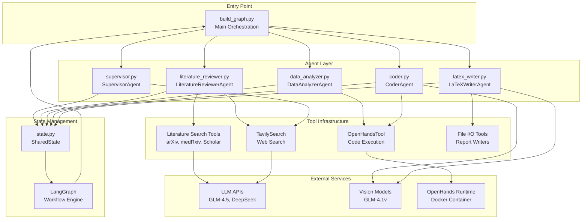

Sources: [README.md:176-197](), [modules.md:5-13](), [openlens_ai/build_graph.py]()

### Agent Workflow Orchestration

The system implements a state-driven workflow where agents operate on shared context and coordinate through LangGraph routing decisions. Each agent specializes in distinct research phases while maintaining access to accumulated knowledge and artifacts.

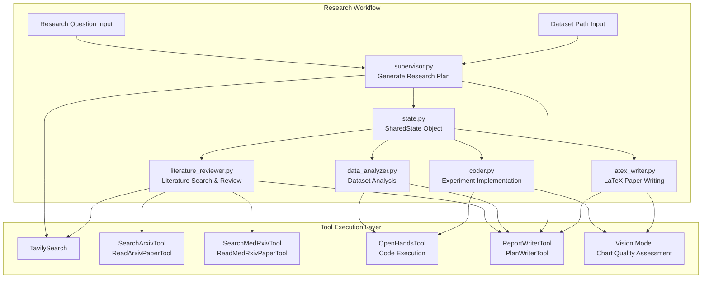

Sources: [modules.md:199-209](), [README.md:184-196]()

## Core Components

### Multi-Agent Coordination

The system implements five specialized agents in [openlens_ai/agents/]() that communicate through a `SharedState` object defined in [openlens_ai/state.py](). Each agent focuses on specific research tasks:

| Agent | Implementation | Primary Function |
|-------|---------------|------------------|
| `SupervisorAgent` | [supervisor.py]() | Research planning and coordination |
| `LiteratureReviewerAgent` | [literature_reviewer.py]() | Academic paper search and analysis |
| `DataAnalyzerAgent` | [data_analyzer.py]() | Dataset processing and statistical analysis |
| `CoderAgent` | [coder.py]() | Experiment implementation and validation |
| `LaTeXWriterAgent` | [latex_writer.py]() | Academic paper generation |

Sources: [modules.md:5-13](), [README.md:176-183]()

### LangGraph Workflow Engine

Workflow orchestration uses LangGraph to manage agent transitions and shared state. The main coordination logic resides in [openlens_ai/build_graph.py]() which constructs the agent graph and handles routing between specialized tasks.

The `SharedState` class maintains:
- Research question context
- Current subtask progression  
- Agent message histories
- Intermediate artifacts and reports
- Tool execution results

Sources: [modules.md:209](), [openlens_ai/state.py]()

### Tool Infrastructure

Agents access external capabilities through standardized tool interfaces in [openlens_ai/tools/](). Key tool categories include:

- **Literature Search**: `SearchArxivTool`, `SearchMedRxivTool`, `ReadArxivPaperTool`, `ReadMedRxivPaperTool`
- **Web Search**: `TavilySearch` for general information retrieval
- **Code Execution**: `OpenHandsTool` for sandboxed Python execution
- **File Operations**: `ReportWriterTool`, `PlanWriterTool` for artifact generation

Sources: [modules.md:66-73](), [modules.md:214-220](), [README.md:184-196]()

## External Service Integration

### Language Model APIs

The system integrates with multiple LLM providers configured through environment variables in [.env](). Primary models include:
- `MODEL="glm-4.5-air"` for general language tasks
- `CODE_MODEL="glm-4.5-air"` for code generation
- `VISION_MODEL="glm-4.1v-9b-thinking"` for visual analysis
- `RERANK_MODEL="bge-reranker-v2-m3"` for search result reranking

Sources: [README.md:115-125]()

### Code Execution Environment

The `OpenHandsTool` executes code in isolated Docker containers using the OpenHands runtime. The container environment is configured through `DOCKER_NAME=agent-med-cpu` and provides a sandboxed Python environment for data analysis and experiment execution.

Sources: [README.md:137](), [README.md:53]()

### Academic Database Access

Literature search capabilities connect to multiple academic databases:
- arXiv API for preprint access
- medRxiv API for medical preprints  
- Google Scholar for citation searches
- Tavily API for general web search

Sources: [README.md:189-196](), [modules.md:66-72]()

## User Interfaces

### Command Line Interface

Direct execution through [openlens_ai/build_graph.py]() accepts research questions and dataset paths:

```bash
python -m openlens_ai.build_graph --question "Your research question" --dataset-path "path/to/dataset" --thread-id "unique_job_id"
```

### Web Interface

Interactive Streamlit application launched via [start_app.py]() provides browser-based access at `http://localhost:8501` for workflow monitoring and interaction.

Sources: [README.md:155-172]()

## Configuration Management

System configuration centralizes in [.env]() with key parameters:
- `MAX_CONTEXT_TOKEN_CNT=32000` for standard context limits
- `MAX_CONTEXT_TOKEN_CNT_LARGE=96000` for extended operations  
- `OPENHANDS_MAX_ITER=100` for code execution limits
- `MAX_LATEX_POLISH_ROUND=2` for paper refinement cycles

Sources: [README.md:112-151]()

---

# Page: System Architecture

# System Architecture

<details>
<summary>Relevant source files</summary>

The following files were used as context for generating this wiki page:

- [README.md](README.md)
- [modules.md](modules.md)

</details>


This document provides a comprehensive technical overview of OpenLens AI's multi-agent architecture, workflow orchestration, and component integration. It covers the core system design, agent collaboration mechanisms, state management, and external service dependencies.

For implementation details of individual agents, see [Multi-Agent System](#3). For configuration and deployment specifics, see [Configuration](#2.1) and [LLM Router Infrastructure](#4).

## Architecture Overview

OpenLens AI implements a sophisticated multi-agent research automation system built on LangGraph workflow orchestration. The system coordinates five specialized agents through shared state management to conduct autonomous medical research from literature review through paper generation.

### Core System Components

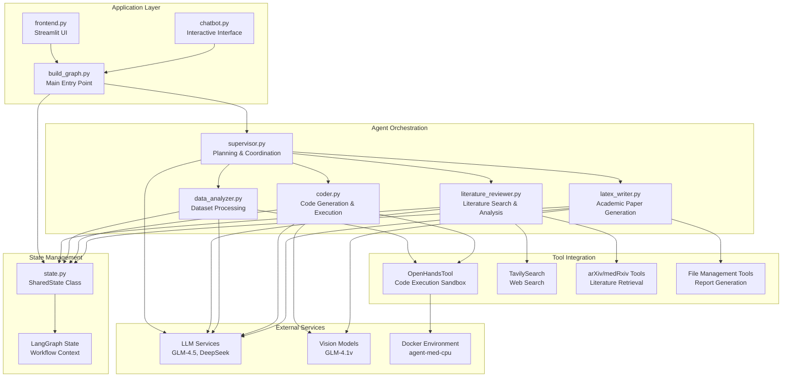

**Sources:** [README.md:174-197](), [build_graph.py](), [modules.md:1-15]()

## Multi-Agent Workflow Architecture

The system implements a coordinated multi-agent workflow where each agent has specific responsibilities and communicates through the shared state managed by LangGraph.

### Agent Interaction Flow

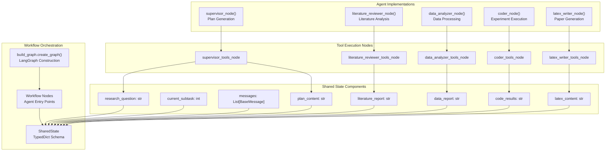

**Sources:** [build_graph.py](), [state.py](), [modules.md:199-210]()

## Agent Specialization and Responsibilities

Each agent in the system has distinct responsibilities and utilizes specific tools to accomplish its tasks.

| Agent | Primary Function | Key Tools | Output Artifacts |
|-------|------------------|-----------|------------------|
| `supervisor.py` | Research planning and coordination | `PlanWriterTool`, `PlanReaderTool`, `TavilySearch` | `plan.md` |
| `literature_reviewer.py` | Academic literature analysis | `SearchArxivTool`, `SearchMedRxivTool`, `ReadArxivPaperTool`, `ReadMedRxivPaperTool` | `literature_report.md` |
| `data_analyzer.py` | Dataset processing and analysis | `OpenHandsTool`, `ReportWriterTool` | `data_show.md`, `data_report.md` |
| `coder.py` | Experiment code generation and execution | `OpenHandsTool`, Vision-Language Model validation | Code files, experimental results |
| `latex_writer.py` | Academic paper generation | `LatexWriterTool`, PDF quality assessment | LaTeX documents, compiled PDFs |

**Sources:** [modules.md:16-196](), [README.md:177-183]()

## State Management and Orchestration

The system uses LangGraph for workflow orchestration with a centralized state management approach that enables agent coordination and context sharing.

### State Schema Definition

The `SharedState` class in [state.py]() defines the complete state structure:

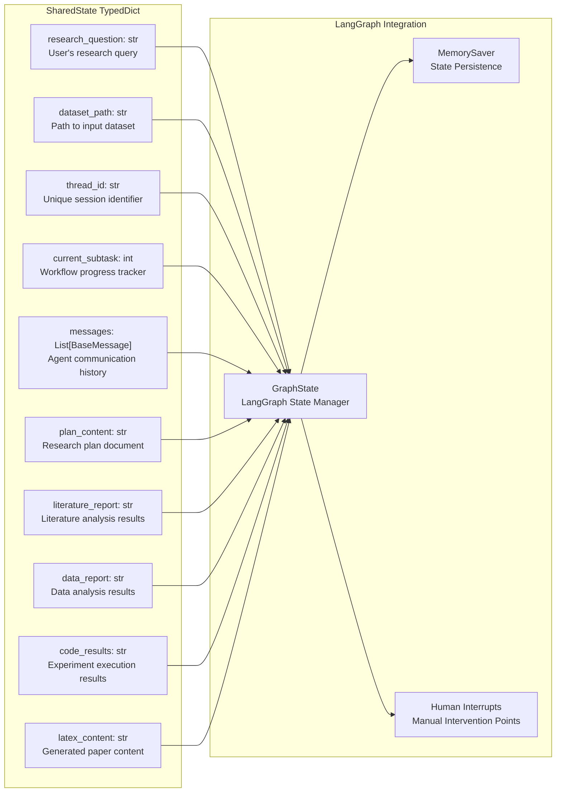

**Sources:** [state.py](), [build_graph.py]()

## Tool Integration Architecture

The system integrates multiple specialized tools that agents use to accomplish their tasks. Each tool provides specific capabilities for different aspects of the research workflow.

### Tool Ecosystem

```mermaid
graph TB
    subgraph "Literature Research Tools"
        search_arxiv["SearchArxivTool<br/>arXiv paper discovery"]
        read_arxiv["ReadArxivPaperTool<br/>arXiv content extraction"]
        search_medrxiv["SearchMedRxivTool<br/>medRxiv paper discovery"]
        read_medrxiv["ReadMedRxivPaperTool<br/>medRxiv content extraction"]
        tavily["TavilySearch<br/>General web search"]
    end
    
    subgraph "Code Execution Environment"
        openhands["OpenHandsTool<br/>Sandboxed code execution"]
        docker_runtime["Docker Container<br/>agent-med-cpu image"]
        file_ops["File Operations<br/>Code and data management"]
    end
    
    subgraph "Document Generation Tools"
        plan_writer["PlanWriterTool<br/>Research plan creation"]
        plan_reader["PlanReaderTool<br/>Plan retrieval"]
        report_writer["ReportWriterTool<br/>Report generation"]
        latex_writer["LatexWriterTool<br/>Academic paper creation"]
    end
    
    subgraph "Quality Assessment Tools"
        vlm_assess["Vision-Language Model<br/>Chart quality evaluation"]
        pdf_validator["PDF Quality Validator<br/>Document assessment"]
        rerank_service["BGE Reranker<br/>Search result optimization"]
    end
    
    search_arxiv --> lit_reviewer
    read_arxiv --> lit_reviewer
    search_medrxiv --> lit_reviewer
    read_medrxiv --> lit_reviewer
    tavily --> lit_reviewer
    tavily --> supervisor
    
    openhands --> data_analyzer
    openhands --> coder
    docker_runtime --> openhands
    file_ops --> openhands
    
    plan_writer --> supervisor
    plan_reader --> supervisor
    report_writer --> data_analyzer
    latex_writer --> latex_writer_agent["latex_writer"]
    
    vlm_assess --> coder
    vlm_assess --> latex_writer_agent
    pdf_validator --> latex_writer_agent
    rerank_service --> lit_reviewer
```

**Sources:** [README.md:184-196](), [modules.md:214-221](), [openlens_ai/tools/]()

## Workflow Execution Model

The system implements a structured workflow execution model that coordinates agent activities through defined phases and routing logic.

### Execution Flow Control

The workflow execution follows a deterministic pattern managed by LangGraph with conditional routing between agents based on task completion and quality assessment.

| Phase | Agent | Entry Point | Routing Logic | Next Phase |
|-------|-------|-------------|---------------|------------|
| Planning | `supervisor` | `supervisor_node()` | Plan exists check | Literature Review |
| Literature Review | `literature_reviewer` | `literature_reviewer_node()` | Minimum tool calls reached | Data Analysis |
| Data Analysis | `data_analyzer` | `data_analyzer_node()` | Data report generated | Code Execution |
| Code Execution | `coder` | `coder_node()` | Code validation passed | Paper Generation |
| Paper Generation | `latex_writer` | `latex_writer_node()` | Quality assessment | Completion |

**Routing Functions:**
- `supervisor_router()` - Determines planning completion
- `literature_reviewer_router()` - Controls literature review phase
- `data_analyzer_router()` - Manages data analysis workflow  
- `coder_router()` - Handles code execution routing
- `latex_writer_router()` - Controls paper generation flow

**Sources:** [build_graph.py](), [modules.md:42-49, 79-84, 116-117, 152-153, 195-196]()

## External Service Dependencies

The system relies on several external services for LLM capabilities, search functionality, and specialized processing.

### Service Integration Points

| Service Category | Provider | Configuration | Usage |
|-----------------|----------|---------------|-------|
| Language Models | Infini AI Cloud, DeepSeek | `MODEL`, `CODE_MODEL`, `OPENAI_API_KEY`, `BASE_URL` | Text generation, code generation |
| Vision Models | GLM-4.1v | `VISION_MODEL` | Chart quality assessment, PDF validation |
| Search Services | Tavily API | `TAVILY_API_KEY` | Web search, literature discovery |
| Reranking | BGE Reranker | `RERANK_MODEL`, `RERANK_API_KEY` | Search result optimization |
| Code Execution | Docker | `DOCKER_NAME` | Sandboxed code execution environment |
| Monitoring | LangSmith | `LANGSMITH_API_KEY`, `LANGSMITH_PROJECT` | Workflow tracing and debugging |

**Sources:** [README.md:112-151](), [.env.example]()

---

# Page: Getting Started

# Getting Started

<details>
<summary>Relevant source files</summary>

The following files were used as context for generating this wiki page:

- [.env.example](.env.example)
- [README.md](README.md)

</details>


This document provides step-by-step instructions for installing, configuring, and running OpenLens AI for the first time. It covers the essential setup process from initial installation through executing your first research workflow.

For detailed configuration options and parameters, see [Configuration](#2.1). For development environment setup including OpenHands integration, see [Development Environment](#6).

## Prerequisites

OpenLens AI requires the following components to be installed on your system:

| Component | Version | Purpose |
|-----------|---------|---------|
| Python | 3.9+ | Core runtime environment |
| Docker | Latest | OpenHands code execution sandbox |
| Git | Latest | Repository cloning and version control |

### Required API Keys

The system integrates with several external services that require API keys:

| Service | Required For | Environment Variable |
|---------|--------------|---------------------|
| LLM Provider (e.g., Infini AI, DeepSeek) | Core language model operations | `OPENAI_API_KEY` |
| Reranking Service | Literature search result optimization | `RERANK_API_KEY` |
| Tavily Search | Web search and literature discovery | `TAVILY_API_KEY` |

**Optional Services:**

| Service | Purpose | Environment Variable |
|---------|---------|---------------------|
| LangSmith | Workflow tracing and debugging | `LANGSMITH_API_KEY` |
| SMTP Server | Email notifications | `EMAIL_USER`, `EMAIL_PASSWORD` |

## Installation Workflow

### Docker Environment Setup

OpenLens AI uses Docker containers for secure code execution through OpenHands integration.

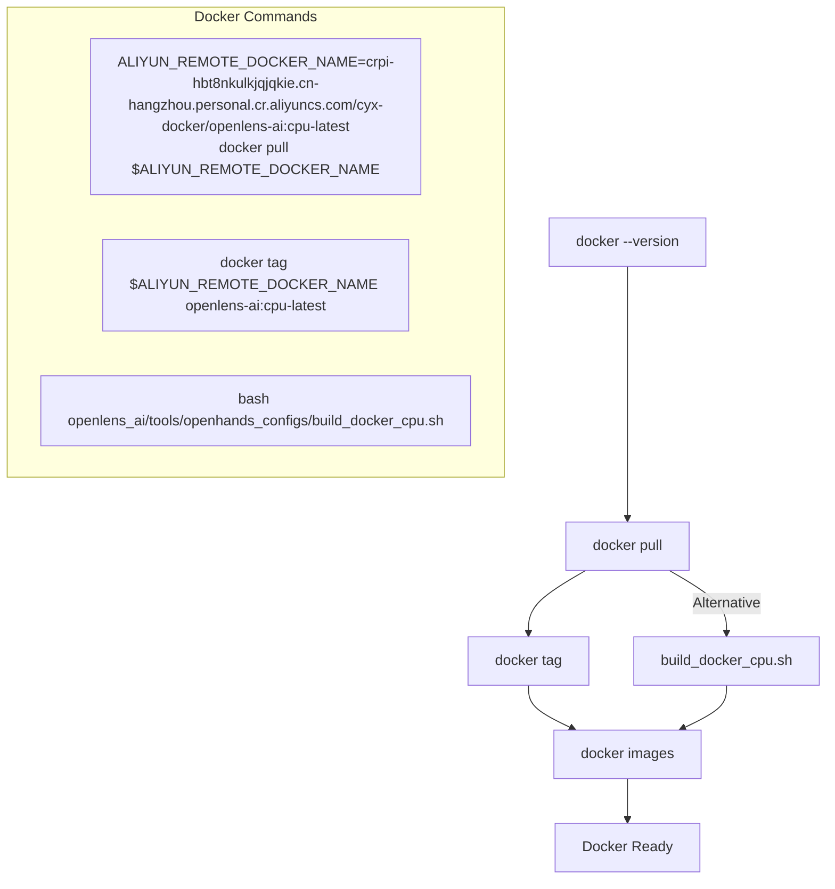

**Docker Setup Commands:**

Sources: [README.md:74-85]()

```bash
# Verify Docker installation
docker --version

# Pull pre-built Docker image
ALIYUN_REMOTE_DOCKER_NAME=crpi-hbt8nkulkjqjqkie.cn-hangzhou.personal.cr.aliyuncs.com/cyx-docker/openlens-ai:cpu-latest
docker pull $ALIYUN_REMOTE_DOCKER_NAME
docker tag $ALIYUN_REMOTE_DOCKER_NAME openlens-ai:cpu-latest

# Alternative: Build from source
bash openlens_ai/tools/openhands_configs/build_docker_cpu.sh
```

### Python Environment Setup

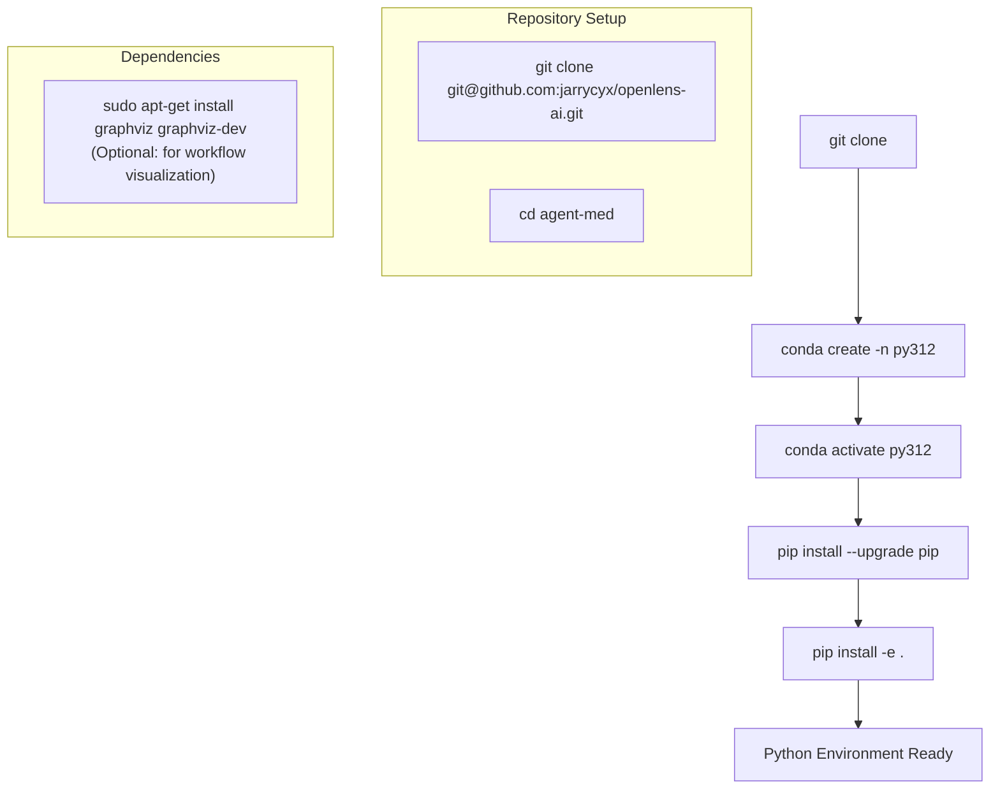

**Installation Commands:**

Sources: [README.md:87-102]()

```bash
# Clone repository
git clone git@github.com:jarrycyx/openlens-ai.git
cd agent-med

# Create Python environment
conda create -n py312 python=3.12
conda activate py312

# Install dependencies
pip install --upgrade pip
pip install -e .

# Optional: Install graphviz for workflow visualization
sudo apt-get install graphviz graphviz-dev
```

## Configuration Setup

### Environment File Creation

The configuration process involves copying and customizing the environment template:

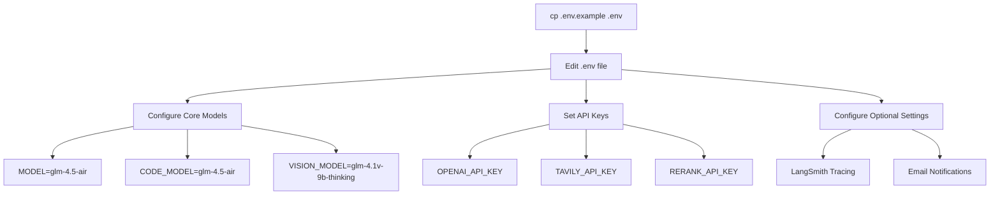

**Configuration Steps:**

Sources: [.env.example:1-38](), [README.md:104-151]()

```bash
# Create configuration file
cp .env.example .env
```

### Core Configuration Parameters

Edit the `.env` file with the following essential parameters:

| Parameter | Example Value | Description |
|-----------|---------------|-------------|
| `MODEL` | `"glm-4.5-air"` | Primary language model for general tasks |
| `CODE_MODEL` | `"glm-4.5-air"` | Language model for code generation |
| `VISION_MODEL` | `"glm-4.1v-9b-thinking"` | Vision model for image analysis |
| `OPENAI_API_KEY` | `"<YOUR API KEY>"` | API key for language model access |
| `BASE_URL` | `"https://cloud.infini-ai.com/maas/v1/"` | API service base URL |
| `TAVILY_API_KEY` | `"<YOUR API KEY>"` | Tavily search service key |
| `DOCKER_NAME` | `"agent-med-cpu"` | Docker container name |

### Advanced Configuration Parameters

| Parameter | Default Value | Purpose |
|-----------|---------------|---------|
| `MAX_CONTEXT_TOKEN_CNT` | `32000` | Normal operation context limit |
| `MAX_CONTEXT_TOKEN_CNT_LARGE` | `96000` | Large operation context limit |
| `OPENHANDS_MAX_ITER` | `100` | Maximum OpenHands execution iterations |
| `MAX_SUBTASK_REDO` | `2` | Maximum subtask retry attempts |
| `MAX_LATEX_POLISH_ROUND` | `2` | LaTeX document polishing rounds |

Sources: [.env.example:13-24]()

## First Execution

### Command Line Interface

OpenLens AI provides a command-line interface through the `build_graph` module:

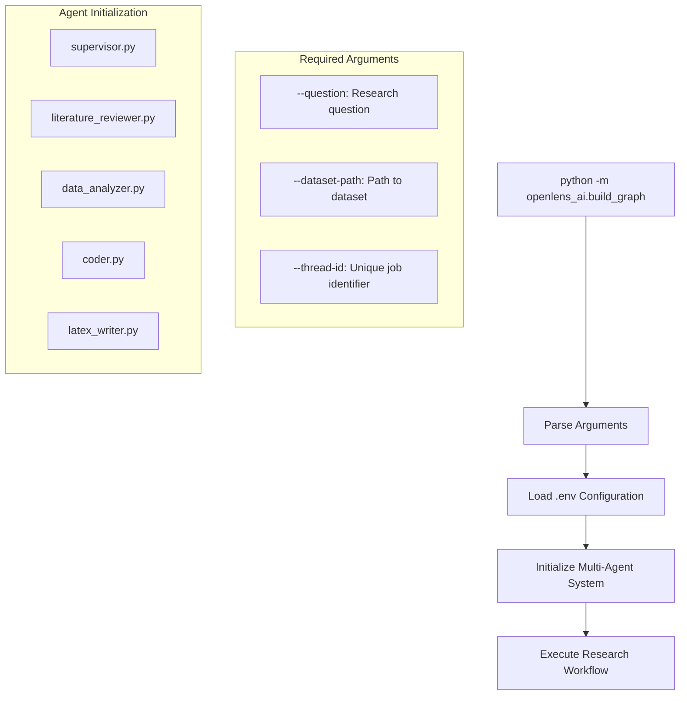

**Basic Usage:**

Sources: [README.md:155-164]()

```bash
python -m openlens_ai.build_graph \
    --question "Your research question" \
    --dataset-path "path/to/dataset" \
    --thread-id "unique_job_id"
```

**Example Execution:**

```bash
python -m openlens_ai.build_graph \
    --question "What is the prediction precision of AKI based on historical 2 day data?" \
    --dataset-path "datasets/mimic" \
    --thread-id "test_000"
```

### Web Interface

For interactive usage, OpenLens AI provides a Streamlit-based web interface:

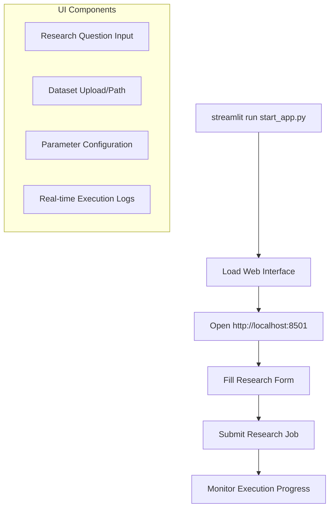

**Web Interface Startup:**

Sources: [README.md:167-172]()

```bash
streamlit run start_app.py
```

Then navigate to `http://localhost:8501` in your web browser.

## Verification Steps

### System Health Check

After installation, verify that all components are working correctly:

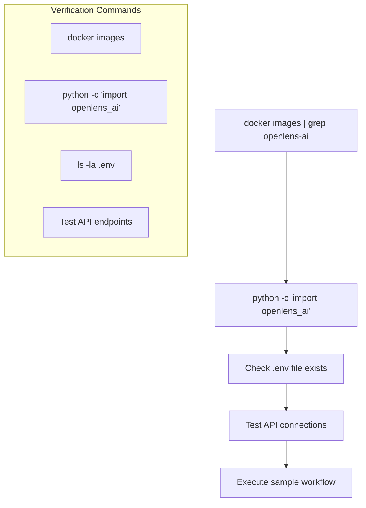

**Verification Commands:**

```bash
# Verify Docker image
docker images | grep openlens-ai

# Verify Python package installation
python -c "import openlens_ai; print('Installation successful')"

# Check configuration file
ls -la .env

# Test with a simple question
python -m openlens_ai.build_graph \
    --question "Test question" \
    --dataset-path "." \
    --thread-id "health_check"
```

### Common Configuration Issues

| Issue | Symptom | Solution |
|-------|---------|----------|
| Missing API keys | Authentication errors | Verify all required API keys in `.env` |
| Docker not running | Container startup failures | Ensure Docker daemon is running |
| Python version | Import errors | Confirm Python 3.9+ is being used |
| Missing dependencies | Module not found errors | Re-run `pip install -e .` |

## Next Steps

After successful installation and configuration:

1. **Explore the Multi-Agent System**: Learn about the five specialized agents in [Multi-Agent System](#3)
2. **Configure Advanced Settings**: Customize model parameters and execution limits in [Configuration](#2.1)
3. **Set up Development Environment**: For code contributions, see [Development Environment](#6)
4. **Run Evaluation Tests**: Validate your setup using the evaluation framework in [Evaluation Framework](#5)

Sources: [README.md:1-259](), [.env.example:1-38]()

---

# Page: Configuration

# Configuration

<details>
<summary>Relevant source files</summary>

The following files were used as context for generating this wiki page:

- [.env.example](.env.example)
- [.setup/env.sh](.setup/env.sh)
- [.streamlit/config.toml](.streamlit/config.toml)
- [langgraph.json](langgraph.json)

</details>


This document provides comprehensive guidance for configuring OpenLens AI's environment variables, external service integrations, and system parameters. Configuration controls the system's connections to AI models, search services, monitoring tools, and execution environments.

For information about model-specific configuration files and YAML generation, see [Model Configuration](#4.1). For development environment setup details, see [Installation](#2.2).

## Configuration Overview

OpenLens AI's configuration system uses environment variables to manage connections to external services, model parameters, and system behavior. The primary configuration mechanism is through `.env` files that define API endpoints, authentication credentials, and operational parameters.

### Configuration Architecture

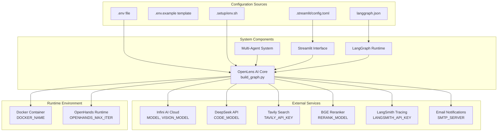

Sources: [.env.example:1-38](), [.setup/env.sh:1-4](), [.streamlit/config.toml:1-3](), [langgraph.json:1-9]()

## Environment Variables

### AI Model Configuration

The system requires configuration for three primary model types, each serving specific roles in the multi-agent workflow.

| Variable | Purpose | Example Value | Required |
|----------|---------|---------------|----------|
| `MODEL` | Main language model for general tasks | `glm-4.5-air` | Yes |
| `CODE_MODEL` | Model for code generation and analysis | `glm-4.5-air` | Yes |
| `VISION_MODEL` | Model for image and chart analysis | `glm-4.1v-9b-thinking` | Yes |
| `OPENAI_API_KEY` | API key for model access | `<YOUR API KEY>` | Yes |
| `BASE_URL` | Model API endpoint | `https://cloud.infini-ai.com/maas/v1/` | Yes |

The `MODEL` variable controls the primary language model used by the Supervisor Agent, Literature Reviewer Agent, Data Analyzer Agent, and LaTeX Writer Agent. The `CODE_MODEL` specifically serves the Coder Agent for code generation and execution tasks. The `VISION_MODEL` enables quality assessment of generated charts and LaTeX documents.

Sources: [.env.example:1-5]()

### Search and Reranking Services

OpenLens AI integrates with external search and reranking services to enhance literature review and information retrieval capabilities.

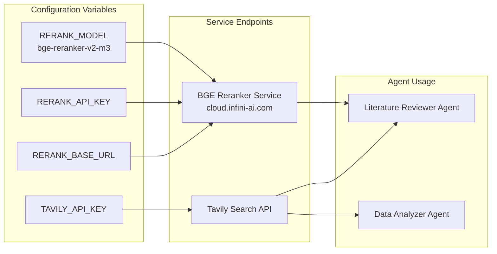

Sources: [.env.example:7-11]()

### System Parameters

#### Token Limits and Processing Control

| Variable | Purpose | Default Value | Description |
|----------|---------|---------------|-------------|
| `MAX_CONTEXT_TOKEN_CNT` | Normal operation token limit | 32000 | Context window for standard tasks |
| `MAX_CONTEXT_TOKEN_CNT_LARGE` | Large operation token limit | 96000 | Extended context for complex analysis |
| `MAX_TOOL_TOKEN_CNT` | Tool response token limit | 2000 | Maximum tokens in tool call responses |
| `LITERATURE_SEARCH_MIN_TOOL_CALL` | Minimum search iterations | 10 | Required tool calls for literature review |

These parameters control the system's token usage and ensure efficient resource utilization across different operation types.

Sources: [.env.example:13-17]()

#### Execution and Retry Logic

| Variable | Purpose | Default Value | Description |
|----------|---------|---------------|-------------|
| `OPENHANDS_MAX_ITER` | OpenHands iteration limit | 100 | Maximum execution steps in code sandbox |
| `MAX_SUBTASK_REDO` | Subtask retry limit | 2 | Maximum retries for failed subtasks |
| `MAX_LATEX_POLISH_ROUND` | LaTeX refinement cycles | 2 | Rounds of document quality improvement |

The `OPENHANDS_MAX_ITER` variable directly controls the execution behavior in [build_graph.py]() where the OpenHands agent operates within the Docker container specified by `DOCKER_NAME`.

Sources: [.env.example:19-23]()

### Runtime Environment

#### Docker Configuration

The `DOCKER_NAME` variable specifies the container environment for code execution:

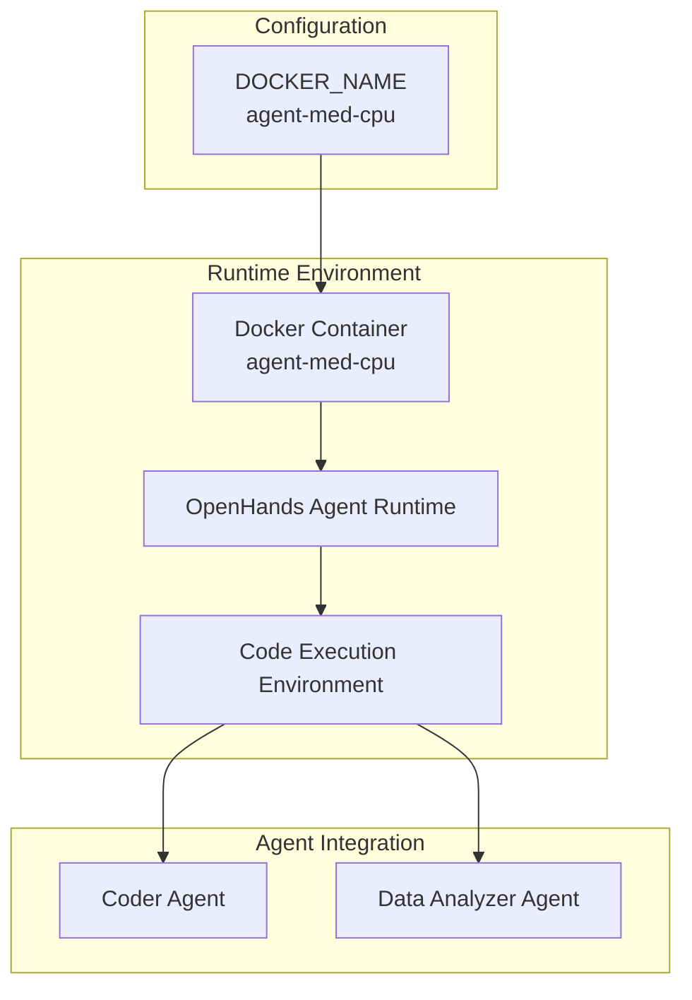

Sources: [.env.example:23]()

## Optional Services Configuration

### Monitoring and Tracing

LangSmith integration provides comprehensive tracing and monitoring capabilities for the multi-agent workflow:

| Variable | Purpose | Example Value |
|----------|---------|---------------|
| `LANGSMITH_TRACING` | Enable tracing | `true` |
| `LANGSMITH_ENDPOINT` | Service endpoint | `https://api.smith.langchain.com` |
| `LANGSMITH_PROJECT` | Project identifier | `openlens` |
| `LANGSMITH_API_KEY` | Authentication key | `<YOUR API KEY>` |

When enabled, LangSmith traces agent interactions, tool calls, and workflow progression throughout the research process.

Sources: [.env.example:28-31]()

### Email Notifications

SMTP configuration enables automated notifications for experiment completion and system events:

| Variable | Purpose | Example Value |
|----------|---------|---------------|
| `SMTP_SERVER` | Mail server address | `smtpdm.aliyun.com` |
| `SMTP_PORT` | Server port | `25` |
| `EMAIL_USER` | Sender email address | `<YOUR EMAIL>` |
| `EMAIL_PASSWORD` | SMTP authentication | `<YOUR EMAIL SMTP PASSWORD>` |

These settings are used by the evaluation framework for experiment completion notifications and error reporting.

Sources: [.env.example:33-36]()

## Alternative Configuration Files

### DeepSeek Integration

The [.setup/env.sh:1-4]() file provides an alternative configuration for using DeepSeek models directly:

```bash
export MODEL="deepseek/deepseek-chat"
export DEEPSEEK_API_KEY="sk-e55d833c6ea540e085469a84b0b11960"
export DEEPSEEK_API_BASE="https://api.deepseek.com/"
```

This configuration bypasses the Infini AI proxy and connects directly to DeepSeek's API endpoints.

Sources: [.setup/env.sh:1-4]()

### Streamlit SSL Configuration

The [.streamlit/config.toml:1-3]() file configures SSL certificates for the web interface:

```toml
[server]
sslCertFile = '.streamlit/app.openlens.icu.pem'
sslKeyFile = '.streamlit/app.openlens.icu.key'
```

This enables HTTPS access to the Streamlit-based user interface with proper SSL encryption.

Sources: [.streamlit/config.toml:1-3]()

### LangGraph Runtime Configuration

The [langgraph.json:1-9]() file defines the LangGraph deployment configuration:

```json
{
  "dependencies": ["."],
  "graphs": {
    "agent": "./start_graph.py:graph"
  },
  "env": ".env",
  "image_distro": "wolfi"
}
```

This configuration specifies the graph entry point at `start_graph.py:graph`, the environment file location, and the base image distribution for containerized deployment.

Sources: [langgraph.json:1-9]()

## Configuration Validation

The system expects all required environment variables to be properly set before initialization. Missing or invalid configuration values will prevent the multi-agent system from starting correctly. The [.env.example:1-38]() file serves as the authoritative template for all required and optional configuration parameters.

Configuration values are loaded during system startup and used throughout the agent lifecycle for API authentication, service routing, and operational parameter enforcement.

Sources: [.env.example:1-38]()

---

# Page: Installation

# Installation

<details>
<summary>Relevant source files</summary>

The following files were used as context for generating this wiki page:

- [README.md](README.md)
- [modules/OpenHands/.devcontainer/devcontainer.json](modules/OpenHands/.devcontainer/devcontainer.json)
- [modules/OpenHands/.devcontainer/setup.sh](modules/OpenHands/.devcontainer/setup.sh)

</details>


This document provides step-by-step instructions for installing and setting up OpenLens AI on your local development environment. It covers Docker environment configuration, Python dependency management, and API service configuration required for the multi-agent research system.

For information about configuration file details and environment variables, see [Configuration](#2.1). For setting up the development environment with OpenHands integration, see [Development Environment](#6).

## Prerequisites

OpenLens AI requires several external dependencies and services to function properly. The following components must be available before installation:

| Component | Version Requirement | Purpose |
|-----------|-------------------|---------|
| Python | 3.9 or higher | Core runtime environment |
| Docker | Latest stable | OpenHands code execution sandbox |
| API Keys | Various services | LLM services and search functionality |

### Required API Services

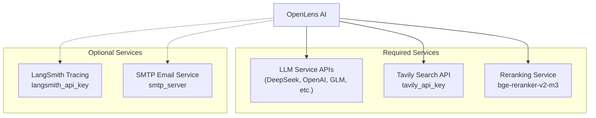

**Installation Prerequisites**
- LLM API access (DeepSeek, OpenAI, GLM-4.5, or compatible service)
- Tavily search API key for literature search functionality
- Docker Engine with sufficient disk space for medical dataset containers

Sources: [README.md:64-71]()

## Docker Environment Setup

OpenLens AI uses Docker containers for isolated code execution through the OpenHands integration. The system requires a specific Docker image optimized for medical data analysis tasks.

### Docker Installation Verification

```bash
docker --version
```

### OpenLens AI Docker Image Setup

The system provides two options for obtaining the required Docker image:

#### Option 1: Pull Pre-built Image (Recommended)

```bash
# Pull from Aliyun container registry
ALIYUN_REMOTE_DOCKER_NAME=crpi-hbt8nkulkjqjqkie.cn-hangzhou.personal.cr.aliyuncs.com/cyx-docker/openlens-ai:cpu-latest
docker pull $ALIYUN_REMOTE_DOCKER_NAME
docker tag $ALIYUN_REMOTE_DOCKER_NAME openlens-ai:cpu-latest
```

#### Option 2: Build Local Image

```bash
# Build Docker image from source
bash openlens_ai/tools/openhands_configs/build_docker_cpu.sh
```

The Docker container uses the name `agent-med-cpu` as specified in the `DOCKER_NAME` environment variable and provides an isolated execution environment for the `coder` agent's code generation and testing operations.

Sources: [README.md:74-85]()

## Python Environment Setup

### Repository Clone

```bash
git clone git@github.com:jarrycyx/openlens-ai.git
cd agent-med
```

### Virtual Environment Creation

OpenLens AI supports multiple Python environment managers:

```bash
# Using conda (recommended)
conda create -n py312 python=3.12
conda activate py312

# Alternative: using venv
python -m venv openlens-env
source openlens-env/bin/activate  # Linux/Mac
# openlens-env\Scripts\activate   # Windows
```

### Dependency Installation

```bash
# Upgrade pip to latest version
pip install --upgrade pip

# Install OpenLens AI in development mode
pip install -e .
```

### Optional: Graphviz Installation

For workflow visualization capabilities:

```bash
# Ubuntu/Debian
sudo apt-get install graphviz graphviz-dev

# macOS
brew install graphviz

# Windows
# Download from https://graphviz.org/download/
```

The graphviz dependency enables the system to generate visual representations of the multi-agent workflow graphs managed by the LangGraph orchestration system.

Sources: [README.md:87-102]()

## Environment Configuration

### Configuration File Setup

```bash
cp .env.example .env
# Edit .env with your API keys and model settings
```

### Core Configuration Parameters

The `.env` file contains essential configuration for the multi-agent system:

```mermaid
graph TB
    subgraph "Model Configuration"
        MODEL["MODEL=glm-4.5-air<br/>Main LLM for general tasks"]
        CODE_MODEL["CODE_MODEL=glm-4.5-air<br/>LLM for code generation"]
        VISION_MODEL["VISION_MODEL=glm-4.1v-9b-thinking<br/>VLM for image analysis"]
    end
    
    subgraph "API Configuration"
        OPENAI_API_KEY["OPENAI_API_KEY<br/>LLM service authentication"]
        BASE_URL["BASE_URL=https://cloud.infini-ai.com/maas/v1/<br/>Model API endpoint"]
        TAVILY_API_KEY["TAVILY_API_KEY<br/>Search service authentication"]
    end
    
    subgraph "Runtime Configuration"
        MAX_CONTEXT["MAX_CONTEXT_TOKEN_CNT=32000<br/>Context window limits"]
        OPENHANDS_ITER["OPENHANDS_MAX_ITER=100<br/>Code execution limits"]
        DOCKER_NAME["DOCKER_NAME=agent-med-cpu<br/>Container specification"]
    end
    
    MODEL --> supervisor_agent["supervisor.py"]
    CODE_MODEL --> coder_agent["coder.py"]
    VISION_MODEL --> latex_writer["latex_writer.py"]
    
    OPENAI_API_KEY --> llm_client["LLM Client Initialization"]
    TAVILY_API_KEY --> search_tools["Literature Search Tools"]
    DOCKER_NAME --> openhands_runtime["OpenHands Runtime"]
```

### Required Environment Variables

| Variable | Purpose | Example Value |
|----------|---------|---------------|
| `MODEL` | Primary LLM for agents | `glm-4.5-air` |
| `OPENAI_API_KEY` | LLM service authentication | `sk-xxx...` |
| `BASE_URL` | Model API endpoint | `https://cloud.infini-ai.com/maas/v1/` |
| `TAVILY_API_KEY` | Literature search service | `tvly-xxx...` |
| `DOCKER_NAME` | OpenHands container name | `agent-med-cpu` |

### Optional Configuration Parameters

| Variable | Purpose | Default |
|----------|---------|---------|
| `LANGSMITH_TRACING` | Enable workflow tracing | `false` |
| `SMTP_SERVER` | Email notification server | None |
| `MAX_CONTEXT_TOKEN_CNT` | Context window size | `32000` |
| `OPENHANDS_MAX_ITER` | Code execution iterations | `100` |

Sources: [README.md:110-151]()

## Installation Verification

### Basic System Check

Verify the installation by running a simple test:

```bash
python -c "import openlens_ai; print('Installation successful')"
```

### Docker Container Verification

```bash
# Verify Docker image is available
docker images | grep openlens-ai

# Expected output:
# openlens-ai    cpu-latest    <image-id>    <time>    <size>
```

### Environment Configuration Test

```bash
# Test environment variable loading
python -c "
from openlens_ai.utils.env import load_env_vars
config = load_env_vars()
print(f'Model: {config.get(\"MODEL\")}')
print(f'Docker: {config.get(\"DOCKER_NAME\")}')
"
```

### OpenHands Integration Test

```bash
# Verify OpenHands can access the Docker container
python -c "
import docker
client = docker.from_env()
containers = client.containers.list()
print('Docker client accessible')
"
```

## Running the Application

After successful installation, OpenLens AI can be launched in two modes:

### Command Line Interface

```bash
python -m openlens_ai.build_graph \
  --question "Your research question" \
  --dataset-path "path/to/dataset" \
  --thread-id "unique-job-id"
```

### Interactive Web Interface

```bash
streamlit run start_app.py
```

Access the web interface at `http://localhost:8501` for interactive research session management.

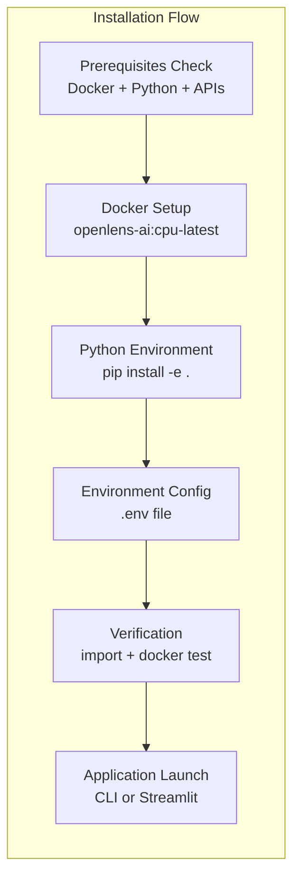

The installation process establishes the foundation for the multi-agent research system, including the `supervisor`, `literature_reviewer`, `data_analyzer`, `coder`, and `latex_writer` agents that collaborate through the LangGraph workflow orchestration system.

Sources: [README.md:154-172](), [README.md:87-102](), [README.md:74-85]()

---

# Page: Multi-Agent System

# Multi-Agent System

<details>
<summary>Relevant source files</summary>

The following files were used as context for generating this wiki page:

- [modules.md](modules.md)

</details>


This document provides a comprehensive overview of OpenLens AI's multi-agent architecture, detailing how five specialized agents collaborate to conduct autonomous research. The system uses LangGraph for workflow orchestration and shared state management to coordinate complex research tasks from literature review through final paper generation.

For configuration details of individual agents, see [Configuration](#2.1). For specific agent implementation details, see the individual agent pages: [Supervisor Agent](#3.1), [Literature Reviewer Agent](#3.2), [Data Analyzer Agent](#3.3), [Coder Agent](#3.4), and [LaTeX Writer Agent](#3.5).

## Architecture Overview

The OpenLens AI multi-agent system consists of five specialized agents that work together through a shared state mechanism. Each agent has distinct responsibilities and tools, but they coordinate their activities through LangGraph's workflow orchestration.

### Agent Communication and State Management

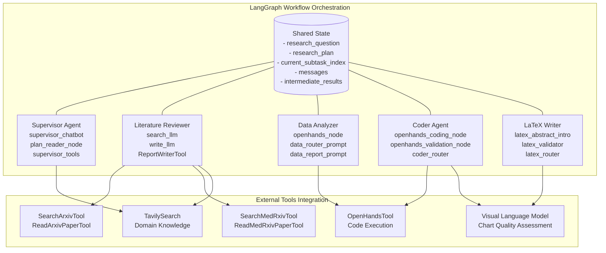

**Sources:** [modules.md:1-221]()

The agents communicate through a centralized shared state that maintains the research context, plan, and intermediate results. This enables seamless handoffs between agents and ensures consistency across the research workflow.

## Agent Roles and Responsibilities

| Agent | Primary Function | Key Tools | Output |
|-------|------------------|-----------|---------|
| **Supervisor** | Planning and coordination | `PlanWriterTool`, `PlanReaderTool`, `TavilySearch` | Research plan (`plan.md`) |
| **Literature Reviewer** | Academic paper search and analysis | `SearchArxivTool`, `SearchMedRxivTool`, `ReportWriterTool` | Literature review report |
| **Data Analyzer** | Dataset processing and analysis | `OpenHandsTool`, data analysis prompts | Data analysis report (`data_show.md`) |
| **Coder** | Experiment code generation and execution | `OpenHandsTool`, validation prompts, VLM | Experimental results and code |
| **LaTeX Writer** | Academic paper generation | Section-specific prompts, VLM for quality assessment | Complete LaTeX paper |

**Sources:** [modules.md:5-12](), [modules.md:23-28](), [modules.md:57-62](), [modules.md:94-99](), [modules.md:124-131](), [modules.md:160-167]()

## Workflow Orchestration

### Agent Execution Flow

```mermaid
graph TD
    START["Research Question Input"] --> SUPERVISOR_CHECK{"plan.md exists?"}
    
    SUPERVISOR_CHECK -->|No| SUPERVISOR_PLAN["supervisor_chatbot<br/>supervisor_plan.md"]
    SUPERVISOR_CHECK -->|Yes| SUPERVISOR_ALTER["supervisor_chatbot<br/>supervisor_alter_plan.md"]
    
    SUPERVISOR_PLAN --> PLAN_WRITE["supervisor_tools<br/>PlanWriterTool"]
    SUPERVISOR_ALTER --> PLAN_READ["plan_reader_node<br/>PlanReaderTool"]
    
    PLAN_WRITE --> LIT_SEARCH["search_llm<br/>SearchArxivTool<br/>SearchMedRxivTool<br/>TavilySearch"]
    PLAN_READ --> LIT_SEARCH
    
    LIT_SEARCH --> LIT_REPORT["write_llm<br/>ReportWriterTool"]
    
    LIT_REPORT --> DATA_CHECK{"data_show.md exists?"}
    DATA_CHECK -->|No| DATA_ANALYZE["openhands_node<br/>data_analyzer_prompt"]
    DATA_CHECK -->|Yes| DATA_REPORT["data_report_prompt"]
    
    DATA_ANALYZE --> DATA_ROUTER["router_node<br/>data_router_prompt"]
    DATA_REPORT --> DATA_ROUTER
    
    DATA_ROUTER --> CODER_PLAN["plan reading"]
    CODER_PLAN --> CODER_CODE["openhands_coding_node<br/>coder.md"]
    CODER_CODE --> CODER_VALIDATE["openhands_validation_node<br/>coder_validator.md"]
    CODER_VALIDATE --> CODER_VLM["VLM Chart Assessment"]
    CODER_VLM --> CODER_CONCLUDE["coder_concluder.md"]
    CODER_CONCLUDE --> CODER_ROUTER["coder_router.md"]
    
    CODER_ROUTER --> LATEX_CLEAR["Clear state and collect files"]
    LATEX_CLEAR --> LATEX_INTRO["latex_abstract_intro.md"]
    LATEX_INTRO --> LATEX_RELATED["latex_related_works.md"]
    LATEX_RELATED --> LATEX_METHODS["latex_methods.md"]
    LATEX_METHODS --> LATEX_EXP["latex_experiments.md"]
    LATEX_EXP --> LATEX_VALIDATE["latex_validator.md"]
    LATEX_VALIDATE --> LATEX_VLM["VLM PDF Quality Assessment"]
    LATEX_VLM --> LATEX_ROUTER["latex_router.md"]
    
    LATEX_ROUTER -->|Continue| LATEX_RIGOR["latex_rigor_prompt.md"]
    LATEX_ROUTER -->|Finish| END["Complete LaTeX Paper"]
    LATEX_RIGOR --> LATEX_VALIDATE
```

**Sources:** [modules.md:42-48](), [modules.md:79-84](), [modules.md:111-116](), [modules.md:145-152](), [modules.md:186-195]()

### State Management and Routing

The system uses several routing mechanisms to control workflow progression:

- **Supervisor routing**: Determines when to create new plans versus modify existing ones
- **Data analyzer routing**: Controls transition between analysis and reporting phases  
- **Coder routing**: Manages code generation, validation, and improvement cycles
- **LaTeX routing**: Controls paper section generation and quality improvement iterations

Each routing decision is based on the current shared state and the completion status of specific tasks or file artifacts.

**Sources:** [modules.md:116](), [modules.md:152](), [modules.md:195]()

## Agent Integration Points

### Tool Integration Architecture

```mermaid
graph LR
    subgraph "Literature Search Integration"
        LIT_AGENT["Literature Reviewer Agent"]
        ARXIV_TOOL["SearchArxivTool<br/>ReadArxivPaperTool"]
        MEDRXIV_TOOL["SearchMedRxivTool<br/>ReadMedRxivPaperTool"]
        TAVILY_TOOL["TavilySearch"]
    end
    
    subgraph "Code Execution Integration"
        DATA_AGENT["Data Analyzer Agent"]
        CODER_AGENT["Coder Agent"]
        OPENHANDS_TOOL["OpenHandsTool<br/>Code Execution Sandbox"]
    end
    
    subgraph "Quality Assessment Integration"
        CODER_QA["Coder Agent"]
        LATEX_QA["LaTeX Writer Agent"]
        VLM_TOOL["Visual Language Model<br/>Chart and PDF Quality"]
    end
    
    subgraph "File Management Integration"
        SUPERVISOR_FILES["Supervisor Agent"]
        DATA_FILES["Data Analyzer Agent"]
        PLAN_TOOLS["PlanWriterTool<br/>PlanReaderTool"]
        REPORT_TOOLS["ReportWriterTool<br/>data_show.md"]
    end
    
    LIT_AGENT --> ARXIV_TOOL
    LIT_AGENT --> MEDRXIV_TOOL
    LIT_AGENT --> TAVILY_TOOL
    
    DATA_AGENT --> OPENHANDS_TOOL
    CODER_AGENT --> OPENHANDS_TOOL
    
    CODER_QA --> VLM_TOOL
    LATEX_QA --> VLM_TOOL
    
    SUPERVISOR_FILES --> PLAN_TOOLS
    DATA_FILES --> REPORT_TOOLS
```

**Sources:** [modules.md:32-36](), [modules.md:67-72](), [modules.md:103-108](), [modules.md:135-142](), [modules.md:172-184]()

## Prompt Template System

Each agent uses specialized prompt templates to guide their behavior:

### Supervisor Agent Prompts
- `supervisor_plan.md`: Initial research plan generation
- `supervisor_alter_plan.md`: Plan modification and refinement

### Literature Reviewer Prompts  
- Search and analysis prompts integrated with `search_llm`
- Report generation prompts integrated with `write_llm`

### Data Analyzer Prompts
- `data_analyzer_prompt`: Guides data analysis execution
- `data_report_prompt`: Guides report generation  
- `data_router_prompt`: Controls workflow routing decisions

### Coder Agent Prompts
- `coder.md`: Code generation guidance
- `coder_validator.md`: Code validation and testing
- `coder_concluder.md`: Results conclusion generation
- `coder_router.md`: Workflow routing decisions

### LaTeX Writer Prompts
- `latex_abstract_intro.md`: Abstract and introduction generation
- `latex_related_works.md`: Related work section generation
- `latex_methods.md`: Methods section generation  
- `latex_experiments.md`: Experiments section generation
- `latex_validator.md`: Paper quality validation
- `latex_concluder.md`: Conclusion generation
- `latex_router.md`: Workflow routing decisions
- `latex_rigor_prompt.md`: Academic rigor improvement
- `latex_literature_check.md`: Reference validation
- `latex_figure_check.md`: Figure quality assessment

**Sources:** [modules.md:37-40](), [modules.md:104-107](), [modules.md:135-140](), [modules.md:171-182]()

## Error Handling and Workflow Control

The multi-agent system implements several mechanisms for robust workflow execution:

- **Minimum tool call requirements**: Literature reviewer must execute a minimum number of search operations before proceeding to report writing
- **File existence checks**: Agents check for prerequisite files (e.g., `plan.md`, `data_show.md`) before proceeding
- **Quality validation loops**: Both coder and LaTeX writer agents include validation steps with improvement iterations
- **State clearing mechanisms**: Agents clear their state at appropriate workflow transition points

The LangGraph orchestration ensures that workflow failures can be detected and handled gracefully, with the ability to retry operations or route to alternative execution paths.

**Sources:** [modules.md:79-84](), [modules.md:111-116](), [modules.md:145-152](), [modules.md:186-195]()

---

# Page: Supervisor Agent

# Supervisor Agent

<details>
<summary>Relevant source files</summary>

The following files were used as context for generating this wiki page:

- [modules.md](modules.md)

</details>


The Supervisor Agent serves as the central coordinator and planning component within the OpenLens AI multi-agent research system. This document covers the Supervisor Agent's core responsibilities, implementation architecture, workflow processes, and integration patterns with other system components.

For information about the other specialized agents that the Supervisor coordinates, see [Literature Reviewer Agent](#3.2), [Data Analyzer Agent](#3.3), [Coder Agent](#3.4), and [LaTeX Writer Agent](#3.5). For the overall multi-agent system architecture, see [Multi-Agent System](#3).

## Core Responsibilities

The Supervisor Agent functions as the orchestrator for autonomous research workflows, with four primary responsibilities:

| Responsibility | Description |
|---|---|
| **Research Planning** | Creates detailed research plans based on user research questions |
| **Agent Coordination** | Directs other agents to execute tasks according to the established plan |
| **Progress Monitoring** | Tracks workflow progress across all agents and subtasks |
| **Plan Adaptation** | Modifies research plans dynamically based on intermediate results |

The Supervisor Agent operates through a shared state mechanism managed by LangGraph, enabling coordination across the five-agent system without direct agent-to-agent communication.

Sources: [modules.md:17-29]()

## Planning and Coordination Architecture

### Supervisor Agent Workflow Components

```mermaid
graph TD
    subgraph "Supervisor Agent Core"
        supervisor_chatbot["supervisor_chatbot<br/>LLM Planning Node"]
        plan_reader_node["plan_reader_node<br/>Plan File Reader"]
        supervisor_tools["supervisor_tools<br/>Tool Execution Node"]
    end
    
    subgraph "Planning Tools"
        PlanWriterTool["PlanWriterTool<br/>Writes plan.md"]
        PlanReaderTool["PlanReaderTool<br/>Reads existing plans"]
        TavilySearch["TavilySearch<br/>Domain Knowledge"]
    end
    
    subgraph "Prompt Templates"
        supervisor_plan["supervisor_plan.md<br/>Initial Planning"]
        supervisor_alter_plan["supervisor_alter_plan.md<br/>Plan Modification"]
    end
    
    subgraph "Shared State"
        plan_md["plan.md<br/>Research Plan File"]
        shared_state["LangGraph State<br/>Agent Coordination"]
    end
    
    supervisor_chatbot --> PlanWriterTool
    supervisor_chatbot --> TavilySearch
    plan_reader_node --> PlanReaderTool
    supervisor_tools --> plan_md
    
    supervisor_plan --> supervisor_chatbot
    supervisor_alter_plan --> supervisor_chatbot
    
    PlanWriterTool --> plan_md
    PlanReaderTool --> plan_md
    
    supervisor_tools --> shared_state
    shared_state --> plan_reader_node
```

Sources: [modules.md:32-48]()

### Agent Coordination Flow

```mermaid
graph TD
    subgraph "Supervisor Control Flow"
        START["Research Question Input"]
        CHECK_PLAN["Check plan.md exists"]
        GENERATE_PLAN["supervisor_chatbot<br/>Generate New Plan"]
        READ_PLAN["plan_reader_node<br/>Read Existing Plan"]
        WRITE_PLAN["supervisor_tools<br/>Execute PlanWriterTool"]
        DECIDE["Tool Result Analysis"]
        END_LOOP["Continue/End Loop"]
    end
    
    subgraph "Agent Coordination"
        LIT_AGENT["Literature Reviewer Agent"]
        DATA_AGENT["Data Analyzer Agent"] 
        CODE_AGENT["Coder Agent"]
        LATEX_AGENT["LaTeX Writer Agent"]
    end
    
    START --> CHECK_PLAN
    CHECK_PLAN -->|"No plan.md"| GENERATE_PLAN
    CHECK_PLAN -->|"plan.md exists"| READ_PLAN
    GENERATE_PLAN --> WRITE_PLAN
    READ_PLAN --> WRITE_PLAN
    WRITE_PLAN --> DECIDE
    DECIDE --> END_LOOP
    
    WRITE_PLAN --> LIT_AGENT
    WRITE_PLAN --> DATA_AGENT
    WRITE_PLAN --> CODE_AGENT
    WRITE_PLAN --> LATEX_AGENT
```

Sources: [modules.md:42-48]()

## Implementation Architecture

### Tool Integration

The Supervisor Agent implements two specialized tools for plan management:

| Tool | Purpose | Implementation |
|---|---|---|
| `PlanWriterTool` | Creates and updates research plan files | Writes structured plans to `plan.md` |
| `PlanReaderTool` | Retrieves existing research plans | Reads and parses existing `plan.md` files |

The Supervisor Agent also integrates `TavilySearch` for gathering domain knowledge to inform research planning decisions.

Sources: [modules.md:34-36]()

### Prompt Template System

The Supervisor Agent utilizes two distinct prompt templates for different planning scenarios:

- **`supervisor_plan.md`**: Used for generating initial research plans from scratch when no existing plan is present
- **`supervisor_alter_plan.md`**: Used for modifying and updating existing research plans based on workflow progress

This dual-template approach enables the Supervisor Agent to handle both cold-start planning scenarios and iterative plan refinement during research execution.

Sources: [modules.md:37-40]()

## Workflow Process

### Plan Generation Workflow

The Supervisor Agent follows a systematic workflow for research plan creation and management:

1. **Plan Existence Check**: Determines if `plan.md` file exists in the workspace
2. **Plan Generation/Reading**: 
   - If no plan exists: Uses `supervisor_chatbot` with `supervisor_plan.md` template
   - If plan exists: Uses `plan_reader_node` with `PlanReaderTool`
3. **Tool Execution**: Executes plan writing operations via `supervisor_tools`
4. **Loop Decision**: Analyzes tool results to determine continuation or termination

This workflow ensures that research planning is both systematic and adaptive to existing work contexts.

Sources: [modules.md:42-48]()

### State Management Integration

The Supervisor Agent operates within the LangGraph state management system, which maintains:

- Current research question and objectives
- Active research plan and subtask tracking
- Agent coordination status and message history
- Intermediate results from all coordinated agents

This shared state approach enables the Supervisor Agent to maintain coordination without requiring direct inter-agent communication protocols.

Sources: [modules.md:199-208]()

## Integration with Multi-Agent System

### Agent Coordination Responsibilities

The Supervisor Agent coordinates task execution across four specialized agents:

| Agent | Coordination Role |
|---|---|
| **Literature Reviewer** | Directs literature search scope and objectives |
| **Data Analyzer** | Specifies data analysis requirements and methods |
| **Coder** | Defines experimental code generation requirements |
| **LaTeX Writer** | Coordinates paper structure and content integration |

The coordination occurs through shared state updates rather than direct agent communication, enabling loose coupling and independent agent operation.

### Workflow Orchestration

The Supervisor Agent's coordination operates through LangGraph's workflow management system, which:

- Ensures sequential task execution when dependencies exist
- Enables parallel agent operation when tasks are independent
- Provides retry and error handling capabilities
- Maintains workflow state consistency across agent boundaries

This orchestration approach enables robust research workflow execution while maintaining system modularity.

Sources: [modules.md:199-210]()

---

# Page: Literature Reviewer Agent

# Literature Reviewer Agent

<details>
<summary>Relevant source files</summary>

The following files were used as context for generating this wiki page:

- [modules.md](modules.md)

</details>


## Purpose and Scope

The Literature Reviewer Agent is one of five specialized agents in the OpenLens AI multi-agent system, specifically responsible for conducting comprehensive literature searches and generating academic literature review reports. This agent searches relevant academic papers from multiple sources including arXiv, medRxiv, and general web sources, then analyzes and synthesizes the findings into structured reports that inform the research process.

For information about overall agent coordination, see [Supervisor Agent](#3.1). For details about the complete multi-agent architecture, see [Multi-Agent System](#3).

## Agent Architecture Overview

The Literature Reviewer Agent operates through a two-phase architecture that separates literature discovery from synthesis and reporting.

### Two-Phase Operation Model

```mermaid
graph TD
    START["Literature Review Request"] --> PHASE1["Phase 1: Literature Search"]
    PHASE1 --> SEARCH_LLM["search_llm"]
    SEARCH_LLM --> SEARCH_TOOLS["Literature Search Tools"]
    SEARCH_TOOLS --> MIN_CALLS{"Minimum Tool Calls Reached?"}
    MIN_CALLS -->|No| SEARCH_LLM
    MIN_CALLS -->|Yes| PHASE2["Phase 2: Report Writing"]
    PHASE2 --> WRITE_LLM["write_llm"]
    WRITE_LLM --> REPORT_TOOL["ReportWriterTool"]
    REPORT_TOOL --> CLEAR_STATE["Clear State"]
    CLEAR_STATE --> END["Workflow Complete"]
    
    style PHASE1 fill:#f9f9f9
    style PHASE2 fill:#f9f9f9
    style SEARCH_LLM fill:#e1f5fe
    style WRITE_LLM fill:#e1f5fe
```

**Sources:** [modules.md:52-84]()

### Core Components

| Component | Purpose | Implementation |
|-----------|---------|----------------|
| `search_llm` | Literature discovery and paper retrieval | Language model optimized for search queries |
| `write_llm` | Report synthesis and writing | Language model optimized for academic writing |
| `ReportWriterTool` | Report generation and file management | Tool for writing structured literature reviews |
| Literature Search Tools | Multi-source paper discovery | Collection of specialized search tools |

**Sources:** [modules.md:66-77]()

## Literature Search Tools Architecture

The agent employs multiple specialized tools for comprehensive literature coverage across different academic repositories and search engines.

### Search Tool Ecosystem

```mermaid
graph TB
    subgraph "Literature Sources"
        ARXIV["arXiv Repository"]
        MEDRXIV["medRxiv Repository"] 
        WEB["General Web Sources"]
    end
    
    subgraph "Search Tools"
        SEARCH_ARXIV["SearchArxivTool"]
        SEARCH_MEDRXIV["SearchMedRxivTool"]
        TAVILY["TavilySearch"]
    end
    
    subgraph "Reading Tools"
        READ_ARXIV["ReadArxivPaperTool"]
        READ_MEDRXIV["ReadMedRxivPaperTool"]
    end
    
    subgraph "Agent Processing"
        SEARCH_LLM_NODE["search_llm"]
        ANALYSIS["Literature Analysis"]
    end
    
    SEARCH_LLM_NODE --> SEARCH_ARXIV
    SEARCH_LLM_NODE --> SEARCH_MEDRXIV
    SEARCH_LLM_NODE --> TAVILY
    
    SEARCH_ARXIV --> ARXIV
    SEARCH_MEDRXIV --> MEDRXIV
    TAVILY --> WEB
    
    SEARCH_ARXIV --> READ_ARXIV
    SEARCH_MEDRXIV --> READ_MEDRXIV
    
    READ_ARXIV --> ANALYSIS
    READ_MEDRXIV --> ANALYSIS
    TAVILY --> ANALYSIS
    
    style SEARCH_LLM_NODE fill:#e1f5fe
    style ANALYSIS fill:#f3e5f5
```

**Sources:** [modules.md:66-73]()

## Literature Search Phase

### Search Strategy Implementation

The literature search phase uses the `search_llm` language model to formulate effective search queries and coordinate tool usage. The agent employs an iterative approach to ensure comprehensive coverage.

#### Search Process Flow

1. **Query Formulation**: The `search_llm` analyzes the research question to generate targeted search queries
2. **Multi-Source Search**: Executes searches across `SearchArxivTool`, `SearchMedRxivTool`, and `TavilySearch`
3. **Paper Retrieval**: Uses `ReadArxivPaperTool` and `ReadMedRxivPaperTool` to access full paper content
4. **Iterative Refinement**: Continues searching until minimum tool call threshold is met

#### Tool Call Management

The agent tracks tool usage to ensure adequate literature coverage before proceeding to the report writing phase. This prevents premature termination and ensures comprehensive research.

**Sources:** [modules.md:74-82]()

## Report Writing Phase

### Report Generation Workflow

Once sufficient literature has been gathered, the agent transitions to the `write_llm` for report synthesis and the `ReportWriterTool` for structured output generation.

```mermaid
graph LR
    LITERATURE_DATA["Collected Literature Data"] --> WRITE_LLM["write_llm"]
    WRITE_LLM --> SYNTHESIS["Literature Synthesis"]
    SYNTHESIS --> REPORT_WRITER["ReportWriterTool"]
    REPORT_WRITER --> STRUCTURED_REPORT["Structured Literature Review"]
    STRUCTURED_REPORT --> FILE_OUTPUT["Report File Output"]
    
    style WRITE_LLM fill:#e1f5fe
    style REPORT_WRITER fill:#f3e5f5
```

### Report Structure and Content

The `ReportWriterTool` generates comprehensive literature reviews that include:

- **Research Context**: Background and motivation from discovered papers
- **Key Findings**: Synthesis of major results and contributions
- **Methodological Approaches**: Analysis of research methods used across papers
- **Research Gaps**: Identification of areas requiring further investigation

**Sources:** [modules.md:77-83]()

## Workflow Implementation

### Complete Agent Workflow

The Literature Reviewer Agent follows a structured workflow managed by LangGraph orchestration:

```mermaid
graph TD
    INIT["Agent Initialization"] --> SEARCH_CHATBOT["Launch Literature Search Chatbot"]
    SEARCH_CHATBOT --> TOOL_CALLS["Execute Search Tools"]
    TOOL_CALLS --> CHECK_MIN["Check Minimum Tool Calls"]
    CHECK_MIN -->|Not Met| TOOL_CALLS
    CHECK_MIN -->|Met| REPORT_PHASE["Move to Report Writing"]
    REPORT_PHASE --> GENERATE_REPORT["Generate Literature Review Report"]
    GENERATE_REPORT --> WRITE_TOOL["Execute ReportWriterTool"]
    WRITE_TOOL --> CLEAR_STATE["Clear Agent State"]
    CLEAR_STATE --> WORKFLOW_END["Workflow Complete"]
    
    style SEARCH_CHATBOT fill:#e1f5fe
    style GENERATE_REPORT fill:#f3e5f5
    style CLEAR_STATE fill:#fff3e0
```

### State Management

The agent maintains state throughout the literature review process, tracking:
- Search queries executed
- Papers discovered and analyzed
- Tool call counts
- Intermediate analysis results

State is cleared upon workflow completion to ensure clean transitions between research tasks.

**Sources:** [modules.md:79-84]()

## Integration with Multi-Agent System

### Shared State Communication

The Literature Reviewer Agent communicates with other agents through the shared state managed by LangGraph. Key shared information includes:

| Shared Data | Purpose | Usage by Other Agents |
|-------------|---------|---------------------|
| Literature review reports | Research context | Used by LaTeX Writer for Related Work section |
| Key papers and citations | Reference management | Integrated into final paper bibliography |
| Research gaps identified | Planning refinement | Informs Supervisor Agent planning |
| Domain knowledge | Context building | Supports Data Analyzer and Coder agents |

### Agent Coordination

The Literature Reviewer typically executes early in the research workflow, providing foundational knowledge that informs subsequent agent activities. The Supervisor Agent coordinates the timing and ensures the literature review aligns with overall research objectives.

**Sources:** [modules.md:199-210]()

## Tool Dependencies and External Services

### External Service Integration

The Literature Reviewer Agent relies on several external services for comprehensive literature access:

- **arXiv API**: Academic paper repository access via `SearchArxivTool` and `ReadArxivPaperTool`
- **medRxiv API**: Medical preprint repository access via `SearchMedRxivTool` and `ReadMedRxivPaperTool`  
- **Tavily Search**: General web search capabilities for broader literature discovery
- **Language Models**: Both `search_llm` and `write_llm` for intelligent query formulation and report generation

### Tool Error Handling

The agent implements robust error handling for external service failures, ensuring research continuity even when individual literature sources are unavailable.

**Sources:** [modules.md:66-73](), [modules.md:215-220]()

---

# Page: Data Analyzer Agent

# Data Analyzer Agent

<details>
<summary>Relevant source files</summary>

The following files were used as context for generating this wiki page:

- [modules.md](modules.md)

</details>


## Purpose and Scope

The Data Analyzer Agent is one of five specialized agents in the OpenLens AI multi-agent research system, responsible for processing user-provided datasets, performing statistical analysis, creating visualizations, and generating comprehensive data analysis reports. This document covers the agent's architecture, workflow, tools, and integration within the broader research automation pipeline.

For information about the overall multi-agent system architecture, see [Multi-Agent System](#3). For details about the code execution environment, see [OpenHands Integration](#6.1). For the supervisor that coordinates this agent, see [Supervisor Agent](#3.1).

## Agent Overview

The Data Analyzer Agent serves as the data processing specialist within the OpenLens AI research workflow. It operates within a sandboxed code execution environment and generates both analytical insights and visual representations of datasets to support the research process.

### Core Responsibilities

| Responsibility | Description |
|---|---|
| Dataset Processing | Analyze user-provided datasets using statistical methods |
| Data Visualization | Create charts, graphs, and visual representations of data patterns |
| Statistical Analysis | Perform quantitative analysis and hypothesis testing |
| Report Generation | Produce structured data analysis reports in markdown format |

## Architecture and Implementation

### Data Analyzer Agent Architecture

```mermaid
graph TD
    subgraph "Data Analyzer Agent Core"
        DA_CHATBOT["data_analyzer_chatbot"] --> OPENHANDS_NODE["openhands_node"]
        REPORT_CHATBOT["data_report_chatbot"] --> TOOL_NODE["data_tool_node"]
        ROUTER_NODE["router_node"] --> DECISION{"Next Action Decision"}
    end
    
    subgraph "Prompt Templates"
        DA_PROMPT["data_analyzer_prompt"] --> DA_CHATBOT
        REPORT_PROMPT["data_report_prompt"] --> REPORT_CHATBOT  
        ROUTER_PROMPT["data_router_prompt"] --> ROUTER_NODE
    end
    
    subgraph "Tools and Execution"
        OPENHANDS_TOOL["OpenHandsTool"] --> OPENHANDS_NODE
        REPORT_TOOL["ReportWriterTool"] --> TOOL_NODE
    end
    
    subgraph "File System Interface"
        DATA_SHOW["data_show.md"] --> FILE_CHECK{"File Exists?"}
        DATA_REPORT["data_report.md"] --> REPORT_OUTPUT
    end
    
    subgraph "External Services"
        DOCKER_ENV["Docker Container<br/>agent-med-cpu"] --> OPENHANDS_TOOL
        LLM_ROUTER["LLM Router"] --> DA_CHATBOT
        LLM_ROUTER --> REPORT_CHATBOT
        LLM_ROUTER --> ROUTER_NODE
    end
    
    OPENHANDS_NODE --> DATA_SHOW
    FILE_CHECK --> REPORT_CHATBOT
    TOOL_NODE --> DATA_REPORT
    DECISION --> DA_CHATBOT
    DECISION --> REPORT_CHATBOT
```

Sources: [modules.md:87-117]()

### Code Entity Mapping

```mermaid
graph TB
    subgraph "Python Functions and Classes"
        DATA_ANALYZER_NODE["data_analyzer_node()"] --> OPENHANDS_NODE_FUNC["openhands_node()"]
        DATA_REPORT_NODE["data_report_node()"] --> DATA_TOOL_NODE_FUNC["data_tool_node()"]
        DATA_ROUTER_NODE["data_router_node()"] --> CONDITIONAL_EDGE["ConditionalEdge"]
    end
    
    subgraph "Prompt Configuration"
        DATA_ANALYZER_PROMPT_FILE["prompts/data_analyzer_prompt.md"] --> CHATBOT_CONFIG["ChatBot Configuration"]
        DATA_REPORT_PROMPT_FILE["prompts/data_report_prompt.md"] --> REPORT_CONFIG["Report ChatBot Config"]
        DATA_ROUTER_PROMPT_FILE["prompts/data_router_prompt.md"] --> ROUTER_CONFIG["Router Configuration"]
    end
    
    subgraph "Tool Classes"
        OPENHANDS_TOOL_CLASS["OpenHandsTool"] --> CODE_EXECUTION["Code Execution Interface"]
        REPORT_WRITER_TOOL_CLASS["ReportWriterTool"] --> FILE_WRITING["File Writing Interface"]
    end
    
    subgraph "State Management"
        SHARED_STATE["SharedState"] --> DATASET_PATH["dataset_path"]
        SHARED_STATE --> CURRENT_TASK["current_subtask_index"]
        SHARED_STATE --> MESSAGE_HISTORY["messages"]
    end
    
    CHATBOT_CONFIG --> DATA_ANALYZER_NODE
    REPORT_CONFIG --> DATA_REPORT_NODE
    ROUTER_CONFIG --> DATA_ROUTER_NODE
    
    CODE_EXECUTION --> OPENHANDS_NODE_FUNC
    FILE_WRITING --> DATA_TOOL_NODE_FUNC
    
    DATASET_PATH --> DATA_ANALYZER_NODE
    CURRENT_TASK --> DATA_ROUTER_NODE
    MESSAGE_HISTORY --> DATA_REPORT_NODE
```

Sources: [modules.md:101-117]()

## Workflow and Process Flow

### Data Analysis Workflow

The Data Analyzer Agent follows a structured workflow that processes datasets through multiple phases:

```mermaid
flowchart TD
    START["Workflow Start"] --> CHECK_PLAN["Read Research Plan"]
    CHECK_PLAN --> ANALYZE["Execute Data Analysis<br/>openhands_node()"]
    
    ANALYZE --> FILE_CHECK{"data_show.md<br/>exists?"}
    FILE_CHECK -->|No| ANALYZE
    FILE_CHECK -->|Yes| REPORT_GEN["Generate Report<br/>data_report_chatbot"]
    
    REPORT_GEN --> WRITE_REPORT["Write Report<br/>data_tool_node()"]
    WRITE_REPORT --> ROUTER["Route Decision<br/>router_node()"]
    
    ROUTER --> DECISION{"Next Action"}
    DECISION -->|Continue Analysis| ANALYZE
    DECISION -->|Generate Report| REPORT_GEN  
    DECISION -->|Complete| END["Workflow End"]
    
    subgraph "Code Execution Environment"
        DOCKER["Docker Container"] --> PYTHON_ENV["Python Environment"]
        PYTHON_ENV --> DATA_LIBS["pandas, matplotlib, seaborn"]
    end
    
    ANALYZE --> DOCKER
```

Sources: [modules.md:110-117]()

### Processing Phases

| Phase | Node | Purpose | Output |
|---|---|---|---|
| **Analysis** | `openhands_node` | Execute data processing code | Analysis results, visualizations |
| **Validation** | File system check | Verify analysis completion | Boolean state |
| **Reporting** | `data_report_chatbot` | Generate comprehensive report | Structured markdown report |
| **Writing** | `data_tool_node` | Write report to file system | `data_report.md` file |
| **Routing** | `router_node` | Determine next workflow step | Routing decision |

## Tools and Integration

### OpenHands Integration

The Data Analyzer Agent leverages the OpenHands tool for secure code execution within a containerized environment:

```mermaid
graph LR
    subgraph "Data Analyzer Agent"
        AGENT_CODE["Agent Code"] --> OPENHANDS_CALL["OpenHandsTool.call()"]
    end
    
    subgraph "OpenHands Runtime"
        OPENHANDS_CALL --> CONTAINER["Docker Container<br/>agent-med-cpu"]
        CONTAINER --> PYTHON_RUNTIME["Python Runtime"]
        PYTHON_RUNTIME --> DATA_ANALYSIS["Data Analysis Execution"]
    end
    
    subgraph "Data Processing Libraries"
        DATA_ANALYSIS --> PANDAS["pandas"]
        DATA_ANALYSIS --> MATPLOTLIB["matplotlib"] 
        DATA_ANALYSIS --> SEABORN["seaborn"]
        DATA_ANALYSIS --> NUMPY["numpy"]
        DATA_ANALYSIS --> SCIPY["scipy"]
    end
    
    subgraph "Output Generation"
        DATA_ANALYSIS --> CHARTS["Chart Generation"]
        DATA_ANALYSIS --> STATISTICS["Statistical Analysis"]
        CHARTS --> DATA_SHOW_FILE["data_show.md"]
        STATISTICS --> DATA_SHOW_FILE
    end
```

Sources: [modules.md:103-109]()

### Tool Configuration

The agent uses several key tools integrated through the OpenLens AI framework:

| Tool | Class/Function | Purpose |
|---|---|---|
| **Code Execution** | `OpenHandsTool` | Execute Python data analysis code |
| **Report Writing** | `ReportWriterTool` | Write analysis reports to files |
| **File Reading** | File system operations | Check for analysis completion markers |
| **LLM Integration** | LLM router | Generate analysis code and reports |

### Prompt System

The agent operates using three specialized prompt templates:

```mermaid
graph TD
    subgraph "Prompt Templates"
        DATA_ANALYZER["data_analyzer_prompt.md"] --> CODE_GEN["Code Generation"]
        DATA_REPORT["data_report_prompt.md"] --> REPORT_GEN["Report Generation"]
        DATA_ROUTER["data_router_prompt.md"] --> ROUTING["Workflow Routing"]
    end
    
    subgraph "LLM Processing"
        CODE_GEN --> ANALYSIS_LLM["Analysis LLM Call"]
        REPORT_GEN --> REPORT_LLM["Report LLM Call"]
        ROUTING --> ROUTER_LLM["Router LLM Call"]
    end
    
    subgraph "Output Actions"
        ANALYSIS_LLM --> EXECUTE_CODE["Execute Analysis Code"]
        REPORT_LLM --> WRITE_REPORT["Write Report File"]
        ROUTER_LLM --> NEXT_STEP["Determine Next Step"]
    end
```

Sources: [modules.md:105-108]()

## State Management and Coordination

The Data Analyzer Agent operates within the shared state system managed by LangGraph, enabling coordination with other agents in the research pipeline:

### Shared State Components

| State Component | Purpose | Usage |
|---|---|---|
| `dataset_path` | Dataset file location | Input for analysis operations |
| `current_subtask_index` | Current workflow position | Progress tracking |
| `messages` | Communication history | Context for report generation |
| `research_question` | Research objective | Guide analysis direction |

### Inter-Agent Communication

The Data Analyzer Agent produces outputs that are consumed by other agents in the research workflow:

- **For Coder Agent**: Provides data insights for experimental design (see [Coder Agent](#3.4))
- **For LaTeX Writer**: Supplies analysis results and visualizations for paper generation (see [LaTeX Writer Agent](#3.5))
- **From Supervisor**: Receives task assignments and research plan guidance (see [Supervisor Agent](#3.1))

Sources: [modules.md:87-117](), [modules.md:199-210]()

---

# Page: Coder Agent

# Coder Agent

<details>
<summary>Relevant source files</summary>

The following files were used as context for generating this wiki page:

- [modules.md](modules.md)

</details>


The Coder Agent is responsible for generating and executing experimental code within the OpenLens AI multi-agent research system. This agent translates high-level research plans into executable code, validates execution results, and iteratively improves code quality based on visual feedback from chart generation. The agent operates as part of the collaborative workflow orchestrated by the Supervisor Agent and provides computational results to the LaTeX Writer Agent.

For information about the overall multi-agent coordination, see [Supervisor Agent](#3.1). For details about code execution environment setup, see [OpenHands Integration](#6.1).

## Agent Architecture

The Coder Agent follows a multi-phase workflow architecture that separates code generation, execution, validation, and improvement into distinct processing stages.

### Core Components

```mermaid
graph TB
    subgraph "Coder Agent Architecture"
        PLAN_READER["plan_reader_node"]
        CODING_NODE["openhands_coding_node"]
        VALIDATION_NODE["openhands_validation_node"] 
        VLM_EVAL["vlm_evaluation"]
        CONCLUSION_NODE["conclusion_generation"]
        ROUTER["coder_router"]
    end
    
    subgraph "Prompt Templates"
        CODER_PROMPT["coder.md"]
        VALIDATOR_PROMPT["coder_validator.md"]
        CONCLUDER_PROMPT["coder_concluder.md"]
        ROUTER_PROMPT["coder_router.md"]
    end
    
    subgraph "External Tools"
        OPENHANDS["OpenHandsTool"]
        VLM_SERVICE["Visual Language Model"]
        SHARED_STATE["LangGraph State"]
    end
    
    subgraph "Output Artifacts"
        CODE_FILES["Generated Code Files"]
        CHARTS["Data Visualizations"]
        RESULTS["Experiment Results"]
        REPORTS["Conclusion Reports"]
    end
    
    PLAN_READER --> CODING_NODE
    CODING_NODE --> VALIDATION_NODE
    VALIDATION_NODE --> VLM_EVAL
    VLM_EVAL --> CONCLUSION_NODE
    CONCLUSION_NODE --> ROUTER
    ROUTER --> CODING_NODE
    
    CODER_PROMPT --> CODING_NODE
    VALIDATOR_PROMPT --> VALIDATION_NODE
    CONCLUDER_PROMPT --> CONCLUSION_NODE
    ROUTER_PROMPT --> ROUTER
    
    CODING_NODE --> OPENHANDS
    VALIDATION_NODE --> OPENHANDS
    VLM_EVAL --> VLM_SERVICE
    
    OPENHANDS --> CODE_FILES
    OPENHANDS --> CHARTS
    OPENHANDS --> RESULTS
    CONCLUSION_NODE --> REPORTS
    
    SHARED_STATE --> PLAN_READER
    REPORTS --> SHARED_STATE
```

Sources: [modules.md:120-153]()

## Code Generation Workflow

The Coder Agent implements an iterative code generation and refinement process that ensures experimental code meets research objectives and produces high-quality outputs.

### Generation Process Flow

```mermaid
flowchart TD
    START["Agent Activation"] --> READ_PLAN["Read Research Plan<br/>plan_reader_node"]
    READ_PLAN --> GENERATE["Generate Code<br/>openhands_coding_node"]
    GENERATE --> EXECUTE["Execute Code<br/>OpenHandsTool"]
    EXECUTE --> VALIDATE["Validate Results<br/>openhands_validation_node"]
    VALIDATE --> VLM_CHECK["Evaluate Charts<br/>vlm_evaluation"]
    
    VLM_CHECK --> QUALITY_DECISION{"Chart Quality<br/>Assessment"}
    QUALITY_DECISION -->|"Poor Quality"| IMPROVE["Improve Code<br/>Regeneration"]
    QUALITY_DECISION -->|"Good Quality"| CONCLUDE["Generate Conclusions<br/>conclusion_generation"]
    
    IMPROVE --> GENERATE
    CONCLUDE --> ROUTE_DECISION["Router Decision<br/>coder_router"]
    ROUTE_DECISION -->|"Continue"| GENERATE
    ROUTE_DECISION -->|"Complete"| END["Agent Complete"]
    
    EXECUTE --> ERROR_CHECK{"Execution<br/>Success?"}
    ERROR_CHECK -->|"Error"| DEBUG["Debug & Fix<br/>Error Handling"]
    ERROR_CHECK -->|"Success"| VALIDATE
    DEBUG --> GENERATE
```

### Prompt Template Integration

| Template File | Node Function | Purpose |
|---------------|---------------|---------|
| `coder.md` | `openhands_coding_node` | Guides initial code generation based on research plan |
| `coder_validator.md` | `openhands_validation_node` | Validates code execution results and identifies issues |
| `coder_concluder.md` | `conclusion_generation` | Synthesizes results into coherent conclusions |
| `coder_router.md` | `coder_router` | Determines next action (continue, improve, or complete) |

Sources: [modules.md:135-141]()

## Execution Environment Integration

The Coder Agent integrates tightly with the OpenHands execution sandbox to provide secure and isolated code execution capabilities.

### OpenHands Tool Integration

```mermaid
graph LR
    subgraph "Coder Agent Process"
        CODE_GEN["Code Generation<br/>LLM Processing"]
        CODE_VALIDATION["Result Validation<br/>Error Checking"]
    end
    
    subgraph "OpenHands Sandbox"
        DOCKER_ENV["Docker Container<br/>agent-med-cpu"]
        PYTHON_RUNTIME["Python Runtime<br/>Data Science Stack"]
        FILE_SYSTEM["Shared File System<br/>Input/Output"]
    end
    
    subgraph "Execution Artifacts"
        DATASETS["Input Datasets<br/>CSV/JSON Files"]
        SCRIPTS["Generated Scripts<br/>Python Code"]
        OUTPUTS["Analysis Results<br/>Charts & Reports"]
    end
    
    CODE_GEN --> DOCKER_ENV
    DOCKER_ENV --> PYTHON_RUNTIME
    PYTHON_RUNTIME --> FILE_SYSTEM
    
    DATASETS --> FILE_SYSTEM
    FILE_SYSTEM --> SCRIPTS
    SCRIPTS --> OUTPUTS
    
    OUTPUTS --> CODE_VALIDATION
    CODE_VALIDATION --> CODE_GEN
```

The `OpenHandsTool` provides the execution interface between the agent's code generation logic and the containerized execution environment. This ensures that generated code can access datasets, execute data analysis operations, and produce visualizations in a controlled environment.

Sources: [modules.md:108](), [modules.md:147-148]()

## Quality Assessment and Validation

The Coder Agent implements a multi-layered quality assessment system that combines execution validation with visual language model evaluation.

### Validation Architecture

```mermaid
graph TB
    subgraph "Quality Assessment Pipeline"
        EXECUTION_VAL["Execution Validation<br/>openhands_validation_node"]
        VLM_ASSESSMENT["VLM Chart Evaluation<br/>vlm_evaluation"]
        FEEDBACK_LOOP["Improvement Feedback<br/>Iterative Refinement"]
    end
    
    subgraph "Validation Criteria"
        CODE_SYNTAX["Code Syntax Check<br/>Python Validation"]
        DATA_PROCESSING["Data Processing Logic<br/>Statistical Correctness"]
        VISUAL_QUALITY["Chart Quality<br/>Clarity & Accuracy"]
        RESULT_COHERENCE["Result Coherence<br/>Research Alignment"]
    end
    
    subgraph "VLM Integration"
        CHART_ANALYSIS["Chart Quality Analysis<br/>Visual Assessment"]
        IMPROVEMENT_SUGGESTIONS["Improvement Recommendations<br/>Specific Feedback"]
    end
    
    EXECUTION_VAL --> CODE_SYNTAX
    EXECUTION_VAL --> DATA_PROCESSING
    VLM_ASSESSMENT --> VISUAL_QUALITY
    VLM_ASSESSMENT --> RESULT_COHERENCE
    
    CHART_ANALYSIS --> VLM_ASSESSMENT
    IMPROVEMENT_SUGGESTIONS --> FEEDBACK_LOOP
    
    VISUAL_QUALITY --> FEEDBACK_LOOP
    RESULT_COHERENCE --> FEEDBACK_LOOP
```

### Quality Metrics

The agent evaluates code quality across multiple dimensions:

- **Execution Success**: Code runs without errors in the OpenHands environment
- **Data Processing Accuracy**: Statistical computations produce valid results
- **Visualization Quality**: Charts are clear, properly labeled, and scientifically accurate
- **Research Alignment**: Results support the research objectives defined in the plan

Sources: [modules.md:142](), [modules.md:149-150]()

## Inter-Agent Communication

The Coder Agent communicates with other system components through the shared LangGraph state and file-based result exchange.

### State Management

```mermaid
graph LR
    subgraph "Input Sources"
        SUPERVISOR["Supervisor Agent<br/>Research Plan"]
        DATA_ANALYZER["Data Analyzer Agent<br/>Dataset Processing"]
    end
    
    subgraph "Coder Agent State"
        CURRENT_TASK["Current Subtask Index"]
        CODE_HISTORY["Generated Code History"]
        EXECUTION_RESULTS["Execution Results"]
        VALIDATION_STATUS["Validation Status"]
    end
    
    subgraph "Output Consumers"
        LATEX_WRITER["LaTeX Writer Agent<br/>Results Integration"]
        SHARED_STATE["LangGraph Shared State<br/>Global Context"]
    end
    
    SUPERVISOR --> CURRENT_TASK
    DATA_ANALYZER --> CODE_HISTORY
    
    CODE_HISTORY --> EXECUTION_RESULTS
    EXECUTION_RESULTS --> VALIDATION_STATUS
    
    VALIDATION_STATUS --> LATEX_WRITER
    VALIDATION_STATUS --> SHARED_STATE
```

### File-Based Communication

The agent produces standardized output files that other agents can consume:

| Output File | Content Type | Consumer Agent |
|-------------|--------------|----------------|
| `experiment_results.md` | Experimental findings and statistical results | LaTeX Writer |
| `generated_code.py` | Final validated Python analysis code | Data Analyzer |
| `charts/` | Generated visualization files (PNG/SVG) | LaTeX Writer |
| `conclusions.md` | Summary of experimental conclusions | LaTeX Writer |

Sources: [modules.md:151-152](), [modules.md:202-208]()

## Router Decision Logic

The `coder_router` implements decision logic that determines agent workflow progression based on validation results and task completion status.

### Routing States

```mermaid
stateDiagram-v2
    [*] --> CodeGeneration
    CodeGeneration --> ExecutionValidation
    ExecutionValidation --> ChartEvaluation
    
    ChartEvaluation --> QualityCheck
    QualityCheck --> Improvement : Quality Issues
    QualityCheck --> ConclusionGeneration : Quality Acceptable
    
    Improvement --> CodeGeneration
    ConclusionGeneration --> CompletionCheck
    
    CompletionCheck --> CodeGeneration : Continue Tasks
    CompletionCheck --> [*] : All Tasks Complete
    
    ExecutionValidation --> ErrorHandling : Execution Error
    ErrorHandling --> CodeGeneration
```

The router evaluates multiple factors including execution success, chart quality scores from the VLM, research plan progress, and available computational resources to determine the optimal next action.

Sources: [modules.md:152](), [modules.md:141]()

---

# Page: LaTeX Writer Agent

# LaTeX Writer Agent

<details>
<summary>Relevant source files</summary>

The following files were used as context for generating this wiki page:

- [modules.md](modules.md)

</details>


The LaTeX Writer Agent is responsible for synthesizing research results from all other agents into a complete academic paper in LaTeX format. This agent takes inputs from the Literature Reviewer, Data Analyzer, and Coder agents to produce publication-ready research papers with proper academic structure and formatting.

This document covers the paper generation workflow, quality assessment mechanisms, and integration patterns within the multi-agent system. For information about the overall multi-agent coordination, see [Supervisor Agent](#3.1). For details about input data processing, see [Data Analyzer Agent](#3.3) and [Coder Agent](#3.4).

## Agent Architecture and Components

The LaTeX Writer Agent operates through a sophisticated multi-stage pipeline that generates different sections of an academic paper sequentially, with quality validation and improvement cycles.

### Core Components

The agent utilizes several specialized prompt templates for different paper sections:

| Template File | Purpose | Section Generated |
|--------------|---------|-------------------|
| `latex_abstract_intro.md` | Abstract and introduction generation | Abstract, Introduction |
| `latex_related_works.md` | Literature review synthesis | Related Work |
| `latex_methods.md` | Methodology description | Methods |
| `latex_experiments.md` | Experimental results presentation | Experiments, Results |
| `latex_validator.md` | Paper quality assessment | Quality validation |
| `latex_concluder.md` | Conclusion generation | Conclusion, Discussion |

Additional specialized templates support quality improvement:

| Template File | Purpose |
|--------------|---------|
| `latex_router.md` | Workflow routing decisions |
| `latex_rigor_prompt.md` | Academic rigor enhancement |
| `latex_literature_check.md` | Reference validation |
| `latex_figure_check.md` | Chart and figure quality assessment |

Sources: [modules.md:172-183]()

## Paper Generation Workflow

The LaTeX Writer Agent follows a structured workflow that builds the paper section by section, with quality checkpoints and improvement cycles.

### Sequential Section Generation

```mermaid
graph TD
    START["latex_writer_node"] --> CLEAR["Clear state and collect files"]
    CLEAR --> INTRO["Generate Introduction"]
    INTRO --> RELATED["Generate Related Work"]
    RELATED --> METHODS["Generate Methods"]
    METHODS --> EXPERIMENTS["Generate Experiments"]
    EXPERIMENTS --> VALIDATE["Validate paper quality"]
    VALIDATE --> DECISION{"Quality acceptable?"}
    DECISION -->|No| IMPROVE["Improve paper"]
    DECISION -->|Yes| ROUTE["latex_router_node"]
    IMPROVE --> ROUTE
    ROUTE --> DECISION2{"Continue polishing?"}
    DECISION2 -->|Yes| VALIDATE
    DECISION2 -->|No| END["Complete paper"]
```

Each section generation involves:

1. **Input Collection**: Gathering results from other agents' outputs
2. **Context Building**: Combining research plan, literature review, and experimental results
3. **Section Generation**: Using specialized prompts to generate LaTeX content
4. **Integration**: Combining new sections with existing paper content

Sources: [modules.md:186-196]()

### Quality Assessment Pipeline

The agent implements a comprehensive quality assessment system that evaluates multiple dimensions of the generated paper:

```mermaid
graph TB
    PAPER["Generated LaTeX Paper"] --> VLM["Visual-Language Model Assessment"]
    PAPER --> VALIDATOR["latex_validator_node"]
    PAPER --> RIGOR["latex_rigor_prompt assessment"]
    
    VLM --> PDF_QUAL["PDF quality evaluation"]
    VALIDATOR --> CONTENT_QUAL["Content quality assessment"]
    RIGOR --> ACADEMIC_QUAL["Academic rigor evaluation"]
    
    PDF_QUAL --> FEEDBACK["Quality feedback compilation"]
    CONTENT_QUAL --> FEEDBACK
    ACADEMIC_QUAL --> FEEDBACK
    
    FEEDBACK --> IMPROVEMENT["Paper improvement cycle"]
    IMPROVEMENT --> DECISION{"Quality threshold met?"}
    DECISION -->|No| PAPER
    DECISION -->|Yes| FINAL["Final paper output"]
```

Sources: [modules.md:184, 193-194]()

## Integration with Multi-Agent System

The LaTeX Writer Agent operates as the final stage in the research pipeline, consuming outputs from all other agents in the system.

### Input Dependencies

```mermaid
graph LR
    SUPERVISOR["Supervisor Agent<br/>plan.md"] --> LATEX["LaTeX Writer Agent"]
    LIT_REVIEWER["Literature Reviewer<br/>literature_review.md"] --> LATEX
    DATA_ANALYZER["Data Analyzer<br/>data_analysis.md"] --> LATEX
    CODER["Coder Agent<br/>experimental_results.md<br/>charts and figures"] --> LATEX
    
    LATEX --> SECTIONS["Paper Sections Generation"]
    SECTIONS --> ABSTRACT["Abstract & Introduction"]
    SECTIONS --> RELATED["Related Work"]
    SECTIONS --> METHODS["Methods"]
    SECTIONS --> EXPERIMENTS["Experiments"]
    
    ABSTRACT --> FINAL["Complete LaTeX Paper"]
    RELATED --> FINAL
    METHODS --> FINAL
    EXPERIMENTS --> FINAL
```

### Shared State Integration

The agent accesses and updates the shared state managed by LangGraph, which includes:

- **Research question**: Original research query
- **Research plan**: Structured plan from Supervisor Agent
- **Literature review**: Comprehensive review from Literature Reviewer
- **Data analysis results**: Processed datasets and visualizations
- **Experimental code and results**: Generated code and execution outputs
- **Message history**: Context from previous agent interactions

Sources: [modules.md:201-208]()

## Technical Implementation Details

### Visual-Language Model Integration

The agent incorporates visual-language model (VLM) assessment to evaluate the quality of generated charts, figures, and the final PDF output:

```mermaid
graph TD
    LATEX_GEN["LaTeX content generation"] --> PDF_COMPILE["PDF compilation"]
    PDF_COMPILE --> VLM_ASSESS["VLM quality assessment"]
    
    CHARTS["Generated charts/figures"] --> FIGURE_CHECK["latex_figure_check evaluation"]
    FIGURE_CHECK --> VLM_ASSESS
    
    VLM_ASSESS --> QUALITY_SCORE["Quality scoring"]
    QUALITY_SCORE --> FEEDBACK_GEN["Improvement feedback"]
    FEEDBACK_GEN --> REVISION_CYCLE["Content revision"]
    REVISION_CYCLE --> LATEX_GEN
```

The VLM assessment evaluates:
- **Chart clarity and readability**
- **Figure-text integration**
- **Overall PDF presentation quality**
- **Academic formatting compliance**

Sources: [modules.md:184, 182]()

### Workflow State Management

The agent uses a routing mechanism to manage the iterative improvement process:

| Router Decision | Next Action | Condition |
|----------------|-------------|-----------|
| `continue` | Return to quality validation | Quality below threshold |
| `improve` | Execute improvement cycle | Specific issues identified |
| `finish` | Complete paper generation | Quality threshold met |

The routing logic considers:
- **Quality assessment scores**
- **Number of improvement iterations**
- **Specific feedback categories**
- **User-defined quality thresholds**

Sources: [modules.md:179, 195]()

### Output Integration

The final LaTeX paper integrates multiple types of content:

- **Textual content**: Generated from prompt templates
- **Citations and references**: Derived from literature review
- **Data visualizations**: Charts and tables from experimental results  
- **Code snippets**: Relevant code examples from experimental implementation
- **Mathematical formulations**: Methodology descriptions and statistical analyses

The agent ensures proper LaTeX formatting, citation management, and figure placement throughout the document generation process.

Sources: [modules.md:163-167]()

---

# Page: LLM Router Infrastructure

# LLM Router Infrastructure

<details>
<summary>Relevant source files</summary>

The following files were used as context for generating this wiki page:

- [llm_router/create_yaml.py](llm_router/create_yaml.py)
- [llm_router/proxy_update.sh](llm_router/proxy_update.sh)

</details>


The LLM Router Infrastructure provides centralized language model routing, load balancing, and API key management for OpenLens AI. This system acts as a proxy layer between the multi-agent system and external language model providers, enabling efficient distribution of requests across multiple API keys and model endpoints while maintaining high availability and performance.

For information about configuring specific models, see [Model Configuration](#4.1). For details on vLLM deployment, see [vLLM Deployment](#4.2). For performance monitoring and testing, see [Performance Testing](#4.3).

## System Architecture

The router infrastructure consists of three main components: YAML configuration generation, LiteLLM proxy server, and API key management with balance validation.

### Router Infrastructure Overview

```mermaid
graph TB
    subgraph "Configuration Generation"
        API_KEY_FILES["API Key Files<br/>keys_*.txt"]
        CREATE_YAML["create_yaml.py<br/>YAML Generator"]
        MODEL_LIST_YAML["model_list.yaml<br/>LiteLLM Config"]
        EXTRA_MODEL_LIST["extra_model_list.yaml<br/>Additional Models"]
    end
    
    subgraph "Balance Validation"
        CHECK_BALANCE["check_balance()<br/>SiliconFlow API"]
        MULTIPROCESS_POOL["Pool(processes)<br/>Parallel Validation"]
        VALID_KEYS["valid_keys<br/>Filtered API Keys"]
    end
    
    subgraph "LiteLLM Proxy Server"
        LITELLM_PROXY["LiteLLM Proxy<br/>Port 8077"]
        ROUTER_SETTINGS["routing_strategy<br/>simple-shuffle"]
        LANGSMITH_CALLBACK["langsmith<br/>Success Callback"]
    end
    
    subgraph "OpenLens AI Integration"
        AGENTS["Multi-Agent System"]
        EVALUATION["Evaluation Framework"]
    end
    
    API_KEY_FILES --> CREATE_YAML
    CREATE_YAML --> CHECK_BALANCE
    CHECK_BALANCE --> MULTIPROCESS_POOL
    MULTIPROCESS_POOL --> VALID_KEYS
    VALID_KEYS --> MODEL_LIST_YAML
    EXTRA_MODEL_LIST --> MODEL_LIST_YAML
    MODEL_LIST_YAML --> LITELLM_PROXY
    ROUTER_SETTINGS --> LITELLM_PROXY
    LANGSMITH_CALLBACK --> LITELLM_PROXY
    LITELLM_PROXY --> AGENTS
    LITELLM_PROXY --> EVALUATION
```

Sources: [llm_router/create_yaml.py:1-253](), [llm_router/proxy_update.sh:1-5]()

## YAML Configuration Generation

The `create_yaml.py` script orchestrates the generation of LiteLLM configuration files by processing API key files, validating account balances, and creating model entries for each valid key-model-endpoint combination.

### Configuration Generation Workflow

```mermaid
graph LR
    subgraph "Input Processing"
        READ_API_KEYS["read_api_keys()<br/>File Processing"]
        API_KEY_FILES_INPUT["keys_0909_100.txt<br/>keys_0909_200.txt"]
        ALL_API_KEYS["all_api_keys<br/>List[str]"]
    end
    
    subgraph "Balance Validation"
        CHECK_BALANCE_FUNC["check_balance()<br/>SiliconFlow API"]
        POOL_MAP["pool.map()<br/>Parallel Processing"]
        BALANCE_RESULTS["results<br/>Tuple[str, bool, float]"]
    end
    
    subgraph "Model Entry Generation"
        CREATE_MODEL_LIST["create_model_list()<br/>Main Function"]
        FORWARD_NAMES["forward_names<br/>Model Name Mapping"]
        MODEL_ENTRIES["model_entry<br/>Dict Configuration"]
    end
    
    subgraph "Output Generation"
        YAML_DUMP["yaml.dump()<br/>File Output"]
        MODEL_LIST_YAML_OUTPUT["model_list.yaml<br/>Final Configuration"]
        ROUTER_SETTINGS_OUTPUT["router_settings<br/>Routing Strategy"]
    end
    
    API_KEY_FILES_INPUT --> READ_API_KEYS
    READ_API_KEYS --> ALL_API_KEYS
    ALL_API_KEYS --> CHECK_BALANCE_FUNC
    CHECK_BALANCE_FUNC --> POOL_MAP
    POOL_MAP --> BALANCE_RESULTS
    BALANCE_RESULTS --> CREATE_MODEL_LIST
    FORWARD_NAMES --> CREATE_MODEL_LIST
    CREATE_MODEL_LIST --> MODEL_ENTRIES
    MODEL_ENTRIES --> YAML_DUMP
    YAML_DUMP --> MODEL_LIST_YAML_OUTPUT
    ROUTER_SETTINGS_OUTPUT --> MODEL_LIST_YAML_OUTPUT
```

Sources: [llm_router/create_yaml.py:35-56](), [llm_router/create_yaml.py:88-159]()

### Model Name Mapping

The system maintains a `forward_names` dictionary that maps internal model identifiers to simplified names used by LiteLLM:

| Internal Model Name | Forward Name |
|---------------------|--------------|
| `zai-org/GLM-4.5` | `glm-4.5` |
| `zai-org/GLM-4.5-Air` | `glm-4.5-air` |
| `zai-org/GLM-4.5V` | `glm-4.5v` |
| `Qwen/Qwen3-235B-A22B-Instruct-2507` | `qwen3-235b-a22b-instruct-2507` |
| `BAAI/bge-reranker-v2-m3` | `bge-reranker-v2-m3` |

The mapping is defined in [llm_router/create_yaml.py:20-30]() and applied during model entry generation in [llm_router/create_yaml.py:147]().

Sources: [llm_router/create_yaml.py:20-34](), [llm_router/create_yaml.py:147]()

## API Key Management and Load Balancing

The router implements sophisticated API key validation and load balancing through parallel balance checking and strategic key distribution.

### Balance Validation Process

The `check_balance()` function validates API keys by querying the SiliconFlow API endpoint and filtering keys based on minimum balance requirements:

```mermaid
graph TB
    subgraph "Balance Check Function"
        CHECK_BALANCE_START["check_balance(api_key)"]
        SILICONFLOW_REQUEST["GET https://api.siliconflow.cn/v1/user/info"]
        RESPONSE_PARSING["response.json()<br/>Extract balance"]
        BALANCE_VALIDATION["balance >= min_balance"]
        RETURN_TUPLE["Tuple[str, bool, float]"]
    end
    
    subgraph "Multiprocess Coordination"
        POOL_CREATION["Pool(processes=cpu_count())"]
        PARALLEL_EXECUTION["pool.map(check_balance, all_api_keys)"]
        RESULTS_AGGREGATION["Process results<br/>Filter valid keys"]
    end
    
    subgraph "Key Filtering"
        VALID_KEYS_LIST["valid_keys<br/>List[Tuple[str, float]]"]
        BALANCE_LOGGING["Print balance status<br/>Include/exclude decisions"]
        TOTAL_BALANCE["Combined balance calculation"]
    end
    
    CHECK_BALANCE_START --> SILICONFLOW_REQUEST
    SILICONFLOW_REQUEST --> RESPONSE_PARSING
    RESPONSE_PARSING --> BALANCE_VALIDATION
    BALANCE_VALIDATION --> RETURN_TUPLE
    
    POOL_CREATION --> PARALLEL_EXECUTION
    PARALLEL_EXECUTION --> RESULTS_AGGREGATION
    RESULTS_AGGREGATION --> VALID_KEYS_LIST
    VALID_KEYS_LIST --> BALANCE_LOGGING
    BALANCE_LOGGING --> TOTAL_BALANCE
```

Sources: [llm_router/create_yaml.py:58-86](), [llm_router/create_yaml.py:116-140]()

### Load Balancing Configuration

The generated configuration includes router settings that implement load balancing through `simple-shuffle` routing strategy with fallback mechanisms:

- **Routing Strategy**: `simple-shuffle` distributes requests randomly across available model instances
- **Fallbacks**: Configuration maps `glm-4.5-air` to fall back to `glm-4.5` when unavailable
- **Retry Logic**: `num_retries: 3` ensures resilience against temporary failures

The configuration is assembled in [llm_router/create_yaml.py:221-230]() and includes LangSmith integration for request tracing.

Sources: [llm_router/create_yaml.py:221-236]()

## Proxy Server Operations

The LiteLLM proxy server operates on port 8077 and serves as the central routing hub for all language model requests within OpenLens AI.

### Proxy Startup and Configuration

The `proxy_update.sh` script orchestrates the complete proxy lifecycle:

1. **Configuration Generation**: Executes `create_yaml.py` with specified API key files
2. **Proxy Launch**: Starts LiteLLM server with generated configuration
3. **Port Binding**: Binds to port 8077 for client connections

```bash
python llm_router/create_yaml.py --api-key-files llm_router/keys_0909_100.txt llm_router/keys_0909_200.txt --output llm_router/model_list.yaml
litellm --config llm_router/model_list.yaml --port 8077
```

Sources: [llm_router/proxy_update.sh:3-4]()

### Model Entry Structure

Each model entry in the generated configuration follows a standardized structure that LiteLLM uses for request routing:

```yaml
model_name: glm-4.5
litellm_params:
  model: openai/zai-org/GLM-4.5
  api_base: https://api.siliconflow.cn/v1/
  api_key: <validated_api_key>
```

This structure is generated for each combination of valid API key, model name, and API base URL in [llm_router/create_yaml.py:146-156]().

Sources: [llm_router/create_yaml.py:146-156]()

## Integration with OpenLens AI

The router infrastructure integrates seamlessly with the broader OpenLens AI system by providing a unified interface for all language model interactions.

### Client Integration Points

The router serves requests from multiple system components:

- **Multi-Agent System**: All five agents (Supervisor, Literature Reviewer, Data Analyzer, Coder, LaTeX Writer) route requests through the proxy
- **Evaluation Framework**: Parallel testing and quality assessment leverage the router for consistent model access
- **Development Environment**: Local development and testing utilize the same routing infrastructure

### Environment Configuration

The router integrates with external monitoring through environment variables:

| Variable | Purpose | Source |
|----------|---------|---------|
| `LANGSMITH_API_KEY` | Request tracing authentication | Environment |
| `LANGSMITH_PROJECT` | Project identifier for traces | Hard-coded as "litellm" |

These settings enable comprehensive request tracking and performance monitoring across the entire system.

Sources: [llm_router/create_yaml.py:231-235]()

---

# Page: Model Configuration

# Model Configuration

<details>
<summary>Relevant source files</summary>

The following files were used as context for generating this wiki page:

- [llm_router/create_yaml.py](llm_router/create_yaml.py)

</details>


This document covers the model configuration system that generates and manages YAML configuration files for the LLM Router Infrastructure. The system automatically creates `model_list.yaml` files from API key files, validates account balances, and configures multiple language models for load balancing through LiteLLM proxy.

For information about deploying vLLM inference engines, see [vLLM Deployment](#4.2). For performance testing of configured models, see [Performance Testing](#4.3).

## Purpose and Scope

The model configuration system provides automated generation of LiteLLM-compatible YAML configuration files that define multiple language models with API key rotation and load balancing. The primary component is the `create_yaml.py` script which reads API keys from text files, validates their balances, and generates comprehensive model configurations.

## Configuration Generation Workflow

The model configuration process follows a structured workflow that transforms API key files into a complete LiteLLM configuration:

**Model Configuration Generation Process**
```mermaid
graph TD
    API_KEY_FILES["API Key Files<br/>(keys_*.txt)"] --> READ_KEYS["read_api_keys()<br/>Parse Key Files"]
    READ_KEYS --> BALANCE_CHECK["check_balance()<br/>SiliconFlow API Validation"]
    BALANCE_CHECK --> FILTER_KEYS["Filter by min_balance<br/>Valid Keys Only"]
    
    MODEL_NAMES["Model Names List<br/>forward_names mapping"] --> GENERATE_CONFIG["create_model_list()<br/>Generate Configuration"]
    API_BASES["API Base URLs<br/>SiliconFlow endpoints"] --> GENERATE_CONFIG
    FILTER_KEYS --> GENERATE_CONFIG
    
    EXTRA_CONFIG["extra_model_list.yaml<br/>Additional Models"] --> MERGE_CONFIG["Merge Configurations<br/>Extend model_list"]
    GENERATE_CONFIG --> MERGE_CONFIG
    
    ROUTER_SETTINGS["Router Settings<br/>simple-shuffle strategy"] --> FINAL_CONFIG["model_list.yaml<br/>Complete Configuration"]
    LITELLM_SETTINGS["LiteLLM Settings<br/>Retries & Callbacks"] --> FINAL_CONFIG
    ENV_VARS["Environment Variables<br/>LangSmith Integration"] --> FINAL_CONFIG
    MERGE_CONFIG --> FINAL_CONFIG
```

Sources: [llm_router/create_yaml.py:88-159]()

## API Key Management

The system reads API keys from text files and validates them before inclusion in the configuration. Each key file contains one API key per line, and the system supports multiple key files for different providers.

**API Key Processing Pipeline**
```mermaid
graph LR
    subgraph "Key File Reading"
        TXT_FILES["keys_*.txt files<br/>One key per line"] --> READ_FUNCTION["read_api_keys()<br/>Strip & Filter"]
        READ_FUNCTION --> KEY_LIST["List[str]<br/>All API Keys"]
    end
    
    subgraph "Balance Validation"
        KEY_LIST --> SHUFFLE["np.random.shuffle()<br/>Randomize Order"]
        SHUFFLE --> MULTIPROCESS["Pool(processes)<br/>Parallel Validation"]
        MULTIPROCESS --> BALANCE_API["SiliconFlow API<br/>/v1/user/info"]
        BALANCE_API --> FILTER_BALANCE["balance >= min_balance<br/>Valid Keys Only"]
    end
    
    subgraph "Configuration Generation"
        FILTER_BALANCE --> CROSS_PRODUCT["Cross Product<br/>keys × models × bases"]
        MODEL_NAMES_REF["model_names list"] --> CROSS_PRODUCT
        API_BASES_REF["api_bases list"] --> CROSS_PRODUCT
        CROSS_PRODUCT --> MODEL_ENTRIES["model_list entries<br/>LiteLLM format"]
    end
```

Sources: [llm_router/create_yaml.py:35-56](), [llm_router/create_yaml.py:58-86](), [llm_router/create_yaml.py:108-158]()

### Balance Checking

The `check_balance()` function validates API keys by querying the SiliconFlow API endpoint:

| Parameter | Description | Default Value |
|-----------|-------------|---------------|
| `api_key` | The API key to validate | Required |
| `timeout` | Request timeout in seconds | 10 |
| `min_balance` | Minimum required balance | 0.01 |

The function returns a tuple `(api_key, is_valid, balance)` and uses multiprocessing for efficient parallel validation of large key sets.

Sources: [llm_router/create_yaml.py:58-86]()

## Model Name Mapping

The system includes a `forward_names` dictionary that maps internal model identifiers to simplified names used by the LiteLLM proxy:

```yaml
# Example mappings from forward_names
"zai-org/GLM-4.5": "glm-4.5"
"zai-org/GLM-4.5-Air": "glm-4.5-air"
"Qwen/Qwen3-235B-A22B-Instruct-2507": "qwen3-235b-a22b-instruct-2507"
"BAAI/bge-reranker-v2-m3": "bge-reranker-v2-m3"
```

This mapping allows the system to use simplified model names in client applications while maintaining compatibility with provider-specific model identifiers.

Sources: [llm_router/create_yaml.py:20-34]()

## Generated Configuration Structure

The `create_model_list()` function generates a comprehensive YAML configuration with multiple sections:

**YAML Configuration Structure**
```mermaid
graph TB
    subgraph "model_list.yaml Structure"
        ROOT["Configuration Root"] --> MODEL_LIST["model_list[]<br/>Array of Model Entries"]
        ROOT --> ROUTER_SETTINGS["router_settings<br/>Routing Strategy"]
        ROOT --> LITELLM_SETTINGS["litellm_settings<br/>Retry & Callback Config"]
        ROOT --> ENV_VARS["environment_variables<br/>LangSmith Integration"]
    end
    
    subgraph "Model Entry Structure"
        MODEL_LIST --> ENTRY["Model Entry"] 
        ENTRY --> MODEL_NAME["model_name<br/>Simplified Name"]
        ENTRY --> LITELLM_PARAMS["litellm_params{}"]
        LITELLM_PARAMS --> MODEL_PARAM["model<br/>openai/provider-name"]
        LITELLM_PARAMS --> API_BASE["api_base<br/>Provider Endpoint"]
        LITELLM_PARAMS --> API_KEY["api_key<br/>Validated Key"]
    end
    
    subgraph "Router Configuration"
        ROUTER_SETTINGS --> STRATEGY["routing_strategy<br/>simple-shuffle"]
        ROUTER_SETTINGS --> FALLBACKS["fallbacks[]<br/>Model Alternatives"]
    end
```

Sources: [llm_router/create_yaml.py:146-158](), [llm_router/create_yaml.py:221-236]()

### Router Settings

The generated configuration includes router settings for load balancing and fallback behavior:

| Setting | Value | Purpose |
|---------|-------|---------|
| `routing_strategy` | `"simple-shuffle"` | Random distribution across available models |
| `fallbacks` | `[{"glm-4.5-air": ["glm-4.5"]}]` | Fallback model mapping for reliability |

### LiteLLM Settings

The configuration includes LiteLLM-specific settings for reliability and observability:

| Setting | Value | Purpose |
|---------|-------|---------|
| `num_retries` | `3` | Automatic retry attempts for failed requests |
| `success_callback` | `["langsmith"]` | Integration with LangSmith tracing |

Sources: [llm_router/create_yaml.py:221-230]()

## Command Line Interface

The `create_yaml.py` script provides a comprehensive command-line interface for configuration generation:

### Required Arguments

| Argument | Description | Example |
|----------|-------------|---------|
| `--api-key-files` | Paths to key files (one key per line) | `keys_sf1.txt keys_sf2.txt` |

### Optional Arguments

| Argument | Default | Description |
|----------|---------|-------------|
| `--model-names` | GLM-4.5, GLM-4.5-Air, Qwen models | Model identifiers to configure |
| `--api-bases` | `["https://api.siliconflow.cn/v1/"]` | Provider API endpoints |
| `--min-balance` | `0.01` | Minimum account balance required |
| `--processes` | CPU count | Parallel processes for balance checking |
| `--output` | `model_list.yaml` | Output configuration file path |
| `--extra` | `llm_router/extra_model_list.yaml` | Additional model configurations |

Sources: [llm_router/create_yaml.py:161-203]()

## Integration with Extra Models

The system supports merging additional model configurations from an `extra_model_list.yaml` file. This allows for hybrid configurations combining dynamically generated entries with manually configured models:

```python
# Example extra model integration
extra_model_list = yaml.safe_load(open(args.extra, "r"))["model_list"]
config["model_list"].extend(extra_model_list)
```

This feature enables the inclusion of specialized models or custom configurations that don't follow the standard API key pattern.

Sources: [llm_router/create_yaml.py:215-237]()

## Error Handling and Validation

The system includes comprehensive error handling for various failure scenarios:

- **File Not Found**: Missing API key files trigger `FileNotFoundError`
- **Balance Check Failures**: Network timeouts return `(api_key, False, 0.0)`
- **Invalid Keys**: Authentication failures are logged and excluded
- **YAML Loading Errors**: Extra model list failures generate warnings but don't halt execution

The parallel balance checking uses process pools to handle large numbers of API keys efficiently while maintaining error isolation between validation attempts.

Sources: [llm_router/create_yaml.py:45-46](), [llm_router/create_yaml.py:82-85](), [llm_router/create_yaml.py:217-219]()

---

# Page: vLLM Deployment

# vLLM Deployment

<details>
<summary>Relevant source files</summary>

The following files were used as context for generating this wiki page:

- [llm_router/deploy_model_vllm.py](llm_router/deploy_model_vllm.py)
- [llm_router/model_dl.py](llm_router/model_dl.py)

</details>


This page covers the deployment and management of vLLM inference engines within the OpenLens AI system. vLLM deployment provides high-performance model serving infrastructure that supports multi-GPU configurations, model-specific optimizations, and integration with the LLM routing system.

For information about LLM model configuration and routing, see [Model Configuration](#4.1). For performance testing of deployed models, see [Performance Testing](#4.3).

## Overview

The vLLM deployment system serves as the inference backend for the OpenLens AI multi-agent framework. It provides optimized model serving with support for tensor parallelism, quantization, and specialized parsing for different model architectures.

## vLLM Deployment Architecture

```mermaid
graph TD
    subgraph "Model Storage"
        LOCAL_MODELS["Local Model Files<br/>/ssd/0/cyx/models"]
        MODELSCOPE["ModelScope Downloads<br/>snapshot_download"]
    end
    
    subgraph "Deployment Layer"
        DEPLOY_SCRIPT["deploy_model_vllm.py<br/>start_vllm_process"]
        GPU_ALLOC["GPU Allocation<br/>gpu_alloc_list"]
        PORT_MGMT["Port Management<br/>port_list"]
    end
    
    subgraph "vLLM Processes"
        VLLM_PROC1["vLLM Process 1<br/>Port 8000, GPU 0"]
        VLLM_PROC2["vLLM Process 2<br/>Port 8001, GPU 1"]
        VLLM_PROCN["vLLM Process N<br/>Port 800N, GPU N"]
    end
    
    subgraph "Process Management"
        PROC_LIST["proc_list<br/>Process Tracking"]
        KILL_TREE["kill_process_tree<br/>Cleanup"]
    end
    
    subgraph "Integration Layer"
        LITELLM_PROXY["LiteLLM Proxy<br/>Port 8077"]
        OPENLENS_AI["OpenLens AI<br/>Main Application"]
    end
    
    MODELSCOPE --> LOCAL_MODELS
    LOCAL_MODELS --> DEPLOY_SCRIPT
    DEPLOY_SCRIPT --> GPU_ALLOC
    DEPLOY_SCRIPT --> PORT_MGMT
    
    GPU_ALLOC --> VLLM_PROC1
    GPU_ALLOC --> VLLM_PROC2
    GPU_ALLOC --> VLLM_PROCN
    
    VLLM_PROC1 --> PROC_LIST
    VLLM_PROC2 --> PROC_LIST
    VLLM_PROCN --> PROC_LIST
    
    PROC_LIST --> KILL_TREE
    
    VLLM_PROC1 --> LITELLM_PROXY
    VLLM_PROC2 --> LITELLM_PROXY
    VLLM_PROCN --> LITELLM_PROXY
    
    LITELLM_PROXY --> OPENLENS_AI
```

Sources: [llm_router/deploy_model_vllm.py:1-119]()

## Model Download and Storage

The system uses ModelScope for downloading and caching models locally before deployment.

| Component | Purpose | Configuration |
|-----------|---------|---------------|
| `snapshot_download` | Downloads models from ModelScope | Cache directory: `/ssd/0/cyx/models` |
| Model Cache | Local storage for downloaded models | Persistent across deployments |
| Model Selection | Configurable model ID selection | Currently supports Qwen3, DeepSeek, GLM families |

Sources: [llm_router/model_dl.py:1-12]()

## vLLM Server Configuration

The `start_vllm_process` function in [deploy_model_vllm.py:7-60]() provides comprehensive server configuration with the following parameters:

### Core Configuration Parameters

| Parameter | Default | Purpose |
|-----------|---------|---------|
| `max_len` | "64000" | Maximum model input length |
| `enforce_eager` | True | Enable eager execution mode |
| `port` | "8000" | API server port |
| `gpu` | "0" | GPU device allocation |
| `memory_utilization` | 0.75 | GPU memory utilization ratio |
| `quant4bit` | False | Enable 4-bit quantization |

### Model-Specific Parser Configuration

The deployment system automatically configures tool and reasoning parsers based on model type:

```mermaid
graph TD
    MODEL_PATH["model_path Input"]
    
    GLM_CHECK{"Contains 'glm'?"}
    QWEN3_CHECK{"Contains 'qwen3'?"}
    CODER_CHECK{"Contains 'coder'?"}
    
    GLM_PARSER["GLM Parser<br/>tool_parser: glm45<br/>reasoning_parser: glm45"]
    QWEN3_CODER_PARSER["Qwen3 Coder Parser<br/>tool_parser: qwen3_coder"]
    HERMES_PARSER["Hermes Parser<br/>tool_parser: hermes"]
    DEFAULT_PARSER["Default Hermes Parser<br/>Fallback option"]
    
    MODEL_PATH --> GLM_CHECK
    GLM_CHECK -->|Yes| GLM_PARSER
    GLM_CHECK -->|No| QWEN3_CHECK
    QWEN3_CHECK -->|Yes| CODER_CHECK
    CODER_CHECK -->|Yes| QWEN3_CODER_PARSER
    CODER_CHECK -->|No| HERMES_PARSER
    QWEN3_CHECK -->|No| DEFAULT_PARSER
```

Sources: [llm_router/deploy_model_vllm.py:23-36]()

## Multi-GPU Deployment

The deployment system supports distributed inference across multiple GPUs with automatic process allocation:

### GPU Allocation Strategy

```mermaid
graph TD
    CLI_ARGS["Command Line Arguments<br/>--gpu '0,1,2,3'<br/>--port '8000,8001'"]
    
    GPU_SPLIT["GPU List Splitting<br/>gpu_list.split(',')"]
    PORT_SPLIT["Port List Splitting<br/>port_list.split(',')"]
    
    GPU_GROUPS["GPU Group Allocation<br/>gpu_alloc_list"]
    VALIDATION["Validation Check<br/>len(gpu_list) % len(port_list) == 0"]
    
    PROC_LOOP["Process Creation Loop<br/>zip(gpu_alloc_list, port_list)"]
    
    VLLM_PROC["vLLM Process Creation<br/>start_vllm_process"]
    PROC_TRACKING["Process Tracking<br/>proc_list.append(p)"]
    
    CLI_ARGS --> GPU_SPLIT
    CLI_ARGS --> PORT_SPLIT
    
    GPU_SPLIT --> VALIDATION
    PORT_SPLIT --> VALIDATION
    
    VALIDATION --> GPU_GROUPS
    GPU_GROUPS --> PROC_LOOP
    PROC_LOOP --> VLLM_PROC
    VLLM_PROC --> PROC_TRACKING
```

Sources: [llm_router/deploy_model_vllm.py:88-108]()

### Tensor Parallelism Configuration

The system automatically calculates tensor parallel size based on GPU allocation:

- `gpu_per_process = len(gpu.split(","))` [llm_router/deploy_model_vllm.py:8]()
- `--tensor-parallel-size` set to `gpu_per_process` [llm_router/deploy_model_vllm.py:13]()
- `CUDA_VISIBLE_DEVICES` environment variable controls GPU visibility [llm_router/deploy_model_vllm.py:47]()

## Process Management

### Process Lifecycle Management

The deployment system provides comprehensive process management capabilities:

| Function | Purpose | Implementation |
|----------|---------|----------------|
| `start_vllm_process` | Launch vLLM server instances | [llm_router/deploy_model_vllm.py:7-60]() |
| `kill_process_tree` | Graceful process termination | [llm_router/deploy_model_vllm.py:62-74]() |
| Process tracking | Monitor running instances | [llm_router/deploy_model_vllm.py:95-108]() |

### Logging and Output Management

Optional logging configuration supports debugging and monitoring:

- Log file generation with timestamps: `vllm_log_{timestamp}_{port}.txt` [llm_router/deploy_model_vllm.py:55]()
- Output directory: `llm_router/outputs/` [llm_router/deploy_model_vllm.py:53]()
- Conditional logging based on `--log-to-file` flag [llm_router/deploy_model_vllm.py:51]()

## Command Line Interface

The deployment script provides a comprehensive CLI for configuration:

### Required Arguments

```bash
python deploy_model_vllm.py -m <model_path> -p <port> -g <gpu_ids>
```

### Optional Configuration

| Argument | Default | Description |
|----------|---------|-------------|
| `--mem-ut` | "0.9" | GPU memory utilization ratio |
| `--quant4bit` | False | Enable 4-bit quantization |
| `--max-len` | "64000" | Maximum input sequence length |
| `--log-to-file` | False | Enable file logging |
| `--enforce-eager` | False | Enable eager execution mode |

Sources: [llm_router/deploy_model_vllm.py:77-86]()

## Integration with LLM Router

The vLLM deployment integrates with the broader LLM router infrastructure:

1. **Model Serving**: vLLM processes serve models on configured ports
2. **LiteLLM Integration**: Deployed models are accessed through LiteLLM proxy at port 8077
3. **Load Balancing**: Multiple vLLM instances support distributed inference
4. **Health Monitoring**: Process management enables automatic cleanup and restart

For complete integration setup, see [Model Configuration](#4.1) for LiteLLM proxy configuration and [Performance Testing](#4.3) for deployment validation.

Sources: [llm_router/deploy_model_vllm.py:1-119]()

---

# Page: Performance Testing

# Performance Testing

<details>
<summary>Relevant source files</summary>

The following files were used as context for generating this wiki page:

- [llm_router/api_perf.py](llm_router/api_perf.py)
- [llm_router/env_api_perf.sh](llm_router/env_api_perf.sh)
- [llm_router/local_api_perf.sh](llm_router/local_api_perf.sh)

</details>


This document covers the API performance testing tools and benchmarking procedures for the LLM Router Infrastructure. The performance testing system measures latency, throughput, concurrency, and token usage statistics for OpenAI-compatible API endpoints.

For broader system evaluation and quality assessment, see [Evaluation Framework](#5). For LLM router configuration and deployment, see [Model Configuration](#4.1) and [vLLM Deployment](#4.2).

## Overview

The performance testing system provides comprehensive benchmarking capabilities for testing OpenAI-compatible API endpoints, including both external services and locally deployed vLLM instances. The testing framework measures multiple performance dimensions through concurrent request execution and statistical analysis.

## Performance Testing Workflow

The performance testing system executes concurrent API requests and collects detailed timing and usage metrics:

```mermaid
graph TB
    subgraph "Test Configuration"
        CONFIG["test_openai_performance()"]
        PARAMS["API Key, Model, Prompt<br/>Requests Count, Workers"]
        CLIENT["OpenAI Client Setup"]
    end
    
    subgraph "Concurrent Execution"
        EXECUTOR["ThreadPoolExecutor"]
        WORKERS["make_request() Functions"]
        TIMING["Request Timing Collection"]
    end
    
    subgraph "Data Collection"
        LATENCIES["latencies[]"]
        TOKENS["Token Usage Counters"]
        SUCCESS["Request Success/Failure"]
        TIMES["start_times[], end_times[]"]
    end
    
    subgraph "Statistical Analysis"
        STATS["Latency Statistics"]
        THROUGHPUT["Throughput Calculations"]
        CONCURRENCY["calculate_max_concurrency()"]
        HISTOGRAM["plot_latency_histogram()"]
    end
    
    CONFIG --> PARAMS
    PARAMS --> CLIENT
    CLIENT --> EXECUTOR
    EXECUTOR --> WORKERS
    WORKERS --> TIMING
    TIMING --> LATENCIES
    TIMING --> TOKENS
    TIMING --> SUCCESS
    TIMING --> TIMES
    
    LATENCIES --> STATS
    TOKENS --> THROUGHPUT
    TIMES --> CONCURRENCY
    LATENCIES --> HISTOGRAM
```

Sources: [llm_router/api_perf.py:8-84]()

## Key Performance Metrics

The testing framework measures comprehensive performance statistics across multiple dimensions:

### Latency Measurements

| Metric | Description | Calculation |
|--------|-------------|-------------|
| Average Latency | Mean response time | `np.mean(latencies_array)` |
| Min/Max Latency | Response time bounds | `np.min()`, `np.max()` |
| Percentile Latencies | P50, P90, P95, P99 | `np.percentile()` |

### Throughput Statistics

| Metric | Description | Formula |
|--------|-------------|---------|
| Request Throughput | Requests per second | `successful_requests / total_time` |
| Input Token TPS | Input tokens per second | `total_input_tokens / total_time` |
| Output Token TPS | Output tokens per second | `total_output_tokens / total_time` |
| Total Token TPS | Combined token throughput | `(input + output) / total_time` |

### Concurrency Analysis

The `calculate_max_concurrency()` function determines peak concurrent request handling by analyzing request overlap intervals:

```mermaid
graph LR
    subgraph "Concurrency Calculation"
        INTERVALS["Request Time Intervals"]
        POINTS["Time Points with Events"]
        SORT["Sorted Event Timeline"]
        TRACK["Current Concurrency Tracking"]
        MAX["Maximum Observed Value"]
    end
    
    INTERVALS --> POINTS
    POINTS --> SORT
    SORT --> TRACK
    TRACK --> MAX
```

Sources: [llm_router/api_perf.py:146-171](), [llm_router/api_perf.py:106-111]()

## Testing Scripts and Usage

### Environment-Based Testing

The `env_api_perf.sh` script loads configuration from environment variables:

```bash
source .env
python llm_router/api_perf.py --api-key $OPENAI_API_KEY \
    --model $MODEL \
    --base-url $BASE_URL \
    --num-requests 20 \
    --max-workers 4
```

### Local API Testing

The `local_api_perf.sh` script tests locally deployed vLLM instances:

```bash
python llm_router/api_perf.py --api-key 0 \
    --model llm \
    --base-url http://127.0.0.1:8007/v1 \
    --num-requests 20 \
    --max-workers 4
```

Sources: [llm_router/env_api_perf.sh:1-7](), [llm_router/local_api_perf.sh:1-7]()

## API Performance Testing Function

The core `test_openai_performance()` function accepts the following parameters:

| Parameter | Type | Description |
|-----------|------|-------------|
| `api_key` | str | OpenAI API authentication key |
| `model` | str | Target model name for testing |
| `prompt` | str | Test prompt content |
| `num_requests` | int | Total number of requests to send |
| `max_workers` | int | Concurrent thread pool size |
| `base_url` | str | Custom API endpoint URL |
| `api_version` | str | API version specification |
| `organization` | str | Organization identifier |

### Request Execution Process

Each request is handled by the `make_request()` function which:

1. Records start time with `time.time()`
2. Calls `client.chat.completions.create()` with specified parameters
3. Captures response timing and token usage
4. Updates global counters for statistics
5. Handles exceptions and tracks failures

Sources: [llm_router/api_perf.py:39-68]()

## Analysis and Reporting

### Statistical Output

The testing framework generates comprehensive performance reports including:

- Test duration and success rates
- Latency distribution statistics
- Throughput measurements across multiple dimensions
- Token usage analysis per request
- Maximum observed concurrency levels

### Latency Distribution Visualization

The `plot_latency_histogram()` function generates text-based histograms showing latency distribution:

```mermaid
graph TD
    subgraph "Histogram Generation"
        LATENCIES["latencies array"]
        HISTOGRAM["np.histogram()"]
        SCALING["Scale to 50 characters"]
        BARS["Text bar visualization"]
    end
    
    LATENCIES --> HISTOGRAM
    HISTOGRAM --> SCALING
    SCALING --> BARS
```

Sources: [llm_router/api_perf.py:173-185](), [llm_router/api_perf.py:140-142]()

## Command Line Interface

The script provides a comprehensive CLI with the following arguments:

- `--api-key`: Required API authentication
- `--model`: Model selection (default: gpt-3.5-turbo)
- `--prompt`: Test prompt text
- `--num-requests`: Request count (default: 10)
- `--max-workers`: Concurrency level (default: 5)
- `--base-url`: Custom endpoint URL
- `--api-version`: API version specification
- `--organization`: Organization ID

Sources: [llm_router/api_perf.py:187-209]()

---

# Page: Evaluation Framework

# Evaluation Framework

<details>
<summary>Relevant source files</summary>

The following files were used as context for generating this wiki page:

- [exp/eval/evaluate_experiment_quality.py](exp/eval/evaluate_experiment_quality.py)
- [exp/eval/parallel_test.py](exp/eval/parallel_test.py)

</details>


The Evaluation Framework provides comprehensive testing, quality assessment, and experiment validation capabilities for the OpenLens AI system. This framework enables systematic evaluation of the multi-agent research system across multiple dimensions, datasets, and experimental conditions to ensure research quality and system reliability.

The framework consists of parallel testing infrastructure, LLM-based quality assessment, experiment tracking mechanisms, and comprehensive dataset management. For specific information about evaluation datasets, see [Evaluation Datasets](#5.1). For quality assessment methodology, see [Quality Assessment](#5.2). For parallel testing implementation, see [Parallel Testing](#5.3). For experiment tracking details, see [Experiment Tracking](#5.4).

## Architecture Overview

The evaluation framework operates as a comprehensive testing orchestration system that interfaces with the core OpenLens AI multi-agent system to validate research outputs across multiple quality dimensions.

```mermaid
graph TB
    subgraph "Evaluation Framework Core"
        EVAL_ENTRY["parallel_test.py<br/>main()"]
        QUAL_EVAL["evaluate_experiment_quality.py<br/>evaluate_experiments_from_csv()"]
        TEST_RUNNER["run_test()"]
        SCORE_PARSER["parse_evaluation_scores()"]
    end
    
    subgraph "Data Sources"
        EVAL_CSV["openlens_eval_dataset.csv<br/>Question Database"]
        EXP_SUMMARY["experiment_summary.csv<br/>Experiment Results"]
        DATASETS["datasets/<br/>mimic-iv-icu, eicu-demo"]
    end
    
    subgraph "OpenLens AI System"
        BUILD_GRAPH["openlens_ai.build_graph<br/>Core Research Engine"]
        AGENTS["Multi-Agent System"]
        WORKSPACE["workspace/<br/>Experiment Outputs"]
    end
    
    subgraph "Quality Assessment"
        LLM_CLIENT["init_llm_client()<br/>OpenAI API"]
        EVAL_PROMPT["evaluation_prompt<br/>5-Dimension Scoring"]
        SCORE_DIMENSIONS["plan_completion<br/>code_execution<br/>result_validity<br/>paper_completeness<br/>conclusion_quality"]
    end
    
    subgraph "Output Generation"
        EVAL_RESULTS["*_evaluated.csv<br/>Detailed Evaluations"]
        SCORE_RESULTS["*_scores.csv<br/>Numerical Scores"]
        THREAD_TRACKING["thread_id<br/>Experiment Identifiers"]
    end
    
    EVAL_ENTRY --> TEST_RUNNER
    EVAL_CSV --> EVAL_ENTRY
    DATASETS --> TEST_RUNNER
    
    TEST_RUNNER --> BUILD_GRAPH
    BUILD_GRAPH --> AGENTS
    AGENTS --> WORKSPACE
    
    EXP_SUMMARY --> QUAL_EVAL
    WORKSPACE --> QUAL_EVAL
    QUAL_EVAL --> LLM_CLIENT
    LLM_CLIENT --> EVAL_PROMPT
    EVAL_PROMPT --> SCORE_DIMENSIONS
    
    SCORE_DIMENSIONS --> SCORE_PARSER
    SCORE_PARSER --> EVAL_RESULTS
    SCORE_PARSER --> SCORE_RESULTS
    
    TEST_RUNNER --> THREAD_TRACKING
    THREAD_TRACKING --> EXP_SUMMARY
```

Sources: [exp/eval/parallel_test.py:1-107](), [exp/eval/evaluate_experiment_quality.py:1-322]()

## Evaluation Workflow

The evaluation process follows a systematic pipeline that executes experiments, collects outputs, and performs multi-dimensional quality assessment.

```mermaid
sequenceDiagram
    participant PT as "parallel_test.py"
    participant BG as "build_graph module"
    participant WS as "workspace/"
    participant EEQ as "evaluate_experiment_quality.py"
    participant LLM as "LLM Client"
    participant CSV as "Results CSV"
    
    PT->>PT: load_questions("openlens_eval_dataset.csv")
    PT->>PT: create_thread_id()
    
    loop "For each question/dataset pair"
        PT->>BG: run_test(question, dataset_path, thread_id)
        BG->>WS: Generate experiment outputs
        Note over WS: subtask_*_report.md<br/>main.tex<br/>literature_check_report.md
    end
    
    EEQ->>CSV: Read experiment_summary.csv
    EEQ->>WS: read_file_content() for each experiment
    EEQ->>LLM: evaluate_single_experiment_parallel()
    LLM->>EEQ: 5-dimension quality scores
    EEQ->>EEQ: parse_evaluation_scores()
    EEQ->>CSV: Write evaluated results and scores
```

Sources: [exp/eval/parallel_test.py:22-41](), [exp/eval/evaluate_experiment_quality.py:94-231]()

## Quality Assessment Dimensions

The framework evaluates experiments across five critical dimensions using LLM-based assessment, each scored on a 3-point scale.

| Dimension | Score Range | Assessment Focus |
|-----------|-------------|------------------|
| Plan Completion | 1-3 | Whether experimental plan was successfully executed |
| Code Execution | 1-3 | Presence of unresolved errors during code execution |
| Result Validity | 1-3 | Reasonableness and validity of experimental results |
| Paper Completeness | 1-3 | LaTeX compilation, structure, content completeness |
| Conclusion Quality | 1-3 | Effectiveness and accuracy of research conclusions |

The `parse_evaluation_scores()` function extracts these scores from LLM responses using pattern matching on structured output format:

```
1. Plan Completion Score: x/3, Reason: ...
2. Code Execution Score: x/3, Reason: ...
3. Result Validity Score: x/3, Reason: ...
4. Paper Completeness Score: x/3, Reason: ...
5. Conclusion Quality Score: x/3, Reason: ...
```

Sources: [exp/eval/evaluate_experiment_quality.py:44-91](), [exp/eval/evaluate_experiment_quality.py:160-177]()

## Parallel Execution Infrastructure

The framework implements concurrent experiment execution using Python's `concurrent.futures.ThreadPoolExecutor` to maximize throughput while maintaining system stability.

```mermaid
graph LR
    subgraph "Parallel Test Orchestration"
        MAIN["main()"]
        TASKS["Task Generation"]
        EXECUTOR["ThreadPoolExecutor"]
        WORKERS["Worker Threads"]
    end
    
    subgraph "Individual Test Execution"
        RUN_TEST["run_test()"]
        SUBPROCESS["subprocess.run()"]
        BUILD_GRAPH_CMD["python -m openlens_ai.build_graph"]
    end
    
    subgraph "Result Collection"
        FUTURES["concurrent.futures"]
        SUCCESS_COUNT["success_count"]
        ERROR_HANDLING["Exception Handling"]
    end
    
    MAIN --> TASKS
    TASKS --> EXECUTOR
    EXECUTOR --> WORKERS
    WORKERS --> RUN_TEST
    RUN_TEST --> SUBPROCESS
    SUBPROCESS --> BUILD_GRAPH_CMD
    
    WORKERS --> FUTURES
    FUTURES --> SUCCESS_COUNT
    FUTURES --> ERROR_HANDLING
```

The `run_test()` function executes individual experiments by calling the main OpenLens AI system with specific parameters:

- `--question`: Research question from evaluation dataset
- `--dataset-path`: Path to medical dataset (MIMIC-IV or eICU)
- `--thread-id`: Unique identifier for experiment tracking
- `--email`: Notification email for completion alerts

Sources: [exp/eval/parallel_test.py:22-41](), [exp/eval/parallel_test.py:85-103]()

## File Structure and Data Flow

The evaluation framework operates on a structured file hierarchy that organizes experiment outputs and evaluation results.

| File Type | Purpose | Example Path |
|-----------|---------|--------------|
| Evaluation Questions | Input dataset of research questions | `exp/eval/openlens_eval_dataset.csv` |
| Experiment Summary | Tracking of completed experiments | `experiment_summary.csv` |
| Subtask Reports | Agent-specific execution reports | `workspace/subtask_*_report.md` |
| LaTeX Output | Generated research papers | `workspace/manuscript/main.tex` |
| Quality Reports | Literature and LaTeX quality assessments | `workspace/manuscript/*_quality_report.md` |
| Evaluation Results | LLM-based quality assessments | `*_evaluated.csv`, `*_scores.csv` |

The `read_file_content()` function provides robust file access with error handling for missing or corrupted experiment outputs, ensuring evaluation can proceed even with incomplete experiments.

Sources: [exp/eval/evaluate_experiment_quality.py:32-41](), [exp/eval/evaluate_experiment_quality.py:136-157]()

## Integration with Core System

The evaluation framework integrates tightly with the OpenLens AI core system through the `build_graph` module entry point, enabling systematic testing of the complete research pipeline.

```mermaid
graph TB
    subgraph "Evaluation Framework"
        PARALLEL_TEST["parallel_test.py"]
        QUALITY_EVAL["evaluate_experiment_quality.py"]
    end
    
    subgraph "OpenLens AI Core"
        BUILD_GRAPH["build_graph.py"]
        SUPERVISOR["Supervisor Agent"]
        LIT_REVIEWER["Literature Reviewer"]
        DATA_ANALYZER["Data Analyzer"]
        CODER["Coder Agent"]
        LATEX_WRITER["LaTeX Writer"]
    end
    
    subgraph "Experiment Artifacts"
        SUBTASK_REPORTS["subtask_*_report.md"]
        MANUSCRIPT["main.tex"]
        QUALITY_REPORTS["*_quality_report.md"]
    end
    
    PARALLEL_TEST --> BUILD_GRAPH
    BUILD_GRAPH --> SUPERVISOR
    SUPERVISOR --> LIT_REVIEWER
    SUPERVISOR --> DATA_ANALYZER
    SUPERVISOR --> CODER
    SUPERVISOR --> LATEX_WRITER
    
    LIT_REVIEWER --> SUBTASK_REPORTS
    DATA_ANALYZER --> SUBTASK_REPORTS
    CODER --> SUBTASK_REPORTS
    LATEX_WRITER --> MANUSCRIPT
    LATEX_WRITER --> QUALITY_REPORTS
    
    SUBTASK_REPORTS --> QUALITY_EVAL
    MANUSCRIPT --> QUALITY_EVAL
    QUALITY_REPORTS --> QUALITY_EVAL
```

The framework uses `create_thread_id()` to generate unique identifiers that combine dataset names and question identifiers, enabling precise tracking and organization of experiment results across multiple concurrent executions.

Sources: [exp/eval/parallel_test.py:43-49](), [exp/eval/parallel_test.py:74-78]()

---

# Page: Evaluation Datasets

# Evaluation Datasets

<details>
<summary>Relevant source files</summary>

The following files were used as context for generating this wiki page:

- [exp/eval/openlens_eval_dataset.csv](exp/eval/openlens_eval_dataset.csv)
- [exp/eval/openlens_eval_dataset_v2.csv](exp/eval/openlens_eval_dataset_v2.csv)

</details>


This document covers the medical research question datasets used to evaluate OpenLens AI's autonomous research capabilities. These datasets provide structured test cases across varying difficulty levels to assess the system's ability to conduct comprehensive medical data analysis and research.

For information about how these datasets are used in quality assessment, see [Quality Assessment](#5.2). For details on parallel execution of these evaluations, see [Parallel Testing](#5.3). For experiment result tracking, see [Experiment Tracking](#5.4).

## Dataset Structure and Purpose

The evaluation datasets consist of carefully curated medical research questions designed to test different aspects of the OpenLens AI system's capabilities. These questions simulate real-world medical research scenarios and are used to validate the system's performance across multiple dimensions.

### Dataset File Organization

```mermaid
graph TD
    subgraph "Evaluation Dataset Files"
        EVAL_V1["openlens_eval_dataset.csv<br/>Original Dataset"]
        EVAL_V2["openlens_eval_dataset_v2.csv<br/>Refined Dataset"]
    end
    
    subgraph "Dataset Structure"
        DIFFICULTY["Difficulty Column<br/>Easy/Medium/Hard"]
        QUESTION["Question Column<br/>Medical Research Questions"]
    end
    
    subgraph "Integration Points"
        PARALLEL_TEST["parallel_test.py<br/>Test Orchestration"]
        QUALITY_EVAL["Quality Assessment<br/>LLM-based Evaluation"]
        PROGRESS_TRACK["Progress Validation<br/>Experiment Tracking"]
    end
    
    EVAL_V1 --> DIFFICULTY
    EVAL_V1 --> QUESTION
    EVAL_V2 --> DIFFICULTY
    EVAL_V2 --> QUESTION
    
    DIFFICULTY --> PARALLEL_TEST
    QUESTION --> PARALLEL_TEST
    
    PARALLEL_TEST --> QUALITY_EVAL
    PARALLEL_TEST --> PROGRESS_TRACK
```

**Sources:** [exp/eval/openlens_eval_dataset.csv:1-14](), [exp/eval/openlens_eval_dataset_v2.csv:1-10]()

## Question Categories and Difficulty Levels

The datasets organize medical research questions into three distinct difficulty categories, each targeting different aspects of the system's analytical capabilities.

### Difficulty Classification

| Difficulty Level | Question Count (v1) | Question Count (v2) | Capability Focus |
|------------------|---------------------|---------------------|------------------|
| Easy | 4 questions | 3 questions | Basic descriptive statistics, simple queries |
| Medium | 4 questions | 3 questions | Predictive modeling, clinical outcomes |
| Hard | 4 questions | 3 questions | Causal inference, bias analysis, generalization |

### Question Type Analysis

```mermaid
graph LR
    subgraph "Easy Questions"
        EASY_DESC["Descriptive Statistics<br/>Demographics, Mortality Rates"]
        EASY_DIST["Data Distributions<br/>Age, Gender Patterns"]
        EASY_COMMON["Common Findings<br/>Primary Diagnoses"]
    end
    
    subgraph "Medium Questions"
        MED_PRED["Predictive Modeling<br/>AKI, Mortality Prediction"]
        MED_EFFECT["Effect Analysis<br/>Age, Comorbidity Impact"]
        MED_ACCURACY["Model Accuracy<br/>24-hour Forecasting"]
    end
    
    subgraph "Hard Questions"
        HARD_BIAS["Bias Analysis<br/>Missingness Patterns"]
        HARD_CAUSAL["Causal Discovery<br/>Structural Models"]
        HARD_GENERAL["Generalization<br/>Age Group Differences"]
        HARD_CONFOUND["Confounding Analysis<br/>Hospital-level Factors"]
    end
    
    subgraph "Medical Domains"
        SEPSIS["Sepsis Research"]
        AKI_PRED["AKI Prediction"]
        MORTALITY["Mortality Analysis"]
        ICU_STAY["ICU Stay Analysis"]
    end
    
    EASY_DESC --> SEPSIS
    EASY_DIST --> MORTALITY
    MED_PRED --> AKI_PRED
    MED_EFFECT --> SEPSIS
    HARD_BIAS --> SEPSIS
    HARD_CAUSAL --> ICU_STAY
```

**Sources:** [exp/eval/openlens_eval_dataset.csv:2-13](), [exp/eval/openlens_eval_dataset_v2.csv:2-9]()

## Dataset Evolution and Versions

The evaluation framework includes two versions of the dataset, reflecting iterative refinement of the evaluation criteria.

### Version Comparison

#### Original Dataset (v1)
The initial dataset contains 12 questions across three difficulty levels, providing comprehensive coverage of medical research scenarios:

**Easy Questions:**
- Average ICU length of stay for sepsis patients
- In-hospital mortality rate for pneumonia patients  
- Patient age distribution by gender
- Most common primary diagnosis at ICU admission

**Medium Questions:**
- AKI prediction accuracy using 24-hour ICU data
- 30-day mortality prediction using vital signs and lab values
- Age and comorbidity effects on sepsis mortality
- Dynamic AKI prediction using two-day historical data

**Hard Questions:**
- Lab test missingness patterns affecting sepsis prediction bias
- Generalization to older patients (>75 years)
- Causal drivers of prolonged ICU stay using structural models
- Hospital-level confounding factors in eICU mortality prediction

#### Refined Dataset (v2)
The second version reduces the question count to 9, maintaining representative coverage while streamlining evaluation:

```mermaid
graph TB
    subgraph "Dataset Evolution"
        V1_QUESTIONS["Version 1<br/>12 Questions<br/>4 Easy, 4 Medium, 4 Hard"]
        V2_QUESTIONS["Version 2<br/>9 Questions<br/>3 Easy, 3 Medium, 3 Hard"]
        
        REFINEMENT["Refinement Process<br/>Question Selection<br/>Balanced Coverage"]
    end
    
    subgraph "Selection Criteria"
        REPRESENT["Representative Coverage<br/>All Medical Domains"]
        COMPLEXITY["Complexity Distribution<br/>Balanced Difficulty"]
        FEASIBILITY["Evaluation Feasibility<br/>Realistic Scope"]
    end
    
    V1_QUESTIONS --> REFINEMENT
    REFINEMENT --> V2_QUESTIONS
    
    REPRESENT --> REFINEMENT
    COMPLEXITY --> REFINEMENT
    FEASIBILITY --> REFINEMENT
    
    subgraph "Maintained Question Types"
        RETAINED_EASY["Patient Demographics<br/>Mortality Rates<br/>Primary Diagnoses"]
        RETAINED_MED["Missingness Bias<br/>Mortality Prediction<br/>Age/Comorbidity Effects"]
        RETAINED_HARD["Causal Discovery<br/>Hospital Confounding<br/>Model Generalization"]
    end
    
    V2_QUESTIONS --> RETAINED_EASY
    V2_QUESTIONS --> RETAINED_MED
    V2_QUESTIONS --> RETAINED_HARD
```

**Sources:** [exp/eval/openlens_eval_dataset.csv:1-14](), [exp/eval/openlens_eval_dataset_v2.csv:1-10]()

## Integration with Evaluation Framework

The evaluation datasets serve as input to the broader evaluation infrastructure, enabling systematic testing of the OpenLens AI system's research capabilities.

### Evaluation Workflow Integration

```mermaid
graph TD
    subgraph "Dataset Input"
        CSV_FILES["CSV Dataset Files<br/>openlens_eval_dataset*.csv"]
        QUESTION_PARSER["Question Parser<br/>Difficulty + Question Text"]
    end
    
    subgraph "Test Orchestration"
        PARALLEL_RUNNER["parallel_test.py<br/>Test Execution Engine"]
        WORKER_THREADS["Worker Threads<br/>Concurrent Processing"]
        BUILD_GRAPH_CALLS["build_graph.py<br/>Core System Invocation"]
    end
    
    subgraph "Evaluation Components"
        QUALITY_ASSESSOR["Quality Evaluator<br/>5-Dimension Assessment"]
        PROGRESS_VALIDATOR["Progress Validator<br/>Completion Tracking"]
        RESULT_AGGREGATOR["Result Aggregator<br/>CSV Summary Generation"]
    end
    
    subgraph "Output Products"
        QUALITY_SCORES["Quality Scores<br/>Multi-dimensional Ratings"]
        COMPLETION_STATUS["Completion Status<br/>Success/Failure Tracking"]
        EXPERIMENT_SUMMARY["Experiment Summary<br/>Consolidated Results"]
    end
    
    CSV_FILES --> QUESTION_PARSER
    QUESTION_PARSER --> PARALLEL_RUNNER
    PARALLEL_RUNNER --> WORKER_THREADS
    WORKER_THREADS --> BUILD_GRAPH_CALLS
    
    BUILD_GRAPH_CALLS --> QUALITY_ASSESSOR
    BUILD_GRAPH_CALLS --> PROGRESS_VALIDATOR
    
    QUALITY_ASSESSOR --> QUALITY_SCORES
    PROGRESS_VALIDATOR --> COMPLETION_STATUS
    QUALITY_SCORES --> RESULT_AGGREGATOR
    COMPLETION_STATUS --> RESULT_AGGREGATOR
    RESULT_AGGREGATOR --> EXPERIMENT_SUMMARY
```

**Sources:** [exp/eval/openlens_eval_dataset.csv:1-14](), [exp/eval/openlens_eval_dataset_v2.csv:1-10]()

## Medical Research Domain Coverage

The datasets comprehensively cover key areas of medical research, ensuring the evaluation framework tests diverse analytical capabilities.

### Research Domain Matrix

| Research Area | Easy Level | Medium Level | Hard Level |
|---------------|------------|--------------|------------|
| **Sepsis Analysis** | Basic mortality rates | Age/comorbidity effects | Missingness bias patterns |
| **AKI Prediction** | - | 24-hour forecasting, Dynamic prediction | - |
| **Mortality Prediction** | Pneumonia outcomes | 30-day forecasting using vitals | Generalization across age groups |
| **ICU Operations** | Length of stay statistics | - | Causal drivers of prolonged stays |
| **Demographics** | Age/gender distributions | - | - |
| **Hospital Systems** | Primary diagnoses | - | Hospital-level confounding |

### Question Complexity Characteristics

```mermaid
graph LR
    subgraph "Easy Complexity"
        EASY_CHAR["Single Table Queries<br/>Descriptive Statistics<br/>Direct Data Access"]
    end
    
    subgraph "Medium Complexity"
        MED_CHAR["Multi-table Joins<br/>Predictive Modeling<br/>Feature Engineering"]
    end
    
    subgraph "Hard Complexity"
        HARD_CHAR["Causal Inference<br/>Bias Analysis<br/>Model Generalization<br/>Confounding Control"]
    end
    
    subgraph "Required Capabilities"
        DATA_ACCESS["Data Access<br/>SQL Querying"]
        ML_MODELING["Machine Learning<br/>Model Development"]
        STATISTICAL["Statistical Analysis<br/>Causal Methods"]
        DOMAIN_KNOWLEDGE["Medical Domain<br/>Clinical Understanding"]
    end
    
    EASY_CHAR --> DATA_ACCESS
    MED_CHAR --> DATA_ACCESS
    MED_CHAR --> ML_MODELING
    HARD_CHAR --> ML_MODELING
    HARD_CHAR --> STATISTICAL
    HARD_CHAR --> DOMAIN_KNOWLEDGE
```

**Sources:** [exp/eval/openlens_eval_dataset.csv:2-13](), [exp/eval/openlens_eval_dataset_v2.csv:2-9]()

---

# Page: Quality Assessment

# Quality Assessment

<details>
<summary>Relevant source files</summary>

The following files were used as context for generating this wiki page:

- [exp/eval/evaluate_experiment_quality.py](exp/eval/evaluate_experiment_quality.py)

</details>


This document covers the LLM-based quality assessment system that evaluates the quality of research experiments generated by OpenLens AI. The system provides automated scoring across five key dimensions to validate experiment completeness and research quality.

For information about the evaluation datasets used in testing, see [Evaluation Datasets](#5.1). For details about parallel test execution, see [Parallel Testing](#5.3).

## Purpose and Scope

The quality assessment system automatically evaluates completed research experiments using large language models to score experimental quality across multiple dimensions. This provides objective measurement of research output quality and helps identify areas for system improvement.

The system processes experiment directories containing workspace files, subtask reports, and generated research papers, then produces structured quality scores and detailed evaluations.

Sources: [exp/eval/evaluate_experiment_quality.py:1-322]()

## Quality Evaluation Dimensions

The assessment evaluates experiments across five critical dimensions, each scored on a 1-3 scale:

| Dimension | Score Range | Description |
|-----------|-------------|-------------|
| **Plan Completion** | 1-3 | Whether the experimental plan was successfully completed |
| **Code Execution** | 1-3 | Presence of unresolved errors during code execution |
| **Result Validity** | 1-3 | Reasonableness and validity of experimental results |
| **Paper Completeness** | 1-3 | Completeness of paper structure and absence of LaTeX errors |
| **Conclusion Quality** | 1-3 | Effectiveness and accuracy of research conclusions |

### Scoring Criteria

- **Score 1**: Severe issues that make the research fundamentally wrong
- **Score 2**: Moderate issues that still make the research valid  
- **Score 3**: Minor or no issues

Sources: [exp/eval/evaluate_experiment_quality.py:47-53](), [exp/eval/evaluate_experiment_quality.py:169-177]()

## Assessment Workflow

### Quality Assessment Flow

```mermaid
flowchart TD
    CSV["experiment_summary.csv"] --> LOADER["evaluate_experiments_from_csv"]
    LOADER --> PARALLEL["Pool(processes=num_processes)"]
    
    PARALLEL --> WORKER1["evaluate_single_experiment_parallel"]
    PARALLEL --> WORKER2["evaluate_single_experiment_parallel"] 
    PARALLEL --> WORKER3["evaluate_single_experiment_parallel"]
    PARALLEL --> WORKERN["..."]
    
    WORKER1 --> CLIENT["init_llm_client"]
    CLIENT --> LLM["OpenAI Client (LiteLLM Proxy)"]
    
    WORKER1 --> FILES["read_file_content"]
    FILES --> SUBTASK["subtask_*_report.md"]
    FILES --> MAIN_TEX["main.tex"]
    FILES --> LIT_CHECK["literature_check_report.md"]
    FILES --> LATEX_QA["latex_quality_report.md"]
    
    WORKER1 --> PROMPT["evaluation_prompt"]
    PROMPT --> LLM
    LLM --> RESPONSE["chat.completions.create"]
    
    RESPONSE --> PARSER["parse_evaluation_scores"]
    PARSER --> SCORES["5-dimension scores"]
    
    SCORES --> OUTPUT_CSV["_evaluated.csv"]
    SCORES --> SCORE_CSV["_scores.csv"]
```

Sources: [exp/eval/evaluate_experiment_quality.py:233-286](), [exp/eval/evaluate_experiment_quality.py:94-230]()

### File Processing Pipeline

```mermaid
flowchart LR
    EXP_PATH["experiment_path"] --> WORKSPACE["workspace/"]
    
    WORKSPACE --> SUBTASKS["subtask_*_report.md"]
    WORKSPACE --> MANUSCRIPT["manuscript/"]
    
    MANUSCRIPT --> MAIN_TEX["main.tex"]
    MANUSCRIPT --> LIT_REPORT["literature_check_report.md"]
    MANUSCRIPT --> LATEX_REPORT["latex_quality_report.md"]
    
    SUBTASKS --> CONTENT_BUILDER["subtask_reports_content"]
    MAIN_TEX --> READ_FILE["read_file_content"]
    LIT_REPORT --> READ_FILE
    LATEX_REPORT --> READ_FILE
    
    CONTENT_BUILDER --> EVAL_PROMPT["evaluation_prompt"]
    READ_FILE --> EVAL_PROMPT
```

Sources: [exp/eval/evaluate_experiment_quality.py:135-157](), [exp/eval/evaluate_experiment_quality.py:32-41]()

## Implementation Details

### LLM Client Configuration

The system initializes an LLM client that connects to a local LiteLLM proxy server for quality assessment:

```python
# From evaluate_experiment_quality.py:24-27
client = OpenAI(
    api_key="0",
    base_url="http://127.0.0.1:8077/v1",
)
```

The client uses temperature 0.1 for consistent evaluations and supports up to 4000 tokens for detailed assessments.

Sources: [exp/eval/evaluate_experiment_quality.py:18-29](), [exp/eval/evaluate_experiment_quality.py:198-203]()

### Score Parsing System

The `parse_evaluation_scores` function extracts numerical scores from LLM evaluation text using pattern matching:

```python
# Pattern matching examples from evaluate_experiment_quality.py:60-89
if '1. Plan Completion Score:' in line:
    score = line.split('Score:')[1].split('/')[0].strip()
    scores['plan_completion'] = int(score)
```

The parser handles five score categories with fallback to 0 for parsing errors.

Sources: [exp/eval/evaluate_experiment_quality.py:44-91]()

### Parallel Processing Architecture

The system uses Python's `multiprocessing.Pool` to evaluate multiple experiments concurrently:

```python
# From evaluate_experiment_quality.py:251-257
evaluate_func = partial(evaluate_single_experiment_parallel, experiment_root, model)
with Pool(processes=num_processes) as pool:
    evaluation_results = pool.map(evaluate_func, experiments)
```

Default configuration uses 4 processes for parallel evaluation.

Sources: [exp/eval/evaluate_experiment_quality.py:251-261]()

## Evaluation Prompt Structure

### Prompt Template

The system generates structured evaluation prompts that include:

1. **Instruction Set**: Five evaluation dimensions with scoring criteria
2. **Format Requirements**: Exact format specification for consistent parsing
3. **Content Sections**: 
   - Subtask reports (truncated to ~160KB)
   - Main LaTeX file (truncated to ~160KB)
   - Literature and quality reports

### Content Truncation

Large files are truncated to prevent token limit issues:

```python
# From evaluate_experiment_quality.py:182-185
{subtask_reports_content[:40*1000*4]}...
{main_tex_content[:40*1000*4]}...
```

Sources: [exp/eval/evaluate_experiment_quality.py:160-186]()

## Output and Reporting

### CSV Output Files

The system generates two CSV output files:

| File Type | Naming Convention | Contents |
|-----------|------------------|----------|
| **Detailed Evaluations** | `*_evaluated.csv` | Question, dataset, thread_ids, full evaluation text |
| **Score Summary** | `*_scores.csv` | Question, dataset, thread_ids, five numerical scores |

### Result Structure

Each evaluation result contains:

```python
# From evaluate_experiment_quality.py:217-227
result = {
    'question': experiment_data['question'],
    'dataset': experiment_data['dataset'], 
    'thread_ids': experiment_data['thread_ids'],
    'evaluation': evaluation,
    'plan_completion': scores['plan_completion'],
    'code_execution': scores['code_execution'],
    'result_validity': scores['result_validity'],
    'paper_completeness': scores['paper_completeness'],
    'conclusion_quality': scores['conclusion_quality'],
}
```

Sources: [exp/eval/evaluate_experiment_quality.py:264-286]()

## Command Line Interface

### Usage Pattern

```bash
python exp/eval/evaluate_experiment_quality.py \
    --csv-file exp/saved_exp/eval_0915/experiment_summary.csv \
    --experiment-root exp/saved_exp/eval_0915 \
    --model glm-4.5 \
    --num-processes 4
```

### Arguments

| Argument | Default | Description |
|----------|---------|-------------|
| `--csv-file` | `exp/saved_exp/eval_0915/experiment_summary.csv` | Input experiment summary file |
| `--experiment-root` | `exp/saved_exp/eval_0915` | Root directory containing experiment outputs |
| `--model` | `glm-4.5` | LLM model name for evaluation |
| `--num-processes` | `4` | Number of parallel processes |

Sources: [exp/eval/evaluate_experiment_quality.py:293-315]()

---

# Page: Parallel Testing

# Parallel Testing

<details>
<summary>Relevant source files</summary>

The following files were used as context for generating this wiki page:

- [exp/eval/parallel_test.py](exp/eval/parallel_test.py)
- [exp/eval/run_parallel_tests.sh](exp/eval/run_parallel_tests.sh)

</details>


This page covers the concurrent execution system for running multiple evaluation experiments in OpenLens AI. The parallel testing framework enables efficient batch testing of research questions across multiple medical datasets, utilizing multi-threaded execution to maximize throughput while maintaining experiment isolation.

For information about the datasets used in testing, see [Evaluation Datasets](#5.1). For details on how experiment quality is assessed, see [Quality Assessment](#5.2). For tracking experiment progress and results, see [Experiment Tracking](#5.4).

## Purpose and Scope

The parallel testing system orchestrates concurrent execution of OpenLens AI experiments across different research questions and medical datasets. It manages resource allocation, coordinates test execution, and tracks completion status for large-scale evaluation workflows.

**Sources:** [exp/eval/parallel_test.py:1-12]()

## System Architecture

The parallel testing framework operates as a test orchestrator that spawns multiple concurrent experiments, each running the complete OpenLens AI multi-agent workflow.

### Parallel Execution Workflow

```mermaid
graph TB
    CSV["openlens_eval_dataset.csv"]
    LOADER["load_questions()"]
    TASK_GENERATOR["Task Generation"]
    THREAD_POOL["ThreadPoolExecutor"]
    
    subgraph "Concurrent Workers"
        WORKER1["Worker Thread 1"]
        WORKER2["Worker Thread 2"]
        WORKER3["Worker Thread N"]
    end
    
    subgraph "Individual Test Execution"
        RUN_TEST["run_test()"]
        SUBPROCESS["subprocess.run()"]
        BUILD_GRAPH["openlens_ai.build_graph"]
        RESULT["Test Result"]
    end
    
    subgraph "Dataset Combinations"
        MIMIC["datasets/mimic-iv-icu"]
        EICU["datasets/eicu-demo"]
    end
    
    CSV --> LOADER
    LOADER --> TASK_GENERATOR
    TASK_GENERATOR --> THREAD_POOL
    
    THREAD_POOL --> WORKER1
    THREAD_POOL --> WORKER2
    THREAD_POOL --> WORKER3
    
    WORKER1 --> RUN_TEST
    WORKER2 --> RUN_TEST
    WORKER3 --> RUN_TEST
    
    RUN_TEST --> SUBPROCESS
    SUBPROCESS --> BUILD_GRAPH
    BUILD_GRAPH --> RESULT
    
    TASK_GENERATOR --> MIMIC
    TASK_GENERATOR --> EICU
```

**Sources:** [exp/eval/parallel_test.py:51-105]()

### Core Components

| Component | Function | Purpose |
|-----------|----------|---------|
| `load_questions()` | Loads evaluation questions from CSV | Reads research questions from dataset file |
| `run_test()` | Executes individual test subprocess | Runs single experiment with specific parameters |
| `create_thread_id()` | Generates unique test identifiers | Creates trackable IDs for each test combination |
| `ThreadPoolExecutor` | Manages concurrent execution | Controls parallel worker threads |

**Sources:** [exp/eval/parallel_test.py:13-21](), [exp/eval/parallel_test.py:22-42](), [exp/eval/parallel_test.py:43-50]()

## Test Execution Details

### Individual Test Execution

Each test runs as a subprocess calling the main OpenLens AI system with specific parameters:

```mermaid
graph LR
    PARAMS["Test Parameters"]
    CMD_BUILD["Command Construction"]
    SUBPROCESS["subprocess.run()"]
    BUILD_GRAPH_MODULE["openlens_ai.build_graph"]
    AGENTS["Multi-Agent System"]
    RESULT_CHECK["Return Code Check"]
    
    subgraph "Parameters"
        QUESTION["--question"]
        DATASET["--dataset-path"]
        THREAD_ID["--thread-id"]
        EMAIL["--email"]
    end
    
    PARAMS --> QUESTION
    PARAMS --> DATASET
    PARAMS --> THREAD_ID
    PARAMS --> EMAIL
    
    QUESTION --> CMD_BUILD
    DATASET --> CMD_BUILD
    THREAD_ID --> CMD_BUILD
    EMAIL --> CMD_BUILD
    
    CMD_BUILD --> SUBPROCESS
    SUBPROCESS --> BUILD_GRAPH_MODULE
    BUILD_GRAPH_MODULE --> AGENTS
    AGENTS --> RESULT_CHECK
```

**Sources:** [exp/eval/parallel_test.py:22-42]()

The `run_test()` function constructs subprocess commands with the following pattern:
```bash
python -m openlens_ai.build_graph --question "<question>" --dataset-path "<path>" --thread-id "<id>" --email "<email>"
```

### Thread ID Generation

The `create_thread_id()` function generates unique identifiers for each test combination by combining dataset name and question content:

| Element | Source | Processing |
|---------|--------|------------|
| Dataset Name | `Path(dataset_path).name` | Extracted from file path |
| Question ID | First 30 alphanumeric characters | Sanitized question text |
| Format | `test_{dataset}_{question}` | Underscores replace spaces |

**Sources:** [exp/eval/parallel_test.py:43-50]()

## Configuration and Parameters

### Command Line Arguments

| Parameter | Default Value | Purpose |
|-----------|---------------|---------|
| `--csv-file` | `exp/eval/openlens_eval_dataset.csv` | Source file for evaluation questions |
| `--email` | `dzdzzd@126.com` | Notification email address |
| `--max-workers` | `4` | Maximum concurrent worker threads |
| `--datasets` | `datasets/mimic-iv-icu`, `datasets/eicu-demo` | Dataset paths for testing |
| `--start-index` | `0` | Starting index for question subset |

**Sources:** [exp/eval/parallel_test.py:52-64]()

### Task Generation Strategy

The system creates a cartesian product of questions and datasets, generating individual test tasks for each combination:

```mermaid
graph TB
    QUESTIONS["Questions List"]
    DATASETS["Dataset Paths"]
    CARTESIAN["Cartesian Product"]
    TASKS["Task List"]
    SUBSET["Index Filtering"]
    EXECUTION["Parallel Execution"]
    
    subgraph "Question Sources"
        Q1["Question 1"]
        Q2["Question 2"]
        QN["Question N"]
    end
    
    subgraph "Dataset Sources"
        MIMIC_DS["mimic-iv-icu"]
        EICU_DS["eicu-demo"]
    end
    
    subgraph "Generated Tasks"
        TASK1["Q1 + MIMIC"]
        TASK2["Q1 + eICU"]
        TASK3["Q2 + MIMIC"]
        TASK4["Q2 + eICU"]
    end
    
    QUESTIONS --> Q1
    QUESTIONS --> Q2
    QUESTIONS --> QN
    
    DATASETS --> MIMIC_DS
    DATASETS --> EICU_DS
    
    Q1 --> CARTESIAN
    Q2 --> CARTESIAN
    MIMIC_DS --> CARTESIAN
    EICU_DS --> CARTESIAN
    
    CARTESIAN --> TASK1
    CARTESIAN --> TASK2
    CARTESIAN --> TASK3
    CARTESIAN --> TASK4
    
    TASK1 --> TASKS
    TASK2 --> TASKS
    TASK3 --> TASKS
    TASK4 --> TASKS
    
    TASKS --> SUBSET
    SUBSET --> EXECUTION
```

**Sources:** [exp/eval/parallel_test.py:74-84]()

## Integration with Evaluation Framework

### Shell Script Wrapper

The system includes a shell script wrapper that provides a simplified interface for running parallel tests:

```bash
python exp/parallel_test.py \
    --csv-file eval/openlens_eval_dataset.csv \
    --email "dzdzzd@126.com" \
    --max-workers 4 \
    --datasets datasets/mimic-iv-icu datasets/eicu-demo
```

**Sources:** [exp/eval/run_parallel_tests.sh:7-12]()

### Result Tracking

The parallel testing system tracks execution results through:

- **Success Counting**: Tracks completed vs. failed tests
- **Exception Handling**: Captures and reports execution errors  
- **Progress Reporting**: Provides real-time status updates
- **Return Code Validation**: Uses subprocess return codes for success detection

**Sources:** [exp/eval/parallel_test.py:86-105]()

### Resource Management

The `ThreadPoolExecutor` manages concurrent execution with configurable worker limits to balance throughput with system resource constraints. Each worker thread operates independently, allowing for isolated experiment execution without cross-contamination.

**Sources:** [exp/eval/parallel_test.py:87-103]()

---

# Page: Experiment Tracking

# Experiment Tracking

<details>
<summary>Relevant source files</summary>

The following files were used as context for generating this wiki page:

- [exp/eval/validate_experiment_progress.py](exp/eval/validate_experiment_progress.py)
- [exp/exp.sh](exp/exp.sh)

</details>


This document covers the experiment tracking and progress validation system in OpenLens AI. The experiment tracking system monitors the completion status of research experiments, handles interrupted and resumed experiments, and generates comprehensive progress reports. For information about running experiments in parallel, see [Parallel Testing](#5.3). For details about experiment quality evaluation, see [Quality Assessment](#5.2).

## Purpose and Scope

The experiment tracking system provides automated monitoring and validation of research experiment progress. It tracks experiment execution across multiple datasets, handles experiment interruptions and resumptions, detects completion status, and generates detailed progress reports. The system operates on experiment outputs stored in the file system and provides both console output and CSV reports for progress analysis.

## Experiment Progress Validation

### Validation Architecture

The core validation system is implemented in the `validate_experiment_progress()` function, which orchestrates the entire tracking process.

```mermaid
flowchart TD
    A["validate_experiment_progress()"] --> B["Load Dataset Questions"]
    A --> C["Find Config Files"]
    A --> D["Parse Experiment Data"]
    
    B --> E["expected_questions list"]
    C --> F["config_files glob pattern"]
    D --> G["experiments_data list"]
    
    G --> H["get_base_thread_id()"]
    G --> I["count_resume_parts()"]
    
    H --> J["merged_experiments dict"]
    I --> J
    
    J --> K["question_dataset_groups"]
    K --> L["Check node_call_stack.json"]
    L --> M["completed_experiments stats"]
    M --> N["Generate CSV Report"]
    M --> O["Console Progress Output"]
```

Sources: [exp/eval/validate_experiment_progress.py:27-193]()

The validation process begins by scanning the experiment root directory for configuration files matching the pattern `**/test*/config.json`. Each configuration file contains essential experiment metadata including the research question, dataset path, and thread identifier.

### Configuration File Processing

The system extracts key information from each `config.json` file:

| Field | Purpose | Example |
|-------|---------|---------|
| `question` | Research question being investigated | "What is the prediction precision of AKI in ICU patients..." |
| `dataset_path` | Target dataset for the experiment | "datasets/mimic-iv-icu" |
| `thread_id` | Unique experiment identifier | "test_eicu-demo_How_accurately_can_30-day_mort-resume-2" |

Sources: [exp/eval/validate_experiment_progress.py:52-71]()

## Thread ID Management

### Resume Handling System

The experiment tracking system handles interrupted and resumed experiments through sophisticated thread ID parsing. When experiments are interrupted and resumed, the system appends resume suffixes to maintain execution continuity.

```mermaid
flowchart LR
    A["thread_id"] --> B["get_base_thread_id()"]
    A --> C["count_resume_parts()"]
    
    B --> D["base_thread_id"]
    C --> E["resume_count"]
    
    D --> F["merged_experiments"]
    E --> F
    
    F --> G["Keep highest resume_count"]
    
    subgraph "Example"
        H["test_eicu-demo_mortality-resume-2"] --> I["Base: test_eicu-demo_mortality"]
        H --> J["Resume Count: 2"]
    end
```

Sources: [exp/eval/validate_experiment_progress.py:10-24](), [exp/eval/validate_experiment_progress.py:74-80]()

The `get_base_thread_id()` function extracts the base identifier by removing resume suffixes, while `count_resume_parts()` determines how many times an experiment has been resumed. The system keeps only the most recent version of each experiment (highest resume count) to avoid duplicate tracking.

### Experiment Grouping

Experiments are grouped by the combination of research question and dataset path. This grouping enables progress tracking across different datasets for the same research question and supports comprehensive analysis of experiment coverage.

```mermaid
flowchart TD
    A["merged_experiments"] --> B["question_dataset_groups"]
    
    B --> C["Group Key Format"]
    C --> D["{question} | Dataset: {dataset}"]
    
    D --> E["Example Groups"]
    E --> F["AKI prediction | Dataset: mimic-iv-icu"]
    E --> G["AKI prediction | Dataset: eicu-demo"]
    E --> H["Sepsis LOS | Dataset: mimic-iv-icu"]
```

Sources: [exp/eval/validate_experiment_progress.py:81-93]()

## Completion Detection

### Node Call Stack Analysis

The system determines experiment completion by analyzing the `node_call_stack.json` file in each experiment directory. This file tracks the sequence of agent nodes executed during the research process.

```mermaid
flowchart TD
    A["node_call_stack.json"] --> B["Load JSON Array"]
    B --> C["Get Last Element"]
    C --> D{"Latest Node Check"}
    
    D -->|"subgraph_latex_writer.latex_validator_node"| E["Experiment Complete"]
    D -->|"Other Node"| F["Experiment In Progress"]
    D -->|"File Missing/Error"| G["Experiment Status Unknown"]
    
    E --> H["completed_count++"]
    F --> I["Track Progress State"]
    G --> J["Error Logging"]
```

Sources: [exp/eval/validate_experiment_progress.py:95-148]()

An experiment is considered complete when the latest node in the call stack is `subgraph_latex_writer.latex_validator_node`, indicating that the LaTeX writer agent has successfully validated the final research paper output.

### Progress Statistics

The system calculates completion statistics at multiple levels:

| Level | Description | Calculation |
|-------|-------------|-------------|
| Group Level | Completion within question+dataset group | `completed_count / len(experiments)` |
| Question Level | Overall progress per research question | `sum(completed_per_group) / sum(total_per_group)` |
| Dataset Level | Progress across all questions for a dataset | Aggregated from group statistics |

Sources: [exp/eval/validate_experiment_progress.py:162-181]()

## Progress Reporting

### Console Output Format

The validation system provides comprehensive console output including:

- **Execution Counts**: Number of experiments per question+dataset combination
- **Latest Node Status**: Current execution state for each experiment thread
- **Completion Summary**: Completed experiments count and percentage
- **Overall Progress**: Cross-dataset progress for each research question

Sources: [exp/eval/validate_experiment_progress.py:88-180]()

### CSV Export System

The system generates a structured CSV report containing experiment summaries:

```mermaid
flowchart LR
    A["csv_data list"] --> B["CSV Fields"]
    
    B --> C["question"]
    B --> D["dataset"]
    B --> E["thread_ids"]
    B --> F["latest_nodes"]
    B --> G["completed"]
    
    A --> H["Sort by dataset, question"]
    H --> I["experiment_summary.csv"]
    
    I --> J["experiment_root/experiment_summary.csv"]
```

Sources: [exp/eval/validate_experiment_progress.py:150-192]()

The CSV export includes semicolon-separated thread IDs and latest node statuses for experiments with multiple executions, enabling detailed analysis of experiment execution patterns.

## Command Line Usage

### Script Execution

The validation script can be executed directly with configurable parameters:

```bash
python exp/eval/validate_experiment_progress.py \
    --experiment-root outputs \
    --dataset-file exp/eval/openlens_eval_dataset.csv
```

### Parameter Configuration

| Parameter | Default | Purpose |
|-----------|---------|---------|
| `--experiment-root` | `outputs` | Root directory containing experiment results |
| `--dataset-file` | `exp/eval/openlens_eval_dataset.csv` | Reference dataset file for expected questions |

Sources: [exp/eval/validate_experiment_progress.py:195-211]()

The script supports flexible configuration for different experiment directory structures and dataset reference files, enabling use across various evaluation scenarios and deployment environments.

### Integration with Experiment Execution

The tracking system integrates with the experiment execution pipeline defined in shell scripts that invoke the core OpenLens AI system:

```mermaid
flowchart TD
    A["exp.sh script"] --> B["python -m openlens_ai.build_graph"]
    B --> C["--question parameter"]
    B --> D["--dataset-path parameter"]
    B --> E["--thread-id parameter"]
    
    C --> F["Research Question"]
    D --> G["Target Dataset"]
    E --> H["Thread Identifier"]
    
    F --> I["config.json creation"]
    G --> I
    H --> I
    
    I --> J["node_call_stack.json tracking"]
    J --> K["validate_experiment_progress.py"]
```

Sources: [exp/exp.sh:1-30]()

The experiment tracking system monitors the outputs generated by these execution scripts, providing comprehensive oversight of the research automation pipeline.

---

# Page: Development Environment

# Development Environment

<details>
<summary>Relevant source files</summary>

The following files were used as context for generating this wiki page:

- [modules/OpenHands/.devcontainer/devcontainer.json](modules/OpenHands/.devcontainer/devcontainer.json)
- [modules/OpenHands/.devcontainer/setup.sh](modules/OpenHands/.devcontainer/setup.sh)

</details>


This document covers the setup and configuration of the OpenLens AI development environment, with particular focus on the OpenHands integration that provides code execution capabilities to the system's agents. This includes containerized development setup, Docker configuration, and the sandbox environment used by the Coder Agent for safe code execution.

For information about configuring the main application environment variables and API keys, see [Configuration](#2.1). For details about the multi-agent system that uses this development environment, see [Multi-Agent System](#3).

## Development Environment Overview

The OpenLens AI development environment is built around a containerized architecture that supports both local development and agent-based code execution. The system uses OpenHands as a code execution sandbox, integrated through Docker containers and VS Code development containers.

### Development Environment Architecture

```mermaid
graph TB
    subgraph "Local Development"
        DEV_CONTAINER["VS Code DevContainer<br/>devcontainer.json"]
        PYTHON_ENV["Python 3.12 Environment<br/>mcr.microsoft.com/devcontainers/python:1-3.12-bullseye"]
        DOCKER_HOST["Docker Host Access<br/>host.docker.internal"]
    end
    
    subgraph "OpenHands Integration"
        OPENHANDS_SETUP[".openhands/setup.sh<br/>Common Setup Tasks"]
        OPENHANDS_MODULE["OpenHands Module<br/>modules/OpenHands/"]
        CODE_SANDBOX["Code Execution Sandbox<br/>agent-med-cpu"]
    end
    
    subgraph "Development Tools"
        POETRY["Poetry Package Manager<br/>Dependency Management"]
        NODE_JS["Node.js Runtime<br/>Frontend Tools"]
        DOCKER_OUTSIDE["Docker-outside-of-Docker<br/>Container Management"]
        NETCAT["Network Utilities<br/>netcat"]
    end
    
    subgraph "Agent Integration"
        CODER_AGENT["Coder Agent<br/>Code Generation"]
        DATA_ANALYZER["Data Analyzer Agent<br/>Data Processing"]
        EXPERIMENT_RUNNER["Experiment Execution<br/>Research Validation"]
    end
    
    DEV_CONTAINER --> PYTHON_ENV
    DEV_CONTAINER --> DOCKER_HOST
    PYTHON_ENV --> POETRY
    PYTHON_ENV --> NODE_JS
    PYTHON_ENV --> DOCKER_OUTSIDE
    
    OPENHANDS_SETUP --> OPENHANDS_MODULE
    OPENHANDS_MODULE --> CODE_SANDBOX
    DOCKER_HOST --> CODE_SANDBOX
    
    CODER_AGENT --> OPENHANDS_MODULE
    DATA_ANALYZER --> OPENHANDS_MODULE
    EXPERIMENT_RUNNER --> OPENHANDS_MODULE
    
    POETRY --> OPENHANDS_SETUP
    NETCAT --> OPENHANDS_SETUP
```

Sources: [modules/OpenHands/.devcontainer/devcontainer.json:1-19](), [modules/OpenHands/.devcontainer/setup.sh:1-12]()

## OpenHands Integration Architecture

The OpenHands integration provides a secure code execution environment for the system's agents. This sandbox allows the Coder Agent and Data Analyzer Agent to execute generated code safely without affecting the host system.

### Container and Execution Flow

```mermaid
graph LR
    subgraph "Agent Workflow"
        CODER_AGENT["CoderAgent<br/>build_graph.py"]
        DATA_ANALYZER["DataAnalyzerAgent<br/>build_graph.py"]
        CODE_GENERATION["Code Generation<br/>Python/R Scripts"]
    end
    
    subgraph "OpenHands Sandbox"
        DEVCONTAINER_JSON["devcontainer.json<br/>Container Configuration"]
        SETUP_SH["setup.sh<br/>Post-Create Commands"]
        OPENHANDS_SETUP[".openhands/setup.sh<br/>OpenHands Setup"]
        PYTHON_ENV["Python 3.12 Runtime<br/>Safe Execution"]
    end
    
    subgraph "Docker Infrastructure"
        DOCKER_FEATURES["Docker Features<br/>docker-outside-of-docker"]
        HOST_GATEWAY["Host Gateway<br/>host.docker.internal"]
        SAFE_DIRECTORY["Git Safe Directory<br/>Security Configuration"]
        NETCAT_UTILS["Network Utilities<br/>netcat installation"]
    end
    
    CODER_AGENT --> CODE_GENERATION
    DATA_ANALYZER --> CODE_GENERATION
    CODE_GENERATION --> DEVCONTAINER_JSON
    
    DEVCONTAINER_JSON --> SETUP_SH
    SETUP_SH --> OPENHANDS_SETUP
    SETUP_SH --> SAFE_DIRECTORY
    SETUP_SH --> NETCAT_UTILS
    
    DEVCONTAINER_JSON --> DOCKER_FEATURES
    DEVCONTAINER_JSON --> HOST_GATEWAY
    DOCKER_FEATURES --> PYTHON_ENV
    HOST_GATEWAY --> PYTHON_ENV
```

Sources: [modules/OpenHands/.devcontainer/devcontainer.json:8-18](), [modules/OpenHands/.devcontainer/setup.sh:5-11]()

## VS Code Development Container Configuration

The development environment uses a VS Code development container configured through `devcontainer.json`. This container provides a consistent development experience across different systems.

### Container Specification

| Configuration | Value | Purpose |
|---------------|-------|---------|
| Base Image | `mcr.microsoft.com/devcontainers/python:1-3.12-bullseye` | Python 3.12 development environment |
| Docker Feature | `docker-outside-of-docker:1` | Access to host Docker daemon |
| Poetry Feature | `poetry:2` | Python dependency management |
| Node Feature | `node:1` | JavaScript/Node.js support |

The container configuration includes specific run arguments and environment variables:

- **Run Arguments**: `["--add-host=host.docker.internal:host-gateway"]` enables communication with the host Docker daemon
- **Container Environment**: `DOCKER_HOST_ADDR: "host.docker.internal"` provides Docker host access for OpenHands

Sources: [modules/OpenHands/.devcontainer/devcontainer.json:8-18]()

### Post-Creation Setup Process

The `setup.sh` script executes after container creation and performs essential configuration:

1. **Git Security Configuration**: Marks the repository as safe using `git config --global --add safe.directory` to prevent ownership errors in containerized environments
2. **Network Utilities**: Installs `netcat` for network debugging and connectivity testing  
3. **OpenHands Setup**: Sources `.openhands/setup.sh` for OpenHands-specific configuration tasks

The setup process ensures that the development environment can safely execute agent-generated code while maintaining proper security boundaries.

Sources: [modules/OpenHands/.devcontainer/setup.sh:4-11]()

## Integration with Multi-Agent System

The development environment directly supports the multi-agent workflow by providing code execution capabilities. The Coder Agent generates experimental code that executes within the OpenHands sandbox, while the Data Analyzer Agent processes datasets using the same secure environment.

### Agent Execution Flow

| Agent | Code Type | Execution Environment |
|-------|-----------|----------------------|
| Coder Agent | Python experiments, data analysis scripts | OpenHands container with Python 3.12 |
| Data Analyzer Agent | Dataset processing, statistical analysis | OpenHands container with scientific libraries |
| Supervisor Agent | Coordination scripts, workflow management | Host environment with container orchestration |

The containerized approach ensures that experimental code generated by the agents cannot affect the host system, while still providing access to necessary computational resources and network connectivity for research tasks.

Sources: [modules/OpenHands/.devcontainer/devcontainer.json:14-18](), [modules/OpenHands/.devcontainer/setup.sh:11]()

---

# Page: OpenHands Integration

# OpenHands Integration

<details>
<summary>Relevant source files</summary>

The following files were used as context for generating this wiki page:

- [modules/OpenHands/.devcontainer/devcontainer.json](modules/OpenHands/.devcontainer/devcontainer.json)
- [modules/OpenHands/.devcontainer/setup.sh](modules/OpenHands/.devcontainer/setup.sh)
- [modules/OpenHands/.dockerignore](modules/OpenHands/.dockerignore)

</details>


## Purpose and Scope

This document covers the integration of OpenHands as a code execution sandbox environment within OpenLens AI. OpenHands provides a containerized runtime for executing code generated by the multi-agent system, particularly for the Data Analyzer and Coder agents. For information about the specific agents that use OpenHands, see [Data Analyzer Agent](#3.3) and [Coder Agent](#3.4). For broader development environment setup, see [Development Environment](#6).

## OpenHands Runtime Architecture

OpenHands serves as the primary code execution environment for OpenLens AI, providing a sandboxed Docker container where agents can safely execute generated code, run experiments, and analyze datasets.

### Integration Overview

```mermaid
graph TB
    subgraph "OpenLens AI Multi-Agent System"
        DataAgent["Data Analyzer Agent"]
        CoderAgent["Coder Agent"]
        SupervisorAgent["Supervisor Agent"]
    end
    
    subgraph "OpenHands Runtime Environment" 
        OpenHandsContainer["OpenHands Container<br/>agent-med-cpu"]
        PythonRuntime["Python 3.12 Runtime"]
        CodeExecution["Code Execution Engine"]
        FileSystem["Isolated File System"]
    end
    
    subgraph "Development Infrastructure"
        DevContainer["DevContainer Configuration<br/>devcontainer.json"]
        SetupScript["Setup Script<br/>setup.sh"]
        DockerConfig["Docker Configuration<br/>.dockerignore"]
    end
    
    subgraph "External Dependencies"
        DockerHost["Docker Host<br/>host.docker.internal"]
        GitConfig["Git Configuration"]
        NetworkTools["Network Tools<br/>netcat"]
    end
    
    DataAgent --> OpenHandsContainer
    CoderAgent --> OpenHandsContainer
    SupervisorAgent --> OpenHandsContainer
    
    OpenHandsContainer --> PythonRuntime
    OpenHandsContainer --> CodeExecution
    OpenHandsContainer --> FileSystem
    
    DevContainer --> OpenHandsContainer
    SetupScript --> GitConfig
    SetupScript --> NetworkTools
    DockerConfig --> OpenHandsContainer
    
    OpenHandsContainer --> DockerHost
```

**Sources:** [modules/OpenHands/.devcontainer/devcontainer.json:1-19](), [modules/OpenHands/.devcontainer/setup.sh:1-11](), [modules/OpenHands/.dockerignore:1-24]()

## Container Configuration

### DevContainer Specification

The OpenHands integration uses a DevContainer configuration based on Microsoft's Python 3.12 image with additional features for Docker-outside-of-Docker capability.

| Configuration | Value | Purpose |
|---------------|-------|---------|
| Base Image | `mcr.microsoft.com/devcontainers/python:1-3.12-bullseye` | Python 3.12 runtime environment |
| Docker Feature | `docker-outside-of-docker:1` | Enable Docker commands within container |
| Poetry Feature | `poetry:2` | Python dependency management |
| Node Feature | `node:1` | JavaScript runtime for additional tooling |

### Container Environment Variables

```mermaid
graph LR
    subgraph "Container Environment"
        ContainerEnv["Container Environment"]
        DockerHostAddr["DOCKER_HOST_ADDR"]
        HostGateway["host.docker.internal"]
    end
    
    subgraph "Host System"
        DockerDaemon["Docker Daemon"]
        HostNetwork["Host Network"]
    end
    
    ContainerEnv --> DockerHostAddr
    DockerHostAddr --> HostGateway
    HostGateway --> DockerDaemon
    HostGateway --> HostNetwork
```

The container environment includes the `DOCKER_HOST_ADDR` variable set to `host.docker.internal`, enabling communication with the host Docker daemon from within the container.

**Sources:** [modules/OpenHands/.devcontainer/devcontainer.json:16-18](), [modules/OpenHands/.devcontainer/devcontainer.json:15]()

## Setup and Initialization

### Post-Creation Setup Process

The container initialization follows a structured setup process:

```mermaid
graph TD
    ContainerStart["Container Creation"]
    PostCreateCommand["postCreateCommand Execution"]
    SetupScript["setup.sh Script"]
    
    subgraph "Setup Tasks"
        GitSafeConfig["Git Safe Directory Configuration<br/>git config --global --add safe.directory"]
        AptUpdate["Package Manager Update<br/>sudo apt update"]
        NetcatInstall["Network Tools Installation<br/>sudo apt install netcat -y"]
        OpenHandsSetup["OpenHands Common Setup<br/>source .openhands/setup.sh"]
    end
    
    ContainerStart --> PostCreateCommand
    PostCreateCommand --> SetupScript
    SetupScript --> GitSafeConfig
    SetupScript --> AptUpdate
    SetupScript --> NetcatInstall
    SetupScript --> OpenHandsSetup
```

The setup script addresses common containerization issues:
- **Git Safe Directory**: Prevents "dubious ownership" errors in containerized environments where directory ownership may not match the current user
- **Network Tools**: Installs `netcat` for network connectivity testing
- **OpenHands Integration**: Sources the main OpenHands setup script for additional configuration

**Sources:** [modules/OpenHands/.devcontainer/setup.sh:4-5](), [modules/OpenHands/.devcontainer/setup.sh:8](), [modules/OpenHands/.devcontainer/setup.sh:11]()

## Docker Build Configuration

### Excluded Files and Directories

The Docker build process excludes specific files and directories to optimize container size and security:

| Category | Excluded Items | Rationale |
|----------|----------------|-----------|
| NodeJS Dependencies | `frontend/node_modules` | Large dependency tree not needed at runtime |
| Configuration Files | `*.ini`, `*.toml` (except `pyproject.toml`), `*.yml` | Environment-specific configs excluded |
| Documentation | `*.md` (except `README.md`) | Documentation not needed in runtime container |
| Development Files | Hidden files (`.*/`), `__pycache__`, `/dev_config/`, `/docs/`, `/evaluation/`, `/tests/` | Development artifacts excluded from production image |

### Critical Included Files

The configuration preserves essential files:
- `pyproject.toml` - Python project dependencies and metadata
- `README.md` - Essential documentation for container users

**Sources:** [modules/OpenHands/.dockerignore:2](), [modules/OpenHands/.dockerignore:5-7](), [modules/OpenHands/.dockerignore:11-12](), [modules/OpenHands/.dockerignore:15-16](), [modules/OpenHands/.dockerignore:19-23]()

## Integration with Multi-Agent System

### Agent-Container Communication

```mermaid
graph TB
    subgraph "Agent Layer"
        DataAnalyzer["Data Analyzer Agent<br/>Dataset Processing"]
        CoderAgent["Coder Agent<br/>Experiment Code Generation"]
    end
    
    subgraph "OpenHands Interface Layer"
        OpenHandsTool["OpenHands Tool Interface"]
        ExecutionManager["Code Execution Manager"]
        ResultHandler["Result Processing"]
    end
    
    subgraph "Container Runtime"
        PythonInterpreter["Python 3.12 Interpreter"]
        FileSystemAccess["File System Access"]
        NetworkAccess["Network Access via host.docker.internal"]
        PackageManager["Poetry Package Management"]
    end
    
    DataAnalyzer --> OpenHandsTool
    CoderAgent --> OpenHandsTool
    
    OpenHandsTool --> ExecutionManager
    ExecutionManager --> ResultHandler
    
    ExecutionManager --> PythonInterpreter
    PythonInterpreter --> FileSystemAccess
    PythonInterpreter --> NetworkAccess
    PythonInterpreter --> PackageManager
    
    ResultHandler --> DataAnalyzer
    ResultHandler --> CoderAgent
```

The OpenHands integration provides a secure, isolated environment where agents can execute code without affecting the host system, while maintaining access to necessary resources through controlled interfaces.

**Sources:** [modules/OpenHands/.devcontainer/devcontainer.json:10-12](), [modules/OpenHands/.devcontainer/devcontainer.json:17]()

---

# Page: Editor Configuration

# Editor Configuration

<details>
<summary>Relevant source files</summary>

The following files were used as context for generating this wiki page:

- [modules/OpenHands/.editorconfig](modules/OpenHands/.editorconfig)
- [modules/OpenHands/.gitattributes](modules/OpenHands/.gitattributes)

</details>


This document covers the standardized editor settings and Git configuration used throughout the OpenLens AI development environment. These configurations ensure consistent code formatting and file handling across different development platforms and editors.

For information about OpenHands integration and container setup, see [OpenHands Integration](#6.1). For GitHub-specific configurations like issue templates and code ownership, see [GitHub Configuration](#6.3).

## Purpose and Scope

The editor configuration system in OpenLens AI establishes consistent development standards through two primary configuration files that control editor behavior and Git file handling. These configurations are particularly important for cross-platform development where Windows and Unix-like systems handle line endings and file attributes differently.

## EditorConfig Settings

The repository uses EditorConfig to standardize formatting across different editors and development environments. The configuration is defined in [modules/OpenHands/.editorconfig:1-6]().

### Line Ending Standardization

The primary purpose of the EditorConfig is to enforce Unix-style line endings (`lf`) across all files to prevent Git from detecting false modifications when the repository is cloned on Windows systems and run in Linux containers:

```
[*]
end_of_line = lf
```

This setting applies to all file types and ensures consistent line endings regardless of the operating system where development occurs.

### Whitespace Management

The configuration includes two additional formatting rules that apply to all files:

| Setting | Purpose | Effect |
|---------|---------|---------|
| `trim_trailing_whitespace = true` | Remove trailing spaces | Prevents unnecessary whitespace in commits |
| `insert_final_newline = true` | Ensure files end with newline | Maintains POSIX compliance |

**Sources:** [modules/OpenHands/.editorconfig:1-6]()

## Git Attributes Configuration

Git attributes control how Git handles different file types during operations like checkout, diff, and merge. The configuration is defined in [modules/OpenHands/.gitattributes:1-8]().

### Language Detection Override

The repository marks Jupyter notebook files as vendored code to exclude them from language statistics:

```
*.ipynb linguist-vendored
```

This prevents notebooks from skewing repository language detection metrics, which is important for accurate project classification.

### Line Ending Enforcement

Git attributes reinforce the EditorConfig line ending policy by treating all text files as requiring Unix line endings:

```
* text eol=lf
```

This setting works in conjunction with the EditorConfig to ensure consistent line endings throughout the development workflow.

### Binary File Handling

Specific file types are explicitly marked as binary to prevent Git from attempting text processing:

| File Type | Setting | Purpose |
|-----------|---------|---------|
| `*.png` | `-text` | Prevent image corruption |
| `*.mp4` | `-text` | Prevent video corruption |

**Sources:** [modules/OpenHands/.gitattributes:1-8]()

## Configuration Flow Diagram

```mermaid
graph TD
    subgraph "Configuration Files"
        EDITORCONFIG["modules/OpenHands/.editorconfig"]
        GITATTRIBUTES["modules/OpenHands/.gitattributes"]
    end
    
    subgraph "Development Tools"
        EDITORS["Text Editors<br/>(VS Code, Vim, etc.)"]
        GIT["Git Commands<br/>(checkout, commit, diff)"]
    end
    
    subgraph "File Processing"
        LINEENDINGS["Line Ending Normalization<br/>lf format"]
        WHITESPACE["Whitespace Trimming<br/>trailing spaces"]
        NEWLINES["Final Newline Insertion<br/>POSIX compliance"]
        BINARY["Binary File Detection<br/>png, mp4"]
        LINGUIST["Language Statistics<br/>exclude ipynb"]
    end
    
    subgraph "Development Environment"
        WINDOWS["Windows Development"]
        LINUX["Linux Containers"]
        MACOS["macOS Development"]
    end
    
    EDITORCONFIG --> EDITORS
    GITATTRIBUTES --> GIT
    
    EDITORS --> LINEENDINGS
    EDITORS --> WHITESPACE
    EDITORS --> NEWLINES
    
    GIT --> LINEENDINGS
    GIT --> BINARY
    GIT --> LINGUIST
    
    LINEENDINGS --> WINDOWS
    LINEENDINGS --> LINUX
    LINEENDINGS --> MACOS
    
    WHITESPACE --> WINDOWS
    WHITESPACE --> LINUX
    WHITESPACE --> MACOS
```

**Sources:** [modules/OpenHands/.editorconfig:1-6](), [modules/OpenHands/.gitattributes:1-8]()

## Cross-Platform Consistency

The configuration addresses several cross-platform development challenges that are particularly relevant for the OpenLens AI project, which uses Docker containers for code execution while supporting development on multiple operating systems.

### Windows Container Compatibility

The line ending standardization prevents a common issue where files appear modified in Linux containers when the repository is cloned on Windows systems. This is critical for the OpenHands integration, which executes code within Docker containers that expect Unix-style line endings.

### Git Workflow Consistency

The Git attributes ensure that:
- All developers see the same diff output regardless of platform
- Binary files are not corrupted by text processing
- Repository language statistics accurately reflect the codebase composition

**Sources:** [modules/OpenHands/.editorconfig:2-3](), [modules/OpenHands/.gitattributes:3-4]()

## File Type Processing Flow

```mermaid
graph LR
    subgraph "File Types"
        TEXTFILES["Text Files<br/>(*.py, *.md, *.yaml)"]
        NOTEBOOKS["Jupyter Notebooks<br/>(*.ipynb)"]
        IMAGES["Images<br/>(*.png)"]
        VIDEOS["Videos<br/>(*.mp4)"]
    end
    
    subgraph "EditorConfig Processing"
        ENDOFLINE["end_of_line = lf"]
        TRIMWHITE["trim_trailing_whitespace = true"]
        FINALNEWLINE["insert_final_newline = true"]
    end
    
    subgraph "Git Attributes Processing"
        FORCELF["* text eol=lf"]
        VENDORED["*.ipynb linguist-vendored"]
        NOTTEXT_PNG["*.png -text"]
        NOTTEXT_MP4["*.mp4 -text"]
    end
    
    subgraph "Final State"
        CONSISTENT["Consistent Formatting<br/>Cross-Platform"]
        EXCLUDED["Excluded from<br/>Language Stats"]
        BINARY["Binary Preserved<br/>No Corruption"]
    end
    
    TEXTFILES --> ENDOFLINE
    TEXTFILES --> TRIMWHITE
    TEXTFILES --> FINALNEWLINE
    TEXTFILES --> FORCELF
    
    NOTEBOOKS --> VENDORED
    NOTEBOOKS --> FORCELF
    
    IMAGES --> NOTTEXT_PNG
    VIDEOS --> NOTTEXT_MP4
    
    ENDOFLINE --> CONSISTENT
    TRIMWHITE --> CONSISTENT
    FINALNEWLINE --> CONSISTENT
    FORCELF --> CONSISTENT
    
    VENDORED --> EXCLUDED
    NOTTEXT_PNG --> BINARY
    NOTTEXT_MP4 --> BINARY
```

**Sources:** [modules/OpenHands/.editorconfig:1-6](), [modules/OpenHands/.gitattributes:1-8]()

---

# Page: GitHub Configuration

# GitHub Configuration

<details>
<summary>Relevant source files</summary>

The following files were used as context for generating this wiki page:

- [modules/OpenHands/.github/CODEOWNERS](modules/OpenHands/.github/CODEOWNERS)
- [modules/OpenHands/.github/ISSUE_TEMPLATE/bug_template.yml](modules/OpenHands/.github/ISSUE_TEMPLATE/bug_template.yml)

</details>


This document covers the GitHub-specific configuration files within the OpenHands module that control repository behavior, code ownership, and issue management workflows. These configurations are located in the `.github` directory and define automated processes for managing contributions, bug reports, and code review assignments.

For information about general development environment setup, see [Development Environment](#6). For editor-specific configurations, see [Editor Configuration](#6.2).

## Purpose and Scope

The GitHub configuration system manages three primary areas:
- **Code Ownership**: Automatic assignment of reviewers based on file paths through the `CODEOWNERS` file
- **Issue Templates**: Structured bug reporting through YAML-based issue templates
- **Repository Automation**: GitHub-specific workflow configurations for the OpenHands integration

## Code Ownership Configuration

The code ownership system automatically assigns reviewers when pull requests modify specific directories or files. This ensures subject matter experts review relevant changes.

### CODEOWNERS File Structure

The primary configuration is defined in [modules/OpenHands/.github/CODEOWNERS:1-13]():

```
# CODEOWNERS file for OpenHands repository
# Frontend code owners
/frontend/ @amanape
/openhands-ui/ @amanape

# Evaluation code owners
/evaluation/ @xingyaoww @neubig

# Documentation code owners
/docs/ @mamoodi
```

### Ownership Mapping

| Directory Pattern | Assigned Owners | Responsibility Area |
|-------------------|-----------------|-------------------|
| `/frontend/` | `@amanape` | Frontend user interface code |
| `/openhands-ui/` | `@amanape` | OpenHands UI components |
| `/evaluation/` | `@xingyaoww @neubig` | Evaluation framework and testing |
| `/docs/` | `@mamoodi` | Documentation and user guides |

Sources: [modules/OpenHands/.github/CODEOWNERS:1-13]()

## Issue Template Configuration

The repository uses structured YAML templates to standardize bug reporting and ensure comprehensive information collection.

### Bug Report Template

The bug template configuration is defined in [modules/OpenHands/.github/ISSUE_TEMPLATE/bug_template.yml:1-72]():

#### Template Metadata
- **Name**: "Bug"
- **Title Prefix**: "[Bug]: "
- **Automatic Label**: "bug"

#### Required Information Fields

```mermaid
flowchart TD
    ISSUE_START["GitHub Issue Creation"] --> EXISTING_CHECK["Existing Issue Check"]
    EXISTING_CHECK --> BUG_DESC["Bug Description & Reproduction"]
    BUG_DESC --> INSTALL_METHOD["Installation Method"]
    INSTALL_METHOD --> VERSION_INFO["Version Information"]
    VERSION_INFO --> MODEL_NAME["Model Name"]
    MODEL_NAME --> OS_INFO["Operating System"]
    OS_INFO --> ADDITIONAL["Additional Context"]
    ADDITIONAL --> ISSUE_COMPLETE["Completed Bug Report"]
    
    INSTALL_METHOD --> DOCKER_README["Docker command in README"]
    INSTALL_METHOD --> GITHUB_RESOLVER["GitHub resolver"]
    INSTALL_METHOD --> DEV_WORKFLOW["Development workflow"]
    INSTALL_METHOD --> CLI_OPTION["CLI"]
    INSTALL_METHOD --> APP_ALLHANDS["app.all-hands.dev"]
    INSTALL_METHOD --> OTHER_METHOD["Other"]
```
*Bug Report Template Workflow*

#### Installation Method Options

The template provides standardized installation method tracking through [modules/OpenHands/.github/ISSUE_TEMPLATE/bug_template.yml:32-38]():

1. Docker command in README
2. GitHub resolver
3. Development workflow
4. CLI
5. app.all-hands.dev
6. Other

#### Operating System Support

Supported platforms as defined in [modules/OpenHands/.github/ISSUE_TEMPLATE/bug_template.yml:59-62]():
- MacOS
- Linux
- WSL on Windows

Sources: [modules/OpenHands/.github/ISSUE_TEMPLATE/bug_template.yml:1-72]()

## GitHub Workflow Integration

The GitHub configuration integrates with the broader OpenLens AI development workflow through automated processes.

```mermaid
graph TB
    subgraph "GitHub Repository"
        PR_CREATE["Pull Request Creation"]
        ISSUE_CREATE["Issue Creation"]
        CODE_REVIEW["Code Review Process"]
    end
    
    subgraph "Automation Systems"
        CODEOWNERS_SYSTEM["CODEOWNERS Assignment"]
        ISSUE_TEMPLATE_SYSTEM["Issue Template Processing"]
        LABEL_SYSTEM["Automatic Labeling"]
    end
    
    subgraph "Development Team"
        FRONTEND_OWNER["@amanape<br/>Frontend/UI"]
        EVAL_OWNERS["@xingyaoww @neubig<br/>Evaluation"]
        DOC_OWNER["@mamoodi<br/>Documentation"]
    end
    
    subgraph "OpenLens AI System"
        OPENHANDS_MODULE["OpenHands Module"]
        EVALUATION_FRAMEWORK["Evaluation Framework"]
        UI_COMPONENTS["User Interface"]
    end
    
    PR_CREATE --> CODEOWNERS_SYSTEM
    ISSUE_CREATE --> ISSUE_TEMPLATE_SYSTEM
    ISSUE_TEMPLATE_SYSTEM --> LABEL_SYSTEM
    
    CODEOWNERS_SYSTEM --> FRONTEND_OWNER
    CODEOWNERS_SYSTEM --> EVAL_OWNERS
    CODEOWNERS_SYSTEM --> DOC_OWNER
    
    FRONTEND_OWNER --> CODE_REVIEW
    EVAL_OWNERS --> CODE_REVIEW
    DOC_OWNER --> CODE_REVIEW
    
    CODE_REVIEW --> OPENHANDS_MODULE
    EVAL_OWNERS --> EVALUATION_FRAMEWORK
    FRONTEND_OWNER --> UI_COMPONENTS
```
*GitHub Configuration Integration with Development Workflow*

Sources: [modules/OpenHands/.github/CODEOWNERS:1-13](), [modules/OpenHands/.github/ISSUE_TEMPLATE/bug_template.yml:1-72]()

## Configuration Management

### File Locations

All GitHub-specific configurations are centralized in the `.github` directory:

```
modules/OpenHands/.github/
├── CODEOWNERS
└── ISSUE_TEMPLATE/
    └── bug_template.yml
```

### Maintenance Requirements

1. **CODEOWNERS Updates**: Must be updated when team members change or new directories are added
2. **Template Evolution**: Issue templates should be updated based on common support patterns
3. **Integration Testing**: Changes should be tested through actual pull request and issue creation

Sources: [modules/OpenHands/.github/CODEOWNERS:1-13](), [modules/OpenHands/.github/ISSUE_TEMPLATE/bug_template.yml:1-72]()

---

# Page: Reference

# Reference

<details>
<summary>Relevant source files</summary>

The following files were used as context for generating this wiki page:

- [.env.example](.env.example)
- [LICENSE](LICENSE)

</details>


This page provides comprehensive reference material for the OpenLens AI system, including configuration parameters, repository structure, and licensing information. For detailed setup instructions, see [Getting Started](#2). For specific configuration guidance during installation, see [Configuration](#2.1).

## Configuration Reference

The OpenLens AI system uses environment variables for configuration, defined in the `.env.example` template file. This section documents all available configuration parameters and their purposes.

### Core Model Configuration

The system supports multiple language models for different tasks:

| Parameter | Purpose | Example Value |
|-----------|---------|---------------|
| `MODEL` | Main language model for general tasks | `glm-4.5-air` |
| `CODE_MODEL` | Language model for code-related tasks | `glm-4.5-air` |
| `VISION_MODEL` | Vision model for image analysis | `glm-4.1v-9b-thinking` |
| `OPENAI_API_KEY` | API key for accessing language models | `<YOUR API KEY>` |
| `BASE_URL` | Base URL for model API service | `https://cloud.infini-ai.com/maas/v1/` |

Sources: [.env.example:1-5]()

### Search and Reranking Configuration

| Parameter | Purpose | Default Value |
|-----------|---------|---------------|
| `RERANK_MODEL` | Reranking model for search relevance | `bge-reranker-v2-m3` |
| `RERANK_API_KEY` | API key for reranking service | `<YOUR API KEY>` |
| `RERANK_BASE_URL` | Base URL for reranking API | `https://cloud.infini-ai.com/maas/v1/` |
| `TAVILY_API_KEY` | API key for Tavily web search | `<YOUR API KEY>` |

Sources: [.env.example:7-11]()

### Context and Token Limits

The system defines various token limits for different operations:

| Parameter | Purpose | Default Value |
|-----------|---------|---------------|
| `MAX_CONTEXT_TOKEN_CNT` | Maximum tokens for normal operations | `32000` |
| `MAX_CONTEXT_TOKEN_CNT_LARGE` | Maximum tokens for large operations | `96000` |
| `MAX_TOOL_TOKEN_CNT` | Maximum tokens in tool responses | `2000` |
| `LITERATURE_SEARCH_MIN_TOOL_CALL` | Minimum tool calls for literature search | `10` |

Sources: [.env.example:13-17]()

### Agent Execution Parameters

| Parameter | Purpose | Default Value |
|-----------|---------|---------------|
| `OPENHANDS_MAX_ITER` | Maximum OpenHands agent iterations | `100` |
| `MAX_SUBTASK_REDO` | Maximum subtask retry attempts | `2` |
| `MAX_LATEX_POLISH_ROUND` | Maximum LaTeX polishing rounds | `2` |
| `DOCKER_NAME` | Docker container name | `agent-med-cpu` |

Sources: [.env.example:19-23]()

### Optional Monitoring and Notifications

| Parameter | Purpose | Default Value |
|-----------|---------|---------------|
| `LANGSMITH_TRACING` | Enable LangSmith tracing | `true` |
| `LANGSMITH_ENDPOINT` | LangSmith service endpoint | `https://api.smith.langchain.com` |
| `LANGSMITH_PROJECT` | LangSmith project name | `openlens` |
| `LANGSMITH_API_KEY` | LangSmith API key | `<YOUR API KEY>` |
| `SMTP_SERVER` | SMTP server for notifications | `smtpdm.aliyun.com` |
| `SMTP_PORT` | SMTP server port | `25` |
| `EMAIL_USER` | Email address for notifications | `<YOUR EMAIL>` |
| `EMAIL_PASSWORD` | Email authentication password | `<YOUR EMAIL SMTP PASSWORD>` |

Sources: [.env.example:28-36]()

## Configuration to Code Entity Mapping

The following diagram shows how configuration parameters map to specific code entities in the system:

```mermaid
graph TD
    subgraph "Environment Configuration"
        ENV_FILE[".env file"]
        MODEL_CONFIG["MODEL, CODE_MODEL, VISION_MODEL"]
        API_KEYS["OPENAI_API_KEY, RERANK_API_KEY, TAVILY_API_KEY"]
        TOKEN_LIMITS["MAX_CONTEXT_TOKEN_CNT, MAX_TOOL_TOKEN_CNT"]
        AGENT_PARAMS["OPENHANDS_MAX_ITER, MAX_SUBTASK_REDO"]
        DOCKER_CONFIG["DOCKER_NAME"]
    end
    
    subgraph "Core System Components"
        BUILD_GRAPH["build_graph.py"]
        AGENTS["agent_*.py modules"]
        OPENHANDS_RUNTIME["OpenHands runtime"]
        DOCKER_CONTAINER["Docker container"]
    end
    
    subgraph "External Service Integrations"
        LLM_CLIENTS["LLM client classes"]
        TAVILY_SEARCH["Tavily search integration"]
        RERANK_SERVICE["Reranking service client"]
        LANGSMITH_TRACE["LangSmith tracing"]
    end
    
    ENV_FILE --> MODEL_CONFIG
    ENV_FILE --> API_KEYS
    ENV_FILE --> TOKEN_LIMITS
    ENV_FILE --> AGENT_PARAMS
    ENV_FILE --> DOCKER_CONFIG
    
    MODEL_CONFIG --> LLM_CLIENTS
    API_KEYS --> LLM_CLIENTS
    API_KEYS --> TAVILY_SEARCH
    API_KEYS --> RERANK_SERVICE
    API_KEYS --> LANGSMITH_TRACE
    
    TOKEN_LIMITS --> BUILD_GRAPH
    AGENT_PARAMS --> AGENTS
    AGENT_PARAMS --> OPENHANDS_RUNTIME
    
    DOCKER_CONFIG --> DOCKER_CONTAINER
    
    BUILD_GRAPH --> AGENTS
    AGENTS --> OPENHANDS_RUNTIME
    OPENHANDS_RUNTIME --> DOCKER_CONTAINER
```

Sources: [.env.example:1-38]()

## Repository Structure Overview

The OpenLens AI repository is organized into several key directories and modules that support the multi-agent research system:

```mermaid
graph TD
    subgraph "Repository Root"
        ROOT["openlens-ai/"]
        LICENSE_FILE["LICENSE"]
        ENV_EXAMPLE[".env.example"]
        README["README.md"]
    end
    
    subgraph "Core System Modules"
        BUILD_GRAPH["build_graph.py"]
        AGENT_MODULES["agent_*.py files"]
        UTILS["utilities and helpers"]
    end
    
    subgraph "LLM Infrastructure"
        LLM_ROUTER["LLM router components"]
        MODEL_DEPLOYMENT["vLLM deployment scripts"]
        CONFIG_YAML["YAML configuration files"]
    end
    
    subgraph "Evaluation Framework"
        EVAL_SCRIPTS["evaluation scripts"]
        TEST_DATA["test datasets"]
        PARALLEL_TESTING["parallel testing tools"]
    end
    
    subgraph "Development Environment"
        DOCKER_CONFIG["Docker configurations"]
        EDITOR_CONFIG["editor settings"]
        GITHUB_CONFIG["GitHub templates and settings"]
    end
    
    ROOT --> LICENSE_FILE
    ROOT --> ENV_EXAMPLE
    ROOT --> README
    ROOT --> BUILD_GRAPH
    ROOT --> AGENT_MODULES
    ROOT --> UTILS
    ROOT --> LLM_ROUTER
    ROOT --> MODEL_DEPLOYMENT
    ROOT --> CONFIG_YAML
    ROOT --> EVAL_SCRIPTS
    ROOT --> TEST_DATA
    ROOT --> PARALLEL_TESTING
    ROOT --> DOCKER_CONFIG
    ROOT --> EDITOR_CONFIG
    ROOT --> GITHUB_CONFIG
```

Sources: [LICENSE:1-26](), [.env.example:1-38]()

## Key System Integration Points

This diagram illustrates how the major system components integrate through configuration and code entities:

```mermaid
graph TB
    subgraph "Configuration Layer"
        ENV_VARS["Environment Variables"]
        API_KEYS_CONFIG["API Key Management"]
        MODEL_SELECTION["Model Selection"]
        LIMITS_CONFIG["Token and Iteration Limits"]
    end
    
    subgraph "Agent System"
        SUPERVISOR_AGENT["supervisor_agent.py"]
        LITERATURE_AGENT["literature_reviewer_agent.py"]
        DATA_AGENT["data_analyzer_agent.py"]
        CODER_AGENT["coder_agent.py"]
        LATEX_AGENT["latex_writer_agent.py"]
    end
    
    subgraph "Execution Environment"
        LANGGRAPH_STATE["LangGraph shared state"]
        OPENHANDS_EXEC["OpenHands execution environment"]
        DOCKER_RUNTIME["agent-med-cpu container"]
    end
    
    subgraph "External Services"
        GLM_MODELS["GLM-4.5-air, GLM-4.1v models"]
        BGE_RERANKER["bge-reranker-v2-m3"]
        TAVILY_API["Tavily search API"]
        LANGSMITH_SERVICE["LangSmith tracing service"]
    end
    
    ENV_VARS --> API_KEYS_CONFIG
    ENV_VARS --> MODEL_SELECTION
    ENV_VARS --> LIMITS_CONFIG
    
    API_KEYS_CONFIG --> GLM_MODELS
    API_KEYS_CONFIG --> BGE_RERANKER
    API_KEYS_CONFIG --> TAVILY_API
    API_KEYS_CONFIG --> LANGSMITH_SERVICE
    
    MODEL_SELECTION --> SUPERVISOR_AGENT
    MODEL_SELECTION --> LITERATURE_AGENT
    MODEL_SELECTION --> DATA_AGENT
    MODEL_SELECTION --> CODER_AGENT
    MODEL_SELECTION --> LATEX_AGENT
    
    LIMITS_CONFIG --> LANGGRAPH_STATE
    LIMITS_CONFIG --> OPENHANDS_EXEC
    
    SUPERVISOR_AGENT --> LANGGRAPH_STATE
    LITERATURE_AGENT --> LANGGRAPH_STATE
    DATA_AGENT --> LANGGRAPH_STATE
    CODER_AGENT --> LANGGRAPH_STATE
    LATEX_AGENT --> LANGGRAPH_STATE
    
    CODER_AGENT --> OPENHANDS_EXEC
    DATA_AGENT --> OPENHANDS_EXEC
    OPENHANDS_EXEC --> DOCKER_RUNTIME
```

Sources: [.env.example:1-38]()

## License Information

OpenLens AI is released under the MIT License, which provides broad permissions for use, modification, and distribution.

### MIT License Summary

The MIT License grants the following permissions:
- **Use**: Run the software for any purpose
- **Copy**: Make copies of the software
- **Modify**: Alter the software's source code
- **Distribute**: Share copies of the software
- **Sublicense**: Include the software in projects with different licenses
- **Sell**: Use the software commercially

### License Requirements

The license requires:
- **Copyright Notice**: Include the original copyright notice
- **License Text**: Include the full license text in substantial portions

### Disclaimer

The software is provided "AS IS" without warranty of any kind. The authors are not liable for any damages arising from the use of the software.

Sources: [LICENSE:1-26]()

## Version and Copyright Information

- **License Type**: MIT License
- **Copyright Year**: 2023
- **License File**: [`LICENSE`]()

The full license text is available in the repository root directory and must be included in any distribution of the software.

Sources: [LICENSE:1-26]()

---

# Page: Configuration Reference

# Configuration Reference

<details>
<summary>Relevant source files</summary>

The following files were used as context for generating this wiki page:

- [.env.example](.env.example)
- [langgraph.json](langgraph.json)

</details>


This document provides a complete reference for all configuration files and parameters used in the OpenLens AI system. It covers environment variables, service endpoints, model configurations, and operational limits that control system behavior.

For information about setting up the initial configuration during installation, see [Installation](#2.2). For details about configuring specific models and routing infrastructure, see [Model Configuration](#4.1).

## Environment Configuration Overview

The OpenLens AI system uses environment-based configuration to manage connections to external services, model parameters, and operational limits. All configuration is centralized through environment variables defined in a `.env` file.

### Configuration Architecture

```mermaid
graph TB
    subgraph "Configuration Sources"
        ENV_FILE[".env file"]
        ENV_EXAMPLE[".env.example template"]
        LANGGRAPH_JSON["langgraph.json"]
    end
    
    subgraph "Configuration Categories"
        MODEL_CONFIG["Model Configuration"]
        API_CONFIG["API Endpoints & Keys"]
        OPERATIONAL_CONFIG["Operational Limits"]
        OPTIONAL_CONFIG["Optional Services"]
    end
    
    subgraph "System Components"
        BUILD_GRAPH["build_graph.py"]
        AGENTS["Multi-Agent System"]
        OPENHANDS["OpenHands Integration"]
        LANGSMITH["LangSmith Tracing"]
        EMAIL_NOTIF["Email Notifications"]
    end
    
    ENV_FILE --> MODEL_CONFIG
    ENV_FILE --> API_CONFIG
    ENV_FILE --> OPERATIONAL_CONFIG
    ENV_FILE --> OPTIONAL_CONFIG
    
    MODEL_CONFIG --> BUILD_GRAPH
    API_CONFIG --> AGENTS
    OPERATIONAL_CONFIG --> OPENHANDS
    OPTIONAL_CONFIG --> LANGSMITH
    OPTIONAL_CONFIG --> EMAIL_NOTIF
    
    LANGGRAPH_JSON --> BUILD_GRAPH
```

**Sources:** [.env.example:1-38](), [langgraph.json:1-9]()

## Core Model Configuration

The system requires configuration for three types of AI models that power different agent capabilities.

### Language Models

| Parameter | Purpose | Default Value |
|-----------|---------|---------------|
| `MODEL` | Primary language model for general tasks | `glm-4.5-air` |
| `CODE_MODEL` | Specialized model for code generation | `glm-4.5-air` |
| `VISION_MODEL` | Vision-language model for image analysis | `glm-4.1v-9b-thinking` |

### Model API Configuration

| Parameter | Purpose | Example Value |
|-----------|---------|---------------|
| `OPENAI_API_KEY` | API key for model access | `<YOUR API KEY>` |
| `BASE_URL` | Model service endpoint | `https://cloud.infini-ai.com/maas/v1/` |

**Sources:** [.env.example:1-5]()

## Reranking Service Configuration

The system uses a reranking model to improve search result relevance for literature review tasks.

```mermaid
graph LR
    subgraph "Reranking Configuration"
        RERANK_MODEL["RERANK_MODEL<br/>bge-reranker-v2-m3"]
        RERANK_API_KEY["RERANK_API_KEY"]
        RERANK_BASE_URL["RERANK_BASE_URL<br/>infini-ai.com/maas/v1/"]
    end
    
    subgraph "Literature Reviewer Agent"
        LIT_AGENT["Literature Reviewer"]
        SEARCH_RESULTS["Search Results"]
        RERANKED_RESULTS["Reranked Results"]
    end
    
    RERANK_MODEL --> LIT_AGENT
    RERANK_API_KEY --> LIT_AGENT
    RERANK_BASE_URL --> LIT_AGENT
    
    LIT_AGENT --> SEARCH_RESULTS
    SEARCH_RESULTS --> RERANKED_RESULTS
```

| Parameter | Purpose | Value |
|-----------|---------|-------|
| `RERANK_MODEL` | Reranking model identifier | `bge-reranker-v2-m3` |
| `RERANK_API_KEY` | API key for reranking service | `<YOUR API KEY>` |
| `RERANK_BASE_URL` | Reranking service endpoint | `https://cloud.infini-ai.com/maas/v1/` |

**Sources:** [.env.example:7-9]()

## Search Service Configuration

External search capabilities are provided through the Tavily API for web search functionality.

| Parameter | Purpose | Usage |
|-----------|---------|-------|
| `TAVILY_API_KEY` | Tavily search service access | Required for literature search |

**Sources:** [.env.example:11]()

## Operational Limits Configuration

These parameters control resource usage and operational behavior across the system.

### Context Token Limits

```mermaid
graph TD
    subgraph "Token Limit Configuration"
        MAX_CONTEXT["MAX_CONTEXT_TOKEN_CNT<br/>32000"]
        MAX_CONTEXT_LARGE["MAX_CONTEXT_TOKEN_CNT_LARGE<br/>96000"]
        MAX_TOOL["MAX_TOOL_TOKEN_CNT<br/>2000"]
    end
    
    subgraph "Agent Operations"
        NORMAL_OPS["Normal Operations"]
        LARGE_OPS["Large Operations"]
        TOOL_RESPONSES["Tool Responses"]
    end
    
    subgraph "System Components"
        AGENTS["Multi-Agent System"]
        TOOLS["External Tools"]
    end
    
    MAX_CONTEXT --> NORMAL_OPS
    MAX_CONTEXT_LARGE --> LARGE_OPS
    MAX_TOOL --> TOOL_RESPONSES
    
    NORMAL_OPS --> AGENTS
    LARGE_OPS --> AGENTS
    TOOL_RESPONSES --> TOOLS
```

| Parameter | Purpose | Default Value |
|-----------|---------|---------------|
| `MAX_CONTEXT_TOKEN_CNT` | Standard context window limit | `32000` |
| `MAX_CONTEXT_TOKEN_CNT_LARGE` | Extended context for complex tasks | `96000` |
| `MAX_TOOL_TOKEN_CNT` | Maximum tokens in tool responses | `2000` |

**Sources:** [.env.example:13-17]()

### Agent Execution Limits

| Parameter | Purpose | Default Value |
|-----------|---------|---------------|
| `OPENHANDS_MAX_ITER` | Maximum OpenHands agent iterations | `100` |
| `MAX_SUBTASK_REDO` | Maximum subtask retry attempts | `2` |
| `MAX_LATEX_POLISH_ROUND` | LaTeX document polishing rounds | `2` |
| `LITERATURE_SEARCH_MIN_TOOL_CALL` | Minimum literature search tool calls | `10` |

**Sources:** [.env.example:15-21]()

### Container Configuration

| Parameter | Purpose | Default Value |
|-----------|---------|---------------|
| `DOCKER_NAME` | OpenHands execution environment | `agent-med-cpu` |

**Sources:** [.env.example:23]()

## Optional Service Configuration

These services provide additional functionality for monitoring, debugging, and notifications.

### LangSmith Tracing

LangSmith provides distributed tracing and monitoring for agent workflows.

| Parameter | Purpose | Default Value |
|-----------|---------|---------------|
| `LANGSMITH_TRACING` | Enable/disable tracing | `true` |
| `LANGSMITH_ENDPOINT` | LangSmith service URL | `https://api.smith.langchain.com` |
| `LANGSMITH_PROJECT` | Project identifier | `openlens` |
| `LANGSMITH_API_KEY` | LangSmith access key | `<YOUR API KEY>` |

**Sources:** [.env.example:28-31]()

### Email Notifications

SMTP configuration for system notifications and alerts.

| Parameter | Purpose | Example Value |
|-----------|---------|---------------|
| `SMTP_SERVER` | SMTP server address | `smtpdm.aliyun.com` |
| `SMTP_PORT` | SMTP server port | `25` |
| `EMAIL_USER` | Sender email address | `<YOUR EMAIL>` |
| `EMAIL_PASSWORD` | Email authentication | `<YOUR EMAIL SMTP PASSWORD>` |

**Sources:** [.env.example:33-36]()

## LangGraph Configuration

The `langgraph.json` file configures the LangGraph framework that orchestrates the multi-agent workflow.

```mermaid
graph TB
    subgraph "LangGraph Configuration Structure"
        LANGGRAPH_JSON["langgraph.json"]
        DEPENDENCIES["dependencies: ['.']"]
        GRAPHS["graphs configuration"]
        ENV_REF["env: '.env'"]
        IMAGE_DISTRO["image_distro: 'wolfi'"]
    end
    
    subgraph "Graph Entry Points"
        AGENT_GRAPH["agent graph"]
        START_GRAPH["start_graph.py:graph"]
    end
    
    subgraph "Runtime Environment"
        WOLFI_IMAGE["Wolfi Linux Image"]
        LOCAL_DEPS["Local Dependencies"]
        ENV_VARS["Environment Variables"]
    end
    
    LANGGRAPH_JSON --> DEPENDENCIES
    LANGGRAPH_JSON --> GRAPHS
    LANGGRAPH_JSON --> ENV_REF
    LANGGRAPH_JSON --> IMAGE_DISTRO
    
    GRAPHS --> AGENT_GRAPH
    AGENT_GRAPH --> START_GRAPH
    
    DEPENDENCIES --> LOCAL_DEPS
    ENV_REF --> ENV_VARS
    IMAGE_DISTRO --> WOLFI_IMAGE
```

### LangGraph Parameters

| Parameter | Purpose | Value |
|-----------|---------|-------|
| `dependencies` | Local package dependencies | `["."]` |
| `graphs.agent` | Main graph entry point | `./start_graph.py:graph` |
| `env` | Environment file location | `.env` |
| `image_distro` | Container base image | `wolfi` |

**Sources:** [langgraph.json:1-9]()

## Configuration Validation

The system expects specific environment variables to be properly configured for different operational modes:

### Required Configuration
- Model API keys and endpoints (`OPENAI_API_KEY`, `BASE_URL`)
- Core model identifiers (`MODEL`, `CODE_MODEL`, `VISION_MODEL`)
- Docker container name (`DOCKER_NAME`)

### Development Configuration
- LangSmith tracing for debugging (`LANGSMITH_*` variables)
- Reranking service for enhanced search (`RERANK_*` variables)

### Production Configuration
- Email notifications for alerts (`SMTP_*`, `EMAIL_*` variables)
- Tavily search for comprehensive literature review (`TAVILY_API_KEY`)
- Optimized token limits based on usage patterns

**Sources:** [.env.example:1-38]()

---

# Page: Repository Structure

# Repository Structure

<details>
<summary>Relevant source files</summary>

The following files were used as context for generating this wiki page:

- [.gitignore](.gitignore)
- [google95d114587c90b3e8.html](google95d114587c90b3e8.html)

</details>


This document provides a comprehensive reference guide to the OpenLens AI repository organization, detailing the purpose and contents of each major directory and file type. Understanding this structure is essential for navigating the codebase, contributing to development, and deploying the system.

For configuration details of specific files, see [Configuration Reference](#7.1). For development environment setup, see [Development Environment](#6).

## Directory Organization Overview

The OpenLens AI repository follows a modular architecture that separates concerns into distinct directories, each serving specific system components.

```mermaid
graph TD
    ROOT["Repository Root"] --> CURIE["curie/<br/>Main Application Package"]
    ROOT --> BASELINES["baselines/<br/>Integration Modules"]
    ROOT --> LLM_ROUTER["llm_router/<br/>Model Management"]
    ROOT --> EXP["exp/<br/>Experiments & Evaluation"]
    ROOT --> MODULES["modules/<br/>External Dependencies"]
    ROOT --> CONFIG_FILES["Configuration Files<br/>.env, .gitignore"]
    ROOT --> STREAMLIT_DIR[".streamlit/<br/>UI SSL Certificates"]
    
    CURIE --> AGENTS["Agent Implementations"]
    CURIE --> CORE["Core System Logic"]
    CURIE --> TOOLS["Integration Tools"]
    
    BASELINES --> OPENHANDS["openhands/<br/>Code Execution"]
    
    LLM_ROUTER --> DEPLOYMENT["Model Deployment Scripts"]
    LLM_ROUTER --> CONFIG_YAML["YAML Configuration Files"]
    LLM_ROUTER --> PERFORMANCE["Performance Testing"]
    
    EXP --> EVALUATION["Evaluation Scripts"]
    EXP --> DATASETS_REF["Dataset References"]
    EXP --> RESULTS["Experiment Results"]
    
    MODULES --> EXTERNAL["OpenHands Module"]
```

Sources: [.gitignore:1-62]()

## Core Application Structure

### Main Package: `curie/`

The `curie/` directory contains the primary OpenLens AI application code, implementing the multi-agent research system.

| Component | Purpose | Key Files |
|-----------|---------|-----------|
| Agent System | Multi-agent orchestration | `build_graph.py`, agent implementations |
| Configuration | Application settings | `config.toml` |
| Setup Scripts | Environment initialization | `setup/` directory |
| Test Suite | Unit and integration tests | `tests/` directory |

```mermaid
graph LR
    CURIE_PKG["curie/"] --> BUILD_GRAPH["build_graph.py<br/>Main Application Entry"]
    CURIE_PKG --> CONFIG_TOML["config.toml<br/>Application Configuration"]
    CURIE_PKG --> SETUP_DIR["setup/<br/>Environment Scripts"]
    CURIE_PKG --> TESTS_DIR["tests/<br/>Test Suite"]
    CURIE_PKG --> VENV["venv/<br/>Virtual Environment"]
    
    BUILD_GRAPH --> AGENT_GRAPH["LangGraph Workflow<br/>Agent Orchestration"]
    CONFIG_TOML --> ENV_VARS["Environment Variables<br/>API Keys & Settings"]
    SETUP_DIR --> ENV_SH["env.sh<br/>Setup Script"]
    TESTS_DIR --> TEST_CLAUDE["test_claude.py<br/>LLM Integration Tests"]
```

The `curie/` package is excluded from version control for virtual environments and build artifacts as shown in [.gitignore:12-14]().

Sources: [.gitignore:12-18]()

## Integration and Baseline Systems

### OpenHands Integration: `baselines/openhands/`

This directory contains the integration layer for OpenHands, the code execution environment used by the Coder Agent.

```mermaid
graph TD
    BASELINES["baselines/"] --> OPENHANDS_DIR["openhands/<br/>Code Execution Integration"]
    
    OPENHANDS_DIR --> CONFIG_TOML_OH["config.toml<br/>OpenHands Configuration"]
    OPENHANDS_DIR --> SESSION_CACHE["session_cache/<br/>Execution Sessions"]
    OPENHANDS_DIR --> WORKSPACE_DIR["workspace/<br/>Code Execution Environment"]
    OPENHANDS_DIR --> OAI_CONFIG[".OAI_CONFIG_LIST<br/>OpenAI Configuration"]
    
    SESSION_CACHE --> AGENT_SESSIONS["Agent Code Sessions<br/>Persistent State"]
    WORKSPACE_DIR --> CODE_EXECUTION["Docker Container<br/>agent-med-cpu"]
    CONFIG_TOML_OH --> RUNTIME_CONFIG["Runtime Parameters<br/>Container Settings"]
```

Key excluded files and directories from [.gitignore:19-20](), [.gitignore:28](), [.gitignore:37-38]():
- `config.toml` - Runtime configuration
- `.OAI_CONFIG_LIST` - OpenAI API credentials
- `session_cache/` - Temporary session data
- `workspace/` - Code execution workspace

Sources: [.gitignore:19-20](), [.gitignore:28](), [.gitignore:37-38]()

## LLM Router Infrastructure

### Model Management: `llm_router/`

The `llm_router/` directory implements the sophisticated language model routing and load balancing system.

```mermaid
graph TB
    LLM_ROUTER_DIR["llm_router/"] --> YAML_GEN["create_yaml.py<br/>Configuration Generator"]
    LLM_ROUTER_DIR --> DEPLOY_SCRIPT["deploy_model_vllm.py<br/>vLLM Deployment"]
    LLM_ROUTER_DIR --> PERF_TEST["api_perf.py<br/>Performance Testing"]
    LLM_ROUTER_DIR --> CONFIG_YAMLS["Configuration Files"]
    
    CONFIG_YAMLS --> MODEL_LIST["model_list.yaml<br/>Main Model Config"]
    CONFIG_YAMLS --> EXTRA_MODELS["extra_model_list.yaml<br/>Additional Models"]
    CONFIG_YAMLS --> LOCAL_MODELS["local_model_list.yaml<br/>Local Deployments"]
    CONFIG_YAMLS --> TUNNEL_SCRIPT["local_llm_tunnel.sh<br/>SSH Tunneling"]
    
    YAML_GEN --> API_KEYS["keys_*.txt<br/>API Key Files"]
    DEPLOY_SCRIPT --> VLLM_SERVERS["vLLM Server Instances<br/>Multiple Ports/GPUs"]
    PERF_TEST --> METRICS["Latency & Throughput<br/>Performance Metrics"]
    
    MODEL_LIST --> LITELLM_PROXY["LiteLLM Proxy<br/>Port 8077"]
```

Configuration files excluded from version control [.gitignore:21-24]():
- `model_list.yaml` - Primary model configuration
- `extra_model_list.yaml` - Extended model definitions
- `local_model_list.yaml` - Local model configurations
- `local_llm_tunnel.sh` - SSH tunneling script

Sources: [.gitignore:21-24]()

## Evaluation and Experimentation

### Experiment Directory: `exp/`

The `exp/` directory contains the evaluation framework, testing infrastructure, and experiment results.

| Subdirectory | Purpose | Contents |
|--------------|---------|----------|
| `saved_exp/` | Experiment archives | Historical evaluation results |
| `docker/` | Container configurations | Docker environment definitions |
| `.langgraph_api/` | LangGraph API cache | Workflow execution cache |

```mermaid
graph LR
    EXP_DIR["exp/"] --> PARALLEL_TEST["parallel_test.py<br/>Concurrent Evaluation"]
    EXP_DIR --> SAVED_EXP["saved_exp/<br/>Archived Results"]
    EXP_DIR --> DOCKER_EXP["docker/<br/>Container Configs"]
    EXP_DIR --> LANGGRAPH_API[".langgraph_api/<br/>Workflow Cache"]
    
    PARALLEL_TEST --> EVAL_DATASET["openlens_eval_dataset.csv<br/>Medical Questions"]
    PARALLEL_TEST --> QUALITY_EVAL["Quality Assessment<br/>5-Dimension Scoring"]
    PARALLEL_TEST --> PROGRESS_VAL["Progress Validation<br/>Experiment Tracking"]
    
    SAVED_EXP --> EXP_RESULTS["CSV Reports<br/>Quality Scores"]
    DOCKER_EXP --> AGENT_CONTAINERS["agent-med-cpu<br/>Execution Environment"]
```

Excluded directories from [.gitignore:52](), [.gitignore:54-55]():
- `saved_exp/` - Experiment result archives
- `.langgraph_api/` - LangGraph API cache
- `docker/` - Docker configuration files

Sources: [.gitignore:52](), [.gitignore:54-55]()

## External Dependencies and Modules

### External Module Integration: `modules/`

The `modules/` directory contains external dependencies, primarily the OpenHands integration.

```mermaid
graph TD
    MODULES_DIR["modules/"] --> OPENHANDS_MOD["OpenHands/<br/>External Code Execution Module"]
    
    OPENHANDS_MOD --> DOCS_EXCL["docs/<br/>Documentation (Excluded)"]
    OPENHANDS_MOD --> EVAL_EXCL["evaluation/<br/>Evaluation Suite (Excluded)"]
    OPENHANDS_MOD --> CORE_MODULE["Core OpenHands<br/>Code Execution Runtime"]
    
    CORE_MODULE --> DOCKER_RUNTIME["Docker Integration<br/>Container Management"]
    CORE_MODULE --> CODE_SANDBOX["Code Sandbox<br/>Isolated Execution"]
```

Excluded subdirectories from [.gitignore:60-61]():
- `modules/OpenHands/docs/` - Documentation files
- `modules/OpenHands/evaluation/` - Evaluation components

Sources: [.gitignore:60-61]()

## Configuration and Credentials

### Environment Configuration

The repository uses multiple configuration approaches for different components and deployment scenarios.

```mermaid
graph TB
    CONFIG_ROOT["Configuration Files"] --> ENV_FILES[".env Files<br/>Environment Variables"]
    CONFIG_ROOT --> TOML_FILES["TOML Files<br/>Application Config"]
    CONFIG_ROOT --> YAML_FILES["YAML Files<br/>Model Configuration"]
    CONFIG_ROOT --> CREDENTIALS["Credential Files<br/>API Keys & Certificates"]
    
    ENV_FILES --> GLOBAL_ENV["**/.env<br/>All Environment Files"]
    
    TOML_FILES --> CURIE_CONFIG["curie/config.toml<br/>Main App Config"]
    TOML_FILES --> OPENHANDS_CONFIG["baselines/openhands/config.toml<br/>OpenHands Config"]
    
    YAML_FILES --> MODEL_LISTS["model_list.yaml variants<br/>LLM Router Config"]
    
    CREDENTIALS --> AWS_CREDS[".aws_creds<br/>AWS Credentials"]
    CREDENTIALS --> SSL_CERTS[".streamlit/*.pem, *.key<br/>SSL Certificates"]
    CREDENTIALS --> SETUP_ENV["curie/setup/env.sh<br/>Setup Scripts"]
```

All environment files are excluded from version control [.gitignore:20](), [.gitignore:26-33](), [.gitignore:59]():

| File Pattern | Purpose | Location |
|--------------|---------|----------|
| `**/.env` | Environment variables | All directories |
| `.aws_creds` | AWS credentials | Repository root |
| `curie/setup/env.sh` | Setup environment script | Setup directory |
| `.streamlit/*.key, *.pem` | SSL certificates | Streamlit directory |

Sources: [.gitignore:20](), [.gitignore:26-33](), [.gitignore:59]()

## Data and Output Directories

### Working Directories

Several directories are used for runtime data, temporary files, and output generation.

| Directory | Purpose | Exclusion Reason |
|-----------|---------|------------------|
| `datasets/` | Evaluation datasets | Large data files |
| `outputs/` | Generated results | Runtime outputs |
| `workspace/` | Code execution workspace | Temporary files |
| `downloads/` | Downloaded resources | Cache files |
| `logs/`, `*.log` | System logging | Runtime logs |
| `tmp*` | Temporary files | Temporary data |

```mermaid
graph LR
    WORKING_DIRS["Working Directories"] --> DATASETS_DIR["datasets/<br/>Evaluation Data"]
    WORKING_DIRS --> OUTPUTS_DIR["outputs/<br/>Generated Results"]
    WORKING_DIRS --> WORKSPACE_GLB["workspace/*<br/>Code Execution"]
    WORKING_DIRS --> DOWNLOADS_DIR["downloads/<br/>Cached Resources"]
    WORKING_DIRS --> LOGS["logs/, *.log<br/>System Logging"]
    WORKING_DIRS --> TEMP_FILES["tmp*<br/>Temporary Data"]
    
    DATASETS_DIR --> EVAL_CSV["openlens_eval_dataset.csv<br/>Medical Questions"]
    OUTPUTS_DIR --> RESEARCH_PAPERS["Generated Research Papers<br/>LaTeX Format"]
    WORKSPACE_GLB --> CODE_SESSIONS["Agent Code Sessions<br/>Execution Results"]
    DOWNLOADS_DIR --> CACHED_MODELS["Model Downloads<br/>Cached Resources"]
```

Sources: [.gitignore:1-3](), [.gitignore:7-8](), [.gitignore:39](), [.gitignore:49-53]()

## Build and Development Artifacts

### Excluded Development Files

The repository excludes various development artifacts and build outputs to keep the repository clean.

```mermaid
graph TD
    DEV_ARTIFACTS["Development Artifacts"] --> PYTHON_BUILD["Python Build Files"]
    DEV_ARTIFACTS --> EDITOR_CONFIG["Editor Configuration"]
    DEV_ARTIFACTS --> CACHE_FILES["Cache Files"]
    DEV_ARTIFACTS --> OS_FILES["OS-Specific Files"]
    
    PYTHON_BUILD --> PYC_FILES["*.pyc<br/>Compiled Python"]
    PYTHON_BUILD --> EGG_INFO["*.egg-info/<br/>Package Info"]
    PYTHON_BUILD --> DIST_DIR["dist/, build/<br/>Distribution Files"]
    
    EDITOR_CONFIG --> VSCODE_DIR["*.vscode/<br/>VS Code Settings"]
    
    CACHE_FILES --> CODE_LOGGING["code_logging<br/>Execution Logs"]
    CACHE_FILES --> BENCHMARK_TXT["benchmark/*txt<br/>Benchmark Results"]
    
    OS_FILES --> DS_STORE["*.DS_Store<br/>macOS Files"]
```

Excluded patterns from [.gitignore:6](), [.gitignore:13-14](), [.gitignore:36](), [.gitignore:40-45]():
- `*.pyc` - Compiled Python bytecode
- `curie.egg-info/`, `curie_ai.egg-info/` - Python package metadata
- `dist/`, `build/` - Build distribution files
- `*.vscode/` - VS Code configuration
- `*.DS_Store` - macOS system files
- `code_logging/` - Code execution logs

Sources: [.gitignore:6](), [.gitignore:13-14](), [.gitignore:36](), [.gitignore:40-45]()

## Special Files

### Web and Verification Files

The repository includes web-related configuration and verification files in the root directory.

```mermaid
graph LR
    ROOT_FILES["Root Directory Files"] --> SITE_VERIFY["google95d114587c90b3e8.html<br/>Google Site Verification"]
    ROOT_FILES --> GITIGNORE[".gitignore<br/>Version Control Exclusions"]
    ROOT_FILES --> ENV_CONFIG["Environment Configuration<br/>Various .env files"]
    
    SITE_VERIFY --> GOOGLE_SEARCH["Google Search Console<br/>Site Ownership Verification"]
    GITIGNORE --> VCS_RULES["Version Control Rules<br/>File Exclusion Patterns"]
```

The `google95d114587c90b3e8.html` file contains Google site verification for web deployment [google95d114587c90b3e8.html:1]().

Sources: [google95d114587c90b3e8.html:1](), [.gitignore:1-62]()

---

# Page: License and Legal

# License and Legal

<details>
<summary>Relevant source files</summary>

The following files were used as context for generating this wiki page:

- [LICENSE](LICENSE)

</details>


This document covers the licensing terms and legal considerations for the OpenLens AI project. It explains the MIT license under which the software is distributed, outlines permissions and limitations, and provides guidance on legal compliance for users and contributors.

For configuration details related to the project setup, see [Configuration Reference](#7.1). For overall repository organization, see [Repository Structure](#7.2).

## MIT License Overview

OpenLens AI is distributed under the MIT License, one of the most permissive open-source licenses available. The license grants broad permissions for use, modification, and distribution of the software while requiring minimal obligations from users.

The complete license text is contained in the repository root at [LICENSE:1-26]().

| **License Type** | **MIT License** |
|------------------|-----------------|
| **Copyright Year** | 2023 |
| **Permissions** | Use, copy, modify, merge, publish, distribute, sublicense, sell |
| **Conditions** | Include copyright notice and license text |
| **Limitations** | No warranty, no liability |

Sources: [LICENSE:1-26]()

## License Terms and Permissions

The MIT License grants the following permissions without restriction:

### Permitted Actions

```mermaid
graph TD
    MIT_LICENSE["MIT License<br/>LICENSE file"] --> PERMISSIONS["Permitted Actions"]
    
    PERMISSIONS --> USE["Use<br/>Run OpenLens AI system"]
    PERMISSIONS --> COPY["Copy<br/>Distribute software copies"]
    PERMISSIONS --> MODIFY["Modify<br/>Change source code"]
    PERMISSIONS --> MERGE["Merge<br/>Combine with other software"]
    PERMISSIONS --> PUBLISH["Publish<br/>Make publicly available"]
    PERMISSIONS --> DISTRIBUTE["Distribute<br/>Share with others"]
    PERMISSIONS --> SUBLICENSE["Sublicense<br/>License under different terms"]
    PERMISSIONS --> SELL["Sell<br/>Commercial use permitted"]
    
    USE --> OPENLENS_CORE["build_graph.py<br/>Core system execution"]
    MODIFY --> SOURCE_FILES["Python modules<br/>Agent implementations"]
    DISTRIBUTE --> DOCKER_IMAGES["Docker containers<br/>agent-med-cpu"]
    SELL --> COMMERCIAL_USE["Commercial deployment<br/>Enterprise usage"]
```

Sources: [LICENSE:6-12]()

### Required Conditions

The license requires only two conditions to be met:

1. **Copyright Notice**: The copyright notice from [LICENSE:4]() must be included
2. **License Text**: The full license text from [LICENSE:1-26]() must be included

```mermaid
graph LR
    DISTRIBUTION["Software Distribution"] --> COPYRIGHT_NOTICE["Include Copyright Notice<br/>© 2023"]
    DISTRIBUTION --> LICENSE_TEXT["Include MIT License Text<br/>Full license from LICENSE file"]
    
    COPYRIGHT_NOTICE --> DOCUMENTATION["In documentation"]
    COPYRIGHT_NOTICE --> SOURCE_CODE["In source code headers"]
    
    LICENSE_TEXT --> LICENSE_FILE["LICENSE file included"]
    LICENSE_TEXT --> PACKAGE_INFO["Package metadata"]
```

Sources: [LICENSE:15-16]()

## Warranty and Liability Disclaimers

The MIT License explicitly disclaims warranties and limits liability:

### No Warranty Provision

The software is provided "AS IS" without warranty of any kind, as stated in [LICENSE:18-22]():

| **Warranty Type** | **Status** |
|-------------------|------------|
| **Express Warranty** | None |
| **Implied Warranty** | None |
| **MERCHANTABILITY** | No warranty |
| **FITNESS FOR PURPOSE** | No warranty |
| **NON-INFRINGEMENT** | No warranty |

### Liability Limitations

The license limits liability for various types of damages as specified in [LICENSE:22-25]():

- **No liability for claims**
- **No liability for damages** 
- **No liability for other issues arising from use**
- **Applies to contract, tort, or other legal theories**

Sources: [LICENSE:18-25]()

## Third-Party Dependencies and Legal Compliance

OpenLens AI integrates with numerous external services and dependencies that have their own licensing terms:

```mermaid
graph TB
    OPENLENS_AI["OpenLens AI<br/>MIT Licensed"] --> EXTERNAL_DEPS["External Dependencies"]
    
    EXTERNAL_DEPS --> AI_SERVICES["AI Service APIs"]
    EXTERNAL_DEPS --> PYTHON_PACKAGES["Python Packages"]
    EXTERNAL_DEPS --> DOCKER_IMAGES["Base Docker Images"]
    EXTERNAL_DEPS --> SYSTEM_TOOLS["System Tools"]
    
    AI_SERVICES --> INFINI_AI["Infini AI Cloud<br/>cloud.infini-ai.com"]
    AI_SERVICES --> DEEPSEEK["DeepSeek API<br/>api.deepseek.com"]
    AI_SERVICES --> TAVILY["Tavily Search<br/>Commercial API"]
    AI_SERVICES --> LANGSMITH["LangSmith<br/>api.smith.langchain.com"]
    
    PYTHON_PACKAGES --> LANGGRAPH["LangGraph<br/>Workflow orchestration"]
    PYTHON_PACKAGES --> STREAMLIT["Streamlit<br/>UI framework"]
    PYTHON_PACKAGES --> DOCKER_PY["Docker Python<br/>Container management"]
    
    DOCKER_IMAGES --> OPENHANDS_IMAGE["OpenHands<br/>agent-med-cpu container"]
    
    SYSTEM_TOOLS --> VLLM["vLLM<br/>Model inference engine"]
    SYSTEM_TOOLS --> LITELLM["LiteLLM<br/>Proxy service"]
```

Sources: [Configuration files and deployment scripts referenced throughout the codebase]()

### License Compliance Guidelines

When using OpenLens AI, users should:

1. **Review API Terms**: Each external AI service has its own terms of service
2. **Check Package Licenses**: Python dependencies may have different license requirements  
3. **Respect Usage Limits**: API services may have usage restrictions or commercial requirements
4. **Include Required Notices**: Maintain all required copyright and license notices

## Distribution and Modification Guidelines

### For Users

Users may freely use OpenLens AI for any purpose, including:
- **Personal research projects**
- **Academic research and publications**  
- **Commercial applications and services**
- **Integration into larger software systems**

### For Contributors

Contributors should ensure:
- **Code contributions**: Compatible with MIT License terms
- **Documentation**: Include appropriate license headers
- **Dependencies**: Verify compatibility of any new dependencies added

### For Redistributors

When redistributing OpenLens AI:
- **Include LICENSE file**: The complete [LICENSE:1-26]() must be included
- **Maintain copyright**: Preserve copyright notice from [LICENSE:4]()
- **Document modifications**: Clearly indicate any changes made to the original software

```mermaid
graph TD
    REDISTRIBUTION["Software Redistribution"] --> REQUIREMENTS["License Requirements"]
    
    REQUIREMENTS --> INCLUDE_LICENSE["Include LICENSE file<br/>Complete MIT license text"]
    REQUIREMENTS --> MAINTAIN_COPYRIGHT["Maintain Copyright Notice<br/>© 2023 attribution"]
    REQUIREMENTS --> DOCUMENT_CHANGES["Document Modifications<br/>Indicate changes made"]
    
    INCLUDE_LICENSE --> BINARY_DIST["Binary Distribution<br/>Packaged applications"]
    INCLUDE_LICENSE --> SOURCE_DIST["Source Distribution<br/>GitHub forks/copies"]
    
    MAINTAIN_COPYRIGHT --> CODE_HEADERS["Source Code Headers<br/>Python file comments"]
    MAINTAIN_COPYRIGHT --> README_ATTRIBUTION["README Attribution<br/>Project documentation"]
    
    DOCUMENT_CHANGES --> CHANGELOG["CHANGELOG files<br/>Version history"]
    DOCUMENT_CHANGES --> COMMIT_HISTORY["Git Commit History<br/>Version control"]
```

Sources: [LICENSE:15-16]()

## Legal Contact and Questions

For legal questions or concerns regarding the OpenLens AI project licensing:

- **Review the complete license**: See [LICENSE:1-26]() for full terms
- **Check project documentation**: Refer to other sections in [Reference](#7) for technical details
- **Consult legal counsel**: For specific legal advice regarding your use case

The MIT License is well-established and widely understood in the open-source community, providing clear guidance for most use cases.

Sources: [LICENSE:1-26]()