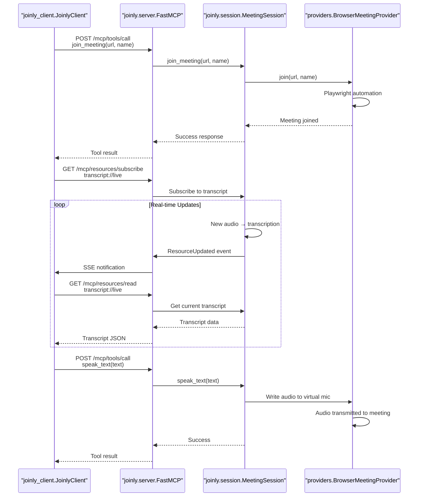
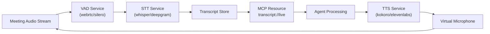

<!-- source: DeepWiki mcp.deepwiki.com · repo joinly-ai/joinly · page 1 Overview · fetched 2026-10-27 -->

# Overview

<details>
<summary>Relevant source files</summary>

The following files were used as context for generating this wiki page:

- [.env.example](.env.example)
- [CHANGELOG.md](CHANGELOG.md)
- [README.md](README.md)
- [joinly/services/tts/resemble.py](joinly/services/tts/resemble.py)
- [pyproject.toml](pyproject.toml)
- [uv.lock](uv.lock)

</details>


This document provides a high-level introduction to the joinly.ai system, explaining its architecture, core components, and operational model. joinly.ai is a connector middleware that enables AI agents to join and participate in video meetings through browser automation and real-time audio processing.

For installation and initial setup, see [Getting Started](#2). For detailed architecture explanations, see [Architecture](#3). For information about the server package, see [Core Server](#4). For the client SDK, see [Client SDK](#6).

## Purpose and Design Philosophy

joinly.ai addresses the challenge of making video meetings accessible to AI agents by providing:

1. **Meeting Access**: Browser-based automation for joining Google Meet, Zoom, and Microsoft Teams
2. **Audio Processing**: Bidirectional speech pipeline for transcription (STT) and synthesis (TTS)
3. **MCP Interface**: Standardized Model Context Protocol server exposing meeting tools and resources
4. **Client Framework**: High-level agent implementation with LLM integration for building conversational bots

The system follows a modular, privacy-first design where users can choose between local and cloud-based speech services, self-host the entire stack, and integrate their preferred LLM providers.

Sources: [README.md:1-50](), [pyproject.toml:1-10]()

## System Architecture

### Package Structure

joinly.ai is organized as a monorepo with three Python packages managed by uv:

| Package | Purpose | Key Entry Points |
|---------|---------|------------------|
| `joinly` | Core server handling meeting connections and audio processing | `joinly.main:cli` |
| `joinly-client` | Client SDK for building conversational agents | `joinly_client.run`, `JoinlyClient` |
| `joinly-common` | Shared types and protocols | `Transcript`, `AudioFormat`, `AudioChunk` |

Sources: [pyproject.toml:61-65](), [uv.lock:13-18]()

### High-Level Component Diagram

```mermaid
graph TB
    subgraph "External Systems"
        Meetings["Meeting Platforms<br/>(Meet/Zoom/Teams)"]
        LLMs["LLM Providers<br/>(OpenAI/Anthropic/Google)"]
        CloudSTT["Cloud STT<br/>(Deepgram)"]
        CloudTTS["Cloud TTS<br/>(ElevenLabs/Deepgram/Resemble)"]
        MCPServers["External MCP Servers<br/>(Tavily/Notion/GitHub)"]
    end
    
    subgraph "joinly Package"
        Main["joinly.main<br/>CLI entry point"]
        Session["session.MeetingSession<br/>Orchestrator"]
        Container["di.SessionContainer<br/>DI system"]
        FastMCP["server.FastMCP<br/>MCP interface"]
        
        subgraph "providers"
            Browser["browser.BrowserMeetingProvider"]
            GMeet["browser.platforms.GoogleMeetController"]
            Zoom["browser.platforms.ZoomController"]
            Teams["browser.platforms.TeamsController"]
        end
        
        subgraph "controllers"
            TransCtrl["transcription.DefaultTranscriptionController"]
            SpeechCtrl["speech.DefaultSpeechController"]
        end
        
        subgraph "services"
            VAD["vad.WebRTCVAD / vad.SileroVAD"]
            STT["stt.FasterWhisperSTT"]
            TTS["tts.KokoroTTS"]
        end
        
        subgraph "core"
            Transcript["core.Transcript"]
            EventBus["core.EventBus"]
            Clock["core.Clock"]
        end
    end
    
    subgraph "joinly-client Package"
        CLIClient["joinly_client.__main__<br/>CLI entry"]
        RunFunc["joinly_client.run<br/>High-level API"]
        JClient["client.JoinlyClient<br/>MCP client"]
        Agent["agent.ConversationalToolAgent<br/>LLM integration"]
    end
    
    subgraph "joinly-common Package"
        Types["types.AudioChunk<br/>types.AudioFormat<br/>types.TranscriptSegment"]
        Protocols["protocols.TTS<br/>protocols.STT<br/>protocols.VAD"]
    end
    
    Main --> Container
    Container --> Session
    Session --> FastMCP
    Session --> Browser
    Session --> TransCtrl
    Session --> SpeechCtrl
    Session --> Transcript
    Session --> EventBus
    Session --> Clock
    
    Browser --> GMeet
    Browser --> Zoom
    Browser --> Teams
    Browser --> Meetings
    
    TransCtrl --> VAD
    TransCtrl --> STT
    TransCtrl --> Transcript
    SpeechCtrl --> TTS
    
    STT -.optional.-> CloudSTT
    TTS -.optional.-> CloudTTS
    
    FastMCP <--> JClient
    
    CLIClient --> RunFunc
    RunFunc --> Agent
    RunFunc --> JClient
    Agent --> LLMs
    Agent --> JClient
    JClient -.optional.-> MCPServers
    
    Types -.used by.-> Session
    Types -.used by.-> JClient
    Protocols -.implemented by.-> VAD
    Protocols -.implemented by.-> STT
    Protocols -.implemented by.-> TTS
```



Sources: [pyproject.toml:1-65](), [README.md:23-50]()

### Server-Client Communication via MCP

The server and client communicate using the FastMCP protocol over HTTP with Server-Sent Events for real-time updates:



Sources: [README.md:220-238](), Diagram 5 from high-level diagrams

## Core Components

### Server Package (`joinly`)

The server package runs in a Docker container and handles:

**Meeting Integration** ([#4.3](#4.3))
- `joinly.providers.browser.BrowserMeetingProvider` - Main provider using Playwright
- Platform-specific controllers in `joinly.providers.browser.platforms/` - GoogleMeetController, ZoomController, TeamsController
- Virtual devices (Xvfb display, PulseAudio for audio I/O)

**Audio Processing** ([#5](#5))
- `joinly.controllers.transcription.DefaultTranscriptionController` - Manages VAD → STT pipeline
- `joinly.controllers.speech.DefaultSpeechController` - Manages TTS → audio output pipeline
- Service implementations in `joinly.services/` - VAD, STT, TTS providers

**Session Management** ([#4.2](#4.2))
- `joinly.session.MeetingSession` - Central orchestrator coordinating all components
- `joinly.di.SessionContainer` - Dependency injection container for service resolution
- Shared resources: `joinly.core.Transcript`, `joinly.core.EventBus`, `joinly.core.Clock`

**MCP Server** ([#4.1](#4.1))
- `joinly.server` - FastMCP server implementation exposing tools and resources
- Runs on port 8000 by default, configurable via CLI

Sources: [pyproject.toml:1-31](), [README.md:220-238](), Diagram 2 from high-level diagrams

### Client Package (`joinly-client`)

The client package provides tools for building AI agents:

**Core Client** ([#6.1](#6.1))
- `joinly_client.client.JoinlyClient` - Low-level MCP client for custom agents
- Handles MCP communication, resource subscriptions, tool execution
- Can be used standalone for building custom agents

**Conversational Agent** ([#6.2](#6.2))
- `joinly_client.agent.ConversationalToolAgent` - High-level agent with LLM integration
- Message history management with filtering
- Tool orchestration across multiple MCP servers
- System prompts for dyadic and multi-party conversations

**LLM Integration**
- Uses `pydantic-ai-slim` for type-safe LLM interactions
- Supports OpenAI, Anthropic, Google, Azure OpenAI providers
- Configurable via environment variables

**Entry Points** ([#6.3](#6.3))
- CLI: `uvx joinly-client <MeetingURL>`
- Python function: `await joinly_client.run(...)`
- Direct usage: `JoinlyClient(...)` for custom agents

Sources: [README.md:87-127](), [.env.example:1-48](), Diagram 3 from high-level diagrams

### Common Package (`joinly-common`)

Shared types and protocols used by both server and client:

| Module | Key Types | Purpose |
|--------|-----------|---------|
| `types` | `AudioChunk`, `AudioFormat`, `TranscriptSegment`, `Transcript` | Data models for audio and transcripts |
| `protocols` | `VAD`, `STT`, `TTS`, `MeetingProvider` | Protocol interfaces for service implementations |
| `settings` | `Settings`, `get_settings` | Configuration management |

Sources: [pyproject.toml:50-52]()

## Key Features

### Real-Time Audio Processing

The system processes audio bidirectionally:

**Input Pipeline**: Meeting audio → VAD → STT → Transcript → MCP updates → Client agent
**Output Pipeline**: Agent response → TTS → Virtual microphone → Meeting audio



Sources: [README.md:34-40](), Diagram 5 from high-level diagrams

### Service Provider Flexibility

Multiple implementations for each service type:

| Service | Local (Privacy) | Cloud (Quality) |
|---------|-----------------|-----------------|
| **VAD** | WebRTC VAD, Silero VAD | N/A |
| **STT** | Faster Whisper (base.en, distil-large-v3) | Deepgram (nova-2, nova-3) |
| **TTS** | Kokoro ONNX | ElevenLabs, Deepgram Aura, Resemble AI |

Configuration via CLI arguments (`--stt`, `--tts`, `--vad`) or environment variables.

Sources: [README.md:159-184](), [.env.example:37-45](), Diagram 6 from high-level diagrams

### MCP Tools and Resources

The server exposes standardized meeting capabilities:

**Tools** (callable actions):
- `join_meeting`, `leave_meeting` - Session control
- `speak_text`, `send_chat_message` - Output actions
- `mute_yourself`, `unmute_yourself` - Audio control
- `get_transcript`, `get_chat_history`, `get_participants` - State queries
- `get_video_snapshot` - Visual information (for vision models)

**Resources** (subscribable data streams):
- `transcript://live` - Real-time transcript with speaker attribution
- `transcript://live/segments` - Individual segment updates
- `usage://current` - Token and API usage tracking

Sources: [README.md:220-238]()

## Deployment Modes

joinly.ai supports three primary deployment patterns:

### Mode 1: Server + External Client

Run server in Docker, client runs separately (local machine or cloud):

```bash
# Terminal 1: Start server
docker run -p 8000:8000 ghcr.io/joinly-ai/joinly:latest

# Terminal 2: Run client
uvx joinly-client --env-file .env <MeetingURL>
```

**Use case**: Production deployments, multiple clients, custom agent development

### Mode 2: All-in-One Client

Server and client bundled in single Docker container:

```bash
docker run --env-file .env ghcr.io/joinly-ai/joinly:latest --client <MeetingURL>
```

**Use case**: Quick testing, simple deployments, minimal setup

### Mode 3: Custom Client

Build specialized agents using low-level `JoinlyClient` API:

```python
from joinly_client import JoinlyClient

async def my_agent():
    client = JoinlyClient(mcp_server_url="http://localhost:8000/mcp/")
    await client.join_meeting(url="...", name="Custom Agent")
    # Custom agent logic...
```

**Use case**: Advanced integrations, specialized behavior, research

Sources: [README.md:52-127](), Diagram 4 from high-level diagrams

## Docker Image Variants

Three image types support different deployment scenarios:

| Variant | Tag | Size | Models Included | GPU Support | Use Case |
|---------|-----|------|-----------------|-------------|----------|
| **Base** | `latest` | ~2.3GB | Whisper base.en, Kokoro v0.4.9 | No | CPU deployments, privacy-focused |
| **CUDA** | `latest-cuda` | Larger | Whisper distil-large-v3, Kokoro | Yes (CUDA 12.6+) | High-quality transcription, GPU available |
| **Lite** | `latest-lite` | Minimal | None (downloads on first use) | No | Cloud services only, minimal footprint |

Sources: [README.md:199-214](), [CHANGELOG.md:133-135]()

## Technology Stack

### Core Technologies

- **Language**: Python 3.12+
- **Package Management**: uv (monorepo with workspace)
- **Browser Automation**: Playwright with Chromium
- **Containerization**: Docker with multi-stage builds

### Key Dependencies

```python
# Server (joinly)
"fastmcp>=2.10.5"           # MCP server framework
"playwright>=1.51.0"         # Browser automation
"faster-whisper>=1.1.1"      # Local STT
"kokoro-onnx>=0.4.9"         # Local TTS
"webrtcvad-wheels>=2.0.14"   # Voice activity detection
"deepgram-sdk>=4.1.1"        # Cloud STT/TTS
"elevenlabs>=2.5.0"          # Cloud TTS

# Client (joinly-client)
"pydantic-ai-slim"           # LLM integration
"anthropic", "openai"        # LLM providers
```

Sources: [pyproject.toml:10-27](), [uv.lock:1-20]()

### Virtual Device Infrastructure

The server creates virtual devices for browser integration:

- **Display**: Xvfb (X Virtual Framebuffer) with optional VNC for debugging
- **Audio Input**: Virtual microphone via PulseAudio
- **Audio Output**: Virtual speaker via PulseAudio
- **Audio Server**: PulseAudio managing audio routing

Sources: Diagram 1 from high-level diagrams

## Configuration System

Settings are loaded hierarchically from multiple sources:

1. **Environment Variables** - Highest priority, loaded from `.env` file
2. **CLI Arguments** - Override environment settings
3. **HTTP Headers** - Client can set `joinly-settings` header for session-specific config
4. **Defaults** - Fallback values in code

Configuration areas:
- LLM provider and model selection
- STT/TTS service providers and parameters
- Meeting participant name and language
- Server host and port
- Logging verbosity

Sources: [README.md:128-157](), [.env.example:1-48]()

## Development and Extension

joinly.ai is designed for extensibility:

**Adding Speech Services**: Implement `STT`, `TTS`, or `VAD` protocol from `joinly-common`, register in `SessionContainer._resolve`

**Custom Meeting Providers**: Implement `MeetingProvider` protocol for new platforms

**Custom Agents**: Use `JoinlyClient` API to build specialized agents with custom logic

**MCP Integration**: Connect additional MCP servers via client configuration

For development setup, see [Development Environment Setup](#8.1). For build system details, see [Build System and Dependencies](#8.2).

Sources: [README.md:216-250](), [pyproject.toml:37-48]()

---

