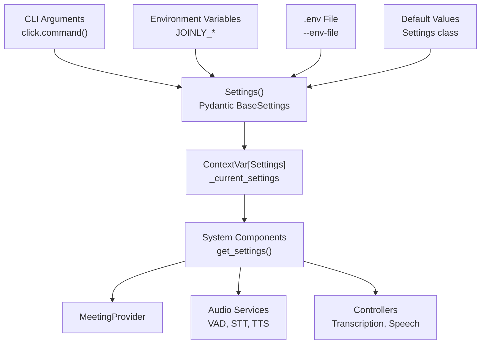
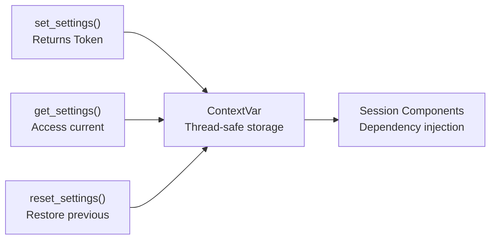
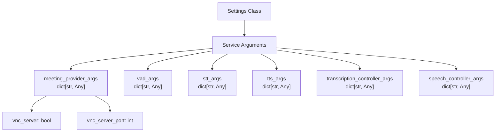
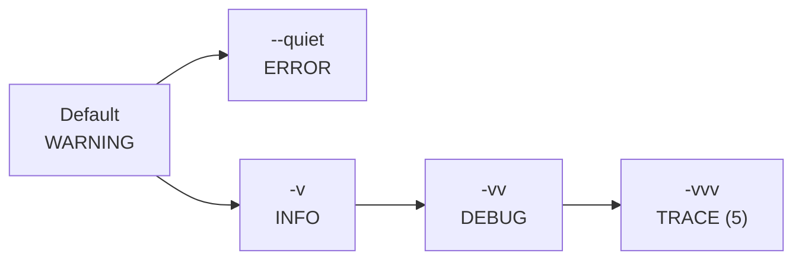

<!-- source: DeepWiki mcp.deepwiki.com · repo joinly-ai/joinly · page 2.3 Configuration and Settings · fetched 2026-10-27 -->

# Configuration and Settings

<details>
<summary>Relevant source files</summary>

The following files were used as context for generating this wiki page:

- [.env.example](.env.example)
- [README.md](README.md)
- [joinly/main.py](joinly/main.py)
- [joinly/services/tts/resemble.py](joinly/services/tts/resemble.py)

</details>


This document covers the configuration system for the joinly application, including environment variables, command-line options, settings management, and service-specific configuration. The configuration system uses Pydantic BaseSettings for type-safe configuration management with support for multiple configuration sources.

For information about installation and system dependencies, see [Installation and Dependencies](#2.1). For usage examples and running the system, see [Quick Start Guide](#2.2).

## Configuration Architecture

The joinly configuration system follows a layered approach where settings can be specified through multiple sources with a defined precedence order.

### Configuration Flow



Sources: [joinly/main.py:35-315](), [joinly/settings.py:1-79]()

### Settings Management Pattern



Sources: [joinly/settings.py:48-79]()

## Configuration Sources

The configuration system supports multiple sources with the following precedence order (highest to lowest):

1. **Command-line arguments** - Direct CLI options override all other sources
2. **Environment variables** - Prefixed with `JOINLY_`
3. **Environment files** - Loaded via `--env-file` option
4. **Default values** - Defined in the `Settings` class

### Environment File Loading

```bash
# Load configuration from custom .env file
joinly --env-file /path/to/config.env

# Environment variables are loaded eagerly before other options
```

Sources: [joinly/main.py:114-122]()

## Core Settings

### Basic Configuration

The `Settings` class in [joinly/settings.py:17-46]() defines the core configuration structure:

| Setting | Default | Environment Variable | Description |
|---------|---------|---------------------|-------------|
| `name` | `"joinly"` | `JOINLY_NAME` | Meeting participant name |
| `language` | `"en"` | `JOINLY_LANGUAGE` | Language for transcription and TTS |
| `device` | `"cpu"` | `JOINLY_DEVICE` | Compute device (cpu/cuda) |

### Server Configuration

| Setting | Default | Environment Variable | Description |
|---------|---------|---------------------|-------------|
| `host` | `"127.0.0.1"` | `JOINLY_SERVER_HOST` | Server bind address |
| `port` | `8000` | `JOINLY_SERVER_PORT` | Server bind port |

### Service Selection

Each service type can be configured independently:

| Service | Default | Environment Variable | Available Options |
|---------|---------|---------------------|-------------------|
| `meeting_provider` | `"browser"` | `JOINLY_MEETING_PROVIDER` | `"browser"` |
| `vad` | `"silero"` | `JOINLY_VAD` | `"webrtc"`, `"silero"` |
| `stt` | `"whisper"` | `JOINLY_STT` | `"whisper"`, `"deepgram"` |
| `tts` | `"kokoro"` | `JOINLY_TTS` | `"kokoro"`, `"elevenlabs"`, `"deepgram"` |
| `transcription_controller` | `"default"` | - | `"default"` |
| `speech_controller` | `"default"` | - | `"default"` |

Sources: [joinly/settings.py:24-31]()

## Service-Specific Configuration

Each service supports additional configuration through argument dictionaries:

### Service Arguments Structure



Sources: [joinly/settings.py:33-38](), [joinly/main.py:182-234]()

### CLI Argument Parsing

Service arguments can be specified via CLI using key-value pairs:

```bash
# Multiple service arguments
joinly --meeting-provider-arg vnc_server=true \
       --meeting-provider-arg vnc_server_port=5901 \
       --vad-arg threshold=0.5 \
       --stt-arg model=whisper-large \
       meeting_url

# JSON values are parsed automatically
joinly --tts-arg voice_settings='{"speed": 1.2, "pitch": 0.8}'
```

The `_parse_kv` function [joinly/main.py:16-32]() handles conversion of CLI key-value pairs to dictionaries with automatic JSON parsing.

Sources: [joinly/main.py:16-32](), [joinly/main.py:182-234]()

## Environment Variable Configuration

### Naming Convention

All environment variables use the `JOINLY_` prefix with nested configuration supported via double underscores:

```bash
# Basic settings
export JOINLY_NAME="MyBot"
export JOINLY_LANGUAGE="es"
export JOINLY_DEVICE="cuda"

# Server configuration
export JOINLY_SERVER_HOST="0.0.0.0"
export JOINLY_SERVER_PORT="9000"

# Service selection
export JOINLY_VAD="webrtc"
export JOINLY_STT="deepgram"
export JOINLY_TTS="elevenlabs"

# Nested configuration (example)
export JOINLY_MEETING_PROVIDER_ARGS__VNC_SERVER="true"
export JOINLY_MEETING_PROVIDER_ARGS__VNC_SERVER_PORT="5901"
```

### Pydantic Settings Configuration

The `Settings` class uses `SettingsConfigDict` [joinly/settings.py:40-45]() to configure environment variable handling:

- `env_prefix="JOINLY_"` - All environment variables must start with this prefix
- `env_nested_delimiter="__"` - Double underscores separate nested configuration levels
- `extra="forbid"` - Unknown configuration keys are rejected
- `frozen=True` - Settings instances are immutable after creation

Sources: [joinly/settings.py:40-45]()

## Logging Configuration

### Logging Levels and Options

The logging system [joinly/utils/logging.py:6-44]() supports multiple configuration options:

| Option | Environment Variable | Description |
|--------|---------------------|-------------|
| `-v, --verbose` | - | Increase verbosity (repeatable) |
| `-q, --quiet` | - | Suppress non-error logs |
| `--logging-plain` | `JOINLY_LOGGING_PLAIN` | Disable rich formatting |

### Verbosity Levels



The logging configuration automatically detects and uses Rich formatting when available, falling back to plain formatting.

Sources: [joinly/utils/logging.py:6-44](), [joinly/main.py:235-250]()

## Client-Specific Configuration

When running in client mode, additional LLM configuration is available:

| Setting | Default | Environment Variable | Description |
|---------|---------|---------------------|-------------|
| `llm_provider` | `"openai"` | `JOINLY_LLM_PROVIDER` | LLM provider selection |
| `llm_model` | `"gpt-4o"` | `JOINLY_LLM_MODEL` | Specific model name |
| `name_trigger` | `false` | - | Activate only on name mention |

These settings are passed to the `joinly_client.run()` function when operating in client mode [joinly/main.py:301-310]().

Sources: [joinly/main.py:94-112](), [joinly/main.py:301-310]()

## Configuration Examples

### Development Configuration

```bash
# .env file for development
JOINLY_NAME="DevBot"
JOINLY_DEVICE="cpu"
JOINLY_SERVER_HOST="0.0.0.0"
JOINLY_SERVER_PORT="8000"
JOINLY_VAD="silero"
JOINLY_STT="whisper"
JOINLY_TTS="kokoro"
JOINLY_LOGGING_PLAIN="false"
```

### Production Configuration

```bash
# Production environment variables
export JOINLY_NAME="ProductionAgent"
export JOINLY_DEVICE="cuda"
export JOINLY_SERVER_HOST="0.0.0.0"
export JOINLY_SERVER_PORT="8000"
export JOINLY_STT="deepgram"
export JOINLY_TTS="elevenlabs"
export DEEPGRAM_API_KEY="your_api_key"
export ELEVENLABS_API_KEY="your_api_key"
```

### CLI Override Example

```bash
# Override environment settings via CLI
joinly --name "MeetingBot" \
       --device cuda \
       --stt deepgram \
       --tts elevenlabs \
       --meeting-provider-arg vnc_server=true \
       --server
```

Sources: [joinly/main.py:35-315](), [joinly/settings.py:17-46]()

---

