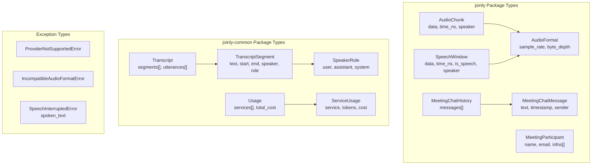
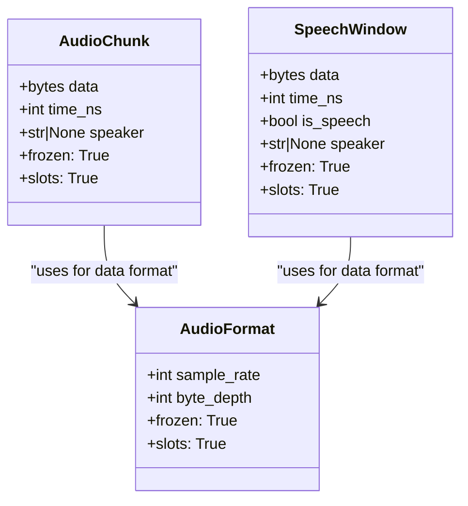
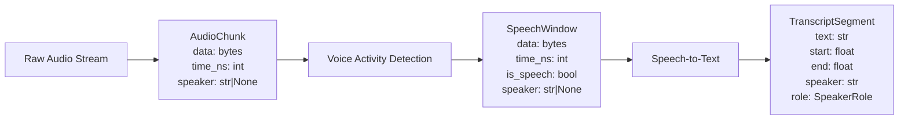
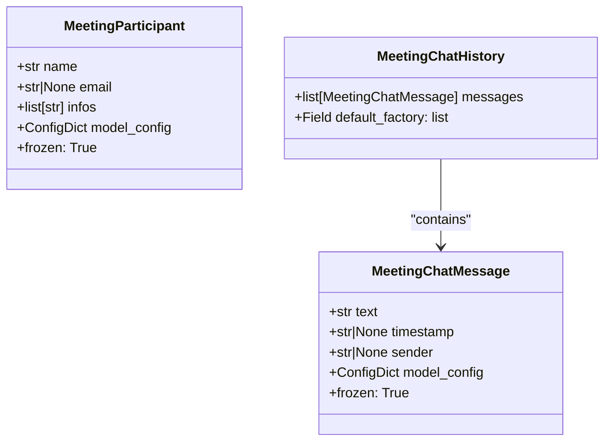
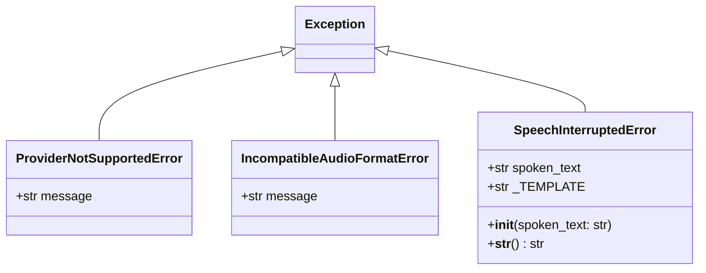
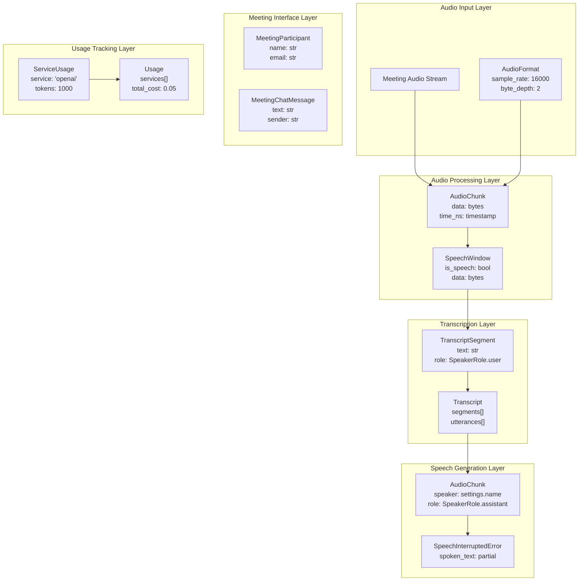

<!-- source: DeepWiki mcp.deepwiki.com · repo joinly-ai/joinly · page 3.3 Data Types and Models · fetched 2026-10-27 -->

# Data Types and Models

Relevant source files

The following files were used as context for generating this wiki page:

- [common/joinly_common/types.py](common/joinly_common/types.py)
- [joinly/controllers/speech/default.py](joinly/controllers/speech/default.py)
- [joinly/server.py](joinly/server.py)
- [joinly/types.py](joinly/types.py)
- [joinly/utils/usage.py](joinly/utils/usage.py)

This document covers the core data structures, types, and models used throughout the joinly system. These types define the contracts for audio processing, meeting interaction, transcription, and inter-component communication. For information about how these types are used in the MCP protocol implementation, see [MCP Server and Client Communication](#3.1). For session-specific model management, see [Session Management and Dependency Injection](#3.2).

## Core Data Structures Overview

The joinly system defines its data models across two main packages: the core `joinly` application and the shared `joinly-common` library. The core application focuses on audio processing and meeting-specific types, while the common library provides shared abstractions for transcription and usage tracking.

Sources: [joinly/types.py:1-125](), [common/joinly_common/types.py]()

## Audio Processing Types

The audio processing pipeline relies on several core data structures that represent different stages of audio handling, from raw chunks to processed speech windows.

### AudioFormat

The `AudioFormat` dataclass defines the properties of PCM audio streams used throughout the system:

The `AudioFormat` type is defined as a frozen dataclass with slots for memory efficiency [joinly/types.py:44-55](). It specifies the sample rate in Hz and byte depth in bytes, which are essential for audio format conversion operations used in the speech processing pipeline.

### Audio Data Flow Types

The audio processing pipeline transforms raw audio through several typed stages:

Sources: [joinly/types.py:57-87](), [joinly/controllers/speech/default.py:1-279]()

## Meeting-Related Types

The system defines several Pydantic models to represent meeting participants, chat messages, and conversation history.

### Meeting Participants and Chat

These models use Pydantic's `BaseModel` with frozen configuration to ensure immutability [joinly/types.py:111-125](). The `MeetingParticipant` model includes an `infos` list for extensible participant metadata, while `MeetingChatMessage` captures the essential elements of chat communication during meetings.

Sources: [joinly/types.py:89-125]()

## Exception Types

The system defines specialized exceptions for different error conditions that can occur during audio processing and provider interactions.

### Custom Exception Hierarchy

The `SpeechInterruptedError` is particularly notable as it includes the partially spoken text when speech is interrupted by detected speech from other participants [joinly/types.py:29-42](). This allows the system to provide meaningful feedback about what was successfully communicated before interruption.

Sources: [joinly/types.py:21-42]()

## Shared Types from joinly-common

The `joinly-common` package provides shared types that are used across multiple components of the joinly ecosystem. These types are imported and re-exported by the main joinly package.

### Transcription and Usage Types

| Type | Purpose | Key Fields |
|------|---------|------------|
| `Transcript` | Container for transcription data | `segments[]`, `utterances[]` |
| `TranscriptSegment` | Individual speech segment | `text`, `start`, `end`, `speaker`, `role` |
| `SpeakerRole` | Enumeration of speaker types | `user`, `assistant`, `system` |
| `ServiceUsage` | Tracks usage of AI services | `service`, `tokens`, `cost` |
| `Usage` | Aggregated usage metrics | `services[]`, `total_cost` |

These types are defined in the `joinly-common` package and imported into the main application [joinly/types.py:3-18](). The re-export pattern allows consumers to import all necessary types from a single location while maintaining clear separation of concerns.

Sources: [joinly/types.py:3-18](), [common/pyproject.toml:1-23]()

## Type Relationships and Data Flow

The following diagram shows how data types flow through the major system components and their transformations:

This data flow demonstrates how the type system enforces contracts between different processing stages, from raw audio input through transcription and speech generation, while maintaining usage tracking and meeting context throughout the pipeline.

Sources: [joinly/types.py:1-125](), [joinly/controllers/speech/default.py:93-279]()

---

