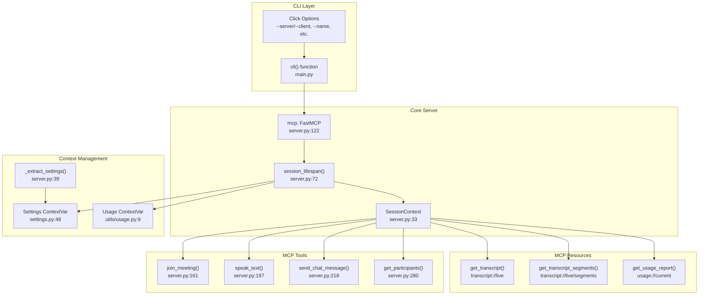
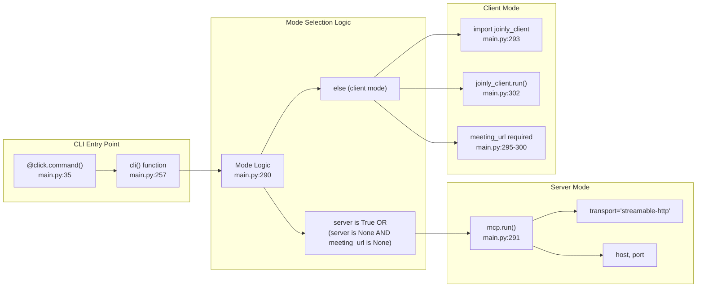
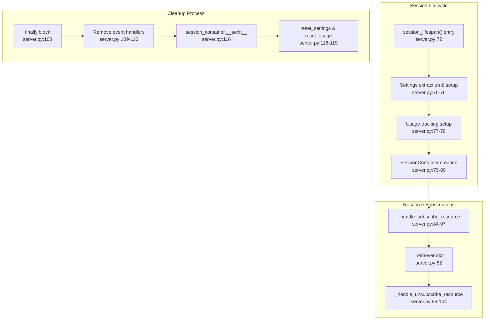
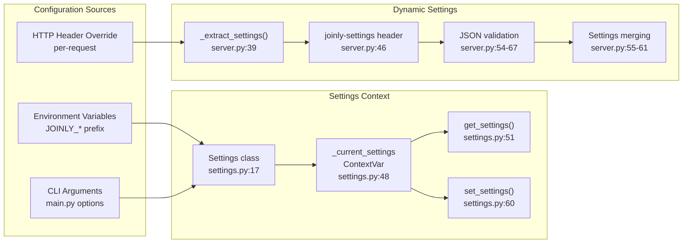
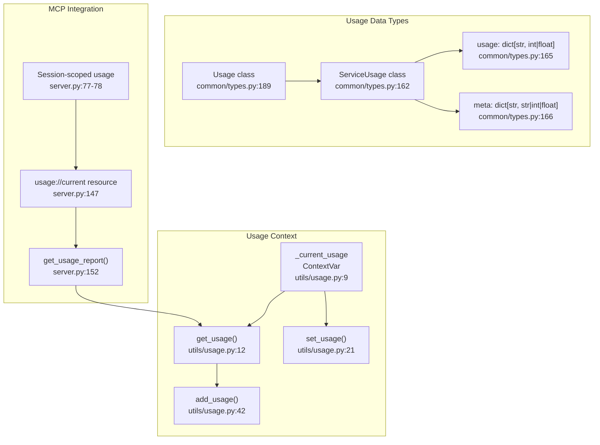

<!-- source: DeepWiki mcp.deepwiki.com · repo joinly-ai/joinly · page 4 Core Server (joinly) · fetched 2026-10-27 -->

# joinly (Core Application)

Relevant source files

The following files were used as context for generating this wiki page:

- [CHANGELOG.md](CHANGELOG.md)
- [common/joinly_common/types.py](common/joinly_common/types.py)
- [joinly/main.py](joinly/main.py)
- [joinly/server.py](joinly/server.py)
- [joinly/utils/usage.py](joinly/utils/usage.py)
- [pyproject.toml](pyproject.toml)
- [uv.lock](uv.lock)

The joinly core application is the main server component that provides MCP (Model Context Protocol) services for AI agents to join and interact with video meetings. This application can operate in two modes: as a standalone MCP server exposing meeting tools and resources, or as a client that directly joins meetings using integrated AI capabilities.

For information about the client SDK for building AI agents, see [joinly-client (Python SDK)](#4.2). For shared utilities and data structures, see [joinly-common (Shared Library)](#4.3).

## Application Architecture

The core application is built around a FastMCP server that provides tools and resources for meeting interaction, with a CLI interface that supports both server and client operational modes.

Sources: [joinly/main.py:257-311](), [joinly/server.py:122](), [joinly/server.py:32-37](), [joinly/server.py:71-120]()

## CLI Interface and Application Modes

The application supports two primary operational modes controlled by the CLI interface in `main.py`.

Sources: [joinly/main.py:257-311](), [joinly/main.py:290-310]()

### Server Mode

When running in server mode, the application starts a FastMCP server that exposes meeting control tools and resources over HTTP. This mode is activated when:
- `--server` flag is explicitly set, or  
- No meeting URL is provided (default behavior)

The server binds to the specified host and port (defaults: `127.0.0.1:8000`) and provides MCP endpoints for client connections.

### Client Mode  

In client mode, the application directly joins a meeting using the integrated `joinly_client` package. This mode requires:
- A meeting URL as a command line argument
- LLM provider and model configuration
- Optional name trigger functionality

## MCP Server Implementation

The FastMCP server provides a comprehensive set of tools and resources for meeting interaction, implemented in [joinly/server.py]().

### Core Tools

| Tool | Function | Description |
|------|----------|-------------|
| `join_meeting` | [server.py:161-181]() | Join a meeting with URL, name, and optional passcode |
| `leave_meeting` | [server.py:188-194]() | Leave the current meeting |
| `speak_text` | [server.py:197-212]() | Speak text using TTS in the meeting |
| `send_chat_message` | [server.py:218-225]() | Send chat messages to meeting participants |
| `get_chat_history` | [server.py:228-237]() | Retrieve meeting chat history |
| `get_transcript` | [server.py:241-273]() | Get transcript with filtering options |
| `get_participants` | [server.py:277-285]() | List current meeting participants |
| `mute_yourself` | [server.py:289-298]() | Mute microphone |
| `unmute_yourself` | [server.py:301-311]() | Unmute microphone |

### MCP Resources

| Resource | URL | Function | Description |
|----------|-----|----------|-------------|
| Live Transcript | `transcript://live` | [server.py:130-133]() | Participant utterances only |
| Transcript Segments | `transcript://live/segments` | [server.py:141-144]() | All transcript segments |
| Usage Statistics | `usage://current` | [server.py:152-154]() | Service usage metrics |

Sources: [joinly/server.py:125-155](), [joinly/server.py:157-311]()

## Session Management

The application implements sophisticated session management using FastMCP's lifespan context system to ensure proper resource allocation and cleanup.

Sources: [joinly/server.py:71-120](), [joinly/server.py:84-104](), [joinly/server.py:108-119]()

## Settings Management

The application uses a context-based settings system that supports dynamic configuration through HTTP headers and environment variables.

The `Settings` class in [joinly/settings.py:17-46]() defines configuration for:
- Meeting provider and AI service selections (`meeting_provider`, `vad`, `stt`, `tts`)
- Service-specific arguments (`meeting_provider_args`, `vad_args`, etc.)
- Basic parameters (`name`, `language`, `device`)

Sources: [joinly/settings.py:17-78](), [joinly/server.py:39-68]()

## Usage Tracking System

The application implements comprehensive usage tracking for AI services and meeting operations using a context-based system.

Sources: [joinly/utils/usage.py:1-56](), [common/joinly_common/types.py:162-236](), [joinly/server.py:147-154]()

## Health Check and HTTP Endpoints

The application provides additional HTTP endpoints beyond the MCP protocol:

- **Health Check**: `GET /health` [server.py:314-317]() returns JSON status
- **MCP Endpoints**: Automatically provided by FastMCP at `/mcp/` paths

The server uses "streamable-http" transport, enabling both standard HTTP requests and WebSocket connections for MCP communication.

Sources: [joinly/server.py:314-321](), [joinly/main.py:291]()

---

