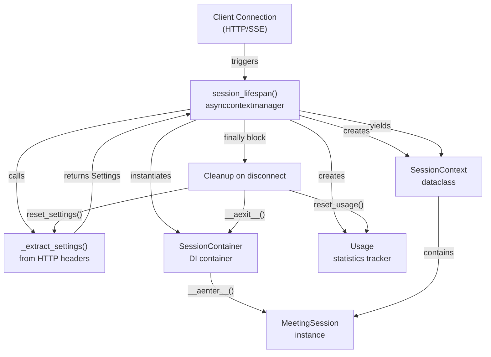
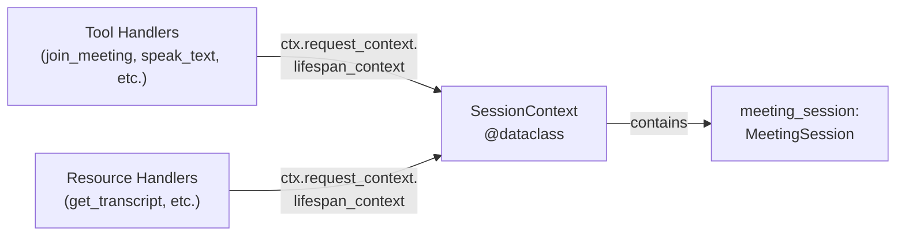
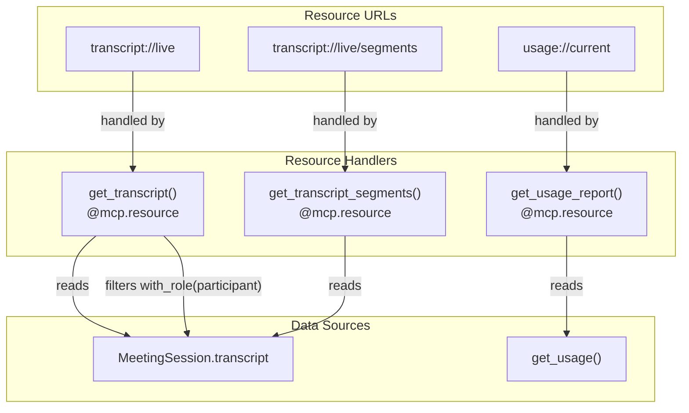
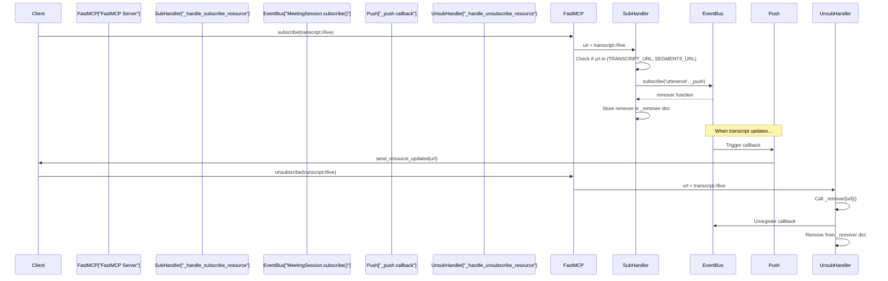
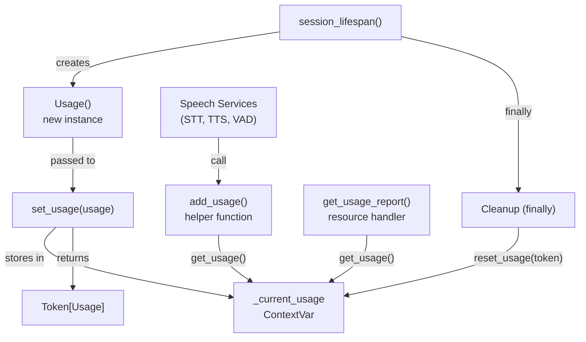

<!-- source: DeepWiki mcp.deepwiki.com · repo joinly-ai/joinly · page 4.1 FastMCP Server Interface · fetched 2026-10-27 -->

# FastMCP Server Interface

<details>
<summary>Relevant source files</summary>

The following files were used as context for generating this wiki page:

- [common/joinly_common/types.py](common/joinly_common/types.py)
- [joinly/server.py](joinly/server.py)
- [joinly/utils/usage.py](joinly/utils/usage.py)

</details>


## Purpose and Scope

This document details the FastMCP server implementation in `joinly/server.py`, which exposes the joinly meeting capabilities through the Model Context Protocol (MCP). The server provides a standardized interface for clients to control meeting sessions, access live transcripts, and invoke meeting operations.

For details on the MCP protocol and client-server communication patterns, see [MCP Server and Client Communication](#3.1). For information on how the underlying `MeetingSession` orchestrates components, see [Meeting Session Orchestration](#4.2). For client-side usage of these resources and tools, see [JoinlyClient API](#6.1).

**Sources:** [joinly/server.py:1-342]()

## Server Instance and Transport

The MCP server is instantiated using the `FastMCP` framework with a custom lifespan manager:

```python
mcp = FastMCP("joinly", lifespan=session_lifespan)
```

The server runs on the `streamable-http` transport, which enables both HTTP requests for tool calls and Server-Sent Events (SSE) for resource subscriptions. The server listens at the `/mcp/` path when deployed in the Docker container.

**Sources:** [joinly/server.py:124-342]()

## Session Lifecycle and Context Management

### Per-Connection Session Architecture



Each client connection establishes its own `MeetingSession` instance through the `session_lifespan` context manager. This ensures isolation between concurrent clients and proper resource cleanup on disconnection.

**Sources:** [joinly/server.py:73-122]()

### Settings Extraction from HTTP Headers

The server supports dynamic per-connection configuration through the `joinly-settings` HTTP header:

| Configuration Source | Priority | Handled By |
|---------------------|----------|------------|
| HTTP header `joinly-settings` | Highest | `_extract_settings()` |
| Global settings | Fallback | `get_settings()` |

The `_extract_settings()` function [joinly/server.py:41-70]() parses JSON from the header and merges it with the current global settings, enabling clients to override TTS/STT providers, language settings, and other parameters on a per-connection basis.

**Sources:** [joinly/server.py:41-70](), [joinly/server.py:77-78]()

### SessionContext Structure



The `SessionContext` dataclass [joinly/server.py:34-38]() wraps the `MeetingSession` and is accessible to all resource and tool handlers through the FastMCP `Context` object.

**Sources:** [joinly/server.py:34-38]()

## Resources

Resources expose read-only data that clients can query or subscribe to for live updates.

### Resource Definitions



**Sources:** [joinly/server.py:30-31](), [joinly/server.py:127-156]()

### transcript://live

Returns the live transcript containing only participant utterances (excludes assistant speech).

| Property | Value |
|----------|-------|
| URL | `transcript://live` |
| Handler | `get_transcript()` |
| MIME Type | `application/json` |
| Return Type | `Transcript` |
| Filtering | Only `SpeakerRole.participant` segments |

**Implementation:** [joinly/server.py:127-135]()

The handler retrieves `MeetingSession.transcript` and filters it to include only participant segments using `with_role(SpeakerRole.participant)`.

**Sources:** [joinly/server.py:127-135](), [common/joinly_common/types.py:130-133]()

### transcript://live/segments

Returns the complete transcript including both participant and assistant segments.

| Property | Value |
|----------|-------|
| URL | `transcript://live/segments` |
| Handler | `get_transcript_segments()` |
| MIME Type | `application/json` |
| Return Type | `Transcript` |
| Filtering | None (all segments) |

**Implementation:** [joinly/server.py:138-146]()

**Sources:** [joinly/server.py:138-146]()

### usage://current

Returns current usage statistics for speech services (STT, TTS, VAD).

| Property | Value |
|----------|-------|
| URL | `usage://current` |
| Handler | `get_usage_report()` |
| MIME Type | `application/json` |
| Return Type | `Usage` |

**Implementation:** [joinly/server.py:149-156]()

The `Usage` object tracks per-service statistics such as audio duration processed, API calls made, and provider metadata.

**Sources:** [joinly/server.py:149-156](), [joinly/utils/usage.py:12-18](), [common/joinly_common/types.py:245-291]()

## Tools

Tools expose operations that clients can invoke to control the meeting session.

### Tool Catalog

```mermaid
graph TB
    subgraph "Meeting Control Tools"
        JoinMeeting["join_meeting<br/>(meeting_url, participant_name, passcode)"]
        LeaveMeeting["leave_meeting<br/>()"]
    end
    
    subgraph "Communication Tools"
        SpeakText["speak_text<br/>(text)"]
        SendChatMessage["send_chat_message<br/>(message)"]
        MuteYourself["mute_yourself<br/>()"]
        UnmuteYourself["unmute_yourself<br/>()"]
    end
    
    subgraph "Query Tools"
        GetTranscriptTool["get_transcript<br/>(mode, minutes)"]
        GetChatHistory["get_chat_history<br/>()"]
        GetParticipants["get_participants<br/>()"]
        GetVideoSnapshot["get_video_snapshot<br/>()"]
    end
    
    subgraph "MeetingSession Methods"
        MSJoin["ms.join_meeting()"]
        MSLeave["ms.leave_meeting()"]
        MSSpeak["ms.speak_text()"]
        MSChat["ms.send_chat_message()"]
        MSMute["ms.mute()"]
        MSUnmute["ms.unmute()"]
        MSGetChat["ms.get_chat_history()"]
        MSGetParticipants["ms.get_participants()"]
        MSGetSnapshot["ms.get_video_snapshot()"]
        MSTranscript["ms.transcript"]
    end
    
    JoinMeeting -->|"calls"| MSJoin
    LeaveMeeting -->|"calls"| MSLeave
    SpeakText -->|"calls"| MSSpeak
    SendChatMessage -->|"calls"| MSChat
    MuteYourself -->|"calls"| MSMute
    UnmuteYourself -->|"calls"| MSUnmute
    GetChatHistory -->|"calls"| MSGetChat
    GetParticipants -->|"calls"| MSGetParticipants
    GetVideoSnapshot -->|"calls"| MSGetSnapshot
    GetTranscriptTool -->|"reads"| MSTranscript
```



All tools access the `MeetingSession` instance through `ctx.request_context.lifespan_context.meeting_session` and delegate to corresponding session methods.

**Sources:** [joinly/server.py:159-331]()

### join_meeting

Connects to a meeting platform using the provided URL.

| Parameter | Type | Required | Description |
|-----------|------|----------|-------------|
| `meeting_url` | `str \| None` | No | URL to join (e.g., Google Meet link) |
| `participant_name` | `str \| None` | No | Display name in the meeting |
| `passcode` | `str \| None` | No | Meeting password if required |

**Return:** `"Joined meeting."`

**Implementation:** [joinly/server.py:159-183]()

**Sources:** [joinly/server.py:159-183]()

### leave_meeting

Disconnects from the current meeting and cleans up resources.

**Return:** `"Left the meeting."`

**Implementation:** [joinly/server.py:186-196]()

**Sources:** [joinly/server.py:186-196]()

### speak_text

Generates speech audio from text and transmits it to the meeting using TTS.

| Parameter | Type | Required | Description |
|-----------|------|----------|-------------|
| `text` | `str` | Yes | Text to synthesize and speak |

**Return:** `"Finished speaking."` or error message if interrupted

**Implementation:** [joinly/server.py:199-213]()

The tool catches `SpeechInterruptedError` exceptions and returns the error message instead of raising, allowing clients to handle interruptions gracefully.

**Sources:** [joinly/server.py:199-213]()

### send_chat_message

Sends a text message to the meeting chat interface.

| Parameter | Type | Required | Description |
|-----------|------|----------|-------------|
| `message` | `str` | Yes | Chat message text |

**Return:** `"Sent message."`

**Implementation:** [joinly/server.py:216-227]()

**Sources:** [joinly/server.py:216-227]()

### get_chat_history

Retrieves all messages from the meeting chat.

**Return:** `MeetingChatHistory` containing list of `MeetingChatMessage` objects

**Implementation:** [joinly/server.py:230-239]()

**Sources:** [joinly/server.py:230-239](), [common/joinly_common/types.py:170-190]()

### get_transcript

Retrieves the meeting transcript with optional time-based filtering.

| Parameter | Type | Default | Description |
|-----------|------|---------|-------------|
| `mode` | `Literal["full", "first", "latest"]` | `"full"` | Filtering mode |
| `minutes` | `int` | `0` | Time window in minutes |

**Modes:**
- `"full"`: Returns entire transcript, compacted
- `"first"`: Returns first N minutes, compacted
- `"latest"`: Returns last N minutes, compacted

**Return:** `Transcript` (compacted to merge adjacent segments)

**Implementation:** [joinly/server.py:242-275]()

The tool uses `Transcript.before()`, `Transcript.after()`, and `Transcript.compact()` methods to slice and merge segments efficiently.

**Sources:** [joinly/server.py:242-275](), [common/joinly_common/types.py:120-167]()

### get_participants

Retrieves the current list of meeting participants.

**Return:** `MeetingParticipantList` containing participant names, emails, and metadata

**Implementation:** [joinly/server.py:278-287]()

**Sources:** [joinly/server.py:278-287](), [common/joinly_common/types.py:192-216]()

### get_video_snapshot

Captures a screenshot of the current meeting video feed.

**Return:** `ImageContent` with base64-encoded image data

**Implementation:** [joinly/server.py:290-305]()

The snapshot includes participant webcams and any shared screens. The raw bytes from `MeetingSession.get_video_snapshot()` are base64-encoded for JSON transport.

**Sources:** [joinly/server.py:290-305]()

### mute_yourself / unmute_yourself

Controls the assistant's microphone state in the meeting.

**Return:** `"Muted yourself."` or `"Unmuted yourself."`

**Implementation:** [joinly/server.py:308-331]()

**Sources:** [joinly/server.py:308-331]()

## Resource Subscriptions

The server implements real-time push notifications for resource updates using the MCP subscription mechanism.

### Subscription Flow



**Sources:** [joinly/server.py:84-106]()

### Subscription Handler Implementation

The subscription handlers are registered dynamically during session lifespan initialization [joinly/server.py:86-106]():

**Subscribe Handler:**
1. Filters requests to only handle `transcript://live` and `transcript://live/segments`
2. Determines event type: `"utterance"` for transcript, `"segment"` for segments
3. Registers a `_push()` callback with `MeetingSession.subscribe()`
4. Stores the remover function for cleanup

**Unsubscribe Handler:**
1. Calls the stored remover function to unregister the callback
2. Removes the entry from the `_remover` dictionary

**Event Mapping:**

| Resource URL | Event Name | Trigger Condition |
|--------------|------------|-------------------|
| `transcript://live` | `"utterance"` | New participant utterance detected |
| `transcript://live/segments` | `"segment"` | Any new transcript segment added |

**Sources:** [joinly/server.py:86-106]()

## Custom HTTP Endpoints

### Health Check

A custom health check endpoint is exposed for deployment monitoring:

| Property | Value |
|----------|-------|
| Path | `/health` |
| Method | `GET` |
| Handler | `health_check()` |
| Response | `{"status": "healthy"}` |

**Implementation:** [joinly/server.py:334-337]()

This endpoint bypasses MCP protocol handling and returns a simple JSON response, suitable for container orchestration health checks.

**Sources:** [joinly/server.py:334-337]()

## Usage Tracking

The server tracks service usage statistics using a context-variable-based system that maintains per-connection isolation.

### Usage Context Variables



**Lifecycle:**
1. **Initialization:** [joinly/server.py:79-80]() creates a new `Usage()` instance and sets it in the context variable
2. **During Session:** Speech services call `add_usage()` to record metrics [joinly/utils/usage.py:42-56]()
3. **Queries:** The `usage://current` resource reads from `get_usage()` [joinly/utils/usage.py:12-18]()
4. **Cleanup:** [joinly/server.py:121]() resets the context variable on disconnection

**Sources:** [joinly/server.py:79-80](), [joinly/server.py:121](), [joinly/utils/usage.py:9-40](), [common/joinly_common/types.py:245-291]()

## Server Execution

When run as the main module, the server starts in `streamable-http` transport mode:

```python
if __name__ == "__main__":
    mcp.run(transport="streamable-http")
```

This enables the server to handle both synchronous HTTP tool calls and asynchronous SSE resource subscriptions over the same connection.

**Sources:** [joinly/server.py:340-342]()

---

