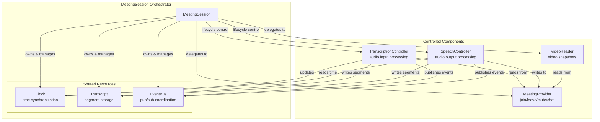
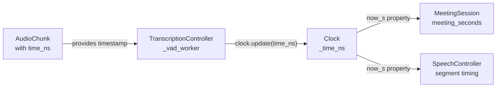
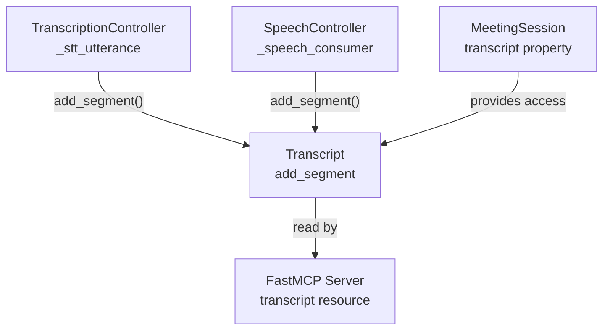
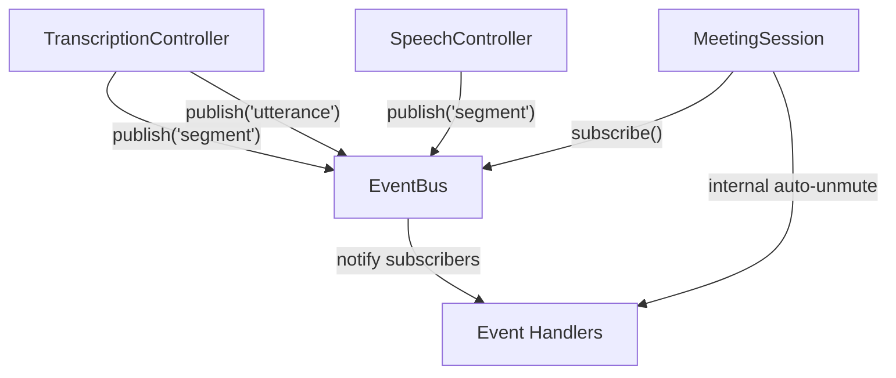
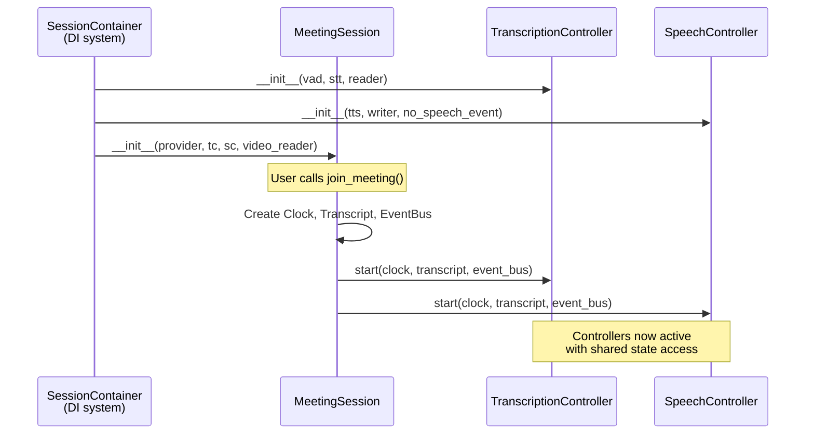
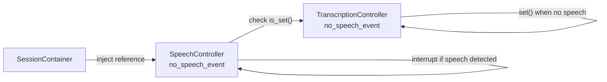
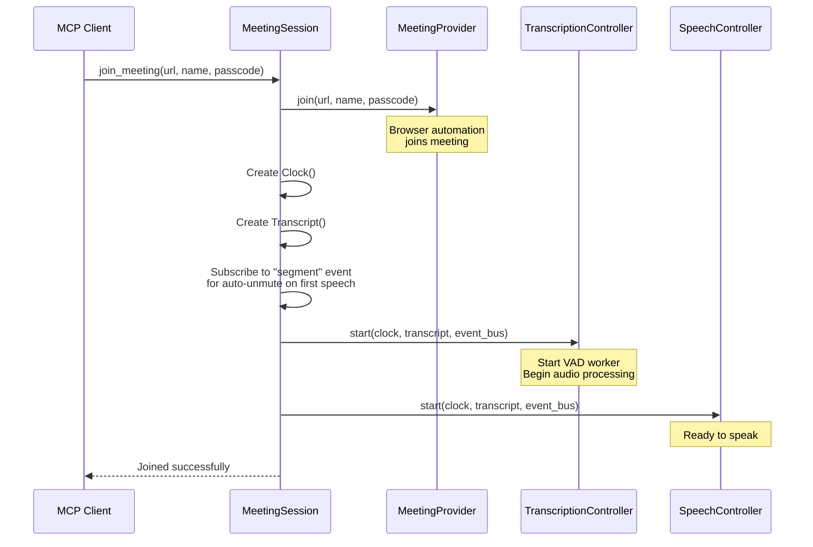
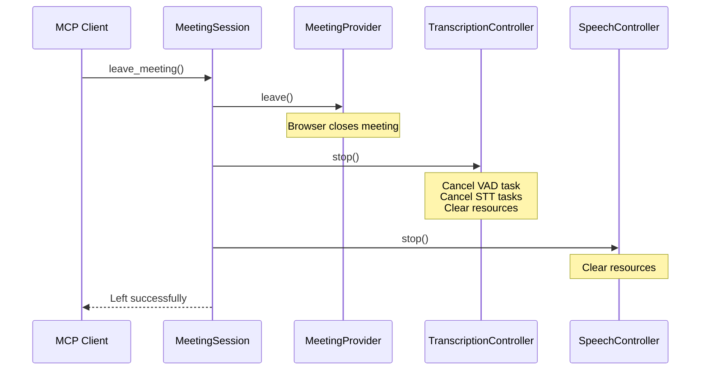
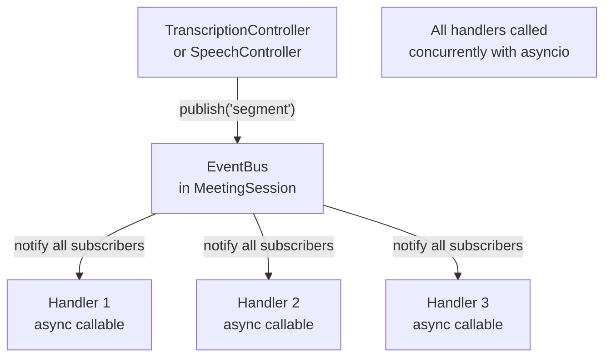
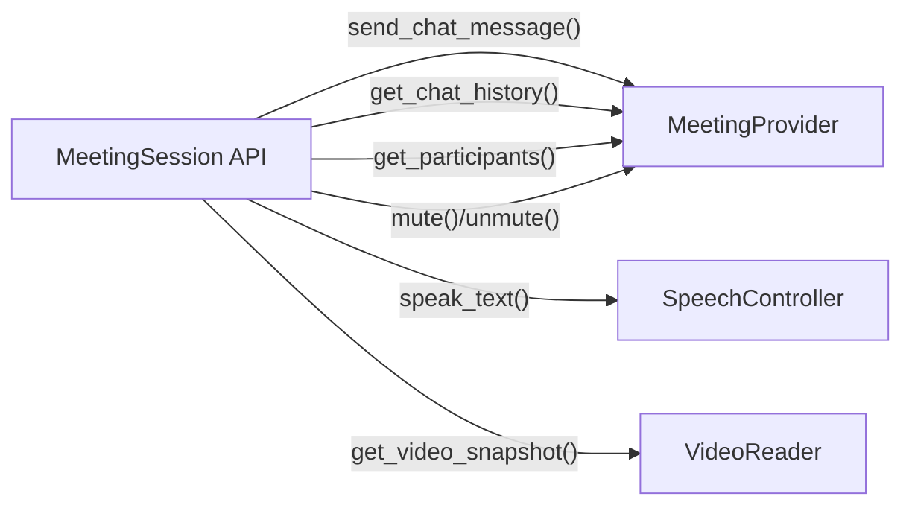

<!-- source: DeepWiki mcp.deepwiki.com · repo joinly-ai/joinly · page 4.2 Meeting Session Orchestration · fetched 2026-10-27 -->

# Meeting Session Orchestration

<details>
<summary>Relevant source files</summary>

The following files were used as context for generating this wiki page:

- [joinly/controllers/speech/default.py](joinly/controllers/speech/default.py)
- [joinly/controllers/transcription/default.py](joinly/controllers/transcription/default.py)
- [joinly/core.py](joinly/core.py)
- [joinly/session.py](joinly/session.py)
- [joinly/types.py](joinly/types.py)
- [joinly/utils/clock.py](joinly/utils/clock.py)

</details>


## Purpose and Scope

This document describes the `MeetingSession` class, which serves as the central orchestrator in the joinly server architecture. `MeetingSession` coordinates the meeting provider, audio processing controllers, and shared resources to enable AI agents to participate in meetings. This page focuses on how the session manages component lifecycle, coordinates bidirectional audio processing, and maintains shared state.

For information about the dependency injection system that instantiates `MeetingSession`, see [Session Management and Dependency Injection](#3.2). For details about the meeting provider abstraction, see [Browser Meeting Provider](#4.3). For audio processing pipeline details, see [Transcription Controller](#5.1) and [Speech Controller](#5.2).

**Sources:** [joinly/session.py:1-172]()

## Architecture Overview

The `MeetingSession` acts as the central coordinator between multiple independent components, providing them with shared resources and managing their lifecycle.

### Component Structure



**Sources:** [joinly/session.py:23-49](), [joinly/core.py:239-322]()

## Core Responsibilities

The `MeetingSession` class has four primary responsibilities:

| Responsibility | Description | Methods |
|---------------|-------------|---------|
| **Component Composition** | Holds references to meeting provider and controllers | Constructor at [joinly/session.py:26-49]() |
| **Shared Resource Management** | Creates and provides `Clock`, `Transcript`, and `EventBus` instances | [joinly/session.py:47-49](), [joinly/session.py:98-99]() |
| **Lifecycle Coordination** | Starts and stops controllers in proper sequence | `join_meeting()`, `leave_meeting()` |
| **API Facade** | Exposes unified interface for meeting operations | All public methods |

**Sources:** [joinly/session.py:23-172]()

## Shared Resources

### Clock

The `Clock` class provides monotonic time tracking for the meeting session. It is updated by the `TranscriptionController` based on incoming audio timestamps, ensuring all components have a synchronized view of meeting time.



The `Clock` is initialized to zero nanoseconds when joining a meeting and tracks relative time from the start of the session. Controllers use `clock.now_s` to timestamp transcript segments.

**Sources:** [joinly/session.py:98](), [joinly/utils/clock.py:1-37](), [joinly/controllers/transcription/default.py:137-138]()

### Transcript

The `Transcript` object serves as the shared data store for all transcript segments generated during the meeting. Both `TranscriptionController` and `SpeechController` write segments to it.



The transcript is created fresh for each meeting session and accessed via the `MeetingSession.transcript` property.

**Sources:** [joinly/session.py:52-57](), [joinly/session.py:99](), [joinly/controllers/transcription/default.py:258](), [joinly/controllers/speech/default.py:200-208]()

### EventBus

The `EventBus` provides a pub/sub mechanism for coordination between components. Controllers publish events when significant actions occur, and other components can subscribe to these events.



**Event Types:**
- `"segment"`: Emitted when a new transcript segment is added
- `"utterance"`: Emitted when a complete utterance is transcribed

**Sources:** [joinly/session.py:49](), [joinly/session.py:67-79](), [joinly/controllers/transcription/default.py:259](), [joinly/controllers/transcription/default.py:277](), [joinly/controllers/speech/default.py:209]()

## Component Coordination

The `MeetingSession` coordinates four independent components by providing them with shared resources and managing their lifecycle.

### Controller Initialization

Both `TranscriptionController` and `SpeechController` follow a two-phase initialization pattern:

1. **Construction Phase**: Components are dependency-injected with their service dependencies (VAD, STT, TTS, etc.)
2. **Activation Phase**: Components receive shared resources via the `start()` method



This pattern decouples service configuration (which service implementation to use) from runtime state (clock, transcript).

**Sources:** [joinly/session.py:26-49](), [joinly/session.py:112-117](), [joinly/core.py:263-273](), [joinly/core.py:296-306]()

### Cross-Controller Coordination

The `SpeechController` references the `TranscriptionController`'s `no_speech_event` to implement speech interruption. This is the only direct cross-controller dependency:



When the transcription controller detects speech, it clears the event. The speech controller checks this event and raises `SpeechInterruptedError` if speech is detected while the agent is speaking.

**Sources:** [joinly/core.py:288-294](), [joinly/controllers/transcription/default.py:177](), [joinly/controllers/transcription/default.py:200](), [joinly/controllers/speech/default.py:231-253]()

## Lifecycle Management

### Join Meeting Sequence

The `join_meeting()` method orchestrates the startup sequence:



**Auto-Unmute Behavior**: The session automatically unmutes the participant when the first segment is detected, then unsubscribes from the event. This ensures the agent can speak after confirming audio input is working.

**Sources:** [joinly/session.py:81-117]()

### Leave Meeting Sequence

The `leave_meeting()` method performs orderly shutdown:



The controllers are stopped after the provider leaves to ensure all pending audio processing completes before cleanup.

**Sources:** [joinly/session.py:119-123](), [joinly/controllers/transcription/default.py:90-109](), [joinly/controllers/speech/default.py:76-80]()

## Event Subscription System

The `MeetingSession` exposes an event subscription mechanism that allows external code (such as the FastMCP server) to react to transcription events.

### Subscription API

```python
unsubscribe = meeting_session.subscribe(
    event_type="segment",  # or "utterance"
    handler=async_callable
)
# Later: unsubscribe() to remove handler
```

The `subscribe()` method returns an unsubscribe callable that removes the handler when called.

**Sources:** [joinly/session.py:67-79]()

### Event Flow



**Sources:** [joinly/utils/events.py]() (referenced but not provided), [joinly/session.py:67-79]()

## API Surface

The `MeetingSession` provides the following public methods:

| Method | Parameters | Returns | Description |
|--------|-----------|---------|-------------|
| `join_meeting` | `meeting_url`, `participant_name`, `passcode` | `None` | Joins a meeting and starts audio processing |
| `leave_meeting` | None | `None` | Leaves meeting and stops all processing |
| `speak_text` | `text: str` | `None` | Synthesizes and speaks text via TTS |
| `send_chat_message` | `message: str` | `None` | Sends chat message to meeting |
| `get_chat_history` | None | `MeetingChatHistory` | Retrieves chat history from meeting |
| `get_participants` | None | `list[MeetingParticipant]` | Lists current meeting participants |
| `get_video_snapshot` | None | `VideoSnapshot` | Captures current video frame |
| `mute` | None | `None` | Mutes the agent's microphone |
| `unmute` | None | `None` | Unmutes the agent's microphone |
| `subscribe` | `event_type`, `handler` | `Callable[[], None]` | Subscribes to events, returns unsubscribe function |

### Properties

| Property | Type | Description |
|----------|------|-------------|
| `transcript` | `Transcript` | Access to the current transcript (raises if not in meeting) |
| `meeting_seconds` | `float` | Current meeting duration in seconds (raises if not in meeting) |

**Sources:** [joinly/session.py:52-172]()

## Implementation Details

### Method Delegation Pattern

Most `MeetingSession` methods are thin wrappers that delegate to the appropriate component:



This design keeps `MeetingSession` focused on coordination rather than implementing features itself.

**Sources:** [joinly/session.py:125-172]()

### Error Handling

The session's public API methods propagate exceptions from the underlying components without catching them. This allows callers (such as the FastMCP server) to handle errors appropriately.

Notable exceptions that may be raised:
- `RuntimeError`: When accessing `transcript` or `meeting_seconds` before joining a meeting
- `SpeechInterruptedError`: From `speak_text()` when speech is interrupted
- Provider-specific errors: From meeting provider operations

**Sources:** [joinly/session.py:54-65](), [joinly/types.py:37-49]()

---

