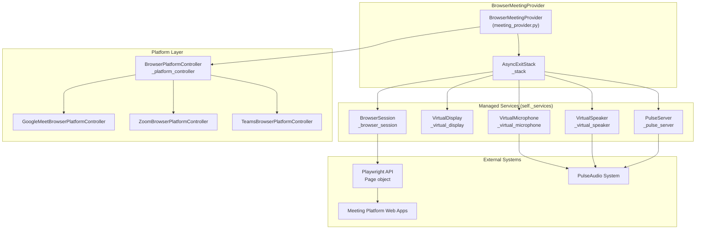
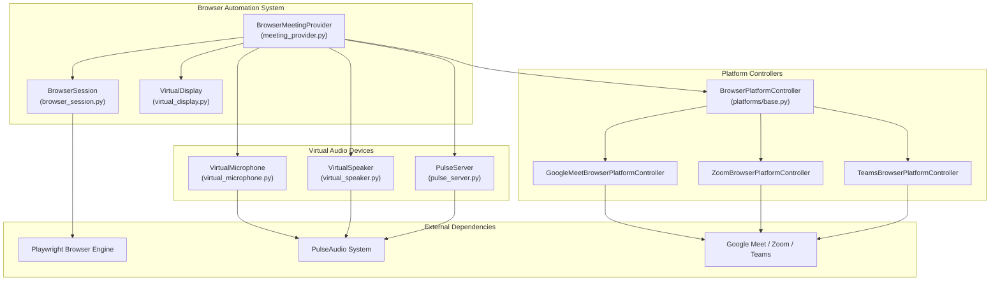
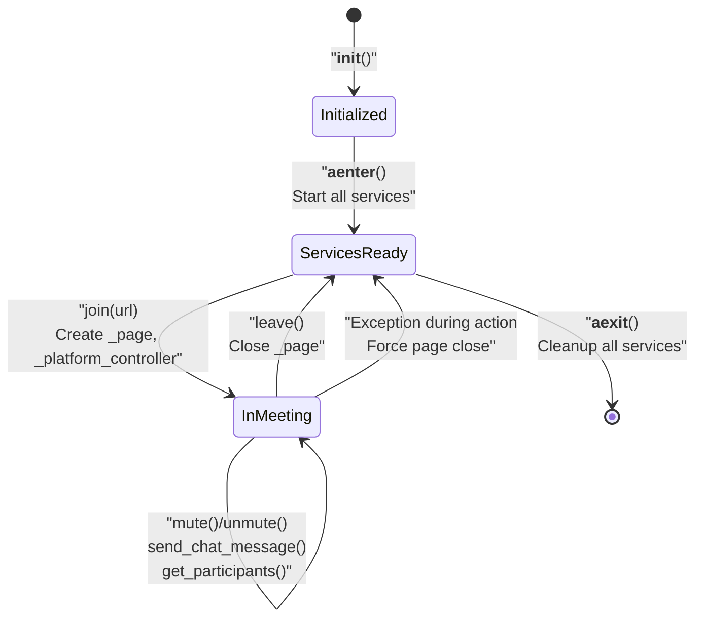
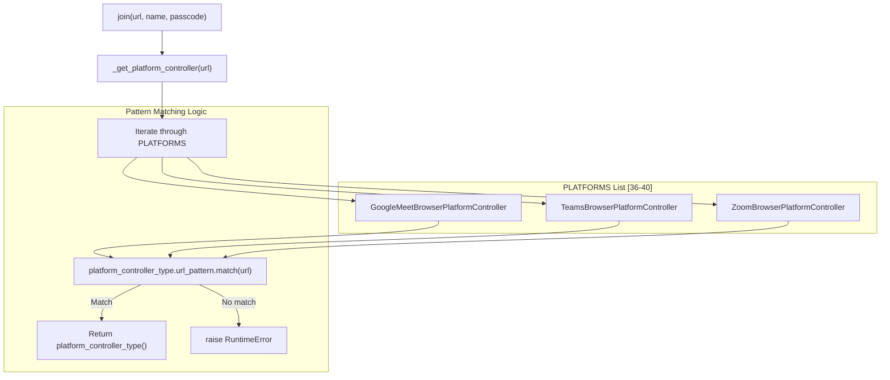
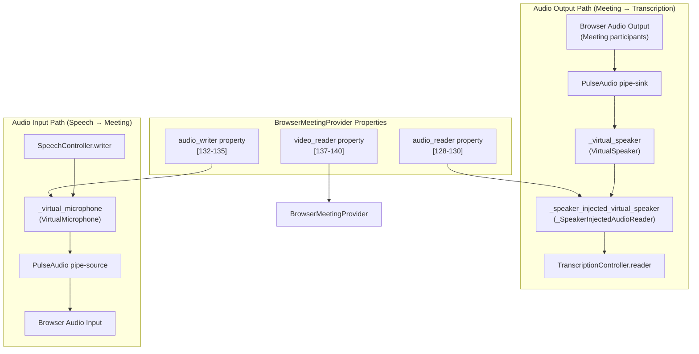
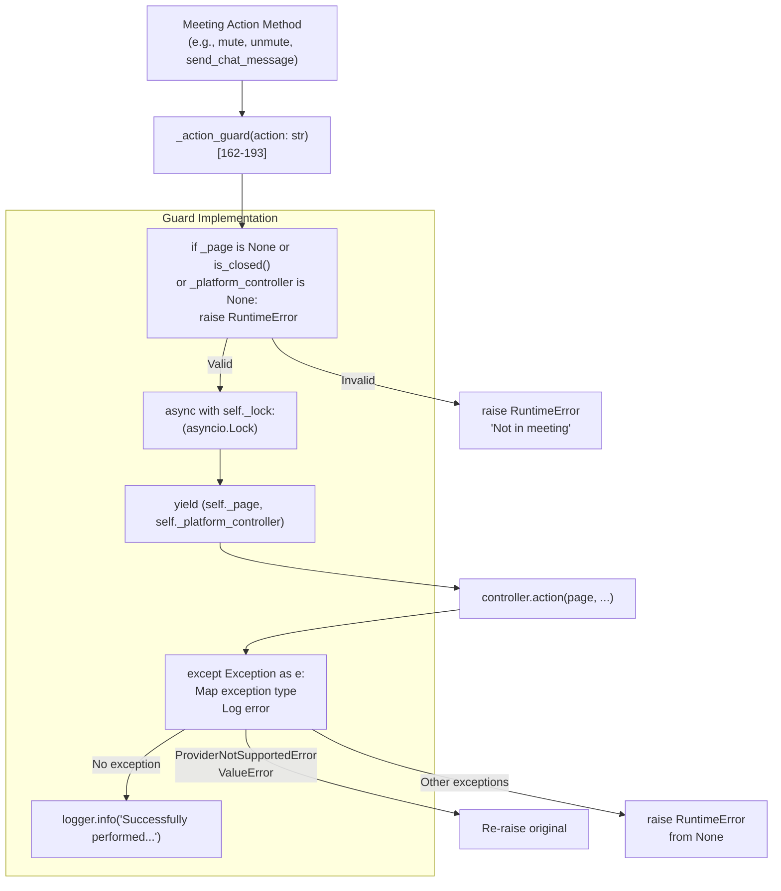
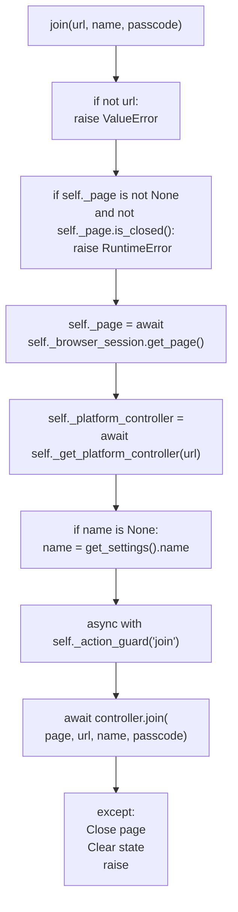
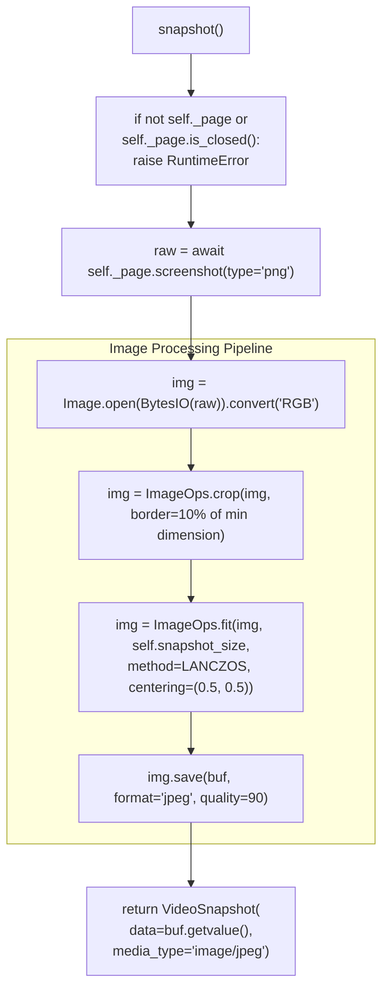
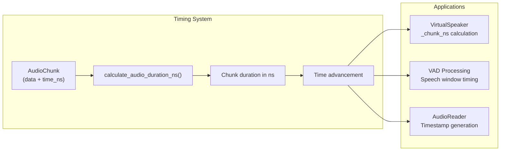

<!-- source: DeepWiki mcp.deepwiki.com · repo joinly-ai/joinly · page 4.3 Browser Meeting Provider · fetched 2026-10-27 -->

# Browser Meeting Provider

<details>
<summary>Relevant source files</summary>

The following files were used as context for generating this wiki page:

- [joinly/container.py](joinly/container.py)
- [joinly/providers/browser/meeting_provider.py](joinly/providers/browser/meeting_provider.py)

</details>


## Purpose and Scope

The `BrowserMeetingProvider` is a concrete implementation of the `MeetingProvider` interface that enables browser-based integration with video conferencing platforms. It uses Playwright automation to control web browsers and manages audio I/O through a virtual PulseAudio device architecture. This provider serves as the meeting connection layer in the joinly server, orchestrating virtual devices, browser sessions, and platform-specific controllers to enable AI agents to join and participate in meetings.

The provider implements the complete meeting lifecycle (join, leave, mute, unmute, chat) and exposes `AudioReader` and `AudioWriter` interfaces that integrate with the transcription and speech controllers. Platform-specific implementations for Google Meet, Zoom, and Microsoft Teams are handled by separate controllers documented in page 4.4.
</thinking>

## Architecture Overview

The `BrowserMeetingProvider` orchestrates five core services through a layered architecture, managing their lifecycle through an `AsyncExitStack`. The provider acts as the primary interface between the `MeetingSession` and the underlying browser automation infrastructure.



Sources: [joinly/providers/browser/meeting_provider.py:64-126]()

## Architecture Overview

The browser automation system follows a layered architecture with the `BrowserMeetingProvider` as the main orchestrator, coordinating virtual devices, browser sessions, and platform-specific controllers.



Sources: [joinly/providers/browser/meeting_provider.py:1-287](), [joinly/providers/browser/platforms/base.py:1-150]()

## Core Components

### BrowserMeetingProvider Class

The `BrowserMeetingProvider` class is defined in [joinly/providers/browser/meeting_provider.py:64-343]() and implements both `BaseMeetingProvider` and `VideoReader` protocols. It manages the complete meeting lifecycle through async context manager semantics.

**Initialization and Configuration**

The constructor accepts the following parameters:

| Parameter | Type | Default | Purpose |
|-----------|------|---------|---------|
| `reader_byte_depth` | `int \| None` | `None` | Byte depth for virtual speaker audio format |
| `writer_byte_depth` | `int \| None` | `None` | Byte depth for virtual microphone audio format |
| `snapshot_size` | `tuple[int, int]` | `(512, 288)` | Dimensions for video snapshots |
| `vnc_server` | `bool` | `False` | Whether to enable VNC server on virtual display |
| `vnc_server_port` | `int` | `5900` | VNC server port |

Sources: [joinly/providers/browser/meeting_provider.py:67-87]()

**Managed Services Lifecycle**

The provider manages five services through `self._services` list and an `AsyncExitStack`:

| Service | Instance Variable | Purpose | Environment Modified |
|---------|------------------|---------|---------------------|
| `PulseServer` | `_pulse_server` | Manages dedicated PulseAudio server | None directly |
| `VirtualDisplay` | `_virtual_display` | Xvfb headless display with optional VNC | `DISPLAY` |
| `VirtualSpeaker` | `_virtual_speaker` | Captures browser audio output | `PULSE_SINK` |
| `VirtualMicrophone` | `_virtual_microphone` | Injects synthesized audio to browser | `PULSE_SOURCE` |
| `BrowserSession` | `_browser_session` | Playwright browser instance | None directly |

All services share a common `self._env` dictionary that accumulates environment variables. Services are entered in the order listed during `__aenter__()` and cleaned up in reverse order during `__aexit__()`.

Sources: [joinly/providers/browser/meeting_provider.py:89-146]()

**Meeting Lifecycle State Management**



The state is tracked through two key instance variables:
- `self._page: Page | None` - Playwright `Page` object when connected to a meeting
- `self._platform_controller: BrowserPlatformController | None` - Platform-specific controller instance

Sources: [joinly/providers/browser/meeting_provider.py:113-116](), [joinly/providers/browser/meeting_provider.py:142-160]()

### Platform Controller Selection and Integration

The `_get_platform_controller()` method selects the appropriate platform-specific controller based on URL pattern matching:



The `PLATFORMS` constant at [joinly/providers/browser/meeting_provider.py:36-40]() defines the list of available platform controllers. Each controller class has a `url_pattern` class variable that is a compiled regex pattern. Platform-specific controller implementations are documented in page 4.4.

Sources: [joinly/providers/browser/meeting_provider.py:36-40](), [joinly/providers/browser/meeting_provider.py:195-221]()

## Virtual Audio Device Architecture

### Audio Reader and Writer Properties

The `BrowserMeetingProvider` exposes audio interfaces through three properties that integrate with the transcription and speech controllers:



Sources: [joinly/providers/browser/meeting_provider.py:127-140]()

### Speaker Attribution Wrapper

The `_SpeakerInjectedAudioReader` class at [joinly/providers/browser/meeting_provider.py:43-62]() wraps the `VirtualSpeaker` to inject speaker attribution into audio chunks:

```python
# Conceptual implementation
class _SpeakerInjectedAudioReader(AudioReader):
    def __init__(self, reader: AudioReader, get_reader: Callable[[], str | None]):
        self._reader = reader
        self._get_reader = get_reader  # Returns platform_controller.active_speaker
        
    async def read(self) -> AudioChunk:
        chunk = await self._reader.read()
        return AudioChunk(
            data=chunk.data,
            time_ns=chunk.time_ns,
            speaker=self._get_reader(),  # Inject speaker name
        )
```

The wrapper is instantiated at [joinly/providers/browser/meeting_provider.py:118-125]() with a lambda that retrieves `self._platform_controller.active_speaker`. This enables the transcription system to attribute audio chunks to specific meeting participants.

Sources: [joinly/providers/browser/meeting_provider.py:43-62](), [joinly/providers/browser/meeting_provider.py:118-125]()

### Virtual Microphone and Speaker Configuration

The provider instantiates `VirtualMicrophone` and `VirtualSpeaker` with optional byte depth configuration to match the audio formats of the TTS and VAD services:

| Virtual Device | Instance Variable | Configured From | Purpose |
|---------------|------------------|-----------------|---------|
| `VirtualMicrophone` | `_virtual_microphone` | `writer_byte_depth` param | Writes TTS audio to browser |
| `VirtualSpeaker` | `_virtual_speaker` | `reader_byte_depth` param | Reads meeting audio for VAD/STT |

The byte depth parameters are passed by the `SessionContainer` at [joinly/container.py:110-122](), which extracts them from the VAD and TTS service audio formats:

```python
# From SessionContainer._build logic
provider_extra_args = {
    "reader_byte_depth": vad.audio_format.byte_depth,
    "writer_byte_depth": tts.audio_format.byte_depth,
}
```

This ensures that the virtual devices produce and consume audio in the correct format for the speech processing pipeline without requiring conversion.

Sources: [joinly/providers/browser/meeting_provider.py:94-103](), [joinly/container.py:110-122]()

## Meeting Action Implementation

### Action Guard Context Manager

All meeting actions (join, leave, mute, unmute, send_chat_message, get_participants, get_chat_history) use the `_action_guard()` context manager for consistent error handling and concurrency control:



The guard pattern ensures:
1. **State consistency**: Actions only execute when connected to a meeting
2. **Mutual exclusion**: `self._lock` prevents concurrent action execution
3. **Error mapping**: Platform-specific errors are preserved, others are wrapped
4. **Consistent logging**: All actions log success or failure

Sources: [joinly/providers/browser/meeting_provider.py:162-193]()

### Join and Leave Methods

**join() Method Flow** [joinly/providers/browser/meeting_provider.py:223-265]()



**leave() Method Flow** [joinly/providers/browser/meeting_provider.py:267-280]()

The `leave()` method attempts graceful disconnection through the platform controller, but forces page closure even if the controller fails:

```python
# Conceptual flow
async with self._action_guard("leave") as (page, controller):
    try:
        await controller.leave(page)
    except RuntimeError:
        logger.warning("Failed to leave, forcing page close")
    finally:
        self._platform_controller = None
        if self._page and not self._page.is_closed():
            await self._page.close()
        self._page = None
```

Sources: [joinly/providers/browser/meeting_provider.py:223-280]()

### Meeting Control Methods

All other meeting control methods follow a consistent pattern using `_action_guard`:

| Method | Parameters | Delegates To | Purpose |
|--------|-----------|--------------|---------|
| `mute()` | None | `controller.mute(page)` | Mute microphone in meeting |
| `unmute()` | None | `controller.unmute(page)` | Unmute microphone in meeting |
| `send_chat_message()` | `message: str` | `controller.send_chat_message(page, message)` | Send chat message |
| `get_chat_history()` | None | `controller.get_chat_history(page)` | Retrieve chat history |
| `get_participants()` | None | `controller.get_participants(page)` | Get participant list |

Sources: [joinly/providers/browser/meeting_provider.py:282-317]()

## Video Snapshot Support

The `BrowserMeetingProvider` implements the `VideoReader` protocol through the `snapshot()` method at [joinly/providers/browser/meeting_provider.py:319-343]():



The method captures the browser window, applies cropping and resizing, and returns a JPEG-encoded snapshot. The default snapshot size of `(512, 288)` provides a 16:9 aspect ratio suitable for video frame analysis.

Sources: [joinly/providers/browser/meeting_provider.py:319-343]()

## Audio Format Integration

The browser automation system integrates with the broader audio processing pipeline through standardized audio formats and conversion utilities.

### Audio Format Conversion

The system uses `AudioFormat` objects to define audio characteristics and provides conversion between different bit depths:

| Format | Byte Depth | Use Case |
|--------|------------|----------|
| 16-bit PCM | 2 bytes | Standard audio processing |
| 32-bit float | 4 bytes | PulseAudio virtual devices |

The `convert_audio_format` function handles conversion between these formats while maintaining sample rate compatibility.

Sources: [joinly/utils/audio.py:9-57](), [joinly/providers/browser/devices/virtual_microphone.py:50](), [joinly/providers/browser/devices/virtual_speaker.py:44]()

### Timing and Duration Calculations

Audio timing is managed through nanosecond precision timestamps and duration calculations:



Sources: [joinly/utils/audio.py:60-72](), [joinly/providers/browser/devices/virtual_speaker.py:57](), [joinly/services/vad/base.py:37-46]()

---

