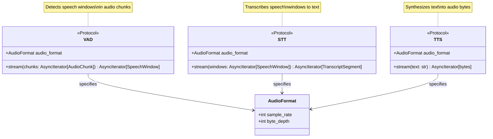
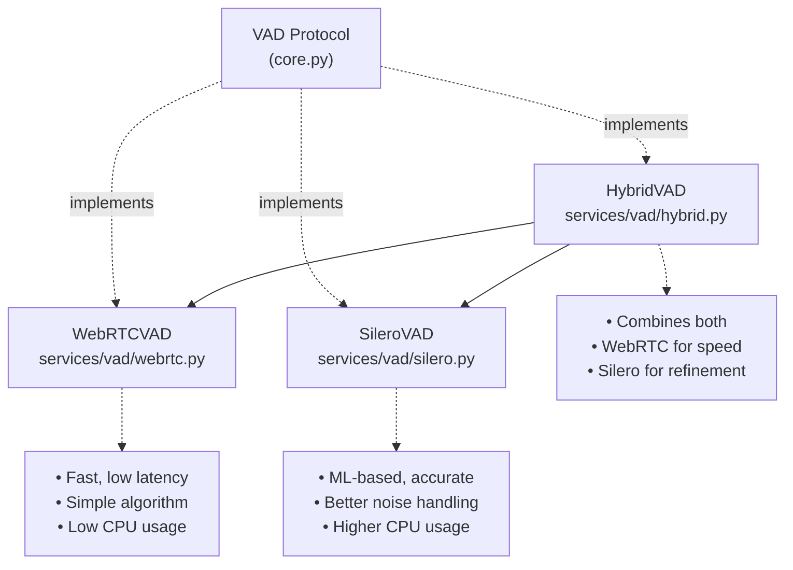
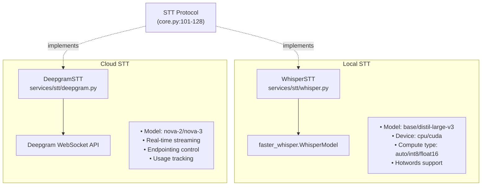
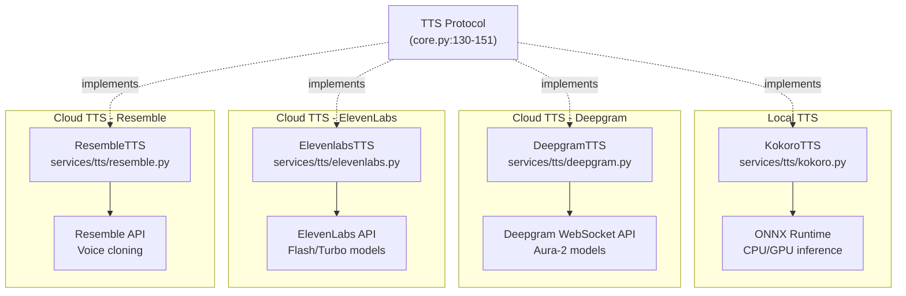
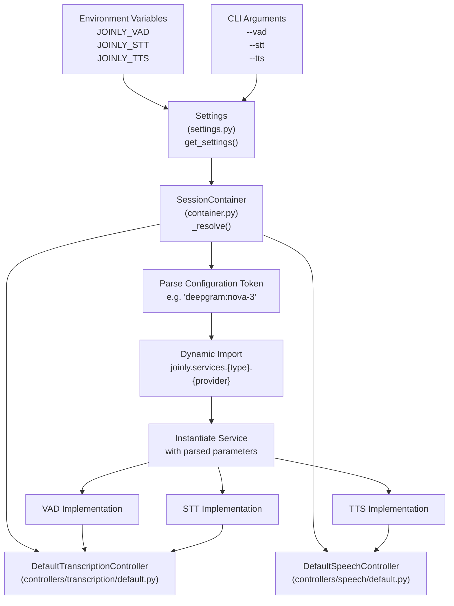
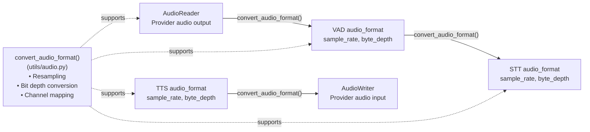
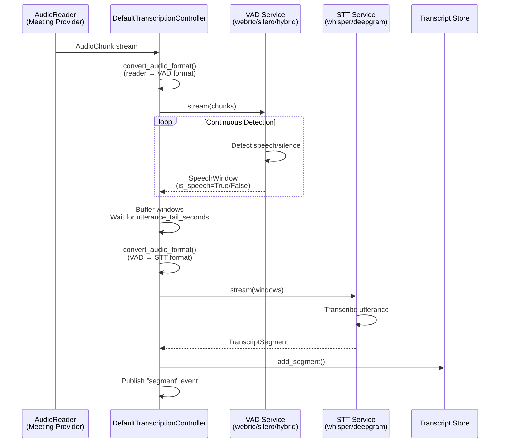
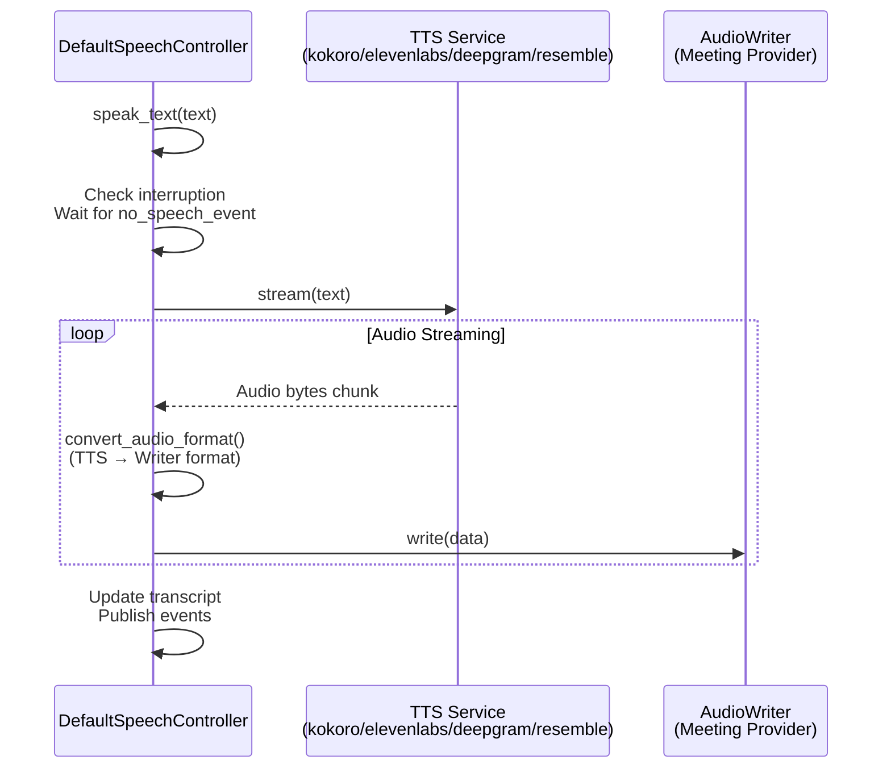

<!-- source: DeepWiki mcp.deepwiki.com · repo joinly-ai/joinly · page 5.3 Service Providers (VAD, STT, TTS) · fetched 2026-10-27 -->

# Service Providers (VAD, STT, TTS)

<details>
<summary>Relevant source files</summary>

The following files were used as context for generating this wiki page:

- [joinly/controllers/transcription/default.py](joinly/controllers/transcription/default.py)
- [joinly/core.py](joinly/core.py)
- [joinly/services/stt/deepgram.py](joinly/services/stt/deepgram.py)
- [joinly/services/stt/whisper.py](joinly/services/stt/whisper.py)
- [joinly/services/tts/deepgram.py](joinly/services/tts/deepgram.py)
- [joinly/services/tts/elevenlabs.py](joinly/services/tts/elevenlabs.py)
- [joinly/session.py](joinly/session.py)
- [joinly/utils/clock.py](joinly/utils/clock.py)

</details>


## Purpose and Scope

This document details the service provider architecture for audio processing components: Voice Activity Detection (VAD), Speech-to-Text (STT), and Text-to-Speech (TTS). These providers implement standardized protocol interfaces and can be swapped via configuration without code changes. The system supports both local (privacy-focused, in-process) and cloud-based (higher quality, API-based) implementations.

For information about how these services are integrated into the transcription and speech pipelines, see [Transcription Controller](#5.1) and [Speech Controller](#5.2). For configuration options, see [Configuration and Settings](#2.3).

---

## Protocol Interfaces

Each service type is defined by a protocol in [joinly/core.py]() that specifies the contract all implementations must fulfill.

### Core Service Protocols



**Sources:** [joinly/core.py:76-151]()

### Protocol Requirements

| Protocol | Required Attribute | Required Method | Input Type | Output Type |
|----------|-------------------|-----------------|------------|-------------|
| `VAD` | `audio_format: AudioFormat` | `stream()` | `AsyncIterator[AudioChunk]` | `AsyncIterator[SpeechWindow]` |
| `STT` | `audio_format: AudioFormat` | `stream()` | `AsyncIterator[SpeechWindow]` | `AsyncIterator[TranscriptSegment]` |
| `TTS` | `audio_format: AudioFormat` | `stream()` | `str` | `AsyncIterator[bytes]` |

Each protocol specifies the `audio_format` it requires or produces, enabling automatic format conversion when connecting mismatched services.

**Sources:** [joinly/core.py:76-151]()

---

## Voice Activity Detection (VAD)

VAD services detect speech activity in audio streams, segmenting continuous audio into windows labeled as speech or silence.

### Available VAD Implementations



### VAD Configuration

| Implementation | Configuration Token | Typical Use Case | Audio Format |
|----------------|-------------------|------------------|--------------|
| `WebRTCVAD` | `"webrtc"` | Low-latency, resource-constrained | 8kHz or 16kHz, 16-bit |
| `SileroVAD` | `"silero"` | High accuracy, noisy environments | 16kHz, 32-bit float |
| `HybridVAD` | `"hybrid"` | Balanced accuracy and speed | Varies |

The VAD is selected via the `--vad` CLI argument or in the `SessionContainer` configuration.

**Sources:** [joinly/services/vad/](), Diagram 6 from high-level architecture

---

## Speech-to-Text (STT)

STT services transcribe speech windows into text segments with timing information.

### STT Implementation Architecture



**Sources:** [joinly/services/stt/whisper.py](), [joinly/services/stt/deepgram.py](), [joinly/core.py:101-128]()

### WhisperSTT Implementation

The `WhisperSTT` class provides local, privacy-preserving transcription using the Faster Whisper library.

**Key Parameters:**
- `model_name`: Model size (default: `"base"` for CPU, `"distil-large-v3"` for CUDA)
- `compute_type`: Quantization level (`"auto"`, `"int8"`, `"float16"`)
- `min_audio`: Minimum audio duration to transcribe (default: 0.4s)
- `min_silence`: Minimum silence to end a segment (default: 0.2s)
- `hotwords`: List of words to improve recognition accuracy

**Workflow:**
1. Buffers incoming `SpeechWindow` objects
2. Waits for minimum audio duration and silence threshold
3. Runs transcription in thread pool to avoid blocking
4. Attributes speaker based on window metadata
5. Yields `TranscriptSegment` objects with text and timing

**Sources:** [joinly/services/stt/whisper.py:23-225]()

### DeepgramSTT Implementation

The `DeepgramSTT` class provides cloud-based transcription with real-time streaming.

**Key Parameters:**
- `model_name`: Deepgram model (default: `"nova-3-general"` for supported languages, `"nova-2-general"` otherwise)
- `finalize_silence`: Duration of silence to finalize stream (default: 0.375s)
- `finalize_min_speech`: Minimum speech duration to consider (default: 0.03s)
- `padding_silence`: Silence padding at stream start (default: 0.1s)
- `stream_idle_timeout`: Timeout after finalization (default: 1.0s)
- `mip_opt_out`: Opt out of model improvement program (default: `True`)

**Workflow:**
1. Establishes WebSocket connection to Deepgram API
2. Sends silence padding followed by audio windows
3. Finalizes stream after detecting sufficient silence
4. Receives transcription results via callback
5. Attributes speaker by overlapping window metadata with result timing

**Sources:** [joinly/services/stt/deepgram.py:31-286]()

### STT Configuration Comparison

| Feature | WhisperSTT | DeepgramSTT |
|---------|-----------|-------------|
| **Deployment** | In-process (local) | Cloud API (WebSocket) |
| **Privacy** | Full (data stays local) | Requires trust in Deepgram |
| **Latency** | Moderate (buffering required) | Low (streaming) |
| **Accuracy** | Good (model-dependent) | Excellent |
| **Cost** | Free (compute only) | Paid (per minute) |
| **GPU Support** | Yes (CUDA) | N/A |
| **Hotwords** | Yes (via transcription param) | Yes (nova-3 keyterm) |
| **Configuration Token** | `"whisper"` or `"whisper:model_name"` | `"deepgram"` or `"deepgram:model_name"` |

**Sources:** [joinly/services/stt/whisper.py](), [joinly/services/stt/deepgram.py]()

---

## Text-to-Speech (TTS)

TTS services synthesize text into audio streams that can be played in meetings.

### TTS Implementation Landscape



**Sources:** [joinly/services/tts/](), [joinly/core.py:130-151]()

### TTS Provider Comparison

| Provider | Configuration Token | Audio Quality | Latency | Privacy | Cost | Multi-language | Voice Options |
|----------|-------------------|---------------|---------|---------|------|----------------|---------------|
| **Kokoro** | `"kokoro"` | Good | Low | Full | Free | Limited | Limited |
| **Deepgram** | `"deepgram"` | Excellent | Very Low | API | Paid | Limited | Pre-defined |
| **ElevenLabs** | `"elevenlabs"` | Excellent | Moderate | API | Paid | Extensive | Custom voices |
| **Resemble** | `"resemble"` | Excellent | Moderate | API | Paid | Good | Voice cloning |

### KokoroTTS (Local)

Local neural TTS using ONNX runtime for CPU/GPU inference.

**Key Features:**
- In-process inference (no network calls)
- ONNX runtime optimization
- GPU acceleration support
- Phoneme-based synthesis

**Configuration:**
- Model version: Specified via model path or version string
- Sample rate: Typically 24kHz
- Device: CPU or CUDA

**Sources:** Reference to [joinly/services/tts/kokoro.py]() (not in provided files but mentioned in architecture)

### DeepgramTTS (Cloud)

Cloud-based TTS using Deepgram's Aura-2 models via WebSocket streaming.

**Key Parameters:**
- `model_name`: Aura-2 model variant (default: `"aura-2-andromeda-en"` for English, `"aura-2-estrella-es"` for Spanish)
- `sample_rate`: Audio sample rate (default: 24000)
- `mip_opt_out`: Opt out of model improvement program (default: `True`)

**Workflow:**
1. Establishes WebSocket connection to Deepgram
2. Sends text via `send_text()` and calls `flush()`
3. Receives audio data chunks via callback
4. Tracks character usage for billing
5. Streams audio bytes for output

**Sources:** [joinly/services/tts/deepgram.py:22-146]()

### ElevenlabsTTS (Cloud)

Cloud-based TTS using ElevenLabs API with high-quality voice synthesis.

**Key Parameters:**
- `voice_id`: ElevenLabs voice identifier (defaults per language)
- `model_id`: Model variant (default: `"eleven_flash_v2_5"`)
- `sample_rate`: Audio sample rate (default: 24000)

**Default Voices:**
- English (`"en"`): `"XrExE9yKIg1WjnnlVkGX"`
- German (`"de"`): `"1iF3vHdwHKuVKSPDK23Z"`
- Other languages: Falls back to English voice

**Workflow:**
1. Streams text directly to ElevenLabs API
2. Receives audio chunks asynchronously
3. Tracks character usage for billing
4. Returns async iterator of audio bytes

**Sources:** [joinly/services/tts/elevenlabs.py:24-74]()

---

## Service Resolution and Configuration

Services are resolved dynamically at runtime by the `SessionContainer` based on configuration strings.

### Resolution Architecture



**Sources:** Diagram 2 from high-level architecture, [joinly/controllers/transcription/default.py:17-48]()

### Configuration Token Format

Configuration tokens follow the pattern: `provider[:parameter]`

**Examples:**
- `"webrtc"` → `WebRTCVAD` with defaults
- `"whisper"` → `WhisperSTT` with default model (base or distil-large-v3)
- `"whisper:base.en"` → `WhisperSTT` with base.en model
- `"deepgram"` → `DeepgramSTT` with default model (nova-3 or nova-2)
- `"deepgram:nova-2-general"` → `DeepgramSTT` with nova-2-general model
- `"elevenlabs"` → `ElevenlabsTTS` with default voice

### Resolution Process

The `SessionContainer._resolve()` method implements the following logic:

1. **Parse Token:** Extract provider name and optional parameter
2. **Construct Module Path:** `joinly.services.{type}.{provider}`
3. **Dynamic Import:** Import the provider class
4. **Instantiate:** Create instance with parsed parameters and settings
5. **Validate Protocol:** Ensure instance satisfies protocol requirements

**Sources:** Reference to SessionContainer implementation (not in provided files but described in Diagram 2)

---

## Audio Format Handling

Services specify their required audio formats via the `audio_format` attribute. The system automatically converts between formats when necessary.

### Audio Format Specifications



**Sources:** [joinly/controllers/transcription/default.py:140-145](), [joinly/controllers/transcription/default.py:236-242]()

### Format Conversion Points

The transcription controller performs format conversions at two points:

1. **Audio Reader → VAD:** [joinly/controllers/transcription/default.py:140-145]()
   ```python
   data=convert_audio_format(
       chunk.data, self.reader.audio_format, self.vad.audio_format
   )
   ```

2. **VAD → STT:** [joinly/controllers/transcription/default.py:236-242]()
   ```python
   data=convert_audio_format(
       window.data, self.vad.audio_format, self.stt.audio_format
   )
   ```

### Common Audio Formats by Service

| Service Type | Implementation | Sample Rate | Byte Depth | Notes |
|-------------|----------------|-------------|------------|-------|
| VAD | WebRTC | 8000 or 16000 Hz | 2 (int16) | Limited to specific rates |
| VAD | Silero | 16000 Hz | 4 (float32) | ML model requirement |
| STT | Whisper | 16000 Hz | 4 (float32) | Model trained at 16kHz |
| STT | Deepgram | 16000 Hz | 2 (int16) | Configurable, default 16kHz |
| TTS | Kokoro | 24000 Hz | 2 (int16) | High quality output |
| TTS | Deepgram | 24000 Hz | 2 (int16) | Configurable |
| TTS | ElevenLabs | 24000 Hz | 2 (int16) | Configurable |

**Sources:** [joinly/services/stt/whisper.py:55](), [joinly/services/stt/deepgram.py:97](), [joinly/services/tts/deepgram.py:67](), [joinly/services/tts/elevenlabs.py:46]()

---

## Usage Tracking

Cloud-based services track usage for billing and monitoring purposes using the `add_usage()` utility.

### Usage Recording Pattern

```python
from joinly.utils.usage import add_usage

# STT usage (per minute)
add_usage(
    service="deepgram_stt",
    usage={"minutes": duration / 60},
    meta={"model": self.model_name, "mip_opt_out": self._mip_opt_out}
)

# TTS usage (per character)
add_usage(
    service="elevenlabs_tts",
    usage={"characters": len(text)},
    meta={"model": self._model_id, "voice": self._voice_id}
)
```

**Sources:** [joinly/services/stt/deepgram.py:181-185](), [joinly/services/stt/deepgram.py:200-204](), [joinly/services/tts/deepgram.py:136-140](), [joinly/services/tts/elevenlabs.py:61-65]()

### Tracked Metrics

| Service | Metric | Unit | Billing Basis |
|---------|--------|------|---------------|
| Deepgram STT | `minutes` | Audio duration | Per minute |
| Deepgram TTS | `characters` | Text length | Per character |
| ElevenLabs TTS | `characters` | Text length | Per character |
| Resemble TTS | `characters` | Text length | Per character |

The usage data can be accessed via the `usage://current` MCP resource for monitoring and cost tracking.

**Sources:** [joinly/services/stt/deepgram.py](), [joinly/services/tts/deepgram.py](), [joinly/services/tts/elevenlabs.py]()

---

## Integration with Controllers

Services are wired into controllers by the `SessionContainer` and used by the transcription and speech pipelines.

### Service Flow in Transcription Pipeline



**Sources:** [joinly/controllers/transcription/default.py:122-278]()

### Service Flow in Speech Pipeline



**Sources:** [joinly/session.py:125-131](), Reference to [joinly/controllers/speech/default.py]() (implementation pattern)

---

## Summary

The service provider architecture in joinly enables flexible deployment options through:

1. **Protocol-Based Design:** `VAD`, `STT`, and `TTS` protocols define clear contracts
2. **Multiple Implementations:** Local (privacy, free) and cloud (quality, cost) options
3. **Dynamic Resolution:** Configuration strings map to implementations at runtime
4. **Audio Format Handling:** Automatic conversion between service format requirements
5. **Usage Tracking:** Built-in metering for cloud service costs
6. **Extensibility:** New providers can be added by implementing protocols

This architecture allows users to balance privacy, cost, quality, and latency requirements by mixing and matching providers via simple configuration changes.

**Sources:** [joinly/core.py](), [joinly/services/](), [joinly/controllers/](), [joinly/session.py]()

---

