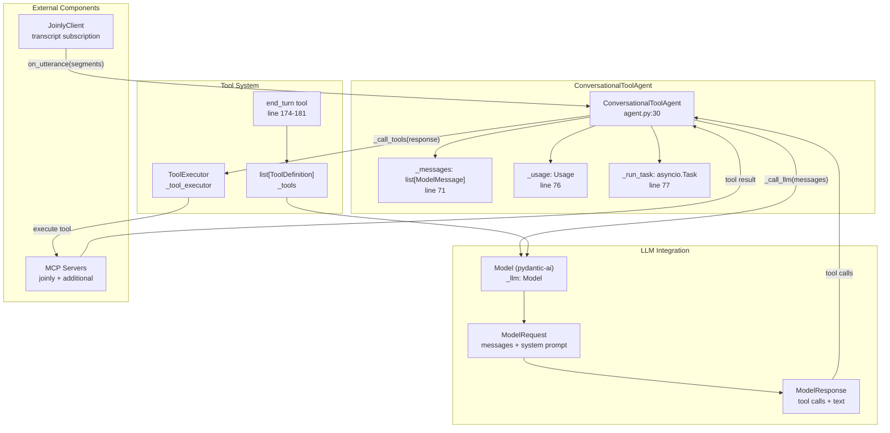
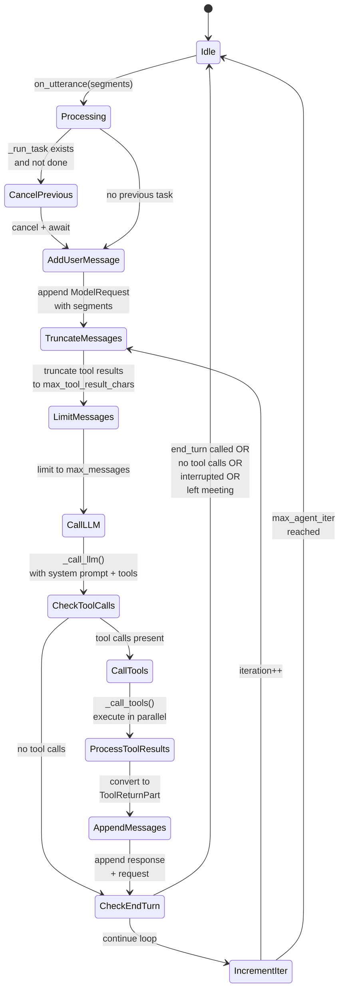
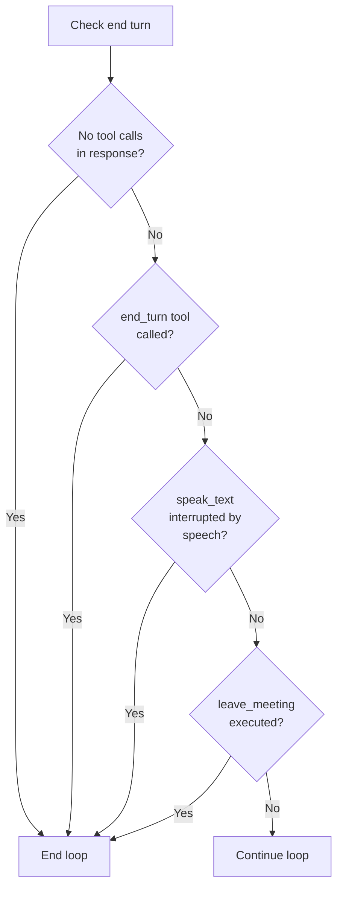
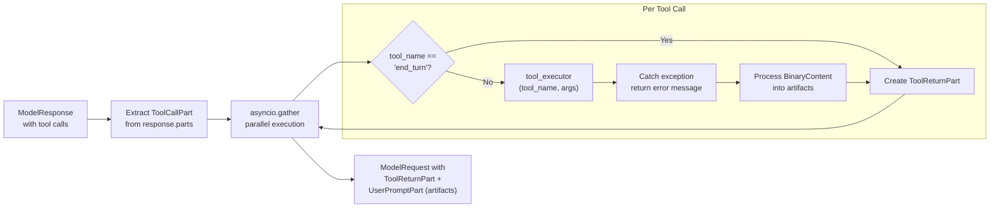
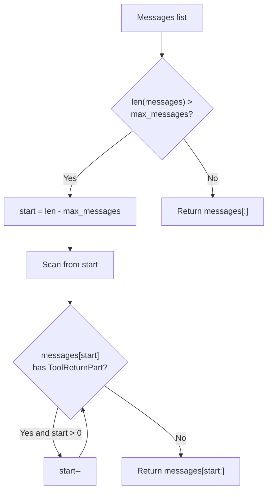
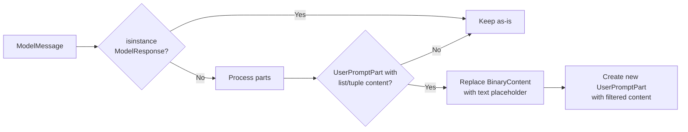
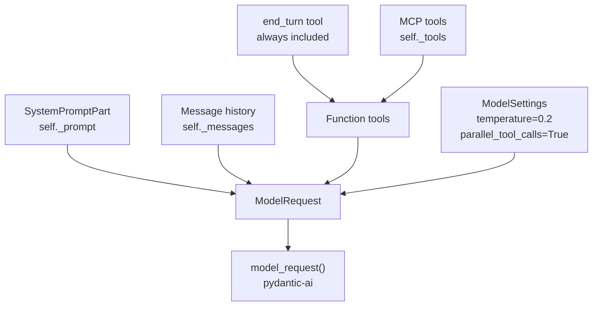
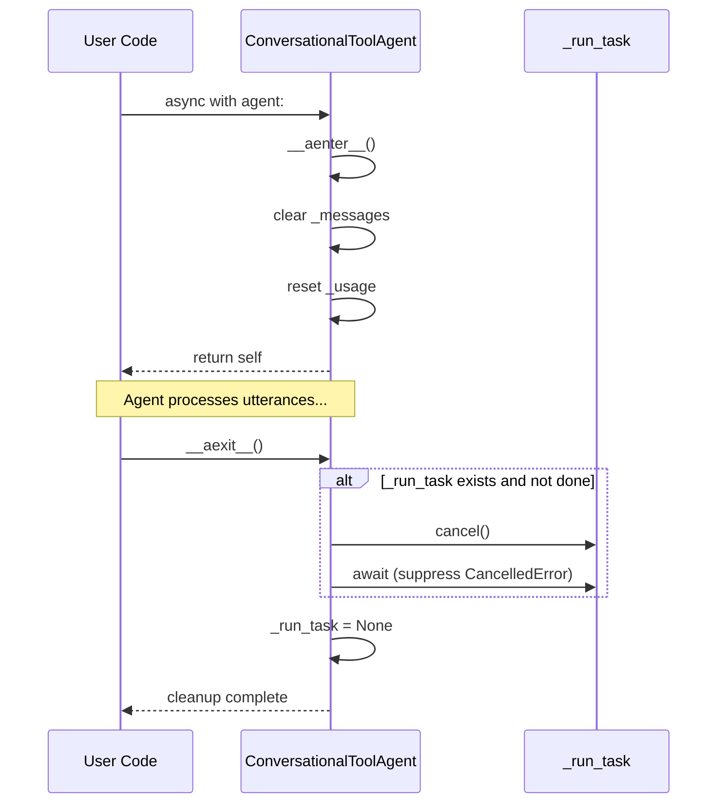
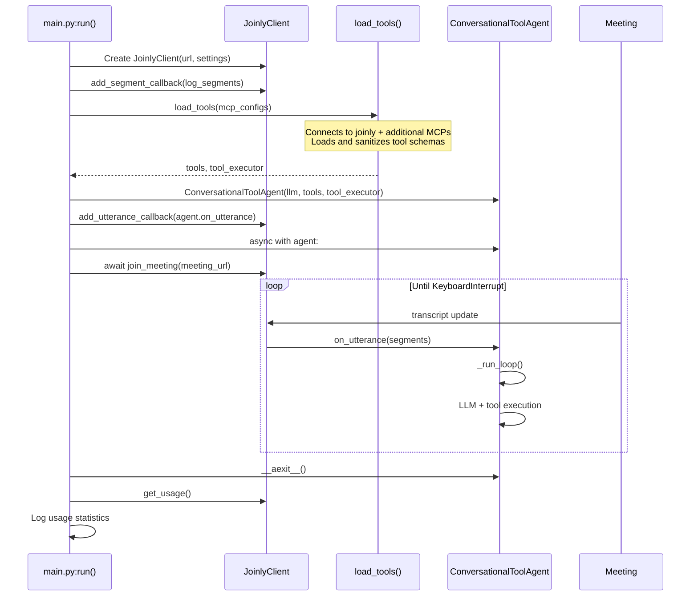

<!-- source: DeepWiki mcp.deepwiki.com · repo joinly-ai/joinly · page 6.2 ConversationalToolAgent · fetched 2026-10-27 -->

# ConversationalToolAgent

<details>
<summary>Relevant source files</summary>

The following files were used as context for generating this wiki page:

- [client/joinly_client/agent.py](client/joinly_client/agent.py)
- [client/joinly_client/client.py](client/joinly_client/client.py)
- [client/joinly_client/main.py](client/joinly_client/main.py)
- [client/joinly_client/prompts.py](client/joinly_client/prompts.py)
- [client/joinly_client/types.py](client/joinly_client/types.py)
- [client/joinly_client/utils.py](client/joinly_client/utils.py)
- [joinly/utils/events.py](joinly/utils/events.py)

</details>


## Purpose and Scope

The `ConversationalToolAgent` is the high-level conversational AI component of the joinly-client package. It manages interactions with LLM providers, orchestrates tool execution, and maintains conversation history. This page covers the agent's architecture, message processing loop, tool handling, and configuration options.

For information about the low-level MCP client API, see [JoinlyClient API](#6.1). For examples of how to use the agent in practice, see [Usage Patterns and Examples](#6.3). For details on LLM provider configuration and external MCP server integration, see [LLM and External Service Integration](#7).

---

## Overview

The `ConversationalToolAgent` class provides a complete implementation of a tool-using conversational agent for meeting participation. It processes transcript segments, generates responses using LLM providers, executes tools, and manages conversation context with automatic history management.

**Key Responsibilities:**

| Responsibility | Description |
|---------------|-------------|
| **LLM Integration** | Interfaces with language models via `pydantic-ai`, supporting multiple providers (OpenAI, Anthropic, Google, etc.) |
| **Tool Orchestration** | Manages tool definitions, executes tool calls, and processes tool results |
| **Message History** | Maintains conversation context with automatic truncation and filtering |
| **Utterance Processing** | Responds to transcript updates with appropriate LLM calls and tool executions |
| **Usage Tracking** | Monitors token usage and service calls across LLM and tool operations |

Sources: [client/joinly_client/agent.py:30-97]()

---

## Architecture

### Component Diagram



Sources: [client/joinly_client/agent.py:30-97](), [client/joinly_client/main.py:374-384]()

### Agent Loop State Machine



Sources: [client/joinly_client/agent.py:98-151]()

---

## Initialization and Configuration

### Constructor Parameters

The agent is initialized with the following parameters:

| Parameter | Type | Default | Description |
|-----------|------|---------|-------------|
| `llm` | `Model` | *required* | The pydantic-ai Model instance for LLM calls |
| `tools` | `list[ToolDefinition]` | *required* | List of tool definitions available to the agent |
| `tool_executor` | `ToolExecutor` | *required* | Async function to execute tool calls |
| `prompt` | `str \| None` | `None` | System prompt (defaults to template from `get_prompt()`) |
| `max_messages` | `int` | `50` | Maximum number of messages to retain in history |
| `max_tool_result_chars` | `int` | `2048` | Max chars for tool results after each turn |
| `max_ephemeral_tool_result_chars` | `int` | `16384` | Max chars for tool results during iteration |
| `max_agent_iter` | `int \| None` | `15` | Maximum iterations per utterance (None = unlimited) |

**Validation:** At least one tool must be provided; the agent validates this in the constructor at [client/joinly_client/agent.py:63-65]().

Sources: [client/joinly_client/agent.py:33-76]()

### System Prompt Structure

The agent uses a structured system prompt that includes:

1. **Identity**: Defines the agent's role and capabilities
2. **Instructions**: Behavior guidelines (dyadic vs. MPC style)
3. **Core Principles**: Mandatory behavior rules
4. **Response Guidelines**: Voice vs. chat response selection
5. **Tool Use Protocol**: Rules for meeting and external tools
6. **Metadata**: Current date and other context
7. **Operational Constraints**: Content and transcript handling rules

The prompt is generated by `get_prompt()` and supports two styles:

| Style | Use Case | Key Behavior |
|-------|----------|--------------|
| `dyadic` | One-on-one meetings | Respond to every message, stay engaged |
| `mpc` | Multi-party meetings | Only respond when addressed or blocking progress |

Sources: [client/joinly_client/prompts.py:1-151](), [client/joinly_client/utils.py:86-111]()

---

## Message Processing Loop

### Utterance Event Flow

```mermaid
sequenceDiagram
    participant Client as JoinlyClient
    participant Agent as ConversationalToolAgent
    participant RunTask as _run_task
    participant Loop as _run_loop
    participant LLM as LLM Provider
    participant Tools as Tool System
    
    Client->>Agent: on_utterance(segments)
    
    alt Previous task exists
        Agent->>RunTask: cancel()
        RunTask-->>Agent: await cancellation
    end
    
    Agent->>Loop: create_task(_run_loop)
    Agent-->>Client: return immediately
    
    Loop->>Loop: append ModelRequest<br/>(UserPromptPart per segment)
    Loop->>Loop: _truncate_tool_results<br/>(max_tool_result_chars)
    Loop->>Loop: _omit_binary_tool_results
    
    loop While iteration < max_agent_iter
        Loop->>Loop: _limit_messages<br/>(max_messages)
        Loop->>Loop: _truncate_tool_results<br/>(max_ephemeral_tool_result_chars)
        
        Loop->>LLM: _call_llm(messages)
        Note over Loop,LLM: SystemPromptPart + messages<br/>+ tools + end_turn
        LLM-->>Loop: ModelResponse<br/>(parts with tool calls)
        
        Loop->>Tools: _call_tools(response)
        Note over Loop,Tools: Execute all tool calls<br/>in parallel
        Tools-->>Loop: ModelRequest<br/>(ToolReturnPart per call)
        
        Loop->>Loop: append ModelResponse
        Loop->>Loop: append ModelRequest (if present)
        
        Loop->>Loop: _check_end_turn(response, request)
        alt End turn condition met
            Loop-->>Agent: break loop
        else Continue
            Loop->>Loop: iteration++
        end
    end
```

Sources: [client/joinly_client/agent.py:98-151]()

### End Turn Conditions

The agent exits the processing loop when any of these conditions are met:



The `_check_end_turn()` method examines:
- Whether any tool calls are present in the response
- Whether the `end_turn` tool was explicitly called
- Whether speech synthesis was interrupted by detected speech
- Whether the agent left the meeting

Sources: [client/joinly_client/agent.py:307-356]()

---

## Tool Execution

### Tool Call Processing

The agent uses the special `end_turn` tool in addition to MCP tools. This tool is automatically injected into the tool list sent to the LLM:



Sources: [client/joinly_client/agent.py:204-305]()

### Binary Content Handling

When tools return `BinaryContent` (e.g., images, PDFs), the agent:

1. **Creates Artifacts**: Assigns unique identifiers like `artifact_{tool_call_id}_0`
2. **Splits Message Parts**: 
   - `ToolReturnPart`: Contains reference like "See artifact_xyz"
   - `UserPromptPart`: Contains the actual binary content
3. **Filters for Context Window**: Binary content is omitted when re-sending messages to LLM (replaced with `[omitted {media_type}, {bytes} bytes]`)

Sources: [client/joinly_client/agent.py:277-305](), [client/joinly_client/agent.py:408-448]()

### Error Handling

Tool execution errors are caught and converted to error messages:

```python
# From client/joinly_client/agent.py:258-264
try:
    content = await self._tool_executor(
        tool_call.tool_name, tool_call.args_as_dict()
    )
except Exception:
    logger.exception("Error calling tool %s", tool_call.tool_name)
    content = f"Error calling tool {tool_call.tool_name}"
```

Sources: [client/joinly_client/agent.py:258-264]()

---

## Message History Management

The agent employs multiple strategies to manage conversation history within LLM context windows:

### Message Limiting



The `_limit_messages()` method ensures:
- Total messages don't exceed `max_messages`
- Never cuts off at a `ToolReturnPart` (to maintain tool call/return pairing)
- Scans backward to find a safe cut point

Sources: [client/joinly_client/agent.py:450-479]()

### Tool Result Truncation

Two-stage truncation is applied:

| Stage | Parameter | When Applied | Purpose |
|-------|-----------|--------------|---------|
| **Ephemeral** | `max_ephemeral_tool_result_chars` | During each iteration | Prevent immediate context overflow |
| **Persistent** | `max_tool_result_chars` | After turn completes | Reduce long-term memory usage |

Truncation algorithm:
1. Convert content to JSON string if dict/list
2. If length > max_chars, truncate to `max_chars - 26`
3. Append `[truncated N chars]` message

Sources: [client/joinly_client/agent.py:358-406]()

### Binary Content Filtering

Binary content from tool results is filtered to save tokens:



The `_omit_binary_tool_results()` method replaces binary content with text like `[omitted image/png, 12345 bytes]`.

Sources: [client/joinly_client/agent.py:408-448]()

---

## LLM Integration

### Model Request Construction

The agent constructs LLM requests with:



**Special Handling:**
- GPT-5 models: `allow_text_output=True` (no forced tool calls)
- Parallel tool calls: Enabled by default
- Temperature: Fixed at 0.2 for consistency

Sources: [client/joinly_client/agent.py:152-202]()

### Usage Tracking

The agent tracks LLM usage via the `Usage` object:

```python
# From client/joinly_client/agent.py:194-201
self._usage.add(
    "llm",
    usage={
        "input_tokens": response.usage.request_tokens or 0,
        "output_tokens": response.usage.response_tokens or 0,
    },
    meta={"model": self._llm.model_name, "provider": self._llm.system},
)
```

The usage can be accessed via the `usage` property and is accumulated across all LLM calls during the agent's lifetime.

Sources: [client/joinly_client/agent.py:76-82](), [client/joinly_client/agent.py:194-201]()

---

## Async Context Management

The agent supports async context manager protocol for clean resource management:



This ensures:
- Clean state initialization on entry
- Cancellation of ongoing tasks on exit
- No lingering background tasks

Sources: [client/joinly_client/agent.py:84-96]()

---

## Integration Example

### Complete Setup Flow



Sources: [client/joinly_client/main.py:294-393]()

### Typical Usage Pattern

```python
# Simplified from client/joinly_client/main.py:294-393

async def run(joinly_url, meeting_url, llm_provider, llm_model, **kwargs):
    # 1. Create client
    client = JoinlyClient(joinly_url, name=name, settings=settings)
    
    # 2. Load tools from MCP servers
    tools, tool_executor = await load_tools({
        "joinly": McpClientConfig(client=client.client, exclude=["join_meeting"]),
        # ... additional MCP servers ...
    })
    
    # 3. Create agent with LLM
    llm = get_llm(llm_provider, llm_model)
    agent = ConversationalToolAgent(
        llm,
        tools,
        tool_executor,
        prompt=get_prompt(prompt_style=prompt_style, name=client.name),
    )
    
    # 4. Connect callbacks
    client.add_utterance_callback(agent.on_utterance)
    
    # 5. Enter context and join meeting
    async with client, agent:
        await client.join_meeting(meeting_url)
        await asyncio.Event().wait()  # Run indefinitely
```

Sources: [client/joinly_client/main.py:294-393]()

---

## Configuration Reference

### Complete Parameter Matrix

| Parameter | Location | Type | Default | Effect |
|-----------|----------|------|---------|--------|
| `llm` | Constructor | `Model` | *required* | Determines LLM provider and model |
| `tools` | Constructor | `list[ToolDefinition]` | *required* | Available tools for agent |
| `tool_executor` | Constructor | `ToolExecutor` | *required* | Function to execute tool calls |
| `prompt` | Constructor | `str \| None` | Template | System prompt for agent behavior |
| `max_messages` | Constructor | `int` | `50` | Context window size in messages |
| `max_tool_result_chars` | Constructor | `int` | `2048` | Long-term tool result truncation |
| `max_ephemeral_tool_result_chars` | Constructor | `int` | `16384` | Per-iteration tool result truncation |
| `max_agent_iter` | Constructor | `int \| None` | `15` | Max iterations per utterance |
| `llm.temperature` | LLM call | `float` | `0.2` | Hardcoded in `_call_llm()` |
| `llm.parallel_tool_calls` | LLM call | `bool` | `True` | Hardcoded in `_call_llm()` |

Sources: [client/joinly_client/agent.py:33-76](), [client/joinly_client/agent.py:162-186]()

---

## Key Methods Reference

| Method | Signature | Purpose |
|--------|-----------|---------|
| `__init__()` | `(llm, tools, tool_executor, ...)` | Initialize agent with configuration |
| `__aenter__()` | `() -> Self` | Enter async context, reset state |
| `__aexit__()` | `(*exc) -> None` | Exit context, cancel running tasks |
| `on_utterance()` | `(segments) -> None` | Handle new transcript segments |
| `_run_loop()` | `(segments) -> None` | Main processing loop |
| `_call_llm()` | `(messages) -> ModelResponse` | Execute LLM request |
| `_call_tools()` | `(response) -> ModelRequest \| None` | Execute all tool calls |
| `_call_tool()` | `(tool_call) -> tuple[ToolReturnPart, UserPromptPart \| None]` | Execute single tool call |
| `_check_end_turn()` | `(response, request) -> bool` | Determine if loop should exit |
| `_truncate_tool_results()` | `(messages, max_chars) -> list[ModelMessage]` | Truncate large tool results |
| `_omit_binary_tool_results()` | `(messages) -> list[ModelMessage]` | Remove binary content |
| `_limit_messages()` | `(messages, max_messages) -> list[ModelMessage]` | Limit history size |

Sources: [client/joinly_client/agent.py:30-479]()

---

