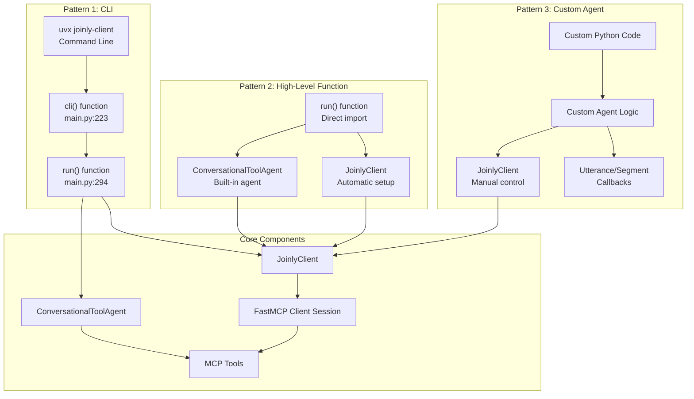
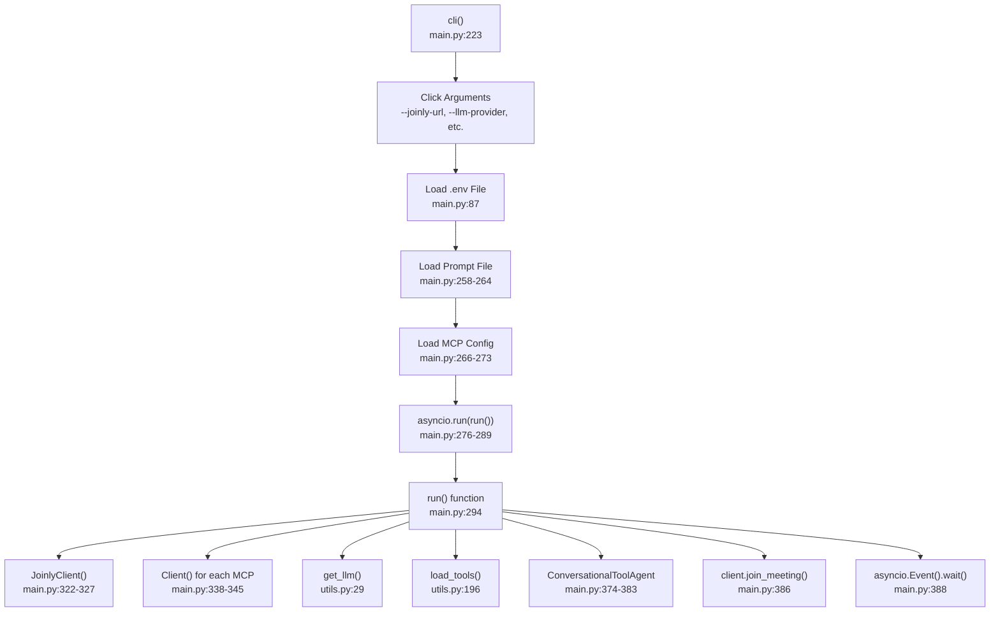
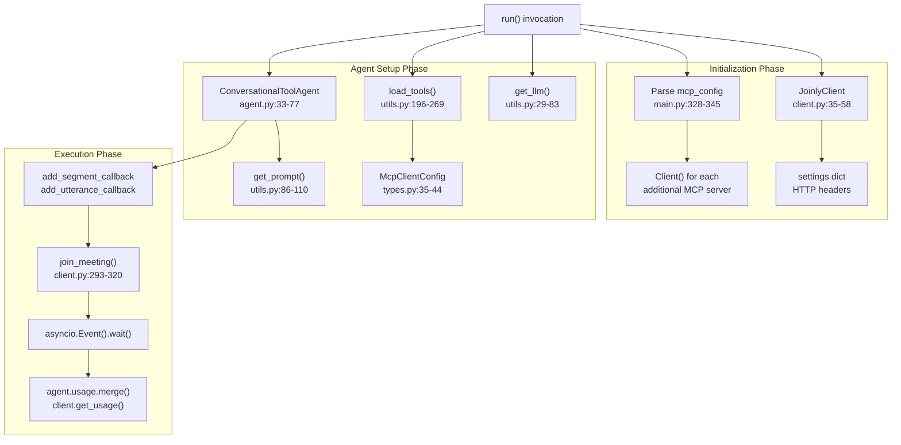
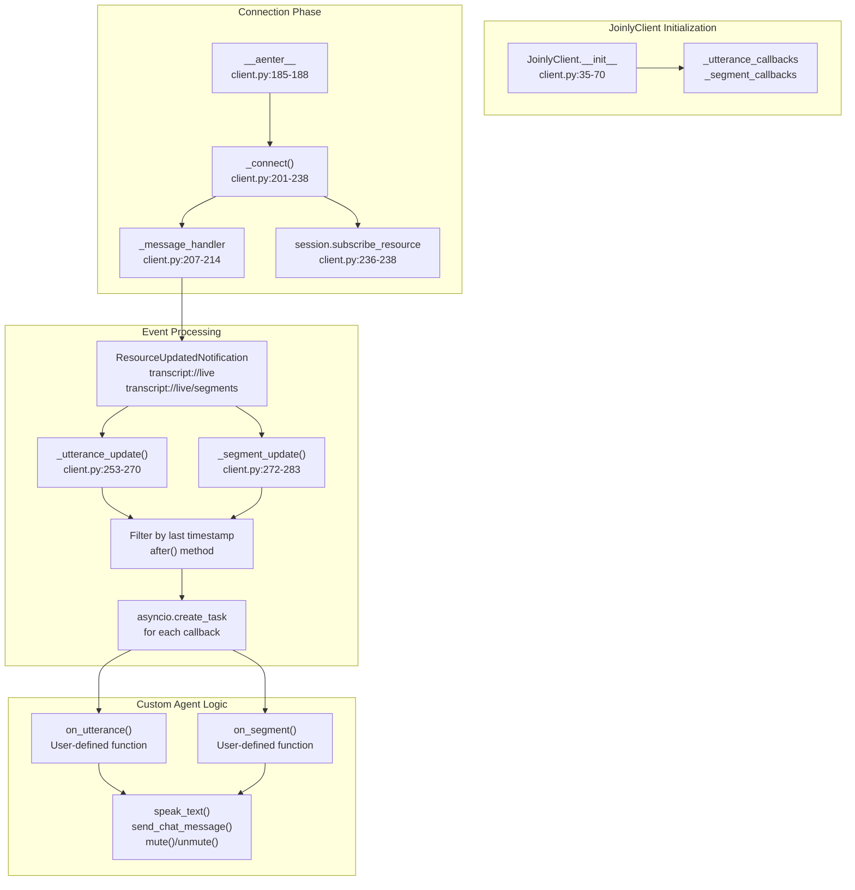
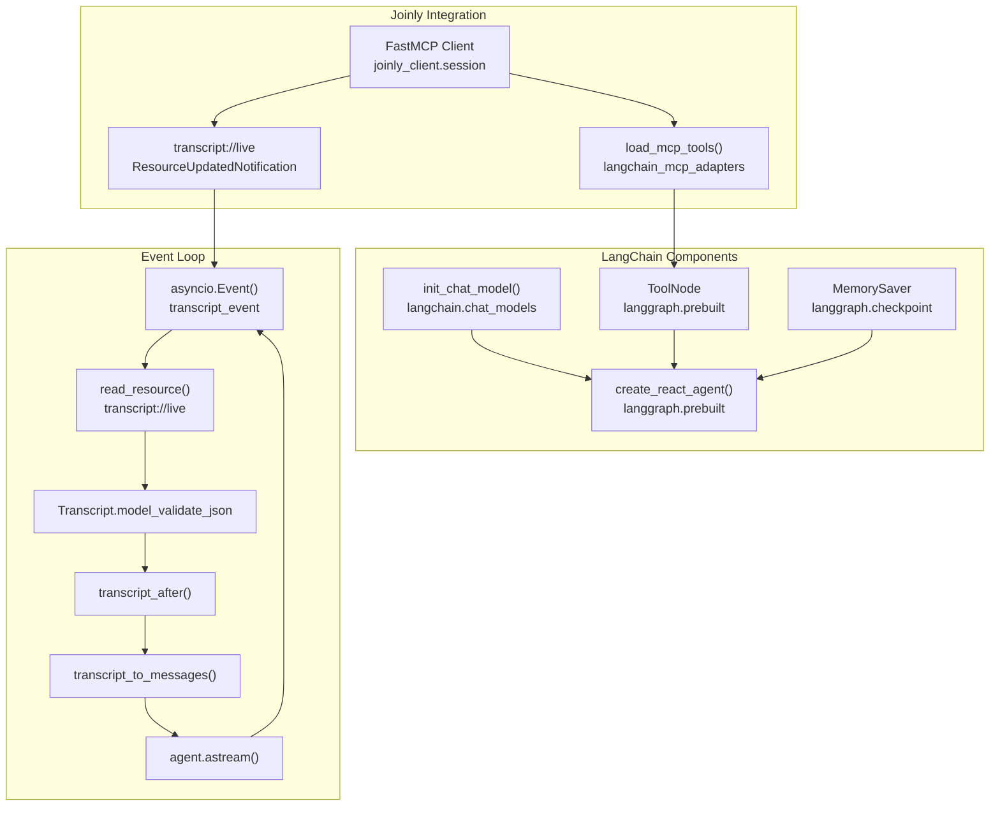
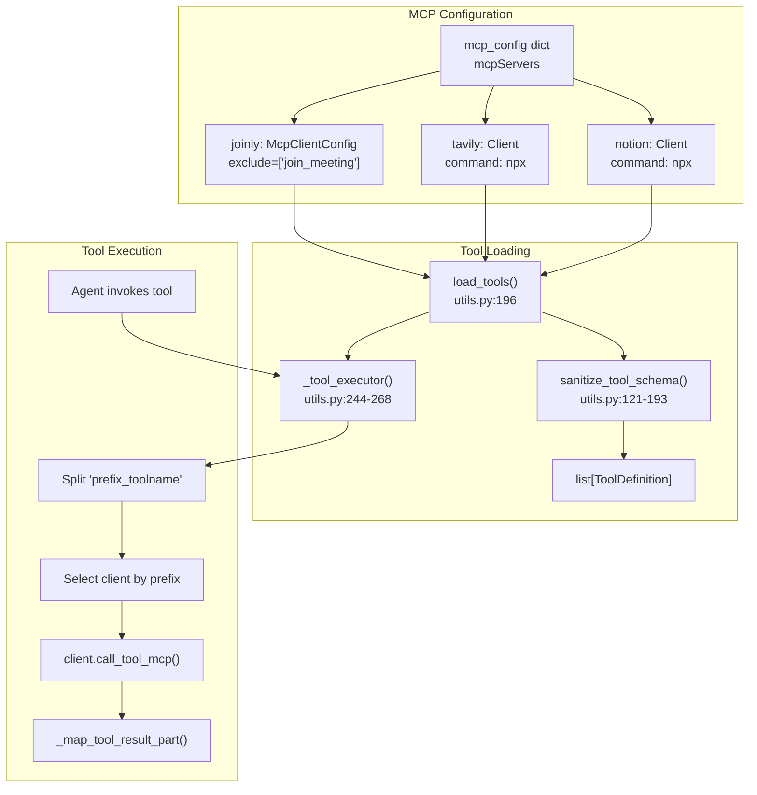
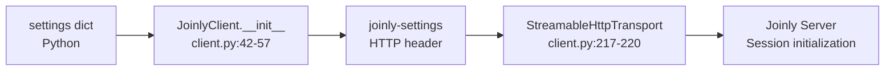

<!-- source: DeepWiki mcp.deepwiki.com · repo joinly-ai/joinly · page 6.3 Usage Patterns and Examples · fetched 2026-10-27 -->

# Usage Patterns and Examples

<details>
<summary>Relevant source files</summary>

The following files were used as context for generating this wiki page:

- [client/README.md](client/README.md)
- [client/joinly_client/__init__.py](client/joinly_client/__init__.py)
- [client/joinly_client/agent.py](client/joinly_client/agent.py)
- [client/joinly_client/client.py](client/joinly_client/client.py)
- [client/joinly_client/main.py](client/joinly_client/main.py)
- [client/joinly_client/prompts.py](client/joinly_client/prompts.py)
- [client/joinly_client/types.py](client/joinly_client/types.py)
- [client/joinly_client/utils.py](client/joinly_client/utils.py)
- [examples/client_example.py](examples/client_example.py)
- [examples/client_example.py.lock](examples/client_example.py.lock)
- [examples/config_notion.json](examples/config_notion.json)
- [examples/config_tavily.json](examples/config_tavily.json)
- [joinly/utils/events.py](joinly/utils/events.py)

</details>


## Purpose and Scope

This page documents the three primary usage patterns for the `joinly-client` package, demonstrating how to build conversational meeting agents that interact with the joinly server. Each pattern serves different use cases, from quick prototyping to fully custom agent implementations. For details about the underlying client API, see [JoinlyClient API](#6.1). For information about the built-in agent implementation, see [ConversationalToolAgent](#6.2).

---

## Overview of Usage Patterns

The `joinly-client` package supports three distinct usage patterns, each offering different levels of control and customization:



**Sources:** [client/joinly_client/main.py:223-396](), [client/joinly_client/agent.py:30-480](), [client/joinly_client/client.py:32-428](), [client/README.md:1-140]()

---

## Pattern 1: Command-Line Interface

### Basic CLI Usage

The simplest way to use `joinly-client` is through the command-line interface, which handles all setup automatically.

**Minimum Required Configuration:**

```bash
# Set API key for your LLM provider
export OPENAI_API_KEY="sk-..."

# Run with default settings
uvx joinly-client https://meet.google.com/abc-defg-hij
```

**Common CLI Options:**

```bash
uvx joinly-client \
  --joinly-url http://localhost:8000/mcp/ \
  --llm-provider openai \
  --llm-model gpt-4o \
  --name "joinly" \
  --prompt-style mpc \
  --env-file .env \
  https://meet.google.com/abc-defg-hij
```

### CLI Configuration Flow



**Sources:** [client/joinly_client/main.py:39-292]()

### Advanced CLI Configuration

**Service Configuration:**

```bash
# Configure speech services
uvx joinly-client \
  --tts elevenlabs \
  --tts-arg voice_id=EXAVITQu4vr4xnSDxMa6 \
  --stt deepgram \
  --lang de \
  https://meet.google.com/abc-defg-hij
```

**Multiple MCP Servers:**

Create a configuration file `config.json`:

```json
{
    "mcpServers": {
        "tavily": {
            "command": "npx",
            "args": ["-y", "tavily-mcp@0.2.2"]
        },
        "notion": {
            "command": "npx",
            "args": ["-y", "@notionhq/notion-mcp-server"],
            "env": {
                "OPENAPI_MCP_HEADERS": "{\"Authorization\": \"Bearer ntn_****\"}"
            }
        }
    }
}
```

Then use it:

```bash
uvx joinly-client --mcp-config config.json https://meet.google.com/abc-defg-hij
```

**CLI Options Reference:**

| Option | Environment Variable | Default | Description |
|--------|---------------------|---------|-------------|
| `--joinly-url` | `JOINLY_URL` | `http://localhost:8000/mcp/` | Joinly server URL |
| `--name` | `JOINLY_NAME` | `joinly` | Participant name |
| `--llm-provider` | `JOINLY_LLM_PROVIDER` | `openai` | LLM provider (openai, anthropic, google, azure_openai, ollama) |
| `--llm-model` | `JOINLY_LLM_MODEL` | `gpt-4o` | LLM model name |
| `--prompt` | `JOINLY_PROMPT` | None | Custom system prompt |
| `--prompt-file` | `JOINLY_PROMPT_FILE` | None | Path to prompt file |
| `--prompt-style` | `JOINLY_PROMPT_STYLE` | `mpc` | Prompt style: `dyadic` or `mpc` |
| `--name-trigger` | N/A | False | Only respond when name is mentioned |
| `--language` | `JOINLY_LANGUAGE` | None | Language for STT/TTS |
| `--vad` | `JOINLY_VAD` | None | VAD service (silero, webrtc) |
| `--stt` | `JOINLY_STT` | None | STT service (whisper, deepgram) |
| `--tts` | `JOINLY_TTS` | None | TTS service (kokoro, elevenlabs, deepgram, resemble) |

**Sources:** [client/joinly_client/main.py:39-222](), [client/README.md:31-68](), [examples/config_tavily.json:1-8](), [examples/config_notion.json:1-11]()

---

## Pattern 2: High-Level `run` Function

### Direct Function Usage

For programmatic control with minimal setup, use the `run` function directly in Python code.

**Basic Example:**

```python
import asyncio
from dotenv import load_dotenv
from joinly_client import run

load_dotenv()

async def main():
    await run(
        joinly_url="http://localhost:8000/mcp/",
        meeting_url="https://meet.google.com/abc-defg-hij",
        llm_provider="openai",
        llm_model="gpt-4o-mini",
    )

if __name__ == "__main__":
    asyncio.run(main())
```

**Sources:** [client/README.md:70-98]()

### Run Function Configuration



**Sources:** [client/joinly_client/main.py:294-393]()

### Run Function Parameters

**Function Signature:**

```python
async def run(
    joinly_url: str | FastMCP,
    meeting_url: str,
    llm_provider: str,
    llm_model: str,
    *,
    prompt: str | None = None,
    prompt_style: str | None = None,
    name: str | None = None,
    name_trigger: bool = False,
    mcp_config: dict[str, Any] | None = None,
    settings: dict[str, Any] | None = None,
) -> None:
```

| Parameter | Type | Required | Description |
|-----------|------|----------|-------------|
| `joinly_url` | `str` \| `FastMCP` | Yes | URL of joinly server or FastMCP instance |
| `meeting_url` | `str` | Yes | Meeting URL to join |
| `llm_provider` | `str` | Yes | LLM provider (openai, anthropic, google, etc.) |
| `llm_model` | `str` | Yes | Model name (gpt-4o, claude-3-5-sonnet, etc.) |
| `prompt` | `str` \| `None` | No | Custom system prompt |
| `prompt_style` | `str` \| `None` | No | Default prompt style: `dyadic` or `mpc` |
| `name` | `str` \| `None` | No | Participant name (default: "joinly") |
| `name_trigger` | `bool` | No | Only respond when name mentioned |
| `mcp_config` | `dict` \| `None` | No | Additional MCP servers configuration |
| `settings` | `dict` \| `None` | No | Settings for joinly server |

**Sources:** [client/joinly_client/main.py:294-321]()

### Advanced Configuration Examples

**Custom Prompt:**

```python
await run(
    joinly_url="http://localhost:8000/mcp/",
    meeting_url="https://meet.google.com/abc-defg-hij",
    llm_provider="openai",
    llm_model="gpt-4o",
    prompt="""You are a specialized meeting assistant focused on 
    technical discussions. Provide concise, technical answers.""",
)
```

**Name Trigger Mode:**

```python
# Only respond when "assistant" is mentioned in transcript
await run(
    joinly_url="http://localhost:8000/mcp/",
    meeting_url="https://meet.google.com/abc-defg-hij",
    llm_provider="openai",
    llm_model="gpt-4o",
    name="assistant",
    name_trigger=True,
)
```

**Server Settings Override:**

```python
# Configure speech services for this session
await run(
    joinly_url="http://localhost:8000/mcp/",
    meeting_url="https://meet.google.com/abc-defg-hij",
    llm_provider="openai",
    llm_model="gpt-4o",
    settings={
        "tts": "elevenlabs",
        "tts_args": {"voice_id": "EXAVITQu4vr4xnSDxMa6"},
        "language": "en",
    },
)
```

**Multiple MCP Servers:**

```python
mcp_config = {
    "mcpServers": {
        "tavily": {
            "command": "npx",
            "args": ["-y", "tavily-mcp@0.2.2"]
        },
        "notion": {
            "command": "npx",
            "args": ["-y", "@notionhq/notion-mcp-server"]
        }
    }
}

await run(
    joinly_url="http://localhost:8000/mcp/",
    meeting_url="https://meet.google.com/abc-defg-hij",
    llm_provider="openai",
    llm_model="gpt-4o",
    mcp_config=mcp_config,
)
```

**Sources:** [client/joinly_client/main.py:294-393](), [client/README.md:70-98]()

---

## Pattern 3: Custom Agent with JoinlyClient

### Low-Level Client API

For full control over agent behavior, use the `JoinlyClient` directly with custom callbacks.

**Basic Custom Agent Example:**

```python
import asyncio
from joinly_client import JoinlyClient
from joinly_client.types import TranscriptSegment

async def run():
    client = JoinlyClient(
        url="http://localhost:8000/mcp/",
        name="joinly",
        name_trigger=False,
        settings=None,
    )

    async def on_utterance(segments: list[TranscriptSegment]) -> None:
        for segment in segments:
            print(f"Received utterance: {segment.text}")
            if "marco" in segment.text.lower():
                await client.speak_text("Polo!")

    client.add_utterance_callback(on_utterance)

    async with client:
        await client.join_meeting("https://meet.google.com/abc-defg-hij")
        try:
            await asyncio.Event().wait()
        finally:
            print(await client.get_transcript())

if __name__ == "__main__":
    asyncio.run(run())
```

**Sources:** [client/README.md:100-139]()

### Callback System Architecture



**Sources:** [client/joinly_client/client.py:32-428]()

### Callback Registration and Lifecycle

**Adding Callbacks:**

```python
# Utterance callback - fires on complete utterances
def remove_utterance = client.add_utterance_callback(on_utterance)

# Segment callback - fires on every transcript segment
def remove_segment = client.add_segment_callback(on_segment)

# Remove callbacks later
remove_utterance()
remove_segment()
```

**Callback Function Signatures:**

```python
async def on_utterance(segments: list[TranscriptSegment]) -> None:
    """Called when a complete utterance is detected.
    
    Args:
        segments: List of compact segments forming an utterance.
                  Only includes participant speech (not agent).
    """
    pass

async def on_segment(segments: list[TranscriptSegment]) -> None:
    """Called for every new transcript segment.
    
    Args:
        segments: List of all new segments since last callback.
                  Includes both participant and agent speech.
    """
    pass
```

**Sources:** [client/joinly_client/client.py:99-183]()

### JoinlyClient Methods Reference

| Method | Parameters | Returns | Description |
|--------|-----------|---------|-------------|
| `add_utterance_callback` | `callback` | `Callable[[], None]` | Register utterance callback, returns removal function |
| `add_segment_callback` | `callback` | `Callable[[], None]` | Register segment callback, returns removal function |
| `join_meeting` | `meeting_url`, `passcode`, `participant_name` | `None` | Join a meeting |
| `leave_meeting` | None | `None` | Leave current meeting |
| `speak_text` | `text: str` | `None` | Speak text in meeting |
| `send_chat_message` | `message: str` | `None` | Send chat message |
| `mute` | None | `None` | Mute microphone |
| `unmute` | None | `None` | Unmute microphone |
| `get_transcript` | None | `Transcript` | Get full transcript |
| `get_chat_history` | None | `MeetingChatHistory` | Get chat messages |
| `get_participants` | None | `MeetingParticipantList` | Get participant list |
| `get_usage` | None | `Usage` | Get usage statistics |
| `list_tools` | None | `list[Tool]` | List available MCP tools |

**Sources:** [client/joinly_client/client.py:285-428]()

### Advanced Custom Agent Examples

**Conditional Response Agent:**

```python
import re
from joinly_client import JoinlyClient
from joinly_client.types import TranscriptSegment

async def run():
    client = JoinlyClient(url="http://localhost:8000/mcp/")
    
    patterns = {
        r"what time is it": lambda: f"It's {datetime.now().strftime('%I:%M %p')}",
        r"take a note": lambda: "I've noted that.",
        r"end meeting": lambda: None  # Special case: leave
    }
    
    async def on_utterance(segments: list[TranscriptSegment]) -> None:
        text = " ".join(s.text for s in segments).lower()
        
        for pattern, response_fn in patterns.items():
            if re.search(pattern, text):
                response = response_fn()
                if response:
                    await client.speak_text(response)
                else:
                    await client.speak_text("Leaving the meeting now.")
                    await client.leave_meeting()
                break
    
    client.add_utterance_callback(on_utterance)
    
    async with client:
        await client.join_meeting("https://meet.google.com/abc-defg-hij")
        await asyncio.Event().wait()
```

**Multi-Modal Response Agent:**

```python
async def on_utterance(segments: list[TranscriptSegment]) -> None:
    text = " ".join(s.text for s in segments)
    
    # Analyze intent
    if "summarize" in text.lower():
        transcript = await client.get_transcript()
        summary = generate_summary(transcript)
        
        # Respond via voice for short summary
        await client.speak_text("Here's a quick summary:")
        await client.speak_text(summary[:100])
        
        # Send full summary in chat
        await client.send_chat_message(f"Full Summary:\n{summary}")
    
    elif "who's here" in text.lower():
        participants = await client.get_participants()
        names = [p.name for p in participants.participants]
        await client.speak_text(f"We have {len(names)} participants: {', '.join(names)}")
```

**State Machine Agent:**

```python
from enum import Enum

class AgentState(Enum):
    IDLE = "idle"
    LISTENING = "listening"
    MUTED = "muted"

class StatefulAgent:
    def __init__(self, client: JoinlyClient):
        self.client = client
        self.state = AgentState.IDLE
    
    async def on_utterance(self, segments: list[TranscriptSegment]) -> None:
        text = " ".join(s.text for s in segments).lower()
        
        if self.state == AgentState.MUTED:
            if "unmute" in text and "joinly" in text:
                await self.client.unmute()
                await self.client.speak_text("I'm back!")
                self.state = AgentState.LISTENING
            return
        
        if "stay quiet" in text or "mute yourself" in text:
            await self.client.speak_text("Muting myself now.")
            await self.client.mute()
            self.state = AgentState.MUTED
        
        elif "start listening" in text:
            self.state = AgentState.LISTENING
            await self.client.speak_text("I'm listening carefully now.")
        
        elif self.state == AgentState.LISTENING:
            # Process everything when in listening mode
            await self.process_utterance(segments)
    
    async def process_utterance(self, segments: list[TranscriptSegment]) -> None:
        # Custom processing logic
        pass
```

**Sources:** [client/joinly_client/client.py:32-428]()

---

## Pattern 4: Integration with Other Frameworks

### LangChain/LangGraph Integration

The `joinly-client` can be integrated with other agent frameworks by using the low-level `JoinlyClient` API.

**LangChain Agent Example:**



**Sources:** [examples/client_example.py:92-219]()

**Complete LangGraph Example Structure:**

The example at [examples/client_example.py:1-294]() demonstrates:

1. **FastMCP Client Setup** - Using separate client for notifications [examples/client_example.py:148-149]()
2. **MCP Tool Loading** - Load tools from joinly and additional servers [examples/client_example.py:173-176]()
3. **Custom Finish Tool** - Return-direct tool to end agent turns [examples/client_example.py:167-170]()
4. **ReAct Agent Creation** - LangGraph agent with tools and memory [examples/client_example.py:182-184]()
5. **Transcript Subscription** - Subscribe to live transcript updates [examples/client_example.py:165]()
6. **Event-Driven Loop** - Wait for updates and process with agent [examples/client_example.py:191-218]()

**Key Implementation Details:**

```python
# Message handler for transcript updates
async def _message_handler(message) -> None:
    if (
        isinstance(message, ServerNotification)
        and isinstance(message.root, ResourceUpdatedNotification)
        and message.root.params.uri == transcript_url
    ):
        transcript_event.set()

# Convert transcript to LangChain messages
def transcript_to_messages(transcript: Transcript) -> list[HumanMessage]:
    return [
        HumanMessage(
            content=s.text,
            name=_normalize_speaker(s.speaker),
        )
        for s in transcript.segments
    ]

# Stream agent responses
async for chunk in agent.astream(
    {"messages": transcript_to_messages(transcript)},
    config={"configurable": {"thread_id": "1"}},
    stream_mode="updates",
):
    log_chunk(chunk)
```

**Sources:** [examples/client_example.py:53-90](), [examples/client_example.py:111-118](), [examples/client_example.py:211-216]()

### Integration with Other MCP Servers

Both the CLI and `run` function support connecting to multiple MCP servers simultaneously, enabling agents to access a wide variety of tools.

**MCP Configuration Structure:**

```json
{
    "mcpServers": {
        "server_name": {
            "command": "command_to_run",
            "args": ["arg1", "arg2"],
            "env": {
                "ENV_VAR": "value"
            }
        }
    }
}
```

**Tool Naming Convention:**

When multiple MCP servers are configured, tools are prefixed with the server name to avoid conflicts:

- Joinly tools: `join_meeting`, `speak_text`, `get_transcript`
- Tavily tools: `tavily_search`
- Notion tools: `notion_create_page`, `notion_search`



**Sources:** [client/joinly_client/utils.py:196-269](), [client/joinly_client/main.py:328-373]()

**Example: Web Search Integration:**

```bash
# Create config_tavily.json
uvx joinly-client --mcp-config config_tavily.json <meeting_url>
```

The agent can now use the `tavily_search` tool:
- Agent hears: "What's the weather in Paris?"
- Agent uses: `tavily_search(query="weather in Paris")`
- Agent speaks: "According to the latest data, it's 15°C and partly cloudy in Paris."

**Example: Notion Integration:**

```bash
# Create config_notion.json with API token
uvx joinly-client --mcp-config config_notion.json <meeting_url>
```

The agent can now create and search Notion pages:
- Agent hears: "Create an action item to review the proposal"
- Agent uses: `notion_create_page(title="Review proposal", ...)`
- Agent speaks: "I've created an action item in Notion."

**Sources:** [examples/config_tavily.json:1-8](), [examples/config_notion.json:1-11]()

---

## Comparison of Usage Patterns

### Decision Matrix

| Criterion | CLI Pattern | `run()` Function | Custom Agent |
|-----------|-------------|------------------|--------------|
| **Ease of Use** | ⭐⭐⭐⭐⭐ Simplest | ⭐⭐⭐⭐ Simple | ⭐⭐ Requires code |
| **Flexibility** | ⭐⭐ Limited to options | ⭐⭐⭐ Moderate | ⭐⭐⭐⭐⭐ Full control |
| **Agent Customization** | ⭐ Fixed agent | ⭐⭐ Prompt only | ⭐⭐⭐⭐⭐ Complete |
| **Integration** | ⭐⭐ MCP servers only | ⭐⭐⭐ MCP + config | ⭐⭐⭐⭐⭐ Any framework |
| **Setup Time** | ⭐⭐⭐⭐⭐ Instant | ⭐⭐⭐⭐ Minutes | ⭐⭐ Hours |
| **Debugging** | ⭐⭐ Log output | ⭐⭐⭐ Log + code | ⭐⭐⭐⭐⭐ Full control |

### Use Case Recommendations

**Use CLI Pattern when:**
- Quick testing or prototyping
- Standard conversational agent is sufficient
- No custom logic required
- Command-line environment available

**Use `run()` Function when:**
- Programmatic deployment needed
- Custom prompts or multiple configurations
- Integration into Python application
- Standard agent behavior acceptable

**Use Custom Agent when:**
- Complex conditional logic required
- State machine or specialized behavior
- Integration with existing frameworks (LangChain, etc.)
- Custom callback processing
- Non-standard tool usage patterns

**Sources:** [client/joinly_client/main.py:1-396](), [client/joinly_client/client.py:1-428](), [client/README.md:1-140]()

---

## Common Configuration Patterns

### Prompt Customization

**Built-in Prompt Styles:**

The default prompt template is structured with sections defined at [client/joinly_client/prompts.py:1-101]():

- **Identity**: Agent role and capabilities
- **Instructions**: Behavior based on prompt style (dyadic or mpc)
- **Core Principles**: Universal rules for all agents
- **Response Guidelines**: Voice vs. chat selection logic
- **Tool Use Protocol**: Meeting tools and external tools rules

**Dyadic Style** [client/joinly_client/prompts.py:103-122](): For one-on-one meetings, respond to all messages, stay engaged

**MPC Style** [client/joinly_client/prompts.py:124-150](): For group meetings, only respond when addressed or when blocking progress

**Custom Prompt Template:**

```python
custom_prompt = """
<identity>
You are {name}, a technical meeting assistant specialized in {domain}.
</identity>

<instructions>
{instructions}
</instructions>

<custom_rules>
- Always cite sources when providing information
- Use technical terminology appropriate for the audience
- Provide code examples when relevant
</custom_rules>

<metadata>
Today is {date}.
Specialized domain: {domain}
</metadata>
"""

await run(
    ...,
    prompt=custom_prompt.format(
        name="TechBot",
        domain="software architecture",
        instructions="Provide detailed technical explanations",
        date=datetime.now().strftime("%Y-%m-%d")
    )
)
```

**Sources:** [client/joinly_client/prompts.py:1-151](), [client/joinly_client/utils.py:86-110]()

### LLM Provider Configuration

**OpenAI:**

```python
await run(
    ...,
    llm_provider="openai",
    llm_model="gpt-4o",  # or gpt-4o-mini, gpt-4-turbo
)
```

**Anthropic:**

```python
await run(
    ...,
    llm_provider="anthropic",
    llm_model="claude-3-5-sonnet-20241022",
)
```

**Google:**

```python
await run(
    ...,
    llm_provider="google",  # Mapped to "google-gla" internally
    llm_model="gemini-1.5-pro",
)
```

**Azure OpenAI:**

```python
# Set environment variables:
# AZURE_OPENAI_ENDPOINT, AZURE_OPENAI_API_KEY

await run(
    ...,
    llm_provider="azure_openai",  # Mapped to "azure" internally
    llm_model="gpt-4o",
)
```

**Ollama (Local):**

```python
# Set OLLAMA_HOST and OLLAMA_PORT if not default
await run(
    ...,
    llm_provider="ollama",
    llm_model="llama3.2",
)
```

**Sources:** [client/joinly_client/utils.py:29-83]()

### Settings Propagation

Settings passed to `JoinlyClient` or `run()` are propagated to the joinly server via HTTP headers, allowing per-session configuration:



**Available Settings:**

| Setting | Type | Description |
|---------|------|-------------|
| `name` | `str` | Participant name (also set via parameter) |
| `language` | `str` | Language code for STT/TTS (e.g., "en", "de") |
| `vad` | `str` | VAD service: "silero", "webrtc" |
| `stt` | `str` | STT service: "whisper", "deepgram" |
| `tts` | `str` | TTS service: "kokoro", "elevenlabs", "deepgram", "resemble" |
| `vad_args` | `dict` | Arguments for VAD service |
| `stt_args` | `dict` | Arguments for STT service |
| `tts_args` | `dict` | Arguments for TTS service |
| `transcription_controller_args` | `dict` | Arguments for transcription controller |
| `speech_controller_args` | `dict` | Arguments for speech controller |

**Example with Service Configuration:**

```python
settings = {
    "language": "en",
    "tts": "elevenlabs",
    "tts_args": {
        "voice_id": "EXAVITQu4vr4xnSDxMa6",
        "model_id": "eleven_turbo_v2_5"
    },
    "stt": "deepgram",
    "stt_args": {
        "model": "nova-2"
    }
}

await run(
    joinly_url="http://localhost:8000/mcp/",
    meeting_url="https://meet.google.com/abc-defg-hij",
    llm_provider="openai",
    llm_model="gpt-4o",
    settings=settings,
)
```

**Sources:** [client/joinly_client/client.py:35-70](), [client/joinly_client/client.py:217-220]()

---

## Error Handling and Best Practices

### Connection Management

**Context Manager Pattern:**

Always use the async context manager to ensure proper cleanup:

```python
async with client:
    await client.join_meeting(meeting_url)
    # Client automatically disconnects on exit
```

**Manual Connection Management:**

```python
client = JoinlyClient(url="http://localhost:8000/mcp/")

try:
    await client.__aenter__()
    await client.join_meeting(meeting_url)
    # ... do work ...
finally:
    await client.__aexit__(None, None, None)
```

**Sources:** [client/joinly_client/client.py:185-199]()

### Callback Exception Handling

Callbacks should handle exceptions internally to prevent task failures:

```python
async def safe_on_utterance(segments: list[TranscriptSegment]) -> None:
    try:
        # Your logic here
        text = " ".join(s.text for s in segments)
        response = await generate_response(text)
        await client.speak_text(response)
    except Exception as e:
        logger.exception("Error in utterance callback: %s", e)
        # Optionally notify in meeting
        await client.speak_text("I encountered an error processing that.")
```

**Sources:** [client/joinly_client/client.py:240-251]()

### Tool Execution Error Handling

The `ConversationalToolAgent` automatically catches tool execution errors:

```python
# From agent.py:258-264
try:
    content = await self._tool_executor(
        tool_call.tool_name, tool_call.args_as_dict()
    )
except Exception:
    logger.exception("Error calling tool %s", tool_call.tool_name)
    content = f"Error calling tool {tool_call.tool_name}"
```

For custom agents, implement similar error handling:

```python
async def call_tool_safely(tool_name: str, args: dict) -> str:
    try:
        return await client.client.call_tool(tool_name, arguments=args)
    except McpError as e:
        logger.error("MCP error calling %s: %s", tool_name, e)
        return f"Error: {e.message}"
    except Exception as e:
        logger.exception("Unexpected error calling %s", tool_name)
        return "An unexpected error occurred"
```

**Sources:** [client/joinly_client/agent.py:258-264]()

### Best Practices Summary

1. **Always use async context managers** for `JoinlyClient` and `ConversationalToolAgent`
2. **Handle exceptions in callbacks** to prevent task crashes
3. **Validate settings** before passing to client to catch configuration errors early
4. **Use name_trigger mode** in group meetings to reduce noise
5. **Limit callback processing time** to avoid blocking the event loop
6. **Log extensively** for debugging agent behavior
7. **Test with local models** (Ollama) before using paid APIs
8. **Monitor usage statistics** via `client.get_usage()` and `agent.usage`

**Sources:** [client/joinly_client/agent.py:84-96](), [client/joinly_client/client.py:185-199](), [client/joinly_client/client.py:369-381]()

---

