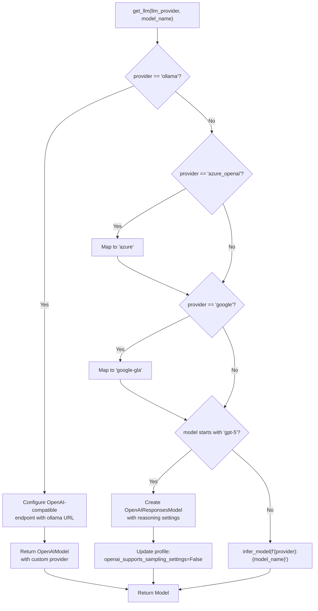
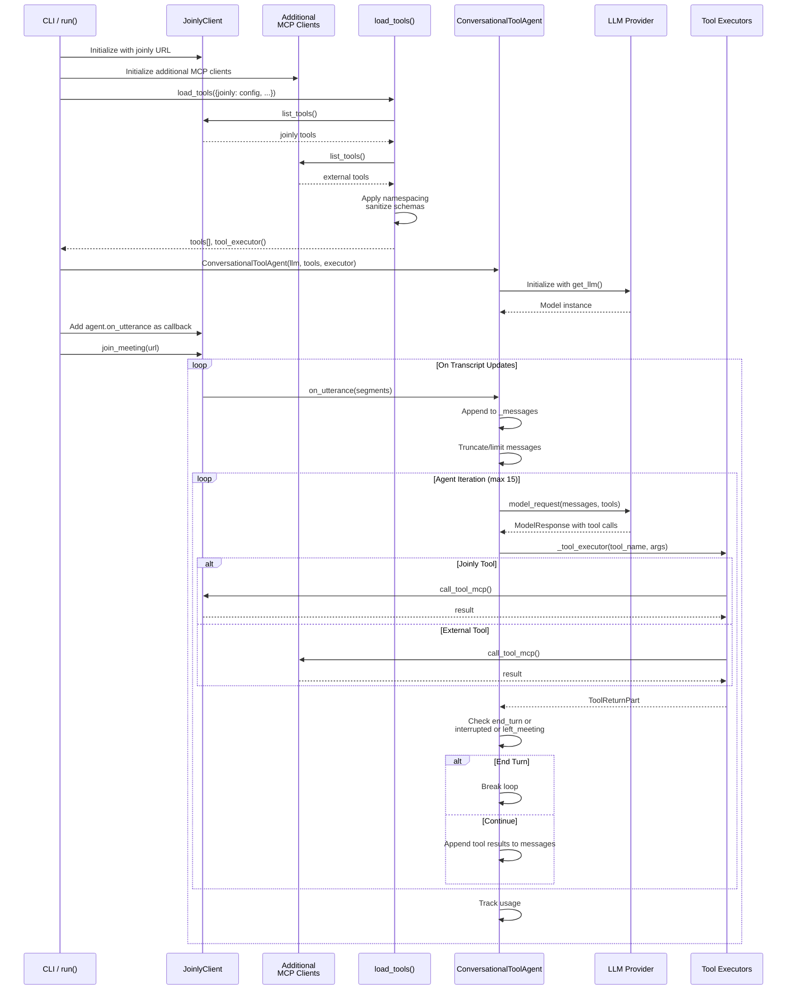

<!-- source: DeepWiki mcp.deepwiki.com · repo joinly-ai/joinly · page 7 LLM and External Service Integration · fetched 2026-10-27 -->

# LLM and External Service Integration

<details>
<summary>Relevant source files</summary>

The following files were used as context for generating this wiki page:

- [client/joinly_client/agent.py](client/joinly_client/agent.py)
- [client/joinly_client/client.py](client/joinly_client/client.py)
- [client/joinly_client/main.py](client/joinly_client/main.py)
- [client/joinly_client/prompts.py](client/joinly_client/prompts.py)
- [client/joinly_client/types.py](client/joinly_client/types.py)
- [client/joinly_client/utils.py](client/joinly_client/utils.py)
- [examples/client_example.py](examples/client_example.py)
- [examples/client_example.py.lock](examples/client_example.py.lock)
- [examples/config_notion.json](examples/config_notion.json)
- [examples/config_tavily.json](examples/config_tavily.json)
- [joinly/utils/events.py](joinly/utils/events.py)

</details>


## Purpose and Scope

This document explains how joinly integrates with Large Language Model (LLM) providers and external Model Context Protocol (MCP) servers. It covers LLM provider configuration, the agent's interaction with LLMs, and how to extend the system with additional MCP servers for capabilities like web search, document management, and version control.

For information about the basic client architecture and usage patterns, see [Client SDK (joinly-client)](#6). For details on the core agent implementation, see [ConversationalToolAgent](#6.2).

## Supported LLM Providers

joinly supports multiple LLM providers through the `pydantic-ai` library, which provides a unified interface for different model providers.

### Provider Support Matrix

| Provider | Configuration Key | Environment Variable | Notes |
|----------|------------------|---------------------|-------|
| OpenAI | `openai` | `OPENAI_API_KEY` | Default provider |
| Anthropic | `anthropic` | `ANTHROPIC_API_KEY` | Claude models |
| Google | `google` / `google-gla` | `GOOGLE_API_KEY` | Gemini models |
| Azure OpenAI | `azure_openai` / `azure` | `AZURE_OPENAI_API_KEY` | Azure-hosted models |
| Ollama | `ollama` | `OLLAMA_URL` or `OLLAMA_HOST`/`OLLAMA_PORT` | Local models |

Sources: [client/joinly_client/utils.py:29-83]()

### LLM Configuration Function

The `get_llm()` function in [client/joinly_client/utils.py:29-83]() handles provider initialization and model-specific settings:



**Diagram: LLM Provider Resolution and Configuration**

Sources: [client/joinly_client/utils.py:29-83]()

#### Special Provider Handling

**Ollama**: Configured as an OpenAI-compatible endpoint. The URL is determined from environment variables, defaulting to `http://localhost:11434/v1`.

```python
# From client/joinly_client/utils.py:39-51
ollama_url = os.getenv("OLLAMA_URL")
if not ollama_url:
    ollama_url = (
        f"http://{os.getenv('OLLAMA_HOST', 'localhost')}:"
        f"{os.getenv('OLLAMA_PORT', '11434')}/v1"
    )
return OpenAIModel(
    model_name,
    provider=OpenAIProvider(base_url=ollama_url),
)
```

**GPT-5 Models**: Require special configuration for reasoning capabilities and have sampling settings disabled:

```python
# From client/joinly_client/utils.py:60-74
model = OpenAIResponsesModel(
    model_name,
    provider=llm_provider,
    settings=ModelSettings(
        extra_body={
            "reasoning": {"effort": "minimal"},
            "text": {"verbosity": "low"},
        }
    ),
)
model.profile = model.profile.update(
    OpenAIModelProfile(openai_supports_sampling_settings=False)
)
```

Sources: [client/joinly_client/utils.py:39-83]()

## ConversationalToolAgent Integration

The `ConversationalToolAgent` class in [client/joinly_client/agent.py]() orchestrates LLM interactions, managing message history, tool execution, and response generation.

### Agent-LLM Interaction Architecture

```mermaid
flowchart TB
    subgraph "Input"
        Segments["TranscriptSegment[]<br/>from meeting"]
    end
    
    subgraph "ConversationalToolAgent"
        OnUtterance["on_utterance(segments)"]
        RunLoop["_run_loop(segments)"]
        
        subgraph "Message Management"
            Messages["_messages: list[ModelMessage]"]
            Truncate["_truncate_tool_results()"]
            Limit["_limit_messages()"]
            Omit["_omit_binary_tool_results()"]
        end
        
        CallLLM["_call_llm(messages)"]
        
        subgraph "Tool Execution"
            CallTools["_call_tools(response)"]
            CallTool["_call_tool(tool_call)"]
            ToolExecutor["_tool_executor(tool_name, args)"]
        end
        
        CheckEnd["_check_end_turn(response, request)"]
        Usage["_usage: Usage<br/>track token usage"]
    end
    
    subgraph "External Services"
        LLM["Model<br/>(pydantic-ai)"]
        MCPTools["MCP Tool Execution"]
    end
    
    Segments --> OnUtterance
    OnUtterance --> RunLoop
    RunLoop --> Messages
    Messages --> Truncate
    Truncate --> Limit
    Limit --> Omit
    Omit --> CallLLM
    CallLLM --> LLM
    LLM -->|ModelResponse| CallTools
    CallTools --> CallTool
    CallTool --> ToolExecutor
    ToolExecutor --> MCPTools
    MCPTools -->|tool result| CallTool
    CallTool -->|ToolReturnPart| Messages
    Messages --> CheckEnd
    CheckEnd -->|not done| CallLLM
    CheckEnd -->|done| Usage
    
    style ConversationalToolAgent fill:#f9f9f9
    style "Message Management" fill:#e8e8e8
    style "Tool Execution" fill:#e8e8e8
```

**Diagram: ConversationalToolAgent LLM Interaction Flow**

Sources: [client/joinly_client/agent.py:30-480]()

### Agent Initialization

The agent is initialized with an LLM model, available tools, and a tool executor:

```python
# From client/joinly_client/agent.py:33-76
def __init__(
    self,
    llm: Model,
    tools: list[ToolDefinition],
    tool_executor: ToolExecutor,
    *,
    prompt: str | None = None,
    max_messages: int = 50,
    max_tool_result_chars: int = 2048,
    max_ephemeral_tool_result_chars: int = 16384,
    max_agent_iter: int | None = 15,
) -> None:
    self._llm = llm
    self._tools = tools
    self._tool_executor = tool_executor
    self._messages: list[ModelMessage] = []
    # ... other initialization
```

Sources: [client/joinly_client/agent.py:33-77]()

### LLM Request Construction

When calling the LLM, the agent constructs a request with:
- System prompt
- Message history
- Available tools (including a special `end_turn` tool)
- Model settings (temperature, parallel tool calls)

```python
# From client/joinly_client/agent.py:152-203
async def _call_llm(self, messages: list[ModelMessage]) -> ModelResponse:
    response = await model_request(
        self._llm,
        [ModelRequest(parts=[SystemPromptPart(self._prompt)]), *messages],
        model_settings=merge_model_settings(
            self._llm.settings,
            ModelSettings(
                temperature=0.2,
                parallel_tool_calls=True,
            ),
        ),
        model_request_parameters=ModelRequestParameters(
            function_tools=[
                ToolDefinition(
                    name="end_turn",
                    description="End the current response turn...",
                    parameters_json_schema={"properties": {}, "type": "object"},
                ),
                *self._tools,
            ],
            allow_text_output=self._llm.model_name.startswith("gpt-5"),
        ),
    )
    # Track usage
    self._usage.add("llm", usage={...}, meta={...})
    return response
```

Sources: [client/joinly_client/agent.py:152-202]()

### Message History Management

The agent implements several strategies to manage message history:

| Strategy | Purpose | Implementation |
|----------|---------|---------------|
| Truncation | Limit tool result size | `_truncate_tool_results()` |
| Binary Omission | Remove binary content from history | `_omit_binary_tool_results()` |
| Message Limiting | Keep history within bounds | `_limit_messages()` |

**Truncation Levels**:
- `max_tool_result_chars` (default: 2048): Applied after each agent turn
- `max_ephemeral_tool_result_chars` (default: 16384): Applied immediately after tool calls

Sources: [client/joinly_client/agent.py:358-479]()

### Usage Tracking

The agent tracks LLM usage through the `_usage` object:

```python
# From client/joinly_client/agent.py:194-201
self._usage.add(
    "llm",
    usage={
        "input_tokens": response.usage.request_tokens or 0,
        "output_tokens": response.usage.response_tokens or 0,
    },
    meta={"model": self._llm.model_name, "provider": self._llm.system},
)
```

Sources: [client/joinly_client/agent.py:76-82](), [client/joinly_client/agent.py:194-201]()

## External MCP Server Integration

joinly can integrate with additional MCP servers to extend the agent's capabilities beyond meeting control. These external servers provide tools for web search, document management, version control, and more.

### MCP Configuration Format

External MCP servers are configured using a JSON file following the FastMCP client configuration format:

```json
{
    "mcpServers": {
        "server_name": {
            "command": "npx",
            "args": ["-y", "package-name"],
            "env": {
                "ENV_VAR": "value"
            }
        }
    }
}
```

Sources: [examples/config_tavily.json:1-8](), [examples/config_notion.json:1-11]()

### Example: Tavily Web Search Integration

```json
{
    "mcpServers": {
        "tavily": {
            "command": "npx",
            "args": ["-y", "tavily-mcp@0.2.2"]
        }
    }
}
```

This configuration adds web search capabilities through the Tavily MCP server.

Sources: [examples/config_tavily.json:1-8]()

### Example: Notion Integration

```json
{
    "mcpServers": {
        "notion": {
            "command": "npx",
            "args": ["-y", "@notionhq/notion-mcp-server"],
            "env": {
                "OPENAPI_MCP_HEADERS": "{\"Authorization\": \"Bearer ntn_****\", \"Notion-Version\": \"2022-06-28\"}"
            }
        }
    }
}
```

This adds Notion document management capabilities with authentication.

Sources: [examples/config_notion.json:1-11]()

### Tool Loading and Namespacing

```mermaid
flowchart LR
    subgraph "Input"
        Config["McpClientConfig<br/>or dict[str, McpClientConfig]"]
    end
    
    subgraph "load_tools()"
        LoadTools["load_tools(clients, sanitize_fn)"]
        
        Iterate["For each MCP client"]
        ListTools["client.list_tools()"]
        Filter["Apply include/exclude filters"]
        Sanitize["sanitize_tool_schema()"]
        AddPrefix["Add prefix to tool name<br/>if multiple clients"]
        
        CreateExecutor["Create _tool_executor()<br/>function"]
    end
    
    subgraph "Output"
        ToolDefs["list[ToolDefinition]<br/>with namespaced names"]
        Executor["ToolExecutor<br/>callable"]
    end
    
    Config --> LoadTools
    LoadTools --> Iterate
    Iterate --> ListTools
    ListTools --> Filter
    Filter --> Sanitize
    Sanitize --> AddPrefix
    AddPrefix --> ToolDefs
    LoadTools --> CreateExecutor
    CreateExecutor --> Executor
    
    style "load_tools()" fill:#f9f9f9
```

**Diagram: Multi-MCP Tool Loading and Namespacing**

Sources: [client/joinly_client/utils.py:196-269]()

#### Tool Namespacing Logic

When multiple MCP clients are configured, tools are prefixed with the client name:

```python
# From client/joinly_client/utils.py:236-242
tools.append(
    ToolDefinition(
        name=f"{prefix}_{tool.name}" if prefix is not None else tool.name,
        description=tool.description,
        parameters_json_schema=schema,
    )
)
```

The tool executor splits the prefixed name to route to the correct client:

```python
# From client/joinly_client/utils.py:244-259
async def _tool_executor(tool_name: str, args: dict[str, Any]) -> Any:
    if isinstance(clients, McpClientConfig):
        client = clients.client
    else:
        prefix, tool_name = tool_name.split("_", 1)
        if prefix not in clients:
            raise ValueError(f"MCP '{prefix}' not found")
        client = clients[prefix].client
    
    result = await client.call_tool_mcp(tool_name, args)
    # Handle result mapping and callbacks
```

Sources: [client/joinly_client/utils.py:196-269]()

### Schema Sanitization

The `sanitize_tool_schema()` function removes unsupported JSON schema features to ensure compatibility with OpenAI's tool calling requirements:

**Removed Features**:
- `allOf`, `anyOf`, `oneOf`, `not`
- `if`, `then`, `else`
- `$schema`, `$id`, `$ref`
- `definitions`, `$defs`
- `patternProperties`

Sources: [client/joinly_client/utils.py:121-193]()

## Complete Integration Flow



**Diagram: Complete LLM and MCP Integration Flow**

Sources: [client/joinly_client/main.py:294-393](), [client/joinly_client/agent.py:98-150]()

## Configuration Examples

### CLI Configuration

```bash
# Basic OpenAI configuration
joinly-client \
  --llm-provider openai \
  --llm-model gpt-4o \
  https://meet.google.com/abc-defg-hij

# Anthropic with external MCP servers
joinly-client \
  --llm-provider anthropic \
  --llm-model claude-3-5-sonnet-20241022 \
  --mcp-config mcp_servers.json \
  https://meet.google.com/abc-defg-hij

# Ollama with local model
OLLAMA_HOST=localhost OLLAMA_PORT=11434 \
joinly-client \
  --llm-provider ollama \
  --llm-model llama3.2 \
  https://meet.google.com/abc-defg-hij
```

Sources: [client/joinly_client/main.py:60-78]()

### Programmatic Configuration

```python
# From client/joinly_client/main.py:322-393
from joinly_client import JoinlyClient, ConversationalToolAgent
from joinly_client.utils import get_llm, load_tools, get_prompt
from joinly_client.types import McpClientConfig
from fastmcp import Client

# Initialize joinly client
client = JoinlyClient(
    "http://localhost:8000/mcp/",
    name="assistant",
    settings={"language": "en", "tts": "elevenlabs"}
)

# Load additional MCP clients
additional_clients = {
    "tavily": Client({"mcpServers": {"tavily": {"command": "npx", "args": ["-y", "tavily-mcp"]}}}),
    "notion": Client({"mcpServers": {"notion": {"command": "npx", "args": ["-y", "@notionhq/notion-mcp-server"]}}})
}

# Load tools from all sources
tools, tool_executor = await load_tools({
    "joinly": McpClientConfig(client=client.client, exclude=["join_meeting"]),
    "tavily": McpClientConfig(client=additional_clients["tavily"]),
    "notion": McpClientConfig(client=additional_clients["notion"])
})

# Initialize LLM and agent
llm = get_llm("openai", "gpt-4o")
agent = ConversationalToolAgent(
    llm,
    tools,
    tool_executor,
    prompt=get_prompt(prompt_style="mpc", name="assistant")
)

# Connect callbacks and join meeting
client.add_utterance_callback(agent.on_utterance)
await client.join_meeting("https://meet.google.com/abc-defg-hij")
```

Sources: [client/joinly_client/main.py:322-393]()

### Alternative: LangChain Integration

For users who prefer LangChain, the `examples/client_example.py` demonstrates integration using `langchain-mcp-adapters`:

```python
# From examples/client_example.py:119-184
from langchain.chat_models import init_chat_model
from langchain_mcp_adapters.tools import load_mcp_tools
from langgraph.prebuilt import create_react_agent

llm = init_chat_model(model_name, model_provider=model_provider)

# Load tools from MCP servers
tools = await load_mcp_tools(joinly_client.session)
if client:
    tools.extend(await load_mcp_tools(client.session))

# Create agent with tool node
agent = create_react_agent(llm_binded, tool_node, prompt=prompt, checkpointer=memory)
```

Sources: [examples/client_example.py:92-219]()

## HTTP Header Configuration

When connecting to the joinly server, settings can be passed via HTTP headers using the `joinly-settings` header:

```python
# From client/joinly_client/client.py:216-220
transport = StreamableHttpTransport(
    url=self.url,
    headers={"joinly-settings": json.dumps(self.settings)},
)
```

This allows per-connection configuration of server-side settings like TTS provider, STT provider, language, and participant name.

Sources: [client/joinly_client/client.py:35-58](), [client/joinly_client/client.py:216-220]()

## Best Practices

### LLM Provider Selection
- **OpenAI**: Best overall compatibility, supports parallel tool calls
- **Anthropic**: Excellent for complex reasoning tasks
- **Ollama**: Use for local deployment, privacy-sensitive scenarios
- **Azure OpenAI**: Enterprise deployments with existing Azure infrastructure

### Tool Configuration
- Use `exclude` in `McpClientConfig` to prevent duplicate or unwanted tools
- Use `include` to explicitly allow specific tools
- Implement `post_callback` for custom result processing

### Message History Management
- Adjust `max_messages` based on expected conversation length
- Tune `max_tool_result_chars` to balance context preservation with token limits
- Set `max_ephemeral_tool_result_chars` higher for immediate tool calls with large results

### Usage Tracking
- Monitor `Usage` object to track token consumption
- Use `agent.usage` and `client.get_usage()` to get comprehensive metrics
- Merge usage from agent and client for complete picture

Sources: [client/joinly_client/agent.py:33-76](), [client/joinly_client/types.py:34-44]()

---

