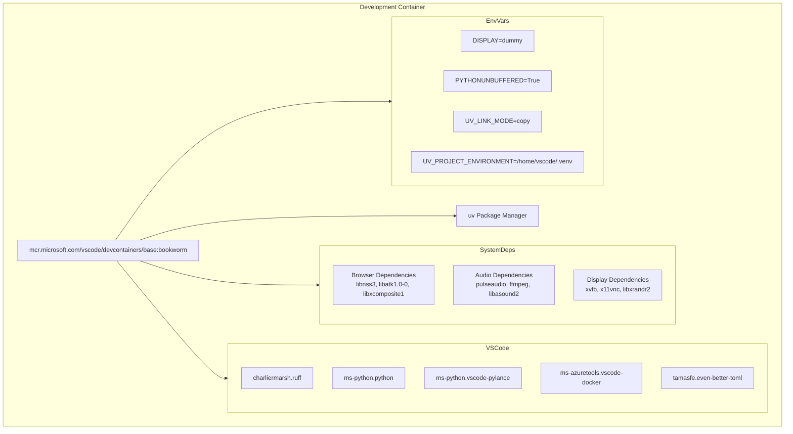
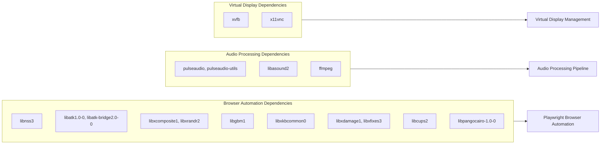
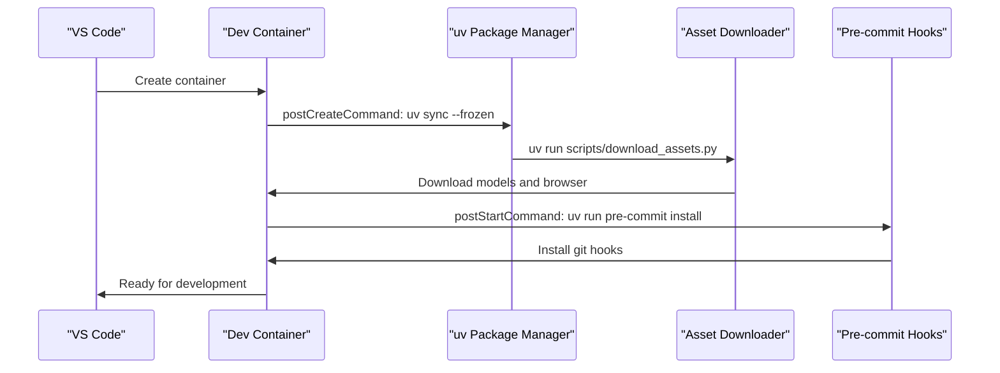

<!-- source: DeepWiki mcp.deepwiki.com · repo joinly-ai/joinly · page 8.1 Development Environment Setup · fetched 2026-10-27 -->

# Development Environment

Relevant source files

The following files were used as context for generating this wiki page:

- [CHANGELOG.md](CHANGELOG.md)
- [pyproject.toml](pyproject.toml)
- [uv.lock](uv.lock)

This document covers the development environment setup for joinly, including development containers, VS Code configuration, and the development toolchain. The development environment is containerized to ensure consistent builds and provides all necessary dependencies for browser automation, audio processing, and MCP server development.

For information about asset management and model downloads, see [Asset Management System](#6.2). For testing setup and frameworks, see [Testing Framework](#6.3).

## Development Container Architecture

The joinly development environment uses VS Code dev containers to provide a consistent, reproducible development setup. The development container includes all system dependencies required for browser automation, audio processing, and Python development.

### Development Container Configuration

Sources: [.devcontainer/devcontainer.json:1-33](), [.devcontainer/Dockerfile:1-29]()

The development container configuration in [.devcontainer/devcontainer.json:3-6]() builds from a custom Dockerfile that extends the Microsoft VS Code dev containers base image. The container includes Node.js LTS through the devcontainers features system [.devcontainer/devcontainer.json:7-11]().

## VS Code Extensions and Configuration

The development environment includes a curated set of VS Code extensions specifically chosen for Python development, code quality, and container management.

| Extension | Purpose | Configuration |
|-----------|---------|---------------|
| `charliermarsh.ruff` | Python linting and formatting | Code quality enforcement |
| `ms-python.python` | Python language support | Core Python development |
| `ms-python.vscode-pylance` | Python language server | Type checking and IntelliSense |
| `ms-azuretools.vscode-docker` | Docker integration | Container management |
| `tamasfe.even-better-toml` | TOML file support | Configuration file editing |
| `yzhang.markdown-all-in-one` | Markdown editing | Documentation writing |

Sources: [.devcontainer/devcontainer.json:14-21]()

## System Dependencies and Runtime Environment

The development container includes comprehensive system dependencies to support joinly's browser automation and audio processing capabilities.

### System Package Installation

Sources: [.devcontainer/Dockerfile:5-23]()

The system dependencies are installed through `apt-get` in the Dockerfile [.devcontainer/Dockerfile:5-23](). These packages provide the necessary libraries for:

- **Browser Dependencies**: Required for Playwright browser automation and Chromium rendering
- **Audio Dependencies**: Support for PulseAudio virtual devices and audio processing
- **Display Dependencies**: Virtual display management for headless browser operation

### Runtime Directory Configuration

The container sets up the XDG runtime directory for the `vscode` user [.devcontainer/Dockerfile:25-26](), which is required for proper PulseAudio and display management in the containerized environment.

## Environment Variables

The development environment configures several key environment variables to optimize the development workflow:

| Variable | Value | Purpose |
|----------|-------|---------|
| `DISPLAY` | `dummy` | Prevents display-related errors in headless environment |
| `PYTHONUNBUFFERED` | `True` | Ensures immediate Python output for debugging |
| `UV_LINK_MODE` | `copy` | Configures uv package manager linking behavior |
| `UV_PROJECT_ENVIRONMENT` | `/home/vscode/.venv` | Sets virtual environment location |

Sources: [.devcontainer/devcontainer.json:24-29]()

## Development Workflow Setup

The development container implements a multi-stage setup process that automatically configures the development environment.

### Container Lifecycle Commands

Sources: [.devcontainer/devcontainer.json:30-31]()

The development workflow includes two key lifecycle commands:

1. **Post-Create Command** [.devcontainer/devcontainer.json:30](): Runs `uv sync --frozen` to install dependencies and `uv run scripts/download_assets.py` to download required assets
2. **Post-Start Command** [.devcontainer/devcontainer.json:31](): Runs `uv run pre-commit install` to set up code quality hooks

### Package Manager Integration

The development environment uses `uv` as the primary package manager, copied from the official Astral uv image [.devcontainer/Dockerfile:1,28](). The `uv` binary is installed with appropriate ownership for the `vscode` user.

This setup ensures that developers have a consistent environment with all dependencies, assets, and development tools ready for immediate use when the container starts.

---

