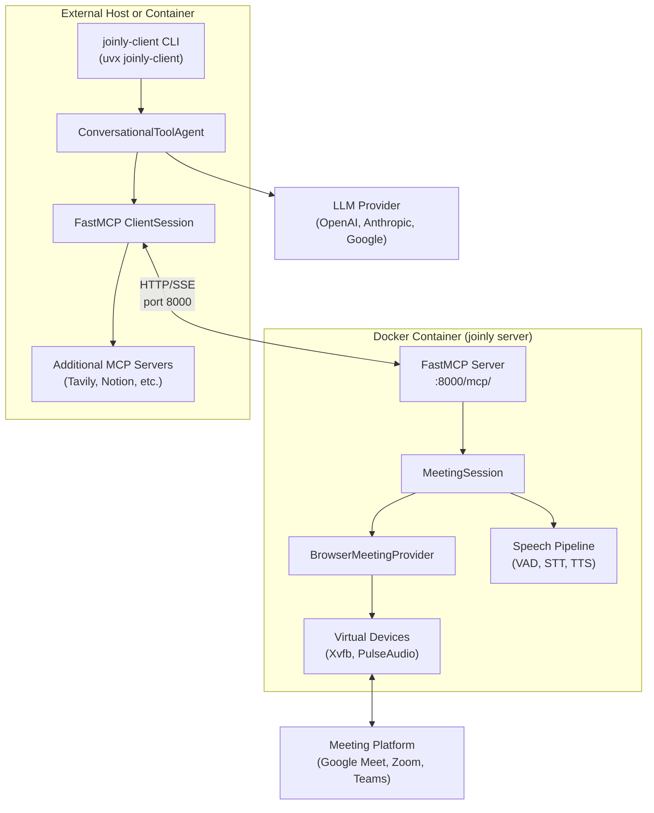
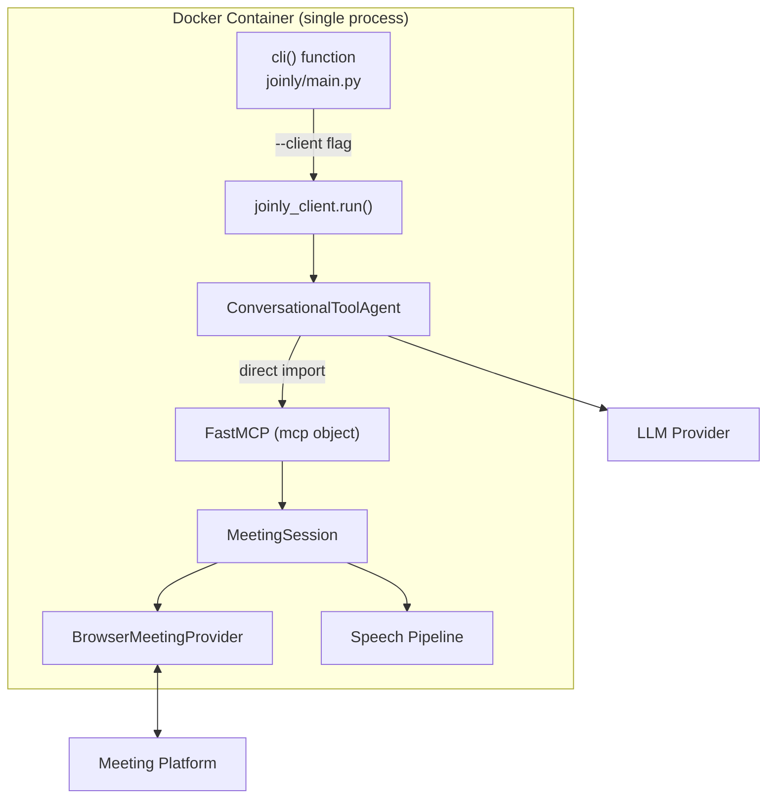
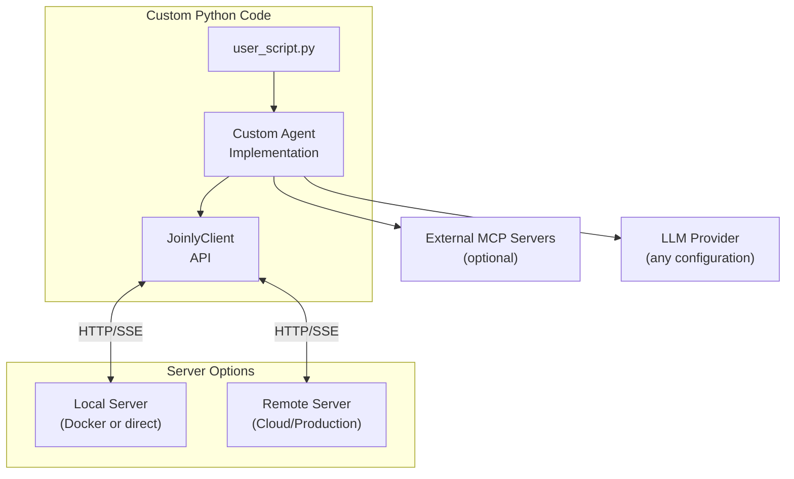
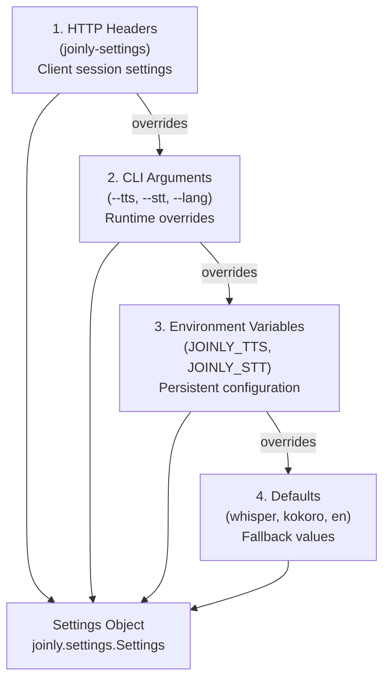
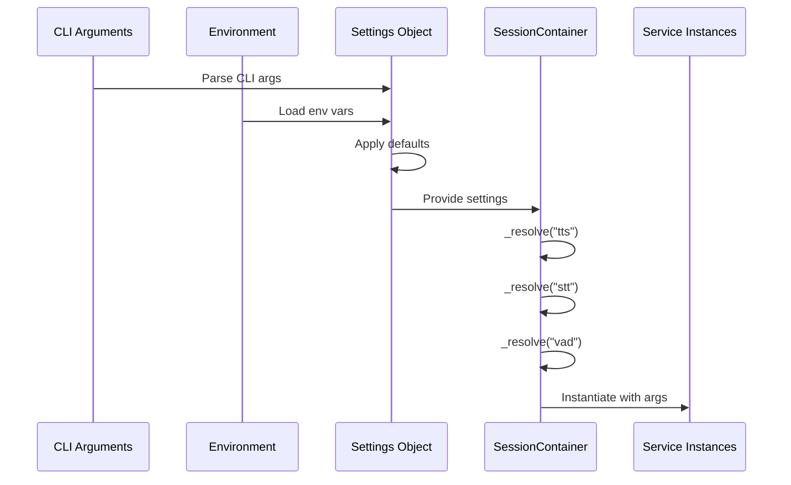
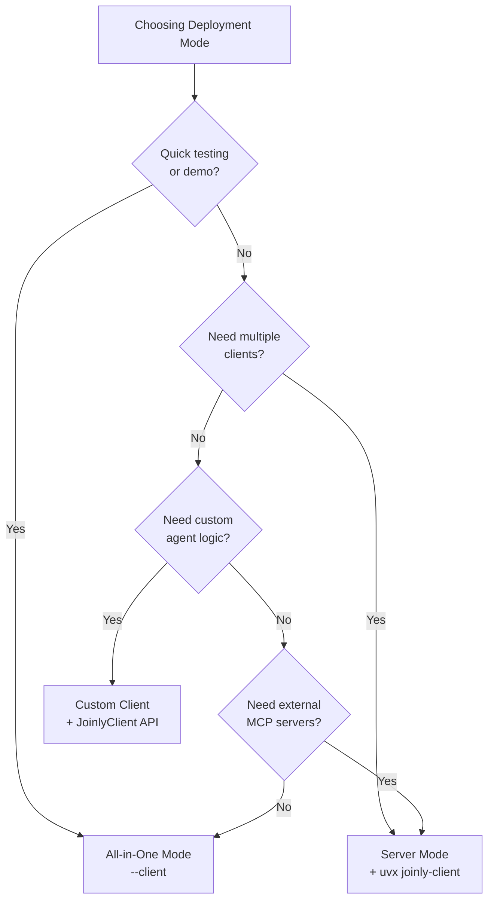

<!-- source: DeepWiki mcp.deepwiki.com · repo joinly-ai/joinly · page 9.2 Deployment Modes · fetched 2026-10-27 -->

# Deployment Modes

<details>
<summary>Relevant source files</summary>

The following files were used as context for generating this wiki page:

- [.env.example](.env.example)
- [README.md](README.md)
- [client/README.md](client/README.md)
- [client/joinly_client/__init__.py](client/joinly_client/__init__.py)
- [joinly/main.py](joinly/main.py)
- [joinly/services/tts/resemble.py](joinly/services/tts/resemble.py)

</details>


This document explains the three deployment patterns available in joinly: **Server Mode**, **All-in-One Client Mode**, and **Custom Client Mode**. Each pattern offers different trade-offs between separation of concerns, flexibility, and ease of setup. The page also covers configuration methods and how settings are propagated across components.

For information about Docker image variants (base, CUDA, lite), see [Docker Images and Variants](#9.1). For detailed configuration options, see [Configuration and Settings](#2.3). For understanding the MCP communication layer, see [MCP Server and Client Communication](#3.1).

---

## Overview of Deployment Patterns

joinly supports three distinct deployment patterns, each suited for different use cases:

| Pattern | Description | Use Case |
|---------|-------------|----------|
| **Server Mode** | Docker container runs FastMCP server; external client connects via HTTP/SSE | Production deployments, multiple clients, cloud services |
| **All-in-One Client** | Docker container runs server and client in single process | Quick testing, demos, simple use cases |
| **Custom Client** | Developer-written Python code using `JoinlyClient` API | Custom agents, specialized workflows, research |

The deployment mode is determined by the presence of the `--client` flag and meeting URL when starting the container.

**Sources:** [README.md:87-102](), [joinly/main.py:276-333](), Diagram 4

---

## Mode 1: Server Mode (Separated Architecture)

### Architecture



### Starting the Server

The server mode is activated when no meeting URL is provided or when explicitly using `--server` flag:

```bash
# Start server (default when no meeting URL provided)
docker run -p 8000:8000 ghcr.io/joinly-ai/joinly:latest

# Explicit server mode
docker run -p 8000:8000 ghcr.io/joinly-ai/joinly:latest --server
```

The server binds to host and port configured via `--host` and `--port` arguments (defaults: `127.0.0.1:8000`). The logic is implemented in [joinly/main.py:311-312]():

```python
if server is True or (server is None and meeting_url is None):
    mcp.run(transport="streamable-http", host=host, port=port, show_banner=False)
```

### Connecting External Client

With the server running, connect an external client:

```bash
# Basic connection
uvx joinly-client --env-file .env <MeetingUrl>

# Specify server URL explicitly
uvx joinly-client --joinly-url http://localhost:8000/mcp/ --env-file .env <MeetingUrl>
```

The client can override server settings by passing additional arguments:

```bash
# Override TTS and language settings
uvx joinly-client --tts elevenlabs --lang de --env-file .env <MeetingUrl>
```

### Adding Additional MCP Servers

Server mode enables integration with external MCP servers via configuration file:

```json
{
    "mcpServers": {
        "tavily": {
            "command": "npx",
            "args": ["-y", "@tavily/mcp-server@latest"]
        },
        "notion": {
            "command": "npx",
            "args": ["-y", "@notionhq/mcp-server-notion@latest"]
        }
    }
}
```

```bash
uvx joinly-client --mcp-config config.json --env-file .env <MeetingUrl>
```

### Advantages and Use Cases

**Advantages:**
- Separation of concerns: meeting infrastructure isolated from agent logic
- Multiple clients can connect to single server
- Easy to integrate with additional MCP servers
- Client can run on different machine or in different environment
- Server settings can be overridden per-client via HTTP headers

**Use Cases:**
- Production deployments where meeting connectivity is managed separately
- Cloud services where clients connect to hosted server
- Development workflows testing different agent implementations
- Integration with existing MCP ecosystems

**Sources:** [README.md:87-125](), [client/README.md:31-68](), [joinly/main.py:311-312]()

---

## Mode 2: All-in-One Client Mode

### Architecture



### Starting All-in-One Mode

The all-in-one mode is activated when a meeting URL is provided without `--server` flag:

```bash
# All-in-one mode (server + client in single container)
docker run --env-file .env ghcr.io/joinly-ai/joinly:latest --client <MeetingUrl>
```

The implementation in [joinly/main.py:313-333]() dynamically imports `joinly_client` and runs it with the `mcp` object directly:

```python
else:
    import joinly_client
    
    if not meeting_url:
        msg = (
            "Meeting URL is required when running as a client. "
            "Please provide it as an argument."
        )
        raise click.UsageError(msg)
    asyncio.run(
        joinly_client.run(
            joinly_url=mcp,
            meeting_url=meeting_url,
            llm_provider=llm_provider,
            llm_model=llm_model,
            prompt=prompt,
            prompt_style=prompt_style,
            name=settings.name,
            name_trigger=name_trigger,
        )
    )
```

Note that `joinly_url` receives the `mcp` object directly rather than a URL string, enabling in-process communication.

### Configuration in All-in-One Mode

All configuration is passed via CLI arguments or environment variables:

```bash
# LLM configuration
docker run --env-file .env \
  ghcr.io/joinly-ai/joinly:latest \
  --client <MeetingUrl> \
  --llm-provider openai \
  --llm-model gpt-4o

# Service provider configuration
docker run --env-file .env \
  ghcr.io/joinly-ai/joinly:latest \
  --client <MeetingUrl> \
  --tts elevenlabs \
  --stt deepgram \
  --lang de
```

### Advantages and Limitations

**Advantages:**
- Single command setup: no separate server/client coordination
- Minimal configuration required
- Ideal for quick testing and demos
- All components share same environment

**Limitations:**
- Cannot connect external MCP servers (no `--mcp-config` support)
- No MCP server exposed for external clients
- Single meeting session per container
- Less flexibility for custom agent implementations

**Use Cases:**
- Quick testing and prototyping
- Demos and presentations
- Simple meeting automation without additional tools
- Environments where separation is not needed

**Sources:** [README.md:52-85](), [joinly/main.py:313-333](), [joinly/main.py:36-41]()

---

## Mode 3: Custom Client (Developer Mode)

### Architecture



### Using the JoinlyClient API

The `JoinlyClient` class provides low-level control over meeting interactions:

```python
import asyncio
from joinly_client import JoinlyClient
from joinly_client.types import TranscriptSegment

async def run():
    client = JoinlyClient(
        url="http://localhost:8000/mcp/",
        name="CustomBot",
        name_trigger=False,
        settings={
            "tts": "elevenlabs",
            "tts_args": {"voice_id": "EXAVITQu4vr4xnSDxMa6"},
            "lang": "en"
        }
    )
    
    async def on_utterance(segments: list[TranscriptSegment]) -> None:
        # Custom logic for processing utterances
        for segment in segments:
            if "marco" in segment.text.lower():
                await client.speak_text("Polo!")
    
    client.add_utterance_callback(on_utterance)
    
    async with client:
        await client.join_meeting("<MeetingUrl>")
        await asyncio.Event().wait()

asyncio.run(run())
```

### Client Settings Propagation

The `settings` parameter in `JoinlyClient` is propagated to the server via HTTP headers. The client adds a `joinly-settings` header containing JSON-encoded settings:

```python
# Example settings that override server defaults
settings = {
    "tts": "elevenlabs",
    "tts_args": {"voice_id": "EXAVITQu4vr4xnSDxMa6"},
    "stt": "deepgram",
    "stt_args": {"model_name": "nova-2"},
    "language": "de",
    "name": "CustomBot"
}
```

These settings are applied when the client calls `join_meeting()`, creating a session with the specified configuration.

### Using ConversationalToolAgent

For LLM-based agents, use the higher-level `run()` function:

```python
from dotenv import load_dotenv
from joinly_client import run

load_dotenv()

await run(
    joinly_url="http://localhost:8000/mcp/",
    meeting_url="<MeetingUrl>",
    llm_provider="openai",
    llm_model="gpt-4o-mini",
    prompt="You are a specialized meeting assistant that...",
    name="SpecialistBot",
    name_trigger=False,
    mcp_config={
        "mcpServers": {
            "tavily": {
                "command": "npx",
                "args": ["-y", "@tavily/mcp-server@latest"]
            }
        }
    },
    settings={
        "tts": "elevenlabs",
        "lang": "en"
    }
)
```

### Available Client Methods

The `JoinlyClient` class provides these methods for meeting control:

| Method | Purpose |
|--------|---------|
| `join_meeting(url, passcode)` | Join meeting with URL and optional passcode |
| `leave_meeting()` | Leave current meeting |
| `speak_text(text)` | Synthesize and speak text |
| `send_chat_message(message)` | Send chat message |
| `mute_yourself()` / `unmute_yourself()` | Control microphone |
| `get_transcript(minutes)` | Retrieve transcript (optionally filtered) |
| `get_chat_history()` | Retrieve chat messages |
| `get_participants()` | Get list of participants |
| `get_video_snapshot()` | Capture current video frame |
| `list_tools()` | Get available MCP tools |
| `add_utterance_callback(callback)` | Subscribe to new utterances |

### Advantages and Use Cases

**Advantages:**
- Full control over agent behavior and logic
- Custom conversation patterns and decision-making
- Integration with any LLM framework (LangChain, etc.)
- Can connect to multiple MCP servers programmatically
- Suitable for research and experimentation

**Use Cases:**
- Specialized meeting agents with custom logic
- Research projects exploring conversational AI
- Integration with existing Python applications
- Complex workflows requiring fine-grained control
- A/B testing different agent strategies

**Sources:** [client/README.md:70-139](), [client/joinly_client/__init__.py:1-9]()

---

## Configuration Methods and Precedence

### Configuration Sources

joinly accepts configuration from multiple sources with the following precedence (highest to lowest):



### Environment Variables (.env file)

Environment variables provide persistent configuration:

```bash
# Server configuration
JOINLY_SERVER_HOST=0.0.0.0
JOINLY_SERVER_PORT=8000

# Participant settings
JOINLY_NAME=JoinlyBot
JOINLY_LANGUAGE=en

# Service providers
JOINLY_VAD=silero
JOINLY_STT=whisper
JOINLY_TTS=kokoro

# API keys
OPENAI_API_KEY=sk-...
DEEPGRAM_API_KEY=...
ELEVENLABS_API_KEY=...
```

Load via `--env-file`:

```bash
docker run --env-file .env ghcr.io/joinly-ai/joinly:latest
```

### CLI Arguments

Override settings at runtime:

```bash
# Service provider arguments
--tts elevenlabs --tts-arg voice_id=EXAVITQu4vr4xnSDxMa6
--stt deepgram --stt-arg model_name=nova-2
--vad silero

# Session arguments
--name "Meeting Assistant" --lang de

# Provider-specific arguments (parsed as key=value)
--meeting-provider-arg vnc_server=true
--transcription-controller-arg max_silence_duration=1.5
```

The [joinly/main.py:16-32]() `_parse_kv` function converts these to dictionaries:

```python
def _parse_kv(
    _ctx: click.Context, _param: click.Parameter, value: tuple[str]
) -> dict[str, object]:
    """Convert (--foo-arg key=value) repeated tuples to dict."""
    out: dict[str, object] = {}
    for item in value:
        try:
            k, v = item.split("=", 1)
        except ValueError as exc:
            msg = f"{item!r} is not of the form key=value"
            raise click.BadParameter(msg) from exc
        
        try:
            out[k] = json.loads(v)
        except json.JSONDecodeError:
            out[k] = v
    return out
```

### HTTP Headers (Client → Server)

When using external client, settings are sent via HTTP headers and override server defaults for that session:

```python
# In JoinlyClient
settings = {
    "tts": "elevenlabs",
    "language": "de"
}
# These are serialized to joinly-settings header
```

This enables per-session configuration without restarting the server.

### Settings Resolution Flow



The `Settings` object is created in [joinly/main.py:302-303]() and used throughout the session:

```python
settings = Settings(**cli_settings)  # type: ignore[arg-type]
set_settings(settings)
```

**Sources:** [joinly/main.py:16-32](), [joinly/main.py:35-275](), [.env.example:1-48]()

---

## Deployment Comparison

### Feature Matrix

| Feature | Server Mode | All-in-One | Custom Client |
|---------|-------------|------------|---------------|
| **Separation of concerns** | ✅ Complete | ❌ None | ✅ Complete |
| **Multiple clients** | ✅ Yes | ❌ No | ✅ Yes |
| **External MCP servers** | ✅ Via config | ❌ No | ✅ Programmatic |
| **Custom agent logic** | ⚠️ Limited | ⚠️ Limited | ✅ Full control |
| **Setup complexity** | Medium | Low | High |
| **Configuration flexibility** | ✅ Per-client | ⚠️ Container-wide | ✅ Per-instance |
| **Debugging** | ✅ Easy | ⚠️ Moderate | ✅ Easy |
| **Production ready** | ✅ Yes | ⚠️ Simple cases | ✅ Yes |

### Resource Requirements

| Mode | Memory | CPU | Network |
|------|--------|-----|---------|
| **Server Mode** | ~2GB (server) + ~500MB (client) | Moderate (both) | Requires port forwarding |
| **All-in-One** | ~2GB | Moderate | None (single process) |
| **Custom Client** | ~2GB (server) + varies (client) | Varies | Requires connectivity |

### Selection Guidelines



**Sources:** [README.md:52-219]()

---

## Common Deployment Scenarios

### Scenario 1: Local Development

Developer testing new features with external MCP tools:

```bash
# Terminal 1: Start server with debug logging
docker run -p 8000:8000 ghcr.io/joinly-ai/joinly:latest -vv

# Terminal 2: Run client with Tavily integration
uvx joinly-client \
  --env-file .env \
  --mcp-config config_tavily.json \
  --tts kokoro \
  <MeetingUrl>
```

### Scenario 2: Cloud Production

Server deployed on cloud VM, multiple clients connecting:

```bash
# On cloud VM (e.g., AWS EC2)
docker run -d \
  --name joinly-server \
  -p 8000:8000 \
  --env-file /etc/joinly/.env \
  --restart unless-stopped \
  ghcr.io/joinly-ai/joinly:latest-cuda \
  --host 0.0.0.0 \
  -v

# From client machines
uvx joinly-client \
  --joinly-url https://joinly.example.com/mcp/ \
  --env-file .env \
  <MeetingUrl>
```

### Scenario 3: Demo Presentation

Quick all-in-one setup for live demonstration:

```bash
docker run --env-file .env \
  ghcr.io/joinly-ai/joinly:latest \
  --client <MeetingUrl> \
  --tts elevenlabs \
  --name "Demo Assistant"
```

### Scenario 4: Research Experiment

Custom agent with specialized behavior:

```python
# experiment.py
from joinly_client import JoinlyClient
import asyncio

async def experiment():
    client = JoinlyClient(
        url="http://localhost:8000/mcp/",
        settings={"tts": "kokoro", "stt": "whisper"}
    )
    
    async def hypothesis_tester(segments):
        # Custom experimental logic
        for seg in segments:
            if meets_criteria(seg):
                await client.speak_text(generate_response(seg))
    
    client.add_utterance_callback(hypothesis_tester)
    
    async with client:
        await client.join_meeting(MEETING_URL)
        await run_experiment_protocol()

asyncio.run(experiment())
```

### Scenario 5: Multi-Meeting Server

Single server handling multiple concurrent meetings:

```bash
# Start server
docker run -p 8000:8000 ghcr.io/joinly-ai/joinly:latest

# Client 1 - Sales meeting
uvx joinly-client --name "Sales Bot" <Meeting1URL> &

# Client 2 - Support meeting
uvx joinly-client --name "Support Bot" <Meeting2URL> &

# Client 3 - Engineering meeting
uvx joinly-client --name "Eng Bot" <Meeting3URL> &
```

Note: Each client creates a separate session on the server with isolated resources.

**Sources:** [README.md:52-219](), [client/README.md:31-68]()

---

## Debugging and Monitoring

### VNC Server for Visual Debugging

Enable VNC server to observe browser automation:

```bash
# Server mode with VNC
docker run -p 8000:8000 -p 5900:5900 \
  ghcr.io/joinly-ai/joinly:latest \
  --vnc-server --vnc-server-port 5900

# All-in-one mode with VNC
docker run -p 5900:5900 \
  ghcr.io/joinly-ai/joinly:latest \
  --client <MeetingUrl> \
  --vnc-server
```

Connect with VNC client (e.g., RealVNC, TightVNC) to `localhost:5900`.

### Logging Levels

Control logging verbosity:

```bash
# Minimal logging
docker run ghcr.io/joinly-ai/joinly:latest -q

# Normal logging (default)
docker run ghcr.io/joinly-ai/joinly:latest

# Verbose logging
docker run ghcr.io/joinly-ai/joinly:latest -v

# Very verbose (debug level)
docker run ghcr.io/joinly-ai/joinly:latest -vv

# Maximum verbosity
docker run ghcr.io/joinly-ai/joinly:latest -vvv
```

Logging is configured in [joinly/main.py:305-309]():

```python
configure_logging(
    verbose=verbose,
    quiet=quiet,
    plain=logging_plain,
)
```

**Sources:** [joinly/main.py:157-170](), [joinly/main.py:254-269](), [joinly/main.py:305-309]()