# Page: Overview

# Overview

<details>
<summary>Relevant source files</summary>

The following files were used as context for generating this wiki page:

- [.env.example](.env.example)
- [CHANGELOG.md](CHANGELOG.md)
- [README.md](README.md)
- [joinly/services/tts/resemble.py](joinly/services/tts/resemble.py)
- [pyproject.toml](pyproject.toml)
- [uv.lock](uv.lock)

</details>


This document provides a high-level introduction to the joinly.ai system, explaining its architecture, core components, and operational model. joinly.ai is a connector middleware that enables AI agents to join and participate in video meetings through browser automation and real-time audio processing.

For installation and initial setup, see [Getting Started](#2). For detailed architecture explanations, see [Architecture](#3). For information about the server package, see [Core Server](#4). For the client SDK, see [Client SDK](#6).

## Purpose and Design Philosophy

joinly.ai addresses the challenge of making video meetings accessible to AI agents by providing:

1. **Meeting Access**: Browser-based automation for joining Google Meet, Zoom, and Microsoft Teams
2. **Audio Processing**: Bidirectional speech pipeline for transcription (STT) and synthesis (TTS)
3. **MCP Interface**: Standardized Model Context Protocol server exposing meeting tools and resources
4. **Client Framework**: High-level agent implementation with LLM integration for building conversational bots

The system follows a modular, privacy-first design where users can choose between local and cloud-based speech services, self-host the entire stack, and integrate their preferred LLM providers.

Sources: [README.md:1-50](), [pyproject.toml:1-10]()

## System Architecture

### Package Structure

joinly.ai is organized as a monorepo with three Python packages managed by uv:

| Package | Purpose | Key Entry Points |
|---------|---------|------------------|
| `joinly` | Core server handling meeting connections and audio processing | `joinly.main:cli` |
| `joinly-client` | Client SDK for building conversational agents | `joinly_client.run`, `JoinlyClient` |
| `joinly-common` | Shared types and protocols | `Transcript`, `AudioFormat`, `AudioChunk` |

Sources: [pyproject.toml:61-65](), [uv.lock:13-18]()

### High-Level Component Diagram

```mermaid
graph TB
    subgraph "External Systems"
        Meetings["Meeting Platforms<br/>(Meet/Zoom/Teams)"]
        LLMs["LLM Providers<br/>(OpenAI/Anthropic/Google)"]
        CloudSTT["Cloud STT<br/>(Deepgram)"]
        CloudTTS["Cloud TTS<br/>(ElevenLabs/Deepgram/Resemble)"]
        MCPServers["External MCP Servers<br/>(Tavily/Notion/GitHub)"]
    end
    
    subgraph "joinly Package"
        Main["joinly.main<br/>CLI entry point"]
        Session["session.MeetingSession<br/>Orchestrator"]
        Container["di.SessionContainer<br/>DI system"]
        FastMCP["server.FastMCP<br/>MCP interface"]
        
        subgraph "providers"
            Browser["browser.BrowserMeetingProvider"]
            GMeet["browser.platforms.GoogleMeetController"]
            Zoom["browser.platforms.ZoomController"]
            Teams["browser.platforms.TeamsController"]
        end
        
        subgraph "controllers"
            TransCtrl["transcription.DefaultTranscriptionController"]
            SpeechCtrl["speech.DefaultSpeechController"]
        end
        
        subgraph "services"
            VAD["vad.WebRTCVAD / vad.SileroVAD"]
            STT["stt.FasterWhisperSTT"]
            TTS["tts.KokoroTTS"]
        end
        
        subgraph "core"
            Transcript["core.Transcript"]
            EventBus["core.EventBus"]
            Clock["core.Clock"]
        end
    end
    
    subgraph "joinly-client Package"
        CLIClient["joinly_client.__main__<br/>CLI entry"]
        RunFunc["joinly_client.run<br/>High-level API"]
        JClient["client.JoinlyClient<br/>MCP client"]
        Agent["agent.ConversationalToolAgent<br/>LLM integration"]
    end
    
    subgraph "joinly-common Package"
        Types["types.AudioChunk<br/>types.AudioFormat<br/>types.TranscriptSegment"]
        Protocols["protocols.TTS<br/>protocols.STT<br/>protocols.VAD"]
    end
    
    Main --> Container
    Container --> Session
    Session --> FastMCP
    Session --> Browser
    Session --> TransCtrl
    Session --> SpeechCtrl
    Session --> Transcript
    Session --> EventBus
    Session --> Clock
    
    Browser --> GMeet
    Browser --> Zoom
    Browser --> Teams
    Browser --> Meetings
    
    TransCtrl --> VAD
    TransCtrl --> STT
    TransCtrl --> Transcript
    SpeechCtrl --> TTS
    
    STT -.optional.-> CloudSTT
    TTS -.optional.-> CloudTTS
    
    FastMCP <--> JClient
    
    CLIClient --> RunFunc
    RunFunc --> Agent
    RunFunc --> JClient
    Agent --> LLMs
    Agent --> JClient
    JClient -.optional.-> MCPServers
    
    Types -.used by.-> Session
    Types -.used by.-> JClient
    Protocols -.implemented by.-> VAD
    Protocols -.implemented by.-> STT
    Protocols -.implemented by.-> TTS
```

Sources: [pyproject.toml:1-65](), [README.md:23-50]()

### Server-Client Communication via MCP

The server and client communicate using the FastMCP protocol over HTTP with Server-Sent Events for real-time updates:

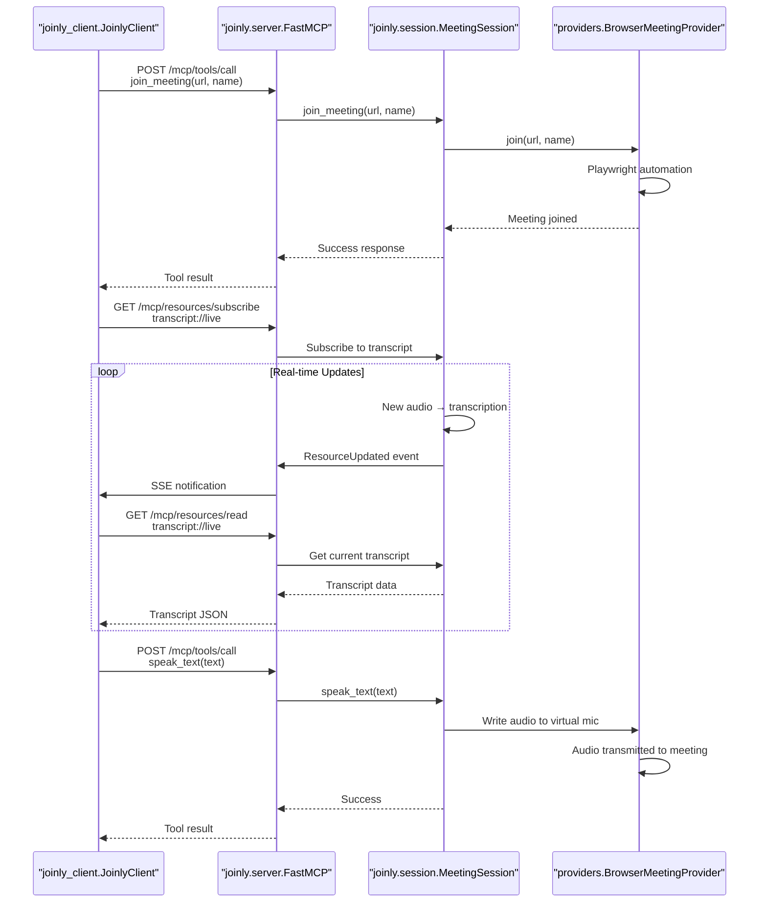

Sources: [README.md:220-238](), Diagram 5 from high-level diagrams

## Core Components

### Server Package (`joinly`)

The server package runs in a Docker container and handles:

**Meeting Integration** ([#4.3](#4.3))
- `joinly.providers.browser.BrowserMeetingProvider` - Main provider using Playwright
- Platform-specific controllers in `joinly.providers.browser.platforms/` - GoogleMeetController, ZoomController, TeamsController
- Virtual devices (Xvfb display, PulseAudio for audio I/O)

**Audio Processing** ([#5](#5))
- `joinly.controllers.transcription.DefaultTranscriptionController` - Manages VAD → STT pipeline
- `joinly.controllers.speech.DefaultSpeechController` - Manages TTS → audio output pipeline
- Service implementations in `joinly.services/` - VAD, STT, TTS providers

**Session Management** ([#4.2](#4.2))
- `joinly.session.MeetingSession` - Central orchestrator coordinating all components
- `joinly.di.SessionContainer` - Dependency injection container for service resolution
- Shared resources: `joinly.core.Transcript`, `joinly.core.EventBus`, `joinly.core.Clock`

**MCP Server** ([#4.1](#4.1))
- `joinly.server` - FastMCP server implementation exposing tools and resources
- Runs on port 8000 by default, configurable via CLI

Sources: [pyproject.toml:1-31](), [README.md:220-238](), Diagram 2 from high-level diagrams

### Client Package (`joinly-client`)

The client package provides tools for building AI agents:

**Core Client** ([#6.1](#6.1))
- `joinly_client.client.JoinlyClient` - Low-level MCP client for custom agents
- Handles MCP communication, resource subscriptions, tool execution
- Can be used standalone for building custom agents

**Conversational Agent** ([#6.2](#6.2))
- `joinly_client.agent.ConversationalToolAgent` - High-level agent with LLM integration
- Message history management with filtering
- Tool orchestration across multiple MCP servers
- System prompts for dyadic and multi-party conversations

**LLM Integration**
- Uses `pydantic-ai-slim` for type-safe LLM interactions
- Supports OpenAI, Anthropic, Google, Azure OpenAI providers
- Configurable via environment variables

**Entry Points** ([#6.3](#6.3))
- CLI: `uvx joinly-client <MeetingURL>`
- Python function: `await joinly_client.run(...)`
- Direct usage: `JoinlyClient(...)` for custom agents

Sources: [README.md:87-127](), [.env.example:1-48](), Diagram 3 from high-level diagrams

### Common Package (`joinly-common`)

Shared types and protocols used by both server and client:

| Module | Key Types | Purpose |
|--------|-----------|---------|
| `types` | `AudioChunk`, `AudioFormat`, `TranscriptSegment`, `Transcript` | Data models for audio and transcripts |
| `protocols` | `VAD`, `STT`, `TTS`, `MeetingProvider` | Protocol interfaces for service implementations |
| `settings` | `Settings`, `get_settings` | Configuration management |

Sources: [pyproject.toml:50-52]()

## Key Features

### Real-Time Audio Processing

The system processes audio bidirectionally:

**Input Pipeline**: Meeting audio → VAD → STT → Transcript → MCP updates → Client agent
**Output Pipeline**: Agent response → TTS → Virtual microphone → Meeting audio

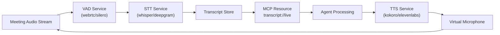

Sources: [README.md:34-40](), Diagram 5 from high-level diagrams

### Service Provider Flexibility

Multiple implementations for each service type:

| Service | Local (Privacy) | Cloud (Quality) |
|---------|-----------------|-----------------|
| **VAD** | WebRTC VAD, Silero VAD | N/A |
| **STT** | Faster Whisper (base.en, distil-large-v3) | Deepgram (nova-2, nova-3) |
| **TTS** | Kokoro ONNX | ElevenLabs, Deepgram Aura, Resemble AI |

Configuration via CLI arguments (`--stt`, `--tts`, `--vad`) or environment variables.

Sources: [README.md:159-184](), [.env.example:37-45](), Diagram 6 from high-level diagrams

### MCP Tools and Resources

The server exposes standardized meeting capabilities:

**Tools** (callable actions):
- `join_meeting`, `leave_meeting` - Session control
- `speak_text`, `send_chat_message` - Output actions
- `mute_yourself`, `unmute_yourself` - Audio control
- `get_transcript`, `get_chat_history`, `get_participants` - State queries
- `get_video_snapshot` - Visual information (for vision models)

**Resources** (subscribable data streams):
- `transcript://live` - Real-time transcript with speaker attribution
- `transcript://live/segments` - Individual segment updates
- `usage://current` - Token and API usage tracking

Sources: [README.md:220-238]()

## Deployment Modes

joinly.ai supports three primary deployment patterns:

### Mode 1: Server + External Client

Run server in Docker, client runs separately (local machine or cloud):

```bash
# Terminal 1: Start server
docker run -p 8000:8000 ghcr.io/joinly-ai/joinly:latest

# Terminal 2: Run client
uvx joinly-client --env-file .env <MeetingURL>
```

**Use case**: Production deployments, multiple clients, custom agent development

### Mode 2: All-in-One Client

Server and client bundled in single Docker container:

```bash
docker run --env-file .env ghcr.io/joinly-ai/joinly:latest --client <MeetingURL>
```

**Use case**: Quick testing, simple deployments, minimal setup

### Mode 3: Custom Client

Build specialized agents using low-level `JoinlyClient` API:

```python
from joinly_client import JoinlyClient

async def my_agent():
    client = JoinlyClient(mcp_server_url="http://localhost:8000/mcp/")
    await client.join_meeting(url="...", name="Custom Agent")
    # Custom agent logic...
```

**Use case**: Advanced integrations, specialized behavior, research

Sources: [README.md:52-127](), Diagram 4 from high-level diagrams

## Docker Image Variants

Three image types support different deployment scenarios:

| Variant | Tag | Size | Models Included | GPU Support | Use Case |
|---------|-----|------|-----------------|-------------|----------|
| **Base** | `latest` | ~2.3GB | Whisper base.en, Kokoro v0.4.9 | No | CPU deployments, privacy-focused |
| **CUDA** | `latest-cuda` | Larger | Whisper distil-large-v3, Kokoro | Yes (CUDA 12.6+) | High-quality transcription, GPU available |
| **Lite** | `latest-lite` | Minimal | None (downloads on first use) | No | Cloud services only, minimal footprint |

Sources: [README.md:199-214](), [CHANGELOG.md:133-135]()

## Technology Stack

### Core Technologies

- **Language**: Python 3.12+
- **Package Management**: uv (monorepo with workspace)
- **Browser Automation**: Playwright with Chromium
- **Containerization**: Docker with multi-stage builds

### Key Dependencies

```python
# Server (joinly)
"fastmcp>=2.10.5"           # MCP server framework
"playwright>=1.51.0"         # Browser automation
"faster-whisper>=1.1.1"      # Local STT
"kokoro-onnx>=0.4.9"         # Local TTS
"webrtcvad-wheels>=2.0.14"   # Voice activity detection
"deepgram-sdk>=4.1.1"        # Cloud STT/TTS
"elevenlabs>=2.5.0"          # Cloud TTS

# Client (joinly-client)
"pydantic-ai-slim"           # LLM integration
"anthropic", "openai"        # LLM providers
```

Sources: [pyproject.toml:10-27](), [uv.lock:1-20]()

### Virtual Device Infrastructure

The server creates virtual devices for browser integration:

- **Display**: Xvfb (X Virtual Framebuffer) with optional VNC for debugging
- **Audio Input**: Virtual microphone via PulseAudio
- **Audio Output**: Virtual speaker via PulseAudio
- **Audio Server**: PulseAudio managing audio routing

Sources: Diagram 1 from high-level diagrams

## Configuration System

Settings are loaded hierarchically from multiple sources:

1. **Environment Variables** - Highest priority, loaded from `.env` file
2. **CLI Arguments** - Override environment settings
3. **HTTP Headers** - Client can set `joinly-settings` header for session-specific config
4. **Defaults** - Fallback values in code

Configuration areas:
- LLM provider and model selection
- STT/TTS service providers and parameters
- Meeting participant name and language
- Server host and port
- Logging verbosity

Sources: [README.md:128-157](), [.env.example:1-48]()

## Development and Extension

joinly.ai is designed for extensibility:

**Adding Speech Services**: Implement `STT`, `TTS`, or `VAD` protocol from `joinly-common`, register in `SessionContainer._resolve`

**Custom Meeting Providers**: Implement `MeetingProvider` protocol for new platforms

**Custom Agents**: Use `JoinlyClient` API to build specialized agents with custom logic

**MCP Integration**: Connect additional MCP servers via client configuration

For development setup, see [Development Environment Setup](#8.1). For build system details, see [Build System and Dependencies](#8.2).

Sources: [README.md:216-250](), [pyproject.toml:37-48]()

---

# Page: Getting Started

# Getting Started

<details>
<summary>Relevant source files</summary>

The following files were used as context for generating this wiki page:

- [.env.example](.env.example)
- [CHANGELOG.md](CHANGELOG.md)
- [README.md](README.md)
- [joinly/services/tts/resemble.py](joinly/services/tts/resemble.py)
- [pyproject.toml](pyproject.toml)
- [uv.lock](uv.lock)

</details>


This page provides an overview of how to get started with joinly, covering system setup, basic usage patterns, and the initial workflow for running your first meeting agent. The guide assumes you want to quickly deploy a meeting agent that can join video calls and interact using AI.

For detailed installation instructions, see [Installation and Dependencies](#2.1). For a step-by-step walkthrough with example commands, see [Quick Start Guide](#2.2). For comprehensive configuration options, see [Configuration and Settings](#2.3).

## System Overview

Joinly consists of two main components that work together to enable AI agents in meetings:

1. **Joinly Server** - A Docker container that manages meeting connections, handles audio processing (speech-to-text and text-to-speech), and exposes an MCP (Model Context Protocol) server interface
2. **Joinly Client** - A Python package that connects to the MCP server, manages LLM interactions, and orchestrates agent behavior

### Component Architecture

The following diagram shows the core components and how they map to code entities:

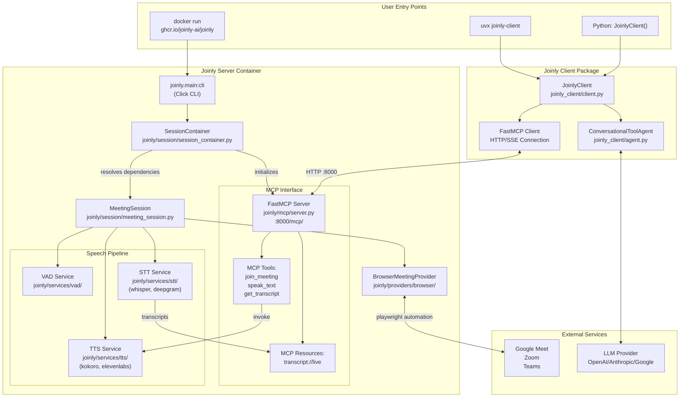

**Sources:** [joinly/main.py](), [joinly/session/session_container.py](), [joinly/session/meeting_session.py](), [joinly/mcp/server.py](), [joinly_client/client.py](), [joinly_client/agent.py](), [joinly/providers/browser/browser_meeting_provider.py](), [README.md:1-290]()

## Deployment Modes

Joinly supports three primary deployment patterns, each suited for different use cases:

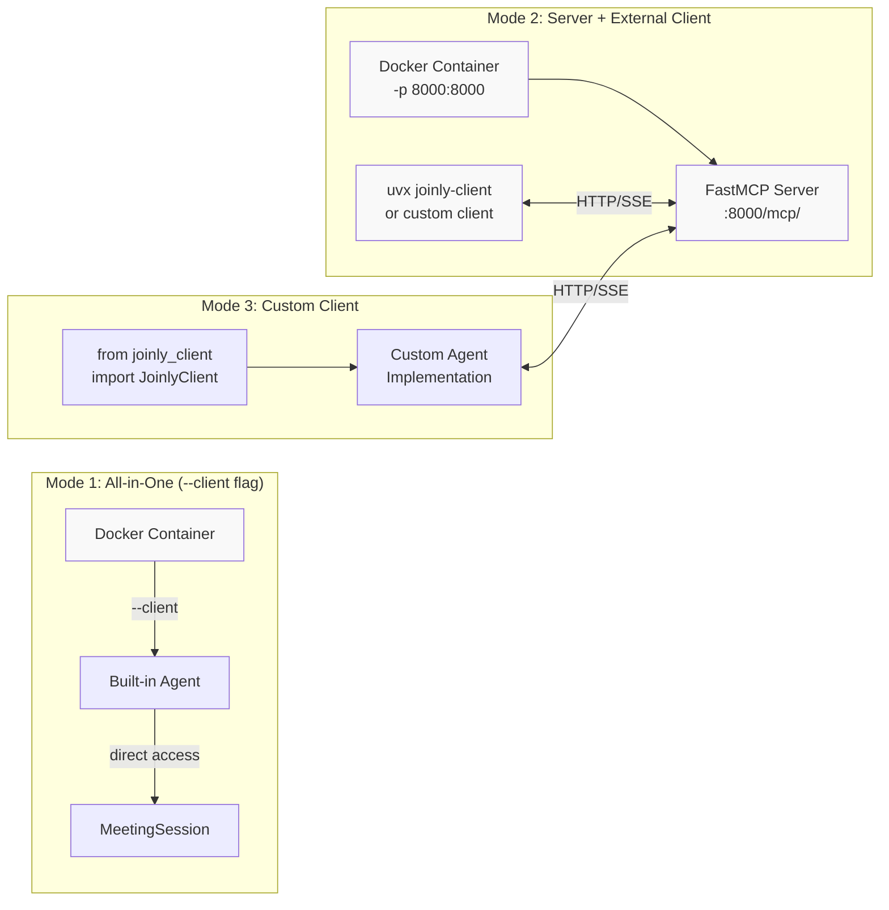

**Sources:** [README.md:53-126](), [joinly/main.py:32-58]()

### Mode Comparison

| Mode | Use Case | Command Pattern | Advantages |
|------|----------|----------------|------------|
| **All-in-One** | Quick testing, simple deployments | `docker run --client <URL>` | Simplest setup, no external dependencies |
| **Server + External Client** | Production use, multi-client scenarios | Server: `docker run -p 8000:8000`<br/>Client: `uvx joinly-client <URL>` | Separation of concerns, supports external MCP servers |
| **Custom Client** | Custom agent logic, specialized workflows | `from joinly_client import JoinlyClient` | Full control over agent behavior |

**Sources:** [README.md:87-138]()

## Basic Getting Started Workflow

The typical workflow for getting started with joinly follows these steps:

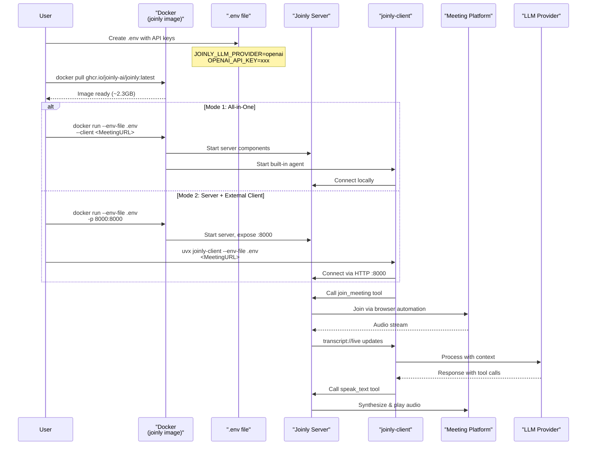

**Sources:** [README.md:52-101](), [joinly/main.py](), [joinly_client/__main__.py]()

## Prerequisites

Before starting, ensure you have:

1. **Docker** - For running the joinly server container
2. **API Keys** - At minimum, an API key for an LLM provider (OpenAI, Anthropic, Google, or Azure)
3. **Optional: uv** - For running external clients (Mode 2 or 3)
4. **Meeting Link** - A valid Google Meet, Zoom, or Microsoft Teams meeting URL

For detailed installation instructions, see [Installation and Dependencies](#2.1).

**Sources:** [README.md:56-57](), [.env.example:1-48]()

## Configuration Overview

Joinly is configured through a combination of:

1. **Environment Variables** - Stored in a `.env` file for API keys and provider settings
2. **Command-Line Arguments** - For runtime options like `--tts`, `--stt`, `--lang`, `--name`
3. **HTTP Headers** - For session-specific settings when using external clients (via `joinly-settings` header)

### Essential Environment Variables

The minimum required configuration is an LLM provider setup. Example for OpenAI:

```env
JOINLY_LLM_PROVIDER=openai
JOINLY_LLM_MODEL=gpt-4o
OPENAI_API_KEY=your-api-key-here
```

**Sources:** [.env.example:1-10](), [README.md:58-73]()

### Speech Service Configuration

By default, joinly uses local models (Whisper for STT, Kokoro for TTS), but supports cloud alternatives:

| Service | Provider Options | Configuration |
|---------|-----------------|---------------|
| **Text-to-Speech (TTS)** | `kokoro` (default), `elevenlabs`, `deepgram`, `resemble` | `--tts <provider>` |
| **Speech-to-Text (STT)** | `whisper` (default), `deepgram` | `--stt <provider>` |
| **Voice Activity Detection (VAD)** | `hybrid` (default), `webrtc`, `silero` | `--vad <provider>` |

Cloud providers require API keys in the `.env` file:

```env
DEEPGRAM_API_KEY=your-key
ELEVENLABS_API_KEY=your-key
RESEMBLE_API_KEY=your-key
```

**Sources:** [README.md:160-184](), [.env.example:37-44](), [joinly/services/tts/](), [joinly/services/stt/]()

For comprehensive configuration details, see [Configuration and Settings](#2.3).

## Docker Image Variants

Joinly provides three Docker image variants optimized for different scenarios:

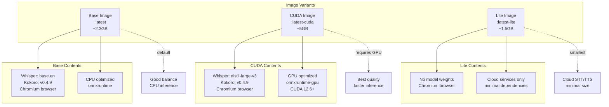

**Sources:** [README.md:76-214](), [Dockerfile](), [pyproject.toml:32-35]()

### Choosing an Image

- **Base (`:latest`)** - Default choice for most users. Includes `base.en` Whisper model for reasonable quality on CPU.
- **CUDA (`:latest-cuda`)** - For GPU-accelerated inference. Automatically uses `distil-large-v3` Whisper model for better quality. Requires NVIDIA Container Toolkit and CUDA 12.6+.
- **Lite (`:latest-lite`)** - Minimal image without local model weights. Requires cloud STT/TTS services (Deepgram, ElevenLabs, etc.).

**Sources:** [README.md:200-214](), [CHANGELOG.md:133-134]()

## First Steps After Installation

Once you have Docker and your `.env` file ready:

1. **Pull the image:**
   ```bash
   docker pull ghcr.io/joinly-ai/joinly:latest
   ```

2. **Start a meeting and get the URL** from Google Meet, Zoom, or Teams

3. **Run joinly** using one of the deployment modes:
   - All-in-one: `docker run --env-file .env ghcr.io/joinly-ai/joinly:latest --client <MeetingURL>`
   - Server mode: `docker run --env-file .env -p 8000:8000 ghcr.io/joinly-ai/joinly:latest`

4. **Monitor the logs** for connection status and agent activity

For detailed step-by-step instructions with troubleshooting, see [Quick Start Guide](#2.2).

**Sources:** [README.md:76-85]()

## MCP Server Interface

When running in server mode, joinly exposes a FastMCP server on port 8000 that provides standardized tools and resources for meeting interaction:

### Available Tools

| Tool | Purpose | Key Parameters |
|------|---------|----------------|
| `join_meeting` | Join a video call | `url`, `participant_name`, `passcode?` |
| `leave_meeting` | Leave the current meeting | None |
| `speak_text` | Speak using TTS | `text` |
| `send_chat_message` | Send a chat message | `message` |
| `mute_yourself` / `unmute_yourself` | Control microphone | None |
| `get_transcript` | Retrieve transcript with filters | `minutes?` |
| `get_chat_history` | Get meeting chat | None |
| `get_participants` | List current participants | None |
| `get_video_snapshot` | Capture screen/video frame | None |

### Available Resources

| Resource URI | Description | Subscribable |
|--------------|-------------|--------------|
| `transcript://live` | Real-time meeting transcript with speaker attribution and timestamps | Yes |
| `usage://current` | Current session usage metrics (LLM tokens, STT/TTS minutes) | No |

**Sources:** [README.md:220-238](), [joinly/mcp/server.py]()

## Next Steps

After completing initial setup:

- **For installation details:** See [Installation and Dependencies](#2.1)
- **For a guided walkthrough:** See [Quick Start Guide](#2.2)
- **For configuration reference:** See [Configuration and Settings](#2.3)
- **For architecture details:** See [Architecture](#3)
- **For building custom agents:** See [Client SDK](#6)
- **For adding external MCP servers:** See [LLM and External Service Integration](#7)

**Sources:** [README.md:1-290]()

---

# Page: Installation and Dependencies

# Installation and Dependencies

<details>
<summary>Relevant source files</summary>

The following files were used as context for generating this wiki page:

- [CHANGELOG.md](CHANGELOG.md)
- [client/README.md](client/README.md)
- [client/joinly_client/__init__.py](client/joinly_client/__init__.py)
- [pyproject.toml](pyproject.toml)
- [uv.lock](uv.lock)

</details>


This document covers the installation of the joinly system, including both the server and client components, system requirements, and dependency management. For detailed development environment setup, see [Development Environment Setup](#8.1). For information about Docker image variants and deployment, see [Docker Images and Variants](#9.1). For dependency internals and the build system, see [Build System and Dependencies](#8.2).

## System Requirements

### Python Version

The joinly system requires **Python 3.12 or higher**. This requirement is enforced across all packages in the workspace.

**Sources:** [pyproject.toml:9](), [uv.lock:3]()

### Platform Support

The system supports multiple platforms with platform-specific dependency resolution:

| Platform | Architecture | Support Level |
|----------|-------------|---------------|
| Linux | x86_64 | Full support (CPU and CUDA) |
| Linux | aarch64 | Full support (CPU only) |
| Linux | i686 | Full support (CPU only) |
| macOS | x86_64 | Full support |
| macOS | ARM64 (Apple Silicon) | Full support |
| Windows | x86_64 | Full support |

**Sources:** [uv.lock:4-11]()

### System Dependencies

For Docker deployments, all system dependencies are included in the container images. For local installations, the following system-level dependencies may be required:

- **Playwright browsers**: Automatically installed via `playwright install` command
- **PulseAudio** (Linux): Required for virtual audio devices
- **FFmpeg**: Required by the `av` package for audio/video processing
- **ONNX Runtime dependencies**: Included with the Python packages

**Sources:** [pyproject.toml:10-27](), High-level system diagrams

## Installation Methods

### Docker Installation (Recommended)

Docker is the recommended installation method for the joinly server, as it includes all dependencies and system-level requirements pre-configured.

```bash
# Pull and run the latest base image (CPU, local models)
docker run -p 8000:8000 ghcr.io/joinly-ai/joinly:latest

# Pull and run the CUDA image (GPU acceleration)
docker run --gpus all -p 8000:8000 ghcr.io/joinly-ai/joinly:cuda

# Pull and run the lite image (cloud services only, minimal size)
docker run -p 8000:8000 ghcr.io/joinly-ai/joinly:lite
```

#### Image Variants

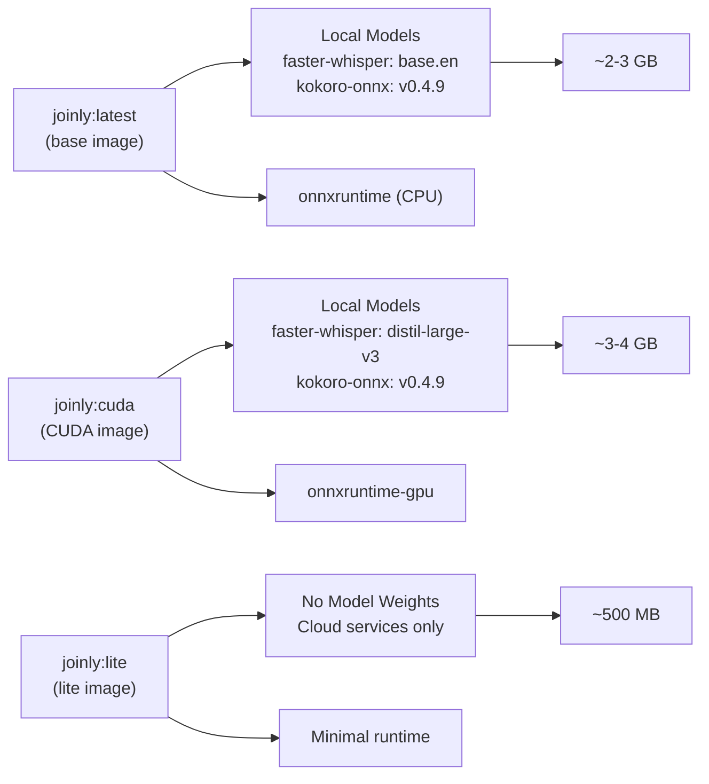

**Image Characteristics:**

| Variant | Local STT | Local TTS | GPU Support | Image Size | Use Case |
|---------|-----------|-----------|-------------|------------|----------|
| `latest` (base) | faster-whisper (base.en) | kokoro-onnx | No | ~2-3 GB | General purpose, CPU |
| `cuda` | faster-whisper (distil-large-v3) | kokoro-onnx | Yes | ~3-4 GB | High performance, GPU available |
| `lite` | None (cloud only) | None (cloud only) | No | ~500 MB | Cloud-only, minimal footprint |

**Sources:** [CHANGELOG.md:134](), Deployment Modes diagram, [pyproject.toml:33-35]()

### uv Installation (Development/Local)

[uv](https://github.com/astral-sh/uv) is the recommended tool for local development and client-only usage. It provides fast dependency resolution and virtual environment management.

#### Installing uv

```bash
# macOS and Linux
curl -LsSf https://astral.sh/uv/install.sh | sh

# Windows
powershell -c "irm https://astral.sh/uv/install.ps1 | iex"
```

#### Installing joinly Server Locally

```bash
# Clone the repository
git clone https://github.com/joinly-ai/joinly.git
cd joinly

# Create virtual environment and install with uv
uv sync

# Run the server
uv run joinly --help
```

#### Installing joinly Client

The client can be used without installing, via `uvx`:

```bash
# Run client directly (downloads and caches automatically)
uvx joinly-client --joinly-url http://localhost:8000/mcp/ <MeetingUrl>
```

Or install it in a project:

```bash
# Add to project dependencies
uv add joinly-client

# Or install globally
uv tool install joinly-client
```

**Sources:** [client/README.md:33-38](), [client/README.md:72-98]()

### pip Installation

While uv is recommended, pip can also be used for installation:

```bash
# Install server with dependencies
pip install joinly

# Install client separately
pip install joinly-client

# Install with CUDA support
pip install joinly[cuda]
```

**Sources:** [pyproject.toml:1-36]()

## Dependency Overview

### Workspace Structure

The joinly project is organized as a uv workspace with three packages:

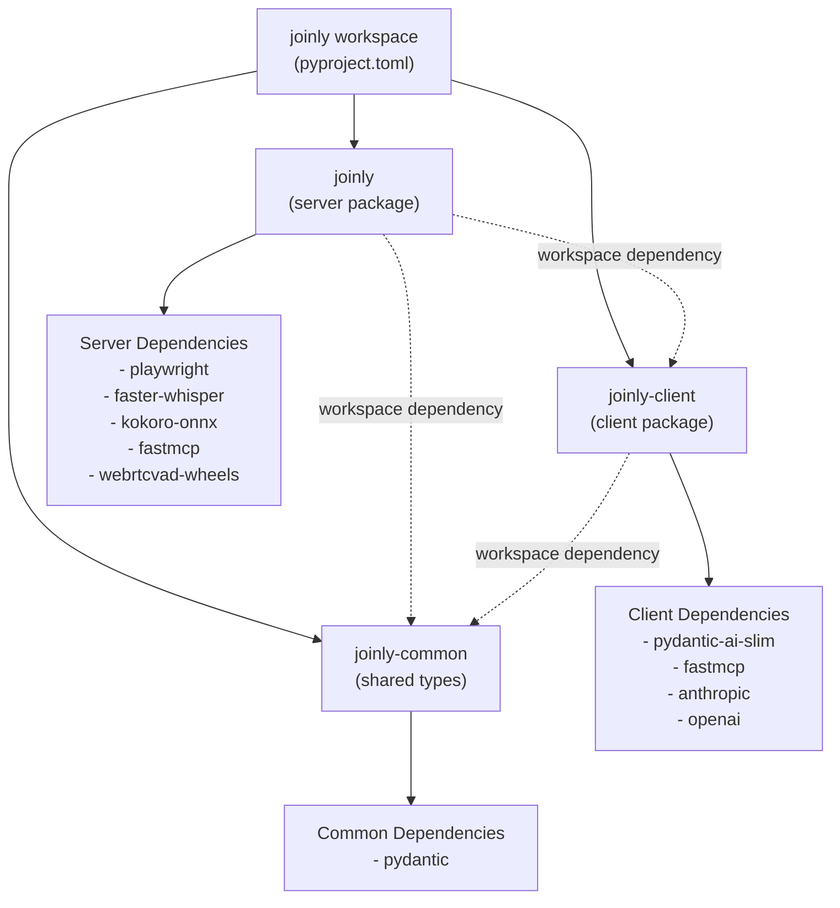

**Sources:** [pyproject.toml:61-65](), [uv.lock:13-18]()

### Core Server Dependencies

The server package has extensive dependencies for meeting automation and speech processing:

| Category | Package | Purpose | Version Constraint |
|----------|---------|---------|-------------------|
| **Web Automation** | playwright | Browser automation for meeting platforms | >=1.51.0 |
| **Speech-to-Text** | faster-whisper | Local STT using Whisper models | >=1.1.1 |
| | deepgram-sdk | Cloud STT service | >=4.1.1 |
| **Text-to-Speech** | kokoro-onnx | Local TTS using ONNX models | >=0.4.9 |
| | elevenlabs | Cloud TTS service | >=2.5.0 |
| **Voice Activity** | webrtcvad-wheels | VAD for speech detection | >=2.0.14 |
| **MCP Server** | fastmcp | FastMCP server implementation | >=2.10.5 |
| **Audio Processing** | numpy | Numerical operations for audio | >=2.2.4 |
| | onnxruntime | ONNX model inference (CPU) | >=1.21.1 |
| **Utilities** | click | CLI framework | >=8.1.8 |
| | python-dotenv | Environment variable management | >=1.1.0 |
| | aiohttp | Async HTTP client/server | >=3.11.18 |

**Sources:** [pyproject.toml:10-27]()

#### Optional Dependencies

```python
# CUDA acceleration for local models
[project.optional-dependencies]
cuda = [
    "onnxruntime-gpu>=1.22.0",
]
```

The CUDA optional dependency replaces `onnxruntime` with `onnxruntime-gpu` to enable GPU acceleration for Whisper (STT) and Kokoro (TTS) models.

**Sources:** [pyproject.toml:33-35]()

### Client Dependencies

The client package focuses on LLM integration and MCP communication:

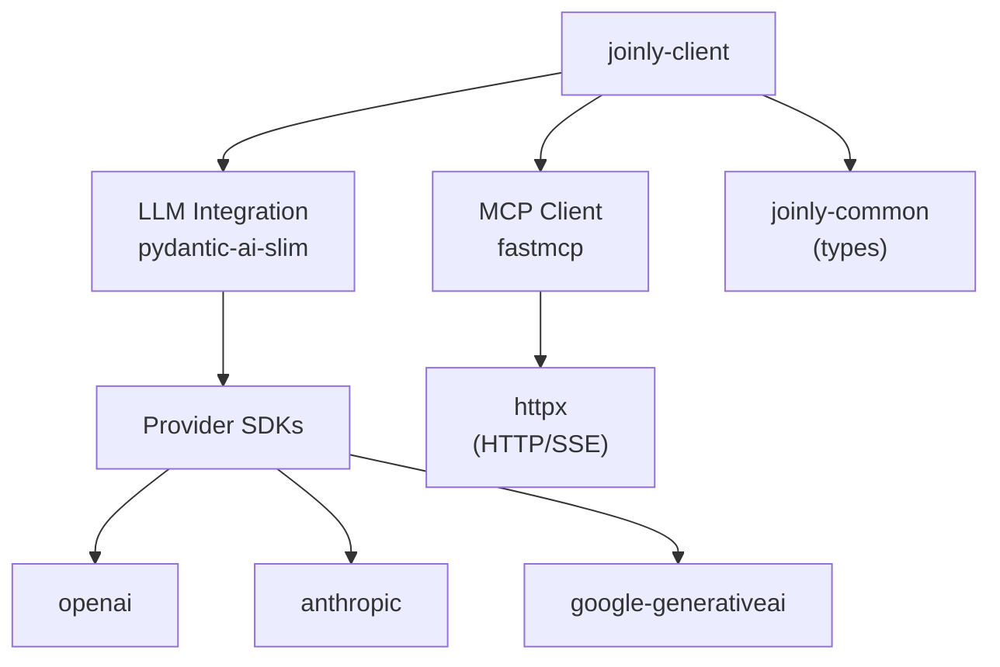

The client package is designed to be lightweight, with LLM provider SDKs as the primary dependencies.

**Sources:** [client/joinly_client/__init__.py:1-9](), Package importance scores

### Development Dependencies

Development dependencies are specified in a `[dependency-groups]` section:

```python
[dependency-groups]
dev = [
    "aiofiles>=24.1.0",
    "aiohttp>=3.11.18",
    "jiwer>=3.1.0",           # Word error rate for testing
    "pre-commit>=4.2.0",      # Git hooks
    "pyright>=1.1.399",       # Type checking
    "pytest>=8.3.5",          # Testing framework
    "pytest-asyncio>=0.26.0", # Async test support
    "rich>=14.0.0",           # Terminal formatting
    "ruff>=0.11.6",           # Linting and formatting
]
```

**Sources:** [pyproject.toml:37-48]()

## Dependency Resolution

### Platform-Specific Resolution

The lockfile uses resolution markers to handle platform-specific dependencies:

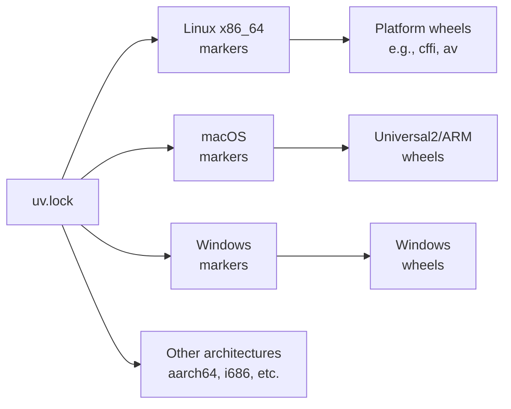

For example, the `aiohttp` package has different wheels for each platform:

```
aiohttp-3.11.18-cp312-cp312-macosx_10_13_universal2.whl
aiohttp-3.11.18-cp312-cp312-manylinux_2_17_x86_64.whl
aiohttp-3.11.18-cp312-cp312-win_amd64.whl
```

**Sources:** [uv.lock:4-11](), [uv.lock:60-92]()

### Workspace Dependencies

The `[tool.uv.sources]` section specifies workspace dependencies:

```toml
[tool.uv.sources]
joinly-client = { workspace = true }
joinly-common = { workspace = true }
```

This ensures that the server package uses the local workspace versions of `joinly-client` and `joinly-common` rather than published versions, enabling coordinated development across packages.

**Sources:** [pyproject.toml:50-52]()

## Version Management

### Package Versions

Current versions as of the latest release:

| Package | Version |
|---------|---------|
| joinly (server) | 0.5.1 |
| joinly-client | 0.1.18 |
| joinly-common | 0.1.3 |

**Sources:** [pyproject.toml:3](), [CHANGELOG.md:4-5]()

### Dependency Updates

Dependencies are locked in `uv.lock` with exact versions to ensure reproducible builds. The lockfile tracks:

- Package versions
- Package hashes (SHA256)
- Wheel URLs
- Source distributions (sdist)
- Resolution markers for platform-specific builds

Example lockfile entry:

```toml
[[package]]
name = "fastmcp"
version = "2.10.5"
source = { registry = "https://pypi.org/simple" }
dependencies = [
    { name = "httpx" },
    { name = "pydantic" },
    ...
]
```

**Sources:** [uv.lock:1-11](), [uv.lock:20-46]()

## CLI Entry Points

The server package provides a CLI entry point:

```toml
[project.scripts]
joinly = "joinly.main:cli"
```

After installation, the `joinly` command invokes the `cli` function in `joinly.main`.

The client package similarly provides:

```toml
[project.scripts]
joinly-client = "joinly_client.main:main"
```

**Sources:** [pyproject.toml:29-30]()

## Next Steps

After installation, proceed to:
- [Quick Start Guide](#2.2) for running the system for the first time
- [Configuration and Settings](#2.3) for detailed configuration options
- [Development Environment Setup](#8.1) for setting up a development environment

---

# Page: Quick Start Guide

# Quick Start Guide

<details>
<summary>Relevant source files</summary>

The following files were used as context for generating this wiki page:

- [.env.example](.env.example)
- [README.md](README.md)
- [client/README.md](client/README.md)
- [client/joinly_client/__init__.py](client/joinly_client/__init__.py)
- [joinly/main.py](joinly/main.py)
- [joinly/services/tts/resemble.py](joinly/services/tts/resemble.py)

</details>


This guide provides step-by-step instructions for running joinly and connecting AI agents to video meetings. It covers the basic Docker deployment, client connection, and MCP server integration patterns.

For detailed configuration options, see [Configuration and Settings](#2.3). For architecture details, see [Architecture](#3). For building custom agents, see [Building Custom Agents](#8.2).

## Prerequisites and Setup

Before starting, ensure you have [Docker installed](https://docs.docker.com/engine/install/) on your system. Joinly runs as a containerized application that provides an MCP server for AI agent integration.

### Environment Configuration

Create a `.env` file in your working directory with the required API keys for your LLM provider:

```bash
# For OpenAI
JOINLY_LLM_MODEL=gpt-4o
JOINLY_LLM_PROVIDER=openai
OPENAI_API_KEY=your-openai-api-key

# For Anthropic
JOINLY_LLM_MODEL=claude-3-5-haiku-latest
JOINLY_LLM_PROVIDER=anthropic
ANTHROPIC_API_KEY=your-anthropic-api-key
```

The complete configuration options are available in [.env.example:1-40]().

Sources: [README.md:51-69](), [.env.example:1-40]()

## Basic Deployment

### Pull Docker Image

```bash
docker pull ghcr.io/joinly-ai/joinly:latest
```

The Docker image (~2.3GB) includes the browser runtime, AI models, and all dependencies. For GPU-accelerated transcription, use the CUDA variant:

```bash
docker pull ghcr.io/joinly-ai/joinly:latest-cuda
```

Sources: [README.md:72-75](), [README.md:197-210]()

### Direct Client Mode

For immediate testing, run joinly in direct client mode with a meeting URL:

```bash
docker run --env-file .env ghcr.io/joinly-ai/joinly:latest --client <MeetingURL>
```

This bypasses the MCP server and runs a basic conversational agent directly in the container.

Sources: [README.md:77-80]()

## MCP Server Deployment

### Start Server Mode

Run joinly as an MCP server for external client connections:

```bash
docker run -p 8000:8000 --env-file .env ghcr.io/joinly-ai/joinly:latest
```

The server exposes the FastMCP protocol on port 8000 and provides meeting tools and resources to connected clients.

### Quick Start Architecture

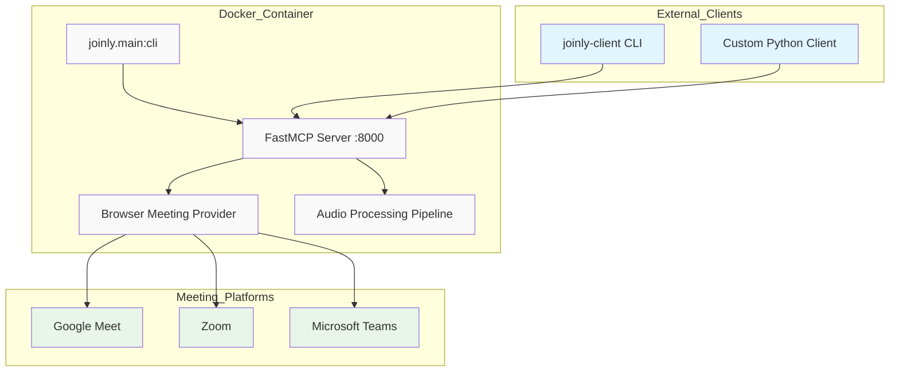

Sources: [pyproject.toml:28](), [README.md:89-92]()

## External Client Connection

### Using joinly-client

Install and run the external client to connect to the MCP server:

```bash
uvx joinly-client --env-file .env <MeetingUrl>
```

The `joinly-client` package provides a Python SDK for building AI agents that connect to joinly servers.

### MCP Tools and Resources Flow

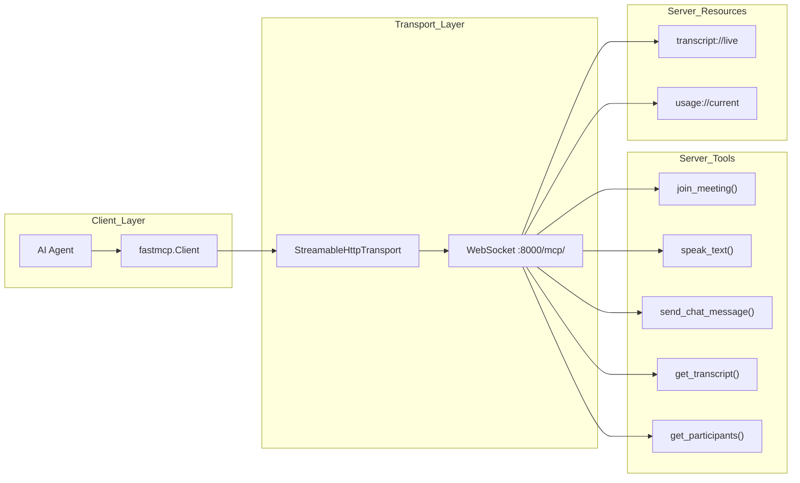

Sources: [examples/client_example.py:24-25](), [examples/client_example.py:142-144](), [README.md:218-229](), [README.md:230-233]()

## Multi-MCP Server Integration

### Configuration File

Create a JSON configuration file to connect additional MCP servers:

```json
{
    "mcpServers": {
        "tavily": {
            "command": "npx",
            "args": ["-y", "tavily-mcp@0.2.2"]
        },
        "notion": {
            "command": "npx", 
            "args": ["-y", "@notionhq/notion-mcp-server"],
            "env": {
                "OPENAPI_MCP_HEADERS": "{\"Authorization\": \"Bearer ntn_****\"}"
            }
        }
    }
}
```

### Run with Multiple Servers

```bash
uvx joinly-client --env-file .env --mcp-config config.json <MeetingUrl>
```

This configuration connects both joinly meeting tools and external MCP servers (web search, Notion, etc.) to the same AI agent.

Sources: [README.md:99-121](), [examples/config_tavily.json:1-8](), [examples/config_notion.json:1-11]()

## Meeting Session Lifecycle

### Session Management Flow

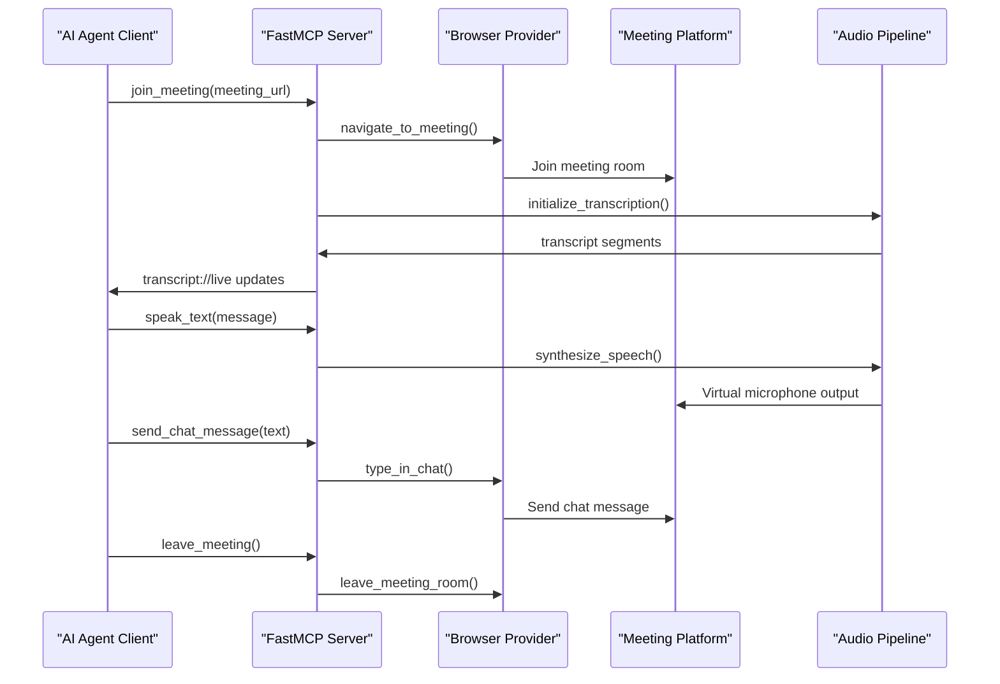

Sources: [examples/client_example.py:188-189](), [examples/client_example.py:108-118]()

## Common Configuration Options

### Basic Settings

| Parameter | Description | Example |
|-----------|-------------|---------|
| `--name` | Participant name in meeting | `"AI Assistant"` |
| `--lang` | TTS/STT language | `en`, `de`, `fr` |
| `--host` | MCP server host | `0.0.0.0` |
| `--port` | MCP server port | `8000` |

### Provider Settings

| Service | Configuration | Environment Variable |
|---------|---------------|---------------------|
| OpenAI TTS | `--tts openai` | `OPENAI_API_KEY` |
| ElevenLabs TTS | `--tts elevenlabs` | `ELEVENLABS_API_KEY` |
| Deepgram STT | `--stt deepgram` | `DEEPGRAM_API_KEY` |
| Whisper STT | `--stt whisper` | (local, no key needed) |

### Debug Options

```bash
# Enable VNC for browser debugging
docker run -p 5900:5900 --env-file .env ghcr.io/joinly-ai/joinly:latest --vnc-server

# Verbose logging
docker run --env-file .env ghcr.io/joinly-ai/joinly:latest -vv --client <MeetingURL>
```

Sources: [README.md:125-193]()

## Next Steps

After completing this quick start:

1. **Custom Agent Development**: See [Building Custom Agents](#8.2) for creating sophisticated conversational agents
2. **Advanced Configuration**: Review [Configuration and Settings](#2.3) for detailed provider options
3. **MCP Integration**: Explore [Examples and Usage Patterns](#8) for integration with external services
4. **Production Deployment**: See [Docker Deployment](#10.1) for production considerations

Sources: [README.md:212-215]()

---

# Page: Configuration and Settings

# Configuration and Settings

<details>
<summary>Relevant source files</summary>

The following files were used as context for generating this wiki page:

- [.env.example](.env.example)
- [README.md](README.md)
- [joinly/main.py](joinly/main.py)
- [joinly/services/tts/resemble.py](joinly/services/tts/resemble.py)

</details>


This document covers the configuration system for the joinly application, including environment variables, command-line options, settings management, and service-specific configuration. The configuration system uses Pydantic BaseSettings for type-safe configuration management with support for multiple configuration sources.

For information about installation and system dependencies, see [Installation and Dependencies](#2.1). For usage examples and running the system, see [Quick Start Guide](#2.2).

## Configuration Architecture

The joinly configuration system follows a layered approach where settings can be specified through multiple sources with a defined precedence order.

### Configuration Flow

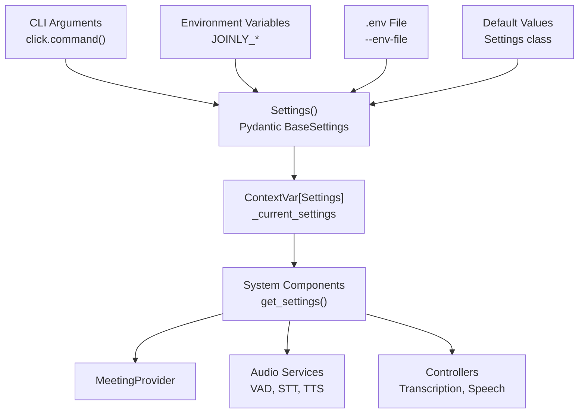

Sources: [joinly/main.py:35-315](), [joinly/settings.py:1-79]()

### Settings Management Pattern

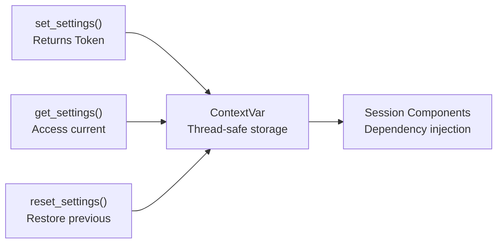

Sources: [joinly/settings.py:48-79]()

## Configuration Sources

The configuration system supports multiple sources with the following precedence order (highest to lowest):

1. **Command-line arguments** - Direct CLI options override all other sources
2. **Environment variables** - Prefixed with `JOINLY_`
3. **Environment files** - Loaded via `--env-file` option
4. **Default values** - Defined in the `Settings` class

### Environment File Loading

```bash
# Load configuration from custom .env file
joinly --env-file /path/to/config.env

# Environment variables are loaded eagerly before other options
```

Sources: [joinly/main.py:114-122]()

## Core Settings

### Basic Configuration

The `Settings` class in [joinly/settings.py:17-46]() defines the core configuration structure:

| Setting | Default | Environment Variable | Description |
|---------|---------|---------------------|-------------|
| `name` | `"joinly"` | `JOINLY_NAME` | Meeting participant name |
| `language` | `"en"` | `JOINLY_LANGUAGE` | Language for transcription and TTS |
| `device` | `"cpu"` | `JOINLY_DEVICE` | Compute device (cpu/cuda) |

### Server Configuration

| Setting | Default | Environment Variable | Description |
|---------|---------|---------------------|-------------|
| `host` | `"127.0.0.1"` | `JOINLY_SERVER_HOST` | Server bind address |
| `port` | `8000` | `JOINLY_SERVER_PORT` | Server bind port |

### Service Selection

Each service type can be configured independently:

| Service | Default | Environment Variable | Available Options |
|---------|---------|---------------------|-------------------|
| `meeting_provider` | `"browser"` | `JOINLY_MEETING_PROVIDER` | `"browser"` |
| `vad` | `"silero"` | `JOINLY_VAD` | `"webrtc"`, `"silero"` |
| `stt` | `"whisper"` | `JOINLY_STT` | `"whisper"`, `"deepgram"` |
| `tts` | `"kokoro"` | `JOINLY_TTS` | `"kokoro"`, `"elevenlabs"`, `"deepgram"` |
| `transcription_controller` | `"default"` | - | `"default"` |
| `speech_controller` | `"default"` | - | `"default"` |

Sources: [joinly/settings.py:24-31]()

## Service-Specific Configuration

Each service supports additional configuration through argument dictionaries:

### Service Arguments Structure

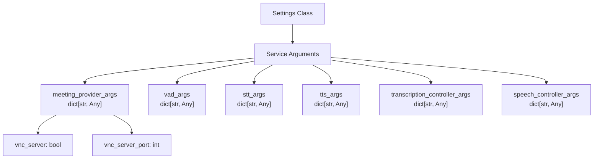

Sources: [joinly/settings.py:33-38](), [joinly/main.py:182-234]()

### CLI Argument Parsing

Service arguments can be specified via CLI using key-value pairs:

```bash
# Multiple service arguments
joinly --meeting-provider-arg vnc_server=true \
       --meeting-provider-arg vnc_server_port=5901 \
       --vad-arg threshold=0.5 \
       --stt-arg model=whisper-large \
       meeting_url

# JSON values are parsed automatically
joinly --tts-arg voice_settings='{"speed": 1.2, "pitch": 0.8}'
```

The `_parse_kv` function [joinly/main.py:16-32]() handles conversion of CLI key-value pairs to dictionaries with automatic JSON parsing.

Sources: [joinly/main.py:16-32](), [joinly/main.py:182-234]()

## Environment Variable Configuration

### Naming Convention

All environment variables use the `JOINLY_` prefix with nested configuration supported via double underscores:

```bash
# Basic settings
export JOINLY_NAME="MyBot"
export JOINLY_LANGUAGE="es"
export JOINLY_DEVICE="cuda"

# Server configuration
export JOINLY_SERVER_HOST="0.0.0.0"
export JOINLY_SERVER_PORT="9000"

# Service selection
export JOINLY_VAD="webrtc"
export JOINLY_STT="deepgram"
export JOINLY_TTS="elevenlabs"

# Nested configuration (example)
export JOINLY_MEETING_PROVIDER_ARGS__VNC_SERVER="true"
export JOINLY_MEETING_PROVIDER_ARGS__VNC_SERVER_PORT="5901"
```

### Pydantic Settings Configuration

The `Settings` class uses `SettingsConfigDict` [joinly/settings.py:40-45]() to configure environment variable handling:

- `env_prefix="JOINLY_"` - All environment variables must start with this prefix
- `env_nested_delimiter="__"` - Double underscores separate nested configuration levels
- `extra="forbid"` - Unknown configuration keys are rejected
- `frozen=True` - Settings instances are immutable after creation

Sources: [joinly/settings.py:40-45]()

## Logging Configuration

### Logging Levels and Options

The logging system [joinly/utils/logging.py:6-44]() supports multiple configuration options:

| Option | Environment Variable | Description |
|--------|---------------------|-------------|
| `-v, --verbose` | - | Increase verbosity (repeatable) |
| `-q, --quiet` | - | Suppress non-error logs |
| `--logging-plain` | `JOINLY_LOGGING_PLAIN` | Disable rich formatting |

### Verbosity Levels

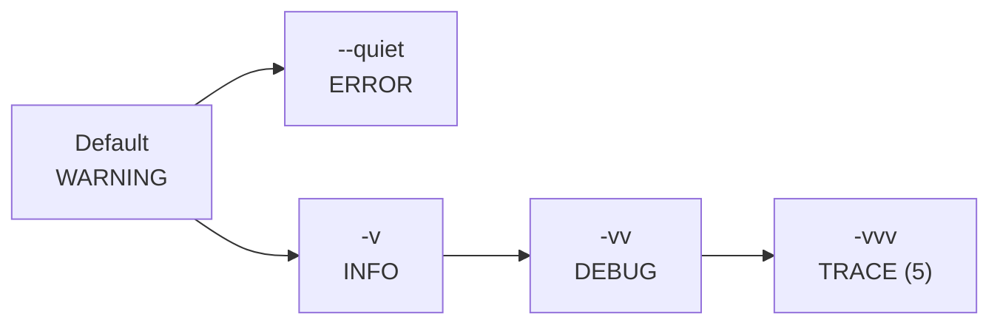

The logging configuration automatically detects and uses Rich formatting when available, falling back to plain formatting.

Sources: [joinly/utils/logging.py:6-44](), [joinly/main.py:235-250]()

## Client-Specific Configuration

When running in client mode, additional LLM configuration is available:

| Setting | Default | Environment Variable | Description |
|---------|---------|---------------------|-------------|
| `llm_provider` | `"openai"` | `JOINLY_LLM_PROVIDER` | LLM provider selection |
| `llm_model` | `"gpt-4o"` | `JOINLY_LLM_MODEL` | Specific model name |
| `name_trigger` | `false` | - | Activate only on name mention |

These settings are passed to the `joinly_client.run()` function when operating in client mode [joinly/main.py:301-310]().

Sources: [joinly/main.py:94-112](), [joinly/main.py:301-310]()

## Configuration Examples

### Development Configuration

```bash
# .env file for development
JOINLY_NAME="DevBot"
JOINLY_DEVICE="cpu"
JOINLY_SERVER_HOST="0.0.0.0"
JOINLY_SERVER_PORT="8000"
JOINLY_VAD="silero"
JOINLY_STT="whisper"
JOINLY_TTS="kokoro"
JOINLY_LOGGING_PLAIN="false"
```

### Production Configuration

```bash
# Production environment variables
export JOINLY_NAME="ProductionAgent"
export JOINLY_DEVICE="cuda"
export JOINLY_SERVER_HOST="0.0.0.0"
export JOINLY_SERVER_PORT="8000"
export JOINLY_STT="deepgram"
export JOINLY_TTS="elevenlabs"
export DEEPGRAM_API_KEY="your_api_key"
export ELEVENLABS_API_KEY="your_api_key"
```

### CLI Override Example

```bash
# Override environment settings via CLI
joinly --name "MeetingBot" \
       --device cuda \
       --stt deepgram \
       --tts elevenlabs \
       --meeting-provider-arg vnc_server=true \
       --server
```

Sources: [joinly/main.py:35-315](), [joinly/settings.py:17-46]()

---

# Page: Architecture

# Architecture

<details>
<summary>Relevant source files</summary>

The following files were used as context for generating this wiki page:

- [CHANGELOG.md](CHANGELOG.md)
- [client/joinly_client/agent.py](client/joinly_client/agent.py)
- [client/joinly_client/client.py](client/joinly_client/client.py)
- [client/joinly_client/main.py](client/joinly_client/main.py)
- [client/joinly_client/prompts.py](client/joinly_client/prompts.py)
- [client/joinly_client/types.py](client/joinly_client/types.py)
- [client/joinly_client/utils.py](client/joinly_client/utils.py)
- [common/joinly_common/types.py](common/joinly_common/types.py)
- [joinly/server.py](joinly/server.py)
- [joinly/utils/events.py](joinly/utils/events.py)
- [joinly/utils/usage.py](joinly/utils/usage.py)
- [pyproject.toml](pyproject.toml)
- [uv.lock](uv.lock)

</details>


This document explains the high-level architecture of the joinly system, focusing on the separation between server and client components, their communication protocol, and how they integrate to enable AI agents in meetings. For detailed information about specific subsystems, see [MCP Server and Client Communication](#3.1), [Session Management and Dependency Injection](#3.2), and [Data Types and Models](#3.3). For operational deployment patterns, see [Deployment Modes](#9.2).

## System Overview

Joinly follows a **server-client architecture** where the server handles meeting connections and real-time audio processing, while clients orchestrate conversational AI agents with LLM integration. The two components communicate over the **Model Context Protocol (MCP)**, an HTTP/SSE-based protocol that provides a standardized interface for resources, tools, and subscriptions.

### Server-Client Separation

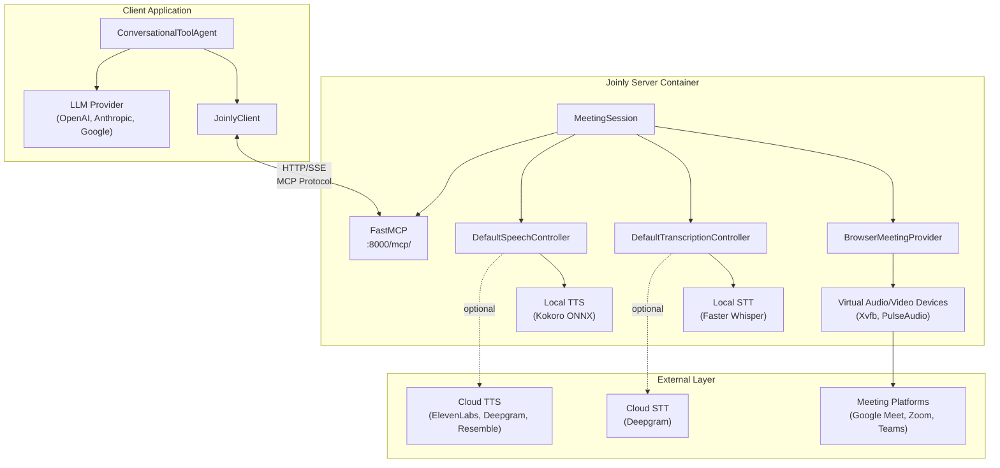

**Sources:** [joinly/server.py:1-342](), [client/joinly_client/client.py:1-428](), [client/joinly_client/agent.py:1-480]()

The architecture provides clear separation of concerns:

| Component | Responsibility | Key Classes |
|-----------|---------------|-------------|
| **Server** | Meeting access, audio I/O, speech processing | `MeetingSession`, `BrowserMeetingProvider`, `DefaultTranscriptionController`, `DefaultSpeechController` |
| **Client** | Conversational AI, LLM orchestration, tool execution | `JoinlyClient`, `ConversationalToolAgent` |
| **Protocol** | Communication, resource subscription, tool invocation | `FastMCP` (server), MCP client session (client) |

## Core Components

### Server Components

The server side is organized around the `MeetingSession` orchestrator that coordinates all meeting-related functionality.

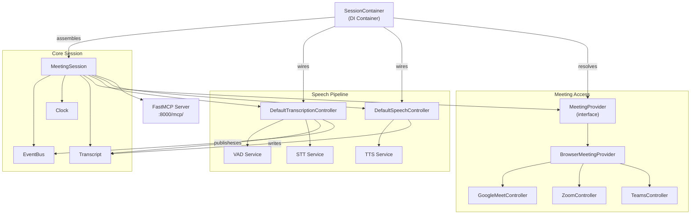

**Sources:** [joinly/session.py](), [joinly/container.py](), [joinly/server.py:34-122](), [joinly/providers/meeting.py](), [joinly/controllers/transcription.py](), [joinly/controllers/speech.py]()

#### SessionContainer (Dependency Injection)

The `SessionContainer` class [joinly/container.py]() acts as a dependency injection container that dynamically resolves and wires components based on configuration. It uses a `_resolve` method to instantiate services from configuration strings like `"whisper"` or `"joinly.services.stt.deepgram:DeepgramSTT"`.

#### MeetingSession (Orchestrator)

The `MeetingSession` class [joinly/session.py]() serves as the central orchestrator, coordinating:
- Meeting lifecycle (join, leave)
- Shared resources (`Clock`, `Transcript`, `EventBus`)
- Audio processing pipelines (transcription and speech)
- Event publishing for real-time updates

#### Speech Processing Pipeline

Two controllers manage bidirectional audio:

- **DefaultTranscriptionController**: Receives audio from the meeting → VAD detects speech → STT transcribes → writes segments to `Transcript`
- **DefaultSpeechController**: Receives text to speak → chunks text → TTS generates audio → plays through virtual microphone

### Client Components

The client side focuses on conversational AI orchestration and MCP communication.

```mermaid
graph TB
    subgraph "Entry Points"
        CLI["CLI (uvx joinly-client)"]
        RunFunc["run() function"]
        DirectUsage["Direct JoinlyClient usage"]
    end
    
    subgraph "Client Core"
        JoinlyClient["JoinlyClient"]
        MCPSession["MCP ClientSession"]
        
        JoinlyClient --> MCPSession
    end
    
    subgraph "Resource Subscriptions"
        TranscriptSub["transcript://live<br/>subscription"]
        SegmentsSub["transcript://live/segments<br/>subscription"]
        UsageResource["usage://current"]
        
        JoinlyClient --> TranscriptSub
        JoinlyClient --> SegmentsSub
        JoinlyClient --> UsageResource
    end
    
    subgraph "Agent System"
        ConvAgent["ConversationalToolAgent"]
        MessageHistory["Message History"]
        ToolDefs["ToolDefinition[]"]
        ToolExecutor["ToolExecutor"]
        
        ConvAgent --> MessageHistory
        ConvAgent --> ToolDefs
        ConvAgent --> ToolExecutor
    end
    
    subgraph "LLM Integration"
        LLMConfig["Model Configuration"]
        PydanticAI["pydantic-ai"]
        LLMProviders["LLM Providers<br/>(OpenAI, Anthropic, Google)"]
        
        ConvAgent --> LLMConfig
        LLMConfig --> PydanticAI
        PydanticAI --> LLMProviders
    end
    
    CLI --> RunFunc
    RunFunc --> JoinlyClient
    RunFunc --> ConvAgent
    DirectUsage --> JoinlyClient
    
    TranscriptSub -.triggers.-> ConvAgent
    ToolExecutor --> MCPSession
```

**Sources:** [client/joinly_client/client.py:1-428](), [client/joinly_client/agent.py:1-480](), [client/joinly_client/main.py:1-397](), [client/joinly_client/utils.py:1-312]()

#### JoinlyClient

The `JoinlyClient` class [client/joinly_client/client.py:32-428]() provides:
- MCP session management and connection lifecycle
- Resource subscription handling with callbacks
- Tool invocation methods (`join_meeting`, `speak_text`, etc.)
- Transcript filtering and segment delivery to callbacks

#### ConversationalToolAgent

The `ConversationalToolAgent` class [client/joinly_client/agent.py:30-480]() implements the conversational AI loop:
- Maintains message history with `ModelRequest`/`ModelResponse` objects
- Calls LLM with system prompt, history, and available tools
- Executes tool calls via `ToolExecutor`
- Handles interruptions and turn management
- Truncates large tool results to manage token usage

## Communication Protocol

The server and client communicate via the Model Context Protocol (MCP), a standardized protocol for AI-tool integration.

```mermaid
sequenceDiagram
    participant Client as JoinlyClient
    participant MCP as FastMCP Server
    participant Session as MeetingSession
    participant Provider as MeetingProvider
    
    Note over Client,MCP: Connection Establishment
    Client->>MCP: HTTP Connect + SSE
    MCP->>MCP: session_lifespan()
    MCP->>Session: Create SessionContainer
    MCP->>Session: Enter MeetingSession
    
    Note over Client,Session: Resource Subscription
    Client->>MCP: subscribe_resource(transcript://live)
    MCP->>Session: EventBus.subscribe("utterance")
    
    Note over Client,Session: Tool Invocation
    Client->>MCP: call_tool("join_meeting", {url, name})
    MCP->>Session: join_meeting()
    Session->>Provider: join()
    Provider-->>Session: joined
    Session-->>MCP: "Joined meeting."
    MCP-->>Client: Tool result
    
    Note over Client,Session: Live Updates
    Session->>Session: Transcript updated
    Session->>MCP: EventBus.publish("utterance")
    MCP->>Client: ResourceUpdatedNotification
    Client->>MCP: read_resource(transcript://live)
    MCP->>Session: Get transcript
    Session-->>MCP: Transcript JSON
    MCP-->>Client: Resource content
```

**Sources:** [joinly/server.py:73-122](), [client/joinly_client/client.py:201-239]()

### MCP Resources

The server exposes three primary resources:

| Resource URI | Content Type | Description | Handler |
|--------------|--------------|-------------|---------|
| `transcript://live` | `application/json` | Participant utterances only | [joinly/server.py:127-136]() |
| `transcript://live/segments` | `application/json` | All transcript segments including agent speech | [joinly/server.py:138-147]() |
| `usage://current` | `application/json` | Service usage statistics (tokens, audio minutes) | [joinly/server.py:149-157]() |

### MCP Tools

The server exposes meeting control tools:

| Tool Name | Purpose | Key Parameter | Handler |
|-----------|---------|---------------|---------|
| `join_meeting` | Join a meeting | `meeting_url`, `participant_name` | [joinly/server.py:159-184]() |
| `leave_meeting` | Leave current meeting | none | [joinly/server.py:186-197]() |
| `speak_text` | Synthesize speech in meeting | `text` | [joinly/server.py:199-214]() |
| `send_chat_message` | Send chat message | `message` | [joinly/server.py:216-228]() |
| `get_chat_history` | Retrieve chat messages | none | [joinly/server.py:230-240]() |
| `get_transcript` | Get transcript with filters | `mode`, `minutes` | [joinly/server.py:242-276]() |
| `get_participants` | List meeting participants | none | [joinly/server.py:278-288]() |
| `get_video_snapshot` | Capture video frame | none | [joinly/server.py:290-306]() |
| `mute_yourself` | Mute microphone | none | [joinly/server.py:308-319]() |
| `unmute_yourself` | Unmute microphone | none | [joinly/server.py:321-332]() |

## Data Flow Architecture

### Event-Driven Transcript Updates

The system uses an event-driven architecture for real-time transcript distribution.

```mermaid
graph LR
    Audio["Meeting Audio"]
    VAD["VAD Service"]
    STT["STT Service"]
    TransCtrl["TranscriptionController"]
    Transcript["Transcript Store"]
    EventBus["EventBus"]
    FastMCP["FastMCP Server"]
    Client["JoinlyClient"]
    Agent["ConversationalToolAgent"]
    
    Audio --> VAD
    VAD -->|"SpeechWindow"| STT
    STT -->|"transcribed text"| TransCtrl
    TransCtrl -->|"add_segment()"| Transcript
    TransCtrl -->|"publish('segment')"| EventBus
    TransCtrl -->|"publish('utterance')"| EventBus
    EventBus -->|"notify subscribers"| FastMCP
    FastMCP -->|"ResourceUpdatedNotification"| Client
    Client -->|"read_resource()"| FastMCP
    FastMCP -->|"Transcript JSON"| Client
    Client -->|"on_utterance(segments)"| Agent
```

**Sources:** [joinly/controllers/transcription.py](), [joinly/types.py](), [joinly/utils/events.py:1-73](), [client/joinly_client/client.py:253-284](), [client/joinly_client/agent.py:98-151]()

#### Event Types

The `EventBus` class [joinly/utils/events.py:11-73]() supports two event types defined as `EventType = Literal["segment", "utterance"]`:

- **segment**: Published after every transcript segment is added (all speakers)
- **utterance**: Published after participant segments are added (excludes agent speech)

Clients subscribe to the corresponding resource URI (`transcript://live` for utterances, `transcript://live/segments` for segments), and the server automatically manages the event subscription lifecycle in `session_lifespan` [joinly/server.py:86-106]().

### Bidirectional Speech Pipeline

```mermaid
graph TB
    subgraph "Inbound: Meeting → Agent"
        MeetingIn["Meeting Audio Stream"]
        VADIn["VAD Detection"]
        STTIn["Speech-to-Text"]
        TranscriptIn["Transcript Segments"]
        ClientIn["Client receives updates"]
        AgentIn["Agent processes utterances"]
        
        MeetingIn --> VADIn
        VADIn --> STTIn
        STTIn --> TranscriptIn
        TranscriptIn -.event.-> ClientIn
        ClientIn --> AgentIn
    end
    
    subgraph "Outbound: Agent → Meeting"
        AgentOut["Agent generates response"]
        ClientOut["Client calls speak_text"]
        SpeechCtrlOut["SpeechController"]
        TTSOut["Text-to-Speech"]
        ChunkingOut["Chunk audio"]
        MeetingOut["Virtual Microphone → Meeting"]
        
        AgentOut --> ClientOut
        ClientOut --> SpeechCtrlOut
        SpeechCtrlOut --> TTSOut
        TTSOut --> ChunkingOut
        ChunkingOut --> MeetingOut
    end
    
    AgentIn -.LLM processing.-> AgentOut
```

**Sources:** [joinly/controllers/transcription.py](), [joinly/controllers/speech.py](), [client/joinly_client/agent.py:112-151]()

The inbound pipeline detects voice activity, transcribes speech, and publishes segments to subscribed clients. The outbound pipeline receives text from clients, synthesizes speech with optional pre-chunking, and interrupts gracefully if new speech is detected from participants.

## Shared Data Types

The `joinly-common` package [common/joinly_common/types.py:1-292]() defines shared data types used throughout the system:

### Core Types

| Type | Purpose | Key Fields | Immutable |
|------|---------|-----------|-----------|
| `TranscriptSegment` | Single utterance | `text`, `start`, `end`, `speaker`, `role` | Yes |
| `Transcript` | Collection of segments | `segments` (computed property), methods like `after()`, `compact()` | No (mutable set internally) |
| `SpeakerRole` | Speaker classification | `participant`, `assistant` | Enum |
| `Usage` | Service usage tracking | Root dict of `ServiceUsage` by service name | No |
| `MeetingParticipant` | Participant metadata | `name`, `email`, `infos` | Yes |
| `MeetingChatMessage` | Chat message | `text`, `timestamp`, `sender` | Yes |

**Sources:** [common/joinly_common/types.py:16-292]()

### Transcript Model

The `Transcript` class [common/joinly_common/types.py:54-168]() maintains an internal `_segments` set and provides methods for filtering and manipulation:

- `after(seconds)` / `before(seconds)`: Temporal filtering
- `with_role(role)`: Filter by speaker role
- `compact(max_gap=0.5)`: Merge nearby segments from the same speaker

The computed `segments` property returns a sorted list, making the transcript's order deterministic.

### Usage Tracking

The `Usage` and `ServiceUsage` classes [common/joinly_common/types.py:218-292]() track resource consumption:

```python
# Usage structure (conceptual)
{
    "llm": {
        "usage": {"input_tokens": 1234, "output_tokens": 567},
        "meta": {"model": "gpt-4o", "provider": "openai"}
    },
    "stt": {
        "usage": {"audio_minutes": 2.5},
        "meta": {"service": "deepgram", "model": "nova-2"}
    },
    "tts": {
        "usage": {"characters": 450},
        "meta": {"service": "elevenlabs", "voice_id": "xyz"}
    }
}
```

Usage is accumulated in a context variable [joinly/utils/usage.py:1-56]() on the server side and merged from the server in the client's agent [client/joinly_client/main.py:390-392]().

## Configuration and Settings

### Server Configuration

The server uses a `Settings` class [joinly/settings.py]() loaded from environment variables or CLI arguments. Key settings include:

- Service selection: `vad`, `stt`, `tts` (e.g., `"whisper"`, `"deepgram"`)
- Service arguments: `vad_args`, `stt_args`, `tts_args` (passed to service constructors)
- Controller arguments: `transcription_controller_args`, `speech_controller_args`
- Language: `language` (e.g., `"en"` for English)

Settings can be overridden per-session via HTTP headers [joinly/server.py:41-71]():

```python
# Extracted from HTTP header "joinly-settings"
settings = _extract_settings()
settings_token = set_settings(settings)
```

### Client Configuration

The client accepts configuration through CLI arguments [client/joinly_client/main.py:39-222]() or programmatically via the `run()` function [client/joinly_client/main.py:294-393](). The `settings` dictionary is passed to the server via the `joinly-settings` HTTP header [client/joinly_client/client.py:218-220]().

| Configuration | Purpose | Default |
|---------------|---------|---------|
| `llm_provider` | LLM provider name | `"openai"` |
| `llm_model` | Model name | `"gpt-4o"` |
| `prompt` | System prompt | Template with instructions |
| `prompt_style` | Instruction style | `"mpc"` (multi-party) or `"dyadic"` |
| `name_trigger` | Only respond when mentioned | `False` |
| `mcp_config` | Additional MCP servers | `None` |

The `get_llm()` function [client/joinly_client/utils.py:29-84]() supports multiple providers including `"openai"`, `"anthropic"`, `"google"`, `"azure_openai"`, and `"ollama"`.

## Deployment Architecture

The system supports flexible deployment patterns based on operational requirements.

```mermaid
graph TB
    subgraph "Pattern 1: Separate Server and Client"
        Docker1["Docker Container<br/>(joinly server)"]
        ExtClient1["External Client<br/>(uvx/Python)"]
        
        Docker1 <-->|"HTTP/SSE :8000"| ExtClient1
    end
    
    subgraph "Pattern 2: All-in-One"
        Docker2["Docker Container<br/>(--client flag)"]
        BuiltInAgent["Built-in Agent + LLM"]
        
        Docker2 --> BuiltInAgent
    end
    
    subgraph "Pattern 3: Custom Integration"
        CustomApp["Custom Python Application"]
        CustomAgent["Custom Agent Logic"]
        JCLowLevel["JoinlyClient API"]
        RemoteServer["joinly Server<br/>(local or remote)"]
        
        CustomApp --> CustomAgent
        CustomAgent --> JCLowLevel
        JCLowLevel <--> RemoteServer
    end
```

**Sources:** [joinly/main.py](), [client/joinly_client/main.py:294-393](), [client/joinly_client/client.py:32-428]()

### Docker Image Variants

The build system [pyproject.toml:1-155](), [uv.lock:1-...]() provides three Docker image variants:

| Variant | Use Case | Model Weights | Hardware |
|---------|----------|---------------|----------|
| `base` | CPU deployment with local models | Whisper `base.en`, Kokoro | CPU-only |
| `cuda` | GPU-accelerated transcription | Whisper `distil-large-v3`, Kokoro | NVIDIA GPU |
| `lite` | Cloud-only services | None (uses cloud APIs) | CPU-only, minimal |

The `cuda` variant includes `onnxruntime-gpu` [pyproject.toml:33-35]() for GPU acceleration of Whisper and Kokoro models.

## Summary

The joinly architecture separates meeting access (server) from conversational AI orchestration (client), connected via the MCP protocol. The server manages virtual devices, speech processing pipelines, and meeting platform automation. The client handles LLM integration, tool execution, and agent conversation flow. This separation enables flexible deployment, supports multiple LLM providers and speech services, and provides a clean abstraction for building meeting-aware AI agents.

Key architectural decisions:
- **Event-driven updates**: Real-time transcript distribution via EventBus and MCP subscriptions
- **Dependency injection**: Dynamic service resolution enables swapping STT/TTS/VAD providers
- **Shared data models**: Common types package ensures consistency across server and client
- **Tool-based interface**: MCP tools provide standardized meeting control operations
- **Modular speech pipeline**: Separate controllers for transcription and speech synthesis with pluggable services

---

# Page: MCP Server and Client Communication

# MCP Server and Client Communication

<details>
<summary>Relevant source files</summary>

The following files were used as context for generating this wiki page:

- [client/joinly_client/agent.py](client/joinly_client/agent.py)
- [client/joinly_client/client.py](client/joinly_client/client.py)
- [client/joinly_client/main.py](client/joinly_client/main.py)
- [client/joinly_client/prompts.py](client/joinly_client/prompts.py)
- [client/joinly_client/types.py](client/joinly_client/types.py)
- [client/joinly_client/utils.py](client/joinly_client/utils.py)
- [common/joinly_common/types.py](common/joinly_common/types.py)
- [joinly/server.py](joinly/server.py)
- [joinly/utils/events.py](joinly/utils/events.py)
- [joinly/utils/usage.py](joinly/utils/usage.py)

</details>


This document covers the Model Context Protocol (MCP) server and client communication architecture in joinly. It details how the FastMCP-based server exposes meeting functionality through resources and tools, and how clients connect and interact with these services.

For information about the broader system architecture, see [Architecture](#3). For details about session lifecycle and dependency injection patterns, see [Session Management and Dependency Injection](#3.2).

## Architecture Overview

The MCP communication layer forms the core interface between joinly clients and the meeting infrastructure. The server exposes meeting capabilities as MCP resources and tools, while clients connect via HTTP transport to access these services.

```mermaid
graph TB
    subgraph "Client Side"
        JoinlyClient["JoinlyClient"]
        Agent["ConversationalToolAgent"]
        CLI["CLI Interface (main.py)"]
        StreamableHttpTransport["StreamableHttpTransport"]
    end
    
    subgraph "MCP Protocol Layer"
        McpSession["MCP Session"]
        ResourceUpdates["Resource Update Notifications"]
        ToolCalls["Tool Call Requests/Responses"]
    end
    
    subgraph "Server Side"
        FastMCP["FastMCP Server (mcp)"]
        SessionLifespan["session_lifespan"]
        SessionContext["SessionContext"]
        MeetingSession["MeetingSession"]
    end
    
    subgraph "Resources"
        TranscriptLive["transcript://live"]
        SegmentsLive["transcript://live/segments"] 
        UsageCurrent["usage://current"]
    end
    
    subgraph "Tools"
        JoinMeeting["join_meeting"]
        SpeakText["speak_text"]
        GetTranscript["get_transcript"]
        SendChat["send_chat_message"]
    end
    
    CLI --> JoinlyClient
    JoinlyClient --> Agent
    JoinlyClient --> StreamableHttpTransport
    StreamableHttpTransport --> McpSession
    
    McpSession --> FastMCP
    FastMCP --> SessionLifespan
    SessionLifespan --> SessionContext
    SessionContext --> MeetingSession
    
    FastMCP --> TranscriptLive
    FastMCP --> SegmentsLive
    FastMCP --> UsageCurrent
    
    FastMCP --> JoinMeeting
    FastMCP --> SpeakText
    FastMCP --> GetTranscript
    FastMCP --> SendChat
    
    ResourceUpdates --> McpSession
    ToolCalls --> McpSession
```

**Sources:** [joinly/server.py:1-322](), [client/joinly_client/client.py:1-319](), [client/joinly_client/main.py:1-344]()

## Server Implementation

The MCP server is implemented using the FastMCP framework and provides a session-based architecture for managing meeting connections.

### Core Server Setup

The server instance is created with a custom lifespan handler that manages session creation and cleanup:

```mermaid
graph TB
    ServerInit["mcp = FastMCP('joinly', lifespan=session_lifespan)"]
    SessionLifespan["session_lifespan()"]
    SettingsExtraction["_extract_settings()"]
    SessionContainer["SessionContainer()"]
    MeetingSession["MeetingSession"]
    
    ServerInit --> SessionLifespan
    SessionLifespan --> SettingsExtraction
    SessionLifespan --> SessionContainer
    SessionContainer --> MeetingSession
    
    subgraph "Resource Subscriptions"
        SubscribeHandler["_handle_subscribe_resource()"]
        UnsubscribeHandler["_handle_unsubscribe_resource()"]
        EventNotifications["session.send_resource_updated()"]
    end
    
    SessionLifespan --> SubscribeHandler
    SessionLifespan --> UnsubscribeHandler
    SubscribeHandler --> EventNotifications
```

**Sources:** [joinly/server.py:122](), [joinly/server.py:71-120](), [joinly/server.py:39-68]()

### Settings Injection

Client settings are extracted from HTTP headers and injected into the session context:

| Component | Purpose | Implementation |
|-----------|---------|----------------|
| `_extract_settings()` | Extract settings from `joinly-settings` header | [joinly/server.py:39-68]() |
| `set_settings()` | Apply settings to context variables | [joinly/server.py:76]() |
| `reset_settings()` | Cleanup settings on session end | [joinly/server.py:118]() |

**Sources:** [joinly/server.py:39-68](), [joinly/server.py:75-76](), [joinly/server.py:118]()

### Resource Providers

The server exposes three main resources for real-time meeting data access:

| Resource URI | Purpose | Response Type | Implementation |
|-------------|---------|---------------|----------------|
| `transcript://live` | Live participant utterances | `Transcript` | [joinly/server.py:125-133]() |
| `transcript://live/segments` | Raw transcript segments | `Transcript` | [joinly/server.py:136-144]() |
| `usage://current` | Service usage statistics | `Usage` | [joinly/server.py:147-154]() |

**Sources:** [joinly/server.py:125-154](), [joinly/server.py:28-29]()

### Tool Implementations

The server provides meeting control tools through the MCP tool interface:

```mermaid
graph TB
    subgraph "Meeting Control Tools"
        JoinMeeting["join_meeting(meeting_url, participant_name, passcode)"]
        LeaveMeeting["leave_meeting()"]
        MuteYourself["mute_yourself()"]
        UnmuteYourself["unmute_yourself()"]
    end
    
    subgraph "Communication Tools"
        SpeakText["speak_text(text)"]
        SendChatMessage["send_chat_message(message)"]
        GetChatHistory["get_chat_history()"]
    end
    
    subgraph "Information Tools"
        GetTranscriptTool["get_transcript(mode, minutes)"]
        GetParticipants["get_participants()"]
    end
    
    subgraph "MeetingSession Interface"
        JoinMeetingMethod["ms.join_meeting()"]
        SpeakTextMethod["ms.speak_text()"]
        SendChatMethod["ms.send_chat_message()"]
        GetTranscriptMethod["ms.transcript"]
    end
    
    JoinMeeting --> JoinMeetingMethod
    SpeakText --> SpeakTextMethod
    SendChatMessage --> SendChatMethod
    GetTranscriptTool --> GetTranscriptMethod
```

**Sources:** [joinly/server.py:157-286]()

## Client Implementation

The client side is implemented through the `JoinlyClient` class, which handles MCP communication and resource subscriptions.

### Client Connection Architecture

```mermaid
graph TB
    subgraph "JoinlyClient Initialization"
        ClientInit["JoinlyClient(url, name, name_trigger, settings)"]
        UrlCheck{"url type?"}
        StringUrl["str: Create StreamableHttpTransport"]
        FastMcpUrl["FastMCP: Use directly"]
        
        ClientInit --> UrlCheck
        UrlCheck -->|string| StringUrl
        UrlCheck -->|FastMCP| FastMcpUrl
    end
    
    subgraph "Connection Management"
        Connect["_connect()"]
        MessageHandler["_message_handler()"]
        AsyncExitStack["AsyncExitStack()"]
        
        Connect --> MessageHandler
        Connect --> AsyncExitStack
    end
    
    subgraph "Callback System"
        UtteranceCallbacks["_utterance_callbacks"]
        SegmentCallbacks["_segment_callbacks"]
        TaskTracking["_track_task()"]
        
        MessageHandler --> UtteranceCallbacks
        MessageHandler --> SegmentCallbacks
        UtteranceCallbacks --> TaskTracking
        SegmentCallbacks --> TaskTracking
    end
```

**Sources:** [client/joinly_client/client.py:24-63](), [client/joinly_client/client.py:210-248]()

### Resource Subscription Model

The client implements a callback-based system for handling real-time transcript updates:

| Callback Type | Resource URI | Trigger Condition | Implementation |
|---------------|-------------|-------------------|----------------|
| Utterance callbacks | `transcript://live` | Complete utterances from participants | [client/joinly_client/client.py:79-120]() |
| Segment callbacks | `transcript://live/segments` | Raw transcript segments | [client/joinly_client/client.py:122-163]() |

**Sources:** [client/joinly_client/client.py:19-21](), [client/joinly_client/client.py:79-163]()

### Message Handling Pipeline

```mermaid
graph LR
    subgraph "Incoming Notifications"
        ServerNotification["ServerNotification"]
        ResourceUpdatedNotification["ResourceUpdatedNotification"]
    end
    
    subgraph "Resource Processing"
        TranscriptUrl{"uri == TRANSCRIPT_URL?"}
        SegmentsUrl{"uri == SEGMENTS_URL?"}
        UtteranceUpdate["_utterance_update()"]
        SegmentUpdate["_segment_update()"]
    end
    
    subgraph "Callback Execution"
        UtteranceCallbacks["utterance callbacks"]
        SegmentCallbacks["segment callbacks"]
        NameTriggerCheck["name_trigger check"]
        TaskCreation["asyncio.create_task()"]
    end
    
    ServerNotification --> ResourceUpdatedNotification
    ResourceUpdatedNotification --> TranscriptUrl
    ResourceUpdatedNotification --> SegmentsUrl
    TranscriptUrl -->|Yes| UtteranceUpdate
    SegmentsUrl -->|Yes| SegmentUpdate
    
    UtteranceUpdate --> NameTriggerCheck
    NameTriggerCheck --> UtteranceCallbacks
    SegmentUpdate --> SegmentCallbacks
    UtteranceCallbacks --> TaskCreation
    SegmentCallbacks --> TaskCreation
```

**Sources:** [client/joinly_client/client.py:216-223](), [client/joinly_client/client.py:262-292]()

## Communication Protocols

### Transport Layer Configuration

The client uses HTTP-based transport with custom header injection for settings:

```mermaid
graph TB
    subgraph "Transport Setup"
        StreamableHttpTransport["StreamableHttpTransport"]
        UrlConfig["url: server endpoint"]
        HeadersConfig["headers: {'joinly-settings': json.dumps(settings)}"]
        
        StreamableHttpTransport --> UrlConfig
        StreamableHttpTransport --> HeadersConfig
    end
    
    subgraph "Client Creation"
        ClientInstance["Client(transport, message_handler)"]
        AsyncContext["AsyncExitStack.enter_async_context()"]
        
        StreamableHttpTransport --> ClientInstance
        ClientInstance --> AsyncContext
    end
    
    subgraph "Settings Processing"
        JsonDumps["json.dumps(settings)"]
        HeaderExtraction["_extract_settings()"]
        SettingsValidation["Settings.model_validate()"]
        
        JsonDumps --> HeaderExtraction
        HeaderExtraction --> SettingsValidation
    end
```

**Sources:** [client/joinly_client/client.py:225-234](), [joinly/server.py:39-68]()

### Resource Update Flow

The server implements resource subscription handling through event-driven notifications:

| Step | Component | Action | Code Reference |
|------|-----------|--------|----------------|
| 1 | Client | Subscribe to resource | [client/joinly_client/client.py:100]() |
| 2 | Server | Register subscription handler | [joinly/server.py:84-97]() |
| 3 | Meeting | Trigger event (utterance/segment) | [joinly/server.py:97]() |
| 4 | Server | Send resource update notification | [joinly/server.py:95]() |
| 5 | Client | Receive and process notification | [client/joinly_client/client.py:216-223]() |
| 6 | Client | Execute registered callbacks | [client/joinly_client/client.py:276-278]() |

**Sources:** [joinly/server.py:84-105](), [client/joinly_client/client.py:216-223](), [client/joinly_client/client.py:262-292]()

## Session Management

### Session Lifecycle

The server manages session state through the `session_lifespan` async context manager:

```mermaid
graph TB
    subgraph "Session Creation"
        ExtractSettings["_extract_settings()"]
        SetSettingsToken["set_settings(settings)"]
        CreateUsage["Usage()"]
        SetUsageToken["set_usage(usage)"]
        CreateContainer["SessionContainer()"]
        EnterSession["session_container.__aenter__()"]
    end
    
    subgraph "Session Operation"
        SessionContext["SessionContext(meeting_session)"]
        SubscribeHandlers["Resource subscription handlers"]
        UnsubscribeHandlers["Resource unsubscription handlers"]
        YieldContext["yield SessionContext"]
    end
    
    subgraph "Session Cleanup"
        RemoveHandlers["Remove all subscription handlers"]
        CancelScope["CancelScope(shield=True)"]
        ExitSession["session_container.__aexit__()"]
        ResetSettings["reset_settings(settings_token)"]
        ResetUsage["reset_usage(usage_token)"]
    end
    
    ExtractSettings --> SetSettingsToken
    SetSettingsToken --> CreateUsage
    CreateUsage --> SetUsageToken
    SetUsageToken --> CreateContainer
    CreateContainer --> EnterSession
    
    EnterSession --> SessionContext
    SessionContext --> SubscribeHandlers
    SubscribeHandlers --> UnsubscribeHandlers
    UnsubscribeHandlers --> YieldContext
    
    YieldContext --> RemoveHandlers
    RemoveHandlers --> CancelScope
    CancelScope --> ExitSession
    ExitSession --> ResetSettings
    ResetSettings --> ResetUsage
```

**Sources:** [joinly/server.py:71-120]()

### Context Variable Management

The system uses context variables for managing per-session state:

| Context Variable | Purpose | Module | Implementation |
|------------------|---------|--------|----------------|
| Settings | Per-session configuration | `joinly.settings` | [joinly/server.py:76]() |
| Usage | Service usage tracking | `joinly.utils.usage` | [joinly/utils/usage.py:9]() |

**Sources:** [joinly/server.py:75-78](), [joinly/server.py:118-119](), [joinly/utils/usage.py:9-55]()

## Code Entity Mapping

This diagram maps the high-level MCP communication concepts to specific code entities in the codebase:

```mermaid
graph TB
    subgraph "Server Code Entities"
        ServerPy["joinly/server.py"]
        McpVar["mcp = FastMCP('joinly')"]
        SessionLifespanFunc["session_lifespan()"]
        SessionContextClass["SessionContext"]
        ExtractSettingsFunc["_extract_settings()"]
        
        subgraph "Resource Decorators"
            GetTranscriptResource["@mcp.resource('transcript://live')"]
            GetSegmentsResource["@mcp.resource('transcript://live/segments')"]
            GetUsageResource["@mcp.resource('usage://current')"]
        end
        
        subgraph "Tool Decorators"
            JoinMeetingTool["@mcp.tool('join_meeting')"]
            SpeakTextTool["@mcp.tool('speak_text')"]
            GetTranscriptTool["@mcp.tool('get_transcript')"]
        end
    end
    
    subgraph "Client Code Entities"
        ClientPy["client/joinly_client/client.py"]
        JoinlyClientClass["class JoinlyClient"]
        ConnectMethod["_connect()"]
        MessageHandlerFunc["_message_handler()"]
        UtteranceUpdateMethod["_utterance_update()"]
        SegmentUpdateMethod["_segment_update()"]
        
        subgraph "Transport Classes"
            StreamableHttpTransportClass["StreamableHttpTransport"]
            ClientClass["Client"]
        end
        
        subgraph "Callback Collections"
            UtteranceCallbacksVar["_utterance_callbacks"]
            SegmentCallbacksVar["_segment_callbacks"]
        end
    end
    
    subgraph "Agent Code Entities"
        AgentPy["client/joinly_client/agent.py"]
        ConversationalToolAgentClass["class ConversationalToolAgent"]
        OnUtteranceMethod["on_utterance()"]
        RunLoopMethod["_run_loop()"]
        CallLlmMethod["_call_llm()"]
        CallToolsMethod["_call_tools()"]
    end
    
    ServerPy --> McpVar
    McpVar --> SessionLifespanFunc
    SessionLifespanFunc --> SessionContextClass
    SessionLifespanFunc --> ExtractSettingsFunc
    
    ClientPy --> JoinlyClientClass
    JoinlyClientClass --> ConnectMethod
    ConnectMethod --> MessageHandlerFunc
    MessageHandlerFunc --> UtteranceUpdateMethod
    MessageHandlerFunc --> SegmentUpdateMethod
    
    AgentPy --> ConversationalToolAgentClass
    ConversationalToolAgentClass --> OnUtteranceMethod
    OnUtteranceMethod --> RunLoopMethod
```

**Sources:** [joinly/server.py:1-322](), [client/joinly_client/client.py:1-319](), [client/joinly_client/agent.py:1-242]()

---

# Page: Session Management and Dependency Injection

# Session Management and Dependency Injection

<details>
<summary>Relevant source files</summary>

The following files were used as context for generating this wiki page:

- [joinly/container.py](joinly/container.py)
- [joinly/controllers/transcription/default.py](joinly/controllers/transcription/default.py)
- [joinly/core.py](joinly/core.py)
- [joinly/providers/browser/meeting_provider.py](joinly/providers/browser/meeting_provider.py)
- [joinly/session.py](joinly/session.py)
- [joinly/utils/clock.py](joinly/utils/clock.py)

</details>


This document details how `MeetingSession` orchestrates meeting operations and how `SessionContainer` dynamically wires dependencies based on configuration. The dependency injection system resolves service implementations from configuration strings, manages async lifecycles, and wires components together through protocol-based interfaces.

For information about the MCP server interface that uses these components, see page 3.1. For details about individual service implementations (VAD, STT, TTS), see page 5.3.

## Dependency Injection Overview

The dependency injection system has two primary components:

1. **`SessionContainer`** - Resolves and instantiates service implementations from configuration strings, wires dependencies between components, and manages async context lifecycles.

2. **`MeetingSession`** - Orchestrates meeting operations by coordinating the meeting provider, transcription controller, and speech controller through shared resources (`Clock`, `Transcript`, `EventBus`).

### High-Level Component Relationships

```mermaid
graph TB
    Settings["Settings"] -->|configuration| SessionContainer["SessionContainer"]
    
    SessionContainer -->|creates| MeetingProvider["MeetingProvider"]
    SessionContainer -->|creates| VAD["VAD"]
    SessionContainer -->|creates| STT["STT"]
    SessionContainer -->|creates| TTS["TTS"]
    SessionContainer -->|creates| TranscriptionController["TranscriptionController"]
    SessionContainer -->|creates| SpeechController["SpeechController"]
    
    MeetingProvider -->|audio_reader| TranscriptionController
    MeetingProvider -->|audio_writer| SpeechController
    VAD -->|wired to| TranscriptionController
    STT -->|wired to| TranscriptionController
    TTS -->|wired to| SpeechController
    
    SessionContainer -->|assembles| MeetingSession["MeetingSession"]
    MeetingSession -->|owns| TranscriptionController
    MeetingSession -->|owns| SpeechController
    MeetingSession -->|owns| MeetingProvider
    
    MeetingSession -->|creates| Clock["Clock"]
    MeetingSession -->|creates| Transcript["Transcript"]
    MeetingSession -->|creates| EventBus["EventBus"]
    
    Clock -->|shared with| TranscriptionController
    Clock -->|shared with| SpeechController
    Transcript -->|shared with| TranscriptionController
    Transcript -->|shared with| SpeechController
    EventBus -->|shared with| TranscriptionController
    EventBus -->|shared with| SpeechController
```

Sources: [joinly/container.py:59-178](), [joinly/session.py:23-172]()

## Service Resolution: The `_resolve()` Function

The `_resolve()` function is the core of the dependency injection system, converting configuration strings into class objects. It supports three resolution modes:

| Resolution Mode | Example Input | Resolution Path |
|----------------|---------------|-----------------|
| Direct type | `FasterWhisperSTT` (class) | Return as-is |
| Fully-qualified path | `"joinly.services.stt.whisper.FasterWhisperSTT"` | Import module, get class |
| Short token | `"whisper"` | Map to `joinly.services.stt.whisper.WhisperSTT` |

### `_resolve()` Token Mapping Algorithm

```mermaid
graph TD
    Input["spec: str | type[T]"]
    
    Input --> CheckType{"isinstance(spec, type)?"}
    CheckType -->|Yes| ReturnDirect["Return spec directly"]
    
    CheckType -->|No| CheckDot{"'.' in spec?"}
    
    CheckDot -->|Yes| FullyQualified["Fully-qualified path"]
    FullyQualified --> PartitionMod["mod, cls = spec.rpartition('.')"]
    PartitionMod --> Import
    
    CheckDot -->|No| ShortToken["Short token mapping"]
    ShortToken --> BuildPaths["mod = f'{base}.{token.lower()}'<br/>cls = token + suffix"]
    BuildPaths --> Import
    
    Import["importlib.import_module(mod)"]
    Import --> GetAttr["getattr(module, cls)"]
    GetAttr --> Return["Return class"]
```

**Example resolution for `stt="whisper"`:**

1. Base: `"joinly.services.stt"`
2. Suffix: `"STT"`
3. Module path: `"joinly.services.stt.whisper"`
4. Class name: `"WhisperSTT"`
5. Result: `joinly.services.stt.whisper.WhisperSTT` class

Sources: [joinly/container.py:16-56]()

## `SessionContainer`: Dependency Injection Implementation

The `SessionContainer.__aenter__()` method orchestrates the complete dependency injection process: resolving service classes, instantiating them with configuration, managing async contexts, and wiring components together.

### `SessionContainer.__aenter__()` Execution Flow

```mermaid
sequenceDiagram
    participant Client
    participant Container as "SessionContainer"
    participant Resolve as "_resolve()"
    participant Build as "_build()"
    participant Stack as "AsyncExitStack"
    
    Client->>Container: async with SessionContainer()
    activate Container
    
    Container->>Build: _build(settings.vad, "joinly.services.vad", "VAD")
    Build->>Resolve: _resolve("silero", base, suffix)
    Resolve-->>Build: SileroVAD class
    Build->>Build: instance = SileroVAD(**args)
    Build->>Stack: enter_async_context(instance)
    Stack-->>Build: vad instance
    
    Container->>Build: _build(settings.stt, "joinly.services.stt", "STT")
    Build->>Resolve: _resolve("whisper", base, suffix)
    Resolve-->>Build: FasterWhisperSTT class
    Build->>Build: instance = FasterWhisperSTT(**args)
    Build->>Stack: enter_async_context(instance)
    Stack-->>Build: stt instance
    
    Container->>Build: _build(settings.tts, "joinly.services.tts", "TTS")
    Build-->>Build: tts instance
    
    Container->>Build: _build(settings.meeting_provider, ...)
    Build-->>Build: meeting_provider instance
    
    Container->>Build: _build(settings.transcription_controller, ...)
    Build-->>Build: transcription_controller instance
    
    Container->>Build: _build(settings.speech_controller, ...)
    Build-->>Build: speech_controller instance
    
    Note over Container: Wire dependencies together
    Container->>Container: transcription_controller.reader = meeting_provider.audio_reader
    Container->>Container: transcription_controller.vad = vad
    Container->>Container: transcription_controller.stt = stt
    Container->>Container: speech_controller.writer = meeting_provider.audio_writer
    Container->>Container: speech_controller.tts = tts
    Container->>Container: speech_controller.no_speech_event = transcription_controller.no_speech_event
    
    Container->>Container: Create MeetingSession(provider, transcription, speech)
    Container-->>Client: MeetingSession instance
    deactivate Container
```

Sources: [joinly/container.py:67-161]()

### Dependency Wiring Code

The container explicitly wires dependencies after instantiation:

```
Line 143: transcription_controller.reader = meeting_provider.audio_reader
Line 144: transcription_controller.vad = vad
Line 145: transcription_controller.stt = stt

Line 147: speech_controller.writer = meeting_provider.audio_writer
Line 148: speech_controller.tts = tts
Line 149: speech_controller.no_speech_event = transcription_controller.no_speech_event
```

These assignments satisfy the protocol requirements defined in [joinly/core.py:239-321]().

| Protocol | Required Attributes | Wired From |
|----------|-------------------|------------|
| `TranscriptionController` | `reader`, `vad`, `stt` | `meeting_provider.audio_reader`, VAD service, STT service |
| `SpeechController` | `writer`, `tts`, `no_speech_event` | `meeting_provider.audio_writer`, TTS service, `transcription_controller.no_speech_event` |

Sources: [joinly/container.py:143-149](), [joinly/core.py:239-321]()

### Async Context Management with `AsyncExitStack`

The container uses `AsyncExitStack` to manage async context managers. The `_build()` method automatically enters contexts for services that implement `AbstractAsyncContextManager`:

```mermaid
graph TD
    Build["_build(spec, base, suffix, args)"]
    Build --> Resolve["cls = _resolve(spec, base, suffix)"]
    Resolve --> Instantiate["instance = cls(**args)"]
    
    Instantiate --> CheckAsync{"isinstance(instance,<br/>AbstractAsyncContextManager)?"}
    CheckAsync -->|Yes| EnterAsync["stack.enter_async_context(instance)"]
    CheckAsync -->|No| CheckSync{"isinstance(instance,<br/>AbstractContextManager)?"}
    CheckSync -->|Yes| EnterSync["stack.enter_context(instance)"]
    CheckSync -->|No| ReturnDirect["return instance"]
    
    EnterAsync --> Return["return managed instance"]
    EnterSync --> Return
```

When `__aexit__()` is called, the stack automatically cleans up all managed contexts in reverse order.

Sources: [joinly/container.py:167-177]()

### Configuration-to-Service Mapping

| Setting Key | Base Path | Suffix | Example Resolution |
|------------|-----------|--------|-------------------|
| `settings.vad` | `joinly.services.vad` | `VAD` | `"silero"` → `SileroVAD` |
| `settings.stt` | `joinly.services.stt` | `STT` | `"whisper"` → `FasterWhisperSTT` |
| `settings.tts` | `joinly.services.tts` | `TTS` | `"kokoro"` → `KokoroTTS` |
| `settings.meeting_provider` | `joinly.providers` | `MeetingProvider` | `"browser"` → `BrowserMeetingProvider` |
| `settings.transcription_controller` | `joinly.controllers.transcription` | `TranscriptionController` | `"default"` → `DefaultTranscriptionController` |
| `settings.speech_controller` | `joinly.controllers.speech` | `SpeechController` | `"default"` → `DefaultSpeechController` |

Sources: [joinly/container.py:70-141]()

## `MeetingSession`: Component Orchestration

The `MeetingSession` class coordinates meeting operations by managing the meeting provider, transcription controller, and speech controller. It creates and shares common resources (`Clock`, `Transcript`, `EventBus`) between controllers.

### `MeetingSession.join_meeting()` Initialization

```mermaid
sequenceDiagram
    participant Client
    participant Session as "MeetingSession"
    participant Provider as "MeetingProvider"
    participant TransCtrl as "TranscriptionController"
    participant SpeechCtrl as "SpeechController"
    
    Client->>Session: join_meeting(url, name, passcode)
    Session->>Provider: join(url, name, passcode)
    Provider-->>Session: Joined meeting
    
    Note over Session: Create shared resources
    Session->>Session: clock = Clock()
    Session->>Session: transcript = Transcript()
    Session->>Session: event_bus = EventBus()
    
    Note over Session: Start controllers with shared resources
    Session->>TransCtrl: start(clock, transcript, event_bus)
    activate TransCtrl
    TransCtrl->>TransCtrl: Start VAD worker
    TransCtrl->>TransCtrl: Begin audio processing
    
    Session->>SpeechCtrl: start(clock, transcript, event_bus)
    activate SpeechCtrl
    SpeechCtrl->>SpeechCtrl: Initialize speech queue
    SpeechCtrl->>SpeechCtrl: Ready for speak_text()
    
    Session-->>Client: Meeting joined and active
```

Sources: [joinly/session.py:81-117]()

### Shared Resource Architecture

The three shared resources enable coordination between controllers:

| Resource | Purpose | Usage by TranscriptionController | Usage by SpeechController |
|----------|---------|--------------------------------|-------------------------|
| `Clock` | Synchronized timing | Updates clock from audio timestamps | Timestamps speech output |
| `Transcript` | Conversation history | Adds `TranscriptSegment` from STT | Adds own speech segments |
| `EventBus` | Event notifications | Publishes `"segment"` and `"utterance"` events | Subscribes to events for coordination |

**`Clock` synchronization:**

The `Clock` provides a unified timeline anchored to audio timestamps:

```mermaid
graph LR
    AudioChunk["AudioChunk.time_ns"] --> ClockUpdate["clock.update(time_ns)"]
    ClockUpdate --> ClockState["clock.now_ns / clock.now_s"]
    ClockState --> TransTimestamp["TranscriptSegment.start/end"]
    ClockState --> SpeechTimestamp["Speech output timing"]
```

**`Transcript` shared state:**

Both controllers write to the same `Transcript` instance:

```
DefaultTranscriptionController.add_segment()  →  transcript.add_segment(segment)
DefaultSpeechController.speak_text()          →  transcript.add_segment(segment)
```

This provides a complete conversation history accessible via `MeetingSession.transcript`.

**`EventBus` pub/sub:**

Controllers use the event bus for loose coupling:

```
TranscriptionController  →  event_bus.publish("segment")
TranscriptionController  →  event_bus.publish("utterance")

MeetingSession           →  event_bus.subscribe("segment", handler)
```

Sources: [joinly/session.py:47-49, 81-117](), [joinly/controllers/transcription/default.py:70-88](), [joinly/utils/clock.py:1-36]()

## MeetingSession Orchestration

The `MeetingSession` class orchestrates meeting operations by coordinating the meeting provider, transcription controller, and speech controller. It manages the session state and provides a unified interface for meeting actions.

### Session State Management

```mermaid
stateDiagram-v2
    [*] --> Idle
    Idle --> Joining : join_meeting()
    Joining --> Active : Controllers started
    
    state Active {
        [*] --> Transcribing
        [*] --> SpeechReady
        
        Transcribing --> UtteranceDetected : VAD + STT
        UtteranceDetected --> Transcribing
        
        SpeechReady --> Speaking : speak_text()
        Speaking --> SpeechReady : TTS complete
    }
    
    Active --> Leaving : leave_meeting()
    Leaving --> Idle : Controllers stopped
```

### Component Coordination

```mermaid
graph TD
    subgraph "MeetingSession Responsibilities"
        JoinMeeting["join_meeting()"] --> StartClock["Clock()"]
        StartClock --> CreateTranscript["Transcript()"]
        CreateTranscript --> StartTranscription["transcription_controller.start()"]
        StartTranscription --> StartSpeech["speech_controller.start()"]
    end
    
    subgraph "Shared Resources"
        SharedClock["Clock"] --> TranscriptionTime["Transcription timing"]
        SharedClock --> SpeechTime["Speech timing"]
        SharedTranscript["Transcript"] --> TranscriptionOutput["STT output"]
        SharedTranscript --> SpeechContext["TTS context"]
        SharedEventBus["EventBus"] --> TranscriptionEvents["Segment/utterance events"]
        SharedEventBus --> SpeechEvents["Speech state events"]
    end
    
    subgraph "Controller Integration"
        TranscriptionController["TranscriptionController"] --> AudioReader["meeting_provider.audio_reader"]
        SpeechController["SpeechController"] --> AudioWriter["meeting_provider.audio_writer"]
        TranscriptionController --> NoSpeechEvent["no_speech_event"]
        NoSpeechEvent --> SpeechController
    end
```

The session provides a clean API that abstracts the complexity of coordinating multiple audio processing pipelines and ensures proper resource sharing between components.

Sources: [joinly/session.py:16-143](), [joinly/server.py:122](), [joinly/core.py:214-297]()

## Service Configuration Examples

The container supports various service configurations through the settings system:

| Service Type | Setting Key | Example Values |
|--------------|-------------|----------------|
| VAD | `vad` | `"silero"`, `"webrtc"` |
| STT | `stt` | `"whisper"`, `"deepgram"` |
| TTS | `tts` | `"kokoro"`, `"deepgram"` |
| Meeting Provider | `meeting_provider` | `"browser"` |
| Controllers | `transcription_controller`, `speech_controller` | `"default"` |

Each service type has corresponding `*_args` settings for passing constructor arguments to the resolved classes.

Sources: [joinly/container.py:70-93](), [joinly/settings.py]()

---

# Page: Data Types and Models

# Data Types and Models

<details>
<summary>Relevant source files</summary>

The following files were used as context for generating this wiki page:

- [common/joinly_common/types.py](common/joinly_common/types.py)
- [joinly/controllers/speech/default.py](joinly/controllers/speech/default.py)
- [joinly/server.py](joinly/server.py)
- [joinly/types.py](joinly/types.py)
- [joinly/utils/usage.py](joinly/utils/usage.py)

</details>


This document covers the core data structures, types, and models used throughout the joinly system. These types define the contracts for audio processing, meeting interaction, transcription, and inter-component communication. For information about how these types are used in the MCP protocol implementation, see [MCP Server and Client Communication](#3.1). For session-specific model management, see [Session Management and Dependency Injection](#3.2).

## Core Data Structures Overview

The joinly system defines its data models across two main packages: the core `joinly` application and the shared `joinly-common` library. The core application focuses on audio processing and meeting-specific types, while the common library provides shared abstractions for transcription and usage tracking.

```mermaid
graph TB
    subgraph "joinly Package Types"
        AudioFormat["AudioFormat<br/>sample_rate, byte_depth"]
        AudioChunk["AudioChunk<br/>data, time_ns, speaker"]
        SpeechWindow["SpeechWindow<br/>data, time_ns, is_speech, speaker"]
        MeetingChatMessage["MeetingChatMessage<br/>text, timestamp, sender"]
        MeetingChatHistory["MeetingChatHistory<br/>messages[]"]
        MeetingParticipant["MeetingParticipant<br/>name, email, infos[]"]
    end
    
    subgraph "joinly-common Package Types"
        Transcript["Transcript<br/>segments[], utterances[]"]
        TranscriptSegment["TranscriptSegment<br/>text, start, end, speaker, role"]
        SpeakerRole["SpeakerRole<br/>user, assistant, system"]
        ServiceUsage["ServiceUsage<br/>service, tokens, cost"]
        Usage["Usage<br/>services[], total_cost"]
    end
    
    subgraph "Exception Types"
        ProviderNotSupportedError["ProviderNotSupportedError"]
        IncompatibleAudioFormatError["IncompatibleAudioFormatError"]
        SpeechInterruptedError["SpeechInterruptedError<br/>spoken_text"]
    end
    
    AudioChunk --> AudioFormat
    SpeechWindow --> AudioFormat
    MeetingChatHistory --> MeetingChatMessage
    Transcript --> TranscriptSegment
    TranscriptSegment --> SpeakerRole
    Usage --> ServiceUsage
```

Sources: [joinly/types.py:1-125](), [common/joinly_common/types.py]()

## Audio Processing Types

The audio processing pipeline relies on several core data structures that represent different stages of audio handling, from raw chunks to processed speech windows.

### AudioFormat

The `AudioFormat` dataclass defines the properties of PCM audio streams used throughout the system:

```mermaid
classDiagram
    class AudioFormat {
        +int sample_rate
        +int byte_depth
        +frozen: True
        +slots: True
    }
    
    class AudioChunk {
        +bytes data
        +int time_ns
        +str|None speaker
        +frozen: True
        +slots: True
    }
    
    class SpeechWindow {
        +bytes data
        +int time_ns
        +bool is_speech
        +str|None speaker
        +frozen: True
        +slots: True
    }
    
    AudioChunk --> AudioFormat : "uses for data format"
    SpeechWindow --> AudioFormat : "uses for data format"
```

The `AudioFormat` type is defined as a frozen dataclass with slots for memory efficiency [joinly/types.py:44-55](). It specifies the sample rate in Hz and byte depth in bytes, which are essential for audio format conversion operations used in the speech processing pipeline.

### Audio Data Flow Types

The audio processing pipeline transforms raw audio through several typed stages:

```mermaid
flowchart LR
    RawAudio["Raw Audio Stream"] --> AudioChunk["AudioChunk<br/>data: bytes<br/>time_ns: int<br/>speaker: str|None"]
    AudioChunk --> VAD["Voice Activity Detection"]
    VAD --> SpeechWindow["SpeechWindow<br/>data: bytes<br/>time_ns: int<br/>is_speech: bool<br/>speaker: str|None"]
    SpeechWindow --> STT["Speech-to-Text"]
    STT --> TranscriptSegment["TranscriptSegment<br/>text: str<br/>start: float<br/>end: float<br/>speaker: str<br/>role: SpeakerRole"]
```

Sources: [joinly/types.py:57-87](), [joinly/controllers/speech/default.py:1-279]()

## Meeting-Related Types

The system defines several Pydantic models to represent meeting participants, chat messages, and conversation history.

### Meeting Participants and Chat

```mermaid
classDiagram
    class MeetingParticipant {
        +str name
        +str|None email
        +list[str] infos
        +ConfigDict model_config
        +frozen: True
    }
    
    class MeetingChatMessage {
        +str text
        +str|None timestamp
        +str|None sender
        +ConfigDict model_config
        +frozen: True
    }
    
    class MeetingChatHistory {
        +list[MeetingChatMessage] messages
        +Field default_factory: list
    }
    
    MeetingChatHistory --> MeetingChatMessage : "contains"
```

These models use Pydantic's `BaseModel` with frozen configuration to ensure immutability [joinly/types.py:111-125](). The `MeetingParticipant` model includes an `infos` list for extensible participant metadata, while `MeetingChatMessage` captures the essential elements of chat communication during meetings.

Sources: [joinly/types.py:89-125]()

## Exception Types

The system defines specialized exceptions for different error conditions that can occur during audio processing and provider interactions.

### Custom Exception Hierarchy

```mermaid
classDiagram
    class Exception
    
    class ProviderNotSupportedError {
        +str message
    }
    
    class IncompatibleAudioFormatError {
        +str message
    }
    
    class SpeechInterruptedError {
        +str spoken_text
        +str _TEMPLATE
        +__init__(spoken_text: str)
        +__str__() str
    }
    
    Exception <|-- ProviderNotSupportedError
    Exception <|-- IncompatibleAudioFormatError
    Exception <|-- SpeechInterruptedError
```

The `SpeechInterruptedError` is particularly notable as it includes the partially spoken text when speech is interrupted by detected speech from other participants [joinly/types.py:29-42](). This allows the system to provide meaningful feedback about what was successfully communicated before interruption.

Sources: [joinly/types.py:21-42]()

## Shared Types from joinly-common

The `joinly-common` package provides shared types that are used across multiple components of the joinly ecosystem. These types are imported and re-exported by the main joinly package.

### Transcription and Usage Types

| Type | Purpose | Key Fields |
|------|---------|------------|
| `Transcript` | Container for transcription data | `segments[]`, `utterances[]` |
| `TranscriptSegment` | Individual speech segment | `text`, `start`, `end`, `speaker`, `role` |
| `SpeakerRole` | Enumeration of speaker types | `user`, `assistant`, `system` |
| `ServiceUsage` | Tracks usage of AI services | `service`, `tokens`, `cost` |
| `Usage` | Aggregated usage metrics | `services[]`, `total_cost` |

These types are defined in the `joinly-common` package and imported into the main application [joinly/types.py:3-18](). The re-export pattern allows consumers to import all necessary types from a single location while maintaining clear separation of concerns.

Sources: [joinly/types.py:3-18](), [common/pyproject.toml:1-23]()

## Type Relationships and Data Flow

The following diagram shows how data types flow through the major system components and their transformations:

```mermaid
flowchart TD
    subgraph "Audio Input Layer"
        MeetingAudio["Meeting Audio Stream"]
        AudioFormat_Input["AudioFormat<br/>sample_rate: 16000<br/>byte_depth: 2"]
    end
    
    subgraph "Audio Processing Layer"
        AudioChunk_Raw["AudioChunk<br/>data: bytes<br/>time_ns: timestamp"]
        SpeechWindow_VAD["SpeechWindow<br/>is_speech: bool<br/>data: bytes"]
    end
    
    subgraph "Transcription Layer"
        TranscriptSegment_STT["TranscriptSegment<br/>text: str<br/>role: SpeakerRole.user"]
        Transcript_Container["Transcript<br/>segments[]<br/>utterances[]"]
    end
    
    subgraph "Speech Generation Layer"
        TTS_AudioChunk["AudioChunk<br/>speaker: settings.name<br/>role: SpeakerRole.assistant"]
        SpeechInterruptedError_Exception["SpeechInterruptedError<br/>spoken_text: partial"]
    end
    
    subgraph "Meeting Interface Layer"
        MeetingParticipant_Data["MeetingParticipant<br/>name: str<br/>email: str"]
        MeetingChatMessage_Data["MeetingChatMessage<br/>text: str<br/>sender: str"]
    end
    
    subgraph "Usage Tracking Layer"
        ServiceUsage_Individual["ServiceUsage<br/>service: 'openai'<br/>tokens: 1000"]
        Usage_Aggregate["Usage<br/>services[]<br/>total_cost: 0.05"]
    end
    
    MeetingAudio --> AudioChunk_Raw
    AudioFormat_Input --> AudioChunk_Raw
    AudioChunk_Raw --> SpeechWindow_VAD
    SpeechWindow_VAD --> TranscriptSegment_STT
    TranscriptSegment_STT --> Transcript_Container
    
    Transcript_Container --> TTS_AudioChunk
    TTS_AudioChunk --> SpeechInterruptedError_Exception
    
    ServiceUsage_Individual --> Usage_Aggregate
```

This data flow demonstrates how the type system enforces contracts between different processing stages, from raw audio input through transcription and speech generation, while maintaining usage tracking and meeting context throughout the pipeline.

Sources: [joinly/types.py:1-125](), [joinly/controllers/speech/default.py:93-279]()

---

# Page: Core Server (joinly)

# joinly (Core Application)

<details>
<summary>Relevant source files</summary>

The following files were used as context for generating this wiki page:

- [CHANGELOG.md](CHANGELOG.md)
- [common/joinly_common/types.py](common/joinly_common/types.py)
- [joinly/main.py](joinly/main.py)
- [joinly/server.py](joinly/server.py)
- [joinly/utils/usage.py](joinly/utils/usage.py)
- [pyproject.toml](pyproject.toml)
- [uv.lock](uv.lock)

</details>


The joinly core application is the main server component that provides MCP (Model Context Protocol) services for AI agents to join and interact with video meetings. This application can operate in two modes: as a standalone MCP server exposing meeting tools and resources, or as a client that directly joins meetings using integrated AI capabilities.

For information about the client SDK for building AI agents, see [joinly-client (Python SDK)](#4.2). For shared utilities and data structures, see [joinly-common (Shared Library)](#4.3).

## Application Architecture

The core application is built around a FastMCP server that provides tools and resources for meeting interaction, with a CLI interface that supports both server and client operational modes.

```mermaid
graph TB
    subgraph "CLI Layer"
        cli["cli() function<br/>main.py"]
        click_options["Click Options<br/>--server/--client, --name, etc."]
    end
    
    subgraph "Core Server"
        mcp_server["mcp: FastMCP<br/>server.py:122"]
        session_lifespan["session_lifespan()<br/>server.py:72"]
        session_context["SessionContext<br/>server.py:33"]
    end
    
    subgraph "MCP Resources"
        transcript_resource["get_transcript()<br/>transcript://live"]
        segments_resource["get_transcript_segments()<br/>transcript://live/segments"]
        usage_resource["get_usage_report()<br/>usage://current"]
    end
    
    subgraph "MCP Tools"
        join_tool["join_meeting()<br/>server.py:161"]
        speak_tool["speak_text()<br/>server.py:197"]
        chat_tool["send_chat_message()<br/>server.py:218"]
        participants_tool["get_participants()<br/>server.py:280"]
    end
    
    subgraph "Context Management"
        settings_ctx["Settings ContextVar<br/>settings.py:48"]
        usage_ctx["Usage ContextVar<br/>utils/usage.py:9"]
        settings_extractor["_extract_settings()<br/>server.py:39"]
    end
    
    cli --> mcp_server
    click_options --> cli
    
    mcp_server --> session_lifespan
    session_lifespan --> session_context
    session_lifespan --> settings_ctx
    session_lifespan --> usage_ctx
    
    session_context --> transcript_resource
    session_context --> segments_resource
    session_context --> usage_resource
    
    session_context --> join_tool
    session_context --> speak_tool
    session_context --> chat_tool
    session_context --> participants_tool
    
    settings_extractor --> settings_ctx
```

Sources: [joinly/main.py:257-311](), [joinly/server.py:122](), [joinly/server.py:32-37](), [joinly/server.py:71-120]()

## CLI Interface and Application Modes

The application supports two primary operational modes controlled by the CLI interface in `main.py`.

```mermaid
graph LR
    subgraph "CLI Entry Point"
        main_cli["cli() function<br/>main.py:257"]
        click_decorator["@click.command()<br/>main.py:35"]
    end
    
    subgraph "Mode Selection Logic"
        mode_logic["Mode Logic<br/>main.py:290"]
        server_check["server is True OR<br/>(server is None AND meeting_url is None)"]
        client_check["else (client mode)"]
    end
    
    subgraph "Server Mode"
        mcp_run["mcp.run()<br/>main.py:291"]
        transport["transport='streamable-http'"]
        host_port["host, port"]
    end
    
    subgraph "Client Mode"
        joinly_client_import["import joinly_client<br/>main.py:293"]
        client_run["joinly_client.run()<br/>main.py:302"]
        meeting_url_required["meeting_url required<br/>main.py:295-300"]
    end
    
    main_cli --> mode_logic
    click_decorator --> main_cli
    
    mode_logic --> server_check
    mode_logic --> client_check
    
    server_check --> mcp_run
    mcp_run --> transport
    mcp_run --> host_port
    
    client_check --> joinly_client_import
    client_check --> client_run
    client_check --> meeting_url_required
```

Sources: [joinly/main.py:257-311](), [joinly/main.py:290-310]()

### Server Mode

When running in server mode, the application starts a FastMCP server that exposes meeting control tools and resources over HTTP. This mode is activated when:
- `--server` flag is explicitly set, or  
- No meeting URL is provided (default behavior)

The server binds to the specified host and port (defaults: `127.0.0.1:8000`) and provides MCP endpoints for client connections.

### Client Mode  

In client mode, the application directly joins a meeting using the integrated `joinly_client` package. This mode requires:
- A meeting URL as a command line argument
- LLM provider and model configuration
- Optional name trigger functionality

## MCP Server Implementation

The FastMCP server provides a comprehensive set of tools and resources for meeting interaction, implemented in [joinly/server.py]().

### Core Tools

| Tool | Function | Description |
|------|----------|-------------|
| `join_meeting` | [server.py:161-181]() | Join a meeting with URL, name, and optional passcode |
| `leave_meeting` | [server.py:188-194]() | Leave the current meeting |
| `speak_text` | [server.py:197-212]() | Speak text using TTS in the meeting |
| `send_chat_message` | [server.py:218-225]() | Send chat messages to meeting participants |
| `get_chat_history` | [server.py:228-237]() | Retrieve meeting chat history |
| `get_transcript` | [server.py:241-273]() | Get transcript with filtering options |
| `get_participants` | [server.py:277-285]() | List current meeting participants |
| `mute_yourself` | [server.py:289-298]() | Mute microphone |
| `unmute_yourself` | [server.py:301-311]() | Unmute microphone |

### MCP Resources

| Resource | URL | Function | Description |
|----------|-----|----------|-------------|
| Live Transcript | `transcript://live` | [server.py:130-133]() | Participant utterances only |
| Transcript Segments | `transcript://live/segments` | [server.py:141-144]() | All transcript segments |
| Usage Statistics | `usage://current` | [server.py:152-154]() | Service usage metrics |

Sources: [joinly/server.py:125-155](), [joinly/server.py:157-311]()

## Session Management

The application implements sophisticated session management using FastMCP's lifespan context system to ensure proper resource allocation and cleanup.

```mermaid
graph TB
    subgraph "Session Lifecycle"
        lifespan_start["session_lifespan() entry<br/>server.py:72"]
        settings_setup["Settings extraction & setup<br/>server.py:75-76"]
        usage_setup["Usage tracking setup<br/>server.py:77-78"]
        container_create["SessionContainer creation<br/>server.py:79-80"]
    end
    
    subgraph "Resource Subscriptions"
        subscribe_handler["_handle_subscribe_resource<br/>server.py:84-97"]
        unsubscribe_handler["_handle_unsubscribe_resource<br/>server.py:99-104"]
        event_remover["_remover dict<br/>server.py:82"]
    end
    
    subgraph "Cleanup Process"
        lifespan_finally["finally block<br/>server.py:108"]
        remover_cleanup["Remove event handlers<br/>server.py:109-110"]
        container_exit["session_container.__aexit__<br/>server.py:116"]
        context_reset["reset_settings & reset_usage<br/>server.py:118-119"]
    end
    
    lifespan_start --> settings_setup
    settings_setup --> usage_setup
    usage_setup --> container_create
    
    container_create --> subscribe_handler
    subscribe_handler --> event_remover
    event_remover --> unsubscribe_handler
    
    lifespan_finally --> remover_cleanup
    remover_cleanup --> container_exit
    container_exit --> context_reset
```

Sources: [joinly/server.py:71-120](), [joinly/server.py:84-104](), [joinly/server.py:108-119]()

## Settings Management

The application uses a context-based settings system that supports dynamic configuration through HTTP headers and environment variables.

```mermaid
graph LR
    subgraph "Settings Context"
        settings_class["Settings class<br/>settings.py:17"]
        context_var["_current_settings<br/>ContextVar<br/>settings.py:48"]
        get_settings["get_settings()<br/>settings.py:51"]
        set_settings["set_settings()<br/>settings.py:60"]
    end
    
    subgraph "Dynamic Settings"
        extract_func["_extract_settings()<br/>server.py:39"]
        http_header["joinly-settings header<br/>server.py:46"]
        json_parsing["JSON validation<br/>server.py:54-67"]
        model_merge["Settings merging<br/>server.py:55-61"]
    end
    
    subgraph "Configuration Sources"
        env_vars["Environment Variables<br/>JOINLY_* prefix"]
        cli_args["CLI Arguments<br/>main.py options"]
        http_override["HTTP Header Override<br/>per-request"]
    end
    
    settings_class --> context_var
    context_var --> get_settings
    context_var --> set_settings
    
    extract_func --> http_header
    http_header --> json_parsing
    json_parsing --> model_merge
    
    env_vars --> settings_class
    cli_args --> settings_class
    http_override --> extract_func
```

The `Settings` class in [joinly/settings.py:17-46]() defines configuration for:
- Meeting provider and AI service selections (`meeting_provider`, `vad`, `stt`, `tts`)
- Service-specific arguments (`meeting_provider_args`, `vad_args`, etc.)
- Basic parameters (`name`, `language`, `device`)

Sources: [joinly/settings.py:17-78](), [joinly/server.py:39-68]()

## Usage Tracking System

The application implements comprehensive usage tracking for AI services and meeting operations using a context-based system.

```mermaid
graph TB
    subgraph "Usage Context"
        usage_contextvar["_current_usage<br/>ContextVar<Usage><br/>utils/usage.py:9"]
        get_usage_func["get_usage()<br/>utils/usage.py:12"]
        set_usage_func["set_usage()<br/>utils/usage.py:21"]
        add_usage_func["add_usage()<br/>utils/usage.py:42"]
    end
    
    subgraph "Usage Data Types"
        usage_class["Usage class<br/>common/types.py:189"]
        service_usage["ServiceUsage class<br/>common/types.py:162"]
        usage_dict["usage: dict[str, int|float]<br/>common/types.py:165"]
        meta_dict["meta: dict[str, str|int|float]<br/>common/types.py:166"]
    end
    
    subgraph "MCP Integration"
        usage_resource["usage://current resource<br/>server.py:147"]
        usage_endpoint["get_usage_report()<br/>server.py:152"]
        session_usage["Session-scoped usage<br/>server.py:77-78"]
    end
    
    usage_contextvar --> get_usage_func
    usage_contextvar --> set_usage_func
    get_usage_func --> add_usage_func
    
    usage_class --> service_usage
    service_usage --> usage_dict
    service_usage --> meta_dict
    
    session_usage --> usage_resource
    usage_resource --> usage_endpoint
    usage_endpoint --> get_usage_func
```

Sources: [joinly/utils/usage.py:1-56](), [common/joinly_common/types.py:162-236](), [joinly/server.py:147-154]()

## Health Check and HTTP Endpoints

The application provides additional HTTP endpoints beyond the MCP protocol:

- **Health Check**: `GET /health` [server.py:314-317]() returns JSON status
- **MCP Endpoints**: Automatically provided by FastMCP at `/mcp/` paths

The server uses "streamable-http" transport, enabling both standard HTTP requests and WebSocket connections for MCP communication.

Sources: [joinly/server.py:314-321](), [joinly/main.py:291]()

---

# Page: FastMCP Server Interface

# FastMCP Server Interface

<details>
<summary>Relevant source files</summary>

The following files were used as context for generating this wiki page:

- [common/joinly_common/types.py](common/joinly_common/types.py)
- [joinly/server.py](joinly/server.py)
- [joinly/utils/usage.py](joinly/utils/usage.py)

</details>


## Purpose and Scope

This document details the FastMCP server implementation in `joinly/server.py`, which exposes the joinly meeting capabilities through the Model Context Protocol (MCP). The server provides a standardized interface for clients to control meeting sessions, access live transcripts, and invoke meeting operations.

For details on the MCP protocol and client-server communication patterns, see [MCP Server and Client Communication](#3.1). For information on how the underlying `MeetingSession` orchestrates components, see [Meeting Session Orchestration](#4.2). For client-side usage of these resources and tools, see [JoinlyClient API](#6.1).

**Sources:** [joinly/server.py:1-342]()

## Server Instance and Transport

The MCP server is instantiated using the `FastMCP` framework with a custom lifespan manager:

```python
mcp = FastMCP("joinly", lifespan=session_lifespan)
```

The server runs on the `streamable-http` transport, which enables both HTTP requests for tool calls and Server-Sent Events (SSE) for resource subscriptions. The server listens at the `/mcp/` path when deployed in the Docker container.

**Sources:** [joinly/server.py:124-342]()

## Session Lifecycle and Context Management

### Per-Connection Session Architecture

```mermaid
graph TB
    ClientConn["Client Connection<br/>(HTTP/SSE)"]
    Lifespan["session_lifespan()<br/>asynccontextmanager"]
    ExtractSettings["_extract_settings()<br/>from HTTP headers"]
    SessionContainer["SessionContainer<br/>DI container"]
    MeetingSession["MeetingSession<br/>instance"]
    SessionContext["SessionContext<br/>dataclass"]
    Usage["Usage<br/>statistics tracker"]
    
    ClientConn -->|"triggers"| Lifespan
    Lifespan -->|"calls"| ExtractSettings
    ExtractSettings -->|"returns Settings"| Lifespan
    Lifespan -->|"instantiates"| SessionContainer
    SessionContainer -->|"__aenter__()"| MeetingSession
    Lifespan -->|"creates"| SessionContext
    Lifespan -->|"creates"| Usage
    SessionContext -->|"contains"| MeetingSession
    Lifespan -->|"yields"| SessionContext
    
    Cleanup["Cleanup on disconnect"]
    Lifespan -->|"finally block"| Cleanup
    Cleanup -->|"__aexit__()"| SessionContainer
    Cleanup -->|"reset_settings()"| ExtractSettings
    Cleanup -->|"reset_usage()"| Usage
```

Each client connection establishes its own `MeetingSession` instance through the `session_lifespan` context manager. This ensures isolation between concurrent clients and proper resource cleanup on disconnection.

**Sources:** [joinly/server.py:73-122]()

### Settings Extraction from HTTP Headers

The server supports dynamic per-connection configuration through the `joinly-settings` HTTP header:

| Configuration Source | Priority | Handled By |
|---------------------|----------|------------|
| HTTP header `joinly-settings` | Highest | `_extract_settings()` |
| Global settings | Fallback | `get_settings()` |

The `_extract_settings()` function [joinly/server.py:41-70]() parses JSON from the header and merges it with the current global settings, enabling clients to override TTS/STT providers, language settings, and other parameters on a per-connection basis.

**Sources:** [joinly/server.py:41-70](), [joinly/server.py:77-78]()

### SessionContext Structure

```mermaid
graph LR
    SessionContext["SessionContext<br/>@dataclass"]
    MeetingSession["meeting_session:<br/>MeetingSession"]
    
    SessionContext -->|"contains"| MeetingSession
    
    ToolHandlers["Tool Handlers<br/>(join_meeting, speak_text, etc.)"]
    ResourceHandlers["Resource Handlers<br/>(get_transcript, etc.)"]
    
    ToolHandlers -->|"ctx.request_context.<br/>lifespan_context"| SessionContext
    ResourceHandlers -->|"ctx.request_context.<br/>lifespan_context"| SessionContext
```

The `SessionContext` dataclass [joinly/server.py:34-38]() wraps the `MeetingSession` and is accessible to all resource and tool handlers through the FastMCP `Context` object.

**Sources:** [joinly/server.py:34-38]()

## Resources

Resources expose read-only data that clients can query or subscribe to for live updates.

### Resource Definitions

```mermaid
graph TB
    subgraph "Resource URLs"
        TranscriptLive["transcript://live"]
        TranscriptSegments["transcript://live/segments"]
        UsageCurrent["usage://current"]
    end
    
    subgraph "Resource Handlers"
        GetTranscript["get_transcript()<br/>@mcp.resource"]
        GetTranscriptSegments["get_transcript_segments()<br/>@mcp.resource"]
        GetUsageReport["get_usage_report()<br/>@mcp.resource"]
    end
    
    subgraph "Data Sources"
        MSTranscript["MeetingSession.transcript"]
        UsageTracker["get_usage()"]
    end
    
    TranscriptLive -->|"handled by"| GetTranscript
    TranscriptSegments -->|"handled by"| GetTranscriptSegments
    UsageCurrent -->|"handled by"| GetUsageReport
    
    GetTranscript -->|"reads"| MSTranscript
    GetTranscript -->|"filters with_role(participant)"| MSTranscript
    GetTranscriptSegments -->|"reads"| MSTranscript
    GetUsageReport -->|"reads"| UsageTracker
```

**Sources:** [joinly/server.py:30-31](), [joinly/server.py:127-156]()

### transcript://live

Returns the live transcript containing only participant utterances (excludes assistant speech).

| Property | Value |
|----------|-------|
| URL | `transcript://live` |
| Handler | `get_transcript()` |
| MIME Type | `application/json` |
| Return Type | `Transcript` |
| Filtering | Only `SpeakerRole.participant` segments |

**Implementation:** [joinly/server.py:127-135]()

The handler retrieves `MeetingSession.transcript` and filters it to include only participant segments using `with_role(SpeakerRole.participant)`.

**Sources:** [joinly/server.py:127-135](), [common/joinly_common/types.py:130-133]()

### transcript://live/segments

Returns the complete transcript including both participant and assistant segments.

| Property | Value |
|----------|-------|
| URL | `transcript://live/segments` |
| Handler | `get_transcript_segments()` |
| MIME Type | `application/json` |
| Return Type | `Transcript` |
| Filtering | None (all segments) |

**Implementation:** [joinly/server.py:138-146]()

**Sources:** [joinly/server.py:138-146]()

### usage://current

Returns current usage statistics for speech services (STT, TTS, VAD).

| Property | Value |
|----------|-------|
| URL | `usage://current` |
| Handler | `get_usage_report()` |
| MIME Type | `application/json` |
| Return Type | `Usage` |

**Implementation:** [joinly/server.py:149-156]()

The `Usage` object tracks per-service statistics such as audio duration processed, API calls made, and provider metadata.

**Sources:** [joinly/server.py:149-156](), [joinly/utils/usage.py:12-18](), [common/joinly_common/types.py:245-291]()

## Tools

Tools expose operations that clients can invoke to control the meeting session.

### Tool Catalog

```mermaid
graph TB
    subgraph "Meeting Control Tools"
        JoinMeeting["join_meeting<br/>(meeting_url, participant_name, passcode)"]
        LeaveMeeting["leave_meeting<br/>()"]
    end
    
    subgraph "Communication Tools"
        SpeakText["speak_text<br/>(text)"]
        SendChatMessage["send_chat_message<br/>(message)"]
        MuteYourself["mute_yourself<br/>()"]
        UnmuteYourself["unmute_yourself<br/>()"]
    end
    
    subgraph "Query Tools"
        GetTranscriptTool["get_transcript<br/>(mode, minutes)"]
        GetChatHistory["get_chat_history<br/>()"]
        GetParticipants["get_participants<br/>()"]
        GetVideoSnapshot["get_video_snapshot<br/>()"]
    end
    
    subgraph "MeetingSession Methods"
        MSJoin["ms.join_meeting()"]
        MSLeave["ms.leave_meeting()"]
        MSSpeak["ms.speak_text()"]
        MSChat["ms.send_chat_message()"]
        MSMute["ms.mute()"]
        MSUnmute["ms.unmute()"]
        MSGetChat["ms.get_chat_history()"]
        MSGetParticipants["ms.get_participants()"]
        MSGetSnapshot["ms.get_video_snapshot()"]
        MSTranscript["ms.transcript"]
    end
    
    JoinMeeting -->|"calls"| MSJoin
    LeaveMeeting -->|"calls"| MSLeave
    SpeakText -->|"calls"| MSSpeak
    SendChatMessage -->|"calls"| MSChat
    MuteYourself -->|"calls"| MSMute
    UnmuteYourself -->|"calls"| MSUnmute
    GetChatHistory -->|"calls"| MSGetChat
    GetParticipants -->|"calls"| MSGetParticipants
    GetVideoSnapshot -->|"calls"| MSGetSnapshot
    GetTranscriptTool -->|"reads"| MSTranscript
```

All tools access the `MeetingSession` instance through `ctx.request_context.lifespan_context.meeting_session` and delegate to corresponding session methods.

**Sources:** [joinly/server.py:159-331]()

### join_meeting

Connects to a meeting platform using the provided URL.

| Parameter | Type | Required | Description |
|-----------|------|----------|-------------|
| `meeting_url` | `str \| None` | No | URL to join (e.g., Google Meet link) |
| `participant_name` | `str \| None` | No | Display name in the meeting |
| `passcode` | `str \| None` | No | Meeting password if required |

**Return:** `"Joined meeting."`

**Implementation:** [joinly/server.py:159-183]()

**Sources:** [joinly/server.py:159-183]()

### leave_meeting

Disconnects from the current meeting and cleans up resources.

**Return:** `"Left the meeting."`

**Implementation:** [joinly/server.py:186-196]()

**Sources:** [joinly/server.py:186-196]()

### speak_text

Generates speech audio from text and transmits it to the meeting using TTS.

| Parameter | Type | Required | Description |
|-----------|------|----------|-------------|
| `text` | `str` | Yes | Text to synthesize and speak |

**Return:** `"Finished speaking."` or error message if interrupted

**Implementation:** [joinly/server.py:199-213]()

The tool catches `SpeechInterruptedError` exceptions and returns the error message instead of raising, allowing clients to handle interruptions gracefully.

**Sources:** [joinly/server.py:199-213]()

### send_chat_message

Sends a text message to the meeting chat interface.

| Parameter | Type | Required | Description |
|-----------|------|----------|-------------|
| `message` | `str` | Yes | Chat message text |

**Return:** `"Sent message."`

**Implementation:** [joinly/server.py:216-227]()

**Sources:** [joinly/server.py:216-227]()

### get_chat_history

Retrieves all messages from the meeting chat.

**Return:** `MeetingChatHistory` containing list of `MeetingChatMessage` objects

**Implementation:** [joinly/server.py:230-239]()

**Sources:** [joinly/server.py:230-239](), [common/joinly_common/types.py:170-190]()

### get_transcript

Retrieves the meeting transcript with optional time-based filtering.

| Parameter | Type | Default | Description |
|-----------|------|---------|-------------|
| `mode` | `Literal["full", "first", "latest"]` | `"full"` | Filtering mode |
| `minutes` | `int` | `0` | Time window in minutes |

**Modes:**
- `"full"`: Returns entire transcript, compacted
- `"first"`: Returns first N minutes, compacted
- `"latest"`: Returns last N minutes, compacted

**Return:** `Transcript` (compacted to merge adjacent segments)

**Implementation:** [joinly/server.py:242-275]()

The tool uses `Transcript.before()`, `Transcript.after()`, and `Transcript.compact()` methods to slice and merge segments efficiently.

**Sources:** [joinly/server.py:242-275](), [common/joinly_common/types.py:120-167]()

### get_participants

Retrieves the current list of meeting participants.

**Return:** `MeetingParticipantList` containing participant names, emails, and metadata

**Implementation:** [joinly/server.py:278-287]()

**Sources:** [joinly/server.py:278-287](), [common/joinly_common/types.py:192-216]()

### get_video_snapshot

Captures a screenshot of the current meeting video feed.

**Return:** `ImageContent` with base64-encoded image data

**Implementation:** [joinly/server.py:290-305]()

The snapshot includes participant webcams and any shared screens. The raw bytes from `MeetingSession.get_video_snapshot()` are base64-encoded for JSON transport.

**Sources:** [joinly/server.py:290-305]()

### mute_yourself / unmute_yourself

Controls the assistant's microphone state in the meeting.

**Return:** `"Muted yourself."` or `"Unmuted yourself."`

**Implementation:** [joinly/server.py:308-331]()

**Sources:** [joinly/server.py:308-331]()

## Resource Subscriptions

The server implements real-time push notifications for resource updates using the MCP subscription mechanism.

### Subscription Flow

```mermaid
sequenceDiagram
    participant Client
    participant FastMCP["FastMCP Server"]
    participant SubHandler["_handle_subscribe_resource"]
    participant EventBus["MeetingSession.subscribe()"]
    participant Push["_push callback"]
    participant UnsubHandler["_handle_unsubscribe_resource"]
    
    Client->>FastMCP: subscribe(transcript://live)
    FastMCP->>SubHandler: url = transcript://live
    SubHandler->>SubHandler: Check if url in (TRANSCRIPT_URL, SEGMENTS_URL)
    SubHandler->>EventBus: subscribe('utterance', _push)
    EventBus-->>SubHandler: remover function
    SubHandler->>SubHandler: Store remover in _remover dict
    
    Note over EventBus,Push: When transcript updates...
    EventBus->>Push: Trigger callback
    Push->>Client: send_resource_updated(url)
    
    Client->>FastMCP: unsubscribe(transcript://live)
    FastMCP->>UnsubHandler: url = transcript://live
    UnsubHandler->>UnsubHandler: Call _remover[url]()
    UnsubHandler->>EventBus: Unregister callback
    UnsubHandler->>UnsubHandler: Remove from _remover dict
```

**Sources:** [joinly/server.py:84-106]()

### Subscription Handler Implementation

The subscription handlers are registered dynamically during session lifespan initialization [joinly/server.py:86-106]():

**Subscribe Handler:**
1. Filters requests to only handle `transcript://live` and `transcript://live/segments`
2. Determines event type: `"utterance"` for transcript, `"segment"` for segments
3. Registers a `_push()` callback with `MeetingSession.subscribe()`
4. Stores the remover function for cleanup

**Unsubscribe Handler:**
1. Calls the stored remover function to unregister the callback
2. Removes the entry from the `_remover` dictionary

**Event Mapping:**

| Resource URL | Event Name | Trigger Condition |
|--------------|------------|-------------------|
| `transcript://live` | `"utterance"` | New participant utterance detected |
| `transcript://live/segments` | `"segment"` | Any new transcript segment added |

**Sources:** [joinly/server.py:86-106]()

## Custom HTTP Endpoints

### Health Check

A custom health check endpoint is exposed for deployment monitoring:

| Property | Value |
|----------|-------|
| Path | `/health` |
| Method | `GET` |
| Handler | `health_check()` |
| Response | `{"status": "healthy"}` |

**Implementation:** [joinly/server.py:334-337]()

This endpoint bypasses MCP protocol handling and returns a simple JSON response, suitable for container orchestration health checks.

**Sources:** [joinly/server.py:334-337]()

## Usage Tracking

The server tracks service usage statistics using a context-variable-based system that maintains per-connection isolation.

### Usage Context Variables

```mermaid
graph TB
    Lifespan["session_lifespan()"]
    CreateUsage["Usage()<br/>new instance"]
    SetUsage["set_usage(usage)"]
    ContextVar["_current_usage<br/>ContextVar"]
    UsageToken["Token[Usage]"]
    
    Services["Speech Services<br/>(STT, TTS, VAD)"]
    AddUsage["add_usage()<br/>helper function"]
    GetUsageReport["get_usage_report()<br/>resource handler"]
    
    Lifespan -->|"creates"| CreateUsage
    CreateUsage -->|"passed to"| SetUsage
    SetUsage -->|"stores in"| ContextVar
    SetUsage -->|"returns"| UsageToken
    
    Services -->|"call"| AddUsage
    AddUsage -->|"get_usage()"| ContextVar
    GetUsageReport -->|"get_usage()"| ContextVar
    
    Cleanup["Cleanup (finally)"]
    Lifespan -->|"finally"| Cleanup
    Cleanup -->|"reset_usage(token)"| ContextVar
```

**Lifecycle:**
1. **Initialization:** [joinly/server.py:79-80]() creates a new `Usage()` instance and sets it in the context variable
2. **During Session:** Speech services call `add_usage()` to record metrics [joinly/utils/usage.py:42-56]()
3. **Queries:** The `usage://current` resource reads from `get_usage()` [joinly/utils/usage.py:12-18]()
4. **Cleanup:** [joinly/server.py:121]() resets the context variable on disconnection

**Sources:** [joinly/server.py:79-80](), [joinly/server.py:121](), [joinly/utils/usage.py:9-40](), [common/joinly_common/types.py:245-291]()

## Server Execution

When run as the main module, the server starts in `streamable-http` transport mode:

```python
if __name__ == "__main__":
    mcp.run(transport="streamable-http")
```

This enables the server to handle both synchronous HTTP tool calls and asynchronous SSE resource subscriptions over the same connection.

**Sources:** [joinly/server.py:340-342]()

---

# Page: Meeting Session Orchestration

# Meeting Session Orchestration

<details>
<summary>Relevant source files</summary>

The following files were used as context for generating this wiki page:

- [joinly/controllers/speech/default.py](joinly/controllers/speech/default.py)
- [joinly/controllers/transcription/default.py](joinly/controllers/transcription/default.py)
- [joinly/core.py](joinly/core.py)
- [joinly/session.py](joinly/session.py)
- [joinly/types.py](joinly/types.py)
- [joinly/utils/clock.py](joinly/utils/clock.py)

</details>


## Purpose and Scope

This document describes the `MeetingSession` class, which serves as the central orchestrator in the joinly server architecture. `MeetingSession` coordinates the meeting provider, audio processing controllers, and shared resources to enable AI agents to participate in meetings. This page focuses on how the session manages component lifecycle, coordinates bidirectional audio processing, and maintains shared state.

For information about the dependency injection system that instantiates `MeetingSession`, see [Session Management and Dependency Injection](#3.2). For details about the meeting provider abstraction, see [Browser Meeting Provider](#4.3). For audio processing pipeline details, see [Transcription Controller](#5.1) and [Speech Controller](#5.2).

**Sources:** [joinly/session.py:1-172]()

## Architecture Overview

The `MeetingSession` acts as the central coordinator between multiple independent components, providing them with shared resources and managing their lifecycle.

### Component Structure

```mermaid
graph TB
    subgraph "MeetingSession Orchestrator"
        MS[MeetingSession]
        
        subgraph "Shared Resources"
            Clock[Clock<br/>time synchronization]
            Transcript[Transcript<br/>segment storage]
            EventBus[EventBus<br/>pub/sub coordination]
        end
    end
    
    subgraph "Controlled Components"
        MP[MeetingProvider<br/>join/leave/mute/chat]
        TC[TranscriptionController<br/>audio input processing]
        SC[SpeechController<br/>audio output processing]
        VR[VideoReader<br/>video snapshots]
    end
    
    MS -->|"owns & manages"| Clock
    MS -->|"owns & manages"| Transcript
    MS -->|"owns & manages"| EventBus
    
    MS -->|"delegates to"| MP
    MS -->|"lifecycle control"| TC
    MS -->|"lifecycle control"| SC
    MS -->|"delegates to"| VR
    
    TC -->|"updates"| Clock
    TC -->|"writes segments"| Transcript
    TC -->|"publishes events"| EventBus
    
    SC -->|"reads time"| Clock
    SC -->|"writes segments"| Transcript
    SC -->|"publishes events"| EventBus
    
    TC -->|"reads from"| MP
    SC -->|"writes to"| MP
    VR -->|"reads from"| MP
```

**Sources:** [joinly/session.py:23-49](), [joinly/core.py:239-322]()

## Core Responsibilities

The `MeetingSession` class has four primary responsibilities:

| Responsibility | Description | Methods |
|---------------|-------------|---------|
| **Component Composition** | Holds references to meeting provider and controllers | Constructor at [joinly/session.py:26-49]() |
| **Shared Resource Management** | Creates and provides `Clock`, `Transcript`, and `EventBus` instances | [joinly/session.py:47-49](), [joinly/session.py:98-99]() |
| **Lifecycle Coordination** | Starts and stops controllers in proper sequence | `join_meeting()`, `leave_meeting()` |
| **API Facade** | Exposes unified interface for meeting operations | All public methods |

**Sources:** [joinly/session.py:23-172]()

## Shared Resources

### Clock

The `Clock` class provides monotonic time tracking for the meeting session. It is updated by the `TranscriptionController` based on incoming audio timestamps, ensuring all components have a synchronized view of meeting time.

```mermaid
graph LR
    Audio[AudioChunk<br/>with time_ns]
    TC[TranscriptionController<br/>_vad_worker]
    Clock[Clock<br/>_time_ns]
    MS[MeetingSession<br/>meeting_seconds]
    SC[SpeechController<br/>segment timing]
    
    Audio -->|"provides timestamp"| TC
    TC -->|"clock.update(time_ns)"| Clock
    Clock -->|"now_s property"| MS
    Clock -->|"now_s property"| SC
```

The `Clock` is initialized to zero nanoseconds when joining a meeting and tracks relative time from the start of the session. Controllers use `clock.now_s` to timestamp transcript segments.

**Sources:** [joinly/session.py:98](), [joinly/utils/clock.py:1-37](), [joinly/controllers/transcription/default.py:137-138]()

### Transcript

The `Transcript` object serves as the shared data store for all transcript segments generated during the meeting. Both `TranscriptionController` and `SpeechController` write segments to it.

```mermaid
graph TB
    TC[TranscriptionController<br/>_stt_utterance]
    SC[SpeechController<br/>_speech_consumer]
    T[Transcript<br/>add_segment]
    MS[MeetingSession<br/>transcript property]
    MCP[FastMCP Server<br/>transcript resource]
    
    TC -->|"add_segment()"| T
    SC -->|"add_segment()"| T
    MS -->|"provides access"| T
    T -->|"read by"| MCP
```

The transcript is created fresh for each meeting session and accessed via the `MeetingSession.transcript` property.

**Sources:** [joinly/session.py:52-57](), [joinly/session.py:99](), [joinly/controllers/transcription/default.py:258](), [joinly/controllers/speech/default.py:200-208]()

### EventBus

The `EventBus` provides a pub/sub mechanism for coordination between components. Controllers publish events when significant actions occur, and other components can subscribe to these events.

```mermaid
graph TB
    TC[TranscriptionController]
    SC[SpeechController]
    EB[EventBus]
    MS[MeetingSession]
    Handlers[Event Handlers]
    
    TC -->|"publish('segment')"| EB
    TC -->|"publish('utterance')"| EB
    SC -->|"publish('segment')"| EB
    
    EB -->|"notify subscribers"| Handlers
    MS -->|"subscribe()"| EB
    MS -->|"internal auto-unmute"| Handlers
```

**Event Types:**
- `"segment"`: Emitted when a new transcript segment is added
- `"utterance"`: Emitted when a complete utterance is transcribed

**Sources:** [joinly/session.py:49](), [joinly/session.py:67-79](), [joinly/controllers/transcription/default.py:259](), [joinly/controllers/transcription/default.py:277](), [joinly/controllers/speech/default.py:209]()

## Component Coordination

The `MeetingSession` coordinates four independent components by providing them with shared resources and managing their lifecycle.

### Controller Initialization

Both `TranscriptionController` and `SpeechController` follow a two-phase initialization pattern:

1. **Construction Phase**: Components are dependency-injected with their service dependencies (VAD, STT, TTS, etc.)
2. **Activation Phase**: Components receive shared resources via the `start()` method

```mermaid
sequenceDiagram
    participant DI as SessionContainer<br/>(DI system)
    participant MS as MeetingSession
    participant TC as TranscriptionController
    participant SC as SpeechController
    
    DI->>TC: __init__(vad, stt, reader)
    DI->>SC: __init__(tts, writer, no_speech_event)
    DI->>MS: __init__(provider, tc, sc, video_reader)
    
    Note over MS: User calls join_meeting()
    
    MS->>MS: Create Clock, Transcript, EventBus
    MS->>TC: start(clock, transcript, event_bus)
    MS->>SC: start(clock, transcript, event_bus)
    
    Note over TC,SC: Controllers now active<br/>with shared state access
```

This pattern decouples service configuration (which service implementation to use) from runtime state (clock, transcript).

**Sources:** [joinly/session.py:26-49](), [joinly/session.py:112-117](), [joinly/core.py:263-273](), [joinly/core.py:296-306]()

### Cross-Controller Coordination

The `SpeechController` references the `TranscriptionController`'s `no_speech_event` to implement speech interruption. This is the only direct cross-controller dependency:

```mermaid
graph LR
    TC[TranscriptionController<br/>no_speech_event]
    SC[SpeechController<br/>no_speech_event]
    DI[SessionContainer]
    
    DI -->|"inject reference"| SC
    TC -->|"clear() when speech detected"| TC
    TC -->|"set() when no speech"| TC
    SC -->|"check is_set()"| TC
    SC -->|"interrupt if speech detected"| SC
```

When the transcription controller detects speech, it clears the event. The speech controller checks this event and raises `SpeechInterruptedError` if speech is detected while the agent is speaking.

**Sources:** [joinly/core.py:288-294](), [joinly/controllers/transcription/default.py:177](), [joinly/controllers/transcription/default.py:200](), [joinly/controllers/speech/default.py:231-253]()

## Lifecycle Management

### Join Meeting Sequence

The `join_meeting()` method orchestrates the startup sequence:

```mermaid
sequenceDiagram
    participant Client as MCP Client
    participant MS as MeetingSession
    participant MP as MeetingProvider
    participant TC as TranscriptionController
    participant SC as SpeechController
    
    Client->>MS: join_meeting(url, name, passcode)
    MS->>MP: join(url, name, passcode)
    Note over MP: Browser automation<br/>joins meeting
    
    MS->>MS: Create Clock()
    MS->>MS: Create Transcript()
    
    MS->>MS: Subscribe to "segment" event<br/>for auto-unmute on first speech
    
    MS->>TC: start(clock, transcript, event_bus)
    Note over TC: Start VAD worker<br/>Begin audio processing
    
    MS->>SC: start(clock, transcript, event_bus)
    Note over SC: Ready to speak
    
    MS-->>Client: Joined successfully
```

**Auto-Unmute Behavior**: The session automatically unmutes the participant when the first segment is detected, then unsubscribes from the event. This ensures the agent can speak after confirming audio input is working.

**Sources:** [joinly/session.py:81-117]()

### Leave Meeting Sequence

The `leave_meeting()` method performs orderly shutdown:

```mermaid
sequenceDiagram
    participant Client as MCP Client
    participant MS as MeetingSession
    participant MP as MeetingProvider
    participant TC as TranscriptionController
    participant SC as SpeechController
    
    Client->>MS: leave_meeting()
    
    MS->>MP: leave()
    Note over MP: Browser closes meeting
    
    MS->>TC: stop()
    Note over TC: Cancel VAD task<br/>Cancel STT tasks<br/>Clear resources
    
    MS->>SC: stop()
    Note over SC: Clear resources
    
    MS-->>Client: Left successfully
```

The controllers are stopped after the provider leaves to ensure all pending audio processing completes before cleanup.

**Sources:** [joinly/session.py:119-123](), [joinly/controllers/transcription/default.py:90-109](), [joinly/controllers/speech/default.py:76-80]()

## Event Subscription System

The `MeetingSession` exposes an event subscription mechanism that allows external code (such as the FastMCP server) to react to transcription events.

### Subscription API

```python
unsubscribe = meeting_session.subscribe(
    event_type="segment",  # or "utterance"
    handler=async_callable
)
# Later: unsubscribe() to remove handler
```

The `subscribe()` method returns an unsubscribe callable that removes the handler when called.

**Sources:** [joinly/session.py:67-79]()

### Event Flow

```mermaid
graph TB
    TC[TranscriptionController<br/>or SpeechController]
    EB[EventBus<br/>in MeetingSession]
    H1[Handler 1<br/>async callable]
    H2[Handler 2<br/>async callable]
    H3[Handler 3<br/>async callable]
    
    TC -->|"publish('segment')"| EB
    EB -->|"notify all subscribers"| H1
    EB -->|"notify all subscribers"| H2
    EB -->|"notify all subscribers"| H3
    
    Note[All handlers called<br/>concurrently with asyncio]
```

**Sources:** [joinly/utils/events.py]() (referenced but not provided), [joinly/session.py:67-79]()

## API Surface

The `MeetingSession` provides the following public methods:

| Method | Parameters | Returns | Description |
|--------|-----------|---------|-------------|
| `join_meeting` | `meeting_url`, `participant_name`, `passcode` | `None` | Joins a meeting and starts audio processing |
| `leave_meeting` | None | `None` | Leaves meeting and stops all processing |
| `speak_text` | `text: str` | `None` | Synthesizes and speaks text via TTS |
| `send_chat_message` | `message: str` | `None` | Sends chat message to meeting |
| `get_chat_history` | None | `MeetingChatHistory` | Retrieves chat history from meeting |
| `get_participants` | None | `list[MeetingParticipant]` | Lists current meeting participants |
| `get_video_snapshot` | None | `VideoSnapshot` | Captures current video frame |
| `mute` | None | `None` | Mutes the agent's microphone |
| `unmute` | None | `None` | Unmutes the agent's microphone |
| `subscribe` | `event_type`, `handler` | `Callable[[], None]` | Subscribes to events, returns unsubscribe function |

### Properties

| Property | Type | Description |
|----------|------|-------------|
| `transcript` | `Transcript` | Access to the current transcript (raises if not in meeting) |
| `meeting_seconds` | `float` | Current meeting duration in seconds (raises if not in meeting) |

**Sources:** [joinly/session.py:52-172]()

## Implementation Details

### Method Delegation Pattern

Most `MeetingSession` methods are thin wrappers that delegate to the appropriate component:

```mermaid
graph LR
    API[MeetingSession API]
    MP[MeetingProvider]
    SC[SpeechController]
    VR[VideoReader]
    
    API -->|"send_chat_message()"| MP
    API -->|"get_chat_history()"| MP
    API -->|"get_participants()"| MP
    API -->|"mute()/unmute()"| MP
    
    API -->|"speak_text()"| SC
    
    API -->|"get_video_snapshot()"| VR
```

This design keeps `MeetingSession` focused on coordination rather than implementing features itself.

**Sources:** [joinly/session.py:125-172]()

### Error Handling

The session's public API methods propagate exceptions from the underlying components without catching them. This allows callers (such as the FastMCP server) to handle errors appropriately.

Notable exceptions that may be raised:
- `RuntimeError`: When accessing `transcript` or `meeting_seconds` before joining a meeting
- `SpeechInterruptedError`: From `speak_text()` when speech is interrupted
- Provider-specific errors: From meeting provider operations

**Sources:** [joinly/session.py:54-65](), [joinly/types.py:37-49]()

---

# Page: Browser Meeting Provider

# Browser Meeting Provider

<details>
<summary>Relevant source files</summary>

The following files were used as context for generating this wiki page:

- [joinly/container.py](joinly/container.py)
- [joinly/providers/browser/meeting_provider.py](joinly/providers/browser/meeting_provider.py)

</details>


## Purpose and Scope

The `BrowserMeetingProvider` is a concrete implementation of the `MeetingProvider` interface that enables browser-based integration with video conferencing platforms. It uses Playwright automation to control web browsers and manages audio I/O through a virtual PulseAudio device architecture. This provider serves as the meeting connection layer in the joinly server, orchestrating virtual devices, browser sessions, and platform-specific controllers to enable AI agents to join and participate in meetings.

The provider implements the complete meeting lifecycle (join, leave, mute, unmute, chat) and exposes `AudioReader` and `AudioWriter` interfaces that integrate with the transcription and speech controllers. Platform-specific implementations for Google Meet, Zoom, and Microsoft Teams are handled by separate controllers documented in page 4.4.
</thinking>

## Architecture Overview

The `BrowserMeetingProvider` orchestrates five core services through a layered architecture, managing their lifecycle through an `AsyncExitStack`. The provider acts as the primary interface between the `MeetingSession` and the underlying browser automation infrastructure.

```mermaid
graph TB
    subgraph "BrowserMeetingProvider"
        Provider["BrowserMeetingProvider<br/>(meeting_provider.py)"]
        Stack["AsyncExitStack<br/>_stack"]
    end
    
    subgraph "Managed Services (self._services)"
        PulseServer["PulseServer<br/>_pulse_server"]
        VirtualDisplay["VirtualDisplay<br/>_virtual_display"]
        VirtualSpeaker["VirtualSpeaker<br/>_virtual_speaker"]
        VirtualMicrophone["VirtualMicrophone<br/>_virtual_microphone"]
        BrowserSession["BrowserSession<br/>_browser_session"]
    end
    
    subgraph "Platform Layer"
        PlatformController["BrowserPlatformController<br/>_platform_controller"]
        GoogleMeet["GoogleMeetBrowserPlatformController"]
        Zoom["ZoomBrowserPlatformController"]
        Teams["TeamsBrowserPlatformController"]
    end
    
    subgraph "External Systems"
        PlaywrightAPI["Playwright API<br/>Page object"]
        PulseAudioSystem["PulseAudio System"]
        MeetingPlatforms["Meeting Platform Web Apps"]
    end
    
    Provider --> Stack
    Stack --> PulseServer
    Stack --> VirtualDisplay
    Stack --> VirtualSpeaker
    Stack --> VirtualMicrophone
    Stack --> BrowserSession
    
    Provider --> PlatformController
    PlatformController --> GoogleMeet
    PlatformController --> Zoom
    PlatformController --> Teams
    
    BrowserSession --> PlaywrightAPI
    VirtualMicrophone --> PulseAudioSystem
    VirtualSpeaker --> PulseAudioSystem
    PulseServer --> PulseAudioSystem
    
    PlaywrightAPI --> MeetingPlatforms
```

Sources: [joinly/providers/browser/meeting_provider.py:64-126]()

## Architecture Overview

The browser automation system follows a layered architecture with the `BrowserMeetingProvider` as the main orchestrator, coordinating virtual devices, browser sessions, and platform-specific controllers.

```mermaid
graph TB
    subgraph "Browser Automation System"
        BrowserMeetingProvider["BrowserMeetingProvider<br/>(meeting_provider.py)"]
        BrowserSession["BrowserSession<br/>(browser_session.py)"]
        VirtualDisplay["VirtualDisplay<br/>(virtual_display.py)"]
    end
    
    subgraph "Virtual Audio Devices"
        PulseServer["PulseServer<br/>(pulse_server.py)"]
        VirtualMicrophone["VirtualMicrophone<br/>(virtual_microphone.py)"]
        VirtualSpeaker["VirtualSpeaker<br/>(virtual_speaker.py)"]
    end
    
    subgraph "Platform Controllers"
        BrowserPlatformController["BrowserPlatformController<br/>(platforms/base.py)"]
        GoogleMeetController["GoogleMeetBrowserPlatformController"]
        ZoomController["ZoomBrowserPlatformController"] 
        TeamsController["TeamsBrowserPlatformController"]
    end
    
    subgraph "External Dependencies"
        Playwright["Playwright Browser Engine"]
        PulseAudio["PulseAudio System"]
        MeetingPlatforms["Google Meet / Zoom / Teams"]
    end
    
    BrowserMeetingProvider --> BrowserSession
    BrowserMeetingProvider --> VirtualDisplay
    BrowserMeetingProvider --> PulseServer
    BrowserMeetingProvider --> VirtualMicrophone
    BrowserMeetingProvider --> VirtualSpeaker
    BrowserMeetingProvider --> BrowserPlatformController
    
    BrowserPlatformController --> GoogleMeetController
    BrowserPlatformController --> ZoomController
    BrowserPlatformController --> TeamsController
    
    BrowserSession --> Playwright
    VirtualMicrophone --> PulseAudio
    VirtualSpeaker --> PulseAudio
    PulseServer --> PulseAudio
    
    GoogleMeetController --> MeetingPlatforms
    ZoomController --> MeetingPlatforms
    TeamsController --> MeetingPlatforms
```

Sources: [joinly/providers/browser/meeting_provider.py:1-287](), [joinly/providers/browser/platforms/base.py:1-150]()

## Core Components

### BrowserMeetingProvider Class

The `BrowserMeetingProvider` class is defined in [joinly/providers/browser/meeting_provider.py:64-343]() and implements both `BaseMeetingProvider` and `VideoReader` protocols. It manages the complete meeting lifecycle through async context manager semantics.

**Initialization and Configuration**

The constructor accepts the following parameters:

| Parameter | Type | Default | Purpose |
|-----------|------|---------|---------|
| `reader_byte_depth` | `int \| None` | `None` | Byte depth for virtual speaker audio format |
| `writer_byte_depth` | `int \| None` | `None` | Byte depth for virtual microphone audio format |
| `snapshot_size` | `tuple[int, int]` | `(512, 288)` | Dimensions for video snapshots |
| `vnc_server` | `bool` | `False` | Whether to enable VNC server on virtual display |
| `vnc_server_port` | `int` | `5900` | VNC server port |

Sources: [joinly/providers/browser/meeting_provider.py:67-87]()

**Managed Services Lifecycle**

The provider manages five services through `self._services` list and an `AsyncExitStack`:

| Service | Instance Variable | Purpose | Environment Modified |
|---------|------------------|---------|---------------------|
| `PulseServer` | `_pulse_server` | Manages dedicated PulseAudio server | None directly |
| `VirtualDisplay` | `_virtual_display` | Xvfb headless display with optional VNC | `DISPLAY` |
| `VirtualSpeaker` | `_virtual_speaker` | Captures browser audio output | `PULSE_SINK` |
| `VirtualMicrophone` | `_virtual_microphone` | Injects synthesized audio to browser | `PULSE_SOURCE` |
| `BrowserSession` | `_browser_session` | Playwright browser instance | None directly |

All services share a common `self._env` dictionary that accumulates environment variables. Services are entered in the order listed during `__aenter__()` and cleaned up in reverse order during `__aexit__()`.

Sources: [joinly/providers/browser/meeting_provider.py:89-146]()

**Meeting Lifecycle State Management**

```mermaid
stateDiagram-v2
    [*] --> Initialized: "__init__()"
    Initialized --> ServicesReady: "__aenter__()<br/>Start all services"
    ServicesReady --> InMeeting: "join(url)<br/>Create _page, _platform_controller"
    InMeeting --> InMeeting: "mute()/unmute()<br/>send_chat_message()<br/>get_participants()"
    InMeeting --> ServicesReady: "leave()<br/>Close _page"
    ServicesReady --> [*]: "__aexit__()<br/>Cleanup all services"
    
    InMeeting --> ServicesReady: "Exception during action<br/>Force page close"
```

The state is tracked through two key instance variables:
- `self._page: Page | None` - Playwright `Page` object when connected to a meeting
- `self._platform_controller: BrowserPlatformController | None` - Platform-specific controller instance

Sources: [joinly/providers/browser/meeting_provider.py:113-116](), [joinly/providers/browser/meeting_provider.py:142-160]()

### Platform Controller Selection and Integration

The `_get_platform_controller()` method selects the appropriate platform-specific controller based on URL pattern matching:

```mermaid
graph TD
    JoinMethod["join(url, name, passcode)"]
    GetController["_get_platform_controller(url)"]
    
    subgraph "PLATFORMS List [36-40]"
        Platform1["GoogleMeetBrowserPlatformController"]
        Platform2["TeamsBrowserPlatformController"]
        Platform3["ZoomBrowserPlatformController"]
    end
    
    subgraph "Pattern Matching Logic"
        MatchLoop["Iterate through PLATFORMS"]
        CheckPattern["platform_controller_type.url_pattern.match(url)"]
        Instantiate["Return platform_controller_type()"]
        NoMatch["raise RuntimeError"]
    end
    
    JoinMethod --> GetController
    GetController --> MatchLoop
    
    MatchLoop --> Platform1
    MatchLoop --> Platform2
    MatchLoop --> Platform3
    
    Platform1 --> CheckPattern
    Platform2 --> CheckPattern
    Platform3 --> CheckPattern
    
    CheckPattern -->|"Match"| Instantiate
    CheckPattern -->|"No match"| NoMatch
```

The `PLATFORMS` constant at [joinly/providers/browser/meeting_provider.py:36-40]() defines the list of available platform controllers. Each controller class has a `url_pattern` class variable that is a compiled regex pattern. Platform-specific controller implementations are documented in page 4.4.

Sources: [joinly/providers/browser/meeting_provider.py:36-40](), [joinly/providers/browser/meeting_provider.py:195-221]()

## Virtual Audio Device Architecture

### Audio Reader and Writer Properties

The `BrowserMeetingProvider` exposes audio interfaces through three properties that integrate with the transcription and speech controllers:

```mermaid
graph TB
    subgraph "BrowserMeetingProvider Properties"
        AudioReaderProp["audio_reader property<br/>[128-130]"]
        AudioWriterProp["audio_writer property<br/>[132-135]"]
        VideoReaderProp["video_reader property<br/>[137-140]"]
    end
    
    subgraph "Audio Output Path (Meeting → Transcription)"
        BrowserOutput["Browser Audio Output<br/>(Meeting participants)"]
        PulseSink["PulseAudio pipe-sink"]
        VirtualSpeakerInst["_virtual_speaker<br/>(VirtualSpeaker)"]
        SpeakerWrapper["_speaker_injected_virtual_speaker<br/>(_SpeakerInjectedAudioReader)"]
        TransController["TranscriptionController.reader"]
    end
    
    subgraph "Audio Input Path (Speech → Meeting)"
        SpeechController["SpeechController.writer"]
        VirtualMicInst["_virtual_microphone<br/>(VirtualMicrophone)"]
        PulseSource["PulseAudio pipe-source"]
        BrowserInput["Browser Audio Input"]
    end
    
    AudioReaderProp --> SpeakerWrapper
    AudioWriterProp --> VirtualMicInst
    VideoReaderProp --> BrowserMeetingProvider
    
    BrowserOutput --> PulseSink
    PulseSink --> VirtualSpeakerInst
    VirtualSpeakerInst --> SpeakerWrapper
    SpeakerWrapper --> TransController
    
    SpeechController --> VirtualMicInst
    VirtualMicInst --> PulseSource
    PulseSource --> BrowserInput
```

Sources: [joinly/providers/browser/meeting_provider.py:127-140]()

### Speaker Attribution Wrapper

The `_SpeakerInjectedAudioReader` class at [joinly/providers/browser/meeting_provider.py:43-62]() wraps the `VirtualSpeaker` to inject speaker attribution into audio chunks:

```python
# Conceptual implementation
class _SpeakerInjectedAudioReader(AudioReader):
    def __init__(self, reader: AudioReader, get_reader: Callable[[], str | None]):
        self._reader = reader
        self._get_reader = get_reader  # Returns platform_controller.active_speaker
        
    async def read(self) -> AudioChunk:
        chunk = await self._reader.read()
        return AudioChunk(
            data=chunk.data,
            time_ns=chunk.time_ns,
            speaker=self._get_reader(),  # Inject speaker name
        )
```

The wrapper is instantiated at [joinly/providers/browser/meeting_provider.py:118-125]() with a lambda that retrieves `self._platform_controller.active_speaker`. This enables the transcription system to attribute audio chunks to specific meeting participants.

Sources: [joinly/providers/browser/meeting_provider.py:43-62](), [joinly/providers/browser/meeting_provider.py:118-125]()

### Virtual Microphone and Speaker Configuration

The provider instantiates `VirtualMicrophone` and `VirtualSpeaker` with optional byte depth configuration to match the audio formats of the TTS and VAD services:

| Virtual Device | Instance Variable | Configured From | Purpose |
|---------------|------------------|-----------------|---------|
| `VirtualMicrophone` | `_virtual_microphone` | `writer_byte_depth` param | Writes TTS audio to browser |
| `VirtualSpeaker` | `_virtual_speaker` | `reader_byte_depth` param | Reads meeting audio for VAD/STT |

The byte depth parameters are passed by the `SessionContainer` at [joinly/container.py:110-122](), which extracts them from the VAD and TTS service audio formats:

```python
# From SessionContainer._build logic
provider_extra_args = {
    "reader_byte_depth": vad.audio_format.byte_depth,
    "writer_byte_depth": tts.audio_format.byte_depth,
}
```

This ensures that the virtual devices produce and consume audio in the correct format for the speech processing pipeline without requiring conversion.

Sources: [joinly/providers/browser/meeting_provider.py:94-103](), [joinly/container.py:110-122]()

## Meeting Action Implementation

### Action Guard Context Manager

All meeting actions (join, leave, mute, unmute, send_chat_message, get_participants, get_chat_history) use the `_action_guard()` context manager for consistent error handling and concurrency control:

```mermaid
graph TB
    ActionMethod["Meeting Action Method<br/>(e.g., mute, unmute, send_chat_message)"]
    ActionGuard["_action_guard(action: str)<br/>[162-193]"]
    
    subgraph "Guard Implementation"
        StateValidation["if _page is None or is_closed()<br/>or _platform_controller is None:<br/>    raise RuntimeError"]
        LockAcquire["async with self._lock:<br/>(asyncio.Lock)"]
        YieldObjects["yield (self._page, self._platform_controller)"]
        ExceptionHandler["except Exception as e:<br/>Map exception type<br/>Log error"]
        SuccessLog["logger.info('Successfully performed...')"]
    end
    
    ActionMethod --> ActionGuard
    ActionGuard --> StateValidation
    StateValidation -->|"Valid"| LockAcquire
    StateValidation -->|"Invalid"| RuntimeError["raise RuntimeError<br/>'Not in meeting'"]
    LockAcquire --> YieldObjects
    YieldObjects --> PlatformCall["controller.action(page, ...)"]
    PlatformCall --> ExceptionHandler
    ExceptionHandler -->|"No exception"| SuccessLog
    ExceptionHandler -->|"ProviderNotSupportedError<br/>ValueError"| Reraise["Re-raise original"]
    ExceptionHandler -->|"Other exceptions"| WrapRuntime["raise RuntimeError<br/>from None"]
```

The guard pattern ensures:
1. **State consistency**: Actions only execute when connected to a meeting
2. **Mutual exclusion**: `self._lock` prevents concurrent action execution
3. **Error mapping**: Platform-specific errors are preserved, others are wrapped
4. **Consistent logging**: All actions log success or failure

Sources: [joinly/providers/browser/meeting_provider.py:162-193]()

### Join and Leave Methods

**join() Method Flow** [joinly/providers/browser/meeting_provider.py:223-265]()

```mermaid
graph TB
    JoinCall["join(url, name, passcode)"]
    ValidateURL["if not url:<br/>    raise ValueError"]
    CheckExisting["if self._page is not None<br/>and not self._page.is_closed():<br/>    raise RuntimeError"]
    GetPage["self._page = await<br/>self._browser_session.get_page()"]
    GetController["self._platform_controller =<br/>await self._get_platform_controller(url)"]
    UseSettings["if name is None:<br/>    name = get_settings().name"]
    ActionGuardJoin["async with self._action_guard('join')"]
    ControllerJoin["await controller.join(<br/>    page, url, name, passcode)"]
    Cleanup["except:<br/>    Close page<br/>    Clear state<br/>    raise"]
    
    JoinCall --> ValidateURL
    ValidateURL --> CheckExisting
    CheckExisting --> GetPage
    GetPage --> GetController
    GetController --> UseSettings
    UseSettings --> ActionGuardJoin
    ActionGuardJoin --> ControllerJoin
    ControllerJoin --> Cleanup
```

**leave() Method Flow** [joinly/providers/browser/meeting_provider.py:267-280]()

The `leave()` method attempts graceful disconnection through the platform controller, but forces page closure even if the controller fails:

```python
# Conceptual flow
async with self._action_guard("leave") as (page, controller):
    try:
        await controller.leave(page)
    except RuntimeError:
        logger.warning("Failed to leave, forcing page close")
    finally:
        self._platform_controller = None
        if self._page and not self._page.is_closed():
            await self._page.close()
        self._page = None
```

Sources: [joinly/providers/browser/meeting_provider.py:223-280]()

### Meeting Control Methods

All other meeting control methods follow a consistent pattern using `_action_guard`:

| Method | Parameters | Delegates To | Purpose |
|--------|-----------|--------------|---------|
| `mute()` | None | `controller.mute(page)` | Mute microphone in meeting |
| `unmute()` | None | `controller.unmute(page)` | Unmute microphone in meeting |
| `send_chat_message()` | `message: str` | `controller.send_chat_message(page, message)` | Send chat message |
| `get_chat_history()` | None | `controller.get_chat_history(page)` | Retrieve chat history |
| `get_participants()` | None | `controller.get_participants(page)` | Get participant list |

Sources: [joinly/providers/browser/meeting_provider.py:282-317]()

## Video Snapshot Support

The `BrowserMeetingProvider` implements the `VideoReader` protocol through the `snapshot()` method at [joinly/providers/browser/meeting_provider.py:319-343]():

```mermaid
graph TB
    SnapshotCall["snapshot()"]
    ValidatePage["if not self._page or<br/>self._page.is_closed():<br/>    raise RuntimeError"]
    TakeScreenshot["raw = await self._page.screenshot(type='png')"]
    
    subgraph "Image Processing Pipeline"
        LoadPNG["img = Image.open(BytesIO(raw)).convert('RGB')"]
        CropBorder["img = ImageOps.crop(img, border=10% of min dimension)"]
        FitSize["img = ImageOps.fit(img, self.snapshot_size,<br/>method=LANCZOS, centering=(0.5, 0.5))"]
        SaveJPEG["img.save(buf, format='jpeg', quality=90)"]
    end
    
    ReturnSnapshot["return VideoSnapshot(<br/>    data=buf.getvalue(),<br/>    media_type='image/jpeg')"]
    
    SnapshotCall --> ValidatePage
    ValidatePage --> TakeScreenshot
    TakeScreenshot --> LoadPNG
    LoadPNG --> CropBorder
    CropBorder --> FitSize
    FitSize --> SaveJPEG
    SaveJPEG --> ReturnSnapshot
```

The method captures the browser window, applies cropping and resizing, and returns a JPEG-encoded snapshot. The default snapshot size of `(512, 288)` provides a 16:9 aspect ratio suitable for video frame analysis.

Sources: [joinly/providers/browser/meeting_provider.py:319-343]()

## Audio Format Integration

The browser automation system integrates with the broader audio processing pipeline through standardized audio formats and conversion utilities.

### Audio Format Conversion

The system uses `AudioFormat` objects to define audio characteristics and provides conversion between different bit depths:

| Format | Byte Depth | Use Case |
|--------|------------|----------|
| 16-bit PCM | 2 bytes | Standard audio processing |
| 32-bit float | 4 bytes | PulseAudio virtual devices |

The `convert_audio_format` function handles conversion between these formats while maintaining sample rate compatibility.

Sources: [joinly/utils/audio.py:9-57](), [joinly/providers/browser/devices/virtual_microphone.py:50](), [joinly/providers/browser/devices/virtual_speaker.py:44]()

### Timing and Duration Calculations

Audio timing is managed through nanosecond precision timestamps and duration calculations:

```mermaid
graph LR
    subgraph "Timing System"
        AudioChunk["AudioChunk<br/>(data + time_ns)"]
        DurationCalc["calculate_audio_duration_ns()"]
        ChunkNS["Chunk duration in ns"]
        TimeAdvancement["Time advancement"]
    end
    
    subgraph "Applications"
        VirtualSpeaker["VirtualSpeaker<br/>_chunk_ns calculation"]
        VADProcessing["VAD Processing<br/>Speech window timing"]
        AudioReader["AudioReader<br/>Timestamp generation"]
    end
    
    AudioChunk --> DurationCalc
    DurationCalc --> ChunkNS
    ChunkNS --> TimeAdvancement
    
    TimeAdvancement --> VirtualSpeaker
    TimeAdvancement --> VADProcessing
    TimeAdvancement --> AudioReader
```

Sources: [joinly/utils/audio.py:60-72](), [joinly/providers/browser/devices/virtual_speaker.py:57](), [joinly/services/vad/base.py:37-46]()

---

# Page: Platform Controllers

# Platform Controllers

<details>
<summary>Relevant source files</summary>

The following files were used as context for generating this wiki page:

- [joinly/providers/browser/platforms/google_meet.py](joinly/providers/browser/platforms/google_meet.py)
- [joinly/providers/browser/platforms/teams.py](joinly/providers/browser/platforms/teams.py)
- [joinly/providers/browser/platforms/zoom.py](joinly/providers/browser/platforms/zoom.py)

</details>


Platform Controllers provide platform-specific implementations for interacting with different video conferencing platforms through browser automation. Each controller handles the unique DOM structure, UI patterns, and interaction flows required for Google Meet, Zoom, and Microsoft Teams.

For information about the overall browser automation system that manages these controllers, see [Browser Automation System](#5.1). For details about virtual audio device integration, see [Virtual Audio Devices](#5.3).

## Architecture Overview

Platform Controllers implement a common interface defined by `BaseBrowserPlatformController` while providing platform-specific logic for browser automation tasks. Each controller is responsible for URL pattern matching, meeting lifecycle management, and platform-specific DOM interactions.

**Platform Controller Class Hierarchy**
```mermaid
classDiagram
    class BaseBrowserPlatformController {
        <<abstract>>
        +join(page, url, name, passcode) async
        +leave(page) async  
        +send_chat_message(page, message) async
        +get_chat_history(page) async
        +get_participants(page) async
        +mute(page) async
        +unmute(page) async
        +active_speaker: str|None
    }
    
    class GoogleMeetBrowserPlatformController {
        +url_pattern: Pattern
        +_state: dict
        +join(page, url, name, passcode) async
        +_setup_active_speaker_observer(page) async
        +_open_chat(page) async
        +_dismiss_dialog(page) async
    }
    
    class ZoomBrowserPlatformController {
        +url_pattern: Pattern  
        +_state: dict
        +join(page, url, name, passcode) async
        +_setup_active_speaker_observer(page) async
        +_activate_controls(page) async
        +_open_chat(page) async
    }
    
    class TeamsBrowserPlatformController {
        +url_pattern: Pattern
        +_state: dict
        +join(page, url, name, passcode) async
        +_setup_active_speaker_observer(page) async
        +_open_chat(page) async
    }
    
    BaseBrowserPlatformController <|-- GoogleMeetBrowserPlatformController
    BaseBrowserPlatformController <|-- ZoomBrowserPlatformController
    BaseBrowserPlatformController <|-- TeamsBrowserPlatformController
```

Sources: [joinly/providers/browser/platforms/google_meet.py:16-331](), [joinly/providers/browser/platforms/zoom.py:20-361](), [joinly/providers/browser/platforms/teams.py:15-296]()

## Common Interface

All platform controllers inherit from `BaseBrowserPlatformController` and implement a standardized set of methods for meeting management. The interface ensures consistent behavior across different platforms while allowing platform-specific implementations.

| Method | Purpose | Return Type |
|--------|---------|-------------|
| `join` | Join a meeting with credentials | `None` |
| `leave` | Leave the current meeting | `None` |
| `send_chat_message` | Send a chat message | `None` |
| `get_chat_history` | Retrieve chat message history | `MeetingChatHistory` |
| `get_participants` | Get list of meeting participants | `list[MeetingParticipant]` |
| `mute` | Mute the microphone | `None` |
| `unmute` | Unmute the microphone | `None` |
| `active_speaker` | Get current active speaker name | `str \| None` |

Each controller maintains internal state in the `_state` dictionary and provides platform-specific URL pattern matching through the `url_pattern` class variable.

Sources: [joinly/providers/browser/platforms/base.py](), [joinly/providers/browser/platforms/google_meet.py:16-31](), [joinly/providers/browser/platforms/zoom.py:20-35](), [joinly/providers/browser/platforms/teams.py:15-30]()

## Platform-Specific Implementations

### Google Meet Controller

The `GoogleMeetBrowserPlatformController` handles Google Meet's specific DOM structure and interaction patterns. It matches URLs using the pattern `/^(?:https?://)?(?:www\.)?meet\.google\.com/` and implements Google Meet-specific features.

**Key Implementation Details:**
- **Join Flow**: Fills name field via placeholder matching, clicks join button, and validates join success
- **Chat System**: Uses `textarea[placeholder*='Send a message']` for input and parses chat bubbles with `data-message-id` attributes
- **Participants**: Accesses participant list through `div[aria-label="Participants"][role="list"]`
- **Active Speaker Detection**: Uses `div[data-participant-id]` elements and CSS border detection for speaker identification

**Google Meet Join Flow**
```mermaid
flowchart TD
    Start["join(page, url, name, passcode)"] --> Navigate["page.goto(url)"]
    Navigate --> FillName["name_field.fill(name)"]
    FillName --> ClickJoin["join_btn.click()"]
    ClickJoin --> CheckJoined["_check_joined(page)"]
    CheckJoined --> SetupObserver["_setup_active_speaker_observer(page)"]
    SetupObserver --> End["Join Complete"]
    
    CheckJoined -->|"Failed"| Error["RuntimeError: Join failed"]
```

Sources: [joinly/providers/browser/platforms/google_meet.py:16-61](), [joinly/providers/browser/platforms/google_meet.py:284-331]()

### Zoom Controller

The `ZoomBrowserPlatformController` manages Zoom's web client interface and handles URL rewriting from standard join URLs to web client format. It matches URLs using the pattern `/^(?:https?://)?(?:[a-z0-9-]+\.)?zoom\.us/`.

**Key Implementation Details:**
- **URL Rewriting**: Converts `/j/\d+` URLs to `/wc/join/\d+` format for web client access
- **Passcode Handling**: Supports both explicit passcode input and URL parameter extraction
- **Control Activation**: Uses mouse clicks at coordinates `(640, 360)` to activate control bars
- **Chat System**: Uses `div[contenteditable='true']` for message input and `role="application"` panels for history

**Zoom URL Processing**
```mermaid
flowchart TD
    URLInput["Input URL"] --> CheckFormat{"Contains '/j/\\d+'?"}
    CheckFormat -->|"Yes"| Rewrite["Convert to '/wc/join/\\d+' format"]
    CheckFormat -->|"No"| UseOriginal["Use original URL"]
    Rewrite --> Navigate["page.goto(rewritten_url)"]
    UseOriginal --> Navigate
    Navigate --> FillCredentials["Fill name and passcode"]
```

Sources: [joinly/providers/browser/platforms/zoom.py:36-108](), [joinly/providers/browser/platforms/zoom.py:295-318]()

### Teams Controller

The `TeamsBrowserPlatformController` handles Microsoft Teams meetings across both `teams.microsoft.com` and `teams.live.com` domains. It matches URLs using the pattern `/^(?:https?://)?(?:[a-z0-9-]+\.)?(?:teams\.microsoft\.com|teams\.live\.com)/`.

**Key Implementation Details:**
- **Dialog Management**: Implements dialog dismissal for Teams popup handling
- **Chat Integration**: Uses `data-tid="chat-pane-item"` elements for message parsing
- **Participant Management**: Accesses participants through `div[aria-label="Attendees"][role="tree"]`
- **Active Speaker Detection**: Uses `data-tid="stage-layout"` and `data-tid="voice-level-stream-outline"` for speaker identification

Sources: [joinly/providers/browser/platforms/teams.py:15-71](), [joinly/providers/browser/platforms/teams.py:245-296]()

## Core Functionality

### Meeting Lifecycle Management

Each platform controller implements a consistent meeting lifecycle with platform-specific DOM interactions:

**Meeting Join Process**
```mermaid
sequenceDiagram
    participant Client as "Client Code"
    participant Controller as "Platform Controller" 
    participant Page as "Playwright Page"
    participant Platform as "Meeting Platform"
    
    Client->>Controller: join(page, url, name, passcode)
    Controller->>Page: goto(url)
    Page->>Platform: Load meeting page
    Controller->>Page: fill(name_field, name)
    Controller->>Page: click(join_button)
    Controller->>Controller: _check_joined(page)
    Controller->>Controller: _setup_active_speaker_observer(page)
    Controller->>Client: Join complete
```

### Chat Message Handling

Chat functionality varies significantly across platforms but follows a consistent pattern:

| Platform | Input Selector | Message Container | Max Length |
|----------|----------------|------------------|------------|
| Google Meet | `textarea[placeholder*='Send a message']` | `div[data-message-id]` | 500 chars |
| Zoom | `div[contenteditable='true']` | `[role="application"][aria-label="Chat Message List"]` | 1024 chars |
| Teams | `div[contenteditable='true']` | `[data-tid="chat-pane-item"]` | No limit |

Sources: [joinly/providers/browser/platforms/google_meet.py:78-101](), [joinly/providers/browser/platforms/zoom.py:130-150](), [joinly/providers/browser/platforms/teams.py:85-101]()

### Participant Management

Participant list access requires platform-specific button clicking and list parsing:

**Participant Data Structure**
```mermaid
classDiagram
    class MeetingParticipant {
        +name: str
        +infos: list[str]
    }
    
    class ParticipantInfo {
        +"You"
        +"Meeting host" 
        +"Muted"
        +"Unmuted"
    }
    
    MeetingParticipant --> ParticipantInfo : contains
```

Sources: [joinly/providers/browser/platforms/google_meet.py:139-187](), [joinly/providers/browser/platforms/zoom.py:195-234](), [joinly/providers/browser/platforms/teams.py:129-164]()

## Active Speaker Detection

Each platform implements real-time active speaker detection using JavaScript MutationObserver and platform-specific DOM selectors. The detection systems monitor CSS changes and DOM mutations to identify the currently speaking participant.

**Active Speaker Detection Architecture**
```mermaid
flowchart TD
    Setup["_setup_active_speaker_observer(page)"] --> ExposeBinding["page.expose_binding('report', callback)"]
    ExposeBinding --> InjectJS["page.evaluate(js_code)"]
    InjectJS --> MutationObserver["new MutationObserver(callback)"]
    MutationObserver --> FindSpeaker["find() - Platform-specific logic"]
    FindSpeaker --> EmitChange["emit(speaker_name)"]
    EmitChange --> UpdateState["_state['active_speaker'] = name"]
    
    FindSpeaker --> MonitorDOM["Monitor DOM changes"]
    MonitorDOM --> FindSpeaker
```

**Platform-Specific Speaker Detection:**

| Platform | Detection Method | DOM Selectors |
|----------|------------------|---------------|
| Google Meet | Border width detection | `div[data-participant-id]`, CSS `borderTopWidth > 3` |
| Zoom | CSS class matching | `.speaker-active-container__video-frame`, `.speaker-bar-container__video-frame--active` |
| Teams | Voice level indicators | `data-tid="voice-level-stream-outline"`, `.vdi-frame-occlusion` |

Sources: [joinly/providers/browser/platforms/google_meet.py:284-331](), [joinly/providers/browser/platforms/zoom.py:319-361](), [joinly/providers/browser/platforms/teams.py:245-296]()

## URL Pattern Matching

Platform controllers use compiled regular expressions for URL matching to determine which controller should handle a specific meeting URL:

```python
# URL Pattern Examples
GoogleMeetBrowserPlatformController.url_pattern = re.compile(
    r"^(?:https?://)?(?:www\.)?meet\.google\.com/"
)

ZoomBrowserPlatformController.url_pattern = re.compile(
    r"^(?:https?://)?(?:[a-z0-9-]+\.)?zoom\.us/"
)

TeamsBrowserPlatformController.url_pattern = re.compile(
    r"^(?:https?://)?(?:[a-z0-9-]+\.)?(?:teams\.microsoft\.com|teams\.live\.com)/"
)
```

The browser provider uses these patterns to route meeting URLs to the appropriate platform controller during the meeting join process.

Sources: [joinly/providers/browser/platforms/google_meet.py:19-22](), [joinly/providers/browser/platforms/zoom.py:23-26](), [joinly/providers/browser/platforms/teams.py:18-21]()

---

# Page: Audio Processing Pipeline

# Audio Processing Pipeline

<details>
<summary>Relevant source files</summary>

The following files were used as context for generating this wiki page:

- [joinly/controllers/speech/default.py](joinly/controllers/speech/default.py)
- [joinly/controllers/transcription/default.py](joinly/controllers/transcription/default.py)
- [joinly/core.py](joinly/core.py)
- [joinly/services/stt/deepgram.py](joinly/services/stt/deepgram.py)
- [joinly/services/stt/whisper.py](joinly/services/stt/whisper.py)
- [joinly/services/tts/deepgram.py](joinly/services/tts/deepgram.py)
- [joinly/services/tts/elevenlabs.py](joinly/services/tts/elevenlabs.py)
- [joinly/session.py](joinly/session.py)
- [joinly/types.py](joinly/types.py)
- [joinly/utils/clock.py](joinly/utils/clock.py)

</details>


The Audio Processing Pipeline is joinly's real-time audio processing system that handles bidirectional audio flow during meeting participation. It manages the complete lifecycle of audio data from meeting capture through transcription to synthetic speech output, coordinating Voice Activity Detection (VAD), Speech-to-Text (STT), and Text-to-Speech (TTS) services.

For detailed implementation of individual audio processing components, see [Transcription Controller](#5.1), [Speech Controller](#5.2), and [Service Providers](#5.3). For browser-based audio device management, see [Browser Meeting Provider](#4.3).

## Architecture Overview

The audio processing pipeline operates as a bidirectional system with separate input and output flows, coordinated by controller components that manage turn-taking and interruption handling.

### Audio Processing Flow

```mermaid
graph TD
    subgraph "Audio Input Flow"
        READER["AudioReader<br/>(audio_reader)"]
        TC["DefaultTranscriptionController"]
        VAD["VAD<br/>(vad)"]
        STT["STT<br/>(stt)"]
        TRANSCRIPT["Transcript"]
    end
    
    subgraph "Audio Output Flow"
        TEXT["Text Input"]
        SC["DefaultSpeechController"]
        TTS["TTS<br/>(tts)"]
        WRITER["AudioWriter<br/>(audio_writer)"]
    end
    
    subgraph "Coordination"
        NSE["no_speech_event<br/>(asyncio.Event)"]
        CLOCK["Clock"]
        EVENTBUS["EventBus"]
    end
    
    READER -->|"read() -> AudioChunk"| TC
    TC -->|"AudioChunk iterator"| VAD
    VAD -->|"stream() -> SpeechWindow"| STT
    STT -->|"stream() -> TranscriptSegment"| TRANSCRIPT
    
    TEXT -->|"speak_text()"| SC
    SC -->|"text chunks"| TTS
    TTS -->|"stream() -> bytes"| WRITER
    
    TC -->|"no speech detected"| NSE
    NSE -->|"is_set() check"| SC
    
    CLOCK -->|"timing"| TC
    CLOCK -->|"timing"| SC
    EVENTBUS -->|"segment/utterance events"| TC
    EVENTBUS -->|"segment events"| SC
```

Sources: [joinly/controllers/transcription/default.py:17-265](), [joinly/controllers/speech/default.py:26-279](), [joinly/core.py:18-297]()

### Component Integration

```mermaid
graph TB
    subgraph "Controller Layer"
        TC["DefaultTranscriptionController<br/>- utterance_tail_seconds: float<br/>- max_stt_tasks: int<br/>- window_queue_size: int"]
        SC["DefaultSpeechController<br/>- prefetch_chunks: int"]
    end
    
    subgraph "Protocol Interfaces"
        AR["AudioReader<br/>- read() -> AudioChunk<br/>- audio_format: AudioFormat"]
        AW["AudioWriter<br/>- write(data: bytes)<br/>- audio_format: AudioFormat<br/>- chunk_size: int"]
        VAD_IF["VAD<br/>- stream(chunks) -> SpeechWindow<br/>- audio_format: AudioFormat"]
        STT_IF["STT<br/>- stream(windows) -> TranscriptSegment<br/>- audio_format: AudioFormat"]
        TTS_IF["TTS<br/>- stream(text) -> bytes<br/>- audio_format: AudioFormat"]
    end
    
    subgraph "Data Types"
        AC["AudioChunk<br/>- data: bytes<br/>- time_ns: int<br/>- speaker: str | None"]
        AF["AudioFormat<br/>- sample_rate: int<br/>- byte_depth: int"]
        SW["SpeechWindow<br/>- data: bytes<br/>- time_ns: int<br/>- is_speech: bool<br/>- speaker: str | None"]
        TS["TranscriptSegment<br/>- text: str<br/>- start: float<br/>- end: float<br/>- speaker: str | None"]
    end
    
    TC --> AR
    TC --> VAD_IF
    TC --> STT_IF
    SC --> AW
    SC --> TTS_IF
    
    AR --> AC
    AC --> AF
    VAD_IF --> SW
    STT_IF --> TS
    AW --> AF
```

Sources: [joinly/controllers/transcription/default.py:24-44](), [joinly/controllers/speech/default.py:33-44](), [joinly/core.py:18-297](), [joinly/types.py:44-87]()

## Audio Format Management

The pipeline handles audio format conversion transparently between components that may operate with different sample rates and bit depths. All audio processing uses PCM format with configurable parameters.

### AudioFormat Type

The `AudioFormat` dataclass standardizes audio properties across the pipeline:

| Property | Type | Description |
|----------|------|-------------|
| `sample_rate` | `int` | Sample rate in Hz (commonly 16000) |
| `byte_depth` | `int` | Bytes per sample (2 for int16, 4 for float32) |

### Format Conversion

Audio format conversion occurs automatically at component boundaries using the utilities in [joinly/utils/audio.py:9-57](). The system supports conversion between 16-bit integer and 32-bit float PCM formats while maintaining the same sample rate.

```mermaid
graph LR
    subgraph "Audio Format Conversion"
        INPUT["Input Audio<br/>AudioFormat A"]
        CONVERT["convert_audio_format()<br/>- numpy conversion<br/>- clip/scale values"]
        OUTPUT["Output Audio<br/>AudioFormat B"]
    end
    
    INPUT -->|"bytes, source_format, target_format"| CONVERT
    CONVERT -->|"converted bytes"| OUTPUT
    
    subgraph "Supported Conversions"
        INT16["16-bit PCM<br/>(byte_depth=2)"]
        FLOAT32["32-bit float PCM<br/>(byte_depth=4)"]
    end
    
    INT16 <-->|"bidirectional"| FLOAT32
```

Sources: [joinly/utils/audio.py:9-71](), [joinly/types.py:19-30]()

## Transcription Flow

The transcription flow processes incoming meeting audio through VAD and STT services, coordinated by the `DefaultTranscriptionController`.

### Transcription Controller Lifecycle

```mermaid
sequenceDiagram
    participant Session as "MeetingSession"
    participant TC as "DefaultTranscriptionController"
    participant VAD as "VAD"
    participant STT as "STT"
    participant Reader as "AudioReader"
    
    Session->>TC: start(clock, transcript, event_bus)
    TC->>TC: create _vad_task = _vad_worker()
    TC->>TC: set _no_speech_event
    
    loop "_vad_worker Loop"
        TC->>Reader: read()
        Reader->>TC: AudioChunk
        TC->>TC: convert_audio_format()
        TC->>VAD: stream(_chunk_iterator())
        VAD->>TC: SpeechWindow
        
        alt "window.is_speech and _window_queue is None"
            TC->>TC: create asyncio.Queue (window_queue_size)
            TC->>TC: create _stt_utterance task
            TC->>TC: clear _no_speech_event
        end
        
        alt "not window.is_speech and tail elapsed"
            TC->>TC: set _no_speech_event
            TC->>TC: put None in window_queue (end marker)
        end
        
        TC->>TC: put window in queue
    end
    
    loop "_stt_utterance Task"
        TC->>STT: stream(_window_iterator())
        STT->>TC: TranscriptSegment
        TC->>TC: transcript.add_segment()
        TC->>TC: _notify("segment")
    end
```

Sources: [joinly/controllers/transcription/default.py:66-265]()

### Speech Window Processing

The transcription controller manages speech detection using configurable timing parameters:

| Parameter | Default | Description |
|-----------|---------|-------------|
| `utterance_tail_seconds` | 0.6 | Silence duration before ending utterance |
| `max_stt_tasks` | 5 | Maximum concurrent STT operations |
| `window_queue_size` | 100 | Buffer size for speech windows |

Sources: [joinly/controllers/transcription/default.py:22-48]()

## Speech Synthesis Flow

The speech synthesis flow converts text to audio output through TTS services, managed by the `DefaultSpeechController` using a producer-consumer pattern with interruption handling.

### Speech Controller Architecture

```mermaid
graph TD
    subgraph "speak_text() Method"
        LOCK["async with self._lock"]
        TG["asyncio.TaskGroup"]
        CHUNK["_chunk_text()<br/>- semchunk.chunkerify<br/>- dynamic chunk size"]
    end
    
    subgraph "Producer-Consumer Pattern"
        QUEUE["asyncio.Queue[bytes | object]<br/>- audio segments<br/>- _CHUNK_END<br/>- _TEXT_END"]
        SEM["asyncio.Semaphore<br/>- prefetch_chunks limit"]
        PROD["_speech_producer()<br/>- TTS.stream() per chunk<br/>- release semaphore"]
        CONS["_speech_consumer()<br/>- write to AudioWriter<br/>- interruption check"]
    end
    
    subgraph "Audio Output"
        BUF["Audio Buffer<br/>- accumulate segments<br/>- format conversion"]
        INT["Interruption Check<br/>- no_speech_event.is_set()<br/>- estimate spoken text"]
        WRITE["AudioWriter.write()<br/>- chunk_size aligned"]
    end
    
    LOCK --> TG
    TG --> CHUNK
    TG --> PROD
    TG --> CONS
    
    CHUNK --> SEM
    PROD --> QUEUE
    QUEUE --> CONS
    SEM --> PROD
    
    CONS --> BUF
    BUF --> INT
    INT --> WRITE
```

Sources: [joinly/controllers/speech/default.py:93-279]()

### Interruption Handling

The speech controller implements interruption logic during audio output to handle natural conversation flow:

| Feature | Implementation |
|---------|----------------|
| **Speech Detection** | Checks `no_speech_event.is_set()` during audio writing |
| **Interrupt Timing** | Checks between `chunk_size` audio writes |
| **Interrupt Behavior** | Raises `SpeechInterruptedError` when speech detected |
| **Recovery** | Estimates spoken text using duration and words-per-second |
| **Transcript Update** | Adds partial segment with "..." suffix on interruption |

Sources: [joinly/controllers/speech/default.py:230-253](), [joinly/controllers/speech/default.py:261-278]()

## Turn-Taking Coordination

The pipeline coordinates turn-taking between transcription and speech synthesis using the `no_speech_event` mechanism.

### Event Coordination Flow

```mermaid
stateDiagram-v2
    [*] --> NoSpeech: "Initial state"
    NoSpeech --> SpeechDetected: "VAD detects speech"
    SpeechDetected --> UtteranceActive: "Create STT task"
    UtteranceActive --> NoSpeech: "Silence > utterance_tail_seconds"
    
    state "NoSpeech" as NS {
        [*] --> EventSet: "no_speech_event.set()"
        EventSet --> SpeechReady: "Speech controller can proceed"
    }
    
    state "SpeechDetected" as SD {
        [*] --> EventClear: "no_speech_event.clear()"
        EventClear --> SpeechBlocked: "Speech controller waits"
    }
    
    note right of NS: "Speech synthesis allowed"
    note right of SD: "Speech synthesis blocked"
```

Sources: [joinly/controllers/transcription/default.py:47-57](), [joinly/controllers/transcription/default.py:134-156](), [joinly/controllers/speech/default.py:252-253]()

## Error Handling and Resource Management

The audio processing pipeline implements comprehensive error handling and resource cleanup through async context managers.

### Resource Lifecycle Management

Both controllers implement proper async context management:

- **Transcription Controller**: Manages VAD worker task, STT task pool, and event state
- **Speech Controller**: Manages worker task, job queue, and TTS resources
- **Audio Devices**: Virtual speaker/microphone lifecycle tied to browser session

### Exception Types

| Exception | Usage |
|-----------|-------|
| `SpeechInterruptedError` | Raised when speech is interrupted by detected speech |
| `IncompatibleAudioFormatError` | Raised for unsupported audio format conversions |
| `RuntimeError` | General pipeline state errors (already started, not initialized) |

Sources: [joinly/types.py:11-17](), [joinly/controllers/speech/default.py:286-293]()

## Performance Characteristics

The audio processing pipeline is designed for real-time operation with configurable performance parameters:

### Latency Management

- **STT Latency**: Tracked and logged with warnings for >1 second delays
- **TTS Streaming**: Chunked text processing to reduce initial latency  
- **Buffer Management**: Queue size limits prevent memory exhaustion
- **Concurrent Processing**: Multiple STT tasks can run simultaneously

### Memory Management

- **Frame Dropping**: Graceful degradation when queues are full
- **Buffer Cleanup**: Proper cleanup of audio buffers and tasks
- **Resource Limits**: Bounded queues and semaphores prevent resource exhaustion

Sources: [joinly/controllers/transcription/default.py:174-183](), [joinly/controllers/transcription/default.py:216-220](), [joinly/controllers/speech/default.py:220-227]()

---

# Page: Transcription Controller

# Transcription Controller

<details>
<summary>Relevant source files</summary>

The following files were used as context for generating this wiki page:

- [joinly/controllers/transcription/default.py](joinly/controllers/transcription/default.py)
- [joinly/core.py](joinly/core.py)
- [joinly/session.py](joinly/session.py)
- [joinly/utils/clock.py](joinly/utils/clock.py)

</details>


## Purpose and Scope

The Transcription Controller manages the audio-to-text pipeline in the joinly system. It coordinates Voice Activity Detection (VAD) and Speech-to-Text (STT) services to convert meeting audio into structured transcript segments. This document covers the `DefaultTranscriptionController` implementation, its integration with VAD and STT services, and utterance boundary detection.

For information about speech synthesis (text-to-audio), see [Speech Controller](#5.2). For available VAD/STT service implementations, see [Service Providers (VAD, STT, TTS)](#5.3).

## Overview

The `TranscriptionController` protocol defines the interface for managing transcription processes. The `DefaultTranscriptionController` is the primary implementation, providing a complete pipeline from raw audio to structured transcript segments.

**Key Responsibilities:**
- Read audio chunks from an `AudioReader` (meeting provider)
- Detect speech boundaries using a `VAD` service
- Transcribe detected speech using an `STT` service
- Write `TranscriptSegment` objects to the shared `Transcript` store
- Publish events to the `EventBus` for segment and utterance notifications
- Maintain the meeting `Clock` based on audio timestamps
- Signal speech/no-speech state via `no_speech_event`

Sources: [joinly/controllers/transcription/default.py:17-56](), [joinly/core.py:239-277]()

## Architecture and Data Flow

### Component Interaction Diagram

```mermaid
graph TB
    subgraph "MeetingSession Orchestration"
        Session["MeetingSession"]
        Clock["Clock<br/>(shared)"]
        Transcript["Transcript<br/>(shared)"]
        EventBus["EventBus<br/>(shared)"]
    end
    
    subgraph "Meeting Provider"
        AudioReader["AudioReader<br/>(audio_format)"]
    end
    
    subgraph "DefaultTranscriptionController"
        Controller["DefaultTranscriptionController"]
        VADWorker["_vad_worker()<br/>(task)"]
        WindowQueue["asyncio.Queue<br/>[SpeechWindow | None]"]
        STTTasks["_stt_utterance()<br/>(concurrent tasks)"]
        NoSpeechEvent["no_speech_event<br/>(asyncio.Event)"]
    end
    
    subgraph "Speech Services"
        VAD["VAD<br/>(audio_format, stream())"]
        STT["STT<br/>(audio_format, stream())"]
    end
    
    Session -->|"start(clock, transcript, event_bus)"| Controller
    Controller -->|"references"| AudioReader
    Controller -->|"references"| VAD
    Controller -->|"references"| STT
    
    VADWorker -->|"reader.read()"| AudioReader
    AudioReader -->|"AudioChunk"| VADWorker
    
    VADWorker -->|"convert_audio_format()"| VAD
    VAD -->|"SpeechWindow stream"| VADWorker
    
    VADWorker -->|"put_nowait(window)"| WindowQueue
    VADWorker -->|"creates tasks"| STTTasks
    
    WindowQueue -->|"get()"| STTTasks
    STTTasks -->|"convert_audio_format()"| STT
    STT -->|"TranscriptSegment stream"| STTTasks
    
    STTTasks -->|"add_segment()"| Transcript
    STTTasks -->|"publish('segment'/'utterance')"| EventBus
    
    VADWorker -->|"update(time_ns)"| Clock
    VADWorker -->|"set()/clear()"| NoSpeechEvent
    
    Controller -->|"provides"| NoSpeechEvent
```

Sources: [joinly/controllers/transcription/default.py:62-109](), [joinly/session.py:112-117]()

### Pipeline Sequence Diagram

```mermaid
sequenceDiagram
    participant Session as MeetingSession
    participant Controller as DefaultTranscriptionController
    participant VADWorker as _vad_worker task
    participant AudioReader
    participant VAD as VAD Service
    participant Queue as WindowQueue
    participant STTTask as _stt_utterance task
    participant STT as STT Service
    participant Transcript
    participant EventBus
    participant Clock
    
    Session->>Controller: start(clock, transcript, event_bus)
    Controller->>VADWorker: create_task(_vad_worker)
    
    loop Continuous Audio Processing
        VADWorker->>AudioReader: read()
        AudioReader-->>VADWorker: AudioChunk
        VADWorker->>Clock: update(chunk.time_ns)
        VADWorker->>VAD: stream(chunk)
        VAD-->>VADWorker: SpeechWindow
        
        alt Speech Start Detected
            VADWorker->>VADWorker: Create WindowQueue
            VADWorker->>STTTask: create_task(_stt_utterance)
            VADWorker->>Queue: put_nowait(window)
        else Speech Continues
            VADWorker->>Queue: put_nowait(window)
        else Speech End Detected
            VADWorker->>Queue: put_nowait(None)
            VADWorker->>VADWorker: Set no_speech_event
        end
    end
    
    loop STT Processing
        STTTask->>Queue: get()
        Queue-->>STTTask: SpeechWindow or None
        alt More Windows
            STTTask->>STT: stream(window)
        else End Marker (None)
            STTTask->>STTTask: Break loop
        end
    end
    
    STT-->>STTTask: TranscriptSegment
    STTTask->>Transcript: add_segment(segment)
    STTTask->>EventBus: publish("segment")
    STTTask->>EventBus: publish("utterance")
```

Sources: [joinly/controllers/transcription/default.py:122-277]()

## DefaultTranscriptionController Implementation

### Configuration Parameters

The `DefaultTranscriptionController.__init__()` accepts the following tuning parameters:

| Parameter | Type | Default | Description |
|-----------|------|---------|-------------|
| `utterance_tail_seconds` | float | 0.6 | Duration to wait after last detected speech before considering utterance complete |
| `no_speech_event_delay` | float | 0.4 | Duration before clearing `no_speech_event` when speech is detected |
| `max_stt_tasks` | int | 5 | Maximum number of concurrent STT transcription tasks |
| `window_queue_size` | int | 100 | Maximum size of the window queue for each utterance |

Sources: [joinly/controllers/transcription/default.py:24-48]()

### Protocol Requirements

The controller requires three protocol-compliant components to be set as attributes:

- **`reader: AudioReader`** - Provides audio chunks from the meeting
- **`vad: VAD`** - Detects speech in audio chunks
- **`stt: STT`** - Transcribes speech windows into text

These are typically wired by the `SessionContainer` during dependency injection.

Sources: [joinly/controllers/transcription/default.py:20-22](), [joinly/core.py:239-252]()

### Lifecycle Management

The controller implements async context manager protocol and provides explicit lifecycle methods:

```python
# Context manager usage
async with controller:
    # Controller is active
    pass

# Explicit lifecycle
await controller.start(clock, transcript, event_bus)
# ... transcription is active ...
await controller.stop()
```

**`start(clock, transcript, event_bus)`** [joinly/controllers/transcription/default.py:70-88]():
- Validates the controller is not already started
- Stores references to shared `Clock`, `Transcript`, and `EventBus`
- Sets `no_speech_event` to indicate no speech initially
- Creates the `_vad_worker` task to begin audio processing

**`stop()`** [joinly/controllers/transcription/default.py:90-109]():
- Cancels the `_vad_worker` task
- Clears `no_speech_event`
- Cancels all active `_stt_utterance` tasks
- Clears internal state references

Sources: [joinly/controllers/transcription/default.py:62-109]()

## VAD Worker Pipeline

The `_vad_worker()` method [joinly/controllers/transcription/default.py:122-211]() is the core audio processing loop. It runs continuously as an asyncio task from `start()` until `stop()`.

### VAD Worker State Diagram

```mermaid
stateDiagram-v2
    [*] --> NoSpeech: start()
    
    NoSpeech --> UtteranceActive: SpeechWindow.is_speech=True
    UtteranceActive --> NoSpeech: (now - last_speech) >= utterance_tail_seconds
    UtteranceActive --> UtteranceActive: SpeechWindow received
    
    state UtteranceActive {
        [*] --> CreateQueue: First speech window
        CreateQueue --> STTTaskRunning: create_task(_stt_utterance)
        STTTaskRunning --> Queuing: Queue windows
        Queuing --> SendEndMarker: Utterance end detected
        SendEndMarker --> [*]: put_nowait(None)
    }
    
    note right of NoSpeech
        no_speech_event.set()
        window_queue = None
    end note
    
    note right of UtteranceActive
        no_speech_event.clear() after delay
        window_queue active
        STT task processing
    end note
```

Sources: [joinly/controllers/transcription/default.py:122-211]()

### Audio Chunk Processing

**Chunk Iterator** [joinly/controllers/transcription/default.py:129-145]():
1. Reads `AudioChunk` from `self.reader.read()`
2. Calculates offset on first chunk to normalize timestamps to start at 0
3. Updates the shared `Clock` with normalized timestamp
4. Converts audio format from reader format to VAD format using `convert_audio_format()`
5. Yields normalized chunk to VAD

**VAD Streaming** [joinly/controllers/transcription/default.py:147-148]():
- Calls `self.vad.stream(_chunk_iterator())`
- Receives `SpeechWindow` objects with `is_speech` boolean flag

Sources: [joinly/controllers/transcription/default.py:129-148]()

### Utterance Boundary Detection

The worker maintains state variables:
- `last_speech: int | None` - Timestamp (ns) of last detected speech
- `utterance_start: int | None` - Timestamp (ns) when current utterance started
- `dropped_windows: int` - Counter for dropped windows due to full queue

**Utterance Start** [joinly/controllers/transcription/default.py:149-168]():
- Triggered when `window.is_speech` and `window_queue is None`
- Logs utterance start time
- Checks if `len(self._stt_tasks) >= self.max_stt_tasks`, drops window if limit reached
- Creates new `asyncio.Queue` with `maxsize=self.window_queue_size`
- Creates new `_stt_utterance` task and adds to `_stt_tasks` set

**Utterance End** [joinly/controllers/transcription/default.py:170-190]():
- Triggered when `not window.is_speech` and enough time has passed since `last_speech`
- Condition: `(window.time_ns - last_speech) / 1e9 >= self.utterance_tail_seconds`
- Logs utterance end time
- Sets `no_speech_event` to signal no active speech
- Sends `None` to queue as end marker (handles `QueueFull` by dropping middle frame)
- Sets `window_queue = None`

**Window Queueing** [joinly/controllers/transcription/default.py:192-211]():
- When in utterance (`window_queue is not None`), queues windows
- Clears `no_speech_event` after `no_speech_event_delay` seconds of speech
- Uses `put_nowait()` and handles `QueueFull` by incrementing `dropped_windows` counter
- Logs warning if windows are dropped

Sources: [joinly/controllers/transcription/default.py:149-211]()

## STT Utterance Processing

The `_stt_utterance()` method [joinly/controllers/transcription/default.py:213-277]() processes a single utterance (one queue of speech windows) through the STT service.

### Window Iterator

**`_window_iterator()` inner function** [joinly/controllers/transcription/default.py:222-242]():
- Reads `SpeechWindow` objects from the queue until `None` is received
- Tracks `start` time (first window timestamp in seconds)
- Tracks `end` time (last window timestamp + audio duration)
- Records `end_ts` (monotonic time when end marker received) for latency calculation
- Converts audio format from VAD format to STT format
- Yields converted `SpeechWindow` objects to STT service

Sources: [joinly/controllers/transcription/default.py:222-242]()

### STT Streaming and Segment Creation

**Processing Loop** [joinly/controllers/transcription/default.py:244-267]():
1. Calls `self.stt.stream(_window_iterator())` to get segment stream
2. For each `TranscriptSegment` from STT:
   - Clamps segment times to utterance boundaries (`[start, end]`)
   - Creates `TranscriptSegment` with text, timing, and speaker info
   - Adds segment to shared `Transcript` via `self._transcript.add_segment()`
   - Publishes `"segment"` event to `EventBus`
   - Logs segment details (speaker, text, timing)
3. Increments `seg_count` for each segment

**Error Handling** [joinly/controllers/transcription/default.py:268-270]():
- Catches and logs any exceptions during STT processing
- Re-raises exception after logging

Sources: [joinly/controllers/transcription/default.py:244-270]()

### Latency Tracking

**Utterance Completion** [joinly/controllers/transcription/default.py:272-277]():
- If segments were produced (`seg_count > 0`):
  - Calculates latency from `end_ts` to completion as `time.monotonic() - end_ts`
  - Logs at WARNING level if latency > 0.3s, DEBUG otherwise
  - Publishes `"utterance"` event to `EventBus`

This latency measure captures the time from utterance end detection to final STT segment production.

Sources: [joinly/controllers/transcription/default.py:272-277]()

## Concurrency and Task Management

### Task Lifecycle

```mermaid
graph TB
    VADWorker["_vad_worker task<br/>(single, long-running)"]
    STTTaskSet["_stt_tasks: set[asyncio.Task]"]
    
    VADWorker -->|"create_task(_stt_utterance(queue))"| Task1["_stt_utterance task 1<br/>(utterance 1)"]
    VADWorker -->|"create_task(_stt_utterance(queue))"| Task2["_stt_utterance task 2<br/>(utterance 2)"]
    VADWorker -->|"create_task(_stt_utterance(queue))"| TaskN["_stt_utterance task N<br/>(utterance N)"]
    
    Task1 -.->|"add_done_callback(discard)"| STTTaskSet
    Task2 -.->|"add_done_callback(discard)"| STTTaskSet
    TaskN -.->|"add_done_callback(discard)"| STTTaskSet
    
    STTTaskSet -->|"len(tasks) >= max_stt_tasks"| DropWindow["Drop new utterances"]
```

Sources: [joinly/controllers/transcription/default.py:49-51](), [joinly/controllers/transcription/default.py:166-168]()

### Concurrent STT Processing

- **Single VAD Task**: One `_vad_worker` task processes audio and detects utterances
- **Multiple STT Tasks**: Up to `max_stt_tasks` concurrent `_stt_utterance` tasks
- Each STT task processes one utterance independently via its own queue
- Tasks self-remove from `_stt_tasks` set via `add_done_callback()`
- If limit reached, new utterances are dropped with a warning log

This design allows overlapping utterances (e.g., multiple speakers) to be transcribed in parallel.

Sources: [joinly/controllers/transcription/default.py:156-168]()

### Queue Management

- **Per-Utterance Queue**: Each active utterance has its own `asyncio.Queue[SpeechWindow | None]`
- **Queue Size Limit**: `maxsize=self.window_queue_size` (default 100)
- **Overflow Handling**: Uses `put_nowait()`, counts dropped windows on `QueueFull`
- **End Marker**: `None` is sent to signal utterance end; receiver breaks iteration loop

Sources: [joinly/controllers/transcription/default.py:163-165](), [joinly/controllers/transcription/default.py:192-211]()

## Audio Format Conversion

The controller handles audio format mismatches between components using `convert_audio_format()` utility.

### Conversion Points

| From | To | Location |
|------|----|----|
| `reader.audio_format` | `vad.audio_format` | [joinly/controllers/transcription/default.py:140-142]() |
| `vad.audio_format` | `stt.audio_format` | [joinly/controllers/transcription/default.py:236-238]() |

The `convert_audio_format()` function [joinly/utils/audio.py]() handles sample rate, channel, and sample width conversions automatically.

Sources: [joinly/controllers/transcription/default.py:140-142](), [joinly/controllers/transcription/default.py:236-238]()

## Event System Integration

The controller publishes events to the `EventBus` for downstream consumers (e.g., MCP server, clients).

### Event Types

| Event Type | Trigger | Published At |
|------------|---------|--------------|
| `"segment"` | Each `TranscriptSegment` added | [joinly/controllers/transcription/default.py:259]() |
| `"utterance"` | Utterance fully transcribed | [joinly/controllers/transcription/default.py:277]() |

The `_notify()` helper [joinly/controllers/transcription/default.py:111-120]() publishes events via `self._event_bus.publish()`.

Sources: [joinly/controllers/transcription/default.py:111-120](), [joinly/controllers/transcription/default.py:259](), [joinly/controllers/transcription/default.py:277]()

### No Speech Event

The `no_speech_event: asyncio.Event` property signals speech activity state to other components:

- **Set (no speech)**: 
  - Initially in `start()` [joinly/controllers/transcription/default.py:84]()
  - When utterance ends [joinly/controllers/transcription/default.py:177]()
- **Cleared (speech detected)**:
  - After `no_speech_event_delay` seconds of speech [joinly/controllers/transcription/default.py:200]()

The `SpeechController` uses this event to coordinate interruption handling (see [Speech Controller](#5.2)).

Sources: [joinly/controllers/transcription/default.py:52](), [joinly/controllers/transcription/default.py:58-60](), [joinly/controllers/transcription/default.py:194-200]()

## Clock Synchronization

The controller updates the shared `Clock` object as audio chunks arrive, synchronizing all components to meeting time.

**Update Location** [joinly/controllers/transcription/default.py:137-138]():
```python
if self._clock is not None:
    self._clock.update(chunk.time_ns - offset)
```

The `offset` is calculated from the first chunk to normalize timestamps to start at 0. This ensures the meeting clock begins at `0.0` seconds regardless of the audio reader's initial timestamp.

Sources: [joinly/controllers/transcription/default.py:131-145](), [joinly/utils/clock.py:1-36]()

## Integration with MeetingSession

The `MeetingSession` orchestrates the controller lifecycle:

**Startup** [joinly/session.py:112-117]():
```python
await self._transcription_controller.start(
    self._clock, self._transcript, self._event_bus
)
```

**Shutdown** [joinly/session.py:122]():
```python
await self._transcription_controller.stop()
```

The session provides shared resources (`Clock`, `Transcript`, `EventBus`) that the controller uses to coordinate with other components.

Sources: [joinly/session.py:81-117](), [joinly/session.py:119-123]()

---

# Page: Speech Controller

# Speech Controllers

<details>
<summary>Relevant source files</summary>

The following files were used as context for generating this wiki page:

- [joinly/controllers/speech/default.py](joinly/controllers/speech/default.py)
- [joinly/types.py](joinly/types.py)

</details>


This document covers the speech controller subsystem responsible for converting text to speech and managing audio output in joinly meetings. Speech controllers handle text-to-speech (TTS) processing, audio synthesis, speech interruption detection, and integration with virtual audio devices. For information about audio-to-text processing, see [Transcription Controllers](#6.1). For voice activity detection, see [Voice Activity Detection](#6.3).

## Architecture Overview

Speech controllers in joinly manage the complete text-to-speech pipeline from text input to audio output in meeting platforms. The system implements an asynchronous, streaming approach with built-in interruption handling and transcript integration.

### Speech Controller Architecture

```mermaid
graph TB
    subgraph "Text Input"
        TextInput["speak_text(text)"]
        TextChunking["_chunk_text()"]
    end
    
    subgraph "Speech Processing"
        Producer["_speech_producer()"]
        TTSService["TTS Service"]
        AudioQueue["asyncio.Queue[bytes]"]
        Consumer["_speech_consumer()"]
    end
    
    subgraph "Audio Output"
        AudioWriter["AudioWriter"]
        VirtualDevice["Virtual Audio Device"]
        MeetingPlatform["Meeting Platform"]
    end
    
    subgraph "Interruption System"
        NoSpeechEvent["no_speech_event"]
        SpeechDetection["Speech Detection"]
        InterruptionHandler["Interruption Handler"]
    end
    
    subgraph "Integration"
        Transcript["Transcript"]
        EventBus["EventBus"]
        Clock["Clock"]
    end
    
    TextInput --> TextChunking
    TextChunking --> Producer
    Producer --> TTSService
    TTSService --> AudioQueue
    AudioQueue --> Consumer
    Consumer --> AudioWriter
    AudioWriter --> VirtualDevice
    VirtualDevice --> MeetingPlatform
    
    SpeechDetection --> NoSpeechEvent
    NoSpeechEvent --> Consumer
    Consumer --> InterruptionHandler
    
    Consumer --> Transcript
    Consumer --> EventBus
    Clock --> Consumer
```

Sources: [joinly/controllers/speech/default.py:26-279]()

## DefaultSpeechController Implementation

The `DefaultSpeechController` class implements the core speech controller functionality using an asynchronous producer-consumer pattern with speech interruption capabilities.

### Core Components

| Component | Type | Purpose |
|-----------|------|---------|
| `writer` | `AudioWriter` | Outputs audio to virtual devices |
| `tts` | `TTS` | Text-to-speech service interface |
| `no_speech_event` | `asyncio.Event` | Signals when speech should not be interrupted |
| `prefetch_chunks` | `int` | Number of audio chunks to prefetch (default: 3) |

### Lifecycle Management

The speech controller implements async context manager protocol for proper resource management:

```mermaid
stateDiagram-v2
    [*] --> Inactive
    Inactive --> Active: start(clock, transcript, event_bus)
    Active --> Processing: speak_text(text)
    Processing --> Active: completion
    Processing --> Interrupted: speech_detected
    Interrupted --> Active: interruption_handled
    Active --> Inactive: stop()
    Inactive --> [*]
```

The controller maintains references to core dependencies during its active lifecycle:
- `_clock`: Timing for transcript segments
- `_transcript`: Transcript management for spoken text
- `_event_bus`: Event notifications for segment completion

Sources: [joinly/controllers/speech/default.py:26-81]()

## Text Processing and Chunking

### Text Chunking Strategy

The `_chunk_text()` method breaks input text into optimal chunks for TTS processing using semantic chunking:

```mermaid
graph LR
    subgraph "Text Analysis"
        InputText["Input Text"]
        WordCount["Word Count Analysis"]
        ChunkSize["Chunk Size Calculation"]
    end
    
    subgraph "Chunking Process"
        Chunker["semchunk.chunkerify()"]
        ChunkCalc["max(15, min(50, 0.2 * word_count))"]
        ChunkedText["List[str] chunks"]
    end
    
    InputText --> WordCount
    WordCount --> ChunkSize
    ChunkSize --> ChunkCalc
    ChunkCalc --> Chunker
    Chunker --> ChunkedText
```

The chunking algorithm uses adaptive sizing based on text length:
- Minimum chunk size: 15 words
- Maximum chunk size: 50 words  
- Dynamic sizing: 20% of total word count

Sources: [joinly/controllers/speech/default.py:125-139]()

## Audio Streaming and Interruption Handling

### Producer-Consumer Pattern

The speech system uses a dual-task architecture for efficient audio streaming:

```mermaid
sequenceDiagram
    participant Main as "speak_text()"
    participant Producer as "_speech_producer()"
    participant TTS as "TTS Service"
    participant Queue as "Audio Queue"
    participant Consumer as "_speech_consumer()"
    participant Writer as "AudioWriter"
    
    Main->>Producer: Start production
    Main->>Consumer: Start consumption
    
    loop For each chunk
        Producer->>TTS: stream(chunk)
        TTS-->>Producer: audio_segments
        Producer->>Queue: put(audio_segment)
    end
    Producer->>Queue: put(_CHUNK_END)
    
    loop Audio playback
        Consumer->>Queue: get()
        Consumer->>Writer: write(audio_data)
        Consumer->>Consumer: Check interruption
    end
    Producer->>Queue: put(_TEXT_END)
```

### Speech Interruption System

The interruption system monitors for concurrent speech and gracefully handles conflicts:

| Interruption Component | Function | Implementation |
|------------------------|----------|----------------|
| `no_speech_event` | Speech state monitoring | `asyncio.Event` |
| Interruption detection | Check during audio writing | `not self.no_speech_event.is_set()` |
| Text estimation | Calculate spoken portion | Word-per-second estimation (2.0 WPS) |
| Graceful termination | Add partial transcript | `SpeechInterruptedError` with spoken text |

The interruption flow:

```mermaid
graph TB
    subgraph "Audio Writing Loop"
        WriteChunk["Write Audio Chunk"]
        CheckEvent["Check no_speech_event"]
        Decision{"Speech Detected?"}
        EstimateText["Estimate Spoken Text"]
        AddSegment["Add Partial Transcript"]
        RaiseError["Raise SpeechInterruptedError"]
        ContinueWrite["Continue Writing"]
    end
    
    WriteChunk --> CheckEvent
    CheckEvent --> Decision
    Decision -->|"event.is_set()"| ContinueWrite
    Decision -->|"not event.is_set()"| EstimateText
    EstimateText --> AddSegment
    AddSegment --> RaiseError
    ContinueWrite --> WriteChunk
```

Sources: [joinly/controllers/speech/default.py:141-279]()

## Error Handling and Types

### Speech-Specific Exceptions

The speech system defines custom exceptions for robust error handling:

| Exception | Purpose | Context |
|-----------|---------|---------|
| `SpeechInterruptedError` | Speech interruption by detected speech | Includes partial spoken text |
| `ProviderNotSupportedError` | Unsupported TTS provider feature | Provider capability mismatches |
| `IncompatibleAudioFormatError` | Audio format conversion issues | Format compatibility problems |

### Audio Data Types

Core audio types used throughout the speech pipeline:

| Type | Purpose | Key Fields |
|------|---------|------------|
| `AudioFormat` | PCM audio properties | `sample_rate`, `byte_depth` |
| `AudioChunk` | Raw audio data with metadata | `data`, `time_ns`, `speaker` |
| `SpeechWindow` | VAD-processed audio | `data`, `time_ns`, `is_speech`, `speaker` |

Sources: [joinly/types.py:21-87]()

## Integration with Audio Pipeline

### Transcript Integration

Speech controllers integrate tightly with transcript management, adding segments for spoken text:

```mermaid
graph LR
    subgraph "Speech Generation"
        ChunkComplete["Chunk Complete"]
        CreateSegment["Create TranscriptSegment"]
        SegmentData["text, start, end, speaker, role"]
    end
    
    subgraph "Transcript Management"
        AddSegment["transcript.add_segment()"]
        EventNotify["event_bus.publish('segment')"]
        TranscriptUpdate["Transcript Updated"]
    end
    
    ChunkComplete --> CreateSegment
    CreateSegment --> SegmentData
    SegmentData --> AddSegment
    AddSegment --> EventNotify
    EventNotify --> TranscriptUpdate
```

Each spoken chunk generates a `TranscriptSegment` with:
- Speaker: Settings name
- Role: `SpeakerRole.assistant`
- Timing: Clock-based start/end times
- Text: Complete chunk or estimated partial text on interruption

### Audio Format Conversion

The system handles audio format conversion between TTS output and audio writer requirements:

```mermaid
graph TB
    subgraph "Format Conversion"
        TTSFormat["TTS Audio Format"]
        WriterFormat["Writer Audio Format"]
        ConvertFunc["convert_audio_format()"]
        OutputBuffer["Audio Buffer"]
    end
    
    subgraph "Audio Writing"
        ChunkSize["writer.chunk_size"]
        WriteLoop["Write Loop"]
        AudioWriter["AudioWriter.write()"]
    end
    
    TTSFormat --> ConvertFunc
    WriterFormat --> ConvertFunc
    ConvertFunc --> OutputBuffer
    OutputBuffer --> ChunkSize
    ChunkSize --> WriteLoop
    WriteLoop --> AudioWriter
```

Sources: [joinly/controllers/speech/default.py:200-259]()

---

# Page: Service Providers (VAD, STT, TTS)

# Service Providers (VAD, STT, TTS)

<details>
<summary>Relevant source files</summary>

The following files were used as context for generating this wiki page:

- [joinly/controllers/transcription/default.py](joinly/controllers/transcription/default.py)
- [joinly/core.py](joinly/core.py)
- [joinly/services/stt/deepgram.py](joinly/services/stt/deepgram.py)
- [joinly/services/stt/whisper.py](joinly/services/stt/whisper.py)
- [joinly/services/tts/deepgram.py](joinly/services/tts/deepgram.py)
- [joinly/services/tts/elevenlabs.py](joinly/services/tts/elevenlabs.py)
- [joinly/session.py](joinly/session.py)
- [joinly/utils/clock.py](joinly/utils/clock.py)

</details>


## Purpose and Scope

This document details the service provider architecture for audio processing components: Voice Activity Detection (VAD), Speech-to-Text (STT), and Text-to-Speech (TTS). These providers implement standardized protocol interfaces and can be swapped via configuration without code changes. The system supports both local (privacy-focused, in-process) and cloud-based (higher quality, API-based) implementations.

For information about how these services are integrated into the transcription and speech pipelines, see [Transcription Controller](#5.1) and [Speech Controller](#5.2). For configuration options, see [Configuration and Settings](#2.3).

---

## Protocol Interfaces

Each service type is defined by a protocol in [joinly/core.py]() that specifies the contract all implementations must fulfill.

### Core Service Protocols

```mermaid
classDiagram
    class VAD {
        <<Protocol>>
        +AudioFormat audio_format
        +stream(chunks: AsyncIterator[AudioChunk]) AsyncIterator[SpeechWindow]
    }
    
    class STT {
        <<Protocol>>
        +AudioFormat audio_format
        +stream(windows: AsyncIterator[SpeechWindow]) AsyncIterator[TranscriptSegment]
    }
    
    class TTS {
        <<Protocol>>
        +AudioFormat audio_format
        +stream(text: str) AsyncIterator[bytes]
    }
    
    class AudioFormat {
        +int sample_rate
        +int byte_depth
    }
    
    VAD --> AudioFormat : specifies
    STT --> AudioFormat : specifies
    TTS --> AudioFormat : specifies
    
    note for VAD "Detects speech windows\nin audio chunks"
    note for STT "Transcribes speech\nwindows to text"
    note for TTS "Synthesizes text\nto audio bytes"
```

**Sources:** [joinly/core.py:76-151]()

### Protocol Requirements

| Protocol | Required Attribute | Required Method | Input Type | Output Type |
|----------|-------------------|-----------------|------------|-------------|
| `VAD` | `audio_format: AudioFormat` | `stream()` | `AsyncIterator[AudioChunk]` | `AsyncIterator[SpeechWindow]` |
| `STT` | `audio_format: AudioFormat` | `stream()` | `AsyncIterator[SpeechWindow]` | `AsyncIterator[TranscriptSegment]` |
| `TTS` | `audio_format: AudioFormat` | `stream()` | `str` | `AsyncIterator[bytes]` |

Each protocol specifies the `audio_format` it requires or produces, enabling automatic format conversion when connecting mismatched services.

**Sources:** [joinly/core.py:76-151]()

---

## Voice Activity Detection (VAD)

VAD services detect speech activity in audio streams, segmenting continuous audio into windows labeled as speech or silence.

### Available VAD Implementations

```mermaid
graph TB
    VADProtocol["VAD Protocol<br/>(core.py)"]
    
    WebRTC["WebRTCVAD<br/>services/vad/webrtc.py"]
    Silero["SileroVAD<br/>services/vad/silero.py"]
    Hybrid["HybridVAD<br/>services/vad/hybrid.py"]
    
    VADProtocol -.implements.-> WebRTC
    VADProtocol -.implements.-> Silero
    VADProtocol -.implements.-> Hybrid
    
    Hybrid --> WebRTC
    Hybrid --> Silero
    
    WebRTC -.-> Features1["• Fast, low latency<br/>• Simple algorithm<br/>• Low CPU usage"]
    Silero -.-> Features2["• ML-based, accurate<br/>• Better noise handling<br/>• Higher CPU usage"]
    Hybrid -.-> Features3["• Combines both<br/>• WebRTC for speed<br/>• Silero for refinement"]
```

### VAD Configuration

| Implementation | Configuration Token | Typical Use Case | Audio Format |
|----------------|-------------------|------------------|--------------|
| `WebRTCVAD` | `"webrtc"` | Low-latency, resource-constrained | 8kHz or 16kHz, 16-bit |
| `SileroVAD` | `"silero"` | High accuracy, noisy environments | 16kHz, 32-bit float |
| `HybridVAD` | `"hybrid"` | Balanced accuracy and speed | Varies |

The VAD is selected via the `--vad` CLI argument or in the `SessionContainer` configuration.

**Sources:** [joinly/services/vad/](), Diagram 6 from high-level architecture

---

## Speech-to-Text (STT)

STT services transcribe speech windows into text segments with timing information.

### STT Implementation Architecture

```mermaid
graph TB
    subgraph "Local STT"
        WhisperSTT["WhisperSTT<br/>services/stt/whisper.py"]
        FasterWhisper["faster_whisper.WhisperModel"]
        
        WhisperSTT --> FasterWhisper
        
        WhisperConfig["• Model: base/distil-large-v3<br/>• Device: cpu/cuda<br/>• Compute type: auto/int8/float16<br/>• Hotwords support"]
    end
    
    subgraph "Cloud STT"
        DeepgramSTT["DeepgramSTT<br/>services/stt/deepgram.py"]
        DeepgramAPI["Deepgram WebSocket API"]
        
        DeepgramSTT --> DeepgramAPI
        
        DeepgramConfig["• Model: nova-2/nova-3<br/>• Real-time streaming<br/>• Endpointing control<br/>• Usage tracking"]
    end
    
    STTProtocol["STT Protocol<br/>(core.py:101-128)"]
    
    STTProtocol -.implements.-> WhisperSTT
    STTProtocol -.implements.-> DeepgramSTT
```

**Sources:** [joinly/services/stt/whisper.py](), [joinly/services/stt/deepgram.py](), [joinly/core.py:101-128]()

### WhisperSTT Implementation

The `WhisperSTT` class provides local, privacy-preserving transcription using the Faster Whisper library.

**Key Parameters:**
- `model_name`: Model size (default: `"base"` for CPU, `"distil-large-v3"` for CUDA)
- `compute_type`: Quantization level (`"auto"`, `"int8"`, `"float16"`)
- `min_audio`: Minimum audio duration to transcribe (default: 0.4s)
- `min_silence`: Minimum silence to end a segment (default: 0.2s)
- `hotwords`: List of words to improve recognition accuracy

**Workflow:**
1. Buffers incoming `SpeechWindow` objects
2. Waits for minimum audio duration and silence threshold
3. Runs transcription in thread pool to avoid blocking
4. Attributes speaker based on window metadata
5. Yields `TranscriptSegment` objects with text and timing

**Sources:** [joinly/services/stt/whisper.py:23-225]()

### DeepgramSTT Implementation

The `DeepgramSTT` class provides cloud-based transcription with real-time streaming.

**Key Parameters:**
- `model_name`: Deepgram model (default: `"nova-3-general"` for supported languages, `"nova-2-general"` otherwise)
- `finalize_silence`: Duration of silence to finalize stream (default: 0.375s)
- `finalize_min_speech`: Minimum speech duration to consider (default: 0.03s)
- `padding_silence`: Silence padding at stream start (default: 0.1s)
- `stream_idle_timeout`: Timeout after finalization (default: 1.0s)
- `mip_opt_out`: Opt out of model improvement program (default: `True`)

**Workflow:**
1. Establishes WebSocket connection to Deepgram API
2. Sends silence padding followed by audio windows
3. Finalizes stream after detecting sufficient silence
4. Receives transcription results via callback
5. Attributes speaker by overlapping window metadata with result timing

**Sources:** [joinly/services/stt/deepgram.py:31-286]()

### STT Configuration Comparison

| Feature | WhisperSTT | DeepgramSTT |
|---------|-----------|-------------|
| **Deployment** | In-process (local) | Cloud API (WebSocket) |
| **Privacy** | Full (data stays local) | Requires trust in Deepgram |
| **Latency** | Moderate (buffering required) | Low (streaming) |
| **Accuracy** | Good (model-dependent) | Excellent |
| **Cost** | Free (compute only) | Paid (per minute) |
| **GPU Support** | Yes (CUDA) | N/A |
| **Hotwords** | Yes (via transcription param) | Yes (nova-3 keyterm) |
| **Configuration Token** | `"whisper"` or `"whisper:model_name"` | `"deepgram"` or `"deepgram:model_name"` |

**Sources:** [joinly/services/stt/whisper.py](), [joinly/services/stt/deepgram.py]()

---

## Text-to-Speech (TTS)

TTS services synthesize text into audio streams that can be played in meetings.

### TTS Implementation Landscape

```mermaid
graph TB
    TTSProtocol["TTS Protocol<br/>(core.py:130-151)"]
    
    subgraph "Local TTS"
        KokoroTTS["KokoroTTS<br/>services/tts/kokoro.py"]
        ONNX["ONNX Runtime<br/>CPU/GPU inference"]
        KokoroTTS --> ONNX
    end
    
    subgraph "Cloud TTS - Deepgram"
        DeepgramTTS["DeepgramTTS<br/>services/tts/deepgram.py"]
        DeepgramWSAPI["Deepgram WebSocket API<br/>Aura-2 models"]
        DeepgramTTS --> DeepgramWSAPI
    end
    
    subgraph "Cloud TTS - ElevenLabs"
        ElevenlabsTTS["ElevenlabsTTS<br/>services/tts/elevenlabs.py"]
        ElevenAPI["ElevenLabs API<br/>Flash/Turbo models"]
        ElevenlabsTTS --> ElevenAPI
    end
    
    subgraph "Cloud TTS - Resemble"
        ResembleTTS["ResembleTTS<br/>services/tts/resemble.py"]
        ResembleAPI["Resemble API<br/>Voice cloning"]
        ResembleTTS --> ResembleAPI
    end
    
    TTSProtocol -.implements.-> KokoroTTS
    TTSProtocol -.implements.-> DeepgramTTS
    TTSProtocol -.implements.-> ElevenlabsTTS
    TTSProtocol -.implements.-> ResembleTTS
```

**Sources:** [joinly/services/tts/](), [joinly/core.py:130-151]()

### TTS Provider Comparison

| Provider | Configuration Token | Audio Quality | Latency | Privacy | Cost | Multi-language | Voice Options |
|----------|-------------------|---------------|---------|---------|------|----------------|---------------|
| **Kokoro** | `"kokoro"` | Good | Low | Full | Free | Limited | Limited |
| **Deepgram** | `"deepgram"` | Excellent | Very Low | API | Paid | Limited | Pre-defined |
| **ElevenLabs** | `"elevenlabs"` | Excellent | Moderate | API | Paid | Extensive | Custom voices |
| **Resemble** | `"resemble"` | Excellent | Moderate | API | Paid | Good | Voice cloning |

### KokoroTTS (Local)

Local neural TTS using ONNX runtime for CPU/GPU inference.

**Key Features:**
- In-process inference (no network calls)
- ONNX runtime optimization
- GPU acceleration support
- Phoneme-based synthesis

**Configuration:**
- Model version: Specified via model path or version string
- Sample rate: Typically 24kHz
- Device: CPU or CUDA

**Sources:** Reference to [joinly/services/tts/kokoro.py]() (not in provided files but mentioned in architecture)

### DeepgramTTS (Cloud)

Cloud-based TTS using Deepgram's Aura-2 models via WebSocket streaming.

**Key Parameters:**
- `model_name`: Aura-2 model variant (default: `"aura-2-andromeda-en"` for English, `"aura-2-estrella-es"` for Spanish)
- `sample_rate`: Audio sample rate (default: 24000)
- `mip_opt_out`: Opt out of model improvement program (default: `True`)

**Workflow:**
1. Establishes WebSocket connection to Deepgram
2. Sends text via `send_text()` and calls `flush()`
3. Receives audio data chunks via callback
4. Tracks character usage for billing
5. Streams audio bytes for output

**Sources:** [joinly/services/tts/deepgram.py:22-146]()

### ElevenlabsTTS (Cloud)

Cloud-based TTS using ElevenLabs API with high-quality voice synthesis.

**Key Parameters:**
- `voice_id`: ElevenLabs voice identifier (defaults per language)
- `model_id`: Model variant (default: `"eleven_flash_v2_5"`)
- `sample_rate`: Audio sample rate (default: 24000)

**Default Voices:**
- English (`"en"`): `"XrExE9yKIg1WjnnlVkGX"`
- German (`"de"`): `"1iF3vHdwHKuVKSPDK23Z"`
- Other languages: Falls back to English voice

**Workflow:**
1. Streams text directly to ElevenLabs API
2. Receives audio chunks asynchronously
3. Tracks character usage for billing
4. Returns async iterator of audio bytes

**Sources:** [joinly/services/tts/elevenlabs.py:24-74]()

---

## Service Resolution and Configuration

Services are resolved dynamically at runtime by the `SessionContainer` based on configuration strings.

### Resolution Architecture

```mermaid
graph TB
    Settings["Settings<br/>(settings.py)<br/>get_settings()"]
    EnvVars["Environment Variables<br/>JOINLY_VAD<br/>JOINLY_STT<br/>JOINLY_TTS"]
    CLIArgs["CLI Arguments<br/>--vad<br/>--stt<br/>--tts"]
    
    EnvVars --> Settings
    CLIArgs --> Settings
    
    Settings --> Container["SessionContainer<br/>(container.py)<br/>_resolve()"]
    
    Container --> TokenParse["Parse Configuration Token<br/>e.g. 'deepgram:nova-3'"]
    
    TokenParse --> Import["Dynamic Import<br/>joinly.services.{type}.{provider}"]
    
    Import --> Instantiate["Instantiate Service<br/>with parsed parameters"]
    
    Instantiate --> VADImpl["VAD Implementation"]
    Instantiate --> STTImpl["STT Implementation"]
    Instantiate --> TTSImpl["TTS Implementation"]
    
    Container --> TransController["DefaultTranscriptionController<br/>(controllers/transcription/default.py)"]
    Container --> SpeechController["DefaultSpeechController<br/>(controllers/speech/default.py)"]
    
    VADImpl --> TransController
    STTImpl --> TransController
    TTSImpl --> SpeechController
```

**Sources:** Diagram 2 from high-level architecture, [joinly/controllers/transcription/default.py:17-48]()

### Configuration Token Format

Configuration tokens follow the pattern: `provider[:parameter]`

**Examples:**
- `"webrtc"` → `WebRTCVAD` with defaults
- `"whisper"` → `WhisperSTT` with default model (base or distil-large-v3)
- `"whisper:base.en"` → `WhisperSTT` with base.en model
- `"deepgram"` → `DeepgramSTT` with default model (nova-3 or nova-2)
- `"deepgram:nova-2-general"` → `DeepgramSTT` with nova-2-general model
- `"elevenlabs"` → `ElevenlabsTTS` with default voice

### Resolution Process

The `SessionContainer._resolve()` method implements the following logic:

1. **Parse Token:** Extract provider name and optional parameter
2. **Construct Module Path:** `joinly.services.{type}.{provider}`
3. **Dynamic Import:** Import the provider class
4. **Instantiate:** Create instance with parsed parameters and settings
5. **Validate Protocol:** Ensure instance satisfies protocol requirements

**Sources:** Reference to SessionContainer implementation (not in provided files but described in Diagram 2)

---

## Audio Format Handling

Services specify their required audio formats via the `audio_format` attribute. The system automatically converts between formats when necessary.

### Audio Format Specifications

```mermaid
graph LR
    AudioReader["AudioReader<br/>Provider audio output"]
    
    VADFormat["VAD audio_format<br/>sample_rate, byte_depth"]
    STTFormat["STT audio_format<br/>sample_rate, byte_depth"]
    TTSFormat["TTS audio_format<br/>sample_rate, byte_depth"]
    
    AudioWriter["AudioWriter<br/>Provider audio input"]
    
    AudioReader -->|"convert_audio_format()"| VADFormat
    VADFormat -->|"convert_audio_format()"| STTFormat
    TTSFormat -->|"convert_audio_format()"| AudioWriter
    
    ConvertFunc["convert_audio_format()<br/>(utils/audio.py)<br/>• Resampling<br/>• Bit depth conversion<br/>• Channel mapping"]
    
    ConvertFunc -.supports.-> AudioReader
    ConvertFunc -.supports.-> VADFormat
    ConvertFunc -.supports.-> STTFormat
    ConvertFunc -.supports.-> TTSFormat
```

**Sources:** [joinly/controllers/transcription/default.py:140-145](), [joinly/controllers/transcription/default.py:236-242]()

### Format Conversion Points

The transcription controller performs format conversions at two points:

1. **Audio Reader → VAD:** [joinly/controllers/transcription/default.py:140-145]()
   ```python
   data=convert_audio_format(
       chunk.data, self.reader.audio_format, self.vad.audio_format
   )
   ```

2. **VAD → STT:** [joinly/controllers/transcription/default.py:236-242]()
   ```python
   data=convert_audio_format(
       window.data, self.vad.audio_format, self.stt.audio_format
   )
   ```

### Common Audio Formats by Service

| Service Type | Implementation | Sample Rate | Byte Depth | Notes |
|-------------|----------------|-------------|------------|-------|
| VAD | WebRTC | 8000 or 16000 Hz | 2 (int16) | Limited to specific rates |
| VAD | Silero | 16000 Hz | 4 (float32) | ML model requirement |
| STT | Whisper | 16000 Hz | 4 (float32) | Model trained at 16kHz |
| STT | Deepgram | 16000 Hz | 2 (int16) | Configurable, default 16kHz |
| TTS | Kokoro | 24000 Hz | 2 (int16) | High quality output |
| TTS | Deepgram | 24000 Hz | 2 (int16) | Configurable |
| TTS | ElevenLabs | 24000 Hz | 2 (int16) | Configurable |

**Sources:** [joinly/services/stt/whisper.py:55](), [joinly/services/stt/deepgram.py:97](), [joinly/services/tts/deepgram.py:67](), [joinly/services/tts/elevenlabs.py:46]()

---

## Usage Tracking

Cloud-based services track usage for billing and monitoring purposes using the `add_usage()` utility.

### Usage Recording Pattern

```python
from joinly.utils.usage import add_usage

# STT usage (per minute)
add_usage(
    service="deepgram_stt",
    usage={"minutes": duration / 60},
    meta={"model": self.model_name, "mip_opt_out": self._mip_opt_out}
)

# TTS usage (per character)
add_usage(
    service="elevenlabs_tts",
    usage={"characters": len(text)},
    meta={"model": self._model_id, "voice": self._voice_id}
)
```

**Sources:** [joinly/services/stt/deepgram.py:181-185](), [joinly/services/stt/deepgram.py:200-204](), [joinly/services/tts/deepgram.py:136-140](), [joinly/services/tts/elevenlabs.py:61-65]()

### Tracked Metrics

| Service | Metric | Unit | Billing Basis |
|---------|--------|------|---------------|
| Deepgram STT | `minutes` | Audio duration | Per minute |
| Deepgram TTS | `characters` | Text length | Per character |
| ElevenLabs TTS | `characters` | Text length | Per character |
| Resemble TTS | `characters` | Text length | Per character |

The usage data can be accessed via the `usage://current` MCP resource for monitoring and cost tracking.

**Sources:** [joinly/services/stt/deepgram.py](), [joinly/services/tts/deepgram.py](), [joinly/services/tts/elevenlabs.py]()

---

## Integration with Controllers

Services are wired into controllers by the `SessionContainer` and used by the transcription and speech pipelines.

### Service Flow in Transcription Pipeline

```mermaid
sequenceDiagram
    participant Reader as AudioReader<br/>(Meeting Provider)
    participant TransCtrl as DefaultTranscriptionController
    participant VAD as VAD Service<br/>(webrtc/silero/hybrid)
    participant STT as STT Service<br/>(whisper/deepgram)
    participant Transcript as Transcript Store
    
    Reader->>TransCtrl: AudioChunk stream
    TransCtrl->>TransCtrl: convert_audio_format()<br/>(reader → VAD format)
    TransCtrl->>VAD: stream(chunks)
    
    loop Continuous Detection
        VAD->>VAD: Detect speech/silence
        VAD-->>TransCtrl: SpeechWindow<br/>(is_speech=True/False)
    end
    
    TransCtrl->>TransCtrl: Buffer windows<br/>Wait for utterance_tail_seconds
    TransCtrl->>TransCtrl: convert_audio_format()<br/>(VAD → STT format)
    TransCtrl->>STT: stream(windows)
    
    STT->>STT: Transcribe utterance
    STT-->>TransCtrl: TranscriptSegment
    
    TransCtrl->>Transcript: add_segment()
    TransCtrl->>TransCtrl: Publish "segment" event
```

**Sources:** [joinly/controllers/transcription/default.py:122-278]()

### Service Flow in Speech Pipeline

```mermaid
sequenceDiagram
    participant SpeechCtrl as DefaultSpeechController
    participant TTS as TTS Service<br/>(kokoro/elevenlabs/deepgram/resemble)
    participant Writer as AudioWriter<br/>(Meeting Provider)
    
    SpeechCtrl->>SpeechCtrl: speak_text(text)
    SpeechCtrl->>SpeechCtrl: Check interruption<br/>Wait for no_speech_event
    SpeechCtrl->>TTS: stream(text)
    
    loop Audio Streaming
        TTS-->>SpeechCtrl: Audio bytes chunk
        SpeechCtrl->>SpeechCtrl: convert_audio_format()<br/>(TTS → Writer format)
        SpeechCtrl->>Writer: write(data)
    end
    
    SpeechCtrl->>SpeechCtrl: Update transcript<br/>Publish events
```

**Sources:** [joinly/session.py:125-131](), Reference to [joinly/controllers/speech/default.py]() (implementation pattern)

---

## Summary

The service provider architecture in joinly enables flexible deployment options through:

1. **Protocol-Based Design:** `VAD`, `STT`, and `TTS` protocols define clear contracts
2. **Multiple Implementations:** Local (privacy, free) and cloud (quality, cost) options
3. **Dynamic Resolution:** Configuration strings map to implementations at runtime
4. **Audio Format Handling:** Automatic conversion between service format requirements
5. **Usage Tracking:** Built-in metering for cloud service costs
6. **Extensibility:** New providers can be added by implementing protocols

This architecture allows users to balance privacy, cost, quality, and latency requirements by mixing and matching providers via simple configuration changes.

**Sources:** [joinly/core.py](), [joinly/services/](), [joinly/controllers/](), [joinly/session.py]()

---

# Page: Client SDK (joinly-client)

# Client SDK (joinly-client)

<details>
<summary>Relevant source files</summary>

The following files were used as context for generating this wiki page:

- [client/joinly_client/agent.py](client/joinly_client/agent.py)
- [client/joinly_client/client.py](client/joinly_client/client.py)
- [client/joinly_client/main.py](client/joinly_client/main.py)
- [client/joinly_client/prompts.py](client/joinly_client/prompts.py)
- [client/joinly_client/types.py](client/joinly_client/types.py)
- [client/joinly_client/utils.py](client/joinly_client/utils.py)
- [client/pyproject.toml](client/pyproject.toml)
- [joinly/utils/events.py](joinly/utils/events.py)

</details>


## Purpose and Scope

The `joinly-client` package provides a Python SDK for building conversational AI agents that participate in meetings. It handles MCP-based communication with the joinly server, manages real-time transcript subscriptions, integrates with LLM providers, and orchestrates tool execution. This document covers the client SDK architecture and core components.

For details on the low-level `JoinlyClient` API, see [JoinlyClient API](#6.1). For the high-level agent implementation, see [ConversationalToolAgent](#6.2). For usage patterns and code examples, see [Usage Patterns and Examples](#6.3). For server-side components, see [Core Server (joinly)](#4).

**Sources:** [client/pyproject.toml:1-35](), [client/joinly_client/main.py:1-397]()

---

## Package Structure

The client package is organized into five main modules:

| Module | Purpose | Key Components |
|--------|---------|----------------|
| `client.py` | MCP client communication | `JoinlyClient` |
| `agent.py` | Conversational agent with LLM | `ConversationalToolAgent` |
| `utils.py` | Utility functions | `get_llm()`, `load_tools()`, `get_prompt()` |
| `types.py` | Type definitions | `McpClientConfig`, `ToolExecutor`, re-exports from common |
| `prompts.py` | System prompts | `DEFAULT_PROMPT_TEMPLATE`, `DYADIC_INSTRUCTIONS`, `MPC_INSTRUCTIONS` |
| `main.py` | CLI and high-level API | `cli()`, `run()` |

**Sources:** [client/joinly_client/client.py:1-428](), [client/joinly_client/agent.py:1-480](), [client/joinly_client/utils.py:1-312](), [client/joinly_client/types.py:1-45](), [client/joinly_client/prompts.py:1-151](), [client/joinly_client/main.py:1-397]()

---

## Core Architecture

### Component Interaction Diagram

```mermaid
graph TB
    subgraph "Client Entry Points"
        CLI["cli()"]
        RunFunc["run()"]
        CustomCode["Custom Python Code"]
    end
    
    subgraph "Agent Layer"
        ConvAgent["ConversationalToolAgent<br/>_run_loop()<br/>_call_llm()<br/>_call_tools()"]
        MessageHistory["_messages: list[ModelMessage]"]
        Usage["_usage: Usage"]
    end
    
    subgraph "MCP Client Layer"
        JClient["JoinlyClient<br/>join_meeting()<br/>speak_text()<br/>get_transcript()"]
        
        subgraph "Subscription System"
            UtteranceCallbacks["_utterance_callbacks"]
            SegmentCallbacks["_segment_callbacks"]
            ResourceHandler["_utterance_update()<br/>_segment_update()"]
        end
        
        FastMCPClient["Client<br/>(fastmcp.Client)"]
        ClientSession["session: ClientSession"]
    end
    
    subgraph "Tool System"
        LoadTools["load_tools()"]
        ToolDefinitions["list[ToolDefinition]"]
        ToolExecutor["ToolExecutor<br/>_tool_executor()"]
    end
    
    subgraph "LLM Integration"
        GetLLM["get_llm()"]
        ModelInstance["Model<br/>(pydantic-ai)"]
        ModelRequest["model_request()"]
    end
    
    subgraph "Joinly Server"
        MCPServer["FastMCP Server<br/>:8000/mcp/"]
        Resources["Resources<br/>transcript://live<br/>usage://current"]
        Tools["Tools<br/>speak_text<br/>join_meeting<br/>leave_meeting"]
    end
    
    CLI --> RunFunc
    RunFunc --> JClient
    RunFunc --> ConvAgent
    CustomCode --> JClient
    CustomCode -.optional.-> ConvAgent
    
    ConvAgent --> MessageHistory
    ConvAgent --> Usage
    ConvAgent --> ModelRequest
    ConvAgent --> ToolExecutor
    
    ModelRequest --> ModelInstance
    GetLLM --> ModelInstance
    
    JClient --> UtteranceCallbacks
    JClient --> SegmentCallbacks
    JClient --> FastMCPClient
    FastMCPClient --> ClientSession
    
    UtteranceCallbacks --> ResourceHandler
    SegmentCallbacks --> ResourceHandler
    ResourceHandler --> ConvAgent
    
    LoadTools --> ToolDefinitions
    LoadTools --> ToolExecutor
    ToolDefinitions --> ConvAgent
    ToolExecutor --> ClientSession
    
    ClientSession <--> MCPServer
    MCPServer --> Resources
    MCPServer --> Tools
```

**Sources:** [client/joinly_client/main.py:294-393](), [client/joinly_client/client.py:32-428](), [client/joinly_client/agent.py:30-480](), [client/joinly_client/utils.py:29-83](), [client/joinly_client/utils.py:196-269]()

---

## JoinlyClient Component

The `JoinlyClient` class [client/joinly_client/client.py:32-428]() provides low-level MCP communication with the joinly server. It manages connection lifecycle, resource subscriptions, and exposes meeting control methods.

### Key Responsibilities

| Responsibility | Methods | Description |
|----------------|---------|-------------|
| Connection Management | `__aenter__()`, `__aexit__()`, `_connect()` | Establishes and tears down MCP connection |
| Meeting Control | `join_meeting()`, `leave_meeting()` | Joins and leaves meetings |
| Transcript Access | `get_transcript()`, resource subscriptions | Real-time and on-demand transcript access |
| Speech Output | `speak_text()` | Sends text to be spoken in the meeting |
| Chat Interaction | `send_chat_message()`, `get_chat_history()` | Chat message operations |
| Audio Control | `mute()`, `unmute()` | Microphone control |
| Participant Info | `get_participants()` | Lists meeting participants |
| Usage Tracking | `get_usage()` | Retrieves usage statistics |

### Resource Subscriptions

The client subscribes to MCP resources for real-time updates:

- **`transcript://live`** [client/joinly_client/client.py:27]() - Full transcript with utterance boundaries
- **`transcript://live/segments`** [client/joinly_client/client.py:28]() - Individual transcript segments
- **`usage://current`** [client/joinly_client/client.py:29]() - Current usage statistics

When subscribed, the client receives `ResourceUpdatedNotification` messages [client/joinly_client/client.py:207-214]() and triggers registered callbacks.

**Sources:** [client/joinly_client/client.py:32-428](), [client/joinly_client/client.py:185-239](), [client/joinly_client/client.py:253-284]()

---

## ConversationalToolAgent Component

The `ConversationalToolAgent` class [client/joinly_client/agent.py:30-480]() provides a high-level conversational interface with LLM integration. It manages message history, executes tool calls, and implements a response loop.

### Agent Loop

```mermaid
sequenceDiagram
    participant Callback as "Utterance Callback"
    participant Agent as "ConversationalToolAgent"
    participant Loop as "_run_loop()"
    participant Messages as "_messages"
    participant LLM as "_call_llm()"
    participant Tools as "_call_tools()"
    participant Executor as "ToolExecutor"
    participant EndCheck as "_check_end_turn()"
    
    Callback->>Agent: on_utterance(segments)
    Agent->>Loop: Create task
    
    Loop->>Messages: Append UserPromptPart
    
    loop Until end_turn or max_agent_iter
        Loop->>Messages: _limit_messages()
        Loop->>Messages: _truncate_tool_results()
        
        Loop->>LLM: Call with messages
        LLM-->>Loop: ModelResponse
        
        Loop->>Tools: _call_tools(response)
        
        opt Has tool calls
            Tools->>Executor: Execute each tool
            Executor-->>Tools: Tool results
            Tools-->>Loop: ModelRequest with results
        end
        
        Loop->>Messages: Append response
        Loop->>Messages: Append request (if exists)
        
        Loop->>EndCheck: Check if finished
        
        alt end_turn called OR interrupted OR left meeting
            EndCheck-->>Loop: True (exit loop)
        else
            EndCheck-->>Loop: False (continue)
        end
    end
```

**Sources:** [client/joinly_client/agent.py:98-150](), [client/joinly_client/agent.py:152-202](), [client/joinly_client/agent.py:204-225](), [client/joinly_client/agent.py:226-305](), [client/joinly_client/agent.py:307-356]()

### Message History Management

The agent maintains a filtered message history with three processing stages:

1. **On Each Turn** [client/joinly_client/agent.py:131-133]():
   - Truncate tool results to `max_tool_result_chars` (default: 2048)
   - Omit binary content from user prompts

2. **Before LLM Call** [client/joinly_client/agent.py:136-141]():
   - Limit total messages to `max_messages` (default: 50)
   - Truncate tool results to `max_ephemeral_tool_result_chars` (default: 16384)

3. **Processing Methods**:
   - `_limit_messages()` [client/joinly_client/agent.py:450-479]() - Removes oldest messages while preserving tool call/return pairs
   - `_truncate_tool_results()` [client/joinly_client/agent.py:358-406]() - Truncates large tool results with indication
   - `_omit_binary_tool_results()` [client/joinly_client/agent.py:408-448]() - Removes binary content, adds metadata

**Sources:** [client/joinly_client/agent.py:112-150](), [client/joinly_client/agent.py:358-479]()

### Tool Call Handling

The agent processes tool calls with special handling for specific tools:

| Tool | Special Handling | Implementation |
|------|------------------|----------------|
| `end_turn` | Signals end of agent turn | [client/joinly_client/agent.py:239-247]() |
| Binary content results | Extracted to separate user prompts | [client/joinly_client/agent.py:277-305]() |
| `speak_text` with interruption | Detected in response, ends turn | [client/joinly_client/agent.py:330-334]() |
| `leave_meeting` | Ends turn after execution | [client/joinly_client/agent.py:335-339]() |

The `end_turn` tool [client/joinly_client/agent.py:174-181]() is automatically injected into every LLM call to give the model explicit control over when to stop making tool calls.

**Sources:** [client/joinly_client/agent.py:226-305](), [client/joinly_client/agent.py:307-356](), [client/joinly_client/agent.py:162-186]()

---

## Tool System

### Tool Loading and Execution

```mermaid
graph LR
    subgraph "Tool Loading - load_tools()"
        MCPClients["McpClientConfig<br/>dict[str, McpClientConfig]"]
        ListTools["client.list_tools()"]
        FilterTools["Include/Exclude Filters"]
        SanitizeSchema["sanitize_tool_schema()"]
        ToolDefs["list[ToolDefinition]"]
    end
    
    subgraph "Tool Execution - _tool_executor()"
        Parse["Parse tool_name<br/>(split prefix)"]
        ResolveClient["Resolve client by prefix"]
        CallTool["client.call_tool_mcp()"]
        PostCallback["post_callback()"]
        MapResult["_Mapper._map_tool_result_part()"]
        Result["Result (str | list | BinaryContent)"]
    end
    
    MCPClients --> ListTools
    ListTools --> FilterTools
    FilterTools --> SanitizeSchema
    SanitizeSchema --> ToolDefs
    
    ToolDefs -.used by.-> Parse
    Parse --> ResolveClient
    ResolveClient --> CallTool
    CallTool --> PostCallback
    PostCallback --> MapResult
    MapResult --> Result
```

### Tool Schema Sanitization

The `sanitize_tool_schema()` function [client/joinly_client/utils.py:121-193]() removes unsupported JSON schema features to ensure compatibility with LLM providers:

**Removed Features:**
- `allOf`, `anyOf`, `oneOf`, `not` - Complex schema combinators
- `if`, `then`, `else` - Conditional schema logic
- `$schema`, `$id`, `$ref` - Schema references
- `definitions`, `$defs` - Schema definitions
- `patternProperties` - Pattern-based property matching

The function recursively walks the schema tree and ensures:
- All objects have `type: "object"` with `properties` and `additionalProperties`
- All arrays have `type: "array"` with `items`
- Required fields only reference existing properties

**Sources:** [client/joinly_client/utils.py:196-269](), [client/joinly_client/utils.py:121-193]()

### McpClientConfig

The `McpClientConfig` dataclass [client/joinly_client/types.py:34-45]() configures how tools are loaded from each MCP server:

| Field | Type | Purpose |
|-------|------|---------|
| `client` | `Client` | The FastMCP client instance |
| `exclude` | `list[str]` | Tool names to exclude (default: `[]`) |
| `include` | `list[str]` | Tool names to include; if set, only these are loaded (default: `[]`) |
| `post_callback` | Optional callback | Post-processes tool results before returning to agent |

When multiple MCP servers are configured, tools are prefixed with the server name (e.g., `joinly_speak_text`, `tavily_search`).

**Sources:** [client/joinly_client/types.py:34-45](), [client/joinly_client/main.py:362-373](), [client/joinly_client/utils.py:196-269]()

---

## LLM Integration

### Model Initialization

The `get_llm()` function [client/joinly_client/utils.py:29-83]() initializes LLM models with provider-specific configuration:

| Provider | Implementation | Special Configuration |
|----------|----------------|----------------------|
| `openai` | `infer_model("openai:model")` | GPT-5 uses `OpenAIResponsesModel` with reasoning/verbosity controls |
| `anthropic` | `infer_model("anthropic:model")` | Standard pydantic-ai inference |
| `google` | `infer_model("google-gla:model")` | Provider name mapped to `google-gla` |
| `azure_openai` | `infer_model("azure:model")` | Provider name mapped to `azure` |
| `ollama` | `OpenAIModel` with custom base URL | Uses OpenAI-compatible API at custom URL |

**GPT-5 Configuration** [client/joinly_client/utils.py:60-81]():
```python
extra_body={
    "reasoning": {"effort": "minimal"},
    "text": {"verbosity": "low"},
}
profile.update(OpenAIModelProfile(openai_supports_sampling_settings=False))
```

**Sources:** [client/joinly_client/utils.py:29-83]()

### Model Request Flow

```mermaid
sequenceDiagram
    participant Agent as "ConversationalToolAgent"
    participant CallLLM as "_call_llm()"
    participant ModelReq as "model_request()"
    participant Model as "Model (pydantic-ai)"
    participant Provider as "LLM Provider API"
    participant Usage as "Usage Tracker"
    
    Agent->>CallLLM: _messages
    CallLLM->>CallLLM: Prepend SystemPromptPart
    CallLLM->>CallLLM: Merge model settings<br/>(temp=0.2, parallel_tool_calls=True)
    CallLLM->>CallLLM: Add end_turn tool
    
    CallLLM->>ModelReq: llm, messages, settings, parameters
    ModelReq->>Model: Convert to provider format
    Model->>Provider: API request
    Provider-->>Model: API response
    Model-->>ModelReq: ModelResponse
    ModelReq-->>CallLLM: response
    
    CallLLM->>Usage: Add usage stats
    Usage->>Usage: Increment input_tokens, output_tokens
    
    CallLLM-->>Agent: ModelResponse
```

**Sources:** [client/joinly_client/agent.py:152-202](), [client/joinly_client/agent.py:162-186]()

---

## Prompt System

### Prompt Components

The default prompt is constructed from three parts [client/joinly_client/utils.py:86-110]():

1. **Template** - `DEFAULT_PROMPT_TEMPLATE` [client/joinly_client/prompts.py:1-101]() with placeholders for:
   - `{date}` - Current date
   - `{name}` - Agent name
   - `{instructions}` - Conversation style instructions

2. **Instructions** - One of two styles:
   - **`DYADIC_INSTRUCTIONS`** [client/joinly_client/prompts.py:103-122]() - For one-on-one meetings, responds to all messages
   - **`MPC_INSTRUCTIONS`** [client/joinly_client/prompts.py:124-150]() - For group meetings, only responds when directly addressed

3. **Custom Overrides** - Users can provide:
   - Custom instructions string (replaces style-based instructions)
   - Complete custom template (replaces entire prompt)

### Prompt Structure

The default template includes these sections:

| Section | Purpose |
|---------|---------|
| `<identity>` | Agent role and capabilities |
| `<instructions>` | Conversation style (dyadic or MPC) |
| `<core_principles>` | Mandatory behaviors (announce actions, respect modality, etc.) |
| `<response_guidelines>` | When to use voice vs chat |
| `<response_style>` | Voice and chat formatting rules |
| `<tool_use_protocol>` | Meeting tool and external tool protocols |
| `<metadata>` | Current date |
| `<operational_constraints>` | Content and transcript handling constraints |

**Sources:** [client/joinly_client/prompts.py:1-151](), [client/joinly_client/utils.py:86-110]()

---

## Subscription and Callback System

### Callback Registration and Flow

```mermaid
sequenceDiagram
    participant User as "User Code"
    participant JClient as "JoinlyClient"
    participant Subscribe as "add_utterance_callback()<br/>add_segment_callback()"
    participant Session as "ClientSession"
    participant Handler as "_message_handler()"
    participant Update as "_utterance_update()<br/>_segment_update()"
    participant Callbacks as "Registered Callbacks"
    
    User->>Subscribe: Register callback
    
    alt Client already connected
        Subscribe->>Update: Get current state
        Subscribe->>Subscribe: Add to callback set
        Subscribe->>Session: subscribe_resource(uri)
        Session-->>Subscribe: Subscribed
    else Client not connected yet
        Subscribe->>Subscribe: Add to callback set<br/>(defer subscription)
    end
    
    Subscribe-->>User: remove_callback function
    
    Note over Handler,Update: When resource updated...
    
    Session->>Handler: ResourceUpdatedNotification
    Handler->>Update: Create task
    Update->>JClient: Read resource (transcript://live or segments)
    JClient-->>Update: Transcript JSON
    Update->>Update: Filter new segments<br/>Check name_trigger
    
    loop For each callback
        Update->>Callbacks: callback(segments)
    end
```

### Callback Types

**Utterance Callbacks** [client/joinly_client/client.py:99-140]():
- Subscribe to `transcript://live` resource
- Filters segments by `SpeakerRole.participant` [client/joinly_client/client.py:260-262]()
- Tracks last utterance timestamp to avoid duplicates [client/joinly_client/client.py:266]()
- Compacts consecutive segments from same speaker [client/joinly_client/client.py:269]()
- Optional name-trigger filtering [client/joinly_client/client.py:263-265]()

**Segment Callbacks** [client/joinly_client/client.py:142-183]():
- Subscribe to `transcript://live/segments` resource
- No role filtering (includes both participant and agent speech)
- Tracks last segment timestamp [client/joinly_client/client.py:281]()
- Used for logging and monitoring all meeting speech

**Sources:** [client/joinly_client/client.py:99-183](), [client/joinly_client/client.py:253-284](), [client/joinly_client/client.py:201-238]()

---

## Configuration and Settings

### Settings Propagation

Settings flow from multiple sources to the joinly server via HTTP headers [client/joinly_client/client.py:216-220]():

```python
headers={"joinly-settings": json.dumps(self.settings)}
```

**Sources of Settings:**
1. **CLI Arguments** - `--vad`, `--stt`, `--tts`, `--language`, etc. [client/joinly_client/main.py:139-207]()
2. **Environment Variables** - `JOINLY_VAD`, `JOINLY_STT`, `JOINLY_TTS`, etc.
3. **Direct to `run()` function** - `settings` parameter [client/joinly_client/main.py:305]()
4. **Direct to `JoinlyClient`** - `settings` parameter [client/joinly_client/client.py:41]()

Settings control server-side behavior including:
- Speech service selection (VAD, STT, TTS)
- Service-specific arguments
- Language configuration
- Controller parameters

**Sources:** [client/joinly_client/client.py:35-57](), [client/joinly_client/client.py:216-220](), [client/joinly_client/main.py:139-207](), [client/joinly_client/main.py:287]()

---

## Entry Points and Usage Modes

The client SDK supports three usage modes:

### 1. CLI Mode

```bash
uvx joinly-client [OPTIONS] MEETING_URL
```

Entry point: `joinly_client.main:cli` [client/pyproject.toml:20-21]()

The CLI [client/joinly_client/main.py:39-292]() accepts:
- Connection settings (`--joinly-url`, `--name`)
- LLM configuration (`--llm-provider`, `--llm-model`)
- Prompt customization (`--prompt`, `--prompt-file`, `--prompt-style`)
- MCP server configuration (`--mcp-config`)
- Server settings (`--vad`, `--stt`, `--tts`, `--language`, `--*-arg`)
- Logging control (`-v`, `-q`)

### 2. High-Level `run()` Function

```python
await run(
    joinly_url="http://localhost:8000/mcp/",
    meeting_url="https://meet.google.com/...",
    llm_provider="openai",
    llm_model="gpt-4o",
    name="assistant",
    settings={"tts": "kokoro"}
)
```

Function signature: [client/joinly_client/main.py:294-321]()

This mode automatically:
- Creates and manages `JoinlyClient` instance
- Loads tools from joinly server and optional additional MCP servers
- Initializes `ConversationalToolAgent` with LLM
- Wires callbacks and subscriptions
- Handles cleanup and usage reporting

### 3. Low-Level `JoinlyClient` API

```python
client = JoinlyClient(url, name="my_agent")
async with client:
    await client.join_meeting(meeting_url)
    transcript = await client.get_transcript()
    await client.speak_text("Hello!")
```

This mode provides direct control without the agent layer, suitable for:
- Custom agent implementations
- Non-conversational use cases
- Direct MCP tool access
- Custom transcript processing

**Sources:** [client/joinly_client/main.py:39-292](), [client/joinly_client/main.py:294-393](), [client/joinly_client/client.py:32-428]()

---

## Dependencies

The client package requires:

| Dependency | Purpose | Version Constraint |
|------------|---------|-------------------|
| `fastmcp` | MCP client implementation | `>=2.10.5` |
| `pydantic-ai-slim` | LLM integration | `>=0.4.9` with anthropic, openai, google extras |
| `joinly-common` | Shared types | Workspace dependency |
| `openai` | OpenAI API (for Ollama compatibility) | `<=1.99.1` |
| `click` | CLI framework | `>=8.1.8` |
| `python-dotenv` | Environment variable loading | `>=1.1.0` |
| `rich` | Terminal formatting | `>=14.0.0` |

**Sources:** [client/pyproject.toml:10-18](), [client/pyproject.toml:23-24]()

---

# Page: JoinlyClient API

# JoinlyClient API

<details>
<summary>Relevant source files</summary>

The following files were used as context for generating this wiki page:

- [client/README.md](client/README.md)
- [client/joinly_client/__init__.py](client/joinly_client/__init__.py)
- [client/joinly_client/agent.py](client/joinly_client/agent.py)
- [client/joinly_client/client.py](client/joinly_client/client.py)
- [client/joinly_client/main.py](client/joinly_client/main.py)
- [client/joinly_client/prompts.py](client/joinly_client/prompts.py)
- [client/joinly_client/types.py](client/joinly_client/types.py)
- [client/joinly_client/utils.py](client/joinly_client/utils.py)
- [joinly/utils/events.py](joinly/utils/events.py)

</details>


## Purpose and Scope

The `JoinlyClient` class provides a low-level Python API for connecting to a joinly MCP server and building custom conversational meeting agents. It handles MCP communication, resource subscriptions, and provides methods for meeting control, transcript access, and real-time event notifications.

This page documents the core `JoinlyClient` API for developers who want to build custom agents with their own LLM integration or agent logic. For information about the high-level agent implementation with built-in LLM integration, see [ConversationalToolAgent](#6.2). For complete usage examples and patterns, see [Usage Patterns and Examples](#6.3).

## Overview

`JoinlyClient` is the primary interface for custom agent development in the joinly-client package. It provides:

- **MCP Connection Management**: Establishes and maintains HTTP/SSE connection to the joinly server
- **Resource Subscriptions**: Real-time updates from `transcript://live` and `transcript://live/segments` resources
- **Callback System**: Registers handlers for utterance and segment events with filtering options
- **Meeting Control**: Methods for joining, leaving, speaking, and managing meeting state
- **Data Access**: Retrieval of transcripts, chat history, participants, and usage statistics
- **Tool Integration**: Access to all MCP tools exposed by the server

The client is designed for asynchronous operation and uses async context managers for lifecycle management.

## Class Architecture

```mermaid
graph TB
    subgraph "JoinlyClient [client.py:32-428]"
        Init["__init__()<br/>Initialize with URL and settings"]
        Client["client: Client<br/>FastMCP Client property"]
        Session["session: ClientSession<br/>MCP Session property"]
        
        subgraph "Callback Registration"
            AddUtt["add_utterance_callback()<br/>Register utterance handler"]
            AddSeg["add_segment_callback()<br/>Register segment handler"]
        end
        
        subgraph "Lifecycle Management"
            Enter["__aenter__()<br/>Connect to server"]
            Exit["__aexit__()<br/>Cleanup and disconnect"]
        end
        
        subgraph "Meeting Control"
            Join["join_meeting()<br/>Join meeting"]
            Leave["leave_meeting()<br/>Leave meeting"]
            Speak["speak_text()<br/>Speak audio"]
            Chat["send_chat_message()<br/>Send chat"]
            Mute["mute()/unmute()<br/>Audio control"]
        end
        
        subgraph "Data Retrieval"
            GetTrans["get_transcript()<br/>Full transcript"]
            GetChat["get_chat_history()<br/>Chat messages"]
            GetPart["get_participants()<br/>Participant list"]
            GetUsage["get_usage()<br/>Usage statistics"]
            ListTools["list_tools()<br/>Available tools"]
        end
        
        subgraph "Internal State"
            InternalClient["_client: Client | None"]
            Callbacks["_utterance_callbacks<br/>_segment_callbacks"]
            Tasks["_tasks: set[Task]"]
            Stack["_stack: AsyncExitStack"]
        end
    end
    
    subgraph "External Dependencies"
        FastMCPClient["fastmcp.Client"]
        ClientSess["mcp.ClientSession"]
        Transport["StreamableHttpTransport"]
    end
    
    subgraph "MCP Resources"
        TranscriptLive["transcript://live"]
        SegmentsLive["transcript://live/segments"]
        UsageCurrent["usage://current"]
    end
    
    Init --> InternalClient
    Client --> FastMCPClient
    Session --> ClientSess
    Enter --> Transport
    Enter --> InternalClient
    
    AddUtt --> Callbacks
    AddSeg --> Callbacks
    
    GetTrans --> TranscriptLive
    GetUsage --> UsageCurrent
    
    AddUtt -.subscribes.-> TranscriptLive
    AddSeg -.subscribes.-> SegmentsLive
```

**Sources**: [client/joinly_client/client.py:1-428]()

## Connection and Lifecycle Management

### Initialization

The `JoinlyClient` constructor accepts a URL (string or `FastMCP` instance) and optional configuration:

| Parameter | Type | Default | Description |
|-----------|------|---------|-------------|
| `url` | `str \| FastMCP` | Required | joinly server URL (e.g., `http://localhost:8000/mcp/`) or FastMCP instance |
| `name` | `str \| None` | `"joinly"` | Participant name in the meeting |
| `name_trigger` | `bool` | `False` | Only trigger utterance callbacks when name is mentioned |
| `settings` | `dict[str, Any] \| None` | `None` | Additional settings passed to server via HTTP headers |

The `settings` dictionary is serialized to JSON and sent in the `joinly-settings` HTTP header. This allows per-session configuration of server components like VAD, STT, TTS, and language settings without modifying server defaults.

**Sources**: [client/joinly_client/client.py:35-58]()

### Context Manager Pattern

`JoinlyClient` implements the async context manager protocol for automatic lifecycle management:

```mermaid
sequenceDiagram
    participant App as "Application Code"
    participant Client as "JoinlyClient"
    participant Transport as "StreamableHttpTransport"
    participant Server as "MCP Server"
    
    App->>Client: async with JoinlyClient(url)
    activate Client
    Client->>Client: __aenter__()
    Client->>Transport: Create with URL and headers
    Client->>Server: Initialize MCP session
    Server-->>Client: Session established
    Client->>Server: Subscribe to resources (if callbacks registered)
    Client-->>App: Return self
    
    Note over App,Client: Application uses client
    
    App->>Client: Exit context
    Client->>Client: __aexit__()
    Client->>Client: Clear callbacks
    Client->>Client: Cancel all tasks
    Client->>Transport: Close connection
    deactivate Client
    Client-->>App: Cleanup complete
```

The `__aenter__` method [client/joinly_client/client.py:185-188]():
1. Calls `_connect()` to establish the MCP session
2. Returns the client instance for use in the context

The `__aexit__` method [client/joinly_client/client.py:190-199]():
1. Clears all registered callbacks
2. Cancels tracked background tasks
3. Closes the async exit stack (which closes the FastMCP client)
4. Resets internal state

**Sources**: [client/joinly_client/client.py:185-199](), [client/joinly_client/client.py:201-238]()

### Connection Process

```mermaid
flowchart TD
    Start["_connect() called"]
    CheckConnected{"_client<br/>already set?"}
    CreateTransport["Create StreamableHttpTransport<br/>with URL and joinly-settings header"]
    CreateFastMCP["Create FastMCP Client<br/>with transport and message_handler"]
    EnterContext["Enter async context<br/>via AsyncExitStack"]
    SubscribeUtt{"Utterance<br/>callbacks<br/>registered?"}
    SubscribeSeg{"Segment<br/>callbacks<br/>registered?"}
    SubUtt["Subscribe to transcript://live"]
    SubSeg["Subscribe to transcript://live/segments"]
    Done["Connection established"]
    Error["RuntimeError:<br/>Already connected"]
    
    Start --> CheckConnected
    CheckConnected -->|Yes| Error
    CheckConnected -->|No| CreateTransport
    CreateTransport --> CreateFastMCP
    CreateFastMCP --> EnterContext
    EnterContext --> SubscribeUtt
    SubscribeUtt -->|Yes| SubUtt
    SubscribeUtt -->|No| SubscribeSeg
    SubUtt --> SubscribeSeg
    SubscribeSeg -->|Yes| SubSeg
    SubscribeSeg -->|No| Done
    SubSeg --> Done
```

The connection process [client/joinly_client/client.py:201-238]():
1. Creates a `StreamableHttpTransport` with the server URL and settings header
2. Instantiates a `FastMCP.Client` with a message handler for resource update notifications
3. Enters the client's async context via `AsyncExitStack`
4. Subscribes to any resources for which callbacks were pre-registered

**Sources**: [client/joinly_client/client.py:201-238]()

## Resource Subscription System

### MCP Resource URIs

The client interacts with three MCP resources exposed by the joinly server:

| Resource URI | Type | Description | Used By |
|--------------|------|-------------|---------|
| `transcript://live` | Transcript | Full conversation transcript with all segments | Utterance callbacks |
| `transcript://live/segments` | Transcript | Individual segments only (incremental updates) | Segment callbacks |
| `usage://current` | Usage | Cumulative usage statistics (tokens, API calls, etc.) | `get_usage()` method |

These URIs are defined as constants [client/joinly_client/client.py:27-29]():
```python
TRANSCRIPT_URL = AnyUrl("transcript://live")
SEGMENTS_URL = AnyUrl("transcript://live/segments")
USAGE_URL = AnyUrl("usage://current")
```

**Sources**: [client/joinly_client/client.py:27-29]()

### Subscription Mechanism

```mermaid
sequenceDiagram
    participant App as "Application"
    participant Client as "JoinlyClient"
    participant Session as "ClientSession"
    participant Server as "MCP Server"
    participant Handler as "Message Handler"
    
    App->>Client: add_utterance_callback(handler)
    Client->>Client: Add to _utterance_callbacks
    Client->>Session: subscribe_resource(transcript://live)
    Session->>Server: Subscribe request
    Server-->>Session: Subscription confirmed
    
    Note over Server: Transcript updated
    
    Server->>Session: ResourceUpdatedNotification
    Session->>Handler: message_handler(notification)
    Handler->>Client: Create _utterance_update() task
    Client->>Session: read_resource(transcript://live)
    Session-->>Client: Transcript JSON
    Client->>Client: Filter new segments
    Client->>App: handler(segments)
```

The subscription flow:
1. Application registers a callback via `add_utterance_callback()` or `add_segment_callback()`
2. Client subscribes to the corresponding MCP resource
3. Server sends `ResourceUpdatedNotification` when the resource changes
4. Message handler receives notification and triggers update method
5. Update method reads the resource and calls all registered callbacks with new data

**Sources**: [client/joinly_client/client.py:99-183](), [client/joinly_client/client.py:207-214](), [client/joinly_client/client.py:253-283]()

## Callback System

### Callback Types

The client supports two types of callbacks, each tied to a different resource:

**Utterance Callbacks** [client/joinly_client/client.py:99-140]():
- Triggered when the `transcript://live` resource updates
- Receive compacted segments grouped by speaker and role
- Filter out agent's own speech (role != participant)
- Support name-trigger filtering (only fire when name mentioned)
- Signature: `async def callback(segments: list[TranscriptSegment]) -> None`

**Segment Callbacks** [client/joinly_client/client.py:142-183]():
- Triggered when the `transcript://live/segments` resource updates
- Receive individual transcript segments as they arrive
- No filtering by role or name
- Useful for logging or real-time monitoring
- Signature: `async def callback(segments: list[TranscriptSegment]) -> None`

### Callback Registration

```mermaid
flowchart TD
    Start["add_utterance_callback(handler)"]
    ClientSet{"_client<br/>initialized?"}
    HasCallbacks{"Existing<br/>callbacks?"}
    IsAsync{"In async<br/>context?"}
    AddToSet["Add handler to _utterance_callbacks"]
    UpdateLast["Update _last_utterance timestamp"]
    Subscribe["Subscribe to transcript://live"]
    CreateTask["Create subscription task"]
    Return["Return remove_callback function"]
    
    Start --> ClientSet
    ClientSet -->|Yes| HasCallbacks
    ClientSet -->|No| AddToSet
    HasCallbacks -->|No| IsAsync
    HasCallbacks -->|Yes| AddToSet
    IsAsync -->|Yes| CreateTask
    IsAsync -->|No| AddToSet
    CreateTask --> UpdateLast
    UpdateLast --> Subscribe
    Subscribe --> AddToSet
    AddToSet --> Return
```

Registration process [client/joinly_client/client.py:99-140]():
1. If client is already connected and this is the first callback, subscribe to the resource
2. Add the callback to the internal set
3. Return a removal function that unsubscribes when the last callback is removed

The removal function [client/joinly_client/client.py:126-139]():
- Removes the callback from the set
- If no callbacks remain and client is connected, unsubscribes from the resource

**Sources**: [client/joinly_client/client.py:99-183]()

### Callback Filtering

**Utterance Callback Filtering** [client/joinly_client/client.py:253-270]():

```mermaid
flowchart TD
    Start["_utterance_update() triggered"]
    CheckJoined{"joined<br/>== True?"}
    ReadResource["Read transcript://live resource"]
    FilterRole["Filter role == participant"]
    FilterTime["Filter start > _last_utterance"]
    CheckTrigger{"name_trigger<br/>enabled?"}
    CheckName{"Name in<br/>transcript?"}
    UpdateTime["Update _last_utterance"]
    Compact["Compact consecutive segments"]
    CallHandlers["Call all registered handlers"]
    Skip["Skip update"]
    
    Start --> CheckJoined
    CheckJoined -->|No| Skip
    CheckJoined -->|Yes| ReadResource
    ReadResource --> FilterRole
    FilterRole --> FilterTime
    FilterTime --> CheckTrigger
    CheckTrigger -->|Yes| CheckName
    CheckTrigger -->|No| UpdateTime
    CheckName -->|Yes| UpdateTime
    CheckName -->|No| Skip
    UpdateTime --> Compact
    Compact --> CallHandlers
```

Filtering logic:
1. **Joined check**: Only process updates if `joined == True`
2. **Role filter**: Keep only segments with `role == "participant"` (exclude agent's speech)
3. **Time filter**: Keep only segments after `_last_utterance` timestamp
4. **Name trigger**: If enabled, check if transcript mentions the agent's name
5. **Compaction**: Merge consecutive segments from same speaker

Segment callbacks have simpler filtering [client/joinly_client/client.py:272-283]():
- Only check if joined
- Only filter by timestamp (`start > _last_segment`)
- No role or name filtering

**Sources**: [client/joinly_client/client.py:253-283](), [client/joinly_client/utils.py:286-297]()

## API Methods

### Meeting Control Methods

| Method | Parameters | Returns | Description |
|--------|------------|---------|-------------|
| `join_meeting()` | `meeting_url: str \| None`<br/>`passcode: str \| None`<br/>`participant_name: str \| None` | `None` | Join a meeting and start transcription |
| `leave_meeting()` | None | `None` | Leave the current meeting |

**`join_meeting()` Details** [client/joinly_client/client.py:293-320]():
- Calls the `join_meeting` MCP tool with provided parameters
- Sets `joined = True` on success
- Resets `_last_utterance` and `_last_segment` timestamps
- Updates `self.name` if `participant_name` is provided

**`leave_meeting()` Details** [client/joinly_client/client.py:322-331]():
- Calls the `leave_meeting` MCP tool
- Sets `joined = False`
- Resets timestamp trackers
- Raises `RuntimeError` if not currently joined

**Sources**: [client/joinly_client/client.py:293-331]()

### Audio and Chat Methods

| Method | Parameters | Returns | Description |
|--------|------------|---------|-------------|
| `speak_text()` | `text: str` | `None` | Speak text through meeting audio using TTS |
| `send_chat_message()` | `message: str` | `None` | Send a text message in meeting chat |
| `mute()` | None | `None` | Mute the agent's microphone |
| `unmute()` | None | `None` | Unmute the agent's microphone |

All methods require `joined == True` and raise `RuntimeError` otherwise.

**`speak_text()` Implementation** [client/joinly_client/client.py:383-396]():
- Calls the `speak_text` MCP tool
- Text is processed by the speech controller on the server
- May be interrupted if participant speech is detected

**`send_chat_message()` Implementation** [client/joinly_client/client.py:398-411]():
- Calls the `send_chat_message` MCP tool
- Platform-specific chat implementation via meeting provider

**Mute/Unmute Implementation** [client/joinly_client/client.py:413-428]():
- Call `mute_yourself` and `unmute_yourself` MCP tools respectively
- Control the agent's microphone state in the meeting

**Sources**: [client/joinly_client/client.py:383-428]()

### Data Retrieval Methods

| Method | Parameters | Returns | Description |
|--------|------------|---------|-------------|
| `get_transcript()` | None | `Transcript` | Get full transcript with all segments |
| `get_chat_history()` | None | `MeetingChatHistory` | Get all chat messages exchanged |
| `get_participants()` | None | `MeetingParticipantList` | Get list of meeting participants |
| `get_usage()` | None | `Usage` | Get cumulative usage statistics |
| `list_tools()` | None | `list[Tool]` | List all available MCP tools |

**`get_transcript()` Implementation** [client/joinly_client/client.py:333-343]():
- Calls the `get_transcript` MCP tool
- Returns empty transcript if not joined
- Parses JSON response into `Transcript` model

**`get_chat_history()` Implementation** [client/joinly_client/client.py:345-355]():
- Calls the `get_chat_history` MCP tool
- Returns empty history if not joined
- Parses JSON response into `MeetingChatHistory` model

**`get_participants()` Implementation** [client/joinly_client/client.py:357-367]():
- Calls the `get_participants` MCP tool
- Returns empty list if not joined
- Parses JSON response into `MeetingParticipantList` model

**`get_usage()` Implementation** [client/joinly_client/client.py:369-381]():
- Reads the `usage://current` MCP resource (not a tool call)
- Returns empty `Usage` object on error
- Tracks all service usage (LLM tokens, STT/TTS calls, etc.)

**`list_tools()` Implementation** [client/joinly_client/client.py:285-291]():
- Delegates to `client.list_tools()` from FastMCP
- Returns all tools exposed by the server and any additional MCP servers
- Useful for dynamic tool discovery or integration with other frameworks

**Sources**: [client/joinly_client/client.py:285-291](), [client/joinly_client/client.py:333-381]()

## Integration with FastMCP

### Client Wrapper Pattern

```mermaid
graph TB
    subgraph "JoinlyClient Wrapper"
        JC["JoinlyClient"]
        ClientProp["client property"]
        SessionProp["session property"]
        HighLevel["High-level methods<br/>(speak_text, join_meeting, etc.)"]
        Callbacks["Callback system<br/>(add_utterance_callback, etc.)"]
    end
    
    subgraph "FastMCP Client"
        FMCP["fastmcp.Client"]
        FSession["session: ClientSession"]
        CallTool["call_tool()"]
        ReadResource["read_resource()"]
        ListTools["list_tools()"]
        Subscribe["session.subscribe_resource()"]
        Unsubscribe["session.unsubscribe_resource()"]
    end
    
    subgraph "MCP Protocol"
        Transport["StreamableHttpTransport"]
        HTTP["HTTP/SSE Connection"]
        Server["joinly MCP Server"]
    end
    
    JC --> ClientProp
    JC --> SessionProp
    ClientProp --> FMCP
    SessionProp --> FSession
    HighLevel --> CallTool
    HighLevel --> ReadResource
    Callbacks --> Subscribe
    Callbacks --> Unsubscribe
    FMCP --> Transport
    Transport --> HTTP
    HTTP --> Server
```

`JoinlyClient` wraps the FastMCP `Client` class to provide joinly-specific functionality:

**Wrapped Components** [client/joinly_client/client.py:72-97]():
- `client` property: Returns the internal `_client` instance (raises if not connected)
- `session` property: Provides direct access to `ClientSession` for low-level operations

**Additional Features**:
1. **Settings Header**: Automatically includes `joinly-settings` JSON header for per-session configuration
2. **Callback System**: Manages resource subscriptions and notification handling
3. **State Tracking**: Maintains `joined` flag and timestamp tracking for filtering
4. **Type Safety**: Returns typed models (`Transcript`, `Usage`, etc.) instead of raw JSON
5. **Convenience Methods**: Provides domain-specific methods like `speak_text()` instead of generic `call_tool()`

**Sources**: [client/joinly_client/client.py:72-97](), [client/joinly_client/client.py:216-225]()

### Message Handler

The client registers a message handler to process MCP notifications [client/joinly_client/client.py:207-214]():

```python
async def _message_handler(message):
    if isinstance(message, ServerNotification) and isinstance(
        message.root, ResourceUpdatedNotification
    ):
        if message.root.params.uri == TRANSCRIPT_URL:
            # Trigger utterance update
        elif message.root.params.uri == SEGMENTS_URL:
            # Trigger segment update
```

This handler:
- Listens for `ResourceUpdatedNotification` messages from the server
- Routes notifications to the appropriate update method based on URI
- Creates background tasks to process updates asynchronously

**Sources**: [client/joinly_client/client.py:207-214]()

### Task Tracking

The client maintains a set of tracked tasks [client/joinly_client/client.py:240-251]():

```mermaid
flowchart LR
    Task["Background Task Created"]
    Track["_track_task(task)"]
    AddToSet["Add to _tasks set"]
    DoneCallback["Add done_callback"]
    Remove["Remove from set on completion"]
    LogError["Log exception if failed"]
    
    Task --> Track
    Track --> AddToSet
    AddToSet --> DoneCallback
    DoneCallback --> Remove
    DoneCallback --> LogError
```

Task tracking ensures:
1. All background tasks are properly cleaned up on exit
2. Task exceptions are logged but don't crash the client
3. Tasks automatically remove themselves from the set when complete

**Sources**: [client/joinly_client/client.py:240-251]()

## Usage Example

Basic usage pattern for custom agent development:

```python
async def custom_agent():
    # Initialize client
    client = JoinlyClient(
        url="http://localhost:8000/mcp/",
        name="my_agent",
        name_trigger=True,  # Only respond when mentioned
        settings={
            "language": "en",
            "tts": "elevenlabs",
        }
    )
    
    # Define utterance handler
    async def on_utterance(segments: list[TranscriptSegment]) -> None:
        # Custom agent logic here
        text = " ".join(s.text for s in segments)
        if "search" in text.lower():
            # Perform search, then speak result
            await client.speak_text("Here's what I found...")
    
    # Register callback
    client.add_utterance_callback(on_utterance)
    
    # Connect and join meeting
    async with client:
        await client.join_meeting("https://meet.google.com/...")
        
        # Access MCP tools directly if needed
        tools = await client.list_tools()
        
        # Wait for events
        await asyncio.Event().wait()
        
        # Get final transcript
        transcript = await client.get_transcript()
        print(f"Meeting had {len(transcript.segments)} segments")
```

For complete usage patterns including integration with `ConversationalToolAgent`, see [Usage Patterns and Examples](#6.3).

**Sources**: [client/README.md:100-139](), [client/joinly_client/main.py:294-393]()

---

# Page: ConversationalToolAgent

# ConversationalToolAgent

<details>
<summary>Relevant source files</summary>

The following files were used as context for generating this wiki page:

- [client/joinly_client/agent.py](client/joinly_client/agent.py)
- [client/joinly_client/client.py](client/joinly_client/client.py)
- [client/joinly_client/main.py](client/joinly_client/main.py)
- [client/joinly_client/prompts.py](client/joinly_client/prompts.py)
- [client/joinly_client/types.py](client/joinly_client/types.py)
- [client/joinly_client/utils.py](client/joinly_client/utils.py)
- [joinly/utils/events.py](joinly/utils/events.py)

</details>


## Purpose and Scope

The `ConversationalToolAgent` is the high-level conversational AI component of the joinly-client package. It manages interactions with LLM providers, orchestrates tool execution, and maintains conversation history. This page covers the agent's architecture, message processing loop, tool handling, and configuration options.

For information about the low-level MCP client API, see [JoinlyClient API](#6.1). For examples of how to use the agent in practice, see [Usage Patterns and Examples](#6.3). For details on LLM provider configuration and external MCP server integration, see [LLM and External Service Integration](#7).

---

## Overview

The `ConversationalToolAgent` class provides a complete implementation of a tool-using conversational agent for meeting participation. It processes transcript segments, generates responses using LLM providers, executes tools, and manages conversation context with automatic history management.

**Key Responsibilities:**

| Responsibility | Description |
|---------------|-------------|
| **LLM Integration** | Interfaces with language models via `pydantic-ai`, supporting multiple providers (OpenAI, Anthropic, Google, etc.) |
| **Tool Orchestration** | Manages tool definitions, executes tool calls, and processes tool results |
| **Message History** | Maintains conversation context with automatic truncation and filtering |
| **Utterance Processing** | Responds to transcript updates with appropriate LLM calls and tool executions |
| **Usage Tracking** | Monitors token usage and service calls across LLM and tool operations |

Sources: [client/joinly_client/agent.py:30-97]()

---

## Architecture

### Component Diagram

```mermaid
graph TB
    subgraph "ConversationalToolAgent"
        Agent["ConversationalToolAgent<br/>agent.py:30"]
        Messages["_messages: list[ModelMessage]<br/>line 71"]
        Usage["_usage: Usage<br/>line 76"]
        RunTask["_run_task: asyncio.Task<br/>line 77"]
    end
    
    subgraph "LLM Integration"
        LLM["Model (pydantic-ai)<br/>_llm: Model"]
        ModelRequest["ModelRequest<br/>messages + system prompt"]
        ModelResponse["ModelResponse<br/>tool calls + text"]
    end
    
    subgraph "Tool System"
        ToolDefs["list[ToolDefinition]<br/>_tools"]
        ToolExecutor["ToolExecutor<br/>_tool_executor"]
        EndTurnTool["end_turn tool<br/>line 174-181"]
    end
    
    subgraph "External Components"
        JoinlyClient["JoinlyClient<br/>transcript subscription"]
        MCPServers["MCP Servers<br/>joinly + additional"]
    end
    
    JoinlyClient -->|"on_utterance(segments)"| Agent
    Agent -->|"_call_llm(messages)"| LLM
    LLM --> ModelRequest
    ModelRequest --> ModelResponse
    ModelResponse -->|"tool calls"| Agent
    Agent -->|"_call_tools(response)"| ToolExecutor
    ToolExecutor -->|"execute tool"| MCPServers
    MCPServers -->|"tool result"| Agent
    Agent --> Messages
    Agent --> Usage
    Agent --> RunTask
    ToolDefs --> LLM
    EndTurnTool --> ToolDefs
```

Sources: [client/joinly_client/agent.py:30-97](), [client/joinly_client/main.py:374-384]()

### Agent Loop State Machine

```mermaid
stateDiagram-v2
    [*] --> Idle
    
    Idle --> Processing: on_utterance(segments)
    Processing --> CancelPrevious: _run_task exists<br/>and not done
    CancelPrevious --> AddUserMessage: cancel + await
    Processing --> AddUserMessage: no previous task
    
    AddUserMessage --> TruncateMessages: append ModelRequest<br/>with segments
    TruncateMessages --> LimitMessages: truncate tool results<br/>to max_tool_result_chars
    LimitMessages --> CallLLM: limit to max_messages
    
    CallLLM --> CheckToolCalls: _call_llm()<br/>with system prompt + tools
    CheckToolCalls --> CallTools: tool calls present
    CheckToolCalls --> CheckEndTurn: no tool calls
    
    CallTools --> ProcessToolResults: _call_tools()<br/>execute in parallel
    ProcessToolResults --> AppendMessages: convert to<br/>ToolReturnPart
    AppendMessages --> CheckEndTurn: append response<br/>+ request
    
    CheckEndTurn --> Idle: end_turn called OR<br/>no tool calls OR<br/>interrupted OR<br/>left meeting
    CheckEndTurn --> IncrementIter: continue loop
    IncrementIter --> TruncateMessages: iteration++
    IncrementIter --> Idle: max_agent_iter<br/>reached
```

Sources: [client/joinly_client/agent.py:98-151]()

---

## Initialization and Configuration

### Constructor Parameters

The agent is initialized with the following parameters:

| Parameter | Type | Default | Description |
|-----------|------|---------|-------------|
| `llm` | `Model` | *required* | The pydantic-ai Model instance for LLM calls |
| `tools` | `list[ToolDefinition]` | *required* | List of tool definitions available to the agent |
| `tool_executor` | `ToolExecutor` | *required* | Async function to execute tool calls |
| `prompt` | `str \| None` | `None` | System prompt (defaults to template from `get_prompt()`) |
| `max_messages` | `int` | `50` | Maximum number of messages to retain in history |
| `max_tool_result_chars` | `int` | `2048` | Max chars for tool results after each turn |
| `max_ephemeral_tool_result_chars` | `int` | `16384` | Max chars for tool results during iteration |
| `max_agent_iter` | `int \| None` | `15` | Maximum iterations per utterance (None = unlimited) |

**Validation:** At least one tool must be provided; the agent validates this in the constructor at [client/joinly_client/agent.py:63-65]().

Sources: [client/joinly_client/agent.py:33-76]()

### System Prompt Structure

The agent uses a structured system prompt that includes:

1. **Identity**: Defines the agent's role and capabilities
2. **Instructions**: Behavior guidelines (dyadic vs. MPC style)
3. **Core Principles**: Mandatory behavior rules
4. **Response Guidelines**: Voice vs. chat response selection
5. **Tool Use Protocol**: Rules for meeting and external tools
6. **Metadata**: Current date and other context
7. **Operational Constraints**: Content and transcript handling rules

The prompt is generated by `get_prompt()` and supports two styles:

| Style | Use Case | Key Behavior |
|-------|----------|--------------|
| `dyadic` | One-on-one meetings | Respond to every message, stay engaged |
| `mpc` | Multi-party meetings | Only respond when addressed or blocking progress |

Sources: [client/joinly_client/prompts.py:1-151](), [client/joinly_client/utils.py:86-111]()

---

## Message Processing Loop

### Utterance Event Flow

```mermaid
sequenceDiagram
    participant Client as JoinlyClient
    participant Agent as ConversationalToolAgent
    participant RunTask as _run_task
    participant Loop as _run_loop
    participant LLM as LLM Provider
    participant Tools as Tool System
    
    Client->>Agent: on_utterance(segments)
    
    alt Previous task exists
        Agent->>RunTask: cancel()
        RunTask-->>Agent: await cancellation
    end
    
    Agent->>Loop: create_task(_run_loop)
    Agent-->>Client: return immediately
    
    Loop->>Loop: append ModelRequest<br/>(UserPromptPart per segment)
    Loop->>Loop: _truncate_tool_results<br/>(max_tool_result_chars)
    Loop->>Loop: _omit_binary_tool_results
    
    loop While iteration < max_agent_iter
        Loop->>Loop: _limit_messages<br/>(max_messages)
        Loop->>Loop: _truncate_tool_results<br/>(max_ephemeral_tool_result_chars)
        
        Loop->>LLM: _call_llm(messages)
        Note over Loop,LLM: SystemPromptPart + messages<br/>+ tools + end_turn
        LLM-->>Loop: ModelResponse<br/>(parts with tool calls)
        
        Loop->>Tools: _call_tools(response)
        Note over Loop,Tools: Execute all tool calls<br/>in parallel
        Tools-->>Loop: ModelRequest<br/>(ToolReturnPart per call)
        
        Loop->>Loop: append ModelResponse
        Loop->>Loop: append ModelRequest (if present)
        
        Loop->>Loop: _check_end_turn(response, request)
        alt End turn condition met
            Loop-->>Agent: break loop
        else Continue
            Loop->>Loop: iteration++
        end
    end
```

Sources: [client/joinly_client/agent.py:98-151]()

### End Turn Conditions

The agent exits the processing loop when any of these conditions are met:

```mermaid
flowchart TD
    Start["Check end turn"]
    NoTools{"No tool calls<br/>in response?"}
    EndTurnCalled{"end_turn tool<br/>called?"}
    Interrupted{"speak_text<br/>interrupted by<br/>speech?"}
    LeftMeeting{"leave_meeting<br/>executed?"}
    EndLoop["End loop"]
    Continue["Continue loop"]
    
    Start --> NoTools
    NoTools -->|Yes| EndLoop
    NoTools -->|No| EndTurnCalled
    EndTurnCalled -->|Yes| EndLoop
    EndTurnCalled -->|No| Interrupted
    Interrupted -->|Yes| EndLoop
    Interrupted -->|No| LeftMeeting
    LeftMeeting -->|Yes| EndLoop
    LeftMeeting -->|No| Continue
```

The `_check_end_turn()` method examines:
- Whether any tool calls are present in the response
- Whether the `end_turn` tool was explicitly called
- Whether speech synthesis was interrupted by detected speech
- Whether the agent left the meeting

Sources: [client/joinly_client/agent.py:307-356]()

---

## Tool Execution

### Tool Call Processing

The agent uses the special `end_turn` tool in addition to MCP tools. This tool is automatically injected into the tool list sent to the LLM:

```mermaid
graph LR
    Response["ModelResponse<br/>with tool calls"]
    Extract["Extract ToolCallPart<br/>from response.parts"]
    Parallel["asyncio.gather<br/>parallel execution"]
    
    subgraph "Per Tool Call"
        CheckEndTurn{"tool_name ==<br/>'end_turn'?"}
        ExecuteMCP["tool_executor<br/>(tool_name, args)"]
        HandleError["Catch exception<br/>return error message"]
        ProcessBinary["Process BinaryContent<br/>into artifacts"]
        CreateReturn["Create ToolReturnPart"]
    end
    
    Response --> Extract
    Extract --> Parallel
    Parallel --> CheckEndTurn
    CheckEndTurn -->|Yes| CreateReturn
    CheckEndTurn -->|No| ExecuteMCP
    ExecuteMCP --> HandleError
    HandleError --> ProcessBinary
    ProcessBinary --> CreateReturn
    CreateReturn --> Parallel
    Parallel --> ModelRequest["ModelRequest with<br/>ToolReturnPart +<br/>UserPromptPart (artifacts)"]
```

Sources: [client/joinly_client/agent.py:204-305]()

### Binary Content Handling

When tools return `BinaryContent` (e.g., images, PDFs), the agent:

1. **Creates Artifacts**: Assigns unique identifiers like `artifact_{tool_call_id}_0`
2. **Splits Message Parts**: 
   - `ToolReturnPart`: Contains reference like "See artifact_xyz"
   - `UserPromptPart`: Contains the actual binary content
3. **Filters for Context Window**: Binary content is omitted when re-sending messages to LLM (replaced with `[omitted {media_type}, {bytes} bytes]`)

Sources: [client/joinly_client/agent.py:277-305](), [client/joinly_client/agent.py:408-448]()

### Error Handling

Tool execution errors are caught and converted to error messages:

```python
# From client/joinly_client/agent.py:258-264
try:
    content = await self._tool_executor(
        tool_call.tool_name, tool_call.args_as_dict()
    )
except Exception:
    logger.exception("Error calling tool %s", tool_call.tool_name)
    content = f"Error calling tool {tool_call.tool_name}"
```

Sources: [client/joinly_client/agent.py:258-264]()

---

## Message History Management

The agent employs multiple strategies to manage conversation history within LLM context windows:

### Message Limiting

```mermaid
graph TD
    Start["Messages list"]
    Check{"len(messages) ><br/>max_messages?"}
    Calculate["start = len - max_messages"]
    FindSplit["Scan from start"]
    CheckToolReturn{"messages[start]<br/>has ToolReturnPart?"}
    MoveBack["start--"]
    Slice["Return messages[start:]"]
    NoLimit["Return messages[:]"]
    
    Start --> Check
    Check -->|No| NoLimit
    Check -->|Yes| Calculate
    Calculate --> FindSplit
    FindSplit --> CheckToolReturn
    CheckToolReturn -->|Yes and start > 0| MoveBack
    MoveBack --> CheckToolReturn
    CheckToolReturn -->|No| Slice
```

The `_limit_messages()` method ensures:
- Total messages don't exceed `max_messages`
- Never cuts off at a `ToolReturnPart` (to maintain tool call/return pairing)
- Scans backward to find a safe cut point

Sources: [client/joinly_client/agent.py:450-479]()

### Tool Result Truncation

Two-stage truncation is applied:

| Stage | Parameter | When Applied | Purpose |
|-------|-----------|--------------|---------|
| **Ephemeral** | `max_ephemeral_tool_result_chars` | During each iteration | Prevent immediate context overflow |
| **Persistent** | `max_tool_result_chars` | After turn completes | Reduce long-term memory usage |

Truncation algorithm:
1. Convert content to JSON string if dict/list
2. If length > max_chars, truncate to `max_chars - 26`
3. Append `[truncated N chars]` message

Sources: [client/joinly_client/agent.py:358-406]()

### Binary Content Filtering

Binary content from tool results is filtered to save tokens:

```mermaid
graph LR
    ModelMessage["ModelMessage"]
    IsResponse{"isinstance<br/>ModelResponse?"}
    KeepAsIs["Keep as-is"]
    ProcessParts["Process parts"]
    CheckUserPrompt{"UserPromptPart with<br/>list/tuple content?"}
    FilterBinary["Replace BinaryContent<br/>with text placeholder"]
    CreateFiltered["Create new UserPromptPart<br/>with filtered content"]
    
    ModelMessage --> IsResponse
    IsResponse -->|Yes| KeepAsIs
    IsResponse -->|No| ProcessParts
    ProcessParts --> CheckUserPrompt
    CheckUserPrompt -->|Yes| FilterBinary
    FilterBinary --> CreateFiltered
    CheckUserPrompt -->|No| KeepAsIs
```

The `_omit_binary_tool_results()` method replaces binary content with text like `[omitted image/png, 12345 bytes]`.

Sources: [client/joinly_client/agent.py:408-448]()

---

## LLM Integration

### Model Request Construction

The agent constructs LLM requests with:

```mermaid
graph TB
    SystemPrompt["SystemPromptPart<br/>self._prompt"]
    MessageHistory["Message history<br/>self._messages"]
    Tools["Function tools"]
    EndTurn["end_turn tool<br/>always included"]
    MCPTools["MCP tools<br/>self._tools"]
    Settings["ModelSettings<br/>temperature=0.2<br/>parallel_tool_calls=True"]
    
    SystemPrompt --> ModelRequest["ModelRequest"]
    MessageHistory --> ModelRequest
    EndTurn --> Tools
    MCPTools --> Tools
    Tools --> ModelRequest
    Settings --> ModelRequest
    
    ModelRequest --> LLM["model_request()<br/>pydantic-ai"]
```

**Special Handling:**
- GPT-5 models: `allow_text_output=True` (no forced tool calls)
- Parallel tool calls: Enabled by default
- Temperature: Fixed at 0.2 for consistency

Sources: [client/joinly_client/agent.py:152-202]()

### Usage Tracking

The agent tracks LLM usage via the `Usage` object:

```python
# From client/joinly_client/agent.py:194-201
self._usage.add(
    "llm",
    usage={
        "input_tokens": response.usage.request_tokens or 0,
        "output_tokens": response.usage.response_tokens or 0,
    },
    meta={"model": self._llm.model_name, "provider": self._llm.system},
)
```

The usage can be accessed via the `usage` property and is accumulated across all LLM calls during the agent's lifetime.

Sources: [client/joinly_client/agent.py:76-82](), [client/joinly_client/agent.py:194-201]()

---

## Async Context Management

The agent supports async context manager protocol for clean resource management:

```mermaid
sequenceDiagram
    participant User as User Code
    participant Agent as ConversationalToolAgent
    participant RunTask as _run_task
    
    User->>Agent: async with agent:
    Agent->>Agent: __aenter__()
    Agent->>Agent: clear _messages
    Agent->>Agent: reset _usage
    Agent-->>User: return self
    
    Note over User,Agent: Agent processes utterances...
    
    User->>Agent: __aexit__()
    alt _run_task exists and not done
        Agent->>RunTask: cancel()
        Agent->>RunTask: await (suppress CancelledError)
    end
    Agent->>Agent: _run_task = None
    Agent-->>User: cleanup complete
```

This ensures:
- Clean state initialization on entry
- Cancellation of ongoing tasks on exit
- No lingering background tasks

Sources: [client/joinly_client/agent.py:84-96]()

---

## Integration Example

### Complete Setup Flow

```mermaid
sequenceDiagram
    participant Main as main.py:run()
    participant JClient as JoinlyClient
    participant LoadTools as load_tools()
    participant Agent as ConversationalToolAgent
    participant Meeting as Meeting
    
    Main->>JClient: Create JoinlyClient(url, settings)
    Main->>JClient: add_segment_callback(log_segments)
    
    Main->>LoadTools: load_tools(mcp_configs)
    Note over LoadTools: Connects to joinly + additional MCPs<br/>Loads and sanitizes tool schemas
    LoadTools-->>Main: tools, tool_executor
    
    Main->>Agent: ConversationalToolAgent(llm, tools, tool_executor)
    Main->>JClient: add_utterance_callback(agent.on_utterance)
    
    Main->>Agent: async with agent:
    Main->>JClient: await join_meeting(meeting_url)
    
    loop Until KeyboardInterrupt
        Meeting->>JClient: transcript update
        JClient->>Agent: on_utterance(segments)
        Agent->>Agent: _run_loop()
        Agent->>Agent: LLM + tool execution
    end
    
    Main->>Agent: __aexit__()
    Main->>JClient: get_usage()
    Main->>Main: Log usage statistics
```

Sources: [client/joinly_client/main.py:294-393]()

### Typical Usage Pattern

```python
# Simplified from client/joinly_client/main.py:294-393

async def run(joinly_url, meeting_url, llm_provider, llm_model, **kwargs):
    # 1. Create client
    client = JoinlyClient(joinly_url, name=name, settings=settings)
    
    # 2. Load tools from MCP servers
    tools, tool_executor = await load_tools({
        "joinly": McpClientConfig(client=client.client, exclude=["join_meeting"]),
        # ... additional MCP servers ...
    })
    
    # 3. Create agent with LLM
    llm = get_llm(llm_provider, llm_model)
    agent = ConversationalToolAgent(
        llm,
        tools,
        tool_executor,
        prompt=get_prompt(prompt_style=prompt_style, name=client.name),
    )
    
    # 4. Connect callbacks
    client.add_utterance_callback(agent.on_utterance)
    
    # 5. Enter context and join meeting
    async with client, agent:
        await client.join_meeting(meeting_url)
        await asyncio.Event().wait()  # Run indefinitely
```

Sources: [client/joinly_client/main.py:294-393]()

---

## Configuration Reference

### Complete Parameter Matrix

| Parameter | Location | Type | Default | Effect |
|-----------|----------|------|---------|--------|
| `llm` | Constructor | `Model` | *required* | Determines LLM provider and model |
| `tools` | Constructor | `list[ToolDefinition]` | *required* | Available tools for agent |
| `tool_executor` | Constructor | `ToolExecutor` | *required* | Function to execute tool calls |
| `prompt` | Constructor | `str \| None` | Template | System prompt for agent behavior |
| `max_messages` | Constructor | `int` | `50` | Context window size in messages |
| `max_tool_result_chars` | Constructor | `int` | `2048` | Long-term tool result truncation |
| `max_ephemeral_tool_result_chars` | Constructor | `int` | `16384` | Per-iteration tool result truncation |
| `max_agent_iter` | Constructor | `int \| None` | `15` | Max iterations per utterance |
| `llm.temperature` | LLM call | `float` | `0.2` | Hardcoded in `_call_llm()` |
| `llm.parallel_tool_calls` | LLM call | `bool` | `True` | Hardcoded in `_call_llm()` |

Sources: [client/joinly_client/agent.py:33-76](), [client/joinly_client/agent.py:162-186]()

---

## Key Methods Reference

| Method | Signature | Purpose |
|--------|-----------|---------|
| `__init__()` | `(llm, tools, tool_executor, ...)` | Initialize agent with configuration |
| `__aenter__()` | `() -> Self` | Enter async context, reset state |
| `__aexit__()` | `(*exc) -> None` | Exit context, cancel running tasks |
| `on_utterance()` | `(segments) -> None` | Handle new transcript segments |
| `_run_loop()` | `(segments) -> None` | Main processing loop |
| `_call_llm()` | `(messages) -> ModelResponse` | Execute LLM request |
| `_call_tools()` | `(response) -> ModelRequest \| None` | Execute all tool calls |
| `_call_tool()` | `(tool_call) -> tuple[ToolReturnPart, UserPromptPart \| None]` | Execute single tool call |
| `_check_end_turn()` | `(response, request) -> bool` | Determine if loop should exit |
| `_truncate_tool_results()` | `(messages, max_chars) -> list[ModelMessage]` | Truncate large tool results |
| `_omit_binary_tool_results()` | `(messages) -> list[ModelMessage]` | Remove binary content |
| `_limit_messages()` | `(messages, max_messages) -> list[ModelMessage]` | Limit history size |

Sources: [client/joinly_client/agent.py:30-479]()

---

# Page: Usage Patterns and Examples

# Usage Patterns and Examples

<details>
<summary>Relevant source files</summary>

The following files were used as context for generating this wiki page:

- [client/README.md](client/README.md)
- [client/joinly_client/__init__.py](client/joinly_client/__init__.py)
- [client/joinly_client/agent.py](client/joinly_client/agent.py)
- [client/joinly_client/client.py](client/joinly_client/client.py)
- [client/joinly_client/main.py](client/joinly_client/main.py)
- [client/joinly_client/prompts.py](client/joinly_client/prompts.py)
- [client/joinly_client/types.py](client/joinly_client/types.py)
- [client/joinly_client/utils.py](client/joinly_client/utils.py)
- [examples/client_example.py](examples/client_example.py)
- [examples/client_example.py.lock](examples/client_example.py.lock)
- [examples/config_notion.json](examples/config_notion.json)
- [examples/config_tavily.json](examples/config_tavily.json)
- [joinly/utils/events.py](joinly/utils/events.py)

</details>


## Purpose and Scope

This page documents the three primary usage patterns for the `joinly-client` package, demonstrating how to build conversational meeting agents that interact with the joinly server. Each pattern serves different use cases, from quick prototyping to fully custom agent implementations. For details about the underlying client API, see [JoinlyClient API](#6.1). For information about the built-in agent implementation, see [ConversationalToolAgent](#6.2).

---

## Overview of Usage Patterns

The `joinly-client` package supports three distinct usage patterns, each offering different levels of control and customization:

```mermaid
graph TB
    subgraph "Pattern 1: CLI"
        CLI["uvx joinly-client<br/>Command Line"]
        CLIMain["cli() function<br/>main.py:223"]
        CLIRun["run() function<br/>main.py:294"]
    end
    
    subgraph "Pattern 2: High-Level Function"
        DirectRun["run() function<br/>Direct import"]
        DirectAgent["ConversationalToolAgent<br/>Built-in agent"]
        DirectClient["JoinlyClient<br/>Automatic setup"]
    end
    
    subgraph "Pattern 3: Custom Agent"
        CustomCode["Custom Python Code"]
        CustomAgent["Custom Agent Logic"]
        LowClient["JoinlyClient<br/>Manual control"]
        Callbacks["Utterance/Segment<br/>Callbacks"]
    end
    
    subgraph "Core Components"
        JClient["JoinlyClient"]
        ConvAgent["ConversationalToolAgent"]
        MCPSession["FastMCP Client Session"]
        Tools["MCP Tools"]
    end
    
    CLI --> CLIMain
    CLIMain --> CLIRun
    CLIRun --> ConvAgent
    CLIRun --> JClient
    
    DirectRun --> DirectAgent
    DirectRun --> DirectClient
    DirectAgent --> JClient
    DirectClient --> JClient
    
    CustomCode --> CustomAgent
    CustomAgent --> LowClient
    CustomAgent --> Callbacks
    LowClient --> JClient
    
    JClient --> MCPSession
    ConvAgent --> Tools
    MCPSession --> Tools
```

**Sources:** [client/joinly_client/main.py:223-396](), [client/joinly_client/agent.py:30-480](), [client/joinly_client/client.py:32-428](), [client/README.md:1-140]()

---

## Pattern 1: Command-Line Interface

### Basic CLI Usage

The simplest way to use `joinly-client` is through the command-line interface, which handles all setup automatically.

**Minimum Required Configuration:**

```bash
# Set API key for your LLM provider
export OPENAI_API_KEY="sk-..."

# Run with default settings
uvx joinly-client https://meet.google.com/abc-defg-hij
```

**Common CLI Options:**

```bash
uvx joinly-client \
  --joinly-url http://localhost:8000/mcp/ \
  --llm-provider openai \
  --llm-model gpt-4o \
  --name "joinly" \
  --prompt-style mpc \
  --env-file .env \
  https://meet.google.com/abc-defg-hij
```

### CLI Configuration Flow

```mermaid
graph TB
    CLIEntry["cli()<br/>main.py:223"]
    ParseArgs["Click Arguments<br/>--joinly-url, --llm-provider, etc."]
    LoadEnv["Load .env File<br/>main.py:87"]
    LoadPrompt["Load Prompt File<br/>main.py:258-264"]
    LoadMCPConfig["Load MCP Config<br/>main.py:266-273"]
    CallRun["asyncio.run(run())<br/>main.py:276-289"]
    
    RunFunc["run() function<br/>main.py:294"]
    CreateClient["JoinlyClient()<br/>main.py:322-327"]
    LoadMCPClients["Client() for each MCP<br/>main.py:338-345"]
    GetLLM["get_llm()<br/>utils.py:29"]
    LoadTools["load_tools()<br/>utils.py:196"]
    CreateAgent["ConversationalToolAgent<br/>main.py:374-383"]
    JoinMeeting["client.join_meeting()<br/>main.py:386"]
    Wait["asyncio.Event().wait()<br/>main.py:388"]
    
    CLIEntry --> ParseArgs
    ParseArgs --> LoadEnv
    LoadEnv --> LoadPrompt
    LoadPrompt --> LoadMCPConfig
    LoadMCPConfig --> CallRun
    
    CallRun --> RunFunc
    RunFunc --> CreateClient
    RunFunc --> LoadMCPClients
    RunFunc --> GetLLM
    RunFunc --> LoadTools
    RunFunc --> CreateAgent
    RunFunc --> JoinMeeting
    RunFunc --> Wait
```

**Sources:** [client/joinly_client/main.py:39-292]()

### Advanced CLI Configuration

**Service Configuration:**

```bash
# Configure speech services
uvx joinly-client \
  --tts elevenlabs \
  --tts-arg voice_id=EXAVITQu4vr4xnSDxMa6 \
  --stt deepgram \
  --lang de \
  https://meet.google.com/abc-defg-hij
```

**Multiple MCP Servers:**

Create a configuration file `config.json`:

```json
{
    "mcpServers": {
        "tavily": {
            "command": "npx",
            "args": ["-y", "tavily-mcp@0.2.2"]
        },
        "notion": {
            "command": "npx",
            "args": ["-y", "@notionhq/notion-mcp-server"],
            "env": {
                "OPENAPI_MCP_HEADERS": "{\"Authorization\": \"Bearer ntn_****\"}"
            }
        }
    }
}
```

Then use it:

```bash
uvx joinly-client --mcp-config config.json https://meet.google.com/abc-defg-hij
```

**CLI Options Reference:**

| Option | Environment Variable | Default | Description |
|--------|---------------------|---------|-------------|
| `--joinly-url` | `JOINLY_URL` | `http://localhost:8000/mcp/` | Joinly server URL |
| `--name` | `JOINLY_NAME` | `joinly` | Participant name |
| `--llm-provider` | `JOINLY_LLM_PROVIDER` | `openai` | LLM provider (openai, anthropic, google, azure_openai, ollama) |
| `--llm-model` | `JOINLY_LLM_MODEL` | `gpt-4o` | LLM model name |
| `--prompt` | `JOINLY_PROMPT` | None | Custom system prompt |
| `--prompt-file` | `JOINLY_PROMPT_FILE` | None | Path to prompt file |
| `--prompt-style` | `JOINLY_PROMPT_STYLE` | `mpc` | Prompt style: `dyadic` or `mpc` |
| `--name-trigger` | N/A | False | Only respond when name is mentioned |
| `--language` | `JOINLY_LANGUAGE` | None | Language for STT/TTS |
| `--vad` | `JOINLY_VAD` | None | VAD service (silero, webrtc) |
| `--stt` | `JOINLY_STT` | None | STT service (whisper, deepgram) |
| `--tts` | `JOINLY_TTS` | None | TTS service (kokoro, elevenlabs, deepgram, resemble) |

**Sources:** [client/joinly_client/main.py:39-222](), [client/README.md:31-68](), [examples/config_tavily.json:1-8](), [examples/config_notion.json:1-11]()

---

## Pattern 2: High-Level `run` Function

### Direct Function Usage

For programmatic control with minimal setup, use the `run` function directly in Python code.

**Basic Example:**

```python
import asyncio
from dotenv import load_dotenv
from joinly_client import run

load_dotenv()

async def main():
    await run(
        joinly_url="http://localhost:8000/mcp/",
        meeting_url="https://meet.google.com/abc-defg-hij",
        llm_provider="openai",
        llm_model="gpt-4o-mini",
    )

if __name__ == "__main__":
    asyncio.run(main())
```

**Sources:** [client/README.md:70-98]()

### Run Function Configuration

```mermaid
graph TB
    RunCall["run() invocation"]
    
    subgraph "Initialization Phase"
        CreateClient["JoinlyClient<br/>client.py:35-58"]
        Settings["settings dict<br/>HTTP headers"]
        ParseMCPConfig["Parse mcp_config<br/>main.py:328-345"]
        CreateMCPClients["Client() for each<br/>additional MCP server"]
    end
    
    subgraph "Agent Setup Phase"
        GetLLM["get_llm()<br/>utils.py:29-83"]
        LoadTools["load_tools()<br/>utils.py:196-269"]
        McpClientConfig["McpClientConfig<br/>types.py:35-44"]
        CreateAgent["ConversationalToolAgent<br/>agent.py:33-77"]
        GetPrompt["get_prompt()<br/>utils.py:86-110"]
    end
    
    subgraph "Execution Phase"
        AddCallbacks["add_segment_callback<br/>add_utterance_callback"]
        JoinMeeting["join_meeting()<br/>client.py:293-320"]
        EventWait["asyncio.Event().wait()"]
        GetUsage["agent.usage.merge()<br/>client.get_usage()"]
    end
    
    RunCall --> CreateClient
    CreateClient --> Settings
    RunCall --> ParseMCPConfig
    ParseMCPConfig --> CreateMCPClients
    
    RunCall --> GetLLM
    RunCall --> LoadTools
    LoadTools --> McpClientConfig
    RunCall --> CreateAgent
    CreateAgent --> GetPrompt
    
    CreateAgent --> AddCallbacks
    AddCallbacks --> JoinMeeting
    JoinMeeting --> EventWait
    EventWait --> GetUsage
```

**Sources:** [client/joinly_client/main.py:294-393]()

### Run Function Parameters

**Function Signature:**

```python
async def run(
    joinly_url: str | FastMCP,
    meeting_url: str,
    llm_provider: str,
    llm_model: str,
    *,
    prompt: str | None = None,
    prompt_style: str | None = None,
    name: str | None = None,
    name_trigger: bool = False,
    mcp_config: dict[str, Any] | None = None,
    settings: dict[str, Any] | None = None,
) -> None:
```

| Parameter | Type | Required | Description |
|-----------|------|----------|-------------|
| `joinly_url` | `str` \| `FastMCP` | Yes | URL of joinly server or FastMCP instance |
| `meeting_url` | `str` | Yes | Meeting URL to join |
| `llm_provider` | `str` | Yes | LLM provider (openai, anthropic, google, etc.) |
| `llm_model` | `str` | Yes | Model name (gpt-4o, claude-3-5-sonnet, etc.) |
| `prompt` | `str` \| `None` | No | Custom system prompt |
| `prompt_style` | `str` \| `None` | No | Default prompt style: `dyadic` or `mpc` |
| `name` | `str` \| `None` | No | Participant name (default: "joinly") |
| `name_trigger` | `bool` | No | Only respond when name mentioned |
| `mcp_config` | `dict` \| `None` | No | Additional MCP servers configuration |
| `settings` | `dict` \| `None` | No | Settings for joinly server |

**Sources:** [client/joinly_client/main.py:294-321]()

### Advanced Configuration Examples

**Custom Prompt:**

```python
await run(
    joinly_url="http://localhost:8000/mcp/",
    meeting_url="https://meet.google.com/abc-defg-hij",
    llm_provider="openai",
    llm_model="gpt-4o",
    prompt="""You are a specialized meeting assistant focused on 
    technical discussions. Provide concise, technical answers.""",
)
```

**Name Trigger Mode:**

```python
# Only respond when "assistant" is mentioned in transcript
await run(
    joinly_url="http://localhost:8000/mcp/",
    meeting_url="https://meet.google.com/abc-defg-hij",
    llm_provider="openai",
    llm_model="gpt-4o",
    name="assistant",
    name_trigger=True,
)
```

**Server Settings Override:**

```python
# Configure speech services for this session
await run(
    joinly_url="http://localhost:8000/mcp/",
    meeting_url="https://meet.google.com/abc-defg-hij",
    llm_provider="openai",
    llm_model="gpt-4o",
    settings={
        "tts": "elevenlabs",
        "tts_args": {"voice_id": "EXAVITQu4vr4xnSDxMa6"},
        "language": "en",
    },
)
```

**Multiple MCP Servers:**

```python
mcp_config = {
    "mcpServers": {
        "tavily": {
            "command": "npx",
            "args": ["-y", "tavily-mcp@0.2.2"]
        },
        "notion": {
            "command": "npx",
            "args": ["-y", "@notionhq/notion-mcp-server"]
        }
    }
}

await run(
    joinly_url="http://localhost:8000/mcp/",
    meeting_url="https://meet.google.com/abc-defg-hij",
    llm_provider="openai",
    llm_model="gpt-4o",
    mcp_config=mcp_config,
)
```

**Sources:** [client/joinly_client/main.py:294-393](), [client/README.md:70-98]()

---

## Pattern 3: Custom Agent with JoinlyClient

### Low-Level Client API

For full control over agent behavior, use the `JoinlyClient` directly with custom callbacks.

**Basic Custom Agent Example:**

```python
import asyncio
from joinly_client import JoinlyClient
from joinly_client.types import TranscriptSegment

async def run():
    client = JoinlyClient(
        url="http://localhost:8000/mcp/",
        name="joinly",
        name_trigger=False,
        settings=None,
    )

    async def on_utterance(segments: list[TranscriptSegment]) -> None:
        for segment in segments:
            print(f"Received utterance: {segment.text}")
            if "marco" in segment.text.lower():
                await client.speak_text("Polo!")

    client.add_utterance_callback(on_utterance)

    async with client:
        await client.join_meeting("https://meet.google.com/abc-defg-hij")
        try:
            await asyncio.Event().wait()
        finally:
            print(await client.get_transcript())

if __name__ == "__main__":
    asyncio.run(run())
```

**Sources:** [client/README.md:100-139]()

### Callback System Architecture

```mermaid
graph TB
    subgraph "JoinlyClient Initialization"
        Constructor["JoinlyClient.__init__<br/>client.py:35-70"]
        SetCallbacks["_utterance_callbacks<br/>_segment_callbacks"]
    end
    
    subgraph "Connection Phase"
        EnterContext["__aenter__<br/>client.py:185-188"]
        Connect["_connect()<br/>client.py:201-238"]
        MessageHandler["_message_handler<br/>client.py:207-214"]
        Subscribe["session.subscribe_resource<br/>client.py:236-238"]
    end
    
    subgraph "Event Processing"
        ResourceUpdate["ResourceUpdatedNotification<br/>transcript://live<br/>transcript://live/segments"]
        UtteranceUpdate["_utterance_update()<br/>client.py:253-270"]
        SegmentUpdate["_segment_update()<br/>client.py:272-283"]
        FilterNew["Filter by last timestamp<br/>after() method"]
        TriggerCallbacks["asyncio.create_task<br/>for each callback"]
    end
    
    subgraph "Custom Agent Logic"
        UtteranceCallback["on_utterance()<br/>User-defined function"]
        SegmentCallback["on_segment()<br/>User-defined function"]
        ClientMethods["speak_text()<br/>send_chat_message()<br/>mute()/unmute()"]
    end
    
    Constructor --> SetCallbacks
    EnterContext --> Connect
    Connect --> MessageHandler
    Connect --> Subscribe
    
    MessageHandler --> ResourceUpdate
    ResourceUpdate --> UtteranceUpdate
    ResourceUpdate --> SegmentUpdate
    UtteranceUpdate --> FilterNew
    SegmentUpdate --> FilterNew
    FilterNew --> TriggerCallbacks
    
    TriggerCallbacks --> UtteranceCallback
    TriggerCallbacks --> SegmentCallback
    UtteranceCallback --> ClientMethods
    SegmentCallback --> ClientMethods
```

**Sources:** [client/joinly_client/client.py:32-428]()

### Callback Registration and Lifecycle

**Adding Callbacks:**

```python
# Utterance callback - fires on complete utterances
def remove_utterance = client.add_utterance_callback(on_utterance)

# Segment callback - fires on every transcript segment
def remove_segment = client.add_segment_callback(on_segment)

# Remove callbacks later
remove_utterance()
remove_segment()
```

**Callback Function Signatures:**

```python
async def on_utterance(segments: list[TranscriptSegment]) -> None:
    """Called when a complete utterance is detected.
    
    Args:
        segments: List of compact segments forming an utterance.
                  Only includes participant speech (not agent).
    """
    pass

async def on_segment(segments: list[TranscriptSegment]) -> None:
    """Called for every new transcript segment.
    
    Args:
        segments: List of all new segments since last callback.
                  Includes both participant and agent speech.
    """
    pass
```

**Sources:** [client/joinly_client/client.py:99-183]()

### JoinlyClient Methods Reference

| Method | Parameters | Returns | Description |
|--------|-----------|---------|-------------|
| `add_utterance_callback` | `callback` | `Callable[[], None]` | Register utterance callback, returns removal function |
| `add_segment_callback` | `callback` | `Callable[[], None]` | Register segment callback, returns removal function |
| `join_meeting` | `meeting_url`, `passcode`, `participant_name` | `None` | Join a meeting |
| `leave_meeting` | None | `None` | Leave current meeting |
| `speak_text` | `text: str` | `None` | Speak text in meeting |
| `send_chat_message` | `message: str` | `None` | Send chat message |
| `mute` | None | `None` | Mute microphone |
| `unmute` | None | `None` | Unmute microphone |
| `get_transcript` | None | `Transcript` | Get full transcript |
| `get_chat_history` | None | `MeetingChatHistory` | Get chat messages |
| `get_participants` | None | `MeetingParticipantList` | Get participant list |
| `get_usage` | None | `Usage` | Get usage statistics |
| `list_tools` | None | `list[Tool]` | List available MCP tools |

**Sources:** [client/joinly_client/client.py:285-428]()

### Advanced Custom Agent Examples

**Conditional Response Agent:**

```python
import re
from joinly_client import JoinlyClient
from joinly_client.types import TranscriptSegment

async def run():
    client = JoinlyClient(url="http://localhost:8000/mcp/")
    
    patterns = {
        r"what time is it": lambda: f"It's {datetime.now().strftime('%I:%M %p')}",
        r"take a note": lambda: "I've noted that.",
        r"end meeting": lambda: None  # Special case: leave
    }
    
    async def on_utterance(segments: list[TranscriptSegment]) -> None:
        text = " ".join(s.text for s in segments).lower()
        
        for pattern, response_fn in patterns.items():
            if re.search(pattern, text):
                response = response_fn()
                if response:
                    await client.speak_text(response)
                else:
                    await client.speak_text("Leaving the meeting now.")
                    await client.leave_meeting()
                break
    
    client.add_utterance_callback(on_utterance)
    
    async with client:
        await client.join_meeting("https://meet.google.com/abc-defg-hij")
        await asyncio.Event().wait()
```

**Multi-Modal Response Agent:**

```python
async def on_utterance(segments: list[TranscriptSegment]) -> None:
    text = " ".join(s.text for s in segments)
    
    # Analyze intent
    if "summarize" in text.lower():
        transcript = await client.get_transcript()
        summary = generate_summary(transcript)
        
        # Respond via voice for short summary
        await client.speak_text("Here's a quick summary:")
        await client.speak_text(summary[:100])
        
        # Send full summary in chat
        await client.send_chat_message(f"Full Summary:\n{summary}")
    
    elif "who's here" in text.lower():
        participants = await client.get_participants()
        names = [p.name for p in participants.participants]
        await client.speak_text(f"We have {len(names)} participants: {', '.join(names)}")
```

**State Machine Agent:**

```python
from enum import Enum

class AgentState(Enum):
    IDLE = "idle"
    LISTENING = "listening"
    MUTED = "muted"

class StatefulAgent:
    def __init__(self, client: JoinlyClient):
        self.client = client
        self.state = AgentState.IDLE
    
    async def on_utterance(self, segments: list[TranscriptSegment]) -> None:
        text = " ".join(s.text for s in segments).lower()
        
        if self.state == AgentState.MUTED:
            if "unmute" in text and "joinly" in text:
                await self.client.unmute()
                await self.client.speak_text("I'm back!")
                self.state = AgentState.LISTENING
            return
        
        if "stay quiet" in text or "mute yourself" in text:
            await self.client.speak_text("Muting myself now.")
            await self.client.mute()
            self.state = AgentState.MUTED
        
        elif "start listening" in text:
            self.state = AgentState.LISTENING
            await self.client.speak_text("I'm listening carefully now.")
        
        elif self.state == AgentState.LISTENING:
            # Process everything when in listening mode
            await self.process_utterance(segments)
    
    async def process_utterance(self, segments: list[TranscriptSegment]) -> None:
        # Custom processing logic
        pass
```

**Sources:** [client/joinly_client/client.py:32-428]()

---

## Pattern 4: Integration with Other Frameworks

### LangChain/LangGraph Integration

The `joinly-client` can be integrated with other agent frameworks by using the low-level `JoinlyClient` API.

**LangChain Agent Example:**

```mermaid
graph TB
    subgraph "Joinly Integration"
        JoinlyClient["FastMCP Client<br/>joinly_client.session"]
        TranscriptResource["transcript://live<br/>ResourceUpdatedNotification"]
        JoinlyTools["load_mcp_tools()<br/>langchain_mcp_adapters"]
    end
    
    subgraph "LangChain Components"
        ChatModel["init_chat_model()<br/>langchain.chat_models"]
        ToolNode["ToolNode<br/>langgraph.prebuilt"]
        ReactAgent["create_react_agent()<br/>langgraph.prebuilt"]
        Memory["MemorySaver<br/>langgraph.checkpoint"]
    end
    
    subgraph "Event Loop"
        WaitEvent["asyncio.Event()<br/>transcript_event"]
        ReadResource["read_resource()<br/>transcript://live"]
        ParseTranscript["Transcript.model_validate_json"]
        FilterNew["transcript_after()"]
        ConvertMessages["transcript_to_messages()"]
        StreamAgent["agent.astream()"]
    end
    
    JoinlyClient --> TranscriptResource
    JoinlyClient --> JoinlyTools
    JoinlyTools --> ToolNode
    
    ChatModel --> ReactAgent
    ToolNode --> ReactAgent
    Memory --> ReactAgent
    
    TranscriptResource --> WaitEvent
    WaitEvent --> ReadResource
    ReadResource --> ParseTranscript
    ParseTranscript --> FilterNew
    FilterNew --> ConvertMessages
    ConvertMessages --> StreamAgent
    StreamAgent --> WaitEvent
```

**Sources:** [examples/client_example.py:92-219]()

**Complete LangGraph Example Structure:**

The example at [examples/client_example.py:1-294]() demonstrates:

1. **FastMCP Client Setup** - Using separate client for notifications [examples/client_example.py:148-149]()
2. **MCP Tool Loading** - Load tools from joinly and additional servers [examples/client_example.py:173-176]()
3. **Custom Finish Tool** - Return-direct tool to end agent turns [examples/client_example.py:167-170]()
4. **ReAct Agent Creation** - LangGraph agent with tools and memory [examples/client_example.py:182-184]()
5. **Transcript Subscription** - Subscribe to live transcript updates [examples/client_example.py:165]()
6. **Event-Driven Loop** - Wait for updates and process with agent [examples/client_example.py:191-218]()

**Key Implementation Details:**

```python
# Message handler for transcript updates
async def _message_handler(message) -> None:
    if (
        isinstance(message, ServerNotification)
        and isinstance(message.root, ResourceUpdatedNotification)
        and message.root.params.uri == transcript_url
    ):
        transcript_event.set()

# Convert transcript to LangChain messages
def transcript_to_messages(transcript: Transcript) -> list[HumanMessage]:
    return [
        HumanMessage(
            content=s.text,
            name=_normalize_speaker(s.speaker),
        )
        for s in transcript.segments
    ]

# Stream agent responses
async for chunk in agent.astream(
    {"messages": transcript_to_messages(transcript)},
    config={"configurable": {"thread_id": "1"}},
    stream_mode="updates",
):
    log_chunk(chunk)
```

**Sources:** [examples/client_example.py:53-90](), [examples/client_example.py:111-118](), [examples/client_example.py:211-216]()

### Integration with Other MCP Servers

Both the CLI and `run` function support connecting to multiple MCP servers simultaneously, enabling agents to access a wide variety of tools.

**MCP Configuration Structure:**

```json
{
    "mcpServers": {
        "server_name": {
            "command": "command_to_run",
            "args": ["arg1", "arg2"],
            "env": {
                "ENV_VAR": "value"
            }
        }
    }
}
```

**Tool Naming Convention:**

When multiple MCP servers are configured, tools are prefixed with the server name to avoid conflicts:

- Joinly tools: `join_meeting`, `speak_text`, `get_transcript`
- Tavily tools: `tavily_search`
- Notion tools: `notion_create_page`, `notion_search`

```mermaid
graph TB
    subgraph "MCP Configuration"
        ConfigDict["mcp_config dict<br/>mcpServers"]
        JoinlyConfig["joinly: McpClientConfig<br/>exclude=['join_meeting']"]
        TavilyConfig["tavily: Client<br/>command: npx"]
        NotionConfig["notion: Client<br/>command: npx"]
    end
    
    subgraph "Tool Loading"
        LoadTools["load_tools()<br/>utils.py:196"]
        SanitizeSchema["sanitize_tool_schema()<br/>utils.py:121-193"]
        ToolDefinitions["list[ToolDefinition]"]
        ToolExecutor["_tool_executor()<br/>utils.py:244-268"]
    end
    
    subgraph "Tool Execution"
        AgentCall["Agent invokes tool"]
        ParsePrefix["Split 'prefix_toolname'"]
        SelectClient["Select client by prefix"]
        CallTool["client.call_tool_mcp()"]
        MapResult["_map_tool_result_part()"]
    end
    
    ConfigDict --> JoinlyConfig
    ConfigDict --> TavilyConfig
    ConfigDict --> NotionConfig
    
    JoinlyConfig --> LoadTools
    TavilyConfig --> LoadTools
    NotionConfig --> LoadTools
    
    LoadTools --> SanitizeSchema
    SanitizeSchema --> ToolDefinitions
    LoadTools --> ToolExecutor
    
    AgentCall --> ToolExecutor
    ToolExecutor --> ParsePrefix
    ParsePrefix --> SelectClient
    SelectClient --> CallTool
    CallTool --> MapResult
```

**Sources:** [client/joinly_client/utils.py:196-269](), [client/joinly_client/main.py:328-373]()

**Example: Web Search Integration:**

```bash
# Create config_tavily.json
uvx joinly-client --mcp-config config_tavily.json <meeting_url>
```

The agent can now use the `tavily_search` tool:
- Agent hears: "What's the weather in Paris?"
- Agent uses: `tavily_search(query="weather in Paris")`
- Agent speaks: "According to the latest data, it's 15°C and partly cloudy in Paris."

**Example: Notion Integration:**

```bash
# Create config_notion.json with API token
uvx joinly-client --mcp-config config_notion.json <meeting_url>
```

The agent can now create and search Notion pages:
- Agent hears: "Create an action item to review the proposal"
- Agent uses: `notion_create_page(title="Review proposal", ...)`
- Agent speaks: "I've created an action item in Notion."

**Sources:** [examples/config_tavily.json:1-8](), [examples/config_notion.json:1-11]()

---

## Comparison of Usage Patterns

### Decision Matrix

| Criterion | CLI Pattern | `run()` Function | Custom Agent |
|-----------|-------------|------------------|--------------|
| **Ease of Use** | ⭐⭐⭐⭐⭐ Simplest | ⭐⭐⭐⭐ Simple | ⭐⭐ Requires code |
| **Flexibility** | ⭐⭐ Limited to options | ⭐⭐⭐ Moderate | ⭐⭐⭐⭐⭐ Full control |
| **Agent Customization** | ⭐ Fixed agent | ⭐⭐ Prompt only | ⭐⭐⭐⭐⭐ Complete |
| **Integration** | ⭐⭐ MCP servers only | ⭐⭐⭐ MCP + config | ⭐⭐⭐⭐⭐ Any framework |
| **Setup Time** | ⭐⭐⭐⭐⭐ Instant | ⭐⭐⭐⭐ Minutes | ⭐⭐ Hours |
| **Debugging** | ⭐⭐ Log output | ⭐⭐⭐ Log + code | ⭐⭐⭐⭐⭐ Full control |

### Use Case Recommendations

**Use CLI Pattern when:**
- Quick testing or prototyping
- Standard conversational agent is sufficient
- No custom logic required
- Command-line environment available

**Use `run()` Function when:**
- Programmatic deployment needed
- Custom prompts or multiple configurations
- Integration into Python application
- Standard agent behavior acceptable

**Use Custom Agent when:**
- Complex conditional logic required
- State machine or specialized behavior
- Integration with existing frameworks (LangChain, etc.)
- Custom callback processing
- Non-standard tool usage patterns

**Sources:** [client/joinly_client/main.py:1-396](), [client/joinly_client/client.py:1-428](), [client/README.md:1-140]()

---

## Common Configuration Patterns

### Prompt Customization

**Built-in Prompt Styles:**

The default prompt template is structured with sections defined at [client/joinly_client/prompts.py:1-101]():

- **Identity**: Agent role and capabilities
- **Instructions**: Behavior based on prompt style (dyadic or mpc)
- **Core Principles**: Universal rules for all agents
- **Response Guidelines**: Voice vs. chat selection logic
- **Tool Use Protocol**: Meeting tools and external tools rules

**Dyadic Style** [client/joinly_client/prompts.py:103-122](): For one-on-one meetings, respond to all messages, stay engaged

**MPC Style** [client/joinly_client/prompts.py:124-150](): For group meetings, only respond when addressed or when blocking progress

**Custom Prompt Template:**

```python
custom_prompt = """
<identity>
You are {name}, a technical meeting assistant specialized in {domain}.
</identity>

<instructions>
{instructions}
</instructions>

<custom_rules>
- Always cite sources when providing information
- Use technical terminology appropriate for the audience
- Provide code examples when relevant
</custom_rules>

<metadata>
Today is {date}.
Specialized domain: {domain}
</metadata>
"""

await run(
    ...,
    prompt=custom_prompt.format(
        name="TechBot",
        domain="software architecture",
        instructions="Provide detailed technical explanations",
        date=datetime.now().strftime("%Y-%m-%d")
    )
)
```

**Sources:** [client/joinly_client/prompts.py:1-151](), [client/joinly_client/utils.py:86-110]()

### LLM Provider Configuration

**OpenAI:**

```python
await run(
    ...,
    llm_provider="openai",
    llm_model="gpt-4o",  # or gpt-4o-mini, gpt-4-turbo
)
```

**Anthropic:**

```python
await run(
    ...,
    llm_provider="anthropic",
    llm_model="claude-3-5-sonnet-20241022",
)
```

**Google:**

```python
await run(
    ...,
    llm_provider="google",  # Mapped to "google-gla" internally
    llm_model="gemini-1.5-pro",
)
```

**Azure OpenAI:**

```python
# Set environment variables:
# AZURE_OPENAI_ENDPOINT, AZURE_OPENAI_API_KEY

await run(
    ...,
    llm_provider="azure_openai",  # Mapped to "azure" internally
    llm_model="gpt-4o",
)
```

**Ollama (Local):**

```python
# Set OLLAMA_HOST and OLLAMA_PORT if not default
await run(
    ...,
    llm_provider="ollama",
    llm_model="llama3.2",
)
```

**Sources:** [client/joinly_client/utils.py:29-83]()

### Settings Propagation

Settings passed to `JoinlyClient` or `run()` are propagated to the joinly server via HTTP headers, allowing per-session configuration:

```mermaid
graph LR
    Settings["settings dict<br/>Python"]
    ClientInit["JoinlyClient.__init__<br/>client.py:42-57"]
    HTTPHeaders["joinly-settings<br/>HTTP header"]
    Transport["StreamableHttpTransport<br/>client.py:217-220"]
    Server["Joinly Server<br/>Session initialization"]
    
    Settings --> ClientInit
    ClientInit --> HTTPHeaders
    HTTPHeaders --> Transport
    Transport --> Server
```

**Available Settings:**

| Setting | Type | Description |
|---------|------|-------------|
| `name` | `str` | Participant name (also set via parameter) |
| `language` | `str` | Language code for STT/TTS (e.g., "en", "de") |
| `vad` | `str` | VAD service: "silero", "webrtc" |
| `stt` | `str` | STT service: "whisper", "deepgram" |
| `tts` | `str` | TTS service: "kokoro", "elevenlabs", "deepgram", "resemble" |
| `vad_args` | `dict` | Arguments for VAD service |
| `stt_args` | `dict` | Arguments for STT service |
| `tts_args` | `dict` | Arguments for TTS service |
| `transcription_controller_args` | `dict` | Arguments for transcription controller |
| `speech_controller_args` | `dict` | Arguments for speech controller |

**Example with Service Configuration:**

```python
settings = {
    "language": "en",
    "tts": "elevenlabs",
    "tts_args": {
        "voice_id": "EXAVITQu4vr4xnSDxMa6",
        "model_id": "eleven_turbo_v2_5"
    },
    "stt": "deepgram",
    "stt_args": {
        "model": "nova-2"
    }
}

await run(
    joinly_url="http://localhost:8000/mcp/",
    meeting_url="https://meet.google.com/abc-defg-hij",
    llm_provider="openai",
    llm_model="gpt-4o",
    settings=settings,
)
```

**Sources:** [client/joinly_client/client.py:35-70](), [client/joinly_client/client.py:217-220]()

---

## Error Handling and Best Practices

### Connection Management

**Context Manager Pattern:**

Always use the async context manager to ensure proper cleanup:

```python
async with client:
    await client.join_meeting(meeting_url)
    # Client automatically disconnects on exit
```

**Manual Connection Management:**

```python
client = JoinlyClient(url="http://localhost:8000/mcp/")

try:
    await client.__aenter__()
    await client.join_meeting(meeting_url)
    # ... do work ...
finally:
    await client.__aexit__(None, None, None)
```

**Sources:** [client/joinly_client/client.py:185-199]()

### Callback Exception Handling

Callbacks should handle exceptions internally to prevent task failures:

```python
async def safe_on_utterance(segments: list[TranscriptSegment]) -> None:
    try:
        # Your logic here
        text = " ".join(s.text for s in segments)
        response = await generate_response(text)
        await client.speak_text(response)
    except Exception as e:
        logger.exception("Error in utterance callback: %s", e)
        # Optionally notify in meeting
        await client.speak_text("I encountered an error processing that.")
```

**Sources:** [client/joinly_client/client.py:240-251]()

### Tool Execution Error Handling

The `ConversationalToolAgent` automatically catches tool execution errors:

```python
# From agent.py:258-264
try:
    content = await self._tool_executor(
        tool_call.tool_name, tool_call.args_as_dict()
    )
except Exception:
    logger.exception("Error calling tool %s", tool_call.tool_name)
    content = f"Error calling tool {tool_call.tool_name}"
```

For custom agents, implement similar error handling:

```python
async def call_tool_safely(tool_name: str, args: dict) -> str:
    try:
        return await client.client.call_tool(tool_name, arguments=args)
    except McpError as e:
        logger.error("MCP error calling %s: %s", tool_name, e)
        return f"Error: {e.message}"
    except Exception as e:
        logger.exception("Unexpected error calling %s", tool_name)
        return "An unexpected error occurred"
```

**Sources:** [client/joinly_client/agent.py:258-264]()

### Best Practices Summary

1. **Always use async context managers** for `JoinlyClient` and `ConversationalToolAgent`
2. **Handle exceptions in callbacks** to prevent task crashes
3. **Validate settings** before passing to client to catch configuration errors early
4. **Use name_trigger mode** in group meetings to reduce noise
5. **Limit callback processing time** to avoid blocking the event loop
6. **Log extensively** for debugging agent behavior
7. **Test with local models** (Ollama) before using paid APIs
8. **Monitor usage statistics** via `client.get_usage()` and `agent.usage`

**Sources:** [client/joinly_client/agent.py:84-96](), [client/joinly_client/client.py:185-199](), [client/joinly_client/client.py:369-381]()

---

# Page: LLM and External Service Integration

# LLM and External Service Integration

<details>
<summary>Relevant source files</summary>

The following files were used as context for generating this wiki page:

- [client/joinly_client/agent.py](client/joinly_client/agent.py)
- [client/joinly_client/client.py](client/joinly_client/client.py)
- [client/joinly_client/main.py](client/joinly_client/main.py)
- [client/joinly_client/prompts.py](client/joinly_client/prompts.py)
- [client/joinly_client/types.py](client/joinly_client/types.py)
- [client/joinly_client/utils.py](client/joinly_client/utils.py)
- [examples/client_example.py](examples/client_example.py)
- [examples/client_example.py.lock](examples/client_example.py.lock)
- [examples/config_notion.json](examples/config_notion.json)
- [examples/config_tavily.json](examples/config_tavily.json)
- [joinly/utils/events.py](joinly/utils/events.py)

</details>


## Purpose and Scope

This document explains how joinly integrates with Large Language Model (LLM) providers and external Model Context Protocol (MCP) servers. It covers LLM provider configuration, the agent's interaction with LLMs, and how to extend the system with additional MCP servers for capabilities like web search, document management, and version control.

For information about the basic client architecture and usage patterns, see [Client SDK (joinly-client)](#6). For details on the core agent implementation, see [ConversationalToolAgent](#6.2).

## Supported LLM Providers

joinly supports multiple LLM providers through the `pydantic-ai` library, which provides a unified interface for different model providers.

### Provider Support Matrix

| Provider | Configuration Key | Environment Variable | Notes |
|----------|------------------|---------------------|-------|
| OpenAI | `openai` | `OPENAI_API_KEY` | Default provider |
| Anthropic | `anthropic` | `ANTHROPIC_API_KEY` | Claude models |
| Google | `google` / `google-gla` | `GOOGLE_API_KEY` | Gemini models |
| Azure OpenAI | `azure_openai` / `azure` | `AZURE_OPENAI_API_KEY` | Azure-hosted models |
| Ollama | `ollama` | `OLLAMA_URL` or `OLLAMA_HOST`/`OLLAMA_PORT` | Local models |

Sources: [client/joinly_client/utils.py:29-83]()

### LLM Configuration Function

The `get_llm()` function in [client/joinly_client/utils.py:29-83]() handles provider initialization and model-specific settings:

```mermaid
flowchart TD
    Input["get_llm(llm_provider, model_name)"]
    
    CheckOllama{"provider == 'ollama'?"}
    ConfigOllama["Configure OpenAI-compatible<br/>endpoint with ollama URL"]
    ReturnOllama["Return OpenAIModel<br/>with custom provider"]
    
    CheckAzure{"provider == 'azure_openai'?"}
    MapAzure["Map to 'azure'"]
    
    CheckGoogle{"provider == 'google'?"}
    MapGoogle["Map to 'google-gla'"]
    
    CheckGPT5{"model starts with 'gpt-5'?"}
    CreateGPT5["Create OpenAIResponsesModel<br/>with reasoning settings"]
    UpdateProfile["Update profile:<br/>openai_supports_sampling_settings=False"]
    
    InferModel["infer_model(f'{provider}:{model_name}')"]
    
    ReturnModel["Return Model"]
    
    Input --> CheckOllama
    CheckOllama -->|Yes| ConfigOllama --> ReturnOllama --> ReturnModel
    CheckOllama -->|No| CheckAzure
    CheckAzure -->|Yes| MapAzure --> CheckGoogle
    CheckAzure -->|No| CheckGoogle
    CheckGoogle -->|Yes| MapGoogle --> CheckGPT5
    CheckGoogle -->|No| CheckGPT5
    CheckGPT5 -->|Yes| CreateGPT5 --> UpdateProfile --> ReturnModel
    CheckGPT5 -->|No| InferModel --> ReturnModel
```

**Diagram: LLM Provider Resolution and Configuration**

Sources: [client/joinly_client/utils.py:29-83]()

#### Special Provider Handling

**Ollama**: Configured as an OpenAI-compatible endpoint. The URL is determined from environment variables, defaulting to `http://localhost:11434/v1`.

```python
# From client/joinly_client/utils.py:39-51
ollama_url = os.getenv("OLLAMA_URL")
if not ollama_url:
    ollama_url = (
        f"http://{os.getenv('OLLAMA_HOST', 'localhost')}:"
        f"{os.getenv('OLLAMA_PORT', '11434')}/v1"
    )
return OpenAIModel(
    model_name,
    provider=OpenAIProvider(base_url=ollama_url),
)
```

**GPT-5 Models**: Require special configuration for reasoning capabilities and have sampling settings disabled:

```python
# From client/joinly_client/utils.py:60-74
model = OpenAIResponsesModel(
    model_name,
    provider=llm_provider,
    settings=ModelSettings(
        extra_body={
            "reasoning": {"effort": "minimal"},
            "text": {"verbosity": "low"},
        }
    ),
)
model.profile = model.profile.update(
    OpenAIModelProfile(openai_supports_sampling_settings=False)
)
```

Sources: [client/joinly_client/utils.py:39-83]()

## ConversationalToolAgent Integration

The `ConversationalToolAgent` class in [client/joinly_client/agent.py]() orchestrates LLM interactions, managing message history, tool execution, and response generation.

### Agent-LLM Interaction Architecture

```mermaid
flowchart TB
    subgraph "Input"
        Segments["TranscriptSegment[]<br/>from meeting"]
    end
    
    subgraph "ConversationalToolAgent"
        OnUtterance["on_utterance(segments)"]
        RunLoop["_run_loop(segments)"]
        
        subgraph "Message Management"
            Messages["_messages: list[ModelMessage]"]
            Truncate["_truncate_tool_results()"]
            Limit["_limit_messages()"]
            Omit["_omit_binary_tool_results()"]
        end
        
        CallLLM["_call_llm(messages)"]
        
        subgraph "Tool Execution"
            CallTools["_call_tools(response)"]
            CallTool["_call_tool(tool_call)"]
            ToolExecutor["_tool_executor(tool_name, args)"]
        end
        
        CheckEnd["_check_end_turn(response, request)"]
        Usage["_usage: Usage<br/>track token usage"]
    end
    
    subgraph "External Services"
        LLM["Model<br/>(pydantic-ai)"]
        MCPTools["MCP Tool Execution"]
    end
    
    Segments --> OnUtterance
    OnUtterance --> RunLoop
    RunLoop --> Messages
    Messages --> Truncate
    Truncate --> Limit
    Limit --> Omit
    Omit --> CallLLM
    CallLLM --> LLM
    LLM -->|ModelResponse| CallTools
    CallTools --> CallTool
    CallTool --> ToolExecutor
    ToolExecutor --> MCPTools
    MCPTools -->|tool result| CallTool
    CallTool -->|ToolReturnPart| Messages
    Messages --> CheckEnd
    CheckEnd -->|not done| CallLLM
    CheckEnd -->|done| Usage
    
    style ConversationalToolAgent fill:#f9f9f9
    style "Message Management" fill:#e8e8e8
    style "Tool Execution" fill:#e8e8e8
```

**Diagram: ConversationalToolAgent LLM Interaction Flow**

Sources: [client/joinly_client/agent.py:30-480]()

### Agent Initialization

The agent is initialized with an LLM model, available tools, and a tool executor:

```python
# From client/joinly_client/agent.py:33-76
def __init__(
    self,
    llm: Model,
    tools: list[ToolDefinition],
    tool_executor: ToolExecutor,
    *,
    prompt: str | None = None,
    max_messages: int = 50,
    max_tool_result_chars: int = 2048,
    max_ephemeral_tool_result_chars: int = 16384,
    max_agent_iter: int | None = 15,
) -> None:
    self._llm = llm
    self._tools = tools
    self._tool_executor = tool_executor
    self._messages: list[ModelMessage] = []
    # ... other initialization
```

Sources: [client/joinly_client/agent.py:33-77]()

### LLM Request Construction

When calling the LLM, the agent constructs a request with:
- System prompt
- Message history
- Available tools (including a special `end_turn` tool)
- Model settings (temperature, parallel tool calls)

```python
# From client/joinly_client/agent.py:152-203
async def _call_llm(self, messages: list[ModelMessage]) -> ModelResponse:
    response = await model_request(
        self._llm,
        [ModelRequest(parts=[SystemPromptPart(self._prompt)]), *messages],
        model_settings=merge_model_settings(
            self._llm.settings,
            ModelSettings(
                temperature=0.2,
                parallel_tool_calls=True,
            ),
        ),
        model_request_parameters=ModelRequestParameters(
            function_tools=[
                ToolDefinition(
                    name="end_turn",
                    description="End the current response turn...",
                    parameters_json_schema={"properties": {}, "type": "object"},
                ),
                *self._tools,
            ],
            allow_text_output=self._llm.model_name.startswith("gpt-5"),
        ),
    )
    # Track usage
    self._usage.add("llm", usage={...}, meta={...})
    return response
```

Sources: [client/joinly_client/agent.py:152-202]()

### Message History Management

The agent implements several strategies to manage message history:

| Strategy | Purpose | Implementation |
|----------|---------|---------------|
| Truncation | Limit tool result size | `_truncate_tool_results()` |
| Binary Omission | Remove binary content from history | `_omit_binary_tool_results()` |
| Message Limiting | Keep history within bounds | `_limit_messages()` |

**Truncation Levels**:
- `max_tool_result_chars` (default: 2048): Applied after each agent turn
- `max_ephemeral_tool_result_chars` (default: 16384): Applied immediately after tool calls

Sources: [client/joinly_client/agent.py:358-479]()

### Usage Tracking

The agent tracks LLM usage through the `_usage` object:

```python
# From client/joinly_client/agent.py:194-201
self._usage.add(
    "llm",
    usage={
        "input_tokens": response.usage.request_tokens or 0,
        "output_tokens": response.usage.response_tokens or 0,
    },
    meta={"model": self._llm.model_name, "provider": self._llm.system},
)
```

Sources: [client/joinly_client/agent.py:76-82](), [client/joinly_client/agent.py:194-201]()

## External MCP Server Integration

joinly can integrate with additional MCP servers to extend the agent's capabilities beyond meeting control. These external servers provide tools for web search, document management, version control, and more.

### MCP Configuration Format

External MCP servers are configured using a JSON file following the FastMCP client configuration format:

```json
{
    "mcpServers": {
        "server_name": {
            "command": "npx",
            "args": ["-y", "package-name"],
            "env": {
                "ENV_VAR": "value"
            }
        }
    }
}
```

Sources: [examples/config_tavily.json:1-8](), [examples/config_notion.json:1-11]()

### Example: Tavily Web Search Integration

```json
{
    "mcpServers": {
        "tavily": {
            "command": "npx",
            "args": ["-y", "tavily-mcp@0.2.2"]
        }
    }
}
```

This configuration adds web search capabilities through the Tavily MCP server.

Sources: [examples/config_tavily.json:1-8]()

### Example: Notion Integration

```json
{
    "mcpServers": {
        "notion": {
            "command": "npx",
            "args": ["-y", "@notionhq/notion-mcp-server"],
            "env": {
                "OPENAPI_MCP_HEADERS": "{\"Authorization\": \"Bearer ntn_****\", \"Notion-Version\": \"2022-06-28\"}"
            }
        }
    }
}
```

This adds Notion document management capabilities with authentication.

Sources: [examples/config_notion.json:1-11]()

### Tool Loading and Namespacing

```mermaid
flowchart LR
    subgraph "Input"
        Config["McpClientConfig<br/>or dict[str, McpClientConfig]"]
    end
    
    subgraph "load_tools()"
        LoadTools["load_tools(clients, sanitize_fn)"]
        
        Iterate["For each MCP client"]
        ListTools["client.list_tools()"]
        Filter["Apply include/exclude filters"]
        Sanitize["sanitize_tool_schema()"]
        AddPrefix["Add prefix to tool name<br/>if multiple clients"]
        
        CreateExecutor["Create _tool_executor()<br/>function"]
    end
    
    subgraph "Output"
        ToolDefs["list[ToolDefinition]<br/>with namespaced names"]
        Executor["ToolExecutor<br/>callable"]
    end
    
    Config --> LoadTools
    LoadTools --> Iterate
    Iterate --> ListTools
    ListTools --> Filter
    Filter --> Sanitize
    Sanitize --> AddPrefix
    AddPrefix --> ToolDefs
    LoadTools --> CreateExecutor
    CreateExecutor --> Executor
    
    style "load_tools()" fill:#f9f9f9
```

**Diagram: Multi-MCP Tool Loading and Namespacing**

Sources: [client/joinly_client/utils.py:196-269]()

#### Tool Namespacing Logic

When multiple MCP clients are configured, tools are prefixed with the client name:

```python
# From client/joinly_client/utils.py:236-242
tools.append(
    ToolDefinition(
        name=f"{prefix}_{tool.name}" if prefix is not None else tool.name,
        description=tool.description,
        parameters_json_schema=schema,
    )
)
```

The tool executor splits the prefixed name to route to the correct client:

```python
# From client/joinly_client/utils.py:244-259
async def _tool_executor(tool_name: str, args: dict[str, Any]) -> Any:
    if isinstance(clients, McpClientConfig):
        client = clients.client
    else:
        prefix, tool_name = tool_name.split("_", 1)
        if prefix not in clients:
            raise ValueError(f"MCP '{prefix}' not found")
        client = clients[prefix].client
    
    result = await client.call_tool_mcp(tool_name, args)
    # Handle result mapping and callbacks
```

Sources: [client/joinly_client/utils.py:196-269]()

### Schema Sanitization

The `sanitize_tool_schema()` function removes unsupported JSON schema features to ensure compatibility with OpenAI's tool calling requirements:

**Removed Features**:
- `allOf`, `anyOf`, `oneOf`, `not`
- `if`, `then`, `else`
- `$schema`, `$id`, `$ref`
- `definitions`, `$defs`
- `patternProperties`

Sources: [client/joinly_client/utils.py:121-193]()

## Complete Integration Flow

```mermaid
sequenceDiagram
    participant CLI as CLI / run()
    participant JC as JoinlyClient
    participant Clients as Additional<br/>MCP Clients
    participant LoadTools as load_tools()
    participant Agent as ConversationalToolAgent
    participant LLM as LLM Provider
    participant Tools as Tool Executors
    
    CLI->>JC: Initialize with joinly URL
    CLI->>Clients: Initialize additional MCP clients
    CLI->>LoadTools: load_tools({joinly: config, ...})
    
    LoadTools->>JC: list_tools()
    JC-->>LoadTools: joinly tools
    LoadTools->>Clients: list_tools()
    Clients-->>LoadTools: external tools
    
    LoadTools->>LoadTools: Apply namespacing<br/>sanitize schemas
    LoadTools-->>CLI: tools[], tool_executor()
    
    CLI->>Agent: ConversationalToolAgent(llm, tools, executor)
    Agent->>LLM: Initialize with get_llm()
    LLM-->>Agent: Model instance
    
    CLI->>JC: Add agent.on_utterance as callback
    CLI->>JC: join_meeting(url)
    
    loop On Transcript Updates
        JC->>Agent: on_utterance(segments)
        Agent->>Agent: Append to _messages
        Agent->>Agent: Truncate/limit messages
        
        loop Agent Iteration (max 15)
            Agent->>LLM: model_request(messages, tools)
            LLM-->>Agent: ModelResponse with tool calls
            
            Agent->>Tools: _tool_executor(tool_name, args)
            alt Joinly Tool
                Tools->>JC: call_tool_mcp()
                JC-->>Tools: result
            else External Tool
                Tools->>Clients: call_tool_mcp()
                Clients-->>Tools: result
            end
            Tools-->>Agent: ToolReturnPart
            
            Agent->>Agent: Check end_turn or<br/>interrupted or left_meeting
            alt End Turn
                Agent->>Agent: Break loop
            else Continue
                Agent->>Agent: Append tool results to messages
            end
        end
        
        Agent->>Agent: Track usage
    end
```

**Diagram: Complete LLM and MCP Integration Flow**

Sources: [client/joinly_client/main.py:294-393](), [client/joinly_client/agent.py:98-150]()

## Configuration Examples

### CLI Configuration

```bash
# Basic OpenAI configuration
joinly-client \
  --llm-provider openai \
  --llm-model gpt-4o \
  https://meet.google.com/abc-defg-hij

# Anthropic with external MCP servers
joinly-client \
  --llm-provider anthropic \
  --llm-model claude-3-5-sonnet-20241022 \
  --mcp-config mcp_servers.json \
  https://meet.google.com/abc-defg-hij

# Ollama with local model
OLLAMA_HOST=localhost OLLAMA_PORT=11434 \
joinly-client \
  --llm-provider ollama \
  --llm-model llama3.2 \
  https://meet.google.com/abc-defg-hij
```

Sources: [client/joinly_client/main.py:60-78]()

### Programmatic Configuration

```python
# From client/joinly_client/main.py:322-393
from joinly_client import JoinlyClient, ConversationalToolAgent
from joinly_client.utils import get_llm, load_tools, get_prompt
from joinly_client.types import McpClientConfig
from fastmcp import Client

# Initialize joinly client
client = JoinlyClient(
    "http://localhost:8000/mcp/",
    name="assistant",
    settings={"language": "en", "tts": "elevenlabs"}
)

# Load additional MCP clients
additional_clients = {
    "tavily": Client({"mcpServers": {"tavily": {"command": "npx", "args": ["-y", "tavily-mcp"]}}}),
    "notion": Client({"mcpServers": {"notion": {"command": "npx", "args": ["-y", "@notionhq/notion-mcp-server"]}}})
}

# Load tools from all sources
tools, tool_executor = await load_tools({
    "joinly": McpClientConfig(client=client.client, exclude=["join_meeting"]),
    "tavily": McpClientConfig(client=additional_clients["tavily"]),
    "notion": McpClientConfig(client=additional_clients["notion"])
})

# Initialize LLM and agent
llm = get_llm("openai", "gpt-4o")
agent = ConversationalToolAgent(
    llm,
    tools,
    tool_executor,
    prompt=get_prompt(prompt_style="mpc", name="assistant")
)

# Connect callbacks and join meeting
client.add_utterance_callback(agent.on_utterance)
await client.join_meeting("https://meet.google.com/abc-defg-hij")
```

Sources: [client/joinly_client/main.py:322-393]()

### Alternative: LangChain Integration

For users who prefer LangChain, the `examples/client_example.py` demonstrates integration using `langchain-mcp-adapters`:

```python
# From examples/client_example.py:119-184
from langchain.chat_models import init_chat_model
from langchain_mcp_adapters.tools import load_mcp_tools
from langgraph.prebuilt import create_react_agent

llm = init_chat_model(model_name, model_provider=model_provider)

# Load tools from MCP servers
tools = await load_mcp_tools(joinly_client.session)
if client:
    tools.extend(await load_mcp_tools(client.session))

# Create agent with tool node
agent = create_react_agent(llm_binded, tool_node, prompt=prompt, checkpointer=memory)
```

Sources: [examples/client_example.py:92-219]()

## HTTP Header Configuration

When connecting to the joinly server, settings can be passed via HTTP headers using the `joinly-settings` header:

```python
# From client/joinly_client/client.py:216-220
transport = StreamableHttpTransport(
    url=self.url,
    headers={"joinly-settings": json.dumps(self.settings)},
)
```

This allows per-connection configuration of server-side settings like TTS provider, STT provider, language, and participant name.

Sources: [client/joinly_client/client.py:35-58](), [client/joinly_client/client.py:216-220]()

## Best Practices

### LLM Provider Selection
- **OpenAI**: Best overall compatibility, supports parallel tool calls
- **Anthropic**: Excellent for complex reasoning tasks
- **Ollama**: Use for local deployment, privacy-sensitive scenarios
- **Azure OpenAI**: Enterprise deployments with existing Azure infrastructure

### Tool Configuration
- Use `exclude` in `McpClientConfig` to prevent duplicate or unwanted tools
- Use `include` to explicitly allow specific tools
- Implement `post_callback` for custom result processing

### Message History Management
- Adjust `max_messages` based on expected conversation length
- Tune `max_tool_result_chars` to balance context preservation with token limits
- Set `max_ephemeral_tool_result_chars` higher for immediate tool calls with large results

### Usage Tracking
- Monitor `Usage` object to track token consumption
- Use `agent.usage` and `client.get_usage()` to get comprehensive metrics
- Merge usage from agent and client for complete picture

Sources: [client/joinly_client/agent.py:33-76](), [client/joinly_client/types.py:34-44]()

---

# Page: Development

# Development

<details>
<summary>Relevant source files</summary>

The following files were used as context for generating this wiki page:

- [CHANGELOG.md](CHANGELOG.md)
- [pyproject.toml](pyproject.toml)
- [uv.lock](uv.lock)

</details>


This page provides an overview of the development environment, tools, and workflows for contributing to the joinly codebase. It covers the standardized development setup, code quality practices, and asset management systems used in the project.

For detailed information about setting up the development environment, see [Development Environment](#9.1). For specifics about asset management and model downloading, see [Asset Management System](#9.2). For code quality standards and CI/CD workflows, see [Code Quality and CI/CD](#9.3).

## Development Approach

The joinly project uses a containerized development environment to ensure consistency across different developer machines. The development workflow is built around VS Code Dev Containers, the `uv` package manager, and automated code quality tools.

The development environment is designed to handle the complex requirements of the joinly system, including audio processing dependencies, browser automation tools, and AI service integrations.

Sources: [.devcontainer/devcontainer.json:1-34]()

## Development Environment Overview

The development environment is configured through VS Code Dev Containers, providing a standardized setup that includes all necessary dependencies and tools. The environment is based on a Debian Bookworm container with additional packages for audio processing, browser automation, and Python development.

### Development Environment Diagram

```mermaid
graph TB
    subgraph "Host Machine"
        VSCode["VS Code"]
        Docker["Docker Engine"]
    end
    
    subgraph "Dev Container"
        BaseImage["mcr.microsoft.com/vscode/devcontainers/base:bookworm"]
        UV["uv Package Manager"]
        PythonEnv["Python Environment<br/>/home/vscode/.venv"]
        
        subgraph "System Dependencies"
            Audio["PulseAudio<br/>pulseaudio-utils"]
            Browser["Browser Dependencies<br/>libnss3, libatk1.0-0"]
            Media["Media Tools<br/>ffmpeg, xvfb, x11vnc"]
        end
        
        subgraph "VS Code Extensions"
            Ruff["charliermarsh.ruff"]
            Python["ms-python.python"]
            Pylance["ms-python.vscode-pylance"]
            Docker_Ext["ms-azuretools.vscode-docker"]
            TOML["tamasfe.even-better-toml"]
            Markdown["yzhang.markdown-all-in-one"]
        end
    end
    
    VSCode --> Docker
    Docker --> BaseImage
    BaseImage --> UV
    UV --> PythonEnv
    
    BaseImage --> Audio
    BaseImage --> Browser
    BaseImage --> Media
    
    VSCode --> Ruff
    VSCode --> Python
    VSCode --> Pylance
    VSCode --> Docker_Ext
    VSCode --> TOML
    VSCode --> Markdown
```

Sources: [.devcontainer/devcontainer.json:1-34](), [.devcontainer/Dockerfile:1-29]()

## Development Workflow

The development workflow is automated through container lifecycle commands and integrates package management, asset downloading, and code quality tools.

### Development Workflow Diagram

```mermaid
graph LR
    subgraph "Container Lifecycle"
        Start["Container Start"]
        Create["postCreateCommand"]
        PostStart["postStartCommand"]
    end
    
    subgraph "Setup Commands"
        UVSync["uv sync --frozen"]
        DownloadAssets["uv run scripts/download_assets.py"]
        PreCommitInstall["uv run pre-commit install"]
    end
    
    subgraph "Development Tools"
        PreCommitHooks["Pre-commit Hooks"]
        Ruff["Ruff Linting"]
        PythonTooling["Python Tooling"]
        AssetCache["Asset Cache"]
    end
    
    subgraph "Environment Variables"
        Display["DISPLAY=dummy"]
        PythonUnbuf["PYTHONUNBUFFERED=True"]
        UVLink["UV_LINK_MODE=copy"]
        UVEnv["UV_PROJECT_ENVIRONMENT=/home/vscode/.venv"]
    end
    
    Start --> Create
    Create --> UVSync
    UVSync --> DownloadAssets
    Create --> PostStart
    PostStart --> PreCommitInstall
    
    UVSync --> PythonTooling
    DownloadAssets --> AssetCache
    PreCommitInstall --> PreCommitHooks
    PreCommitHooks --> Ruff
    
    Display --> Start
    PythonUnbuf --> Start
    UVLink --> Start
    UVEnv --> Start
```

Sources: [.devcontainer/devcontainer.json:25-33]()

## Code Quality and Tooling

The development environment includes several automated code quality tools and VS Code extensions to maintain consistent code standards across the project.

| Tool | Purpose | Configuration |
|------|---------|---------------|
| `ruff` | Python linting and formatting | Charlier Marsh extension |
| `pre-commit` | Git hook automation | Installed via `postStartCommand` |
| `uv` | Package management | Copy link mode, custom environment path |
| `pylance` | Python language server | Microsoft Python extension |

The environment is configured with specific variables to support the joinly system's requirements:

- `DISPLAY=dummy` - For headless browser automation
- `PYTHONUNBUFFERED=True` - For real-time logging output
- `UV_LINK_MODE=copy` - For consistent package installation
- `UV_PROJECT_ENVIRONMENT=/home/vscode/.venv` - Custom virtual environment location

Sources: [.devcontainer/devcontainer.json:14-33]()

## System Dependencies

The development container includes comprehensive system dependencies required for joinly's audio processing and browser automation capabilities.

### System Dependencies Diagram

```mermaid
graph TB
    subgraph "Audio Processing Dependencies"
        PulseAudio["pulseaudio"]
        PulseUtils["pulseaudio-utils"]
        ALSA["libasound2"]
    end
    
    subgraph "Browser Automation Dependencies"
        NSS["libnss3"]
        ATK["libatk1.0-0"]
        ATKBridge["libatk-bridge2.0-0"]
        Cups["libcups2"]
        XComposite["libxcomposite1"]
        XRandr["libxrandr2"]
        GBM["libgbm1"]
        PangoCairo["libpangocairo-1.0-0"]
        XDamage["libxdamage1"]
        XFixes["libxfixes3"]
        XKBCommon["libxkbcommon0"]
    end
    
    subgraph "Media and Display"
        FFmpeg["ffmpeg"]
        Xvfb["xvfb"]
        X11VNC["x11vnc"]
    end
    
    subgraph "Runtime Directory"
        XDGRuntime["XDG_RUNTIME_DIR=/home/vscode/.xdg_runtime"]
    end
    
    PulseAudio --> ALSA
    NSS --> ATK
    ATK --> ATKBridge
    FFmpeg --> Xvfb
    Xvfb --> X11VNC
    
    XDGRuntime --> PulseAudio
```

Sources: [.devcontainer/Dockerfile:5-26]()

## Package Management

The development environment uses `uv` as the primary package manager, copied from the official Astral SH image. The package management is configured for development-specific requirements including frozen dependency installation and custom virtual environment handling.

The `postCreateCommand` runs `uv sync --frozen` to ensure reproducible dependency installation, followed by asset downloading through the `scripts/download_assets.py` script.

Sources: [.devcontainer/Dockerfile:1-2,28](), [.devcontainer/devcontainer.json:31-32]()

---

# Page: Development Environment Setup

# Development Environment

<details>
<summary>Relevant source files</summary>

The following files were used as context for generating this wiki page:

- [CHANGELOG.md](CHANGELOG.md)
- [pyproject.toml](pyproject.toml)
- [uv.lock](uv.lock)

</details>


This document covers the development environment setup for joinly, including development containers, VS Code configuration, and the development toolchain. The development environment is containerized to ensure consistent builds and provides all necessary dependencies for browser automation, audio processing, and MCP server development.

For information about asset management and model downloads, see [Asset Management System](#6.2). For testing setup and frameworks, see [Testing Framework](#6.3).

## Development Container Architecture

The joinly development environment uses VS Code dev containers to provide a consistent, reproducible development setup. The development container includes all system dependencies required for browser automation, audio processing, and Python development.

### Development Container Configuration

```mermaid
graph TB
    subgraph DevContainer["Development Container"]
        Base[mcr.microsoft.com/vscode/devcontainers/base:bookworm]
        UV[uv Package Manager]
        SystemDeps["System Dependencies"]
        VSCode["VS Code Extensions"]
        EnvVars["Environment Variables"]
    end
    
    subgraph SystemDeps
        Browser["Browser Dependencies<br/>libnss3, libatk1.0-0, libxcomposite1"]
        Audio["Audio Dependencies<br/>pulseaudio, ffmpeg, libasound2"]
        Display["Display Dependencies<br/>xvfb, x11vnc, libxrandr2"]
    end
    
    subgraph VSCode
        Ruff["charliermarsh.ruff"]
        Python["ms-python.python"]
        Pylance["ms-python.vscode-pylance"]
        Docker["ms-azuretools.vscode-docker"]
        TOML["tamasfe.even-better-toml"]
    end
    
    subgraph EnvVars
        Display_Env["DISPLAY=dummy"]
        Python_Env["PYTHONUNBUFFERED=True"]
        UV_Link["UV_LINK_MODE=copy"]
        UV_Env["UV_PROJECT_ENVIRONMENT=/home/vscode/.venv"]
    end
    
    Base --> SystemDeps
    Base --> UV
    Base --> VSCode
    Base --> EnvVars
```

Sources: [.devcontainer/devcontainer.json:1-33](), [.devcontainer/Dockerfile:1-29]()

The development container configuration in [.devcontainer/devcontainer.json:3-6]() builds from a custom Dockerfile that extends the Microsoft VS Code dev containers base image. The container includes Node.js LTS through the devcontainers features system [.devcontainer/devcontainer.json:7-11]().

## VS Code Extensions and Configuration

The development environment includes a curated set of VS Code extensions specifically chosen for Python development, code quality, and container management.

| Extension | Purpose | Configuration |
|-----------|---------|---------------|
| `charliermarsh.ruff` | Python linting and formatting | Code quality enforcement |
| `ms-python.python` | Python language support | Core Python development |
| `ms-python.vscode-pylance` | Python language server | Type checking and IntelliSense |
| `ms-azuretools.vscode-docker` | Docker integration | Container management |
| `tamasfe.even-better-toml` | TOML file support | Configuration file editing |
| `yzhang.markdown-all-in-one` | Markdown editing | Documentation writing |

Sources: [.devcontainer/devcontainer.json:14-21]()

## System Dependencies and Runtime Environment

The development container includes comprehensive system dependencies to support joinly's browser automation and audio processing capabilities.

### System Package Installation

```mermaid
graph LR
    subgraph BrowserDeps["Browser Automation Dependencies"]
        NSS["libnss3"]
        ATK["libatk1.0-0, libatk-bridge2.0-0"]
        Composite["libxcomposite1, libxrandr2"]
        GBM["libgbm1"]
        XKB["libxkbcommon0"]
        Damage["libxdamage1, libxfixes3"]
        Cups["libcups2"]
        Pango["libpangocairo-1.0-0"]
    end
    
    subgraph AudioDeps["Audio Processing Dependencies"]
        PulseAudio["pulseaudio, pulseaudio-utils"]
        ALSA["libasound2"]
        FFmpeg["ffmpeg"]
    end
    
    subgraph DisplayDeps["Virtual Display Dependencies"]
        Xvfb["xvfb"]
        VNC["x11vnc"]
    end
    
    BrowserDeps --> PlaywrightBrowser["Playwright Browser Automation"]
    AudioDeps --> AudioPipeline["Audio Processing Pipeline"]
    DisplayDeps --> VirtualDisplay["Virtual Display Management"]
```

Sources: [.devcontainer/Dockerfile:5-23]()

The system dependencies are installed through `apt-get` in the Dockerfile [.devcontainer/Dockerfile:5-23](). These packages provide the necessary libraries for:

- **Browser Dependencies**: Required for Playwright browser automation and Chromium rendering
- **Audio Dependencies**: Support for PulseAudio virtual devices and audio processing
- **Display Dependencies**: Virtual display management for headless browser operation

### Runtime Directory Configuration

The container sets up the XDG runtime directory for the `vscode` user [.devcontainer/Dockerfile:25-26](), which is required for proper PulseAudio and display management in the containerized environment.

## Environment Variables

The development environment configures several key environment variables to optimize the development workflow:

| Variable | Value | Purpose |
|----------|-------|---------|
| `DISPLAY` | `dummy` | Prevents display-related errors in headless environment |
| `PYTHONUNBUFFERED` | `True` | Ensures immediate Python output for debugging |
| `UV_LINK_MODE` | `copy` | Configures uv package manager linking behavior |
| `UV_PROJECT_ENVIRONMENT` | `/home/vscode/.venv` | Sets virtual environment location |

Sources: [.devcontainer/devcontainer.json:24-29]()

## Development Workflow Setup

The development container implements a multi-stage setup process that automatically configures the development environment.

### Container Lifecycle Commands

```mermaid
sequenceDiagram
    participant VSCode as "VS Code"
    participant Container as "Dev Container"
    participant UV as "uv Package Manager"
    participant Assets as "Asset Downloader"
    participant PreCommit as "Pre-commit Hooks"
    
    VSCode->>Container: Create container
    Container->>UV: postCreateCommand: uv sync --frozen
    UV->>Assets: uv run scripts/download_assets.py
    Assets->>Container: Download models and browser
    Container->>PreCommit: postStartCommand: uv run pre-commit install
    PreCommit->>Container: Install git hooks
    Container->>VSCode: Ready for development
```

Sources: [.devcontainer/devcontainer.json:30-31]()

The development workflow includes two key lifecycle commands:

1. **Post-Create Command** [.devcontainer/devcontainer.json:30](): Runs `uv sync --frozen` to install dependencies and `uv run scripts/download_assets.py` to download required assets
2. **Post-Start Command** [.devcontainer/devcontainer.json:31](): Runs `uv run pre-commit install` to set up code quality hooks

### Package Manager Integration

The development environment uses `uv` as the primary package manager, copied from the official Astral uv image [.devcontainer/Dockerfile:1,28](). The `uv` binary is installed with appropriate ownership for the `vscode` user.

This setup ensures that developers have a consistent environment with all dependencies, assets, and development tools ready for immediate use when the container starts.

---

# Page: Build System and Dependencies

# Build System and Dependencies

<details>
<summary>Relevant source files</summary>

The following files were used as context for generating this wiki page:

- [CHANGELOG.md](CHANGELOG.md)
- [client/pyproject.toml](client/pyproject.toml)
- [pyproject.toml](pyproject.toml)
- [uv.lock](uv.lock)

</details>


## Purpose and Scope

This document details the build system and dependency management for the joinly project. It covers the UV package manager configuration, workspace structure, dependency resolution and locking, and build system setup. For information about setting up a development environment, see [Development Environment Setup](#8.1). For deployment and Docker image variants, see [Docker Images and Variants](#9.1).

---

## Workspace Structure

The joinly project is organized as a UV workspace with three member packages that share a unified dependency lock file.

### Package Organization

```mermaid
graph TB
    Root["Root pyproject.toml<br/>(joinly v0.5.1)"]
    Client["client/pyproject.toml<br/>(joinly-client v0.1.18)"]
    Common["common/pyproject.toml<br/>(joinly-common v0.1.3)"]
    Lock["uv.lock<br/>(unified lock file)"]
    
    Root -->|"workspace member"| Client
    Root -->|"workspace member"| Common
    Root -->|"depends on (workspace)"| Client
    Root -->|"depends on (workspace)"| Common
    Client -->|"depends on (workspace)"| Common
    
    Lock -->|"locks all deps for"| Root
    Lock -->|"locks all deps for"| Client
    Lock -->|"locks all deps for"| Common
    
    Root -->|"defines"| WS["[tool.uv.workspace]<br/>members"]
    WS -.-> Client
    WS -.-> Common
```

**Workspace Configuration**

The root [pyproject.toml:61-65]() defines the workspace structure:

```toml
[tool.uv.workspace]
members = [
    "client",
    "common",
]
```

**Package Purposes**

| Package | Description | Entry Point |
|---------|-------------|-------------|
| `joinly` | Main server package with meeting automation, audio processing, and MCP server | `joinly` CLI → `joinly.main:cli` |
| `joinly-client` | Client SDK with conversational agent and MCP client | `joinly-client` CLI → `joinly_client.main:cli` |
| `joinly-common` | Shared types and utilities used by both packages | None (library only) |

**Sources:** [pyproject.toml:1-65](), [client/pyproject.toml:1-35](), [uv.lock:13-18]()

---

## UV Lock File System

The project uses UV's lock file system to ensure reproducible builds across all platforms and environments. The lock file captures exact dependency versions and platform-specific wheels.

### Lock File Structure

```mermaid
graph TB
    subgraph "Lock File Metadata"
        Version["version = 1<br/>revision = 3"]
        Python["requires-python = '>=3.12'"]
        Markers["resolution-markers[6]<br/>(platform combinations)"]
    end
    
    subgraph "Workspace Members"
        M1["joinly"]
        M2["joinly-client"]
        M3["joinly-common"]
    end
    
    subgraph "Package Entries"
        P1["[[package]]<br/>name = 'aiohttp'<br/>version = '3.11.18'"]
        P2["[[package]]<br/>name = 'faster-whisper'<br/>version = '1.1.1'"]
        P3["[[package]]<br/>name = 'pydantic-ai-slim'<br/>version = '0.4.9'"]
        PN["... (~200 packages)"]
    end
    
    subgraph "Wheels per Platform"
        W1["wheels = [<br/>  macosx_10_13_x86_64<br/>  macosx_11_0_arm64<br/>  manylinux_2_17_x86_64<br/>  win_amd64<br/>  ...]"]
    end
    
    Version --> Markers
    Markers --> M1
    Markers --> M2
    Markers --> M3
    
    M1 -.-> P1
    M2 -.-> P3
    M1 -.-> P2
    
    P1 --> W1
    P2 --> W1
    P3 --> W1
```

**Resolution Markers**

The lock file [uv.lock:4-11]() defines six resolution marker combinations to handle platform-specific dependencies:

1. `python_full_version >= '3.12.4' and platform_machine != 'aarch64' and sys_platform == 'linux'`
2. `python_full_version < '3.12.4' and platform_machine != 'aarch64' and sys_platform == 'linux'`
3. `python_full_version >= '3.12.4' and platform_machine == 'aarch64' and sys_platform == 'linux'`
4. `python_full_version < '3.12.4' and platform_machine == 'aarch64' and sys_platform == 'linux'`
5. `python_full_version >= '3.12.4' and sys_platform == 'darwin'`
6. `python_full_version < '3.12.4' and sys_platform == 'darwin'`

These markers ensure correct dependency resolution for different Python micro versions, CPU architectures (x86_64, aarch64), and operating systems (Linux, macOS, Windows).

**Package Entry Format**

Each package entry in [uv.lock]() contains:
- Package name and version
- Source registry URL
- Dependencies list
- Platform-specific wheel URLs with SHA256 hashes
- Source distribution (sdist) URL for packages without prebuilt wheels

**Sources:** [uv.lock:1-11](), [uv.lock:13-18](), [uv.lock:20-93]()

---

## Project Configuration

### Main Package (joinly)

The root [pyproject.toml]() configures the server package with comprehensive dependencies for meeting automation and audio processing.

**Core Dependencies**

| Category | Dependencies | Purpose |
|----------|--------------|---------|
| **HTTP/Networking** | `aiohttp`, `fastmcp` | Async HTTP client and MCP server framework |
| **Meeting Automation** | `playwright`, `pillow` | Browser automation and image processing |
| **Audio Processing** | `faster-whisper`, `webrtcvad-wheels`, `numpy` | STT with Whisper, VAD, audio manipulation |
| **Cloud Services** | `deepgram-sdk`, `elevenlabs` | Cloud STT and TTS providers |
| **Local TTS** | `kokoro-onnx`, `onnxruntime` | Local neural TTS engine |
| **Utilities** | `click`, `python-dotenv`, `semchunk` | CLI, config, text chunking |
| **Workspace** | `joinly-client`, `joinly-common` | Internal workspace dependencies |

**Dependency Declaration**

[pyproject.toml:10-27]() lists all main dependencies:

```toml
dependencies = [
    "aiohttp>=3.11.18",
    "click>=8.1.8",
    "deepgram-sdk>=4.1.1",
    "elevenlabs>=2.5.0",
    "faster-whisper>=1.1.1",
    "fastmcp>=2.10.5",
    "joinly-client>=0.1.18",
    "joinly-common>=0.1.3",
    "kokoro-onnx>=0.4.9",
    # ... more dependencies
]
```

**Workspace Sources**

[pyproject.toml:50-52]() configures workspace member sources:

```toml
[tool.uv.sources]
joinly-client = { workspace = true }
joinly-common = { workspace = true }
```

This tells UV to resolve these packages from the workspace instead of PyPI, enabling local development changes to propagate immediately.

**Sources:** [pyproject.toml:1-52]()

---

### Client Package (joinly-client)

The client package has a focused dependency set for LLM integration and MCP communication.

**Client Dependencies**

```mermaid
graph LR
    Client["joinly-client"]
    
    subgraph "Core"
        FastMCP["fastmcp<br/>(MCP client)"]
        Common["joinly-common<br/>(workspace)"]
        Click["click<br/>(CLI)"]
        Dotenv["python-dotenv<br/>(config)"]
    end
    
    subgraph "LLM Integration"
        PydanticAI["pydantic-ai-slim<br/>+anthropic<br/>+openai<br/>+google"]
        OpenAI["openai<=1.99.1<br/>(pinned)"]
    end
    
    subgraph "UI"
        Rich["rich<br/>(terminal UI)"]
    end
    
    Client --> FastMCP
    Client --> Common
    Client --> Click
    Client --> Dotenv
    Client --> PydanticAI
    Client --> OpenAI
    Client --> Rich
```

**Version Pinning Strategy**

The client uses an upper bound on `openai` [client/pyproject.toml:14]():

```toml
"openai<=1.99.1",
```

This prevents compatibility issues with newer OpenAI SDK releases while the project evaluates changes. See [CHANGELOG.md:83]() for context on this constraint.

**LLM Provider Extras**

[client/pyproject.toml:15]() includes all LLM provider extras:

```toml
"pydantic-ai-slim[anthropic,openai,google]>=0.4.9",
```

This enables support for Anthropic Claude, OpenAI GPT, and Google Gemini models.

**Sources:** [client/pyproject.toml:9-18]()

---

## Dependency Management

### Dependency Resolution Flow

```mermaid
graph TB
    Dev["Developer modifies<br/>pyproject.toml"]
    
    subgraph "UV Resolution Process"
        Parse["UV parses workspace<br/>structure"]
        Resolve["UV resolves dependencies<br/>recursively"]
        
        subgraph "Resolution Constraints"
            Markers["Platform markers"]
            Versions["Version ranges"]
            Extras["Optional extras"]
        end
        
        Download["UV downloads wheels<br/>for all platforms"]
        Lock["UV writes uv.lock<br/>with exact versions"]
    end
    
    Install["UV installs from lock<br/>for current platform"]
    VEnv[".venv/lib/python3.12/<br/>site-packages/"]
    
    Dev --> Parse
    Parse --> Resolve
    Resolve --> Markers
    Resolve --> Versions
    Resolve --> Extras
    Markers --> Download
    Versions --> Download
    Extras --> Download
    Download --> Lock
    Lock --> Install
    Install --> VEnv
```

**Transitive Dependencies**

The lock file resolves all transitive dependencies. For example, `faster-whisper` depends on:
- `av` (audio/video processing)
- `ctranslate2` (transformer models)
- `huggingface-hub` (model downloading)
- `tokenizers` (text tokenization)
- And their dependencies recursively

All ~200 packages in [uv.lock]() represent the complete transitive closure.

**Platform-Specific Wheels**

Many packages provide platform-specific binary wheels. Example from [uv.lock:173-192]() showing `av` wheels:

- `macosx_12_0_arm64.whl` (Apple Silicon)
- `macosx_12_0_x86_64.whl` (Intel Mac)
- `manylinux_2_17_x86_64.whl` (Linux x64)
- `manylinux_2_17_aarch64.whl` (Linux ARM64)
- `musllinux_1_2_x86_64.whl` (Alpine Linux)
- `win_amd64.whl` (Windows 64-bit)

UV selects the appropriate wheel based on the current platform during installation.

**Sources:** [uv.lock:1-18](), [uv.lock:170-192]()

---

### Optional Dependencies

The project defines optional dependency groups for specific use cases.

**CUDA Support**

[pyproject.toml:33-35]() defines a CUDA extra for GPU acceleration:

```toml
[project.optional-dependencies]
cuda = [
    "onnxruntime-gpu>=1.22.0",
]
```

This replaces the CPU-only `onnxruntime` with the GPU-enabled version, enabling:
- GPU-accelerated Whisper inference (faster-whisper uses ctranslate2 with CUDA)
- GPU-accelerated TTS inference (kokoro-onnx uses onnxruntime with CUDA)

Install with: `uv pip install -e ".[cuda]"`

**Development Dependencies**

[pyproject.toml:37-48]() defines development tools as a dependency group:

```toml
[dependency-groups]
dev = [
    "aiofiles>=24.1.0",
    "aiohttp>=3.11.18",
    "jiwer>=3.1.0",          # Word error rate metrics
    "pre-commit>=4.2.0",     # Git hooks
    "pyright>=1.1.399",      # Type checker
    "pytest>=8.3.5",         # Test framework
    "pytest-asyncio>=0.26.0", # Async test support
    "rich>=14.0.0",          # Terminal formatting
    "ruff>=0.11.6",          # Linter and formatter
]
```

Install with: `uv sync --group dev`

**Sources:** [pyproject.toml:32-48]()

---

### Cross-Package Dependency Graph

```mermaid
graph TB
    subgraph "joinly (server)"
        MainDeps["Main Dependencies<br/>• playwright<br/>• faster-whisper<br/>• kokoro-onnx<br/>• deepgram-sdk<br/>• elevenlabs<br/>• fastmcp<br/>• webrtcvad<br/>• numpy"]
        OptDeps["Optional: cuda<br/>• onnxruntime-gpu"]
        DevDeps["Dev Dependencies<br/>• pytest<br/>• pyright<br/>• ruff<br/>• pre-commit"]
    end
    
    subgraph "joinly-client"
        ClientDeps["Dependencies<br/>• fastmcp<br/>• pydantic-ai-slim<br/>• openai<br/>• rich<br/>• click"]
    end
    
    subgraph "joinly-common"
        CommonDeps["Dependencies<br/>• pydantic<br/>• typing-extensions"]
    end
    
    MainDeps -->|"workspace"| ClientDeps
    MainDeps -->|"workspace"| CommonDeps
    ClientDeps -->|"workspace"| CommonDeps
    
    OptDeps -.->|"replaces"| MainDeps
    DevDeps -.->|"dev only"| MainDeps
```

**Shared Dependencies**

Both server and client packages depend on:
- `fastmcp` - MCP protocol implementation
- `click` - CLI framework
- `python-dotenv` - Environment variable loading
- `joinly-common` - Shared types and utilities

These are resolved once in the lock file and installed once in the virtual environment.

**Sources:** [pyproject.toml:10-27](), [client/pyproject.toml:10-18]()

---

## Build System Configuration

### Hatchling Build Backend

All three packages use Hatchling as the build backend.

**Build System Declaration**

[pyproject.toml:54-56]() and [client/pyproject.toml:26-28]():

```toml
[build-system]
requires = ["hatchling"]
build-backend = "hatchling.build"
```

**Package Discovery**

[pyproject.toml:58-59]() configures which directories to include:

```toml
[tool.hatch.build.targets.wheel]
packages = ["joinly"]
```

This tells Hatchling to:
1. Look for a `joinly/` directory in the project root
2. Include it in the built wheel as the top-level package
3. Exclude test files, documentation, and other non-package files

Similarly, the client specifies [client/pyproject.toml:30-31]():

```toml
packages = ["joinly_client"]
```

**Build Artifacts**

Running `uv build` produces:
- `dist/joinly-0.5.1-py3-none-any.whl` - Installable wheel
- `dist/joinly-0.5.1.tar.gz` - Source distribution

**Sources:** [pyproject.toml:54-59](), [client/pyproject.toml:26-31]()

---

### Entry Points and CLI Commands

Both packages define CLI entry points that become executable commands after installation.

**Server Entry Point**

[pyproject.toml:29-30]():

```toml
[project.scripts]
joinly = "joinly.main:cli"
```

This creates a `joinly` command that calls the `cli` function in `joinly/main.py`.

**Client Entry Point**

[client/pyproject.toml:20-21]():

```toml
[project.scripts]
joinly-client = "joinly_client.main:cli"
```

This creates a `joinly-client` command that calls the `cli` function in `joinly_client/main.py`.

**Installation and Usage**

After `uv sync`:
```bash
# Server command
joinly --help

# Client command  
joinly-client --help
```

Or via `uv run` without installation:
```bash
uv run joinly --help
uv run joinly-client --help
```

**Sources:** [pyproject.toml:29-30](), [client/pyproject.toml:20-21]()

---

## Code Quality Configuration

### Ruff Linter and Formatter

[pyproject.toml:67-124]() configures Ruff for code linting and formatting:

**Basic Settings**

```toml
[tool.ruff]
line-length = 88
indent-width = 4
target-version = "py312"
```

**Lint Rules**

```toml
[tool.ruff.lint]
select = ["ALL"]  # Enable all rules
ignore = [
    "COM812",  # Trailing comma conflicts
    "D100",    # Missing module docstring
    "D104",    # Missing public package docstring
    "ISC001",  # Implicit string concatenation
    # ... more exceptions
]
```

**Per-File Overrides**

```toml
[tool.ruff.lint.extend-per-file-ignores]
"tests/**/*.py" = [
    "S101",  # Allow assert statements in tests
]
```

**Sources:** [pyproject.toml:67-124]()

---

### Pyright Type Checker

[pyproject.toml:126-142]() configures Pyright for static type checking:

```toml
[tool.pyright]
pythonVersion = "3.12"
typeCheckingMode = "standard"
include = [
    "joinly",
    "client",
    "common",
    "tests"
]
```

This enables type checking across all workspace members.

**Sources:** [pyproject.toml:126-142]()

---

### Pytest Configuration

[pyproject.toml:144-154]() configures pytest with async support:

```toml
[tool.pytest.ini_options]
asyncio_mode = "auto"
asyncio_default_fixture_loop_scope = "session"
testpaths = ["tests"]
python_files = ["test_*.py"]
log_cli = true
```

This enables:
- Automatic detection of async tests
- Session-scoped event loop for better performance
- CLI logging output during test runs

**Sources:** [pyproject.toml:144-154]()

---

## Dependency Version Strategy

### Version Constraints

The project uses different version constraint strategies based on dependency stability:

| Pattern | Example | Rationale |
|---------|---------|-----------|
| `>=X.Y.Z` | `aiohttp>=3.11.18` | Accept any version at or above, for stable libraries |
| `<=X.Y.Z` | `openai<=1.99.1` | Upper bound to prevent breaking changes |
| `>=X.Y.Z,<Y` | (none currently) | Major version lock |

**Critical Version Pins**

From [CHANGELOG.md:83-84]():
- `openai<=1.99.1` - Pinned due to breaking changes in 1.99.2+ that affect GPT-5 usage

**Sources:** [pyproject.toml:10-27](), [client/pyproject.toml:10-18](), [CHANGELOG.md:83-84]()

---

### Upgrade Strategy

To update dependencies:

1. **Update a specific package:**
   ```bash
   uv add "package>=X.Y.Z"
   ```

2. **Update all packages respecting constraints:**
   ```bash
   uv lock --upgrade
   ```

3. **Verify compatibility:**
   ```bash
   uv sync
   uv run pytest
   ```

4. **Update lock file only (no install):**
   ```bash
   uv lock
   ```

The lock file ensures all developers and CI/CD systems use identical dependency versions, preventing "works on my machine" issues.

**Sources:** [uv.lock:1-11]()

---

## Summary

The joinly build system leverages UV's workspace capabilities to manage three related packages with a unified lock file. Key characteristics:

1. **Workspace Structure** - Three packages (joinly, joinly-client, joinly-common) share dependencies and lock file
2. **Platform Support** - Lock file contains wheels for Linux (x64/ARM64), macOS (Intel/ARM), and Windows
3. **Flexible Configuration** - Optional CUDA support, development dependencies, and workspace sources
4. **Reproducible Builds** - UV lock file with exact versions and hashes ensures consistency
5. **Modern Tooling** - Hatchling build backend, Ruff linting, Pyright type checking, pytest async support

The dependency graph is optimized to minimize duplication while supporting both local development and cloud deployment scenarios.

**Sources:** [pyproject.toml:1-154](), [client/pyproject.toml:1-35](), [uv.lock:1-18]()

---

# Page: Deployment

# Deployment

<details>
<summary>Relevant source files</summary>

The following files were used as context for generating this wiki page:

- [.env.example](.env.example)
- [README.md](README.md)
- [client/README.md](client/README.md)
- [client/joinly_client/__init__.py](client/joinly_client/__init__.py)
- [joinly/services/tts/resemble.py](joinly/services/tts/resemble.py)

</details>


This page provides a comprehensive guide for deploying joinly in production environments. The joinly system offers flexible deployment patterns to suit different operational requirements, from simple all-in-one setups to distributed architectures with custom agents.

For detailed information on Docker image variants and build configurations, see page 9.1. For in-depth coverage of deployment patterns and runtime configuration, see page 9.2.

## Deployment Patterns

The joinly system supports three primary deployment patterns, each optimized for different use cases and operational requirements.

**Deployment Pattern Comparison**

```mermaid
graph TB
    subgraph Pattern1["Pattern 1: Server + External Client"]
        P1Docker["docker run -p 8000:8000<br/>ghcr.io/joinly-ai/joinly:latest"]
        P1MCP["FastMCP Server<br/>:8000/mcp/"]
        P1Client["uvx joinly-client<br/>--joinly-url http://localhost:8000/mcp/"]
        
        P1Docker --> P1MCP
        P1Client -->|"HTTP/SSE"| P1MCP
    end
    
    subgraph Pattern2["Pattern 2: All-in-One"]
        P2Docker["docker run --env-file .env<br/>ghcr.io/joinly-ai/joinly:latest --client"]
        P2Agent["ConversationalToolAgent<br/>Built-in"]
        P2Session["MeetingSession<br/>Direct"]
        
        P2Docker --> P2Agent
        P2Agent --> P2Session
    end
    
    subgraph Pattern3["Pattern 3: Custom Client"]
        P3Python["Python Script<br/>Custom Agent"]
        P3JClient["JoinlyClient<br/>from joinly_client"]
        P3Server["joinly MCP Server<br/>Remote or Local"]
        
        P3Python --> P3JClient
        P3JClient -->|"MCP Protocol"| P3Server
    end
    
    style P1MCP fill:#f9f9f9
    style P2Agent fill:#f9f9f9
    style P3JClient fill:#f9f9f9
```

Sources: [README.md:52-84](), [README.md:87-125](), [client/README.md:70-139]()

### Pattern 1: Server + External Client

This pattern separates the joinly server (running in Docker) from the client agent. The server handles meeting connections and audio processing, while the client runs independently and connects via the MCP protocol.

**Benefits:**
- Clean separation of concerns
- Client can integrate multiple MCP servers
- Server can support multiple concurrent clients
- Client code runs outside Docker for easier development

**Use cases:** Production deployments, integration with external systems, multi-client scenarios

### Pattern 2: All-in-One

This pattern bundles both server and client into a single Docker container using the `--client` flag. The container includes a built-in `ConversationalToolAgent` and joins the meeting directly.

**Benefits:**
- Simplest deployment (single command)
- No external dependencies
- Ideal for testing and demos

**Use cases:** Quick testing, demonstrations, simple automation tasks

### Pattern 3: Custom Client

This pattern uses the `JoinlyClient` class directly in Python code to build custom agents with specialized behavior. The client connects to a joinly MCP server (local or remote).

**Benefits:**
- Full control over agent behavior
- Can use any LLM framework (LangChain, custom)
- Direct access to low-level MCP APIs
- Flexible tool orchestration

**Use cases:** Custom agent implementations, research projects, specialized workflows

Sources: [README.md:216-218](), [client/README.md:100-139]()

## Docker Image Variants

The joinly system provides three Docker image variants optimized for different hardware configurations and deployment requirements.

| Image Tag | Size | Hardware | STT Model | Use Case |
|-----------|------|----------|-----------|----------|
| `latest` | ~2.3GB | CPU | Whisper base | Standard deployment |
| `latest-cuda` | Largest | GPU (CUDA 12.6+) | Whisper distil-large-v3 | High-performance transcription |
| `latest-lite` | Smallest | CPU | None (cloud only) | Minimal footprint |

**Image Selection Guide:**

- **Standard (`latest`)**: Use for most deployments. Includes local Whisper (base model) and Kokoro TTS for privacy-first operation on CPU.
- **CUDA (`latest-cuda`)**: Use when GPU acceleration is available. Provides significantly faster transcription with larger, more accurate models. Requires NVIDIA Container Toolkit.
- **Lite (`latest-lite`)**: Use for resource-constrained environments or when using cloud STT/TTS services exclusively. Excludes all ML model weights.

For detailed information on image contents, build process, and optimization, see page 9.1.

Sources: [README.md:76-79](), [README.md:200-214](), [docker/Dockerfile:1-78](), [docker/Dockerfile.cuda:1-90](), [docker/Dockerfile.lite:1-80]()

## Configuration Management

Joinly supports multiple configuration sources that can be combined and overridden based on deployment needs.

**Configuration Source Hierarchy**

```mermaid
graph TB
    subgraph Sources["Configuration Sources"]
        EnvFile[".env file<br/>OPENAI_API_KEY, JOINLY_LLM_MODEL"]
        EnvVars["Environment Variables<br/>DEEPGRAM_API_KEY"]
        CLIArgs["CLI Arguments<br/>--name, --lang, --tts, --stt"]
        HTTPHeaders["HTTP Headers<br/>joinly-settings (client to server)"]
        MCPConfig["MCP Config JSON<br/>Additional MCP servers"]
    end
    
    subgraph Resolution["Configuration Resolution"]
        Settings["Settings object<br/>get_settings()"]
        Container["SessionContainer<br/>_resolve()"]
    end
    
    subgraph Application["Application Layer"]
        Server["joinly server<br/>main.py"]
        Client["joinly-client<br/>__main__.py"]
    end
    
    EnvFile --> Settings
    EnvVars --> Settings
    CLIArgs --> Settings
    HTTPHeaders --> Settings
    MCPConfig --> Client
    
    Settings --> Container
    Container --> Server
    Settings --> Client
    
    style Settings fill:#f9f9f9
    style Container fill:#f9f9f9
```

Sources: [README.md:127-156](), [.env.example:1-48](), [client/README.md:14-16](), [client/README.md:60-63]()

### Environment Variables

Environment variables configure API keys and provider settings. Use a `.env` file for local development or container environment variables for production.

**Common Environment Variables:**

| Variable | Purpose | Example |
|----------|---------|---------|
| `JOINLY_LLM_MODEL` | LLM model name | `gpt-4o` |
| `JOINLY_LLM_PROVIDER` | LLM provider | `openai`, `anthropic`, `google` |
| `OPENAI_API_KEY` | OpenAI API key | `sk-...` |
| `DEEPGRAM_API_KEY` | Deepgram STT/TTS key | Required for cloud STT/TTS |
| `ELEVENLABS_API_KEY` | ElevenLabs TTS key | Required for ElevenLabs TTS |

Sources: [.env.example:1-48](), [README.md:58-73]()

### CLI Arguments

Command-line arguments override environment variables and provide runtime control over session behavior.

**Server Runtime Arguments:**

```bash
# Start as server (default)
docker run -p 8000:8000 ghcr.io/joinly-ai/joinly:latest

# Start as all-in-one client
docker run --env-file .env ghcr.io/joinly-ai/joinly:latest --client <MeetingURL>

# Configure service providers
docker run -p 8000:8000 ghcr.io/joinly-ai/joinly:latest \
  --tts elevenlabs \
  --tts-arg voice_id=EXAVITQu4vr4xnSDxMa6 \
  --stt deepgram \
  --stt-arg model_name=nova-2

# Configure participant settings
docker run -p 8000:8000 ghcr.io/joinly-ai/joinly:latest \
  --name "AI Assistant" \
  --lang de
```

**Client Runtime Arguments:**

```bash
# Connect to joinly server
uvx joinly-client --joinly-url http://localhost:8000/mcp/ <MeetingURL>

# Override server settings
uvx joinly-client --tts elevenlabs --lang de <MeetingURL>

# Configure LLM
uvx joinly-client --llm-provider anthropic --llm-model claude-3-5-haiku-latest <MeetingURL>

# Add MCP servers
uvx joinly-client --mcp-config config.json <MeetingURL>
```

Sources: [README.md:127-156](), [README.md:160-184](), [client/README.md:20-21](), [client/README.md:60-67]()

### HTTP Headers for Dynamic Configuration

When using Pattern 1 (Server + External Client), the `joinly-client` can send configuration overrides to the server via the `joinly-settings` HTTP header. This allows per-session customization without restarting the server.

Settings that can be overridden: `--name`, `--lang`, `--tts`, `--tts-arg`, `--stt`, `--stt-arg`

Sources: [README.md:134-137]()

## Runtime Architecture

The joinly containers support multiple runtime configurations depending on the deployment requirements and client connectivity patterns.

```mermaid
graph TB
    subgraph "Container Runtime"
        Entrypoint["/app/.venv/bin/joinly<br/>CLI Application"]
        ServerMode["Server Mode<br/>--server"]
        ClientMode["Client Mode<br/>join command"]
    end
    
    subgraph "Network Configuration"
        Port8000["Port 8000<br/>MCP Server"]
        HostNetwork["Host Network<br/>0.0.0.0"]
    end
    
    subgraph "Process Management"
        NonRootUser["app:app<br/>UID/GID 1001"]
        WorkingDir["/app<br/>Working Directory"]
        Environment["Environment Variables<br/>Configuration"]
    end
    
    Entrypoint --> ServerMode
    Entrypoint --> ClientMode
    
    ServerMode --> Port8000
    Port8000 --> HostNetwork
    
    NonRootUser --> Entrypoint
    WorkingDir --> Entrypoint
    Environment --> Entrypoint
```

Sources: [docker/Dockerfile:35-36](), [docker/Dockerfile:59-60](), [docker/Dockerfile:66-67](), [docker/Dockerfile:78]()

## Environment Configuration

The container images include default environment variables for production deployment. These can be overridden at runtime to customize behavior.

### Default Environment Variables

| Variable | Default Value | Purpose |
|----------|---------------|---------|
| `PYTHONUNBUFFERED` | `1` | Ensure real-time log output |
| `JOINLY_SERVER_HOST` | `"0.0.0.0"` | Bind to all interfaces |
| `JOINLY_SERVER_PORT` | `8000` | MCP server port |
| `JOINLY_LOGGING_PLAIN` | `1` | Plain text logging for containers |

### CUDA-Specific Variables

| Variable | Default Value | Purpose |
|----------|---------------|---------|
| `JOINLY_DEVICE` | `"cuda"` | Enable GPU acceleration |
| `ONNX_PROVIDER` | `CUDAExecutionProvider` | GPU-accelerated inference |

Sources: [docker/Dockerfile:30-33](), [docker/Dockerfile.cuda:37-42]()

## System Dependencies

All image variants include the same core system dependencies required for browser automation, audio processing, and video conferencing integration.

### Browser Dependencies
- `libnss3`, `libatk1.0-0`, `libatk-bridge2.0-0` - GTK/Gecko support
- `libcups2`, `libxcomposite1`, `libxrandr2` - Display composition
- `libgbm1`, `libxkbcommon0` - Graphics and input handling

### Audio/Video Dependencies  
- `libasound2` - ALSA audio system
- `pulseaudio`, `pulseaudio-utils` - PulseAudio server and utilities
- `xvfb` - Virtual X11 framebuffer
- `x11vnc` - VNC server for remote display (standard and CUDA images only)

### Runtime Dependencies
- `libpangocairo-1.0-0` - Text rendering
- `libxdamage1`, `libxfixes3` - X11 extensions

Sources: [docker/Dockerfile:38-56](), [docker/Dockerfile.cuda:46-67]()

## Asset Management

The container build process includes downloading and bundling required assets to ensure consistent runtime behavior across deployments.

```mermaid
graph LR
    subgraph "Asset Download Process"
        DownloadScript["scripts/download_assets.py<br/>Asset Manager"]
        PlaywrightAssets["Playwright Browsers<br/>Chromium binaries"]
        WhisperModels["Whisper Models<br/>Speech-to-text"]
        SileroVAD["Silero VAD<br/>Voice activity detection"]
        KokoroTTS["Kokoro TTS<br/>Text-to-speech"]
    end
    
    DownloadScript --> PlaywrightAssets
    DownloadScript --> WhisperModels
    DownloadScript --> SileroVAD
    DownloadScript --> KokoroTTS
    
    subgraph "Image Variant Assets"
        StandardAssets["Standard: playwright, whisper, silero, kokoro"]
        LiteAssets["Lite: playwright, silero"]
        CudaAssets["CUDA: playwright, whisper, silero, kokoro"]
    end
    
    PlaywrightAssets --> StandardAssets
    WhisperModels --> StandardAssets
    SileroVAD --> StandardAssets
    KokoroTTS --> StandardAssets
    
    PlaywrightAssets --> LiteAssets
    SileroVAD --> LiteAssets
    
    PlaywrightAssets --> CudaAssets
    WhisperModels --> CudaAssets
    SileroVAD --> CudaAssets
    KokoroTTS --> CudaAssets
```

Sources: [docker/Dockerfile:71-75](), [docker/Dockerfile.lite:73-76](), [docker/Dockerfile.cuda:82-86]()

## Security Considerations

The container images implement security best practices to minimize attack surface and follow the principle of least privilege.

### Non-Root Execution
All containers run as a dedicated non-root user (`app:app` with UID/GID 1001) to limit potential security impacts from container escape vulnerabilities.

### Multi-Stage Builds
The build process uses multi-stage Docker builds to separate build dependencies from runtime dependencies, reducing the final image size and attack surface.

### Minimal Base Images
- Standard and lite images use `python:3.12-slim` for minimal footprint
- CUDA image uses official NVIDIA runtime images with only required CUDA libraries

Sources: [docker/Dockerfile:59-63](), [docker/Dockerfile:2](), [docker/Dockerfile.cuda:35]()

---

# Page: Docker Images and Variants

# Docker Images and Variants

<details>
<summary>Relevant source files</summary>

The following files were used as context for generating this wiki page:

- [CHANGELOG.md](CHANGELOG.md)
- [client/README.md](client/README.md)
- [client/joinly_client/__init__.py](client/joinly_client/__init__.py)
- [pyproject.toml](pyproject.toml)
- [uv.lock](uv.lock)

</details>


This document details the three Docker image variants available for the joinly server and explains when to use each. Each variant is optimized for different deployment scenarios, balancing feature completeness, resource requirements, and performance characteristics.

For information about deployment modes and operational patterns, see [Deployment Modes](#9.2). For development environment setup, see [Development Environment Setup](#8.1).

## Overview of Image Variants

Joinly provides three Docker image variants, each optimized for specific deployment scenarios. The variants differ in their included AI model weights, inference backends, and resource requirements.

| Variant | Image Tag | Base Image | Size (Approx) | Local Models | GPU Support |
|---------|-----------|------------|---------------|--------------|-------------|
| **Base** | `latest` | `python:3.12-slim` | ~3-4 GB | Whisper (base), Kokoro, Silero | CPU only |
| **CUDA** | `cuda` | `nvidia/cuda:12.6.0-cudnn-runtime-ubuntu24.04` | ~6-7 GB | Whisper (distil-large-v3), Kokoro, Silero | CUDA GPU |
| **Lite** | `lite` | `python:3.12-slim` | ~800 MB | None (Silero VAD only) | N/A |

**Sources:** [docker/Dockerfile](), [docker/Dockerfile.lite](), [docker/Dockerfile.cuda](), [CHANGELOG.md:133-134]()

## When to Use Each Variant

### Base Image (`latest`)

**Use this variant when:**
- You need full local inference capabilities for privacy or offline operation
- CPU-based processing is sufficient for your use case (real-time transcription with `base` model)
- You want a balance between features and resource consumption
- You're deploying to standard cloud infrastructure without GPU access

**Characteristics:**
- **STT:** Faster Whisper with `base` model (CPU-optimized, near real-time for English)
- **TTS:** Kokoro ONNX v0.4.9 (local neural TTS)
- **VAD:** Hybrid WebRTC/Silero implementation
- **Resource Requirements:** 2-4 GB RAM, 2+ CPU cores recommended
- **Startup Time:** ~30 seconds (model loading)

**Not recommended when:**
- You need highest quality transcription (use CUDA variant with larger models)
- You have strict resource constraints (use lite variant)
- You're transcribing non-English languages extensively (consider cloud services)

**Sources:** [pyproject.toml:14-16](), [docker/Dockerfile:71-75](), [CHANGELOG.md:210-211]()

### CUDA Image (`cuda`)

**Use this variant when:**
- You have GPU resources available (NVIDIA with CUDA 12.6+ support)
- You need highest quality transcription with larger models
- You're processing multiple concurrent sessions
- Low-latency, high-quality local inference is critical

**Characteristics:**
- **STT:** Faster Whisper with `distil-large-v3` model (GPU-accelerated, state-of-the-art quality)
- **TTS:** Kokoro ONNX with GPU acceleration
- **VAD:** Same as base (Hybrid WebRTC/Silero)
- **Resource Requirements:** 6-8 GB GPU VRAM, 4-8 GB RAM recommended
- **Startup Time:** ~45 seconds (larger model loading)
- **Performance:** 10-20x faster transcription than CPU

**CUDA-specific configuration:**
```bash
JOINLY_DEVICE="cuda"
ONNX_PROVIDER=CUDAExecutionProvider
```

**Not recommended when:**
- No GPU available or GPU resources are expensive
- Standard quality transcription is sufficient
- You need minimal container size

**Sources:** [pyproject.toml:33-35](), [docker/Dockerfile.cuda:37-42](), [docker/Dockerfile.cuda:82-86](), [CHANGELOG.md:210-212]()

### Lite Image (`lite`)

**Use this variant when:**
- You're using cloud-based STT/TTS services exclusively (Deepgram, ElevenLabs, etc.)
- Container size and startup time are critical concerns
- You have strict resource limits (embedded systems, serverless, CI/CD)
- You want to minimize attack surface and dependency footprint

**Characteristics:**
- **STT:** Cloud services only (Deepgram)
- **TTS:** Cloud services only (ElevenLabs, Deepgram, Resemble)
- **VAD:** WebRTC VAD only (no ML-based VAD)
- **Resource Requirements:** 512 MB - 1 GB RAM minimum
- **Startup Time:** ~10 seconds (no model loading)
- **Container Size:** 75-80% smaller than base image

**Removed packages:**
```
faster-whisper
kokoro-onnx
joinly-client (built-in client not available)
```

**Not recommended when:**
- Privacy requirements prevent cloud API usage
- You need offline/air-gapped operation
- You want to use the built-in conversational agent
- Network latency to cloud services is problematic

**Sources:** [docker/Dockerfile.lite:24-25](), [docker/Dockerfile.lite:73-76](), [CHANGELOG.md:133-134]()

## Dependency Comparison

The following table shows which packages are included in each image variant:

| Dependency | Base | CUDA | Lite | Purpose |
|------------|------|------|------|---------|
| `faster-whisper` | ✓ | ✓ | ✗ | Local STT (Whisper models) |
| `kokoro-onnx` | ✓ | ✓ | ✗ | Local TTS (neural voices) |
| `onnxruntime` | ✓ | ✗ | ✗ | CPU inference runtime |
| `onnxruntime-gpu` | ✗ | ✓ | ✗ | GPU inference runtime |
| `webrtcvad-wheels` | ✓ | ✓ | ✓ | Fast VAD (WebRTC) |
| `joinly-client` | ✓ | ✓ | ✗ | Built-in conversational agent |
| `deepgram-sdk` | ✓ | ✓ | ✓ | Cloud STT service |
| `elevenlabs` | ✓ | ✓ | ✓ | Cloud TTS service |
| `playwright` | ✓ | ✓ | ✓ | Browser automation |
| `fastmcp` | ✓ | ✓ | ✓ | MCP server framework |

**Sources:** [pyproject.toml:10-26](), [pyproject.toml:33-35](), [docker/Dockerfile.lite:24-25]()

## Build Architecture

### Multi-Stage Build Process

All three image variants use a two-stage Docker build pattern for optimization. The build process differs primarily in dependency installation and asset downloading.

```mermaid
graph TB
    subgraph "Stage 1: Builder"
        UVInstall["uv package manager"]
        LockFile["uv.lock<br/>pyproject.toml"]
        UVSync["uv sync --locked --no-dev"]
        
        LockFile --> UVSync
        UVInstall --> UVSync
    end
    
    subgraph "Variant-Specific Steps"
        BaseSync["Base: Standard sync"]
        CUDASync["CUDA: sync --extra cuda"]
        LiteRemove["Lite: uv remove faster-whisper<br/>kokoro-onnx joinly-client"]
        
        UVSync --> BaseSync
        UVSync --> CUDASync
        UVSync --> LiteRemove
    end
    
    subgraph "Stage 2: Runtime"
        BaseImage["Base Image"]
        SystemDeps["System Dependencies<br/>Browser + Audio + Display"]
        CopyVenv["Copy .venv from builder"]
        DownloadAssets["Download model weights"]
        
        BaseSync --> BaseImage
        CUDASync --> BaseImage
        LiteRemove --> BaseImage
        
        BaseImage --> SystemDeps
        SystemDeps --> CopyVenv
        CopyVenv --> DownloadAssets
    end
    
    subgraph "Asset Downloads"
        BaseAssets["Base: playwright whisper<br/>silero kokoro --whisper-model base"]
        CUDAAssets["CUDA: playwright whisper silero<br/>kokoro --whisper-model distil-large-v3"]
        LiteAssets["Lite: playwright silero"]
        
        DownloadAssets --> BaseAssets
        DownloadAssets --> CUDAAssets
        DownloadAssets --> LiteAssets
    end
```

**Sources:** [docker/Dockerfile:13-25](), [docker/Dockerfile.lite:13-29](), [docker/Dockerfile.cuda:19-32](), [docker/Dockerfile:71-75](), [docker/Dockerfile.lite:73-76](), [docker/Dockerfile.cuda:82-86]()

### Asset Management

During the build process, the `scripts/download_assets.py` script pre-downloads required model weights and browser binaries. This ensures containers start quickly without network dependencies at runtime.

**Base variant assets:**
- Playwright browser binaries (Chromium)
- Whisper `base` model (~140 MB)
- Silero VAD model (~2 MB)
- Kokoro ONNX TTS model (~200 MB)

**CUDA variant assets:**
- Playwright browser binaries
- Whisper `distil-large-v3` model (~1.5 GB)
- Silero VAD model
- Kokoro ONNX TTS model

**Lite variant assets:**
- Playwright browser binaries only
- Silero VAD model
- No local inference models

**Sources:** [docker/Dockerfile:71-75](), [docker/Dockerfile.lite:73-76](), [docker/Dockerfile.cuda:82-86]()

## System Dependencies

All image variants include the same system-level dependencies required for browser automation and audio/video processing. These dependencies are installed in the runtime stage regardless of variant.

### Required System Packages

```mermaid
graph TB
    subgraph "Browser Automation"
        Browser["Chromium via Playwright"]
        BrowserLibs["libnss3, libatk1.0-0, libatk-bridge2.0-0<br/>libcups2, libxcomposite1, libxrandr2<br/>libgbm1, libpangocairo-1.0-0"]
    end
    
    subgraph "Virtual Display"
        Display["Xvfb (X Virtual Framebuffer)"]
        VNC["x11vnc (Optional debugging)"]
        DisplayLibs["libxdamage1, libxfixes3, libxkbcommon0"]
    end
    
    subgraph "Audio Processing"
        PulseAudio["PulseAudio server"]
        AudioLibs["libasound2, pulseaudio-utils"]
    end
    
    Browser --> BrowserLibs
    Display --> DisplayLibs
    Display --> VNC
    PulseAudio --> AudioLibs
```

These dependencies enable:
- **Browser Automation:** Running Chromium in headless mode for meeting platform integration
- **Virtual Display:** Xvfb provides a virtual X11 display for browser rendering
- **Audio Pipeline:** PulseAudio manages virtual microphone and speaker devices

**Sources:** [docker/Dockerfile:37-56](), [docker/Dockerfile.lite:41-59](), [docker/Dockerfile.cuda:46-67]()

## Default Configuration

### Environment Variables

Each variant sets default environment variables appropriate for containerized operation:

**Common to all variants:**
```bash
PYTHONUNBUFFERED=1
JOINLY_SERVER_HOST="0.0.0.0"
JOINLY_SERVER_PORT=8000
JOINLY_LOGGING_PLAIN=1
```

**CUDA variant only:**
```bash
JOINLY_DEVICE="cuda"
ONNX_PROVIDER=CUDAExecutionProvider
```

These defaults can be overridden at runtime via `-e` flags or environment files. See [Configuration and Settings](#2.3) for all available options.

**Sources:** [docker/Dockerfile:30-33](), [docker/Dockerfile.lite:34-37](), [docker/Dockerfile.cuda:37-42]()

### Image Metadata

All images expose port `8000` for the FastMCP server and run as a non-root user (`app:app`, UID/GID 1001) for security.

```bash
EXPOSE 8000
USER app
ENTRYPOINT ["/app/.venv/bin/joinly"]
```

**Sources:** [docker/Dockerfile:58-78](), [docker/Dockerfile.lite:61-79](), [docker/Dockerfile.cuda:69-89]()

## Runtime Configuration

### Port Exposure

All images expose port 8000 for the FastMCP server:

```bash
EXPOSE 8000
```

### Security Model

Images run with a non-root user for security:

```bash
# Create non-root user
RUN groupadd --gid 1001 app && \
    useradd --uid 1001 --gid 1001 -m app
USER app
```

### Entrypoint

The application starts via the installed `joinly` CLI:

```bash
ENTRYPOINT ["/app/.venv/bin/joinly"]
```

**Sources:** [docker/Dockerfile:58-78](), [docker/Dockerfile.lite:61-79](), [docker/Dockerfile.cuda:69-89]()

## Docker Build Exclusions

The `.dockerignore` file optimizes build context by excluding development files:

```
.venv
__pycache__
.gitignore
.git
docker/
docker-compose.yml
.vscode
.devcontainer
.pre-commit-config.yaml
.ruff_cache
node_modules
pytest_cache
.env
```

**Sources:** [.dockerignore:1-13]()

## Deployment Examples

### Basic Deployment

```bash
# Run standard image
docker run -p 8000:8000 ghcr.io/joinly-ai/joinly:latest

# Run with environment variables
docker run -p 8000:8000 \
  -e OPENAI_API_KEY=your_key \
  -e JOINLY_LOGGING_LEVEL=DEBUG \
  ghcr.io/joinly-ai/joinly:latest
```

### CUDA Deployment

```bash
# Run CUDA image with GPU access
docker run --gpus all -p 8000:8000 \
  ghcr.io/joinly-ai/joinly:cuda
```

### Resource-Constrained Deployment

```bash
# Run lite image for minimal resource usage
docker run -p 8000:8000 \
  --memory=2g \
  --cpus=1 \
  ghcr.io/joinly-ai/joinly:lite
```

**Sources:** [docker/Dockerfile:35](), [docker/Dockerfile.lite:39](), [docker/Dockerfile.cuda:44]()

---

# Page: Deployment Modes

# Deployment Modes

<details>
<summary>Relevant source files</summary>

The following files were used as context for generating this wiki page:

- [.env.example](.env.example)
- [README.md](README.md)
- [client/README.md](client/README.md)
- [client/joinly_client/__init__.py](client/joinly_client/__init__.py)
- [joinly/main.py](joinly/main.py)
- [joinly/services/tts/resemble.py](joinly/services/tts/resemble.py)

</details>


This document explains the three deployment patterns available in joinly: **Server Mode**, **All-in-One Client Mode**, and **Custom Client Mode**. Each pattern offers different trade-offs between separation of concerns, flexibility, and ease of setup. The page also covers configuration methods and how settings are propagated across components.

For information about Docker image variants (base, CUDA, lite), see [Docker Images and Variants](#9.1). For detailed configuration options, see [Configuration and Settings](#2.3). For understanding the MCP communication layer, see [MCP Server and Client Communication](#3.1).

---

## Overview of Deployment Patterns

joinly supports three distinct deployment patterns, each suited for different use cases:

| Pattern | Description | Use Case |
|---------|-------------|----------|
| **Server Mode** | Docker container runs FastMCP server; external client connects via HTTP/SSE | Production deployments, multiple clients, cloud services |
| **All-in-One Client** | Docker container runs server and client in single process | Quick testing, demos, simple use cases |
| **Custom Client** | Developer-written Python code using `JoinlyClient` API | Custom agents, specialized workflows, research |

The deployment mode is determined by the presence of the `--client` flag and meeting URL when starting the container.

**Sources:** [README.md:87-102](), [joinly/main.py:276-333](), Diagram 4

---

## Mode 1: Server Mode (Separated Architecture)

### Architecture

```mermaid
graph TB
    subgraph Docker["Docker Container (joinly server)"]
        direction TB
        FastMCP["FastMCP Server<br/>:8000/mcp/"]
        MeetingSession["MeetingSession"]
        BrowserProvider["BrowserMeetingProvider"]
        VirtualDevices["Virtual Devices<br/>(Xvfb, PulseAudio)"]
        SpeechPipeline["Speech Pipeline<br/>(VAD, STT, TTS)"]
        
        FastMCP --> MeetingSession
        MeetingSession --> BrowserProvider
        MeetingSession --> SpeechPipeline
        BrowserProvider --> VirtualDevices
    end
    
    subgraph ExternalHost["External Host or Container"]
        direction TB
        ClientCLI["joinly-client CLI<br/>(uvx joinly-client)"]
        Agent["ConversationalToolAgent"]
        MCPClient["FastMCP ClientSession"]
        AdditionalMCP["Additional MCP Servers<br/>(Tavily, Notion, etc.)"]
        
        ClientCLI --> Agent
        Agent --> MCPClient
        MCPClient --> AdditionalMCP
    end
    
    MCPClient <-->|"HTTP/SSE<br/>port 8000"| FastMCP
    
    MeetingPlatform["Meeting Platform<br/>(Google Meet, Zoom, Teams)"]
    VirtualDevices <--> MeetingPlatform
    
    LLMProvider["LLM Provider<br/>(OpenAI, Anthropic, Google)"]
    Agent --> LLMProvider
```

### Starting the Server

The server mode is activated when no meeting URL is provided or when explicitly using `--server` flag:

```bash
# Start server (default when no meeting URL provided)
docker run -p 8000:8000 ghcr.io/joinly-ai/joinly:latest

# Explicit server mode
docker run -p 8000:8000 ghcr.io/joinly-ai/joinly:latest --server
```

The server binds to host and port configured via `--host` and `--port` arguments (defaults: `127.0.0.1:8000`). The logic is implemented in [joinly/main.py:311-312]():

```python
if server is True or (server is None and meeting_url is None):
    mcp.run(transport="streamable-http", host=host, port=port, show_banner=False)
```

### Connecting External Client

With the server running, connect an external client:

```bash
# Basic connection
uvx joinly-client --env-file .env <MeetingUrl>

# Specify server URL explicitly
uvx joinly-client --joinly-url http://localhost:8000/mcp/ --env-file .env <MeetingUrl>
```

The client can override server settings by passing additional arguments:

```bash
# Override TTS and language settings
uvx joinly-client --tts elevenlabs --lang de --env-file .env <MeetingUrl>
```

### Adding Additional MCP Servers

Server mode enables integration with external MCP servers via configuration file:

```json
{
    "mcpServers": {
        "tavily": {
            "command": "npx",
            "args": ["-y", "@tavily/mcp-server@latest"]
        },
        "notion": {
            "command": "npx",
            "args": ["-y", "@notionhq/mcp-server-notion@latest"]
        }
    }
}
```

```bash
uvx joinly-client --mcp-config config.json --env-file .env <MeetingUrl>
```

### Advantages and Use Cases

**Advantages:**
- Separation of concerns: meeting infrastructure isolated from agent logic
- Multiple clients can connect to single server
- Easy to integrate with additional MCP servers
- Client can run on different machine or in different environment
- Server settings can be overridden per-client via HTTP headers

**Use Cases:**
- Production deployments where meeting connectivity is managed separately
- Cloud services where clients connect to hosted server
- Development workflows testing different agent implementations
- Integration with existing MCP ecosystems

**Sources:** [README.md:87-125](), [client/README.md:31-68](), [joinly/main.py:311-312]()

---

## Mode 2: All-in-One Client Mode

### Architecture

```mermaid
graph TB
    subgraph Docker["Docker Container (single process)"]
        direction TB
        CLI["cli() function<br/>joinly/main.py"]
        ClientRun["joinly_client.run()"]
        Agent["ConversationalToolAgent"]
        MCP["FastMCP (mcp object)"]
        MeetingSession["MeetingSession"]
        BrowserProvider["BrowserMeetingProvider"]
        SpeechPipeline["Speech Pipeline"]
        
        CLI -->|"--client flag"| ClientRun
        ClientRun --> Agent
        Agent -->|"direct import"| MCP
        MCP --> MeetingSession
        MeetingSession --> BrowserProvider
        MeetingSession --> SpeechPipeline
    end
    
    MeetingPlatform["Meeting Platform"]
    BrowserProvider <--> MeetingPlatform
    
    LLMProvider["LLM Provider"]
    Agent --> LLMProvider
```

### Starting All-in-One Mode

The all-in-one mode is activated when a meeting URL is provided without `--server` flag:

```bash
# All-in-one mode (server + client in single container)
docker run --env-file .env ghcr.io/joinly-ai/joinly:latest --client <MeetingUrl>
```

The implementation in [joinly/main.py:313-333]() dynamically imports `joinly_client` and runs it with the `mcp` object directly:

```python
else:
    import joinly_client
    
    if not meeting_url:
        msg = (
            "Meeting URL is required when running as a client. "
            "Please provide it as an argument."
        )
        raise click.UsageError(msg)
    asyncio.run(
        joinly_client.run(
            joinly_url=mcp,
            meeting_url=meeting_url,
            llm_provider=llm_provider,
            llm_model=llm_model,
            prompt=prompt,
            prompt_style=prompt_style,
            name=settings.name,
            name_trigger=name_trigger,
        )
    )
```

Note that `joinly_url` receives the `mcp` object directly rather than a URL string, enabling in-process communication.

### Configuration in All-in-One Mode

All configuration is passed via CLI arguments or environment variables:

```bash
# LLM configuration
docker run --env-file .env \
  ghcr.io/joinly-ai/joinly:latest \
  --client <MeetingUrl> \
  --llm-provider openai \
  --llm-model gpt-4o

# Service provider configuration
docker run --env-file .env \
  ghcr.io/joinly-ai/joinly:latest \
  --client <MeetingUrl> \
  --tts elevenlabs \
  --stt deepgram \
  --lang de
```

### Advantages and Limitations

**Advantages:**
- Single command setup: no separate server/client coordination
- Minimal configuration required
- Ideal for quick testing and demos
- All components share same environment

**Limitations:**
- Cannot connect external MCP servers (no `--mcp-config` support)
- No MCP server exposed for external clients
- Single meeting session per container
- Less flexibility for custom agent implementations

**Use Cases:**
- Quick testing and prototyping
- Demos and presentations
- Simple meeting automation without additional tools
- Environments where separation is not needed

**Sources:** [README.md:52-85](), [joinly/main.py:313-333](), [joinly/main.py:36-41]()

---

## Mode 3: Custom Client (Developer Mode)

### Architecture

```mermaid
graph TB
    subgraph CustomCode["Custom Python Code"]
        direction TB
        Script["user_script.py"]
        CustomAgent["Custom Agent<br/>Implementation"]
        JClient["JoinlyClient<br/>API"]
        
        Script --> CustomAgent
        CustomAgent --> JClient
    end
    
    subgraph ServerChoice["Server Options"]
        LocalServer["Local Server<br/>(Docker or direct)"]
        RemoteServer["Remote Server<br/>(Cloud/Production)"]
    end
    
    JClient <-->|"HTTP/SSE"| LocalServer
    JClient <-->|"HTTP/SSE"| RemoteServer
    
    ExternalMCP["External MCP Servers<br/>(optional)"]
    CustomAgent --> ExternalMCP
    
    LLM["LLM Provider<br/>(any configuration)"]
    CustomAgent --> LLM
```

### Using the JoinlyClient API

The `JoinlyClient` class provides low-level control over meeting interactions:

```python
import asyncio
from joinly_client import JoinlyClient
from joinly_client.types import TranscriptSegment

async def run():
    client = JoinlyClient(
        url="http://localhost:8000/mcp/",
        name="CustomBot",
        name_trigger=False,
        settings={
            "tts": "elevenlabs",
            "tts_args": {"voice_id": "EXAVITQu4vr4xnSDxMa6"},
            "lang": "en"
        }
    )
    
    async def on_utterance(segments: list[TranscriptSegment]) -> None:
        # Custom logic for processing utterances
        for segment in segments:
            if "marco" in segment.text.lower():
                await client.speak_text("Polo!")
    
    client.add_utterance_callback(on_utterance)
    
    async with client:
        await client.join_meeting("<MeetingUrl>")
        await asyncio.Event().wait()

asyncio.run(run())
```

### Client Settings Propagation

The `settings` parameter in `JoinlyClient` is propagated to the server via HTTP headers. The client adds a `joinly-settings` header containing JSON-encoded settings:

```python
# Example settings that override server defaults
settings = {
    "tts": "elevenlabs",
    "tts_args": {"voice_id": "EXAVITQu4vr4xnSDxMa6"},
    "stt": "deepgram",
    "stt_args": {"model_name": "nova-2"},
    "language": "de",
    "name": "CustomBot"
}
```

These settings are applied when the client calls `join_meeting()`, creating a session with the specified configuration.

### Using ConversationalToolAgent

For LLM-based agents, use the higher-level `run()` function:

```python
from dotenv import load_dotenv
from joinly_client import run

load_dotenv()

await run(
    joinly_url="http://localhost:8000/mcp/",
    meeting_url="<MeetingUrl>",
    llm_provider="openai",
    llm_model="gpt-4o-mini",
    prompt="You are a specialized meeting assistant that...",
    name="SpecialistBot",
    name_trigger=False,
    mcp_config={
        "mcpServers": {
            "tavily": {
                "command": "npx",
                "args": ["-y", "@tavily/mcp-server@latest"]
            }
        }
    },
    settings={
        "tts": "elevenlabs",
        "lang": "en"
    }
)
```

### Available Client Methods

The `JoinlyClient` class provides these methods for meeting control:

| Method | Purpose |
|--------|---------|
| `join_meeting(url, passcode)` | Join meeting with URL and optional passcode |
| `leave_meeting()` | Leave current meeting |
| `speak_text(text)` | Synthesize and speak text |
| `send_chat_message(message)` | Send chat message |
| `mute_yourself()` / `unmute_yourself()` | Control microphone |
| `get_transcript(minutes)` | Retrieve transcript (optionally filtered) |
| `get_chat_history()` | Retrieve chat messages |
| `get_participants()` | Get list of participants |
| `get_video_snapshot()` | Capture current video frame |
| `list_tools()` | Get available MCP tools |
| `add_utterance_callback(callback)` | Subscribe to new utterances |

### Advantages and Use Cases

**Advantages:**
- Full control over agent behavior and logic
- Custom conversation patterns and decision-making
- Integration with any LLM framework (LangChain, etc.)
- Can connect to multiple MCP servers programmatically
- Suitable for research and experimentation

**Use Cases:**
- Specialized meeting agents with custom logic
- Research projects exploring conversational AI
- Integration with existing Python applications
- Complex workflows requiring fine-grained control
- A/B testing different agent strategies

**Sources:** [client/README.md:70-139](), [client/joinly_client/__init__.py:1-9]()

---

## Configuration Methods and Precedence

### Configuration Sources

joinly accepts configuration from multiple sources with the following precedence (highest to lowest):

```mermaid
graph TD
    HTTPHeaders["1. HTTP Headers<br/>(joinly-settings)<br/>Client session settings"]
    CLIArgs["2. CLI Arguments<br/>(--tts, --stt, --lang)<br/>Runtime overrides"]
    EnvVars["3. Environment Variables<br/>(JOINLY_TTS, JOINLY_STT)<br/>Persistent configuration"]
    Defaults["4. Defaults<br/>(whisper, kokoro, en)<br/>Fallback values"]
    
    HTTPHeaders -->|"overrides"| CLIArgs
    CLIArgs -->|"overrides"| EnvVars
    EnvVars -->|"overrides"| Defaults
    
    SettingsObject["Settings Object<br/>joinly.settings.Settings"]
    
    HTTPHeaders --> SettingsObject
    CLIArgs --> SettingsObject
    EnvVars --> SettingsObject
    Defaults --> SettingsObject
```

### Environment Variables (.env file)

Environment variables provide persistent configuration:

```bash
# Server configuration
JOINLY_SERVER_HOST=0.0.0.0
JOINLY_SERVER_PORT=8000

# Participant settings
JOINLY_NAME=JoinlyBot
JOINLY_LANGUAGE=en

# Service providers
JOINLY_VAD=silero
JOINLY_STT=whisper
JOINLY_TTS=kokoro

# API keys
OPENAI_API_KEY=sk-...
DEEPGRAM_API_KEY=...
ELEVENLABS_API_KEY=...
```

Load via `--env-file`:

```bash
docker run --env-file .env ghcr.io/joinly-ai/joinly:latest
```

### CLI Arguments

Override settings at runtime:

```bash
# Service provider arguments
--tts elevenlabs --tts-arg voice_id=EXAVITQu4vr4xnSDxMa6
--stt deepgram --stt-arg model_name=nova-2
--vad silero

# Session arguments
--name "Meeting Assistant" --lang de

# Provider-specific arguments (parsed as key=value)
--meeting-provider-arg vnc_server=true
--transcription-controller-arg max_silence_duration=1.5
```

The [joinly/main.py:16-32]() `_parse_kv` function converts these to dictionaries:

```python
def _parse_kv(
    _ctx: click.Context, _param: click.Parameter, value: tuple[str]
) -> dict[str, object]:
    """Convert (--foo-arg key=value) repeated tuples to dict."""
    out: dict[str, object] = {}
    for item in value:
        try:
            k, v = item.split("=", 1)
        except ValueError as exc:
            msg = f"{item!r} is not of the form key=value"
            raise click.BadParameter(msg) from exc
        
        try:
            out[k] = json.loads(v)
        except json.JSONDecodeError:
            out[k] = v
    return out
```

### HTTP Headers (Client → Server)

When using external client, settings are sent via HTTP headers and override server defaults for that session:

```python
# In JoinlyClient
settings = {
    "tts": "elevenlabs",
    "language": "de"
}
# These are serialized to joinly-settings header
```

This enables per-session configuration without restarting the server.

### Settings Resolution Flow

```mermaid
sequenceDiagram
    participant CLI as CLI Arguments
    participant Env as Environment
    participant Settings as Settings Object
    participant Container as SessionContainer
    participant Services as Service Instances
    
    CLI->>Settings: Parse CLI args
    Env->>Settings: Load env vars
    Settings->>Settings: Apply defaults
    Settings->>Container: Provide settings
    Container->>Container: _resolve("tts")
    Container->>Container: _resolve("stt")
    Container->>Container: _resolve("vad")
    Container->>Services: Instantiate with args
```

The `Settings` object is created in [joinly/main.py:302-303]() and used throughout the session:

```python
settings = Settings(**cli_settings)  # type: ignore[arg-type]
set_settings(settings)
```

**Sources:** [joinly/main.py:16-32](), [joinly/main.py:35-275](), [.env.example:1-48]()

---

## Deployment Comparison

### Feature Matrix

| Feature | Server Mode | All-in-One | Custom Client |
|---------|-------------|------------|---------------|
| **Separation of concerns** | ✅ Complete | ❌ None | ✅ Complete |
| **Multiple clients** | ✅ Yes | ❌ No | ✅ Yes |
| **External MCP servers** | ✅ Via config | ❌ No | ✅ Programmatic |
| **Custom agent logic** | ⚠️ Limited | ⚠️ Limited | ✅ Full control |
| **Setup complexity** | Medium | Low | High |
| **Configuration flexibility** | ✅ Per-client | ⚠️ Container-wide | ✅ Per-instance |
| **Debugging** | ✅ Easy | ⚠️ Moderate | ✅ Easy |
| **Production ready** | ✅ Yes | ⚠️ Simple cases | ✅ Yes |

### Resource Requirements

| Mode | Memory | CPU | Network |
|------|--------|-----|---------|
| **Server Mode** | ~2GB (server) + ~500MB (client) | Moderate (both) | Requires port forwarding |
| **All-in-One** | ~2GB | Moderate | None (single process) |
| **Custom Client** | ~2GB (server) + varies (client) | Varies | Requires connectivity |

### Selection Guidelines

```mermaid
graph TD
    Start["Choosing Deployment Mode"]
    
    QuickTest{"Quick testing<br/>or demo?"}
    MultiClient{"Need multiple<br/>clients?"}
    CustomLogic{"Need custom<br/>agent logic?"}
    MCPIntegration{"Need external<br/>MCP servers?"}
    
    AllInOne["All-in-One Mode<br/>--client <URL>"]
    ServerMode["Server Mode<br/>+ uvx joinly-client"]
    CustomMode["Custom Client<br/>+ JoinlyClient API"]
    
    Start --> QuickTest
    QuickTest -->|"Yes"| AllInOne
    QuickTest -->|"No"| MultiClient
    
    MultiClient -->|"Yes"| ServerMode
    MultiClient -->|"No"| CustomLogic
    
    CustomLogic -->|"Yes"| CustomMode
    CustomLogic -->|"No"| MCPIntegration
    
    MCPIntegration -->|"Yes"| ServerMode
    MCPIntegration -->|"No"| AllInOne
```

**Sources:** [README.md:52-219]()

---

## Common Deployment Scenarios

### Scenario 1: Local Development

Developer testing new features with external MCP tools:

```bash
# Terminal 1: Start server with debug logging
docker run -p 8000:8000 ghcr.io/joinly-ai/joinly:latest -vv

# Terminal 2: Run client with Tavily integration
uvx joinly-client \
  --env-file .env \
  --mcp-config config_tavily.json \
  --tts kokoro \
  <MeetingUrl>
```

### Scenario 2: Cloud Production

Server deployed on cloud VM, multiple clients connecting:

```bash
# On cloud VM (e.g., AWS EC2)
docker run -d \
  --name joinly-server \
  -p 8000:8000 \
  --env-file /etc/joinly/.env \
  --restart unless-stopped \
  ghcr.io/joinly-ai/joinly:latest-cuda \
  --host 0.0.0.0 \
  -v

# From client machines
uvx joinly-client \
  --joinly-url https://joinly.example.com/mcp/ \
  --env-file .env \
  <MeetingUrl>
```

### Scenario 3: Demo Presentation

Quick all-in-one setup for live demonstration:

```bash
docker run --env-file .env \
  ghcr.io/joinly-ai/joinly:latest \
  --client <MeetingUrl> \
  --tts elevenlabs \
  --name "Demo Assistant"
```

### Scenario 4: Research Experiment

Custom agent with specialized behavior:

```python
# experiment.py
from joinly_client import JoinlyClient
import asyncio

async def experiment():
    client = JoinlyClient(
        url="http://localhost:8000/mcp/",
        settings={"tts": "kokoro", "stt": "whisper"}
    )
    
    async def hypothesis_tester(segments):
        # Custom experimental logic
        for seg in segments:
            if meets_criteria(seg):
                await client.speak_text(generate_response(seg))
    
    client.add_utterance_callback(hypothesis_tester)
    
    async with client:
        await client.join_meeting(MEETING_URL)
        await run_experiment_protocol()

asyncio.run(experiment())
```

### Scenario 5: Multi-Meeting Server

Single server handling multiple concurrent meetings:

```bash
# Start server
docker run -p 8000:8000 ghcr.io/joinly-ai/joinly:latest

# Client 1 - Sales meeting
uvx joinly-client --name "Sales Bot" <Meeting1URL> &

# Client 2 - Support meeting
uvx joinly-client --name "Support Bot" <Meeting2URL> &

# Client 3 - Engineering meeting
uvx joinly-client --name "Eng Bot" <Meeting3URL> &
```

Note: Each client creates a separate session on the server with isolated resources.

**Sources:** [README.md:52-219](), [client/README.md:31-68]()

---

## Debugging and Monitoring

### VNC Server for Visual Debugging

Enable VNC server to observe browser automation:

```bash
# Server mode with VNC
docker run -p 8000:8000 -p 5900:5900 \
  ghcr.io/joinly-ai/joinly:latest \
  --vnc-server --vnc-server-port 5900

# All-in-one mode with VNC
docker run -p 5900:5900 \
  ghcr.io/joinly-ai/joinly:latest \
  --client <MeetingUrl> \
  --vnc-server
```

Connect with VNC client (e.g., RealVNC, TightVNC) to `localhost:5900`.

### Logging Levels

Control logging verbosity:

```bash
# Minimal logging
docker run ghcr.io/joinly-ai/joinly:latest -q

# Normal logging (default)
docker run ghcr.io/joinly-ai/joinly:latest

# Verbose logging
docker run ghcr.io/joinly-ai/joinly:latest -v

# Very verbose (debug level)
docker run ghcr.io/joinly-ai/joinly:latest -vv

# Maximum verbosity
docker run ghcr.io/joinly-ai/joinly:latest -vvv
```

Logging is configured in [joinly/main.py:305-309]():

```python
configure_logging(
    verbose=verbose,
    quiet=quiet,
    plain=logging_plain,
)
```

**Sources:** [joinly/main.py:157-170](), [joinly/main.py:254-269](), [joinly/main.py:305-309]()