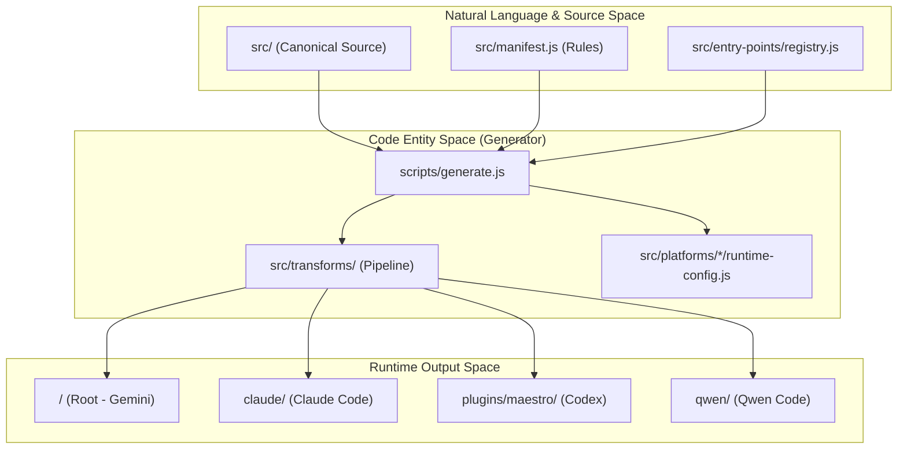
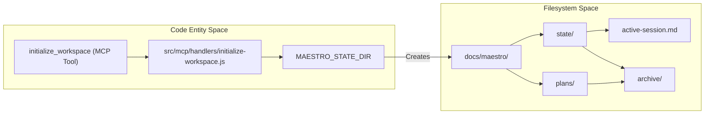

<!-- source: DeepWiki mcp.deepwiki.com · repo josstei/maestro-orchestrate · page 1.1 Getting Started · fetched 2026-10-27 -->

# Getting Started

<details>
<summary>Relevant source files</summary>

The following files were used as context for generating this wiki page:

- [.gitignore](.gitignore)
- [CONTRIBUTING.md](CONTRIBUTING.md)
- [GEMINI.md](GEMINI.md)
- [USAGE.md](USAGE.md)
- [docs/architecture.md](docs/architecture.md)
- [docs/overview.md](docs/overview.md)
- [docs/usage.md](docs/usage.md)
- [package.json](package.json)

</details>


Maestro is a multi-agent development orchestration platform that coordinates 39 specialized AI agents through structured workflows. This page provides the technical requirements and procedures for setting up the development environment, installing the platform, and executing the first run across the four supported runtimes: Gemini CLI, Claude Code, OpenAI Codex, and Qwen Code [docs/overview.md:1-10]().

## Prerequisites

To develop or run Maestro, your environment must meet the following requirements:

*   **Node.js**: Version 20 or higher [package.json:51-51](), [CONTRIBUTING.md:7-7]().
*   **Runtime Host**: At least one of the following must be installed:
    *   [Gemini CLI](https://github.com/google-gemini/gemini-cli)
    *   [Claude Code](https://docs.anthropic.com/en/docs/claude-code)
    *   [Codex](https://github.com/openai/codex)
    *   [Qwen Code](https://github.com/QwenLM/qwen-code) [CONTRIBUTING.md:8-8]().
*   **Command Runner**: [Just](https://github.com/casey/just) is recommended for executing development tasks [CONTRIBUTING.md:9-9]().

## Development Setup

Maestro uses a **src-first, generated-runtime** architecture. All canonical logic resides in `src/`, while the actual runtime files are generated by a build pipeline [docs/architecture.md:3-6]().

### 1. Installation
Clone the repository and install dependencies:
```bash
git clone https://github.com/josstei/maestro-orchestrate.git
cd maestro-orchestrate
npm install
```
[CONTRIBUTING.md:13-17]()

### 2. Git Hooks
Activate the repo-local git hooks to enforce semantic commit messages and branch naming:
```bash
npm run install-hooks
```
*Note: This executes `scripts/install-git-hooks.js` which configures `core.hooksPath` to `.githooks` [package.json:28-28](), [CONTRIBUTING.md:19-25]().*

### 3. Build & Generate
The build process transforms canonical source into runtime-specific adapters:
```bash
npm run build
# OR
node scripts/generate.js
```
[package.json:21-22](), [docs/usage.md:7-12]()

## Key Commands

The project supports both `npm` and `just` commands for common development tasks.

| Task | Command | Description |
| :--- | :--- | :--- |
| **Generate** | `just generate` | Runs `scripts/generate.js` to update all runtimes [CONTRIBUTING.md:35-35](). |
| **Test** | `just test` | Runs unit, transform, and integration suites [docs/usage.md:14-15](). |
| **Verify** | `just check` | Generates files and verifies zero drift using `git diff --exit-code` [docs/usage.md:32-33](). |
| **Clean** | `node scripts/generate.js --clean` | Deletes all generated files before regenerating [docs/usage.md:20-21](). |
| **Coverage** | `npm run test:coverage` | Runs `c8` for code coverage analysis [package.json:24-24](). |

**Sources:** [package.json:20-30](), [docs/usage.md:5-43](), [CONTRIBUTING.md:29-44]()

## System Data Flow: Source to Runtime

The following diagram illustrates how `scripts/generate.js` processes the `src/manifest.js` to produce runtime artifacts.

### Build Pipeline Architecture

**Sources:** [docs/architecture.md:7-26](), [docs/architecture.md:28-37](), [docs/architecture.md:73-84]()

## First-Run Walkthrough by Runtime

Maestro must be initialized in your target workspace before running orchestration.

### Common Startup Logic
Regardless of the runtime, Maestro performs the following startup checks via the MCP server:
1.  **Resolve Settings**: Loads configuration from environment variables, workspace `.env`, or extension `.env` [GEMINI.md:24-26]().
2.  **Initialize Workspace**: Creates the `MAESTRO_STATE_DIR` (default: `docs/maestro`) [GEMINI.md:28-30](), [docs/usage.md:62-62]().

### 1. Gemini CLI
1.  **Enable Agents**: Ensure `experimental.enableAgents` is `true` in `~/.gemini/settings.json` [GEMINI.md:21-23]().
2.  **Run**: Use the slash command:
    ```bash
    /maestro:orchestrate "Implement a new user login flow"
    ```
[docs/usage.md:90-90]()

### 2. Claude Code
1.  **Installation**: Link the `claude/` directory as a plugin.
2.  **Run**: Use the skill command:
    ```bash
    /orchestrate "Implement a new user login flow"
    ```
[docs/usage.md:109-109]()

### 3. Codex
1.  **Installation**: Install the plugin using the provided script:
    ```bash
    npx maestro-install-codex
    ```
    *Note: This runs `./scripts/install-codex-plugin.js` [package.json:17-17]().*
2.  **Run**: Invoke via the maestro namespace:
    ```bash
    $maestro:orchestrate "Implement a new user login flow"
    ```
[docs/usage.md:128-128]()

### 4. Qwen Code
1.  **Installation**: Point Qwen Code to the `qwen/` directory and repo-root `qwen-extension.json` [docs/overview.md:8-8]().
2.  **Run**: Commands are shared with Gemini TOML format [docs/architecture.md:92-93]().

## Workspace State Initialization
The following diagram maps the `initialize_workspace` tool to the physical directory structure created during the first run.

### Workspace Initialization Mapping

**Sources:** [GEMINI.md:28-31](), [docs/usage.md:143-158](), [docs/architecture.md:118-118]()

## Core Configuration
Settings are resolved with the following precedence: **Environment Variable > Workspace `.env` > Extension `.env` > Default** [docs/usage.md:58-58]().

| Setting | Default | Purpose |
| :--- | :--- | :--- |
| `MAESTRO_STATE_DIR` | `docs/maestro` | Root for session and plan persistence [GEMINI.md:57-57](). |
| `MAESTRO_EXECUTION_MODE` | `ask` | Strategy for phase execution (`parallel`, `sequential`, `ask`) [GEMINI.md:59-59](). |
| `MAESTRO_DISABLED_AGENTS` | (none) | Comma-separated list of agents to exclude from planning [GEMINI.md:53-53](). |
| `MAESTRO_MAX_RETRIES` | `2` | Number of times to retry a failed phase [GEMINI.md:54-54](). |

**Sources:** [GEMINI.md:49-61](), [docs/usage.md:56-69]()

---

