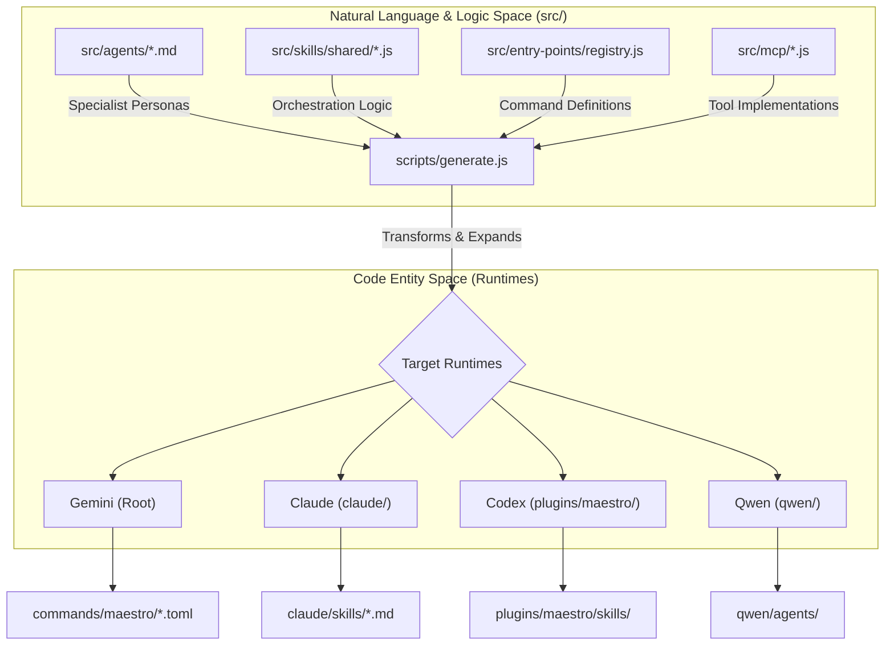
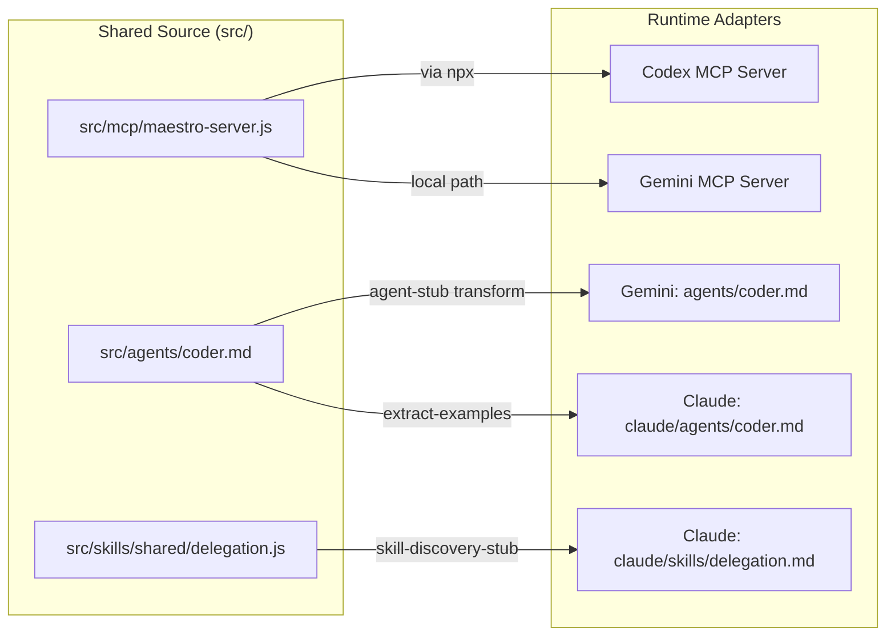

<!-- source: DeepWiki mcp.deepwiki.com · repo josstei/maestro-orchestrate · page 2 Core Architecture · fetched 2026-10-27 -->

# Core Architecture

Relevant source files

The following files were used as context for generating this wiki page:

- [CHANGELOG.md](CHANGELOG.md)
- [README.md](README.md)
- [claude/src/references/architecture.md](claude/src/references/architecture.md)
- [docs/architecture.md](docs/architecture.md)
- [docs/overview.md](docs/overview.md)
- [docs/usage.md](docs/usage.md)
- [plugins/maestro/.mcp.json](plugins/maestro/.mcp.json)
- [plugins/maestro/README.md](plugins/maestro/README.md)
- [plugins/maestro/src/references/architecture.md](plugins/maestro/src/references/architecture.md)
- [src/references/architecture.md](src/references/architecture.md)

Maestro utilizes a **src-first, generated-runtime** architecture [docs/architecture.md:5-6](). All shared methodologies, specialist agent definitions, and orchestration logic are authored exactly once in the `src/` directory, which serves as the project's canonical source of truth [docs/architecture.md:9-12]().

From this source, a manifest-driven generator produces four distinct runtime targets: **Gemini CLI**, **Claude Code**, **Codex**, and **Qwen Code** [README.md:10-19](). This ensures that while each host environment has unique requirements (such as TOML commands for Gemini or Markdown skills for Claude), the underlying orchestration behavior remains identical across all platforms.

### The Canonical Source Pattern

The system is designed to minimize duplication and prevent logic drift. Developers edit files in `src/`, and the generator handles the transformation into the specific formats required by each runtime [docs/usage.md:47-48]().

**System Flow: Source to Runtime**

Sources: [docs/architecture.md:7-26](), [docs/overview.md:40-89](), [src/manifest.js:1-58]()

### Generator Pipeline
The generator (`scripts/generate.js`) acts as the build boundary [docs/architecture.md:30-37](). It processes the `src/manifest.js` file, which maps source files to runtime outputs using a series of functional transforms [docs/architecture.md:40-48](). These transforms handle tasks like stripping examples for specific models, generating MCP delegation stubs, and remapping agent names between `snake_case` (Gemini/Qwen) and `kebab-case` (Claude/Codex) [docs/architecture.md:64-80]().

For a deep dive into the transform logic and the zero-drift enforcement in CI, see **[Generator Pipeline](#2.1)**.

Sources: [docs/architecture.md:28-60](), [src/manifest.js:1-58]()

### Orchestration Workflow
Maestro coordinates 39 specialized agents through two primary workflows [docs/overview.md:3-10]():
*   **Express Workflow**: A single-phase path for simple tasks [docs/overview.md:24-24]().
*   **Standard Workflow**: A rigorous 4-phase process (Design → Plan → Execute → Complete) for medium and complex work [docs/architecture.md:5-10]().

The orchestrator (acting as a TechLead) manages a 41-step sequence that includes HARD-GATEs for user approval and a Design Gate to ensure requirements are solid before implementation begins [CHANGELOG.md:31-32]().

For details on the phase transitions and the 41-step sequence, see **[Orchestration Workflow](#2.2)**.

Sources: [docs/overview.md:12-24](), [src/references/architecture.md:3-12](), [CHANGELOG.md:31-32]()

### Session State Management
Persistence is decoupled from the LLM runtimes. Maestro maintains state in a dedicated directory (defaulting to `docs/maestro/`) using Markdown files with YAML frontmatter [docs/usage.md:143-162](). This allows sessions to be resumed across different runtimes or after a host restart [docs/usage.md:147-152]().

**State Persistence Mapping**

| Entity | Code Implementation | Storage Location |
| :--- | :--- | :--- |
| **Active Session** | `src/mcp/handlers/session-state-core.js` | `docs/maestro/state/active-session.md` |
| **Implementation Plans** | `src/mcp/contracts/plan-schema.js` | `docs/maestro/plans/*.md` |
| **Transaction Logic** | `withSessionState` helper | N/A (Internal logic) |

For details on the state schema and reconciliation logic, see **[Session State Management](#2.3)**.

Sources: [docs/usage.md:143-162](), [docs/architecture.md:128-139](), [src/mcp/handlers/session-state-core.js:56-56]()

### Specialist Agent Roster
Maestro features 39 specialist agents, ranging from `coder` and `architect` to niche experts like `cobol-engineer` and `zos-sysprog` [src/references/architecture.md:16-56](). Each agent has a defined **Capability Tier** (e.g., `read_only`, `read_write`, `full`) that restricts the tools they can access via the MCP server [docs/overview.md:97-102]().

For the full list of agents and their tool access policies, see **[Specialist Agent Roster](#2.4)**.

Sources: [docs/overview.md:93-102](), [src/references/architecture.md:14-58]()

### Runtime Target Relationship
Each of the four targets consumes the shared source differently:

*   **Gemini CLI**: Operates from the repo root using TOML commands and Snake-case agent names [README.md:16-16]().
*   **Claude Code**: Located in `claude/`, uses Kebab-case subagents and Markdown skills [README.md:17-17]().
*   **Codex**: Located in `plugins/maestro/`, uses a detached runtime payload and `spawn_agent` delegation [README.md:18-18]().
*   **Qwen Code**: Located in `qwen/`, reuses Gemini's command surface but implements its own subagent hooks [README.md:19-19]().

**Architecture: Shared Source vs. Runtime Entities**

Sources: [docs/architecture.md:5-26](), [docs/architecture.md:98-100](), [plugins/maestro/README.md:23-30]()

---

