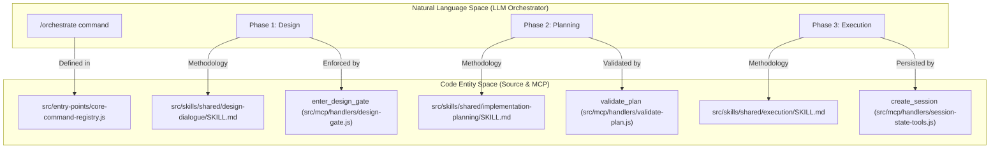
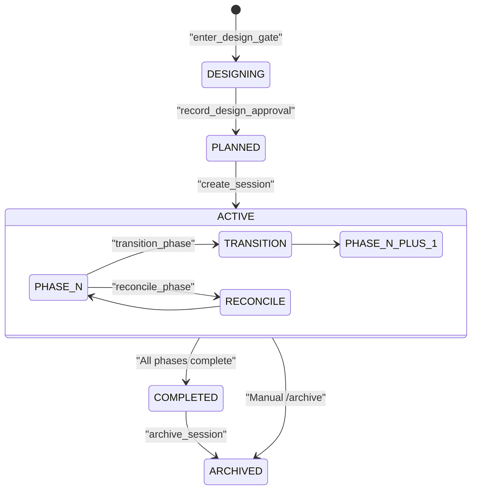

<!-- source: DeepWiki mcp.deepwiki.com · repo josstei/maestro-orchestrate · page 2.2 Orchestration Workflow · fetched 2026-10-27 -->

# Orchestration Workflow

Relevant source files

The following files were used as context for generating this wiki page:

- [.gitignore](.gitignore)
- [CHANGELOG.md](CHANGELOG.md)
- [GEMINI.md](GEMINI.md)
- [USAGE.md](USAGE.md)
- [docs/architecture.md](docs/architecture.md)
- [docs/flow.md](docs/flow.md)
- [docs/overview.md](docs/overview.md)
- [docs/usage.md](docs/usage.md)
- [plugins/maestro/.mcp.json](plugins/maestro/.mcp.json)
- [src/skills/shared/design-dialogue/SKILL.md](src/skills/shared/design-dialogue/SKILL.md)
- [src/skills/shared/execution/SKILL.md](src/skills/shared/execution/SKILL.md)
- [src/skills/shared/implementation-planning/SKILL.md](src/skills/shared/implementation-planning/SKILL.md)
- [src/skills/shared/session-management/SKILL.md](src/skills/shared/session-management/SKILL.md)

The Maestro orchestrator operates as a **TechLead** persona that coordinates 39 specialized agents through structured, multi-phase workflows [GEMINI.md:1-12](). It serves as the primary intelligence layer, responsible for designing solutions, planning implementation phases, delegating tasks, and validating outputs [docs/overview.md:10-12]().

## 1. Workflow Modes

Maestro supports two distinct execution paths based on the complexity of the task, determined during the initial classification step [docs/flow.md:3]().

### 1.1 Standard Workflow
Designed for **medium** and **complex** tasks. It follows a rigorous 4-phase sequence to ensure architectural integrity and phased delivery [docs/flow.md:5-64]().

1.  **Design**: Structured dialogue to gather requirements and define architecture.
2.  **Plan**: Decomposition of the design into a Directed Acyclic Graph (DAG) of implementation phases.
3.  **Execute**: Phased delegation to specialist agents with automated validation.
4.  **Complete**: Final code review and session archival.

### 1.2 Express Workflow
Optimized for **simple** tasks that require only one agent and one phase [docs/overview.md:24](). It bypasses the formal Design and Planning phases, moving directly from a brief clarifying dialogue to execution and review [docs/flow.md:68-93]().

| Feature | Standard Workflow | Express Workflow |
| :--- | :--- | :--- |
| **Complexity** | Medium / Complex | Simple |
| **Phases** | 4 formal phases | 1 execution phase |
| **Skills Used** | `design-dialogue`, `implementation-planning` | Bypassed |
| **Approval** | Multi-gate (Design, Plan, Phase) | Single Brief approval |

**Sources:** [docs/overview.md:23-24](), [docs/flow.md:1-93](), [GEMINI.md:5-10]()

---

## 2. The 41-Step Orchestration Sequence

The orchestrator follows a precise sequence of 41 steps (0–40) to maintain state consistency across agent boundaries [docs/flow.md:3]().

### 2.1 Phase 1: Design
Phase 1 utilizes the `design-dialogue` skill to conduct a requirements-gathering conversation [src/skills/shared/design-dialogue/SKILL.md:6-10]().

*   **Depth Selector**: Users choose between **Quick**, **Standard**, or **Deep** reasoning modes [src/skills/shared/design-dialogue/SKILL.md:14-24]().
*   **Design Gate**: The orchestrator enters a restricted "Plan Mode" (if supported by the runtime) to prevent accidental file modifications during the conversation [src/skills/shared/design-dialogue/SKILL.md:10-12]().
*   **Grounding**: The `codebase_investigator` is used to analyze existing code before proposing architectural changes [src/skills/shared/design-dialogue/SKILL.md:32-49]().

### 2.2 Phase 2: Planning
The `implementation-planning` skill transforms the approved design into a phased implementation plan [src/skills/shared/implementation-planning/SKILL.md:6-10]().

*   **DAG Construction**: Phases are ordered such that "Foundation" (types/interfaces) precedes "Core Domain" and "Infrastructure" [src/skills/shared/implementation-planning/SKILL.md:58-72]().
*   **Validation Gate**: The `validate_plan` MCP tool is called to check for circular dependencies, agent capability mismatches, and file ownership overlaps [src/mcp/handlers/validate-plan.js:1-10](), [CHANGELOG.md:44]().

### 2.3 Phase 3: Execution
Execution involves delegating specific phases to the 39 specialist agents [docs/flow.md:43-54]().

*   **Execution Mode Gate**: The orchestrator determines if phases should run `parallel` or `sequential` based on `MAESTRO_EXECUTION_MODE` and the plan's dependency structure [src/skills/shared/execution/SKILL.md:10-47]().
*   **Delegation Protocol**: Every agent dispatch includes a required `Agent:` header, the `agent-base-protocol`, and a `Downstream Context` from previous phases [docs/flow.md:131-164]().

**Sources:** [docs/flow.md:5-64](), [src/skills/shared/design-dialogue/SKILL.md:1-108](), [src/skills/shared/implementation-planning/SKILL.md:1-108](), [src/skills/shared/execution/SKILL.md:1-108]()

---

## 3. Implementation and Data Flow

The orchestration logic is bridged between the LLM's reasoning and the local environment via the **MCP Server** and **Runtime Adapters**.

### 3.1 Code Entity Mapping: Orchestration Logic
The following diagram maps the logical orchestration steps to the specific code entities that implement them.

**Sources:** [docs/architecture.md:85-132](), [src/mcp/tool-packs/index.js:1-20](), [CHANGELOG.md:30-32]()

### 3.2 HARD-GATE Enforcement
Maestro uses "HARD-GATEs" to ensure the user remains in control and the state is valid before proceeding [src/skills/shared/execution/SKILL.md:19-21]().

1.  **Design Approval**: Requires `record_design_approval` via MCP before a session can be created [CHANGELOG.md:31]().
2.  **Plan Validation**: The `validate_plan` tool must return a success status before the plan is presented to the user [src/skills/shared/execution/SKILL.md:41]().
3.  **Execution Mode**: The `execution_mode` (parallel/sequential) must be recorded in session state before any delegation starts [src/skills/shared/execution/SKILL.md:19-21]().
4.  **Phase Transition**: Every phase must call `transition_phase` to update the canonical `active-session.md` [docs/flow.md:162]().

**Sources:** [src/skills/shared/execution/SKILL.md:19-21](), [CHANGELOG.md:31-32](), [docs/flow.md:156-163]()

---

## 4. Session Lifecycle

Sessions are persisted as Markdown files with YAML frontmatter in the `MAESTRO_STATE_DIR` [docs/usage.md:160-162]().

### 4.1 Lifecycle Diagram
This diagram illustrates the transition of a session from creation to archival, controlled by MCP tools.

### 4.2 Key Lifecycle Tools
*   `create_session`: Initializes the `active-session.md` file with the implementation plan and metadata [src/mcp/handlers/session-state-tools.js:1-5]().
*   `transition_phase`: Atomically moves the session from one phase to the next, updating the `current_phase` and status [docs/flow.md:162]().
*   `reconcile_phase`: Used when an agent's actual file changes diverge from the plan [CHANGELOG.md:32]().
*   `archive_session`: Moves the active session to the `archive/` directory [docs/usage.md:151-152]().

**Sources:** [docs/usage.md:143-179](), [docs/flow.md:190-205](), [CHANGELOG.md:30-32]()

---

