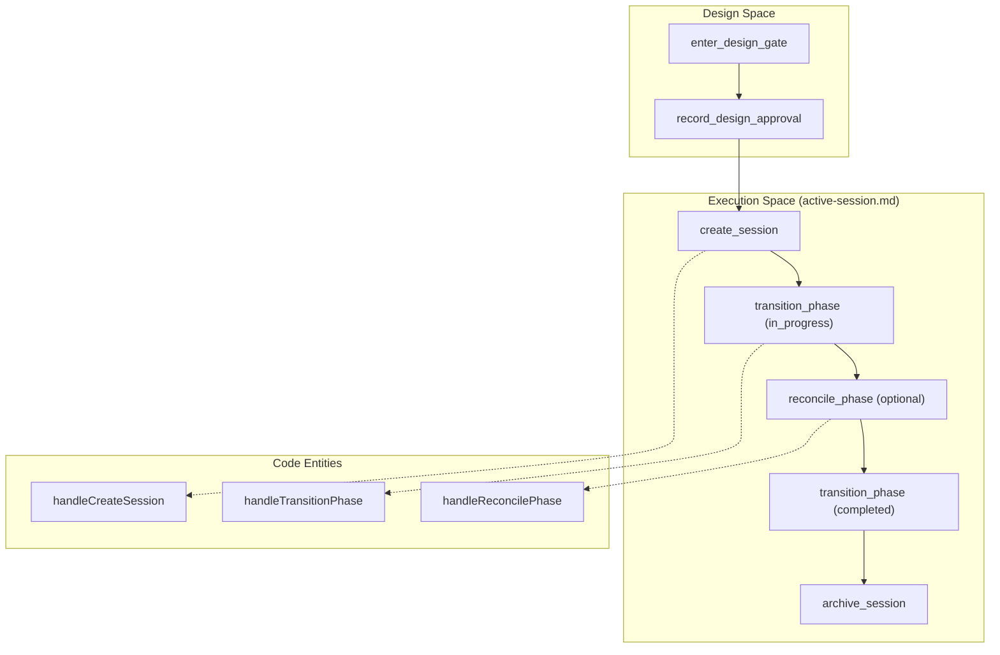
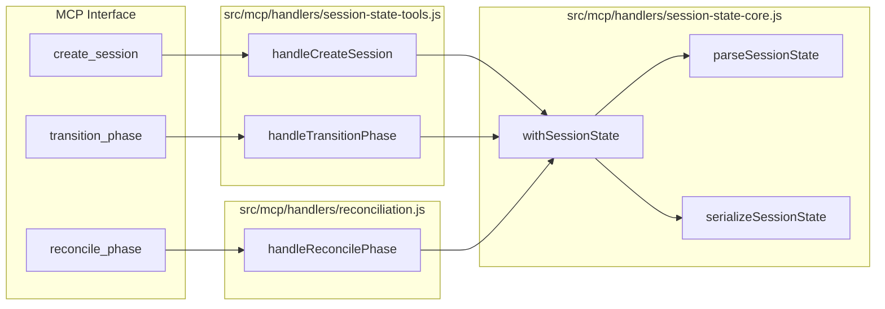

<!-- source: DeepWiki mcp.deepwiki.com · repo josstei/maestro-orchestrate · page 2.3 Session State Management · fetched 2026-10-27 -->

# Session State Management

Relevant source files

The following files were used as context for generating this wiki page:

- [CHANGELOG.md](CHANGELOG.md)
- [claude/src/mcp/handlers/session-state-tools.js](claude/src/mcp/handlers/session-state-tools.js)
- [docs/architecture.md](docs/architecture.md)
- [docs/overview.md](docs/overview.md)
- [docs/usage.md](docs/usage.md)
- [plugins/maestro/.mcp.json](plugins/maestro/.mcp.json)
- [plugins/maestro/src/mcp/handlers/session-state-tools.js](plugins/maestro/src/mcp/handlers/session-state-tools.js)
- [src/mcp/handlers/session-state-tools.js](src/mcp/handlers/session-state-tools.js)
- [src/skills/shared/session-management/SKILL.md](src/skills/shared/session-management/SKILL.md)
- [tests/unit/session-state-tools.test.js](tests/unit/session-state-tools.test.js)

Session state in Maestro is the source of truth for the orchestrator's progress through the multi-phase Standard and Express workflows. It is persisted as a Markdown file with YAML frontmatter, allowing both machine-readability for the MCP server and human-readability for developers.

## State Persistence Model

Maestro stores session data within a configurable directory, defaulting to `docs/maestro/` [docs/usage.md:62-62](). This directory is structured to separate active state from archived history and design artifacts [docs/usage.md:145-158]().

### Directory Structure
| Path | Description |
| :--- | :--- |
| `MAESTRO_STATE_DIR/state/active-session.md` | The current, locked session state [src/skills/shared/session-management/SKILL.md:48-48](). |
| `MAESTRO_STATE_DIR/state/archive/` | Historical session files moved after completion [docs/usage.md:151-152](). |
| `MAESTRO_STATE_DIR/plans/` | Materialized design documents and implementation plans [claude/src/mcp/handlers/session-state-tools.js:37-39](). |

### The `active-session.md` Format
The state file uses a hybrid format:
1.  **YAML Frontmatter**: Contains structured metadata including `session_id`, `current_phase`, `token_usage`, and a detailed `phases` array [docs/usage.md:164-212]().
2.  **Markdown Body**: Serves as the "Orchestration Log," where high-level narrative events are appended [src/skills/shared/session-management/SKILL.md:129-130]().

**Sources:** [docs/usage.md:145-212](), [src/skills/shared/session-management/SKILL.md:48-50](), [claude/src/mcp/handlers/session-state-tools.js:37-39]()

---

## Session Lifecycle & Transitions

The session lifecycle is managed through a series of discrete phases and "gates" that ensure the orchestrator does not proceed without valid configuration or approval.

### 1. Initialization (The Design Gate)
Before a session is created, the system often enters a **Design Gate**. This is a safety mechanism that enforces that a design document is approved by the user before execution begins [CHANGELOG.md:31-31]().
*   `enter_design_gate`: Initializes a temporary gate state.
*   `record_design_approval`: Marks the gate as approved and materializes the design document into the `plans/` directory [claude/src/mcp/handlers/session-state-tools.js:41-43]().
*   `create_session`: Consumes the approved gate to generate the `active-session.md` [claude/src/mcp/handlers/session-state-tools.js:171-174]().

### 2. Phase Execution & Reconciliation
As the orchestrator moves through the implementation plan, it transitions phase statuses: `pending` → `in_progress` → `completed` [src/skills/shared/session-management/SKILL.md:148-152]().
If an agent's actual file modifications diverge from the original plan, the `reconcile_phase` tool is used to update the session state to reflect the reality of the workspace [CHANGELOG.md:32-32]().

### 3. Archival
Upon completion (or manual termination), the `archive_session` tool moves the `active-session.md` to the `archive/` folder, renaming it to `<session_id>.md` [docs/usage.md:151-152]().

### Data Flow: State Transitions
Title: Session State Transition Logic

**Sources:** [CHANGELOG.md:31-32](), [claude/src/mcp/handlers/session-state-tools.js:166-174](), [src/skills/shared/session-management/SKILL.md:148-152]()

---

## Technical Implementation

### Transactional Safety: `withSessionState`
To prevent state corruption during concurrent operations (common in Gemini's parallel dispatch), all mutations are wrapped in the `withSessionState` helper [CHANGELOG.md:56-56](). This helper ensures a read-modify-write cycle is handled atomically.

Key internal functions in `src/mcp/handlers/session-state-core.js`:
*   `readActiveSession()`: Reads and parses the YAML/Markdown hybrid [claude/src/mcp/handlers/session-state-core.js:30-30]().
*   `writeActiveSession()`: Serializes and persists changes [claude/src/mcp/handlers/session-state-core.js:32-32]().
*   `withSessionState(projectRoot, callback)`: The primary transaction wrapper [claude/src/mcp/handlers/session-state-core.js:33-33]().

### The MCP Tool Pack (Session)
The Session Pack provides the external interface for LLMs to interact with the state [CHANGELOG.md:30-32]().

| Tool | Code Handler | Purpose |
| :--- | :--- | :--- |
| `create_session` | `handleCreateSession` | Initializes `active-session.md` from plans [claude/src/mcp/handlers/session-state-tools.js:166-166](). |
| `transition_phase` | `handleTransitionPhase` | Moves `current_phase` and updates status [src/skills/shared/session-management/SKILL.md:148-154](). |
| `update_session` | `handleUpdateSession` | General purpose metadata/token usage updates [src/skills/shared/session-management/SKILL.md:136-143](). |
| `reconcile_phase` | `handleReconcilePhase` | Aligns file manifests after agent execution [CHANGELOG.md:32-32](). |

### Entity Mapping: MCP to Implementation
Title: MCP Tool to Code Handler Mapping

**Sources:** [CHANGELOG.md:56-56](), [claude/src/mcp/handlers/session-state-tools.js:1-34](), [src/mcp/handlers/session-state-tools.js:1-34](), [src/skills/shared/session-management/SKILL.md:12-15]()

---

## Hook-Level vs. Orchestration State

Maestro maintains a strict separation between **Orchestration State** (long-lived, project-visible) and **Hook State** (ephemeral, runtime-internal) [src/skills/shared/session-management/SKILL.md:19-33]().

| Feature | Orchestration State | Hook State |
| :--- | :--- | :--- |
| **Location** | `MAESTRO_STATE_DIR/state/` | `os.tmpdir()/maestro-hooks-<uid>/` |
| **Persistence** | Survives restarts; supports `/resume` | Ephemeral; lost on session end |
| **Primary Data** | Phase tracking, token usage, manifests | Active agent tracking (`active-agent` file) |
| **Management** | `session-management` skill via MCP | Hook runner (pre/post-delegation) |

**Sources:** [src/skills/shared/session-management/SKILL.md:19-33]()

---

