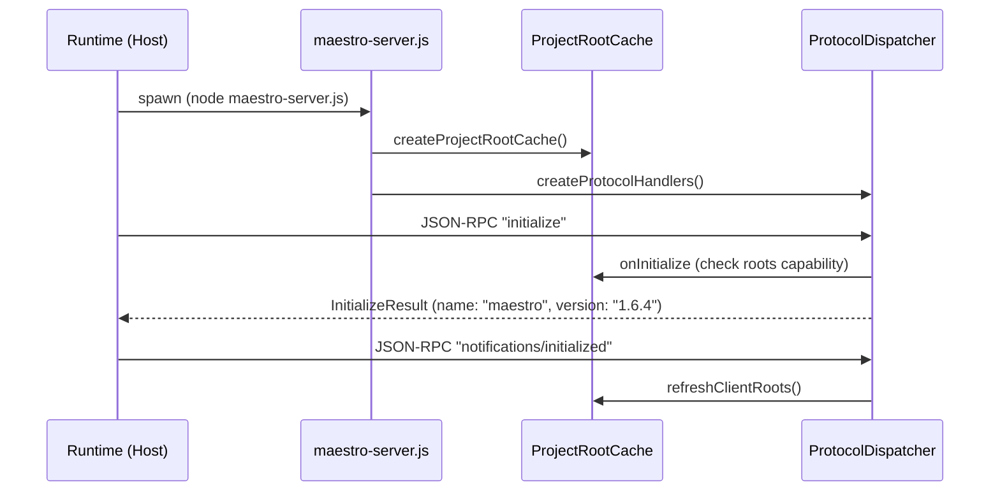
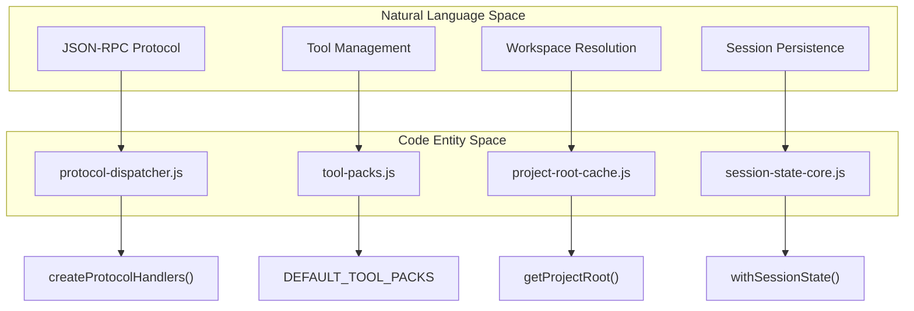

<!-- source: DeepWiki mcp.deepwiki.com · repo josstei/maestro-orchestrate · page 3 MCP Server · fetched 2026-10-27 -->

# MCP Server

Relevant source files

The following files were used as context for generating this wiki page:

- [CHANGELOG.md](CHANGELOG.md)
- [claude/src/mcp/maestro-server.js](claude/src/mcp/maestro-server.js)
- [claude/src/version.json](claude/src/version.json)
- [gemini-extension.json](gemini-extension.json)
- [package-lock.json](package-lock.json)
- [plugins/maestro/.codex-plugin/plugin.json](plugins/maestro/.codex-plugin/plugin.json)
- [plugins/maestro/.mcp.json](plugins/maestro/.mcp.json)
- [plugins/maestro/src/mcp/maestro-server.js](plugins/maestro/src/mcp/maestro-server.js)
- [plugins/maestro/src/version.json](plugins/maestro/src/version.json)
- [src/mcp/maestro-server.js](src/mcp/maestro-server.js)

The `maestro-mcp-server` is the central coordination engine for the Maestro platform. It implements the Model Context Protocol (MCP) using a JSON-RPC 2.0 interface to provide LLM runtimes with structured access to workspace management, session orchestration, and specialist agent content.

### Purpose and Scope
The server acts as a bridge between the high-level natural language instructions of the user and the low-level file operations and state transitions required for multi-agent orchestration. It abstracts away the differences between runtimes (Gemini, Claude, Codex, Qwen) while enforcing a strict 4-phase orchestration methodology.

## Architecture & Lifecycle

The server is implemented in Node.js and uses a line-based JSON-RPC dispatcher. It maintains a `ProjectRootCache` to resolve workspace paths across different runtime environments and uses a `ToolRegistry` to manage the 17 core orchestration tools.

### Server Startup Flow
The entry point is `src/mcp/maestro-server.js`. When the server starts, it initializes the protocol handlers and sets up the communication channel (standard I/O).

Maestro Server Initialization Sequence:

Sources: [src/mcp/maestro-server.js:22-71](), [src/mcp/maestro-server.js:81-88]()

### Connection Strategy by Runtime
Each runtime connects to the MCP server using specific configuration manifests:

| Runtime | Connection Method | Config File |
| :--- | :--- | :--- |
| **Gemini** | Direct `node` spawn of `mcp/maestro-server.js` | `gemini-extension.json` |
| **Claude** | Detached or repo-relative MCP server | `claude/src/mcp/maestro-server.js` |
| **Codex** | `npx -y @josstei/maestro maestro-mcp-server` | `plugins/maestro/.mcp.json` |
| **Qwen** | Shared config with Gemini | `qwen-extension.json` |

Sources: [gemini-extension.json:43-55](), [plugins/maestro/.mcp.json:1-16](), [CHANGELOG.md:39-40]()

## Tool Pack Overview

The server organizes its 17 tools into three functional "Packs". These tools are the primary interface through which an LLM interacts with the Maestro system.

### 1. Workspace Pack
Focuses on environment setup and pre-flight checks. It includes `initialize_workspace` for setting the canonical root and `assess_task_complexity` for initial project analysis.
*   **Key Logic**: Enforces the `requiresWorkspace` contract before any destructive or stateful tools are called [CHANGELOG.md:41-42]().
*   **For details, see [MCP Tool Packs](#3.1)**.

### 2. Session Pack
Manages the state machine of a Maestro session. It handles the transition between Design, Plan, Execute, and Complete phases.
*   **Key Logic**: Implements the Design Gate lifecycle (`enter_design_gate`, `record_design_approval`) and phase reconciliation [CHANGELOG.md:30-32]().
*   **For details, see [MCP Tool Packs](#3.1)**.

### 3. Content Pack
Provides the LLM with the raw materials needed for execution, such as agent personas and skill definitions.
*   **Key Logic**: Uses `get_agent` to load specialist frontmatter and `get_runtime_context` to expose machine-readable constraints (e.g., parallelization limits) [CHANGELOG.md:46-48]().
*   **For details, see [MCP Tool Packs](#3.1)**.

## Plan Validation & Safety

The MCP server is responsible for ensuring that implementation plans generated by the LLM are safe, logical, and executable. This is primarily handled by the `validate_plan` tool.

### Validation Pipeline
When an LLM submits a plan, the server runs a series of checks:
1.  **Schema Check**: Ensures the JSON structure matches the `plan-schema.js` contract [CHANGELOG.md:44-44]().
2.  **Capability Check**: Verifies that assigned agents have the necessary permissions (e.g., `read_write`) for their assigned files.
3.  **DAG Analysis**: Detects circular dependencies and calculates the optimal parallelization profile.
4.  **Overlap Detection**: Blocks multiple agents from writing to the same file in the same parallel phase.

**For details, see [Plan Validation & DAG Checker](#3.2)**.

## Code Entity Mapping

The following diagram maps natural language concepts to the specific code entities within the `maestro-mcp-server` architecture.

Mapping Logic to Code Entities:

Sources: [src/mcp/maestro-server.js:5-20](), [src/mcp/maestro-server.js:42-56](), [CHANGELOG.md:56-56]()

## Configuration & Environment

The server's behavior is influenced by environment variables defined in the runtime manifests.

| Variable | Description | Default |
| :--- | :--- | :--- |
| `MAESTRO_RUNTIME` | Identifies the host runtime (e.g., `gemini`, `codex`) | (Detected) |
| `MAESTRO_STATE_DIR` | Directory where session `.md` files are stored | `docs/maestro` |
| `MAESTRO_MAX_CONCURRENT` | Limit for parallel subagent dispatch | `0` (unlimited) |
| `MAESTRO_EXECUTION_MODE` | Controls phase 3 flow (`parallel`, `sequential`, `ask`) | `ask` |

Sources: [gemini-extension.json:6-41](), [src/mcp/maestro-server.js:99-103]()

---

