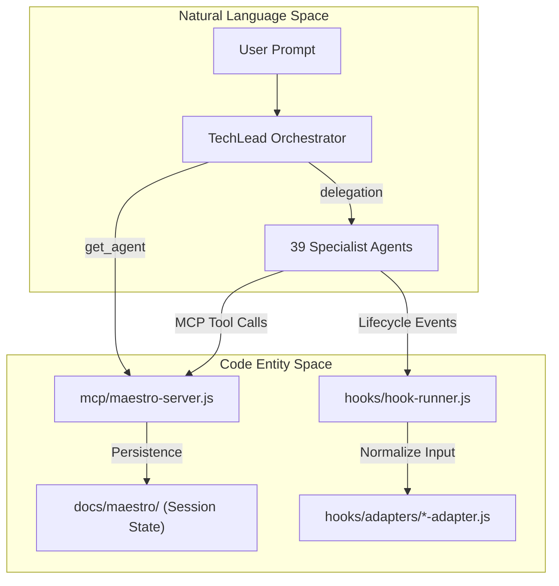

<!-- source: DeepWiki mcp.deepwiki.com · repo josstei/maestro-orchestrate · page 4 Runtime Targets · fetched 2026-10-27 -->

# Runtime Targets

Relevant source files

The following files were used as context for generating this wiki page:

- [QWEN.md](QWEN.md)
- [README.md](README.md)
- [docs/runtime-claude.md](docs/runtime-claude.md)
- [docs/runtime-codex.md](docs/runtime-codex.md)
- [docs/runtime-gemini.md](docs/runtime-gemini.md)
- [docs/runtime-qwen.md](docs/runtime-qwen.md)
- [gemini-extension.json](gemini-extension.json)
- [plugins/maestro/README.md](plugins/maestro/README.md)
- [qwen-extension.json](qwen-extension.json)
- [scripts/generate.js](scripts/generate.js)

Maestro is a multi-agent development orchestration platform designed to run across four distinct LLM runtimes from a single canonical source tree [README.md:10-10](). While the core logic, agent methodologies, and orchestration workflows are shared, each runtime requires specific manifests, naming conventions, and integration patterns to function natively within its host environment.

### Supported Runtimes Overview

Maestro generates and maintains four target outputs via the `scripts/generate.js` pipeline [scripts/generate.js:82-132]().

| Runtime | Location | Public Surface | Agent Naming |
|---------|----------|----------------|--------------|
| **Gemini CLI** | Repo Root | `/maestro:*` | `snake_case` |
| **Claude Code** | `claude/` | `/orchestrate`, `/review-code` | `kebab-case` |
| **Codex** | `plugins/maestro/` | `$maestro:*` | `kebab-case` |
| **Qwen Code** | `qwen/` | `/maestro:*` | `snake_case` |

Sources: [README.md:14-19](), [docs/runtime-gemini.md:29-29](), [docs/runtime-claude.md:30-30](), [docs/runtime-codex.md:61-63](), [docs/runtime-qwen.md:27-29]()

---

### Shared Runtime Architecture

All runtimes bridge the "Natural Language Space" (Agent instructions and user prompts) to the "Code Entity Space" (MCP tools and local scripts) using a unified server and hook system.

**Runtime-to-Code Mapping**

Sources: [gemini-extension.json:43-55](), [docs/runtime-qwen.md:11-25](), [docs/runtime-claude.md:64-73](), [plugins/maestro/README.md:23-30]()

---

### Gemini CLI Runtime
The Gemini CLI extension lives at the repository root and is the primary development target [docs/runtime-gemini.md:1-3](). It uses a `gemini-extension.json` manifest and a `GEMINI.md` context file to define the orchestrator's behavior [gemini-extension.json:1-5]().

*   **Commands:** 12 TOML-based commands in `commands/maestro/` [docs/runtime-gemini.md:42-44]().
*   **Hooks:** Uses `BeforeAgent` and `AfterAgent` events for session context injection and task report validation [docs/runtime-gemini.md:61-70]().
*   **Policy:** Enforces shell safety via `policies/maestro.toml` [docs/runtime-gemini.md:96-98]().

For details, see [Gemini CLI Runtime](#4.1).

Sources: [gemini-extension.json:1-56](), [docs/runtime-gemini.md:1-174]()

---

### Claude Code Runtime
The Claude Code runtime is located in the `claude/` subdirectory [docs/runtime-claude.md:1-3](). It uses a `plugin.json` manifest and supports kebab-case agent naming (e.g., `code-reviewer`) [docs/runtime-claude.md:28-32]().

*   **Dual-Resolution MCP:** The server prefers the canonical repo `src/` but can fall back to a bundled `claude/src/` for detached installs [docs/runtime-claude.md:26-26]().
*   **Hooks:** Uses `PreToolUse` matchers for `Agent` (context) and `Bash` (policy) [docs/runtime-claude.md:64-73]().
*   **Skills:** 19 Markdown skills provide public entry points and discovery stubs [docs/runtime-claude.md:43-62]().

For details, see [Claude Code Runtime](#4.2).

Sources: [docs/runtime-claude.md:1-191](), [README.md:57-73]()

---

### Codex Runtime
The Codex runtime lives in `plugins/maestro/` and functions as a standalone plugin [plugins/maestro/README.md:1-3]().

*   **No Hooks:** Codex lacks a native hook system; it relies on inline methodology constraints [docs/runtime-codex.md:100-103]().
*   **NPX Invocation:** The MCP server is invoked via `npx` to ensure version alignment without relative path resolution issues [docs/runtime-codex.md:13-23]().
*   **Workspace Resolution:** Uses `MAESTRO_WORKSPACE_PATH` or the MCP `roots/list` protocol to locate `docs/maestro` [docs/runtime-codex.md:25-30]().

For details, see [Codex Runtime](#4.3).

Sources: [plugins/maestro/README.md:1-58](), [docs/runtime-codex.md:1-164]()

---

### Qwen Code Runtime
The Qwen Code extension lives in the `qwen/` output directory but remains Gemini-CLI-compatible [docs/runtime-qwen.md:1-3]().

*   **Shared Surface:** Reuses the `/maestro:*` command surface and TOML files from the Gemini runtime [docs/runtime-qwen.md:42-44]().
*   **Tool Mapping:** Remaps canonical tool names to Qwen-specific equivalents (e.g., `google_web_search` → `web_search`) [docs/runtime-qwen.md:83-105]().
*   **Context:** Uses `QWEN.md` as the primary context file for the orchestrator [QWEN.md:1-5]().

For details, see [Qwen Code Runtime](#4.4).

Sources: [docs/runtime-qwen.md:1-151](), [QWEN.md:1-109]()

---

### Tool Mapping Comparison

Each runtime maps Maestro's canonical toolset to its native capabilities.

| Canonical Tool | Gemini CLI | Claude Code | Codex | Qwen Code |
|----------------|------------|-------------|-------|-----------|
| `read_file` | `read_file` | `Read` | direct read | `read_file` |
| `replace` | `replace` | `Edit` | `apply_patch` | `edit` |
| `run_shell_command` | `run_shell_command` | `Bash` | `exec_command` | `run_shell_command` |
| `ask_user` | `ask_user` | `AskUserQuestion` | `request_user_input` | `ask_user_question` |

Sources: [docs/runtime-gemini.md:110-131](), [docs/runtime-claude.md:114-131](), [docs/runtime-codex.md:116-135](), [docs/runtime-qwen.md:83-105]()

---

