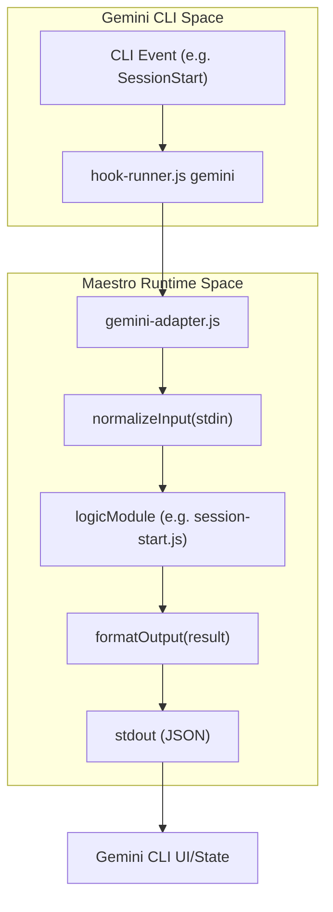
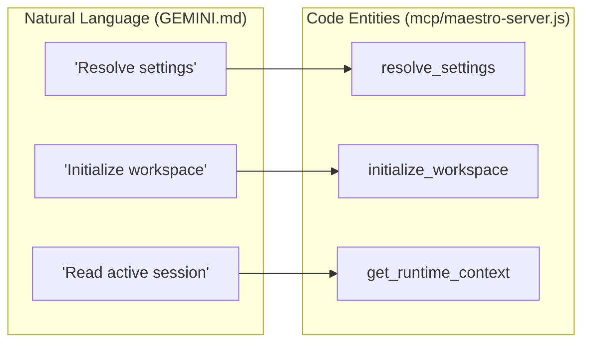

<!-- source: DeepWiki mcp.deepwiki.com · repo josstei/maestro-orchestrate · page 4.1 Gemini CLI Runtime · fetched 2026-10-27 -->

# Gemini CLI Runtime

Relevant source files

The following files were used as context for generating this wiki page:

- [.gitignore](.gitignore)
- [GEMINI.md](GEMINI.md)
- [USAGE.md](USAGE.md)
- [claude/src/platforms/shared/hook-runner.js](claude/src/platforms/shared/hook-runner.js)
- [commands/maestro/execute.toml](commands/maestro/execute.toml)
- [commands/maestro/orchestrate.toml](commands/maestro/orchestrate.toml)
- [commands/maestro/resume.toml](commands/maestro/resume.toml)
- [gemini-extension.json](gemini-extension.json)
- [plugins/maestro/src/platforms/shared/hook-runner.js](plugins/maestro/src/platforms/shared/hook-runner.js)
- [src/platforms/shared/hook-runner.js](src/platforms/shared/hook-runner.js)

The Gemini CLI Runtime provides the integration layer between the Maestro orchestration platform and the Gemini CLI environment. It utilizes a manifest-driven configuration, specific context files, and TOML-based slash commands to enable the 4-phase orchestration workflow within the Gemini ecosystem.

## Extension Configuration

The Gemini runtime is governed by the `gemini-extension.json` manifest, which defines the extension's metadata, configurable settings, and the connection to the Maestro MCP server [gemini-extension.json:1-56]().

### Manifest Structure
The manifest defines several key components:
*   **Metadata**: Name, version, and description [gemini-extension.json:2-4]().
*   **Context File**: Points to `GEMINI.md` as the primary instruction set for the orchestrator [gemini-extension.json:5]().
*   **Settings**: Maps environment variables to user-configurable settings within the Gemini CLI [gemini-extension.json:6-42]().
*   **MCP Server**: Configures the `maestro` MCP server, specifying the entry point (`mcp/maestro-server.js`) and required environment variables like `MAESTRO_RUNTIME=gemini` [gemini-extension.json:43-55]().

### Environment Variables
The following environment variables are exposed through the Gemini CLI extension settings [gemini-extension.json:6-42]():

| Setting | Environment Variable | Description |
| :--- | :--- | :--- |
| Disabled Agents | `MAESTRO_DISABLED_AGENTS` | Comma-separated list of agents to exclude [gemini-extension.json:8-10](). |
| Max Retries | `MAESTRO_MAX_RETRIES` | Retry limit per phase [gemini-extension.json:13-15](). |
| Auto Archive | `MAESTRO_AUTO_ARCHIVE` | Archive state on success [gemini-extension.json:18-20](). |
| Validation | `MAESTRO_VALIDATION_STRICTNESS` | Strictness level (strict/normal/lenient) [gemini-extension.json:23-25](). |
| State Directory | `MAESTRO_STATE_DIR` | Base directory for session state [gemini-extension.json:28-30](). |
| Max Concurrent | `MAESTRO_MAX_CONCURRENT` | Batch size for parallel subagents [gemini-extension.json:33-35](). |
| Execution Mode | `MAESTRO_EXECUTION_MODE` | Mode for Phase 3 (parallel/sequential/ask) [gemini-extension.json:38-40](). |

**Sources:** [gemini-extension.json:1-56](), [GEMINI.md:51-59]()

## Context and Instructions (`GEMINI.md`)

`GEMINI.md` serves as the system prompt for the TechLead orchestrator. It defines the constraints, startup checks, and tool mapping specific to the Gemini CLI [GEMINI.md:1-12]().

### Startup Protocol
The orchestrator performs the following checks before starting:
1.  **Subagent Prerequisite**: Verifies `experimental.enableAgents` is `true` in `~/.gemini/settings.json` [GEMINI.md:21-23]().
2.  **Settings Resolution**: Calls `resolve_settings` (MCP) or falls back to manual resolution (Env > Workspace `.env` > Extension `.env`) [GEMINI.md:24-26]().
3.  **Workspace Prep**: Calls `initialize_workspace` (MCP) or `ensure-workspace.js` to prepare the `MAESTRO_STATE_DIR` [GEMINI.md:28-30]().

### Tool Mapping
Generic orchestration actions are mapped to Gemini-specific tool calls:
*   **Delegation**: Specialist agents are called using `snake_case` tool names (e.g., `code_reviewer(query: "...")`) [commands/maestro/orchestrate.toml:19]().
*   **Skill Loading**: Uses `activate_skill(name: "...")` to expand workspace access [commands/maestro/orchestrate.toml:17]().
*   **MCP Access**: Tools are prefixed with `mcp_maestro_` (e.g., `mcp_maestro_create_session`) [commands/maestro/orchestrate.toml:20]().

**Sources:** [GEMINI.md:1-32](), [commands/maestro/orchestrate.toml:13-25]()

## Command Definitions

Maestro commands for the Gemini runtime are defined in `commands/maestro/*.toml`. These files contain the prompt templates and tool preambles used to initialize specific workflows [GEMINI.md:36]().

| Command | File | Purpose |
| :--- | :--- | :--- |
| `/maestro:orchestrate` | `orchestrate.toml` | Full 4-phase workflow for complex tasks [commands/maestro/orchestrate.toml:1-30](). |
| `/maestro:resume` | `resume.toml` | Resumes an interrupted session using `read-active-session.js` [commands/maestro/resume.toml:1-38](). |
| `/maestro:execute` | `execute.toml` | Directly executes an approved plan, skipping Design/Plan phases [commands/maestro/execute.toml:1-30](). |

**Sources:** [commands/maestro/orchestrate.toml:1-30](), [commands/maestro/resume.toml:1-38](), [commands/maestro/execute.toml:1-30]()

## Hook System and Lifecycle

The Gemini runtime utilizes a hook-based architecture to maintain session context and enforce policies during agent transitions. Hooks are dispatched via `hook-runner.js` using the `gemini-adapter.js` [src/platforms/shared/hook-runner.js:15-36]().

### Hook Data Flow
The `hook-runner.js` acts as a dispatcher between the Gemini CLI events and the Maestro logic modules.

**Gemini Hook Execution Flow**

**Sources:** [src/platforms/shared/hook-runner.js:15-52]()

### Hook Events
*   **SessionStart**: Initializes the `active-session.md` and sets up the environment.
*   **BeforeAgent**: Prepares the context for a subagent delegation, ensuring the `Agent:` header is present [GEMINI.md:66]().
*   **AfterAgent**: Captures subagent output and updates the session state.
*   **SessionEnd**: Finalizes the session and handles `MAESTRO_AUTO_ARCHIVE` logic [gemini-extension.json:18-20]().

## MCP Server Wiring

The Gemini runtime connects to the `maestro` MCP server to perform stateful operations that exceed the capabilities of static prompts.

**Tool Entity Mapping**

**Sources:** [GEMINI.md:24-31](), [gemini-extension.json:43-55](), [commands/maestro/orchestrate.toml:20]()

### Connection Details
The MCP server is invoked as a child process:
*   **Command**: `node ${extensionPath}/mcp/maestro-server.js` [gemini-extension.json:45-47]().
*   **Environment**: Sets `MAESTRO_RUNTIME=gemini` and `MAESTRO_WORKSPACE_PATH` to ensure the server operates in the correct context [gemini-extension.json:50-53]().

**Sources:** [gemini-extension.json:43-55]()

---

