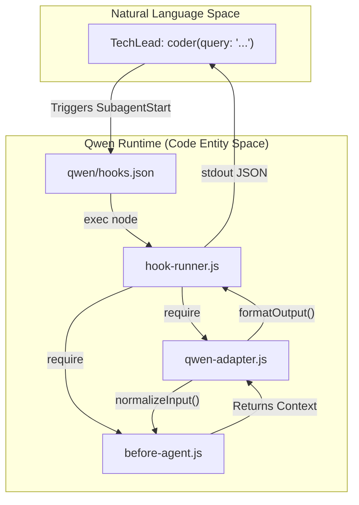
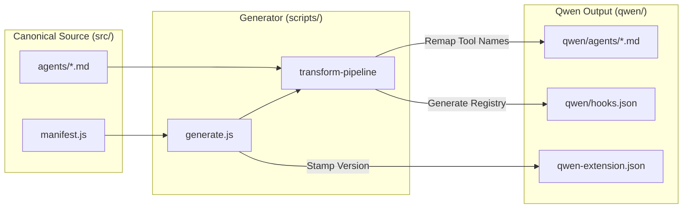

<!-- source: DeepWiki mcp.deepwiki.com · repo josstei/maestro-orchestrate · page 4.4 Qwen Code Runtime · fetched 2026-10-27 -->

# Qwen Code Runtime

Relevant source files

The following files were used as context for generating this wiki page:

- [QWEN.md](QWEN.md)
- [claude/src/platforms/shared/hook-runner.js](claude/src/platforms/shared/hook-runner.js)
- [docs/runtime-codex.md](docs/runtime-codex.md)
- [docs/runtime-gemini.md](docs/runtime-gemini.md)
- [docs/runtime-qwen.md](docs/runtime-qwen.md)
- [plugins/maestro/src/platforms/shared/hook-runner.js](plugins/maestro/src/platforms/shared/hook-runner.js)
- [qwen-extension.json](qwen-extension.json)
- [scripts/generate.js](scripts/generate.js)
- [src/platforms/shared/hook-runner.js](src/platforms/shared/hook-runner.js)

The Qwen Code runtime is a generated extension target that enables the Maestro multi-agent orchestration platform to run within the Qwen Code environment. It mirrors the Gemini CLI extension structure but is optimized for Qwen's native subagent support and specific tool naming conventions.

## Configuration and Manifests

The Qwen runtime is defined by a set of configuration files that allow Qwen Code to discover and execute Maestro's multi-agent workflows. Unlike the Claude or Codex runtimes which use detached source payloads, Qwen operates against the repository root using generated stubs and manifests.

### Manifest: `qwen-extension.json`
The extension manifest defines the metadata, settings, and MCP server configuration. It exposes seven configurable settings as environment variables (e.g., `MAESTRO_STATE_DIR`, `MAESTRO_EXECUTION_MODE`) that the orchestrator consumes to modify its behavior [qwen-extension.json:1-41]().

### Context File: `QWEN.md`
This file serves as the primary system prompt and grounding context for the Qwen TechLead orchestrator. It defines the startup checks, tool mapping overrides, and the standard 4-phase workflow (Design, Plan, Execute, Complete) [QWEN.md:1-12]().

### MCP Server Wiring
Qwen reuses the shared MCP server located at `mcp/maestro-server.js`. The manifest launches this server with the `MAESTRO_RUNTIME=qwen` environment variable to ensure the server applies Qwen-specific logic [qwen-extension.json:43-55]().

**Sources:** [docs/runtime-qwen.md:1-25](), [qwen-extension.json:1-57](), [QWEN.md:1-12]()

## Directory Structure

The Qwen runtime outputs are organized into a specific directory structure to avoid collision with Gemini CLI artifacts while sharing common infrastructure.

| Path | Description |
| :--- | :--- |
| `qwen-extension.json` | Extension manifest (Repo Root) |
| `QWEN.md` | Primary orchestrator context (Repo Root) |
| `qwen/agents/` | 39 specialized agent stubs using Qwen tool names |
| `qwen/hooks.json` | Registration for SubagentStart/Stop and Session hooks |
| `commands/maestro/` | Shared TOML commands (Reused from Gemini) |
| `mcp/` | Shared MCP server entry point |

**Sources:** [docs/runtime-qwen.md:3-31](), [docs/runtime-qwen.md:139-145]()

## Tool Name Remapping

Qwen Code requires specific tool names that differ from Maestro's canonical internal names. These mappings are enforced via the `src/platforms/qwen/runtime-config.js` and documented for the model in `QWEN.md`.

### Tool Mapping Table

| Canonical Name | Qwen Tool Name |
| :--- | :--- |
| `google_web_search` | `web_search` |
| `replace` | `edit` |
| `ask_user` | `ask_user_question` |
| `write_todos` | `todo_write` |
| `activate_skill` | `skill` |

**Sources:** [docs/runtime-qwen.md:85-105](), [QWEN.md:44-64]()

## Hook System and Event Flow

Qwen utilizes a specialized hook system to maintain session state and validate agent outputs. It reuses the `hook-runner.js` infrastructure but maps to Qwen-specific event names.

### Hook Events
1.  **`SessionStart`**: Initializes hook state and prunes stale sessions [docs/runtime-qwen.md:52]().
2.  **`SubagentStart`**: Detects the agent being called and injects the current session context [docs/runtime-qwen.md:53]().
3.  **`SubagentStop`**: Validates that the subagent provided a `## Task Report` and `## Downstream Context`. It implements a two-strike policy: blocking the first failure for a retry and allowing the second with a warning [docs/runtime-qwen.md:54-64]().
4.  **`SessionEnd`**: Performs final state cleanup [docs/runtime-qwen.md:55]().

### Data Flow: Natural Language to Code Entity Space

The following diagram illustrates how a natural language delegation in Qwen triggers the underlying Node.js hook infrastructure.

**Title: Qwen Delegation Hook Flow**

**Sources:** [docs/runtime-qwen.md:48-67](), [src/platforms/shared/hook-runner.js:15-46]()

## Implementation Architecture

The Qwen runtime is a "generated" target. The `scripts/generate.js` script reads the `src/platforms/qwen/runtime-config.js` and applies transforms to the canonical source to produce the Qwen-specific artifacts.

**Title: Qwen Generation Pipeline**

### Shared Command Surface
Unlike other runtimes, Qwen does not generate its own TOML commands. It is configured to be compatible with the Gemini CLI commands located in `commands/maestro/`. This allows both extensions to coexist in the same repository without duplicating the command logic [docs/runtime-qwen.md:44-45]().

**Sources:** [scripts/generate.js:39-76](), [docs/runtime-qwen.md:42-45](), [docs/runtime-qwen.md:149-150]()

---

