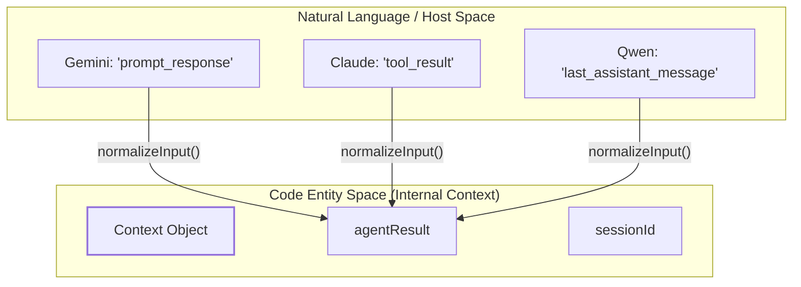

<!-- source: DeepWiki mcp.deepwiki.com · repo josstei/maestro-orchestrate · page 5.1 Hook Runner & Adapter Pattern · fetched 2026-10-27 -->

# Hook Runner & Adapter Pattern

<details>
<summary>Relevant source files</summary>

The following files were used as context for generating this wiki page:

- [claude/src/core/stdin-reader.js](claude/src/core/stdin-reader.js)
- [claude/src/platforms/shared/adapters/claude-adapter.js](claude/src/platforms/shared/adapters/claude-adapter.js)
- [claude/src/platforms/shared/adapters/conventions.js](claude/src/platforms/shared/adapters/conventions.js)
- [plugins/maestro/src/core/stdin-reader.js](plugins/maestro/src/core/stdin-reader.js)
- [plugins/maestro/src/platforms/shared/adapters/conventions.js](plugins/maestro/src/platforms/shared/adapters/conventions.js)
- [src/core/stdin-reader.js](src/core/stdin-reader.js)
- [src/platforms/shared/adapters/claude-adapter.js](src/platforms/shared/adapters/claude-adapter.js)
- [src/platforms/shared/adapters/conventions.js](src/platforms/shared/adapters/conventions.js)
- [src/platforms/shared/adapters/gemini-adapter.js](src/platforms/shared/adapters/gemini-adapter.js)
- [src/platforms/shared/adapters/qwen-adapter.js](src/platforms/shared/adapters/qwen-adapter.js)
- [tests/integration/hook-entrypoints.test.js](tests/integration/hook-entrypoints.test.js)
- [tests/unit/platform-adapters.test.js](tests/unit/platform-adapters.test.js)

</details>


The **Hook Runner** and **Adapter Pattern** form the translation layer between diverse LLM runtime environments (Gemini, Claude Code, Qwen) and Maestro's internal orchestration logic. This architecture allows Maestro to maintain a single, canonical implementation of session lifecycle and security policies while accommodating the varying JSON schemas, event names, and exit code requirements of different host platforms.

## Architecture Overview

Maestro utilizes an event-driven hook system where the host LLM runtime invokes a specific script (the "Hook Runner") at key lifecycle moments. Because each runtime provides data in different formats, the `hook-runner.js` does not contain logic itself; instead, it delegates to a runtime-specific **Adapter**.

### Hook Dispatch Flow

The following diagram illustrates the flow from a host runtime event to the internal Maestro logic.

**Runtime Event Dispatch Flow**
```mermaid
sequenceDiagram
    participant Host ["Host Runtime (e.g., Gemini CLI)"]
    participant Runner ["hook-runner.js"]
    participant Adapter ["gemini-adapter.js"]
    participant Logic ["Hook Logic (e.g., before-agent.js)"]

    Host->>Runner: spawn(runtime, eventName) + STDIN (JSON)
    Runner->>Runner: require(`./adapters/${runtime}-adapter`)
    Runner->>Adapter: normalizeInput(rawStdin)
    Adapter-->>Runner: Internal Context Object
    Runner->>Logic: execute(context)
    Logic-->>Runner: Internal Result { action, message, reason }
    Runner->>Adapter: formatOutput(result)
    Adapter-->>Runner: Runtime-specific JSON
    Runner->>Host: STDOUT (JSON) + Exit Code
```

**Sources:**
- [src/platforms/shared/adapters/gemini-adapter.js:11-21]() (normalizeInput)
- [src/platforms/shared/adapters/claude-adapter.js:11-21]() (normalizeInput)
- [tests/integration/hook-entrypoints.test.js:7-13]() (runHook execution)

---

## The Adapter Factory Contract

All adapters are created using the `defineAdapter` factory [src/platforms/shared/adapters/gemini-adapter.js:34](). This factory enforces a consistent interface that every runtime must implement to participate in the hook system.

### Key Functions

| Function | Purpose | Implementation Detail |
| :--- | :--- | :--- |
| `normalizeInput(raw)` | Converts host-specific STDIN JSON into a standard Maestro context. | Maps fields like `session_id` to `sessionId` and `prompt_response` to `agentResult`. |
| `formatOutput(result)` | Converts Maestro's internal result object back into the host's expected JSON schema. | Determines if the host should `continue` or `block` based on Maestro's policy decision. |
| `errorFallback()` | Provides a safe "fail-closed" response if JSON parsing or logic execution fails. | Typically returns `{ continue: false }` to prevent unauthorized actions during failures. |
| `getExitCode(result)` | Determines the process exit code for the Hook Runner. | Qwen requires `2` for blocks [src/platforms/shared/adapters/qwen-adapter.js:84-86](), while Gemini uses `0` [tests/unit/platform-adapters.test.js:192-194](). |

**Sources:**
- [src/platforms/shared/adapters/gemini-adapter.js:11-34]()
- [src/platforms/shared/adapters/claude-adapter.js:11-36]()
- [src/platforms/shared/adapters/qwen-adapter.js:29-93]()

---

## Runtime Specifics

### Gemini Adapter
The Gemini adapter handles the standard CLI lifecycle. It maps `prompt` and `prompt_response` from the host to Maestro's internal fields [src/platforms/shared/adapters/gemini-adapter.js:17-18](). It uses a simple `continue: boolean` output format [src/platforms/shared/adapters/gemini-adapter.js:23-28]().

### Claude Adapter
The Claude adapter specifically handles `tool_input.subagent_type` to identify which specialist agent is being invoked [src/platforms/shared/adapters/claude-adapter.js:16](). Its output includes a `decision` field (either `approve` or `block`) required by the Claude Code plugin architecture [src/platforms/shared/adapters/claude-adapter.js:27]().

### Qwen Adapter
The Qwen adapter is the most complex, mapping events like `SubagentStart` and `SubagentStop` [src/platforms/shared/adapters/qwen-adapter.js:17-18](). It supports `hookSpecificOutput` to inject `additionalContext` back into the LLM's prompt [src/platforms/shared/adapters/qwen-adapter.js:73-75]().

---

## Data Normalization & Code Entities

The following diagram maps the relationship between the raw input data from different runtimes and the unified `Internal Context` used by Maestro's core logic.

**Input Normalization Mapping**


**Sources:**
- [src/platforms/shared/adapters/gemini-adapter.js:18]()
- [src/platforms/shared/adapters/claude-adapter.js:18]()
- [src/platforms/shared/adapters/qwen-adapter.js:41-43]()

---

## Implementation Details

### STDIN Handling
Because hooks receive data via pipes, the `stdin-reader.js` module provides `readBoundedJson()`. This function implements a 1MB safety cap (`MAX_STDIN_BYTES`) to prevent memory exhaustion attacks from malicious or malformed host inputs [src/core/stdin-reader.js:5-6, 54-75]().

### Adapter Discovery
Maestro uses a convention-based approach for loading adapters. The `conventions.js` utility defines the `ADAPTER_SUFFIX` as `-adapter.js` [src/platforms/shared/adapters/conventions.js:4](). The `extractRuntime` function is used during the generation pipeline to identify which platforms are supported based on the files present in the `adapters/` directory [src/platforms/shared/adapters/conventions.js:22-27]().

### Error Handling & Fallbacks
If the `hook-runner.js` encounters an error (e.g., invalid JSON on STDIN), it invokes the adapter's `errorFallback()`. For Claude, this results in a `block` decision to ensure security [claude/src/platforms/shared/adapters/claude-adapter.js:32-34](). Integration tests verify that providing "not-json" to the runner correctly triggers this fallback [tests/integration/hook-entrypoints.test.js:87-103]().

**Sources:**
- [src/core/stdin-reader.js:54-75]()
- [src/platforms/shared/adapters/conventions.js:1-29]()
- [tests/integration/hook-entrypoints.test.js:87-103]()

---

