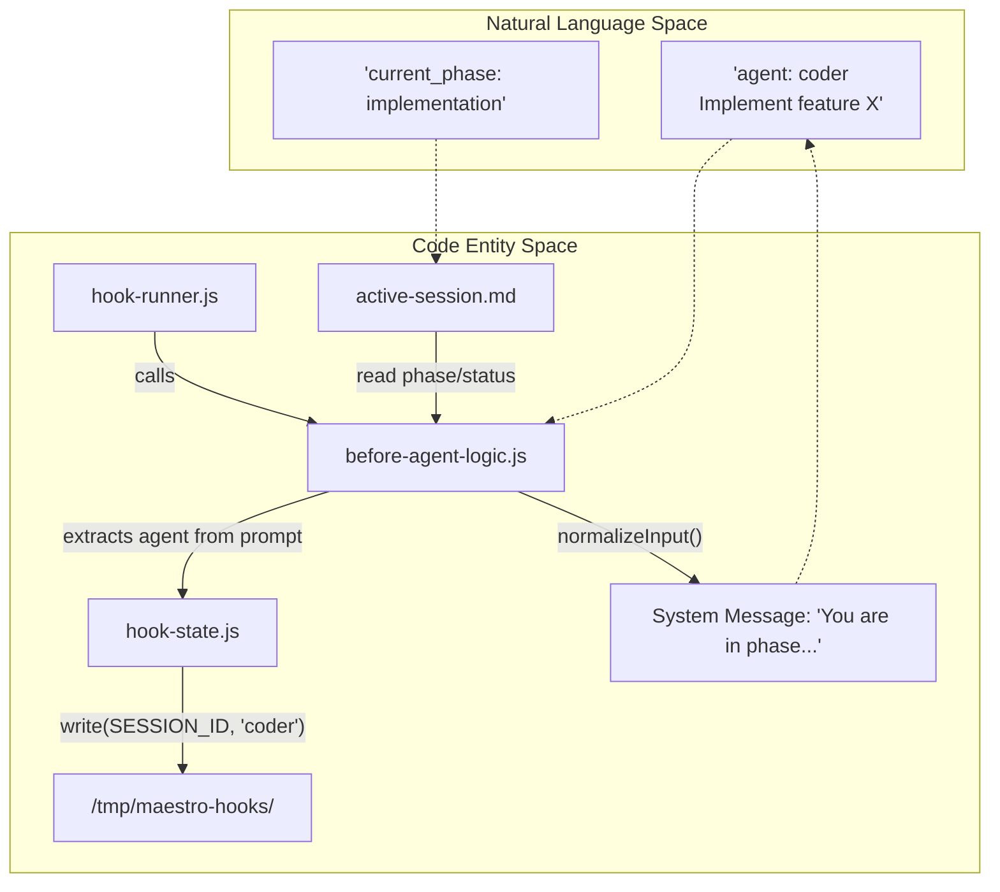
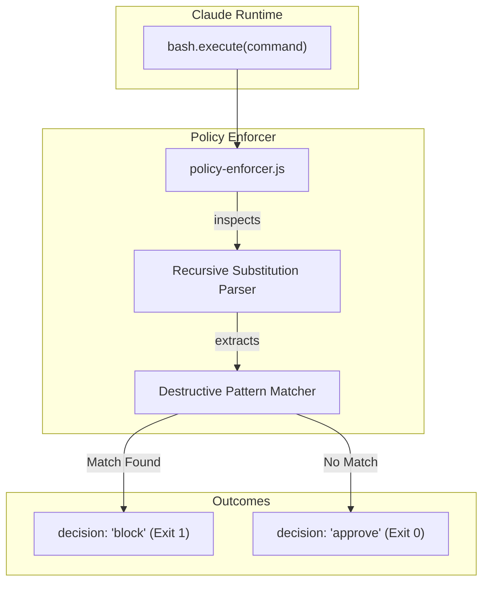

<!-- source: DeepWiki mcp.deepwiki.com · repo josstei/maestro-orchestrate · page 5.2 Hook Logic & Policy Enforcer · fetched 2026-10-27 -->

# Hook Logic & Policy Enforcer

Relevant source files

The following files were used as context for generating this wiki page:

- [claude/src/platforms/shared/hook-runner.js](claude/src/platforms/shared/hook-runner.js)
- [plugins/maestro/src/platforms/shared/hook-runner.js](plugins/maestro/src/platforms/shared/hook-runner.js)
- [src/platforms/shared/hook-runner.js](src/platforms/shared/hook-runner.js)
- [tests/integration/policy-enforcer.test.js](tests/integration/policy-enforcer.test.js)
- [tests/integration/source-of-truth.test.js](tests/integration/source-of-truth.test.js)
- [tests/unit/hook-logic.test.js](tests/unit/hook-logic.test.js)

The Hook Logic system and Policy Enforcer provide the event-driven glue and security guardrails for Maestro. While the **Hook Runner** (see Section 5.1) handles the protocol-level adaptation for different LLM runtimes, the **Hook Logic** modules define the actual behavioral rules that maintain session context and enforce structured communication across agent boundaries. The **Policy Enforcer** acts as a specialized hook specifically for the Claude runtime to prevent destructive operations.

## Hook Logic Architecture

The system consists of five core logic modules located in `src/hooks/logic/`. These modules are runtime-agnostic and receive a normalized context object from the adapter.

### Component Overview

| Module | Function | Purpose |
| :--- | :--- | :--- |
| `session-start-logic` | `handleSessionStart` | Initializes the session-specific state directory in the temp folder. |
| `before-agent-logic` | `handleBeforeAgent` | Injects current session metadata (phase, status) into the agent's prompt and tracks the active agent. |
| `after-agent-logic` | `handleAfterAgent` | Validates that agents have produced the required structured headers (`## Task Report` and `## Downstream Context`). |
| `session-end-logic` | `handleSessionEnd` | Cleans up session-specific temporary files and state. |
| `hook-state` | (Internal API) | Manages filesystem-backed persistence for the active agent name and session tracking. |

**Sources:**
- [src/platforms/shared/hook-runner.js:37-43]()
- [tests/unit/hook-logic.test.js:13-17]()

---

## Session Context & State Flow

The `hook-state` module maintains a temporary directory (defined by `MAESTRO_HOOKS_DIR`) to track the lifecycle of an orchestration session. This allows Maestro to know which specialist agent is currently active, even when the LLM runtime manages the actual process execution.

### Data Flow: Natural Language to Code Entity Space

The following diagram illustrates how a natural language prompt or a runtime event (like a subagent starting) is translated into persistent state and context injection.

**Session Context Injection Flow**

**Sources:**
- [src/platforms/shared/hook-runner.js:1-53]()
- [tests/unit/hook-logic.test.js:134-151]()
- [tests/unit/hook-logic.test.js:153-166]()

---

## The Hook Modules

### 1. session-start-logic
Invoked when a new Maestro command is executed. It ensures the environment is ready for state tracking.
- **Key Action**: Calls `hookState.ensureSessionDir(sessionId)` [tests/unit/hook-logic.test.js:204-207]().
- **Result**: Returns an `advisory` action, which does not block execution but prepares the backend [tests/unit/hook-logic.test.js:197-202]().

### 2. before-agent-logic
This is the primary mechanism for **Context Maintenance**. It performs two critical tasks:
- **State Injection**: It reads the YAML frontmatter from `docs/maestro/state/active-session.md` and prepends the current phase and session status to the agent's input [tests/unit/hook-logic.test.js:134-151]().
- **Agent Tracking**: It parses the prompt (e.g., `agent: coder`) or uses the runtime-provided name to set the active agent in `hook-state` [tests/unit/hook-logic.test.js:153-182]().

### 3. after-agent-logic
This module enforces the **Maestro Communication Protocol**. It ensures that every agent delegation results in structured data that the orchestrator can parse.
- **Validation**: Checks for the presence of `## Task Report` and `## Downstream Context` headers [tests/unit/hook-logic.test.js:40-60]().
- **Hard Gate**: If headers are missing, it returns a `deny` action, forcing the LLM to retry or correct its output [tests/unit/hook-logic.test.js:62-72]().
- **Exception**: If a `stopHookActive` flag is present (indicating a manual interruption), validation is bypassed [tests/unit/hook-logic.test.js:86-94]().

**Sources:**
- [tests/unit/hook-logic.test.js:13-184]()

---

## Policy Enforcer (Claude/Bash Security)

The `policy-enforcer.js` is a specialized security hook used primarily in the Claude runtime. It intercepts shell command execution to block destructive operations.

### Protected Operations
The enforcer utilizes regex and string analysis to block commands including:
- `rm -rf` (Recursive force removal)
- `git reset --hard` (Destructive git state changes)

### Recursive Inspection
The enforcer is designed to detect "hidden" destructive commands within shell substitutions (e.g., backticks or `$()` syntax). It recursively parses the command string to ensure safety even in complex one-liners.

| Input Command | Decision | Reason |
| :--- | :--- | :--- |
| `echo $(git reset --hard)` | `block` | Destructive command inside substitution [tests/integration/policy-enforcer.test.js:24-24](). |
| `echo $(printf "%s" "$(git reset --hard)")` | `block` | Nested substitution check [tests/integration/policy-enforcer.test.js:25-29](). |
| `echo $(git status --short)` | `approve` | Benign command [tests/integration/policy-enforcer.test.js:39-43](). |

**Policy Enforcement Logic**

**Sources:**
- [tests/integration/policy-enforcer.test.js:8-21]()
- [tests/integration/policy-enforcer.test.js:23-37]()
- [tests/integration/policy-enforcer.test.js:39-54]()

---

