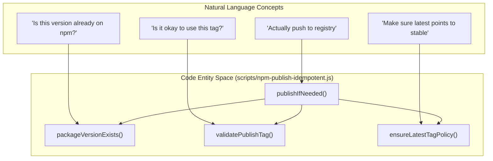
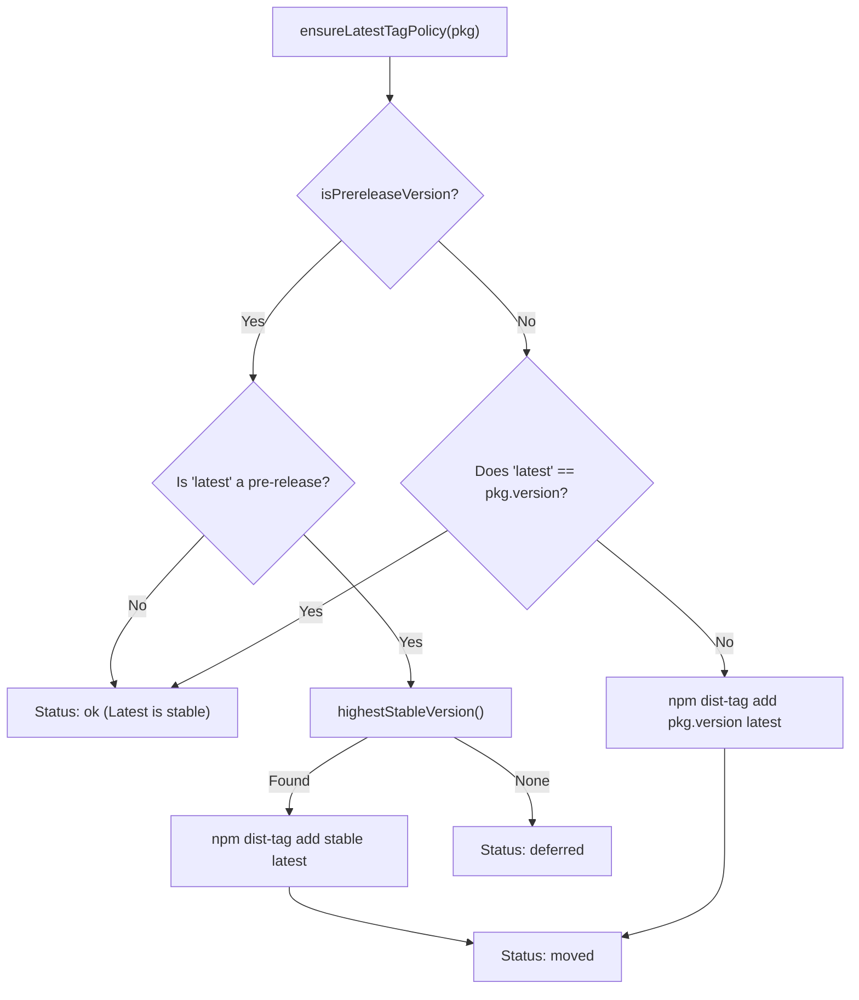

<!-- source: DeepWiki mcp.deepwiki.com · repo josstei/maestro-orchestrate · page 6.2 Idempotent Publishing & Dist-Tag Policy · fetched 2026-10-27 -->

# Idempotent Publishing & Dist-Tag Policy

Relevant source files

The following files were used as context for generating this wiki page:

- [.github/workflows/release.yml](.github/workflows/release.yml)
- [docs/cicd.md](docs/cicd.md)
- [scripts/npm-publish-idempotent.js](scripts/npm-publish-idempotent.js)
- [scripts/package-release-artifacts.js](scripts/package-release-artifacts.js)
- [scripts/release-artifact-manifest.js](scripts/release-artifact-manifest.js)
- [scripts/verify-npm-pack.js](scripts/verify-npm-pack.js)
- [scripts/verify-release-artifacts.js](scripts/verify-release-artifacts.js)
- [tests/unit/npm-publish-idempotent.test.js](tests/unit/npm-publish-idempotent.test.js)
- [tests/unit/workflow-security.test.js](tests/unit/workflow-security.test.js)

The Maestro release pipeline utilizes a specialized publishing mechanism to ensure that npm releases are atomic, idempotent, and adhere to a strict distribution tag (dist-tag) policy. This prevents accidental overwrites of stable versions with pre-releases and automates the repair of the `latest` tag when it drifts from the intended stable version.

The core of this logic resides in `scripts/npm-publish-idempotent.js`, which acts as a wrapper around the standard `npm publish` command.

## Overview of the Publishing Logic

The publishing process is designed to be "safe to retry." If a CI job fails after publishing but before completing subsequent steps, re-running the job will not cause a "version already exists" error. Instead, the script detects the existing version and performs any necessary tag maintenance.

### Key Logic Flow

The system follows a three-step validation and execution sequence:

1.  **Tag Validation**: Ensures the version string in `package.json` is compatible with the requested npm dist-tag [scripts/npm-publish-idempotent.js:193-207]().
2.  **Existence Check**: Queries the npm registry to see if the exact version is already present [scripts/npm-publish-idempotent.js:145-159]().
3.  **Tag Policy Enforcement**: Evaluates if the `latest` tag needs to be moved or repaired based on the current state of the registry [scripts/npm-publish-idempotent.js:209-268]().

### Natural Language to Code Entity Mapping

The following diagram maps the high-level publishing requirements to the specific functions in the codebase.

**Publishing Logic Architecture**

Sources: [scripts/npm-publish-idempotent.js:145-145](), [scripts/npm-publish-idempotent.js:193-193](), [scripts/npm-publish-idempotent.js:209-209](), [scripts/npm-publish-idempotent.js:270-270]()

## Dist-Tag Policy

Maestro enforces a strict mapping between version formats and npm distribution tags to prevent pre-release versions from becoming the default installation for users.

| Tag | Version Type | Requirement |
| :--- | :--- | :--- |
| `latest` | Stable (`X.Y.Z`) | Must be a stable semver; cannot be a pre-release. |
| `rc` | Pre-release (`X.Y.Z-rc.N`) | Used for Release Candidates. |
| `preview` | Pre-release (`X.Y.Z-preview.SHA`) | Used for feature previews or PR builds. |
| `nightly` | Pre-release (`X.Y.Z-nightly.DATE`) | Used for daily scheduled builds. |

### Validation Rules
*   **Refuse Stable on Pre-release Tag**: A stable version (e.g., `1.0.0`) cannot be published with `rc`, `preview`, or `nightly` tags [scripts/npm-publish-idempotent.js:202-206]().
*   **Refuse Pre-release on Latest Tag**: A pre-release version (e.g., `1.0.0-rc.1`) cannot be published with the `latest` tag [scripts/npm-publish-idempotent.js:196-200]().

Sources: [scripts/npm-publish-idempotent.js:9-9](), [scripts/npm-publish-idempotent.js:193-207]()

## The `latest`-tag Repair Mechanism

One of the most critical functions of the idempotent publisher is `ensureLatestTagPolicy`. This function manages the `latest` dist-tag even when a publish is skipped because the version already exists.

### Repair Scenarios

1.  **Stable Version Published**: If the current version is stable and `latest` does not point to it, the script moves the `latest` tag to this version [scripts/npm-publish-idempotent.js:249-260]().
2.  **Pre-release Drift**: If a pre-release is being published, but `latest` accidentally points to a *different* pre-release (instead of a stable version), the script finds the `highestStableVersion` from the registry and restores `latest` to that stable version [scripts/npm-publish-idempotent.js:225-236]().
3.  **No Stable Available**: If `latest` points to a pre-release but no stable version exists in the registry, the repair is deferred [scripts/npm-publish-idempotent.js:239-246]().

**Latest Tag Enforcement Logic**

Sources: [scripts/npm-publish-idempotent.js:209-268](), [scripts/npm-publish-idempotent.js:104-109]()

## Implementation Details

### Execution Flow
The `publishIfNeeded` function coordinates the entire process:

1.  **Read Package**: Loads `name` and `version` from `package.json` [scripts/npm-publish-idempotent.js:59-71]().
2.  **Validate**: Calls `validatePublishTag` [scripts/npm-publish-idempotent.js:274-274]().
3.  **Check Registry**: Checks if `packageVersionExists` [scripts/npm-publish-idempotent.js:276-276]().
4.  **Publish**: If missing, runs `npm publish` with the specified `--tag` and `--access` [scripts/npm-publish-idempotent.js:278-283]().
5.  **Policy Enforcement**: Runs `ensureLatestTagPolicy` regardless of whether a publish occurred [scripts/npm-publish-idempotent.js:287-287]().

### Error Handling
The script identifies registry errors using `isNpmNotFoundError`, which parses stderr for common npm 404 patterns (e.g., `E404`, `Not Found`, or `is not in this registry`) [scripts/npm-publish-idempotent.js:73-81]().

## CI/CD Integration

The publishing workflows (`release.yml`, `nightly.yml`, `preview.yml`, `rc.yml`) are strictly forbidden from calling `npm publish` directly. This is enforced by unit tests [tests/unit/workflow-security.test.js:77-89]().

Instead, they invoke the helper as follows:
*   **Stable Release**: `node scripts/npm-publish-idempotent.js --access public` [tests/unit/workflow-security.test.js:91-95]().
*   **Pre-releases**: `node scripts/npm-publish-idempotent.js --tag [nightly|preview|rc] --access public` [tests/unit/workflow-security.test.js:117-127]().

Sources: [tests/unit/workflow-security.test.js:77-148](), [scripts/npm-publish-idempotent.js:11-17]()

---

