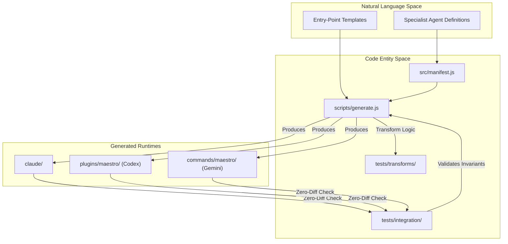
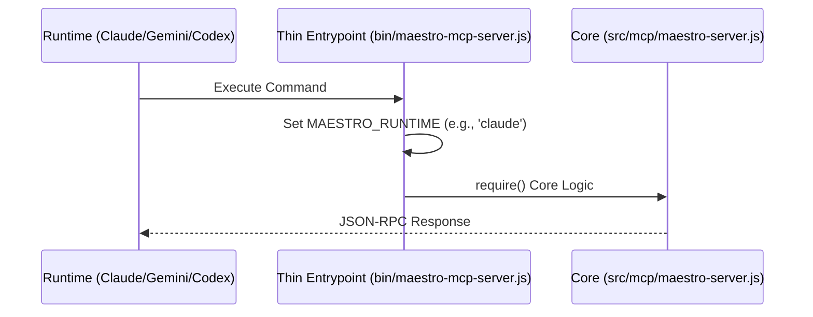

<!-- source: DeepWiki mcp.deepwiki.com · repo josstei/maestro-orchestrate · page 7.2 Integration & Transform Tests · fetched 2026-10-27 -->

# Integration & Transform Tests

Relevant source files

The following files were used as context for generating this wiki page:

- [.github/workflows/release.yml](.github/workflows/release.yml)
- [tests/integration/entry-point-templates.test.js](tests/integration/entry-point-templates.test.js)
- [tests/integration/release-artifacts.test.js](tests/integration/release-artifacts.test.js)
- [tests/integration/source-of-truth.test.js](tests/integration/source-of-truth.test.js)
- [tests/integration/thin-entrypoints.test.js](tests/integration/thin-entrypoints.test.js)
- [tests/integration/zero-diff.test.js](tests/integration/zero-diff.test.js)
- [tests/unit/hook-logic.test.js](tests/unit/hook-logic.test.js)
- [tests/unit/release-artifact-manifest.test.js](tests/unit/release-artifact-manifest.test.js)
- [tests/unit/workflow-security.test.js](tests/unit/workflow-security.test.js)

Maestro employs a multi-layered testing strategy to ensure the integrity of its src-first architecture, the validity of generated runtime artifacts, and the security of its orchestration hooks. This page details the integration and transform test suites which validate the system's end-to-end behavior and the complex pipeline that expands canonical source into runtime-specific implementations.

## Overview and Scope

The testing infrastructure is divided into three primary categories:
1.  **Transform Tests**: Validates the logic within `scripts/generate.js` that transforms source manifests into platform-specific files (e.g., Gemini TOML, Claude SKILL.md).
2.  **Integration Tests**: Enforces architectural invariants, such as the "zero-drift" guarantee, the correctness of thin entrypoints, and the validity of release artifacts.
3.  **Security & Logic Tests**: Validates the hook system's ability to enforce session context and block destructive actions.

### Testing Architecture

The following diagram illustrates the relationship between the generator pipeline and the validation suites.

**Maestro Validation Pipeline**

Sources: [scripts/generate.js:1-10](), [src/manifest.js:1-10](), [tests/integration/zero-diff.test.js:5-45]()

---

## Transform & Entry-Point Tests

The transform suite ensures that the `expandEntryPoints` and `expandCoreCommands` functions correctly map the abstract manifest definitions to the specific syntax required by each LLM runtime.

### Entry-Point Mapping
The system must handle name collisions and platform-specific naming conventions (e.g., `review-code` vs `review`).

| Runtime | Target File | Key Requirement |
| :--- | :--- | :--- |
| **Gemini** | `commands/maestro/*.toml` | TOML format with `prompt` and `description` [tests/integration/entry-point-templates.test.js:6-14]() |
| **Claude** | `claude/skills/*/SKILL.md` | Markdown with YAML frontmatter [tests/integration/entry-point-templates.test.js:16-23]() |
| **Codex** | `plugins/maestro/skills/*/SKILL.md` | Non-conflicting names (e.g., `resume-session`) [tests/integration/entry-point-templates.test.js:45-53]() |

### Logic Validation
*   **Delegation Inclusion**: Tests verify that only entry points with associated agents include the delegation protocol blocks (`get_agent` or `get_skill_content`) [tests/integration/entry-point-templates.test.js:63-83]().
*   **Constraint Enforcement**: Ensures that prompt constraints (e.g., "Do not bury findings") are correctly injected into Gemini TOML files [tests/integration/entry-point-templates.test.js:85-89]().
*   **Naming Collision Avoidance**: Validates that public skills avoid reserved host command names like `review`, `debug`, or `resume` to prevent hijacking by the host runtime [tests/integration/entry-point-templates.test.js:128-155]().

Sources: [tests/integration/entry-point-templates.test.js:1-155]()

---

## Integration Invariants

Integration tests enforce the "src-first" architecture, ensuring that the generated runtimes are strictly derived from `src/` and contain no redundant code.

### Zero-Diff Guarantee
The `zero-diff.test.js` suite runs the generator in `--dry-run` mode to verify that the current state of the repository matches exactly what the generator would produce. This prevents "manual" edits to generated files from persisting [tests/integration/zero-diff.test.js:5-45]().

### Thin Entrypoint Design
Tests verify that entrypoints for MCP servers are "thin" wrappers that set environment variables and delegate to the core source.

**MCP Entrypoint Resolution Logic**

Sources: [tests/integration/thin-entrypoints.test.js:9-23](), [tests/integration/source-of-truth.test.js:46-65]()

### Prohibited Patterns
Integration tests explicitly fail if:
*   `lib/` directories or mirrored shared code exist in runtime folders [tests/integration/source-of-truth.test.js:46-65]().
*   `canonical-source.js` copies are found outside of `src/core/` [tests/integration/thin-entrypoints.test.js:45-60]().
*   Runtime content policies deviate from `primary: filesystem` [tests/integration/source-of-truth.test.js:67-73]().

---

## Release Artifact Validation

The `release-artifacts.test.js` suite validates the integrity of the distribution packages (`.tar.gz`) generated for deployment.

### Packaging Checks
1.  **Self-Containment**: Builds a release archive from a temporary repo copy and verifies it contains all 11 required platform metadata surfaces (e.g., `gemini-extension.json`, `claude/.mcp.json`) [tests/integration/release-artifacts.test.js:19-40](), [tests/integration/thin-entrypoints.test.js:62-84]().
2.  **Allowlist Enforcement**: Uses `scripts/release-artifact-manifest.js` to ensure no sensitive files (like `.env` or local test files) are included in the archive [tests/unit/release-artifact-manifest.test.js:9-51]().
3.  **Version Alignment**: Rejects archives if the version in `package.json` drifts from the versions declared in runtime manifests (e.g., `qwen-extension.json`) [tests/integration/release-artifacts.test.js:42-69](), [tests/unit/release-artifact-manifest.test.js:111-113]().

Sources: [tests/integration/release-artifacts.test.js:1-110](), [tests/unit/release-artifact-manifest.test.js:1-115](), [tests/integration/thin-entrypoints.test.js:62-84]()

---

## Hook & Workflow Security

### Hook Logic Validation
The hook system is tested to ensure it maintains session state and enforces structured output from agents.
*   **State Tracking**: `handleBeforeAgent` is tested for its ability to detect the active agent from the prompt and update the `hook-state` [tests/unit/hook-logic.test.js:153-183]().
*   **Structured Output Enforcement**: `handleAfterAgent` denies agent results that lack required headers like `## Task Report` or `## Downstream Context` [tests/unit/hook-logic.test.js:40-73]().

### CI/CD Security
Maestro uses specialized tests to audit its own GitHub Actions workflows:
*   **Expression Injection**: Validates that no `run` blocks interpolate `${{ github... }}` expressions directly, which prevents shell injection attacks [tests/unit/workflow-security.test.js:60-75]().
*   **Idempotent Publishing**: Ensures that all publishing workflows use `scripts/npm-publish-idempotent.js` instead of raw `npm publish` [tests/unit/workflow-security.test.js:77-95]().
*   **Prerelease Safety**: Verifies that `nightly`, `preview`, and `rc` workflows never use the `latest` dist-tag [tests/unit/workflow-security.test.js:112-148]().

Sources: [tests/unit/hook-logic.test.js:1-207](), [tests/unit/workflow-security.test.js:1-150]()

---

