# Page: Overview

# Overview

<details>
<summary>Relevant source files</summary>

The following files were used as context for generating this wiki page:

- [ARCHITECTURE.md](ARCHITECTURE.md)
- [CHANGELOG.md](CHANGELOG.md)
- [OVERVIEW.md](OVERVIEW.md)
- [README.md](README.md)
- [docs/architecture.md](docs/architecture.md)
- [docs/overview.md](docs/overview.md)
- [docs/usage.md](docs/usage.md)
- [package.json](package.json)
- [plugins/maestro/.mcp.json](plugins/maestro/.mcp.json)
- [plugins/maestro/README.md](plugins/maestro/README.md)

</details>


Maestro is a multi-agent development orchestration platform designed to coordinate 39 specialized AI agents through structured software development lifecycles [README.md:1-10](). It functions as a "TechLead" persona that handles task classification, solution design, implementation planning, and delegated execution [docs/overview.md:10-22]().

The system is built on a **src-first, generated-runtime** architecture [docs/architecture.md:5-12](). All core logic, agent methodologies, and orchestration protocols are authored once in a canonical `src/` directory and then transformed into optimized adapters for four distinct LLM runtimes: **Gemini CLI**, **Claude Code**, **Codex**, and **Qwen Code** [README.md:10-20]().

## System Concept

Maestro bridges the gap between high-level user requirements and low-level agent execution by maintaining a persistent session state and enforcing a 4-phase standard workflow (Design → Plan → Execute → Complete) [docs/overview.md:14-24]().

### From Natural Language to Code Entities
The following diagram illustrates how a user's natural language request is transformed into specific code entities and managed by the orchestration system.

**Workflow Entity Mapping**
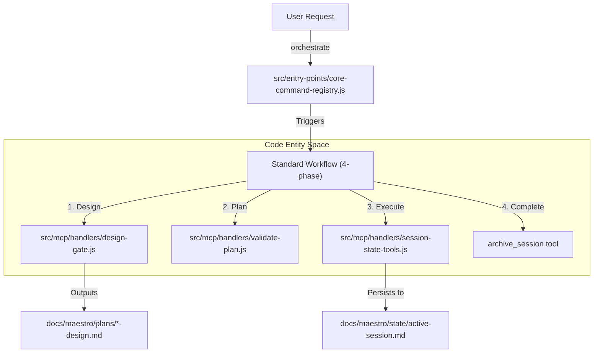
Sources: [docs/overview.md:14-24](), [docs/architecture.md:87-97](), [docs/usage.md:143-158](), [CHANGELOG.md:30-32]()

## Key Capabilities

*   **Multi-Agent Roster**: 39 specialists categorized into capability tiers (e.g., `full`, `read_write`, `read_shell`, `read_only`) to ensure security and tool-access boundaries [docs/overview.md:95-102]().
*   **Persistent Sessions**: All progress is saved as Markdown with YAML frontmatter in a configurable `MAESTRO_STATE_DIR` (defaulting to `docs/maestro/`), allowing for session resumption across restarts [docs/usage.md:60-69](), [docs/usage.md:160-175]().
*   **MCP Integration**: A built-in Model Context Protocol (MCP) server provides 17 specialized tools for workspace analysis, plan validation, and state management [docs/overview.md:104-111]().
*   **Zero-Drift Generation**: A manifest-driven generator ensures that all four runtime targets stay perfectly synchronized with the canonical source [docs/architecture.md:28-37]().

## Project Structure

Maestro organizes its logic into a clear hierarchy that separates source-of-truth from generated artifacts.

**Codebase Organization**
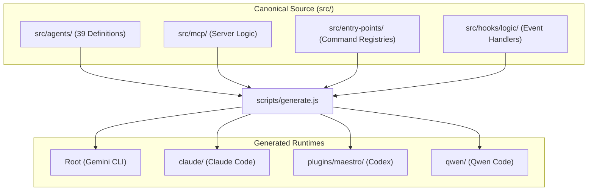
Sources: [docs/architecture.md:5-26](), [docs/overview.md:40-89]()

## Wiki Organization

This wiki is organized to guide you from initial setup to deep architectural understanding:

### 1.1 [Getting Started](#1.1)
Covers prerequisites (Node.js 20+), installation steps for all four runtimes, and the "Quick Start" commands to get your first orchestration running. For details, see [Getting Started](#1.1).
*   **Sources**: [README.md:21-123]()

### 1.2 [Command Reference & Cheatsheet](#1.2)
A comprehensive list of all 12 available commands (9 entry-points + 3 core commands) and their syntax across different platforms (e.g., `/maestro:review` vs `$maestro:review-code`). For details, see [Command Reference & Cheatsheet](#1.2).
*   **Sources**: [README.md:145-161](), [docs/usage.md:82-142]()

### 2. [Core Architecture](#2)
Deep dive into the `src-first` philosophy, the 41-step orchestration sequence, and how the generator pipeline (`scripts/generate.js`) maintains consistency across the project.
*   **Sources**: [docs/architecture.md:1-37](), [CHANGELOG.md:49-56]()

---

# Page: Getting Started

# Getting Started

<details>
<summary>Relevant source files</summary>

The following files were used as context for generating this wiki page:

- [.gitignore](.gitignore)
- [CONTRIBUTING.md](CONTRIBUTING.md)
- [GEMINI.md](GEMINI.md)
- [USAGE.md](USAGE.md)
- [docs/architecture.md](docs/architecture.md)
- [docs/overview.md](docs/overview.md)
- [docs/usage.md](docs/usage.md)
- [package.json](package.json)

</details>


Maestro is a multi-agent development orchestration platform that coordinates 39 specialized AI agents through structured workflows. This page provides the technical requirements and procedures for setting up the development environment, installing the platform, and executing the first run across the four supported runtimes: Gemini CLI, Claude Code, OpenAI Codex, and Qwen Code [docs/overview.md:1-10]().

## Prerequisites

To develop or run Maestro, your environment must meet the following requirements:

*   **Node.js**: Version 20 or higher [package.json:51-51](), [CONTRIBUTING.md:7-7]().
*   **Runtime Host**: At least one of the following must be installed:
    *   [Gemini CLI](https://github.com/google-gemini/gemini-cli)
    *   [Claude Code](https://docs.anthropic.com/en/docs/claude-code)
    *   [Codex](https://github.com/openai/codex)
    *   [Qwen Code](https://github.com/QwenLM/qwen-code) [CONTRIBUTING.md:8-8]().
*   **Command Runner**: [Just](https://github.com/casey/just) is recommended for executing development tasks [CONTRIBUTING.md:9-9]().

## Development Setup

Maestro uses a **src-first, generated-runtime** architecture. All canonical logic resides in `src/`, while the actual runtime files are generated by a build pipeline [docs/architecture.md:3-6]().

### 1. Installation
Clone the repository and install dependencies:
```bash
git clone https://github.com/josstei/maestro-orchestrate.git
cd maestro-orchestrate
npm install
```
[CONTRIBUTING.md:13-17]()

### 2. Git Hooks
Activate the repo-local git hooks to enforce semantic commit messages and branch naming:
```bash
npm run install-hooks
```
*Note: This executes `scripts/install-git-hooks.js` which configures `core.hooksPath` to `.githooks` [package.json:28-28](), [CONTRIBUTING.md:19-25]().*

### 3. Build & Generate
The build process transforms canonical source into runtime-specific adapters:
```bash
npm run build
# OR
node scripts/generate.js
```
[package.json:21-22](), [docs/usage.md:7-12]()

## Key Commands

The project supports both `npm` and `just` commands for common development tasks.

| Task | Command | Description |
| :--- | :--- | :--- |
| **Generate** | `just generate` | Runs `scripts/generate.js` to update all runtimes [CONTRIBUTING.md:35-35](). |
| **Test** | `just test` | Runs unit, transform, and integration suites [docs/usage.md:14-15](). |
| **Verify** | `just check` | Generates files and verifies zero drift using `git diff --exit-code` [docs/usage.md:32-33](). |
| **Clean** | `node scripts/generate.js --clean` | Deletes all generated files before regenerating [docs/usage.md:20-21](). |
| **Coverage** | `npm run test:coverage` | Runs `c8` for code coverage analysis [package.json:24-24](). |

**Sources:** [package.json:20-30](), [docs/usage.md:5-43](), [CONTRIBUTING.md:29-44]()

## System Data Flow: Source to Runtime

The following diagram illustrates how `scripts/generate.js` processes the `src/manifest.js` to produce runtime artifacts.

### Build Pipeline Architecture
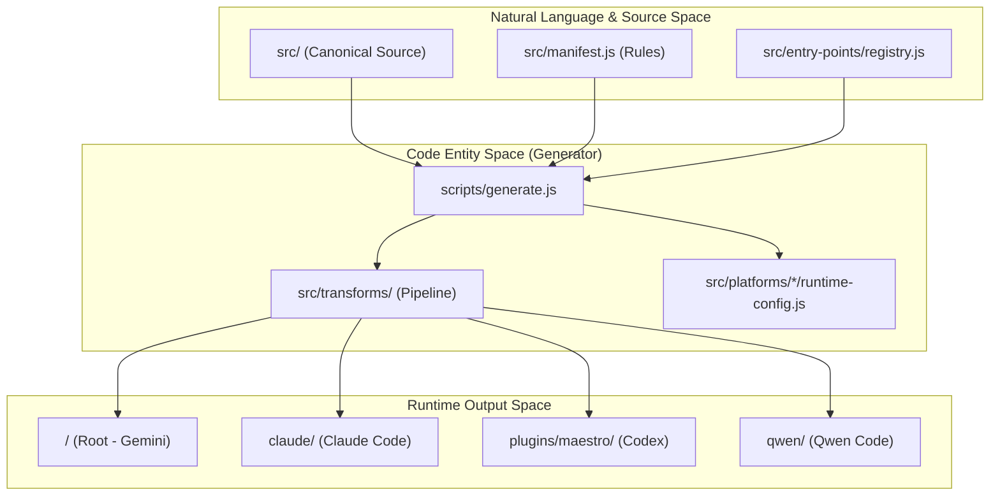
**Sources:** [docs/architecture.md:7-26](), [docs/architecture.md:28-37](), [docs/architecture.md:73-84]()

## First-Run Walkthrough by Runtime

Maestro must be initialized in your target workspace before running orchestration.

### Common Startup Logic
Regardless of the runtime, Maestro performs the following startup checks via the MCP server:
1.  **Resolve Settings**: Loads configuration from environment variables, workspace `.env`, or extension `.env` [GEMINI.md:24-26]().
2.  **Initialize Workspace**: Creates the `MAESTRO_STATE_DIR` (default: `docs/maestro`) [GEMINI.md:28-30](), [docs/usage.md:62-62]().

### 1. Gemini CLI
1.  **Enable Agents**: Ensure `experimental.enableAgents` is `true` in `~/.gemini/settings.json` [GEMINI.md:21-23]().
2.  **Run**: Use the slash command:
    ```bash
    /maestro:orchestrate "Implement a new user login flow"
    ```
[docs/usage.md:90-90]()

### 2. Claude Code
1.  **Installation**: Link the `claude/` directory as a plugin.
2.  **Run**: Use the skill command:
    ```bash
    /orchestrate "Implement a new user login flow"
    ```
[docs/usage.md:109-109]()

### 3. Codex
1.  **Installation**: Install the plugin using the provided script:
    ```bash
    npx maestro-install-codex
    ```
    *Note: This runs `./scripts/install-codex-plugin.js` [package.json:17-17]().*
2.  **Run**: Invoke via the maestro namespace:
    ```bash
    $maestro:orchestrate "Implement a new user login flow"
    ```
[docs/usage.md:128-128]()

### 4. Qwen Code
1.  **Installation**: Point Qwen Code to the `qwen/` directory and repo-root `qwen-extension.json` [docs/overview.md:8-8]().
2.  **Run**: Commands are shared with Gemini TOML format [docs/architecture.md:92-93]().

## Workspace State Initialization
The following diagram maps the `initialize_workspace` tool to the physical directory structure created during the first run.

### Workspace Initialization Mapping
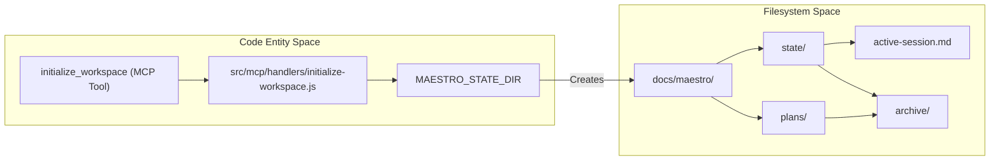
**Sources:** [GEMINI.md:28-31](), [docs/usage.md:143-158](), [docs/architecture.md:118-118]()

## Core Configuration
Settings are resolved with the following precedence: **Environment Variable > Workspace `.env` > Extension `.env` > Default** [docs/usage.md:58-58]().

| Setting | Default | Purpose |
| :--- | :--- | :--- |
| `MAESTRO_STATE_DIR` | `docs/maestro` | Root for session and plan persistence [GEMINI.md:57-57](). |
| `MAESTRO_EXECUTION_MODE` | `ask` | Strategy for phase execution (`parallel`, `sequential`, `ask`) [GEMINI.md:59-59](). |
| `MAESTRO_DISABLED_AGENTS` | (none) | Comma-separated list of agents to exclude from planning [GEMINI.md:53-53](). |
| `MAESTRO_MAX_RETRIES` | `2` | Number of times to retry a failed phase [GEMINI.md:54-54](). |

**Sources:** [GEMINI.md:49-61](), [docs/usage.md:56-69]()

---

# Page: Command Reference & Cheatsheet

# Command Reference & Cheatsheet

<details>
<summary>Relevant source files</summary>

The following files were used as context for generating this wiki page:

- [.gitignore](.gitignore)
- [EXAMPLES.md](EXAMPLES.md)
- [GEMINI.md](GEMINI.md)
- [USAGE.md](USAGE.md)
- [commands/maestro/execute.toml](commands/maestro/execute.toml)
- [commands/maestro/orchestrate.toml](commands/maestro/orchestrate.toml)
- [commands/maestro/resume.toml](commands/maestro/resume.toml)
- [docs/maestro-cheatsheet.md](docs/maestro-cheatsheet.md)
- [src/entry-points/core-command-registry.js](src/entry-points/core-command-registry.js)
- [src/entry-points/registry.js](src/entry-points/registry.js)
- [tests/unit/doc-drift-guard.test.js](tests/unit/doc-drift-guard.test.js)

</details>


This page provides a comprehensive technical reference for all Maestro entry-point commands across the four supported runtimes: Gemini CLI, Claude Code, Codex, and Qwen Code. It details command syntax, runtime-specific remapping, and the underlying registry implementation that ensures cross-runtime consistency.

## 1. Runtime Command Matrix

Maestro uses a unified registry to define command behavior, but each runtime imposes its own syntax constraints and naming conventions.

| Capability | Gemini CLI | Claude Code | Codex CLI | Qwen Code |
| :--- | :--- | :--- | :--- | :--- |
| **Full Orchestration** | `/maestro:orchestrate` | `/orchestrate` | `$maestro:orchestrate` | `/maestro:orchestrate` |
| **Execute Plan** | `/maestro:execute` | `/execute` | `$maestro:execute` | `/maestro:execute` |
| **Session Status** | `/maestro:status` | `/status` | `$maestro:status` | `/maestro:status` |
| **Resume Session** | `/maestro:resume` | `/resume-session` | `$maestro:resume-session` | `/maestro:resume` |
| **Archive Session** | `/maestro:archive` | `/archive` | `$maestro:archive` | `/maestro:archive` |
| **Code Review** | `/maestro:review` | `/review-code` | `$maestro:review-code` | `/maestro:review` |
| **Debug Workflow** | `/maestro:debug` | `/debug-workflow` | `$maestro:debug-workflow` | `/maestro:debug` |
| **Security Audit** | `/maestro:security-audit` | `/security-audit` | `$maestro:security-audit` | `/maestro:security-audit` |
| **Performance Check** | `/maestro:perf-check` | `/perf-check` | `$maestro:perf-check` | `/maestro:perf-check` |

**Sources:** [docs/maestro-cheatsheet.md:14-30](), [EXAMPLES.md:13-31]()

### 1.1 Command Remapping Logic
Claude Code and Codex reserve specific keywords (`/review`, `/debug`, `/resume`) for host-level native behaviors [EXAMPLES.md:30-31](). To avoid collisions, the Maestro generator uses the `runtimeNames` property in the command registry to rename these entry points for those specific targets [src/entry-points/core-command-registry.js:27-27](), [src/entry-points/registry.js:16-16]().

## 2. Command Implementation & Data Flow

Maestro commands are defined in a central registry and expanded into runtime-specific artifacts (TOML files, SKILL.md files, or JSON manifests) by the generator pipeline.

### 2.1 Registry Structure
The system distinguishes between **Core Commands** (orchestration lifecycle) and **Standalone Commands** (specialist tasks).

*   **Core Registry**: Defines `orchestrate`, `execute`, and `resume`. These commands are tightly coupled with the 4-phase Standard workflow and require preloading specific orchestration resources [src/entry-points/core-command-registry.js:3-37]().
*   **General Registry**: Defines standalone utilities like `review`, `status`, and `security-audit`. These specify the specialist agents to delegate to and the specific workflow steps to follow [src/entry-points/registry.js:13-165]().

### 2.2 Execution Data Flow
When a command is invoked, the runtime loads the prompt template. For Gemini, this is a TOML file; for Claude, it is a skill definition.

#### Diagram: Command Dispatch to Logic
This diagram shows how a Natural Language command like `/maestro:resume` maps to code entities and state files.

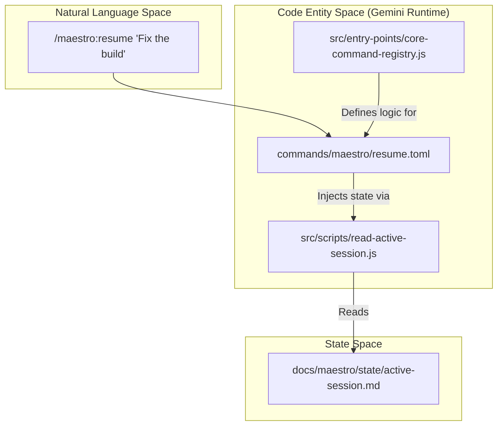
**Sources:** [commands/maestro/resume.toml:1-39](), [src/entry-points/core-command-registry.js:26-37]()

## 3. Detailed Command Reference

### 3.1 Orchestrate
**Purpose**: Start a new task from scratch.
*   **Implementation**: Triggers the `orchestration-steps` protocol [src/entry-points/core-command-registry.js:8-8]().
*   **Logic**: Maestro assesses `task_complexity`. Simple tasks trigger the **Express** workflow; medium/complex tasks trigger the **Standard** 4-phase workflow (Design → Plan → Execute → Complete) [GEMINI.md:5-10]().
*   **Gate**: Requires user approval of the generated implementation plan before moving to the `execute` phase [GEMINI.md:94-96]().

### 3.2 Execute
**Purpose**: Run a previously approved plan.
*   **Syntax**: `/maestro:execute <path-to-plan.md>`
*   **Implementation**: Reads the plan, resolves the `MAESTRO_EXECUTION_MODE` (ask, parallel, or sequential), and dispatches agents [src/entry-points/core-command-registry.js:23-23]().
*   **State**: Creates or resumes session state in `docs/maestro/state/active-session.md` [src/entry-points/core-command-registry.js:23-23]().

### 3.3 Status
**Purpose**: Read-only inspection of the current session.
*   **Logic**: Calls the MCP tool `mcp_maestro_get_runtime_context` or runs `read-active-session.js` to extract session ID, phase progress, and token usage per agent [src/entry-points/registry.js:86-91]().
*   **Constraint**: Must not mutate state or archive the session [src/entry-points/registry.js:93-93]().

### 3.4 Resume
**Purpose**: Recover an interrupted session.
*   **Logic**: Injects the current content of `active-session.md` into the prompt context [commands/maestro/resume.toml:13-15](). It identifies the first `pending` or `failed` phase and resumes delegation from that point [src/entry-points/core-command-registry.js:33-34]().

## 4. Specialist Command Architecture

Standalone commands (e.g., `review`, `debug`) bypass the full orchestration lifecycle and delegate directly to a primary specialist agent.

#### Diagram: Specialist Delegation Flow
This diagram bridges the standalone command to the specific agent code and tool access.

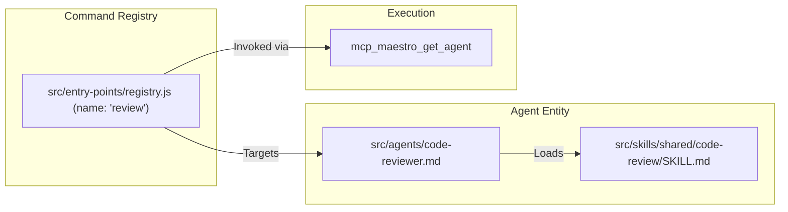
**Sources:** [src/entry-points/registry.js:15-21](), [GEMINI.md:79-79]()

### 4.1 Standalone Workflow Protocols
Each standalone command follows a specific sequence defined in the registry:

1.  **Review**: Identifies scope (staged vs. last commit), delegates to `code-reviewer`, and enforces severity-ordered reporting (Critical → Major → Minor → Suggestion) [src/entry-points/registry.js:22-28]().
2.  **Debug**: Establishes repro path, forms 2-3 hypotheses, gathers evidence, and isolates the root cause using the `debugger` agent [src/entry-points/registry.js:44-50]().
3.  **Security Audit**: Traces trust boundaries and auth flows to identify OWASP Top 10 risks using the `security-engineer` agent [src/entry-points/registry.js:105-110]().

## 5. Summary Cheatsheet

| Task | Recommended Command | Key File/State Involved |
| :--- | :--- | :--- |
| **New Feature** | `orchestrate` | `docs/maestro/plans/` |
| **Fix Bug (Known Cause)** | `orchestrate` | `docs/maestro/state/active-session.md` |
| **Investigate Crash** | `debug-workflow` | Specialist: `debugger` |
| **PR Review** | `review-code` | Specialist: `code-reviewer` |
| **Check Progress** | `status` | `read-active-session.js` |
| **Cleanup** | `archive` | `docs/maestro/state/archive/` |

**Sources:** [docs/maestro-cheatsheet.md:100-114](), [src/entry-points/registry.js:59-77]()

---

# Page: Core Architecture

# Core Architecture

<details>
<summary>Relevant source files</summary>

The following files were used as context for generating this wiki page:

- [CHANGELOG.md](CHANGELOG.md)
- [README.md](README.md)
- [claude/src/references/architecture.md](claude/src/references/architecture.md)
- [docs/architecture.md](docs/architecture.md)
- [docs/overview.md](docs/overview.md)
- [docs/usage.md](docs/usage.md)
- [plugins/maestro/.mcp.json](plugins/maestro/.mcp.json)
- [plugins/maestro/README.md](plugins/maestro/README.md)
- [plugins/maestro/src/references/architecture.md](plugins/maestro/src/references/architecture.md)
- [src/references/architecture.md](src/references/architecture.md)

</details>


Maestro utilizes a **src-first, generated-runtime** architecture [docs/architecture.md:5-6](). All shared methodologies, specialist agent definitions, and orchestration logic are authored exactly once in the `src/` directory, which serves as the project's canonical source of truth [docs/architecture.md:9-12]().

From this source, a manifest-driven generator produces four distinct runtime targets: **Gemini CLI**, **Claude Code**, **Codex**, and **Qwen Code** [README.md:10-19](). This ensures that while each host environment has unique requirements (such as TOML commands for Gemini or Markdown skills for Claude), the underlying orchestration behavior remains identical across all platforms.

### The Canonical Source Pattern

The system is designed to minimize duplication and prevent logic drift. Developers edit files in `src/`, and the generator handles the transformation into the specific formats required by each runtime [docs/usage.md:47-48]().

**System Flow: Source to Runtime**

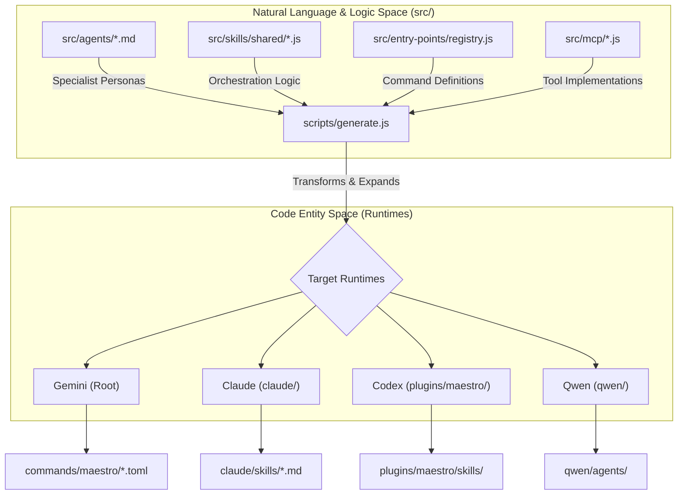
Sources: [docs/architecture.md:7-26](), [docs/overview.md:40-89](), [src/manifest.js:1-58]()

### Generator Pipeline
The generator (`scripts/generate.js`) acts as the build boundary [docs/architecture.md:30-37](). It processes the `src/manifest.js` file, which maps source files to runtime outputs using a series of functional transforms [docs/architecture.md:40-48](). These transforms handle tasks like stripping examples for specific models, generating MCP delegation stubs, and remapping agent names between `snake_case` (Gemini/Qwen) and `kebab-case` (Claude/Codex) [docs/architecture.md:64-80]().

For a deep dive into the transform logic and the zero-drift enforcement in CI, see **[Generator Pipeline](#2.1)**.

Sources: [docs/architecture.md:28-60](), [src/manifest.js:1-58]()

### Orchestration Workflow
Maestro coordinates 39 specialized agents through two primary workflows [docs/overview.md:3-10]():
*   **Express Workflow**: A single-phase path for simple tasks [docs/overview.md:24-24]().
*   **Standard Workflow**: A rigorous 4-phase process (Design → Plan → Execute → Complete) for medium and complex work [docs/architecture.md:5-10]().

The orchestrator (acting as a TechLead) manages a 41-step sequence that includes HARD-GATEs for user approval and a Design Gate to ensure requirements are solid before implementation begins [CHANGELOG.md:31-32]().

For details on the phase transitions and the 41-step sequence, see **[Orchestration Workflow](#2.2)**.

Sources: [docs/overview.md:12-24](), [src/references/architecture.md:3-12](), [CHANGELOG.md:31-32]()

### Session State Management
Persistence is decoupled from the LLM runtimes. Maestro maintains state in a dedicated directory (defaulting to `docs/maestro/`) using Markdown files with YAML frontmatter [docs/usage.md:143-162](). This allows sessions to be resumed across different runtimes or after a host restart [docs/usage.md:147-152]().

**State Persistence Mapping**

| Entity | Code Implementation | Storage Location |
| :--- | :--- | :--- |
| **Active Session** | `src/mcp/handlers/session-state-core.js` | `docs/maestro/state/active-session.md` |
| **Implementation Plans** | `src/mcp/contracts/plan-schema.js` | `docs/maestro/plans/*.md` |
| **Transaction Logic** | `withSessionState` helper | N/A (Internal logic) |

For details on the state schema and reconciliation logic, see **[Session State Management](#2.3)**.

Sources: [docs/usage.md:143-162](), [docs/architecture.md:128-139](), [src/mcp/handlers/session-state-core.js:56-56]()

### Specialist Agent Roster
Maestro features 39 specialist agents, ranging from `coder` and `architect` to niche experts like `cobol-engineer` and `zos-sysprog` [src/references/architecture.md:16-56](). Each agent has a defined **Capability Tier** (e.g., `read_only`, `read_write`, `full`) that restricts the tools they can access via the MCP server [docs/overview.md:97-102]().

For the full list of agents and their tool access policies, see **[Specialist Agent Roster](#2.4)**.

Sources: [docs/overview.md:93-102](), [src/references/architecture.md:14-58]()

### Runtime Target Relationship
Each of the four targets consumes the shared source differently:

*   **Gemini CLI**: Operates from the repo root using TOML commands and Snake-case agent names [README.md:16-16]().
*   **Claude Code**: Located in `claude/`, uses Kebab-case subagents and Markdown skills [README.md:17-17]().
*   **Codex**: Located in `plugins/maestro/`, uses a detached runtime payload and `spawn_agent` delegation [README.md:18-18]().
*   **Qwen Code**: Located in `qwen/`, reuses Gemini's command surface but implements its own subagent hooks [README.md:19-19]().

**Architecture: Shared Source vs. Runtime Entities**

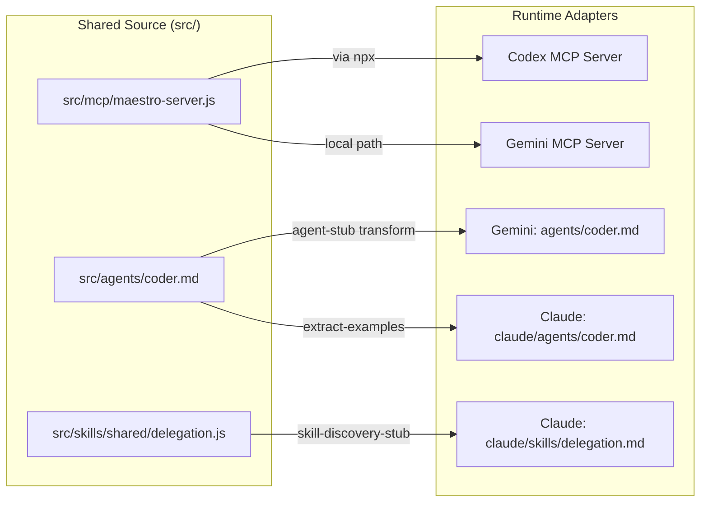
Sources: [docs/architecture.md:5-26](), [docs/architecture.md:98-100](), [plugins/maestro/README.md:23-30]()

---

# Page: Generator Pipeline

# Generator Pipeline

<details>
<summary>Relevant source files</summary>

The following files were used as context for generating this wiki page:

- [docs/architecture.md](docs/architecture.md)
- [docs/overview.md](docs/overview.md)
- [docs/runtime-codex.md](docs/runtime-codex.md)
- [docs/runtime-gemini.md](docs/runtime-gemini.md)
- [docs/runtime-qwen.md](docs/runtime-qwen.md)
- [docs/usage.md](docs/usage.md)
- [scripts/generate.js](scripts/generate.js)
- [src/generator/entry-point-expander.js](src/generator/entry-point-expander.js)
- [src/generator/payload-builder.js](src/generator/payload-builder.js)
- [tests/integration/entry-point-templates.test.js](tests/integration/entry-point-templates.test.js)
- [tests/integration/zero-diff.test.js](tests/integration/zero-diff.test.js)

</details>


The **Generator Pipeline** is the build boundary between Maestro's canonical source of truth and its four supported runtime targets. It implements a **src-first, generated-runtime** architecture where shared behavior, agent methodologies, and core logic are authored once in `src/` and automatically transformed into platform-specific manifests, entry-points, and detached payloads [docs/architecture.md:5-26]().

## Pipeline Overview

The generator, implemented in `scripts/generate.js`, orchestrates the transformation process through five distinct stages:

1.  **Configuration Loading**: Loads runtime-specific settings from `src/platforms/*/runtime-config.js` [scripts/generate.js:26-37]().
2.  **Manifest Expansion**: Resolves glob patterns and mapping rules from `src/manifest.js` into concrete source-to-output pairs [scripts/generate.js:85-87]().
3.  **Transform Execution**: Applies a series of functional transforms (e.g., frontmatter rebuilding, agent stubbing) to source content based on the target runtime [scripts/generate.js:39-66]().
4.  **Entry-Point Expansion**: Generates command surfaces (TOML for Gemini, Markdown skills for Claude/Codex) from the centralized registries [scripts/generate.js:68-76]().
5.  **Payload & Versioning**: Builds detached `src/` copies for plugin runtimes and stamps version metadata from `package.json` [scripts/generate.js:123-132]().

### Data Flow: Source to Runtime

The following diagram illustrates how a single source file in `src/` propagates through the pipeline to create distinct artifacts across the four runtimes.

**Figure 1: Generation Flow**
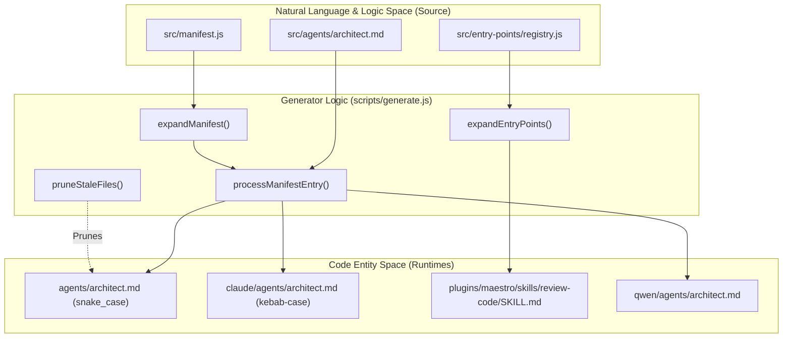
Sources: [docs/architecture.md:7-26](), [scripts/generate.js:8-13](), [src/generator/entry-point-expander.js:19-52]()

## The Manifest System

`src/manifest.js` is the declarative source of truth for file mapping. Each entry defines a source file (or glob), the target runtimes, and the sequence of transforms to apply [docs/architecture.md:40-59]().

### Transform Pipeline
The generator exposes six specialized transforms located in `src/transforms/` [docs/architecture.md:60-62]().

| Transform | Purpose |
| :--- | :--- |
| `parse-frontmatter` | Extracts YAML frontmatter into the pipeline state [docs/architecture.md:66](). |
| `extract-examples` | Extracts `<example>` blocks specifically for Claude's context window [docs/architecture.md:67](). |
| `rebuild-frontmatter` | Emits runtime-specific YAML (e.g., remapping tool names for Qwen) [docs/architecture.md:68](). |
| `agent-stub` | Replaces the agent body with an MCP delegation call to `get_agent()` [docs/architecture.md:69](). |
| `skill-discovery-stub` | Replaces shared skill bodies with a stub referencing `get_skill_content()` [docs/architecture.md:70](). |
| `skill-metadata` | Injects `user-invocable: false` into Claude skill frontmatter [docs/architecture.md:71](). |

Sources: [docs/architecture.md:60-72](), [scripts/generate.js:57-60]()

## Entry-Point Expansion

Maestro provides 9 entry-point commands (e.g., `review`, `debug`, `status`) and 3 core commands (`orchestrate`, `execute`, `resume`). The `expandEntryPoints` function in `src/generator/entry-point-expander.js` maps these to platform-specific surfaces [src/generator/entry-point-expander.js:126-149]().

### Platform Mapping Logic
- **Gemini**: Generates TOML commands in `commands/maestro/` using `gemini-command.toml.tmpl` [src/generator/entry-point-expander.js:20-24]().
- **Claude**: Generates Markdown skills in `claude/skills/` with a `protocol_block` preamble [src/generator/entry-point-expander.js:25-29]().
- **Codex**: Generates Markdown skills in `plugins/maestro/skills/` with a `refs_list` preamble [src/generator/entry-point-expander.js:30-34]().
- **Qwen**: Does not emit unique command files; it reuses the Gemini TOML commands at runtime [docs/runtime-qwen.md:44](), [src/generator/entry-point-expander.js:35]().

### Name Remapping
To avoid collisions with host-native commands (like Claude's built-in `/review`), the expander enforces a remapping strategy. For example, `review` is remapped to `review-code` for Claude and Codex [src/generator/entry-point-expander.js:10-17](), [tests/integration/entry-point-templates.test.js:25-33]().

Sources: [src/generator/entry-point-expander.js:19-52](), [tests/integration/entry-point-templates.test.js:1-53]()

## Detached Payloads and Pruning

For runtimes like Claude and Codex that may be installed as detached plugins, the generator creates a standalone `src/` directory within the runtime folder [scripts/generate.js:123-131]().

### Payload Building
The `buildDetachedPayload` function in `src/generator/payload-builder.js` performs a filtered sync of the root `src/` directory [src/generator/payload-builder.js:100-103](). It excludes "foreign adapters"—files belonging to other runtimes—ensuring that the Claude plugin does not contain Gemini-specific adapter logic [src/generator/payload-builder.js:19-28]().

### Stale Pruning
To prevent "ghost" files from lingering in generated directories, `pruneStaleFiles` compares the current filesystem against the manifest's intended output list [scripts/generate.js:116-117](). Any file in an "owned directory" (like `agents/` or `commands/`) that is not present in the manifest is deleted [scripts/generate.js:18](), [docs/architecture.md:36]().

Sources: [scripts/generate.js:116-132](), [src/generator/payload-builder.js:19-49](), [src/generator/stale-pruner.js:1-10]()

## Zero-Drift Guarantee

Maestro enforces a **Zero-Drift Guarantee** via CI. Developers are prohibited from editing generated files directly [docs/usage.md:45-47]().

### CI Enforcement
The `just check` command runs the generator in a clean environment and executes `git diff --exit-code` [docs/usage.md:32-36](). If the generated output differs from the committed artifacts by even a single character, the CI pipeline fails [docs/usage.md:52]().

**Figure 2: Zero-Drift Verification Architecture**
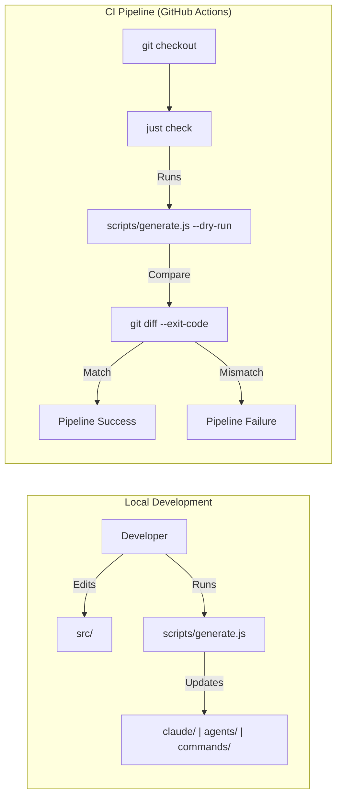
Sources: [docs/usage.md:32-52](), [tests/integration/zero-diff.test.js:5-44]()

---

# Page: Orchestration Workflow

# Orchestration Workflow

<details>
<summary>Relevant source files</summary>

The following files were used as context for generating this wiki page:

- [.gitignore](.gitignore)
- [CHANGELOG.md](CHANGELOG.md)
- [GEMINI.md](GEMINI.md)
- [USAGE.md](USAGE.md)
- [docs/architecture.md](docs/architecture.md)
- [docs/flow.md](docs/flow.md)
- [docs/overview.md](docs/overview.md)
- [docs/usage.md](docs/usage.md)
- [plugins/maestro/.mcp.json](plugins/maestro/.mcp.json)
- [src/skills/shared/design-dialogue/SKILL.md](src/skills/shared/design-dialogue/SKILL.md)
- [src/skills/shared/execution/SKILL.md](src/skills/shared/execution/SKILL.md)
- [src/skills/shared/implementation-planning/SKILL.md](src/skills/shared/implementation-planning/SKILL.md)
- [src/skills/shared/session-management/SKILL.md](src/skills/shared/session-management/SKILL.md)

</details>


The Maestro orchestrator operates as a **TechLead** persona that coordinates 39 specialized agents through structured, multi-phase workflows [GEMINI.md:1-12](). It serves as the primary intelligence layer, responsible for designing solutions, planning implementation phases, delegating tasks, and validating outputs [docs/overview.md:10-12]().

## 1. Workflow Modes

Maestro supports two distinct execution paths based on the complexity of the task, determined during the initial classification step [docs/flow.md:3]().

### 1.1 Standard Workflow
Designed for **medium** and **complex** tasks. It follows a rigorous 4-phase sequence to ensure architectural integrity and phased delivery [docs/flow.md:5-64]().

1.  **Design**: Structured dialogue to gather requirements and define architecture.
2.  **Plan**: Decomposition of the design into a Directed Acyclic Graph (DAG) of implementation phases.
3.  **Execute**: Phased delegation to specialist agents with automated validation.
4.  **Complete**: Final code review and session archival.

### 1.2 Express Workflow
Optimized for **simple** tasks that require only one agent and one phase [docs/overview.md:24](). It bypasses the formal Design and Planning phases, moving directly from a brief clarifying dialogue to execution and review [docs/flow.md:68-93]().

| Feature | Standard Workflow | Express Workflow |
| :--- | :--- | :--- |
| **Complexity** | Medium / Complex | Simple |
| **Phases** | 4 formal phases | 1 execution phase |
| **Skills Used** | `design-dialogue`, `implementation-planning` | Bypassed |
| **Approval** | Multi-gate (Design, Plan, Phase) | Single Brief approval |

**Sources:** [docs/overview.md:23-24](), [docs/flow.md:1-93](), [GEMINI.md:5-10]()

---

## 2. The 41-Step Orchestration Sequence

The orchestrator follows a precise sequence of 41 steps (0–40) to maintain state consistency across agent boundaries [docs/flow.md:3]().

### 2.1 Phase 1: Design
Phase 1 utilizes the `design-dialogue` skill to conduct a requirements-gathering conversation [src/skills/shared/design-dialogue/SKILL.md:6-10]().

*   **Depth Selector**: Users choose between **Quick**, **Standard**, or **Deep** reasoning modes [src/skills/shared/design-dialogue/SKILL.md:14-24]().
*   **Design Gate**: The orchestrator enters a restricted "Plan Mode" (if supported by the runtime) to prevent accidental file modifications during the conversation [src/skills/shared/design-dialogue/SKILL.md:10-12]().
*   **Grounding**: The `codebase_investigator` is used to analyze existing code before proposing architectural changes [src/skills/shared/design-dialogue/SKILL.md:32-49]().

### 2.2 Phase 2: Planning
The `implementation-planning` skill transforms the approved design into a phased implementation plan [src/skills/shared/implementation-planning/SKILL.md:6-10]().

*   **DAG Construction**: Phases are ordered such that "Foundation" (types/interfaces) precedes "Core Domain" and "Infrastructure" [src/skills/shared/implementation-planning/SKILL.md:58-72]().
*   **Validation Gate**: The `validate_plan` MCP tool is called to check for circular dependencies, agent capability mismatches, and file ownership overlaps [src/mcp/handlers/validate-plan.js:1-10](), [CHANGELOG.md:44]().

### 2.3 Phase 3: Execution
Execution involves delegating specific phases to the 39 specialist agents [docs/flow.md:43-54]().

*   **Execution Mode Gate**: The orchestrator determines if phases should run `parallel` or `sequential` based on `MAESTRO_EXECUTION_MODE` and the plan's dependency structure [src/skills/shared/execution/SKILL.md:10-47]().
*   **Delegation Protocol**: Every agent dispatch includes a required `Agent:` header, the `agent-base-protocol`, and a `Downstream Context` from previous phases [docs/flow.md:131-164]().

**Sources:** [docs/flow.md:5-64](), [src/skills/shared/design-dialogue/SKILL.md:1-108](), [src/skills/shared/implementation-planning/SKILL.md:1-108](), [src/skills/shared/execution/SKILL.md:1-108]()

---

## 3. Implementation and Data Flow

The orchestration logic is bridged between the LLM's reasoning and the local environment via the **MCP Server** and **Runtime Adapters**.

### 3.1 Code Entity Mapping: Orchestration Logic
The following diagram maps the logical orchestration steps to the specific code entities that implement them.

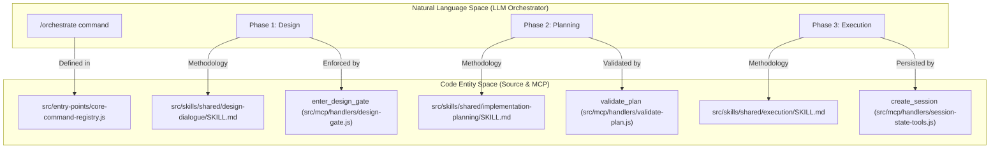
**Sources:** [docs/architecture.md:85-132](), [src/mcp/tool-packs/index.js:1-20](), [CHANGELOG.md:30-32]()

### 3.2 HARD-GATE Enforcement
Maestro uses "HARD-GATEs" to ensure the user remains in control and the state is valid before proceeding [src/skills/shared/execution/SKILL.md:19-21]().

1.  **Design Approval**: Requires `record_design_approval` via MCP before a session can be created [CHANGELOG.md:31]().
2.  **Plan Validation**: The `validate_plan` tool must return a success status before the plan is presented to the user [src/skills/shared/execution/SKILL.md:41]().
3.  **Execution Mode**: The `execution_mode` (parallel/sequential) must be recorded in session state before any delegation starts [src/skills/shared/execution/SKILL.md:19-21]().
4.  **Phase Transition**: Every phase must call `transition_phase` to update the canonical `active-session.md` [docs/flow.md:162]().

**Sources:** [src/skills/shared/execution/SKILL.md:19-21](), [CHANGELOG.md:31-32](), [docs/flow.md:156-163]()

---

## 4. Session Lifecycle

Sessions are persisted as Markdown files with YAML frontmatter in the `MAESTRO_STATE_DIR` [docs/usage.md:160-162]().

### 4.1 Lifecycle Diagram
This diagram illustrates the transition of a session from creation to archival, controlled by MCP tools.

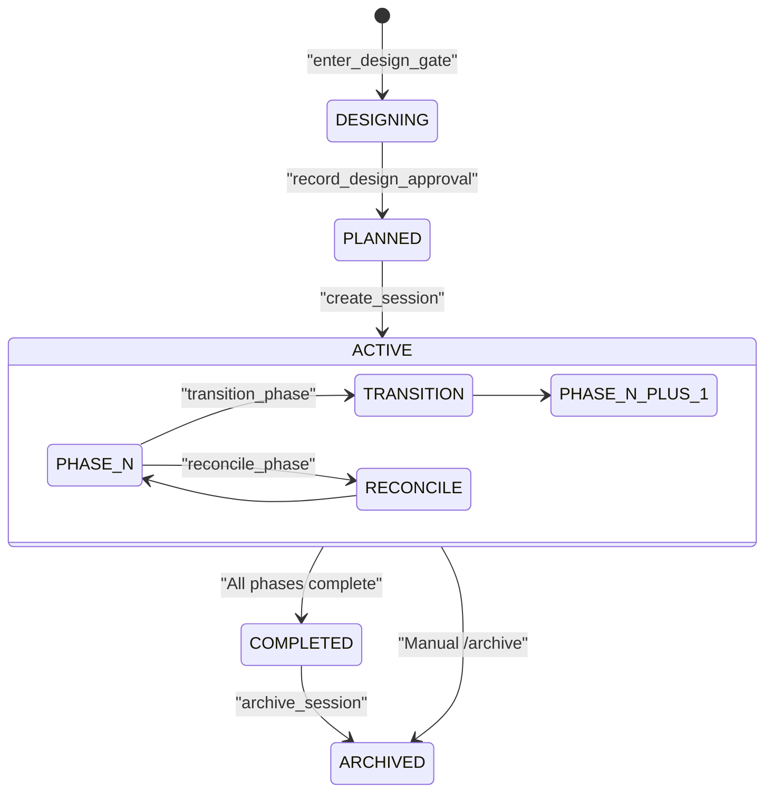

### 4.2 Key Lifecycle Tools
*   `create_session`: Initializes the `active-session.md` file with the implementation plan and metadata [src/mcp/handlers/session-state-tools.js:1-5]().
*   `transition_phase`: Atomically moves the session from one phase to the next, updating the `current_phase` and status [docs/flow.md:162]().
*   `reconcile_phase`: Used when an agent's actual file changes diverge from the plan [CHANGELOG.md:32]().
*   `archive_session`: Moves the active session to the `archive/` directory [docs/usage.md:151-152]().

**Sources:** [docs/usage.md:143-179](), [docs/flow.md:190-205](), [CHANGELOG.md:30-32]()

---

# Page: Session State Management

# Session State Management

<details>
<summary>Relevant source files</summary>

The following files were used as context for generating this wiki page:

- [CHANGELOG.md](CHANGELOG.md)
- [claude/src/mcp/handlers/session-state-tools.js](claude/src/mcp/handlers/session-state-tools.js)
- [docs/architecture.md](docs/architecture.md)
- [docs/overview.md](docs/overview.md)
- [docs/usage.md](docs/usage.md)
- [plugins/maestro/.mcp.json](plugins/maestro/.mcp.json)
- [plugins/maestro/src/mcp/handlers/session-state-tools.js](plugins/maestro/src/mcp/handlers/session-state-tools.js)
- [src/mcp/handlers/session-state-tools.js](src/mcp/handlers/session-state-tools.js)
- [src/skills/shared/session-management/SKILL.md](src/skills/shared/session-management/SKILL.md)
- [tests/unit/session-state-tools.test.js](tests/unit/session-state-tools.test.js)

</details>


Session state in Maestro is the source of truth for the orchestrator's progress through the multi-phase Standard and Express workflows. It is persisted as a Markdown file with YAML frontmatter, allowing both machine-readability for the MCP server and human-readability for developers.

## State Persistence Model

Maestro stores session data within a configurable directory, defaulting to `docs/maestro/` [docs/usage.md:62-62](). This directory is structured to separate active state from archived history and design artifacts [docs/usage.md:145-158]().

### Directory Structure
| Path | Description |
| :--- | :--- |
| `MAESTRO_STATE_DIR/state/active-session.md` | The current, locked session state [src/skills/shared/session-management/SKILL.md:48-48](). |
| `MAESTRO_STATE_DIR/state/archive/` | Historical session files moved after completion [docs/usage.md:151-152](). |
| `MAESTRO_STATE_DIR/plans/` | Materialized design documents and implementation plans [claude/src/mcp/handlers/session-state-tools.js:37-39](). |

### The `active-session.md` Format
The state file uses a hybrid format:
1.  **YAML Frontmatter**: Contains structured metadata including `session_id`, `current_phase`, `token_usage`, and a detailed `phases` array [docs/usage.md:164-212]().
2.  **Markdown Body**: Serves as the "Orchestration Log," where high-level narrative events are appended [src/skills/shared/session-management/SKILL.md:129-130]().

**Sources:** [docs/usage.md:145-212](), [src/skills/shared/session-management/SKILL.md:48-50](), [claude/src/mcp/handlers/session-state-tools.js:37-39]()

---

## Session Lifecycle & Transitions

The session lifecycle is managed through a series of discrete phases and "gates" that ensure the orchestrator does not proceed without valid configuration or approval.

### 1. Initialization (The Design Gate)
Before a session is created, the system often enters a **Design Gate**. This is a safety mechanism that enforces that a design document is approved by the user before execution begins [CHANGELOG.md:31-31]().
*   `enter_design_gate`: Initializes a temporary gate state.
*   `record_design_approval`: Marks the gate as approved and materializes the design document into the `plans/` directory [claude/src/mcp/handlers/session-state-tools.js:41-43]().
*   `create_session`: Consumes the approved gate to generate the `active-session.md` [claude/src/mcp/handlers/session-state-tools.js:171-174]().

### 2. Phase Execution & Reconciliation
As the orchestrator moves through the implementation plan, it transitions phase statuses: `pending` → `in_progress` → `completed` [src/skills/shared/session-management/SKILL.md:148-152]().
If an agent's actual file modifications diverge from the original plan, the `reconcile_phase` tool is used to update the session state to reflect the reality of the workspace [CHANGELOG.md:32-32]().

### 3. Archival
Upon completion (or manual termination), the `archive_session` tool moves the `active-session.md` to the `archive/` folder, renaming it to `<session_id>.md` [docs/usage.md:151-152]().

### Data Flow: State Transitions
Title: Session State Transition Logic
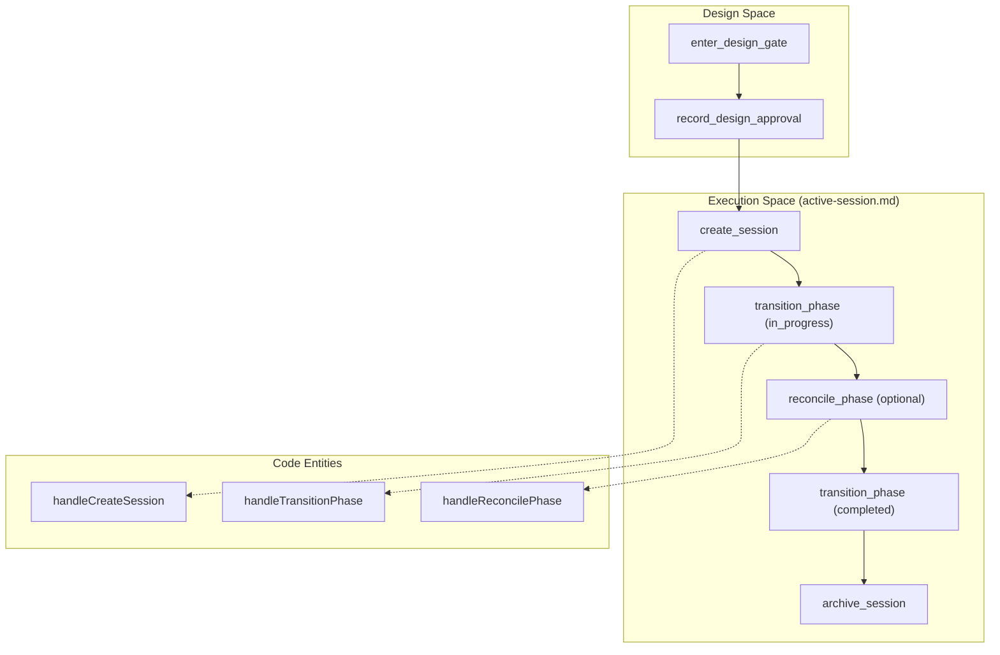
**Sources:** [CHANGELOG.md:31-32](), [claude/src/mcp/handlers/session-state-tools.js:166-174](), [src/skills/shared/session-management/SKILL.md:148-152]()

---

## Technical Implementation

### Transactional Safety: `withSessionState`
To prevent state corruption during concurrent operations (common in Gemini's parallel dispatch), all mutations are wrapped in the `withSessionState` helper [CHANGELOG.md:56-56](). This helper ensures a read-modify-write cycle is handled atomically.

Key internal functions in `src/mcp/handlers/session-state-core.js`:
*   `readActiveSession()`: Reads and parses the YAML/Markdown hybrid [claude/src/mcp/handlers/session-state-core.js:30-30]().
*   `writeActiveSession()`: Serializes and persists changes [claude/src/mcp/handlers/session-state-core.js:32-32]().
*   `withSessionState(projectRoot, callback)`: The primary transaction wrapper [claude/src/mcp/handlers/session-state-core.js:33-33]().

### The MCP Tool Pack (Session)
The Session Pack provides the external interface for LLMs to interact with the state [CHANGELOG.md:30-32]().

| Tool | Code Handler | Purpose |
| :--- | :--- | :--- |
| `create_session` | `handleCreateSession` | Initializes `active-session.md` from plans [claude/src/mcp/handlers/session-state-tools.js:166-166](). |
| `transition_phase` | `handleTransitionPhase` | Moves `current_phase` and updates status [src/skills/shared/session-management/SKILL.md:148-154](). |
| `update_session` | `handleUpdateSession` | General purpose metadata/token usage updates [src/skills/shared/session-management/SKILL.md:136-143](). |
| `reconcile_phase` | `handleReconcilePhase` | Aligns file manifests after agent execution [CHANGELOG.md:32-32](). |

### Entity Mapping: MCP to Implementation
Title: MCP Tool to Code Handler Mapping
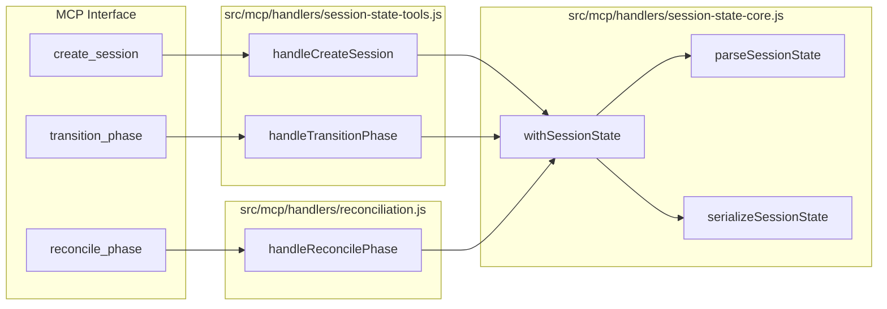
**Sources:** [CHANGELOG.md:56-56](), [claude/src/mcp/handlers/session-state-tools.js:1-34](), [src/mcp/handlers/session-state-tools.js:1-34](), [src/skills/shared/session-management/SKILL.md:12-15]()

---

## Hook-Level vs. Orchestration State

Maestro maintains a strict separation between **Orchestration State** (long-lived, project-visible) and **Hook State** (ephemeral, runtime-internal) [src/skills/shared/session-management/SKILL.md:19-33]().

| Feature | Orchestration State | Hook State |
| :--- | :--- | :--- |
| **Location** | `MAESTRO_STATE_DIR/state/` | `os.tmpdir()/maestro-hooks-<uid>/` |
| **Persistence** | Survives restarts; supports `/resume` | Ephemeral; lost on session end |
| **Primary Data** | Phase tracking, token usage, manifests | Active agent tracking (`active-agent` file) |
| **Management** | `session-management` skill via MCP | Hook runner (pre/post-delegation) |

**Sources:** [src/skills/shared/session-management/SKILL.md:19-33]()

---

# Page: Specialist Agent Roster

# Specialist Agent Roster

<details>
<summary>Relevant source files</summary>

The following files were used as context for generating this wiki page:

- [.gitignore](.gitignore)
- [GEMINI.md](GEMINI.md)
- [README.md](README.md)
- [USAGE.md](USAGE.md)
- [agents/architect.md](agents/architect.md)
- [agents/coder.md](agents/coder.md)
- [agents/debugger.md](agents/debugger.md)
- [agents/refactor.md](agents/refactor.md)
- [agents/tester.md](agents/tester.md)
- [claude/src/platforms/shared/agent-names.js](claude/src/platforms/shared/agent-names.js)
- [plugins/maestro/README.md](plugins/maestro/README.md)
- [src/platforms/shared/agent-names.js](src/platforms/shared/agent-names.js)
- [src/skills/shared/delegation/SKILL.md](src/skills/shared/delegation/SKILL.md)

</details>


The Specialist Agent Roster defines the 39 domain-specific agents available to the Maestro orchestrator. These agents are categorized by their expertise and restricted by capability tiers to ensure safe and efficient task execution. While the TechLead orchestrator coordinates the high-level workflow, implementation is delegated to these specialists [GEMINI.md:1-12]().

## Specialist Domains & Capabilities

Maestro organizes its 39 agents into capability tiers based on their tool access and destructive potential. Each agent is defined by a Markdown file in the `agents/` directory containing a YAML frontmatter schema that specifies its domain, tools, and model parameters [agents/architect.md:1-17]().

### Agent Taxonomy by Domain

| Domain | Signal / Purpose | Candidate Agents |
| :--- | :--- | :--- |
| **Engineering** | Code, infra, APIs, data, delivery | `architect`, `api_designer`, `coder`, `code_reviewer`, `tester`, `refactor`, `data_engineer`, `database_administrator`, `debugger`, `devops_engineer`, `integration_engineer`, `platform_engineer`, `cloud_architect`, `solutions_architect`, `site_reliability_engineer`, `observability_engineer`, `performance_engineer`, `security_engineer`, `technical_writer`, `release_manager` |
| **Product** | Requirements and user outcomes | `product_manager` |
| **Design** | UI/UX and interaction | `ux_designer`, `accessibility_specialist`, `design_system_engineer` |
| **Mainframe** | IBM ecosystem (COBOL, JCL, DB2) | `cobol_engineer`, `db2_dba`, `zos_sysprog`, `hlasm_assembler_specialist`, `ibm_i_specialist` |
| **ML/AI** | Model ops and prompt engineering | `ml_engineer`, `mlops_engineer`, `prompt_engineer` |
| **Compliance** | Security audits and data privacy | `compliance_reviewer` |

Sources: [GEMINI.md:77-90](), [src/platforms/shared/agent-names.js:2-14]()

### Capability Tiers (Access Control)

Agents are restricted to specific toolsets defined in their frontmatter. These toolsets determine the agent's "tier":

1.  **read_only**: Access to `read_file`, `list_directory`, `glob`, `grep_search`. (e.g., `architect` [agents/architect.md:5-13]())
2.  **read_shell**: Tier 1 + `run_shell_command` (limited to non-destructive commands). (e.g., `debugger` [agents/debugger.md:5-16]())
3.  **read_write**: Tier 2 + `write_file`, `replace`, `write_todos`. (e.g., `coder` [agents/coder.md:5-20](), `tester` [agents/tester.md:5-21]())
4.  **full**: Tier 3 + `activate_skill` (capability to trigger other Maestro workflows). (e.g., `refactor` [agents/refactor.md:5-20]())

## Agent Lifecycle & Delegation

Maestro uses a "Stub and Fetch" model. Instead of loading 39 full system prompts into the orchestrator's context, it uses thin stubs and fetches full methodology on-demand via MCP.

### Stub Generation & Naming
The generator pipeline [src/manifest.js]() creates agent stubs for each runtime.
*   **Gemini/Qwen**: Uses `snake_case` (e.g., `api_designer`) [README.md:16]().
*   **Claude Code**: Uses `kebab-case` with a `maestro:` prefix (e.g., `maestro:api-designer`) [README.md:17]().

### Data Flow: get_agent Delegation

The following diagram illustrates how the TechLead orchestrator transitions from "Natural Language" planning to "Code Entity" execution by fetching agent methodology.

**Agent Delegation Sequence**
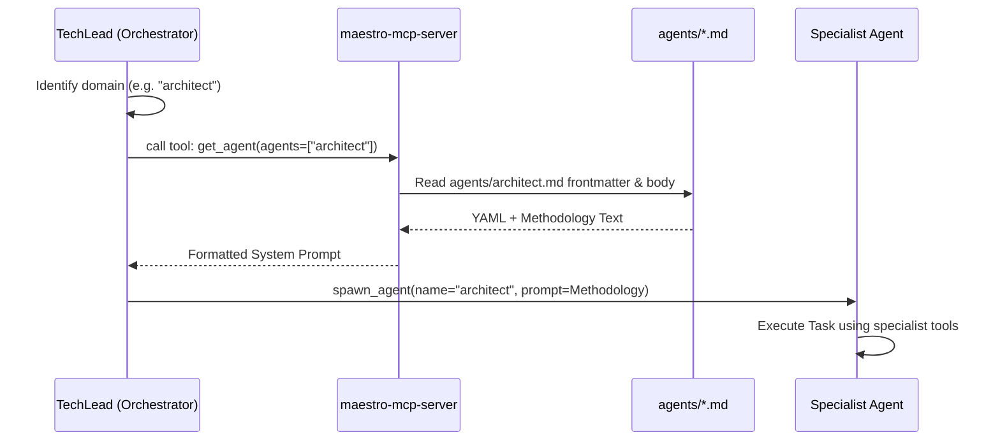
Sources: [agents/architect.md:19-20](), [plugins/maestro/README.md:29](), [GEMINI.md:14-15]()

## Frontmatter Schema Reference

Every specialist agent is defined by a strict YAML frontmatter in `agents/`. This schema is used by the `get_agent` MCP tool to configure the subagent's execution environment.

| Field | Description | Example Value |
| :--- | :--- | :--- |
| `name` | Canonical identifier | `coder` |
| `kind` | Deployment type | `local` |
| `description` | Used by TechLead for planning | "Implementation specialist..." |
| `tools` | Array of allowed MCP tools | `["read_file", "write_file"]` |
| `temperature` | LLM sampling temperature | `0.2` |
| `max_turns` | Limit on tool-use iterations | `25` |
| `timeout_mins` | Execution time limit | `10` |

**Agent Implementation Mapping**
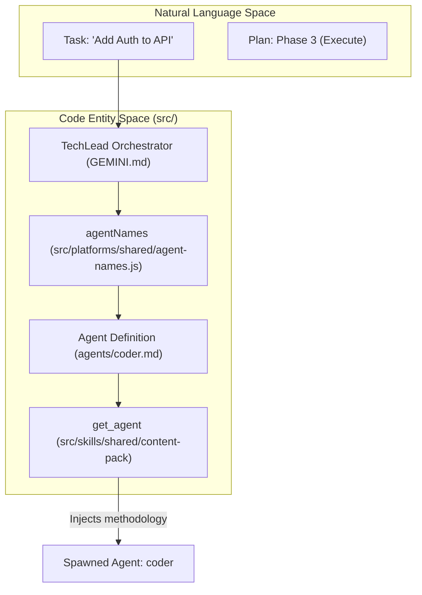
Sources: [agents/coder.md:1-22](), [src/platforms/shared/agent-names.js:1-15](), [GEMINI.md:73-91]()

## Implementation Details

### get_agent Tool
The `get_agent` tool is the primary mechanism for loading specialist instructions. It prevents context bloat in the TechLead orchestrator by only loading the methodology for the specific agents required for the current phase [GEMINI.md:42-45]().

### Agent Disabling
Users can exclude specific agents from the roster by setting the `MAESTRO_DISABLED_AGENTS` environment variable. The TechLead calls `resolve_settings` at startup to parse this list and removes these agents from its planning candidates [GEMINI.md:24-27]().

Sources: [README.md:143](), [GEMINI.md:51-61](), [claude/src/platforms/shared/agent-names.js:1-15]()

---

# Page: MCP Server

# MCP Server

<details>
<summary>Relevant source files</summary>

The following files were used as context for generating this wiki page:

- [CHANGELOG.md](CHANGELOG.md)
- [claude/src/mcp/maestro-server.js](claude/src/mcp/maestro-server.js)
- [claude/src/version.json](claude/src/version.json)
- [gemini-extension.json](gemini-extension.json)
- [package-lock.json](package-lock.json)
- [plugins/maestro/.codex-plugin/plugin.json](plugins/maestro/.codex-plugin/plugin.json)
- [plugins/maestro/.mcp.json](plugins/maestro/.mcp.json)
- [plugins/maestro/src/mcp/maestro-server.js](plugins/maestro/src/mcp/maestro-server.js)
- [plugins/maestro/src/version.json](plugins/maestro/src/version.json)
- [src/mcp/maestro-server.js](src/mcp/maestro-server.js)

</details>


The `maestro-mcp-server` is the central coordination engine for the Maestro platform. It implements the Model Context Protocol (MCP) using a JSON-RPC 2.0 interface to provide LLM runtimes with structured access to workspace management, session orchestration, and specialist agent content.

### Purpose and Scope
The server acts as a bridge between the high-level natural language instructions of the user and the low-level file operations and state transitions required for multi-agent orchestration. It abstracts away the differences between runtimes (Gemini, Claude, Codex, Qwen) while enforcing a strict 4-phase orchestration methodology.

## Architecture & Lifecycle

The server is implemented in Node.js and uses a line-based JSON-RPC dispatcher. It maintains a `ProjectRootCache` to resolve workspace paths across different runtime environments and uses a `ToolRegistry` to manage the 17 core orchestration tools.

### Server Startup Flow
The entry point is `src/mcp/maestro-server.js`. When the server starts, it initializes the protocol handlers and sets up the communication channel (standard I/O).

Maestro Server Initialization Sequence:
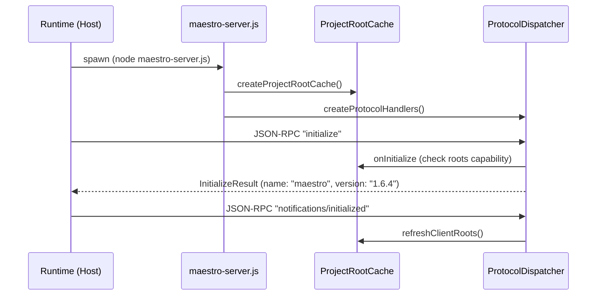
Sources: [src/mcp/maestro-server.js:22-71](), [src/mcp/maestro-server.js:81-88]()

### Connection Strategy by Runtime
Each runtime connects to the MCP server using specific configuration manifests:

| Runtime | Connection Method | Config File |
| :--- | :--- | :--- |
| **Gemini** | Direct `node` spawn of `mcp/maestro-server.js` | `gemini-extension.json` |
| **Claude** | Detached or repo-relative MCP server | `claude/src/mcp/maestro-server.js` |
| **Codex** | `npx -y @josstei/maestro maestro-mcp-server` | `plugins/maestro/.mcp.json` |
| **Qwen** | Shared config with Gemini | `qwen-extension.json` |

Sources: [gemini-extension.json:43-55](), [plugins/maestro/.mcp.json:1-16](), [CHANGELOG.md:39-40]()

## Tool Pack Overview

The server organizes its 17 tools into three functional "Packs". These tools are the primary interface through which an LLM interacts with the Maestro system.

### 1. Workspace Pack
Focuses on environment setup and pre-flight checks. It includes `initialize_workspace` for setting the canonical root and `assess_task_complexity` for initial project analysis.
*   **Key Logic**: Enforces the `requiresWorkspace` contract before any destructive or stateful tools are called [CHANGELOG.md:41-42]().
*   **For details, see [MCP Tool Packs](#3.1)**.

### 2. Session Pack
Manages the state machine of a Maestro session. It handles the transition between Design, Plan, Execute, and Complete phases.
*   **Key Logic**: Implements the Design Gate lifecycle (`enter_design_gate`, `record_design_approval`) and phase reconciliation [CHANGELOG.md:30-32]().
*   **For details, see [MCP Tool Packs](#3.1)**.

### 3. Content Pack
Provides the LLM with the raw materials needed for execution, such as agent personas and skill definitions.
*   **Key Logic**: Uses `get_agent` to load specialist frontmatter and `get_runtime_context` to expose machine-readable constraints (e.g., parallelization limits) [CHANGELOG.md:46-48]().
*   **For details, see [MCP Tool Packs](#3.1)**.

## Plan Validation & Safety

The MCP server is responsible for ensuring that implementation plans generated by the LLM are safe, logical, and executable. This is primarily handled by the `validate_plan` tool.

### Validation Pipeline
When an LLM submits a plan, the server runs a series of checks:
1.  **Schema Check**: Ensures the JSON structure matches the `plan-schema.js` contract [CHANGELOG.md:44-44]().
2.  **Capability Check**: Verifies that assigned agents have the necessary permissions (e.g., `read_write`) for their assigned files.
3.  **DAG Analysis**: Detects circular dependencies and calculates the optimal parallelization profile.
4.  **Overlap Detection**: Blocks multiple agents from writing to the same file in the same parallel phase.

**For details, see [Plan Validation & DAG Checker](#3.2)**.

## Code Entity Mapping

The following diagram maps natural language concepts to the specific code entities within the `maestro-mcp-server` architecture.

Mapping Logic to Code Entities:
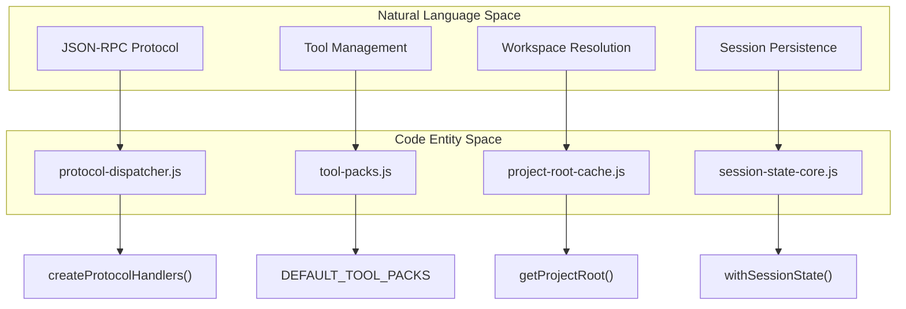
Sources: [src/mcp/maestro-server.js:5-20](), [src/mcp/maestro-server.js:42-56](), [CHANGELOG.md:56-56]()

## Configuration & Environment

The server's behavior is influenced by environment variables defined in the runtime manifests.

| Variable | Description | Default |
| :--- | :--- | :--- |
| `MAESTRO_RUNTIME` | Identifies the host runtime (e.g., `gemini`, `codex`) | (Detected) |
| `MAESTRO_STATE_DIR` | Directory where session `.md` files are stored | `docs/maestro` |
| `MAESTRO_MAX_CONCURRENT` | Limit for parallel subagent dispatch | `0` (unlimited) |
| `MAESTRO_EXECUTION_MODE` | Controls phase 3 flow (`parallel`, `sequential`, `ask`) | `ask` |

Sources: [gemini-extension.json:6-41](), [src/mcp/maestro-server.js:99-103]()

---

# Page: MCP Tool Packs

# MCP Tool Packs

<details>
<summary>Relevant source files</summary>

The following files were used as context for generating this wiki page:

- [CHANGELOG.md](CHANGELOG.md)
- [claude/src/mcp/handlers/get-runtime-context.js](claude/src/mcp/handlers/get-runtime-context.js)
- [claude/src/mcp/handlers/session-state-core.js](claude/src/mcp/handlers/session-state-core.js)
- [claude/src/mcp/handlers/session-state-tools.js](claude/src/mcp/handlers/session-state-tools.js)
- [claude/src/mcp/handlers/validate-plan.js](claude/src/mcp/handlers/validate-plan.js)
- [claude/src/mcp/validation/agent-checker.js](claude/src/mcp/validation/agent-checker.js)
- [claude/src/mcp/validation/schema-checker.js](claude/src/mcp/validation/schema-checker.js)
- [claude/src/platforms/claude/runtime-config.js](claude/src/platforms/claude/runtime-config.js)
- [docs/architecture.md](docs/architecture.md)
- [docs/overview.md](docs/overview.md)
- [docs/usage.md](docs/usage.md)
- [plugins/maestro/.mcp.json](plugins/maestro/.mcp.json)
- [plugins/maestro/src/mcp/handlers/get-runtime-context.js](plugins/maestro/src/mcp/handlers/get-runtime-context.js)
- [plugins/maestro/src/mcp/handlers/session-state-tools.js](plugins/maestro/src/mcp/handlers/session-state-tools.js)
- [plugins/maestro/src/platforms/codex/runtime-config.js](plugins/maestro/src/platforms/codex/runtime-config.js)
- [src/mcp/handlers/get-runtime-context.js](src/mcp/handlers/get-runtime-context.js)
- [src/mcp/handlers/session-state-tools.js](src/mcp/handlers/session-state-tools.js)
- [tests/unit/session-state-tools.test.js](tests/unit/session-state-tools.test.js)

</details>


The Maestro MCP Server provides a suite of 17 specialized tools designed to facilitate multi-agent orchestration. These tools are logically grouped into three packs: **Workspace**, **Session**, and **Content**. The server implements the Model Context Protocol (MCP) JSON-RPC 2.0 interface, allowing various LLM runtimes (Claude, Gemini, Codex, Qwen) to interact with the local filesystem and session state in a standardized way [src/mcp/maestro-server.js:100-106]().

### Tool Pack Architecture

The tools are defined in `src/mcp/tool-packs/` and registered via a central registry that enforces constraints like `requiresWorkspace` [CHANGELOG.md:41-41]().

| Pack | Tool Count | Purpose |
| :--- | :--- | :--- |
| **Workspace Pack** | 4 | Environment initialization, task complexity assessment, and plan validation. |
| **Session Pack** | 10 | Lifecycle management, phase transitions, and design-gate enforcement. |
| **Content Pack** | 3 | Dynamic retrieval of agent methodologies, skills, and runtime metadata. |

---

## 1. Workspace Pack

The Workspace Pack manages the initial interaction between the LLM and the repository. It handles the "Design" and "Plan" phases of the Standard workflow [docs/overview.md:108-108]().

### Key Tools

*   `initialize_workspace`: Sets up the canonical `MAESTRO_STATE_DIR` (default: `docs/maestro/`) and writes a marker file to verify the project root [CHANGELOG.md:42-42]().
*   `assess_task_complexity`: Analyzes the repository using framework indicators and configuration files to classify tasks as `simple`, `medium`, or `complex` [src/lib/framework-detection.js:54-54]().
*   `validate_plan`: Performs deep analysis on implementation plans, including DAG cycle detection and file overlap checks [CHANGELOG.md:44-44]().
*   `resolve_settings`: Aggregates configuration from environment variables, workspace `.env`, and defaults [docs/usage.md:58-60]().

### Natural Language to Code: Plan Validation Flow

The following diagram illustrates how a natural language request to "validate the plan" triggers specific code entities within the Workspace Pack.

"Plan Validation Data Flow"
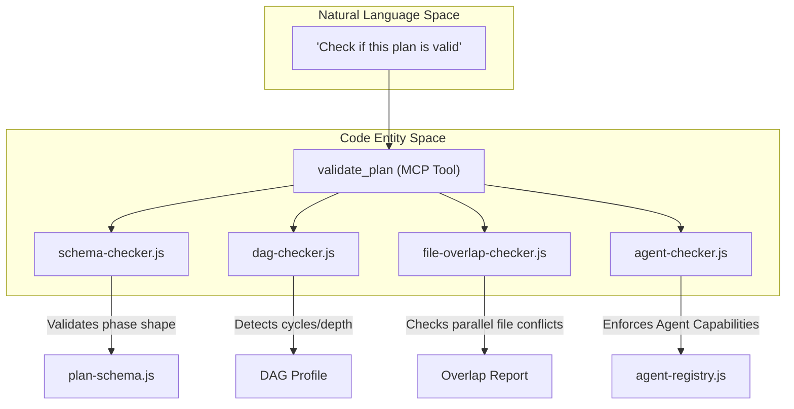
Sources: [src/mcp/handlers/validate-plan.js:1-10](), [CHANGELOG.md:44-44](), [src/mcp/tool-packs/workspace/index.js:1-10]()

---

## 2. Session Pack

The Session Pack manages the stateful lifecycle of an orchestration task. It utilizes `session-state-core.js` for atomic transactions on the `active-session.md` file [src/mcp/handlers/session-state-core.js:33-34]().

### Lifecycle and Design Gates
The Session Pack enforces a **Design Gate**. A session cannot be created via `create_session` if a design gate has been entered but not yet approved via `record_design_approval` [src/mcp/handlers/session-state-tools.js:171-175]().

### Tools Reference
| Tool | Function |
| :--- | :--- |
| `create_session` | Materializes the session and implementation plan into the state directory [src/mcp/handlers/session-state-tools.js:166-170](). |
| `transition_phase` | Advances the `current_phase` and handles downstream context handoffs [src/mcp/handlers/session-state-tools.js:8-13](). |
| `reconcile_phase` | Syncs the actual file manifest with the plan if an agent deviates [CHANGELOG.md:32-32](). |
| `archive_session` | Moves the active session and associated plans to the `archive/` directory [docs/usage.md:151-158](). |

"Session State Transaction Flow"
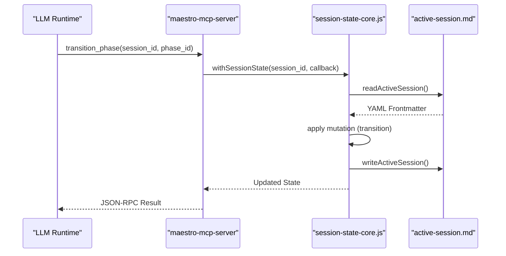
Sources: [src/mcp/handlers/session-state-core.js:33-34](), [src/mcp/handlers/session-state-tools.js:33-34]()

---

## 3. Content Pack

The Content Pack provides the "brain" of the orchestrator, serving methodologies and runtime-specific metadata.

### Content Resolution Logic
*   `get_agent`: Retrieves the Markdown methodology for one of the 39 specialist agents. It applies the `agent-stub` transform to replace the body with an MCP delegation call [docs/architecture.md:69-69]().
*   `get_skill_content`: Serves the 7 shared skills (e.g., `delegation`, `code-review`). In Claude and Gemini, these are resolved via the filesystem; in Codex, they are served as detached payloads [docs/architecture.md:141-144]().
*   `get_runtime_context`: Returns a machine-readable snapshot of the current environment, including agent naming conventions (`snake_case` vs `kebab-case`) and delegation patterns [src/mcp/handlers/get-runtime-context.js:27-45]().

### Runtime Context Schema
The `get_runtime_context` tool is critical for cross-platform compatibility.

| Field | Purpose | Example (Claude) |
| :--- | :--- | :--- |
| `agent_dispatch.pattern` | How to call a sub-agent | `Agent(subagent_type: "maestro:{{agent}}", ...)` |
| `mcp_prefix` | The runtime's specific MCP tool prefix | `mcp__plugin_maestro_maestro__` |
| `plan_mode_native` | Whether the host supports native plan mode | `true` |
| `workspace_suggestion` | Recommended path if auto-resolution fails | `/home/user/project` |

Sources: [src/mcp/handlers/get-runtime-context.js:7-13](), [src/mcp/handlers/get-runtime-context.js:27-45](), [CHANGELOG.md:46-48]()

---

## Implementation Details

### Data Flow: Content Materialization
When `create_session` or `record_design_approval` is called, the server must handle path resolution differences between runtimes (e.g., Gemini's temporary execution roots). To solve this, the tools accept both a `path` and a `content` variant [CHANGELOG.md:43-43]().

1.  **Content Variant**: If `implementation_plan_content` is provided, `writePlansDocumentContent` materializes the bytes atomically into the `plans/` directory [src/mcp/handlers/session-state-tools.js:111-116]().
2.  **Path Variant**: If only a path is provided, `materializeSessionDocument` verifies the file exists on the local disk before proceeding [src/mcp/handlers/session-state-tools.js:51-66]().

### Dependency Management
The MCP server uses a shared contract for plan phases defined in `src/mcp/contracts/plan-schema.js`. This ensures that the structure validated by `validate_plan` is identical to the structure persisted by `create_session` [CHANGELOG.md:44-44]().

Sources: [src/mcp/handlers/session-state-tools.js:1-13](), [src/mcp/handlers/session-state-tools.js:86-124]()

---

# Page: Plan Validation & DAG Checker

# Plan Validation & DAG Checker

<details>
<summary>Relevant source files</summary>

The following files were used as context for generating this wiki page:

- [CHANGELOG.md](CHANGELOG.md)
- [claude/src/mcp/handlers/session-state-core.js](claude/src/mcp/handlers/session-state-core.js)
- [claude/src/mcp/handlers/validate-plan.js](claude/src/mcp/handlers/validate-plan.js)
- [claude/src/mcp/validation/agent-checker.js](claude/src/mcp/validation/agent-checker.js)
- [claude/src/mcp/validation/schema-checker.js](claude/src/mcp/validation/schema-checker.js)
- [claude/src/platforms/claude/runtime-config.js](claude/src/platforms/claude/runtime-config.js)
- [plugins/maestro/.mcp.json](plugins/maestro/.mcp.json)
- [tests/unit/adapter-factory.test.js](tests/unit/adapter-factory.test.js)
- [tests/unit/assess-task-complexity.test.js](tests/unit/assess-task-complexity.test.js)
- [tests/unit/check-layer-boundaries.test.js](tests/unit/check-layer-boundaries.test.js)
- [tests/unit/line-reader.test.js](tests/unit/line-reader.test.js)
- [tests/unit/manifest-curator.test.js](tests/unit/manifest-curator.test.js)
- [tests/unit/protocol-dispatcher.test.js](tests/unit/protocol-dispatcher.test.js)

</details>


The `validate_plan` tool is a critical component of the **Orchestration Workflow**, serving as a gatekeeper between the **Design** and **Plan** phases. It ensures that the implementation plan generated by the orchestrator is structurally sound, logically consistent, and executable within the constraints of the assigned specialist agents.

## Validation Pipeline Overview

The validation process is implemented in `handleValidatePlan` [claude/src/mcp/handlers/validate-plan.js:22-72](). It executes a series of specialized checkers in a specific order to catch errors ranging from basic JSON schema violations to complex circular dependencies in the task graph.

### Data Flow & Logic Execution

The following diagram illustrates how a plan payload is processed through the validation layers:

**Plan Validation Flow**
```mermaid
graph TD
    subgraph "Input Space"
        P["Implementation Plan (JSON)"]
        TC["Task Complexity Metadata"]
    end

    subgraph "Code Entity Space: validate-plan.js"
        V["handleValidatePlan"]
        SC["schema-checker.js"]
        AC["agent-checker.js"]
        DC["dag-checker.js"]
        FC["file-overlap-checker.js"]
    end

    P --> V
    TC --> V
    
    V -->|"1. Structural Check"| SC
    SC -->|"checkPlanShape"| V
    SC -->|"checkPhaseFieldSchema"| V
    
    V -->|"2. Agent Verification"| AC
    AC -->|"checkUnknownAgents"| V
    AC -->|"checkAgentCapabilities"| V
    
    V -->|"3. Graph Analysis"| DC
    DC -->|"checkCycles"| V
    DC -->|"computeDepths"| V
    
    V -->|"4. Parallel Safety"| FC
    FC -->|"checkFileOverlap"| V
    
    V -->|"5. Optimization"| DC
    DC -->|"buildParallelizationProfile"| V
```
**Sources:** [claude/src/mcp/handlers/validate-plan.js:22-72](), [claude/src/mcp/validation/schema-checker.js:1-9](), [claude/src/mcp/validation/agent-checker.js:1-13]()

---

## 1. Schema & Structural Validation
The first layer ensures the plan conforms to the `Plan` and `Phase` contracts.

*   **Shape Check**: `checkPlanShape` verifies the top-level structure (e.g., presence of a `phases` array) [claude/src/mcp/handlers/validate-plan.js:25-32]().
*   **Field Schema**: `checkPhaseFieldSchema` validates that individual phases contain required fields like `id`, `name`, `agent`, and `description` [claude/src/mcp/handlers/validate-plan.js:34-41]().
*   **Integrity Checks**:
    *   `checkDuplicateIds`: Ensures every phase has a unique ID [claude/src/mcp/handlers/validate-plan.js:48-48]().
    *   `checkDanglingDependencies`: Verifies that any ID listed in `depends_on` actually exists within the plan [claude/src/mcp/handlers/validate-plan.js:49-49]().
    *   `checkPhaseCount`: Compares the number of phases against the `task_complexity` to warn if a plan is suspiciously simple or overly complex [claude/src/mcp/handlers/validate-plan.js:47-47]().

**Sources:** [claude/src/mcp/handlers/validate-plan.js:25-50](), [CHANGELOG.md:44-44]()

---

## 2. Agent Capability Enforcement
The `agent-checker.js` module enforces that the assigned specialist agents are capable of performing the tasks described in their phases.

### Capability Mismatch Detection
Maestro uses the `agent-registry` to look up the capability tier of an agent (e.g., `read_only`, `read_write`, `full`) [claude/src/mcp/validation/agent-checker.js:3-8]().

| Check Type | Trigger | Severity |
| :--- | :--- | :--- |
| **Unknown Agent** | Agent name not found in `KNOWN_AGENTS` | `error` |
| **Explicit Mutation** | `read_only` agent assigned to phase with `files`, `files_created`, or `files_modified` | `error` |
| **Implicit Mutation** | `read_only` agent assigned to phase name containing "create", "implement", "build" | `warning` |

**Code Implementation**:
*   `checkUnknownAgents`: Normalizes names to `kebab-case` or `snake_case` (depending on runtime) before checking the registry [claude/src/mcp/validation/agent-checker.js:16-29]().
*   `checkAgentCapabilities`: Uses `canCreateFiles(normalizedAgent)` to block read-only agents from implementation tasks [claude/src/mcp/validation/agent-checker.js:38-76]().

**Sources:** [claude/src/mcp/validation/agent-checker.js:16-76](), [CHANGELOG.md:33-38]()

---

## 3. DAG Analysis & Cycle Detection
The `dag-checker.js` treats the plan as a Directed Acyclic Graph (DAG) where phases are nodes and `depends_on` entries are edges.

### Core Algorithms
1.  **Cycle Detection (`checkCycles`)**: Uses a depth-first search to identify circular dependencies. If a cycle is detected, further graph analysis (like depth computation) is aborted to prevent infinite loops [claude/src/mcp/handlers/validate-plan.js:55-60]().
2.  **Depth Computation (`computeDepths`)**: Calculates the longest path from a root node to each phase. This depth determines the "execution layer" for parallelization [claude/src/mcp/handlers/validate-plan.js:61-61]().
3.  **Redundant Dependency Pruning**: Identifies "shortcuts" in the graph. If Phase C depends on both Phase A and Phase B, but Phase B already depends on Phase A, the direct dependency from C to A is redundant [claude/src/mcp/handlers/validate-plan.js:63-63]().

**Sources:** [claude/src/mcp/handlers/validate-plan.js:52-65]()

---

## 4. Parallelization Safety
Maestro supports parallel execution of phases that reside at the same "depth" in the DAG. However, this introduces the risk of file-access conflicts.

### File Overlap Checker
The `checkFileOverlap` function analyzes the `files` (or `files_modified`/`files_created`) arrays of all phases scheduled for the same depth [claude/src/mcp/handlers/validate-plan.js:62-62]().

*   **Violation**: If two phases at the same depth claim to modify the same file, a validation error is raised.
*   **Resolution**: The user/orchestrator must add a dependency between these phases to force sequential execution, or split the file responsibilities.

**Sources:** [claude/src/mcp/validation/file-overlap-checker.js:20-20](), [CHANGELOG.md:44-44]()

---

## 5. Parallelization Profile Output
If the plan is valid, `validate_plan` returns a `parallelization_profile` [claude/src/mcp/handlers/validate-plan.js:64-64](). This metadata is used by the orchestrator to optimize execution.

**Structure of the Profile:**
```json
{
  "max_width": 3,
  "total_depth": 5,
  "layers": [
    { "depth": 0, "phase_ids": ["init-repo"] },
    { "depth": 1, "phase_ids": ["pkg-auth", "db-schema", "ui-scaffold"] }
  ]
}
```

**Code Entity to System Name Mapping**
```mermaid
classDiagram
    class handleValidatePlan {
        +plan: Object
        +taskComplexity: String
        +execute()
    }
    class SchemaChecker {
        +checkPlanShape()
        +checkPhaseFieldSchema()
    }
    class AgentChecker {
        +checkUnknownAgents()
        +checkAgentCapabilities()
    }
    class DAGChecker {
        +checkCycles()
        +computeDepths()
        +buildParallelizationProfile()
    }
    
    handleValidatePlan ..> SchemaChecker : uses
    handleValidatePlan ..> AgentChecker : uses
    handleValidatePlan ..> DAGChecker : uses
    
    note for handleValidatePlan "Defined in claude/src/mcp/handlers/validate-plan.js"
    note for SchemaChecker "Defined in claude/src/mcp/validation/schema-checker.js"
    note for AgentChecker "Defined in claude/src/mcp/validation/agent-checker.js"
    note for DAGChecker "Defined in claude/src/mcp/validation/dag-checker.js"
```

**Sources:** [claude/src/mcp/handlers/validate-plan.js:1-20](), [claude/src/mcp/handlers/validate-plan.js:67-71]()

---

# Page: Runtime Targets

# Runtime Targets

<details>
<summary>Relevant source files</summary>

The following files were used as context for generating this wiki page:

- [QWEN.md](QWEN.md)
- [README.md](README.md)
- [docs/runtime-claude.md](docs/runtime-claude.md)
- [docs/runtime-codex.md](docs/runtime-codex.md)
- [docs/runtime-gemini.md](docs/runtime-gemini.md)
- [docs/runtime-qwen.md](docs/runtime-qwen.md)
- [gemini-extension.json](gemini-extension.json)
- [plugins/maestro/README.md](plugins/maestro/README.md)
- [qwen-extension.json](qwen-extension.json)
- [scripts/generate.js](scripts/generate.js)

</details>


Maestro is a multi-agent development orchestration platform designed to run across four distinct LLM runtimes from a single canonical source tree [README.md:10-10](). While the core logic, agent methodologies, and orchestration workflows are shared, each runtime requires specific manifests, naming conventions, and integration patterns to function natively within its host environment.

### Supported Runtimes Overview

Maestro generates and maintains four target outputs via the `scripts/generate.js` pipeline [scripts/generate.js:82-132]().

| Runtime | Location | Public Surface | Agent Naming |
|---------|----------|----------------|--------------|
| **Gemini CLI** | Repo Root | `/maestro:*` | `snake_case` |
| **Claude Code** | `claude/` | `/orchestrate`, `/review-code` | `kebab-case` |
| **Codex** | `plugins/maestro/` | `$maestro:*` | `kebab-case` |
| **Qwen Code** | `qwen/` | `/maestro:*` | `snake_case` |

Sources: [README.md:14-19](), [docs/runtime-gemini.md:29-29](), [docs/runtime-claude.md:30-30](), [docs/runtime-codex.md:61-63](), [docs/runtime-qwen.md:27-29]()

---

### Shared Runtime Architecture

All runtimes bridge the "Natural Language Space" (Agent instructions and user prompts) to the "Code Entity Space" (MCP tools and local scripts) using a unified server and hook system.

**Runtime-to-Code Mapping**
```mermaid
graph TD
    subgraph "Natural Language Space"
        User["User Prompt"]
        Orchestrator["TechLead Orchestrator"]
        Agents["39 Specialist Agents"]
    end

    subgraph "Code Entity Space"
        MCPServer["mcp/maestro-server.js"]
        HookRunner["hooks/hook-runner.js"]
        Adapters["hooks/adapters/*-adapter.js"]
        StateDir["docs/maestro/ (Session State)"]
    end

    User --> Orchestrator
    Orchestrator -- "get_agent" --> MCPServer
    Orchestrator -- "delegation" --> Agents
    Agents -- "MCP Tool Calls" --> MCPServer
    MCPServer -- "Persistence" --> StateDir
    
    Agents -- "Lifecycle Events" --> HookRunner
    HookRunner -- "Normalize Input" --> Adapters
```
Sources: [gemini-extension.json:43-55](), [docs/runtime-qwen.md:11-25](), [docs/runtime-claude.md:64-73](), [plugins/maestro/README.md:23-30]()

---

### Gemini CLI Runtime
The Gemini CLI extension lives at the repository root and is the primary development target [docs/runtime-gemini.md:1-3](). It uses a `gemini-extension.json` manifest and a `GEMINI.md` context file to define the orchestrator's behavior [gemini-extension.json:1-5]().

*   **Commands:** 12 TOML-based commands in `commands/maestro/` [docs/runtime-gemini.md:42-44]().
*   **Hooks:** Uses `BeforeAgent` and `AfterAgent` events for session context injection and task report validation [docs/runtime-gemini.md:61-70]().
*   **Policy:** Enforces shell safety via `policies/maestro.toml` [docs/runtime-gemini.md:96-98]().

For details, see [Gemini CLI Runtime](#4.1).

Sources: [gemini-extension.json:1-56](), [docs/runtime-gemini.md:1-174]()

---

### Claude Code Runtime
The Claude Code runtime is located in the `claude/` subdirectory [docs/runtime-claude.md:1-3](). It uses a `plugin.json` manifest and supports kebab-case agent naming (e.g., `code-reviewer`) [docs/runtime-claude.md:28-32]().

*   **Dual-Resolution MCP:** The server prefers the canonical repo `src/` but can fall back to a bundled `claude/src/` for detached installs [docs/runtime-claude.md:26-26]().
*   **Hooks:** Uses `PreToolUse` matchers for `Agent` (context) and `Bash` (policy) [docs/runtime-claude.md:64-73]().
*   **Skills:** 19 Markdown skills provide public entry points and discovery stubs [docs/runtime-claude.md:43-62]().

For details, see [Claude Code Runtime](#4.2).

Sources: [docs/runtime-claude.md:1-191](), [README.md:57-73]()

---

### Codex Runtime
The Codex runtime lives in `plugins/maestro/` and functions as a standalone plugin [plugins/maestro/README.md:1-3]().

*   **No Hooks:** Codex lacks a native hook system; it relies on inline methodology constraints [docs/runtime-codex.md:100-103]().
*   **NPX Invocation:** The MCP server is invoked via `npx` to ensure version alignment without relative path resolution issues [docs/runtime-codex.md:13-23]().
*   **Workspace Resolution:** Uses `MAESTRO_WORKSPACE_PATH` or the MCP `roots/list` protocol to locate `docs/maestro` [docs/runtime-codex.md:25-30]().

For details, see [Codex Runtime](#4.3).

Sources: [plugins/maestro/README.md:1-58](), [docs/runtime-codex.md:1-164]()

---

### Qwen Code Runtime
The Qwen Code extension lives in the `qwen/` output directory but remains Gemini-CLI-compatible [docs/runtime-qwen.md:1-3]().

*   **Shared Surface:** Reuses the `/maestro:*` command surface and TOML files from the Gemini runtime [docs/runtime-qwen.md:42-44]().
*   **Tool Mapping:** Remaps canonical tool names to Qwen-specific equivalents (e.g., `google_web_search` → `web_search`) [docs/runtime-qwen.md:83-105]().
*   **Context:** Uses `QWEN.md` as the primary context file for the orchestrator [QWEN.md:1-5]().

For details, see [Qwen Code Runtime](#4.4).

Sources: [docs/runtime-qwen.md:1-151](), [QWEN.md:1-109]()

---

### Tool Mapping Comparison

Each runtime maps Maestro's canonical toolset to its native capabilities.

| Canonical Tool | Gemini CLI | Claude Code | Codex | Qwen Code |
|----------------|------------|-------------|-------|-----------|
| `read_file` | `read_file` | `Read` | direct read | `read_file` |
| `replace` | `replace` | `Edit` | `apply_patch` | `edit` |
| `run_shell_command` | `run_shell_command` | `Bash` | `exec_command` | `run_shell_command` |
| `ask_user` | `ask_user` | `AskUserQuestion` | `request_user_input` | `ask_user_question` |

Sources: [docs/runtime-gemini.md:110-131](), [docs/runtime-claude.md:114-131](), [docs/runtime-codex.md:116-135](), [docs/runtime-qwen.md:83-105]()

---

# Page: Gemini CLI Runtime

# Gemini CLI Runtime

<details>
<summary>Relevant source files</summary>

The following files were used as context for generating this wiki page:

- [.gitignore](.gitignore)
- [GEMINI.md](GEMINI.md)
- [USAGE.md](USAGE.md)
- [claude/src/platforms/shared/hook-runner.js](claude/src/platforms/shared/hook-runner.js)
- [commands/maestro/execute.toml](commands/maestro/execute.toml)
- [commands/maestro/orchestrate.toml](commands/maestro/orchestrate.toml)
- [commands/maestro/resume.toml](commands/maestro/resume.toml)
- [gemini-extension.json](gemini-extension.json)
- [plugins/maestro/src/platforms/shared/hook-runner.js](plugins/maestro/src/platforms/shared/hook-runner.js)
- [src/platforms/shared/hook-runner.js](src/platforms/shared/hook-runner.js)

</details>


The Gemini CLI Runtime provides the integration layer between the Maestro orchestration platform and the Gemini CLI environment. It utilizes a manifest-driven configuration, specific context files, and TOML-based slash commands to enable the 4-phase orchestration workflow within the Gemini ecosystem.

## Extension Configuration

The Gemini runtime is governed by the `gemini-extension.json` manifest, which defines the extension's metadata, configurable settings, and the connection to the Maestro MCP server [gemini-extension.json:1-56]().

### Manifest Structure
The manifest defines several key components:
*   **Metadata**: Name, version, and description [gemini-extension.json:2-4]().
*   **Context File**: Points to `GEMINI.md` as the primary instruction set for the orchestrator [gemini-extension.json:5]().
*   **Settings**: Maps environment variables to user-configurable settings within the Gemini CLI [gemini-extension.json:6-42]().
*   **MCP Server**: Configures the `maestro` MCP server, specifying the entry point (`mcp/maestro-server.js`) and required environment variables like `MAESTRO_RUNTIME=gemini` [gemini-extension.json:43-55]().

### Environment Variables
The following environment variables are exposed through the Gemini CLI extension settings [gemini-extension.json:6-42]():

| Setting | Environment Variable | Description |
| :--- | :--- | :--- |
| Disabled Agents | `MAESTRO_DISABLED_AGENTS` | Comma-separated list of agents to exclude [gemini-extension.json:8-10](). |
| Max Retries | `MAESTRO_MAX_RETRIES` | Retry limit per phase [gemini-extension.json:13-15](). |
| Auto Archive | `MAESTRO_AUTO_ARCHIVE` | Archive state on success [gemini-extension.json:18-20](). |
| Validation | `MAESTRO_VALIDATION_STRICTNESS` | Strictness level (strict/normal/lenient) [gemini-extension.json:23-25](). |
| State Directory | `MAESTRO_STATE_DIR` | Base directory for session state [gemini-extension.json:28-30](). |
| Max Concurrent | `MAESTRO_MAX_CONCURRENT` | Batch size for parallel subagents [gemini-extension.json:33-35](). |
| Execution Mode | `MAESTRO_EXECUTION_MODE` | Mode for Phase 3 (parallel/sequential/ask) [gemini-extension.json:38-40](). |

**Sources:** [gemini-extension.json:1-56](), [GEMINI.md:51-59]()

## Context and Instructions (`GEMINI.md`)

`GEMINI.md` serves as the system prompt for the TechLead orchestrator. It defines the constraints, startup checks, and tool mapping specific to the Gemini CLI [GEMINI.md:1-12]().

### Startup Protocol
The orchestrator performs the following checks before starting:
1.  **Subagent Prerequisite**: Verifies `experimental.enableAgents` is `true` in `~/.gemini/settings.json` [GEMINI.md:21-23]().
2.  **Settings Resolution**: Calls `resolve_settings` (MCP) or falls back to manual resolution (Env > Workspace `.env` > Extension `.env`) [GEMINI.md:24-26]().
3.  **Workspace Prep**: Calls `initialize_workspace` (MCP) or `ensure-workspace.js` to prepare the `MAESTRO_STATE_DIR` [GEMINI.md:28-30]().

### Tool Mapping
Generic orchestration actions are mapped to Gemini-specific tool calls:
*   **Delegation**: Specialist agents are called using `snake_case` tool names (e.g., `code_reviewer(query: "...")`) [commands/maestro/orchestrate.toml:19]().
*   **Skill Loading**: Uses `activate_skill(name: "...")` to expand workspace access [commands/maestro/orchestrate.toml:17]().
*   **MCP Access**: Tools are prefixed with `mcp_maestro_` (e.g., `mcp_maestro_create_session`) [commands/maestro/orchestrate.toml:20]().

**Sources:** [GEMINI.md:1-32](), [commands/maestro/orchestrate.toml:13-25]()

## Command Definitions

Maestro commands for the Gemini runtime are defined in `commands/maestro/*.toml`. These files contain the prompt templates and tool preambles used to initialize specific workflows [GEMINI.md:36]().

| Command | File | Purpose |
| :--- | :--- | :--- |
| `/maestro:orchestrate` | `orchestrate.toml` | Full 4-phase workflow for complex tasks [commands/maestro/orchestrate.toml:1-30](). |
| `/maestro:resume` | `resume.toml` | Resumes an interrupted session using `read-active-session.js` [commands/maestro/resume.toml:1-38](). |
| `/maestro:execute` | `execute.toml` | Directly executes an approved plan, skipping Design/Plan phases [commands/maestro/execute.toml:1-30](). |

**Sources:** [commands/maestro/orchestrate.toml:1-30](), [commands/maestro/resume.toml:1-38](), [commands/maestro/execute.toml:1-30]()

## Hook System and Lifecycle

The Gemini runtime utilizes a hook-based architecture to maintain session context and enforce policies during agent transitions. Hooks are dispatched via `hook-runner.js` using the `gemini-adapter.js` [src/platforms/shared/hook-runner.js:15-36]().

### Hook Data Flow
The `hook-runner.js` acts as a dispatcher between the Gemini CLI events and the Maestro logic modules.

**Gemini Hook Execution Flow**
```mermaid
graph TD
    subgraph "Gemini CLI Space"
        A["CLI Event (e.g. SessionStart)"] --> B["hook-runner.js gemini <hook-name>"]
    end

    subgraph "Maestro Runtime Space"
        B --> C["gemini-adapter.js"]
        C --> D["normalizeInput(stdin)"]
        D --> E["logicModule (e.g. session-start.js)"]
        E --> F["formatOutput(result)"]
        F --> G["stdout (JSON)"]
    end

    G --> H["Gemini CLI UI/State"]
```
**Sources:** [src/platforms/shared/hook-runner.js:15-52]()

### Hook Events
*   **SessionStart**: Initializes the `active-session.md` and sets up the environment.
*   **BeforeAgent**: Prepares the context for a subagent delegation, ensuring the `Agent:` header is present [GEMINI.md:66]().
*   **AfterAgent**: Captures subagent output and updates the session state.
*   **SessionEnd**: Finalizes the session and handles `MAESTRO_AUTO_ARCHIVE` logic [gemini-extension.json:18-20]().

## MCP Server Wiring

The Gemini runtime connects to the `maestro` MCP server to perform stateful operations that exceed the capabilities of static prompts.

**Tool Entity Mapping**
```mermaid
graph LR
    subgraph "Natural Language (GEMINI.md)"
        N1["'Resolve settings'"]
        N2["'Initialize workspace'"]
        N3["'Read active session'"]
    end

    subgraph "Code Entities (mcp/maestro-server.js)"
        C1["resolve_settings"]
        C2["initialize_workspace"]
        C3["get_runtime_context"]
    end

    N1 --> C1
    N2 --> C2
    N3 --> C3
```
**Sources:** [GEMINI.md:24-31](), [gemini-extension.json:43-55](), [commands/maestro/orchestrate.toml:20]()

### Connection Details
The MCP server is invoked as a child process:
*   **Command**: `node ${extensionPath}/mcp/maestro-server.js` [gemini-extension.json:45-47]().
*   **Environment**: Sets `MAESTRO_RUNTIME=gemini` and `MAESTRO_WORKSPACE_PATH` to ensure the server operates in the correct context [gemini-extension.json:50-53]().

**Sources:** [gemini-extension.json:43-55]()

---

# Page: Claude Code Runtime

# Claude Code Runtime

<details>
<summary>Relevant source files</summary>

The following files were used as context for generating this wiki page:

- [.claude-plugin/marketplace.json](.claude-plugin/marketplace.json)
- [claude/.claude-plugin/plugin.json](claude/.claude-plugin/plugin.json)
- [claude/README.md](claude/README.md)
- [claude/src/entry-points/core-command-registry.js](claude/src/entry-points/core-command-registry.js)
- [claude/src/entry-points/registry.js](claude/src/entry-points/registry.js)
- [claude/src/platforms/shared/adapters/claude-adapter.js](claude/src/platforms/shared/adapters/claude-adapter.js)
- [docs/runtime-claude.md](docs/runtime-claude.md)
- [src/platforms/shared/adapters/claude-adapter.js](src/platforms/shared/adapters/claude-adapter.js)
- [src/platforms/shared/adapters/gemini-adapter.js](src/platforms/shared/adapters/gemini-adapter.js)
- [tests/integration/policy-enforcer.test.js](tests/integration/policy-enforcer.test.js)

</details>


The Claude Code runtime is a plugin-based implementation of the Maestro orchestration platform, specifically designed for the **Claude Code** CLI environment. It resides in the `claude/` directory and utilizes a combination of MCP (Model Context Protocol) servers, lifecycle hooks, and a structured directory of Markdown-based agent stubs and skills.

## Directory Layout & Manifests

The Claude runtime is defined by two primary manifest files and a generated directory structure that allows Claude to discover Maestro's capabilities.

| File | Role |
| :--- | :--- |
| `claude/.claude-plugin/plugin.json` | The primary plugin manifest defining metadata, hooks, and MCP server locations [claude/.claude-plugin/plugin.json:1-21](). |
| `.claude-plugin/marketplace.json` | Marketplace metadata for publishing the plugin to the `josstei` owner [/.claude-plugin/marketplace.json:1-34](). |
| `claude/agents/` | 39 generated specialist agent stubs using **kebab-case** naming [docs/runtime-claude.md:179-180](). |
| `claude/skills/` | 19 skill directories providing public entry points and internal infrastructure [docs/runtime-claude.md:181-181](). |
| `claude/hooks/` | Configuration for lifecycle events and policy enforcement [docs/runtime-claude.md:182-182](). |

### Plugin Architecture
The following diagram illustrates how the Claude plugin components interact with the host environment and the shared Maestro core.

**Claude Runtime Component Map**
```mermaid
graph TD
    subgraph "Claude Host"
        CH["Claude Code CLI"]
    end

    subgraph "Claude Runtime (claude/)"
        PJ["plugin.json"]
        MCP_CFG[".mcp.json"]
        HR["hook-runner.js"]
        PE["policy-enforcer.js"]
        CA["claude-adapter.js"]
    end

    subgraph "Maestro Core (src/)"
        MCPS["maestro-server.js"]
        HL["hook-logic modules"]
    end

    CH --> PJ
    CH -- "JSON-RPC" --> MCPS
    CH -- "Execute Hooks" --> HR
    CH -- "Bash Tool Use" --> PE
    PJ --> MCP_CFG
    HR --> CA
    CA --> HL
    MCP_CFG --> MCPS
```
**Sources:** [claude/.claude-plugin/plugin.json:11-12](), [docs/runtime-claude.md:26-26](), [docs/runtime-claude.md:66-74](), [claude/src/platforms/shared/adapters/claude-adapter.js:1-36]()

## Dual-Resolution MCP Server

The Claude runtime uses a "thin adapter" pattern for its MCP server to handle both development and production environments. The server is registered via `claude/.mcp.json` [claude/README.md:63-75]().

The adapter at `claude/mcp/maestro-server.js` implements a dual-resolution strategy:
1.  **Repo Resolution:** If the plugin is loaded from a git checkout, it prefers the canonical source at `src/mcp/maestro-server.js` [docs/runtime-claude.md:26-26]().
2.  **Detached Resolution:** For marketplace or standalone installs, it falls back to the bundled payload in `claude/src/mcp/maestro-server.js` [docs/runtime-claude.md:26-26]().

It explicitly sets `MAESTRO_RUNTIME=claude` to ensure the core logic applies Claude-specific naming conventions and state contracts [docs/runtime-claude.md:26-26]().

## Agent Naming and Delegation

Claude agents use **kebab-case** naming (e.g., `maestro:code-reviewer`) [claude/README.md:120-120](). This differs from the snake_case used in the Gemini runtime. All agents are prefixed with the `maestro:` namespace to avoid collisions with native Claude agents [claude/README.md:120-120]().

Delegation is performed using the `Agent` tool syntax:
`Agent(subagent_type: "maestro:coder", prompt: "...")` [docs/runtime-claude.md:39-41]().

**Agent Naming Mapping**
| Canonical Name | Claude Agent Name | File Path |
| :--- | :--- | :--- |
| `code_reviewer` | `maestro:code-reviewer` | `claude/agents/code-reviewer.md` |
| `api_designer` | `maestro:api-designer` | `claude/agents/api-designer.md` |
| `accessibility_specialist` | `maestro:accessibility-specialist` | `claude/agents/accessibility-specialist.md` |

**Sources:** [claude/README.md:120-120](), [docs/runtime-claude.md:30-32]()

## Lifecycle Hooks and Policy Enforcer

Claude uses the `PreToolUse` event to implement both session management and security policies.

### Hook Runner and Adapter
The `claude-adapter.js` normalizes Claude's JSON input into the internal context contract used by the shared hook logic.

| Claude Field | Internal Field |
| :--- | :--- |
| `tool_input.subagent_type` | `agentName` |
| `tool_input.prompt` | `agentInput` |
| `tool_result` | `agentResult` |

**Sources:** [claude/src/platforms/shared/adapters/claude-adapter.js:11-21](), [docs/runtime-claude.md:84-94]()

### PreToolUse Policy Enforcer
Maestro implements a dedicated `policy-enforcer.js` that triggers on the `Bash` tool to prevent destructive operations [docs/runtime-claude.md:72-72]().

**Enforcement Logic:**
*   **Deny (Block):** Commands like `rm -rf`, `git reset --hard`, `git clean -fd`, and Heredocs (`<<`) are blocked automatically [docs/runtime-claude.md:102-106]().
*   **Nested Detection:** The enforcer recursively checks subshells `$(...)` and backticks [docs/runtime-claude.md:112-112]().
*   **Ask (User Confirmation):** Redirection operators (`>`, `>>`) and `tee` require explicit user approval [docs/runtime-claude.md:108-110]().

**Security Policy Flow**
```mermaid
sequenceDiagram
    participant C as Claude Code
    participant PE as policy-enforcer.js
    participant U as User

    C->>PE: PreToolUse (Bash command)
    Note over PE: Parse command & subshells
    alt Destructive Command (rm -rf, git reset --hard)
        PE-->>C: decision: "block"
        C->>U: Report security violation
    else Risky Command (tee, redirection)
        PE-->>C: decision: "approve" (with system message)
        C->>U: Prompt for confirmation
    else Benign Command
        PE-->>C: decision: "approve"
        C->>C: Execute Bash
    end
```
**Sources:** [docs/runtime-claude.md:98-112](), [tests/integration/policy-enforcer.test.js:23-54]()

## Command Remapping and Skills

Maestro entry points are exposed to Claude as Markdown skills in the `claude/skills/` directory. Because Claude Code has built-in commands that conflict with Maestro's canonical names, several commands are remapped [docs/runtime-claude.md:52-52]().

| Canonical Command | Claude Remapped Command |
| :--- | :--- |
| `review` | `/review-code` |
| `debug` | `/debug-workflow` |
| `resume` | `/resume-session` |

**Sources:** [claude/src/entry-points/registry.js:16-16](), [claude/src/entry-points/registry.js:38-38](), [claude/src/entry-points/core-command-registry.js:27-27]()

### Skill Types
1.  **Core (Public):** `orchestrate`, `execute`, `resume-session`. These are the primary entry points for the user [docs/runtime-claude.md:47-50]().
2.  **Infrastructure (Private):** Skills like `delegation` or `session-management` have `user-invocable: false` and serve as discovery stubs for Claude's internal picker while delegating content retrieval to the MCP server [docs/runtime-claude.md:57-62]().

---

# Page: Codex Runtime

# Codex Runtime

<details>
<summary>Relevant source files</summary>

The following files were used as context for generating this wiki page:

- [claude/src/version.json](claude/src/version.json)
- [docs/runtime-codex.md](docs/runtime-codex.md)
- [docs/runtime-gemini.md](docs/runtime-gemini.md)
- [docs/runtime-qwen.md](docs/runtime-qwen.md)
- [package-lock.json](package-lock.json)
- [plugins/maestro/.codex-plugin/plugin.json](plugins/maestro/.codex-plugin/plugin.json)
- [plugins/maestro/src/entry-points/core-command-registry.js](plugins/maestro/src/entry-points/core-command-registry.js)
- [plugins/maestro/src/entry-points/registry.js](plugins/maestro/src/entry-points/registry.js)
- [plugins/maestro/src/version.json](plugins/maestro/src/version.json)
- [scripts/generate.js](scripts/generate.js)

</details>


The Codex runtime is a generated plugin located in the `plugins/maestro/` directory [docs/runtime-codex.md:3-3](). It implements the Maestro multi-agent orchestration workflow specifically for the Codex environment, utilizing a detached payload strategy where shared methodology and agent bodies are resolved from generated local source files [docs/runtime-codex.md:110-114]().

## Configuration and Manifests

The Codex plugin is defined by a primary manifest and several auxiliary configuration files that govern its integration with the Codex host and the MCP server.

| File | Purpose |
|------|---------|
| `plugins/maestro/.codex-plugin/plugin.json` | Primary plugin manifest [docs/runtime-codex.md:7-7]() |
| `plugins/maestro/.mcp.json` | MCP server connection configuration [docs/runtime-codex.md:9-9]() |
| `plugins/maestro/.app.json` | Application-level configuration [docs/runtime-codex.md:10-10]() |
| `plugins/maestro/references/runtime-guide.md` | Codex-specific runtime instructions [docs/runtime-codex.md:11-11]() |

### MCP Server Invocation
Unlike Claude or Gemini, Codex lacks a plugin-root substitution variable. Consequently, Maestro invokes the MCP server via `npx` to ensure the versioned package is used regardless of the user's local path [docs/runtime-codex.md:23-23]().

The server is launched with the following configuration:
*   **Command**: `npx` [docs/runtime-codex.md:17-17]()
*   **Arguments**: `-y -p @josstei/maestro@<version> maestro-mcp-server` [docs/runtime-codex.md:18-18]()
*   **Environment**: `MAESTRO_RUNTIME=codex` [docs/runtime-codex.md:19-19]()

### Workspace Resolution Strategy
To maintain state isolation under `docs/maestro/`, the Codex runtime resolves the workspace root using a tiered strategy:
1.  Use `MAESTRO_WORKSPACE_PATH` if exported by the host [docs/runtime-codex.md:26-26]().
2.  Fall back to the MCP client `roots/list` response [docs/runtime-codex.md:27-27]().
3.  Fall back to inherited environment variables and `cwd` heuristics [docs/runtime-codex.md:28-28]().

**Sources:** [docs/runtime-codex.md:7-31](), [plugins/maestro/.codex-plugin/plugin.json:1-41]()

## Runtime Architecture and Data Flow

The Codex runtime follows a "detached payload" model. While the source of truth resides in the canonical `src/` directory, the generator produces a standalone copy in `plugins/maestro/src/` for the published bundle [docs/runtime-codex.md:163-169]().

### Codex Entity Space Mapping
The following diagram illustrates how Codex-specific identifiers map to the underlying Maestro system entities.

Title: Codex to Code Entity Mapping
```mermaid
graph TD
    subgraph "Codex Space"
        A["$maestro:review-code"]
        B["$maestro:debug-workflow"]
        C["$maestro:resume-session"]
        D["spawn_agent()"]
    end

    subgraph "Code Entity Space (src/)"
        E["registry.js (review)"]
        F["registry.js (debug)"]
        G["core-command-registry.js (resume)"]
        H["get_agent tool"]
    end

    A -- "runtimeName" --> E
    B -- "runtimeName" --> F
    C -- "runtimeNames.codex" --> G
    D -- "resolves via" --> H
```
**Sources:** [plugins/maestro/src/entry-points/registry.js:15-40](), [plugins/maestro/src/entry-points/core-command-registry.js:26-37](), [docs/runtime-codex.md:82-94]()

## Skills and Commands

Maestro exposes 19 Markdown skills in `plugins/maestro/skills/` [docs/runtime-codex.md:80-80](). Because Codex has built-in commands like `/review`, Maestro entry points are remapped to use the `$maestro:` prefix to avoid collisions [docs/runtime-codex.md:82-83]().

### Command Mapping Table
| Maestro Command | Codex Invocation | Type |
|-----------------|------------------|------|
| `orchestrate` | `$maestro:orchestrate` | Core |
| `execute` | `$maestro:execute` | Core |
| `resume` | `$maestro:resume-session` | Core |
| `review` | `$maestro:review-code` | Entry-point |
| `debug` | `$maestro:debug-workflow` | Entry-point |

**Sources:** [docs/runtime-codex.md:84-98](), [plugins/maestro/src/entry-points/core-command-registry.js:27-27](), [plugins/maestro/src/entry-points/registry.js:16-16]()

## Agent Delegation and State

Codex uses **kebab-case** for agent naming (e.g., `code-reviewer`) [docs/runtime-codex.md:63-63](). It does not consume plugin-level agent files; instead, the `get_agent` MCP tool serves canonical methodology bodies directly to the runtime [docs/runtime-codex.md:169-169]().

### Tool Mapping
Codex maps canonical Maestro tools to its native capabilities or shell executions:

Title: Codex Tool Execution Flow
```mermaid
graph TD
    subgraph "Maestro Tool (Canonical)"
        T1["read_many_files"]
        T2["write_file"]
        T3["run_shell_command"]
        T4["google_web_search"]
    end

    subgraph "Codex Implementation"
        I1["Direct File Read"]
        I2["apply_patch"]
        I3["exec_command"]
        I4["web search"]
    end

    T1 --> I1
    T2 --> I2
    T3 --> I3
    T4 --> I4
```

### State Isolation
Codex operates with `codexStateContract: true` [docs/runtime-codex.md:141-147](). It lacks a native hook system; delegation tracking and policy enforcement are handled via inline methodology constraints within the generated skills [docs/runtime-codex.md:102-102](). If the MCP server is unavailable, the runtime falls back to direct filesystem operations under `docs/maestro/` [docs/runtime-codex.md:112-113]().

**Sources:** [docs/runtime-codex.md:61-78](), [docs/runtime-codex.md:100-108](), [docs/runtime-codex.md:118-135]()

## Generation Pipeline

The `scripts/generate.js` script is responsible for maintaining the Codex runtime. It performs the following specific actions for Codex:
1.  **Detached Payload**: Copies canonical `src/` to `plugins/maestro/src/` [scripts/generate.js:124-124]().
2.  **Version Stamping**: Synchronizes the version from `package.json` into `plugins/maestro/src/version.json` [scripts/generate.js:127-127]().
3.  **Skill Expansion**: Renders the Markdown skills into `plugins/maestro/skills/` based on the registries [scripts/generate.js:18-18]().
4.  **Metadata Generation**: Builds the `plugin.json` manifest with aligned release metadata [scripts/generate.js:105-105]().

**Sources:** [scripts/generate.js:115-132](), [plugins/maestro/src/version.json:1-3]()

---

# Page: Qwen Code Runtime

# Qwen Code Runtime

<details>
<summary>Relevant source files</summary>

The following files were used as context for generating this wiki page:

- [QWEN.md](QWEN.md)
- [claude/src/platforms/shared/hook-runner.js](claude/src/platforms/shared/hook-runner.js)
- [docs/runtime-codex.md](docs/runtime-codex.md)
- [docs/runtime-gemini.md](docs/runtime-gemini.md)
- [docs/runtime-qwen.md](docs/runtime-qwen.md)
- [plugins/maestro/src/platforms/shared/hook-runner.js](plugins/maestro/src/platforms/shared/hook-runner.js)
- [qwen-extension.json](qwen-extension.json)
- [scripts/generate.js](scripts/generate.js)
- [src/platforms/shared/hook-runner.js](src/platforms/shared/hook-runner.js)

</details>


The Qwen Code runtime is a generated extension target that enables the Maestro multi-agent orchestration platform to run within the Qwen Code environment. It mirrors the Gemini CLI extension structure but is optimized for Qwen's native subagent support and specific tool naming conventions.

## Configuration and Manifests

The Qwen runtime is defined by a set of configuration files that allow Qwen Code to discover and execute Maestro's multi-agent workflows. Unlike the Claude or Codex runtimes which use detached source payloads, Qwen operates against the repository root using generated stubs and manifests.

### Manifest: `qwen-extension.json`
The extension manifest defines the metadata, settings, and MCP server configuration. It exposes seven configurable settings as environment variables (e.g., `MAESTRO_STATE_DIR`, `MAESTRO_EXECUTION_MODE`) that the orchestrator consumes to modify its behavior [qwen-extension.json:1-41]().

### Context File: `QWEN.md`
This file serves as the primary system prompt and grounding context for the Qwen TechLead orchestrator. It defines the startup checks, tool mapping overrides, and the standard 4-phase workflow (Design, Plan, Execute, Complete) [QWEN.md:1-12]().

### MCP Server Wiring
Qwen reuses the shared MCP server located at `mcp/maestro-server.js`. The manifest launches this server with the `MAESTRO_RUNTIME=qwen` environment variable to ensure the server applies Qwen-specific logic [qwen-extension.json:43-55]().

**Sources:** [docs/runtime-qwen.md:1-25](), [qwen-extension.json:1-57](), [QWEN.md:1-12]()

## Directory Structure

The Qwen runtime outputs are organized into a specific directory structure to avoid collision with Gemini CLI artifacts while sharing common infrastructure.

| Path | Description |
| :--- | :--- |
| `qwen-extension.json` | Extension manifest (Repo Root) |
| `QWEN.md` | Primary orchestrator context (Repo Root) |
| `qwen/agents/` | 39 specialized agent stubs using Qwen tool names |
| `qwen/hooks.json` | Registration for SubagentStart/Stop and Session hooks |
| `commands/maestro/` | Shared TOML commands (Reused from Gemini) |
| `mcp/` | Shared MCP server entry point |

**Sources:** [docs/runtime-qwen.md:3-31](), [docs/runtime-qwen.md:139-145]()

## Tool Name Remapping

Qwen Code requires specific tool names that differ from Maestro's canonical internal names. These mappings are enforced via the `src/platforms/qwen/runtime-config.js` and documented for the model in `QWEN.md`.

### Tool Mapping Table

| Canonical Name | Qwen Tool Name |
| :--- | :--- |
| `google_web_search` | `web_search` |
| `replace` | `edit` |
| `ask_user` | `ask_user_question` |
| `write_todos` | `todo_write` |
| `activate_skill` | `skill` |

**Sources:** [docs/runtime-qwen.md:85-105](), [QWEN.md:44-64]()

## Hook System and Event Flow

Qwen utilizes a specialized hook system to maintain session state and validate agent outputs. It reuses the `hook-runner.js` infrastructure but maps to Qwen-specific event names.

### Hook Events
1.  **`SessionStart`**: Initializes hook state and prunes stale sessions [docs/runtime-qwen.md:52]().
2.  **`SubagentStart`**: Detects the agent being called and injects the current session context [docs/runtime-qwen.md:53]().
3.  **`SubagentStop`**: Validates that the subagent provided a `## Task Report` and `## Downstream Context`. It implements a two-strike policy: blocking the first failure for a retry and allowing the second with a warning [docs/runtime-qwen.md:54-64]().
4.  **`SessionEnd`**: Performs final state cleanup [docs/runtime-qwen.md:55]().

### Data Flow: Natural Language to Code Entity Space

The following diagram illustrates how a natural language delegation in Qwen triggers the underlying Node.js hook infrastructure.

**Title: Qwen Delegation Hook Flow**
```mermaid
graph TD
    subgraph "Natural Language Space"
        A["TechLead: coder(query: '...')"]
    end

    subgraph "Qwen Runtime (Code Entity Space)"
        B["qwen/hooks.json"]
        C["hook-runner.js"]
        D["qwen-adapter.js"]
        E["before-agent.js"]
    end

    A -->|"Triggers SubagentStart"| B
    B -->|"exec node"| C
    C -->|"require"| D
    C -->|"require"| E
    D -->|"normalizeInput()"| E
    E -->|"Returns Context"| D
    D -->|"formatOutput()"| C
    C -->|"stdout JSON"| A
```
**Sources:** [docs/runtime-qwen.md:48-67](), [src/platforms/shared/hook-runner.js:15-46]()

## Implementation Architecture

The Qwen runtime is a "generated" target. The `scripts/generate.js` script reads the `src/platforms/qwen/runtime-config.js` and applies transforms to the canonical source to produce the Qwen-specific artifacts.

**Title: Qwen Generation Pipeline**
```mermaid
graph LR
    subgraph "Canonical Source (src/)"
        S1["agents/*.md"]
        S2["manifest.js"]
    end

    subgraph "Generator (scripts/)"
        G1["generate.js"]
        G2["transform-pipeline"]
    end

    subgraph "Qwen Output (qwen/)"
        O1["qwen/agents/*.md"]
        O2["qwen/hooks.json"]
        O3["qwen-extension.json"]
    end

    S1 --> G2
    S2 --> G1
    G1 --> G2
    G2 -->|"Remap Tool Names"| O1
    G2 -->|"Generate Registry"| O2
    G1 -->|"Stamp Version"| O3
```

### Shared Command Surface
Unlike other runtimes, Qwen does not generate its own TOML commands. It is configured to be compatible with the Gemini CLI commands located in `commands/maestro/`. This allows both extensions to coexist in the same repository without duplicating the command logic [docs/runtime-qwen.md:44-45]().

**Sources:** [scripts/generate.js:39-76](), [docs/runtime-qwen.md:42-45](), [docs/runtime-qwen.md:149-150]()

---

# Page: Hook System

# Hook System

<details>
<summary>Relevant source files</summary>

The following files were used as context for generating this wiki page:

- [.githooks/lib/semantic-git.sh](.githooks/lib/semantic-git.sh)
- [.githooks/pre-commit](.githooks/pre-commit)
- [claude/src/platforms/shared/hook-runner.js](claude/src/platforms/shared/hook-runner.js)
- [plugins/maestro/src/platforms/shared/hook-runner.js](plugins/maestro/src/platforms/shared/hook-runner.js)
- [src/platforms/shared/hook-runner.js](src/platforms/shared/hook-runner.js)
- [tests/integration/git-hooks.test.js](tests/integration/git-hooks.test.js)
- [tests/integration/hook-entrypoints.test.js](tests/integration/hook-entrypoints.test.js)
- [tests/unit/platform-adapters.test.js](tests/unit/platform-adapters.test.js)

</details>


The Maestro Hook System is an event-driven architecture designed to maintain session context, enforce security policies, and validate agent handoffs across diverse LLM runtimes. It uses a centralized **Hook Runner** and an **Adapter Pattern** to abstract away the differences between platforms like Gemini, Claude, and Qwen, ensuring that core logic remains "runtime-agnostic."

### Architecture Overview

The system operates by intercepting lifecycle events from the host LLM environment. When an event occurs (e.g., an agent is about to start), the host environment executes `hook-runner.js`. This runner identifies the appropriate platform adapter, normalizes the input, executes the shared logic, and formats the response back to the host's expected schema.

#### Code Entity Map: Hook Dispatch
This diagram shows how the generic `hook-runner.js` bridges the host environment to the specific logic modules via adapters.

```mermaid
graph TD
  subgraph "Host Runtime Space"
    A["Gemini/Claude/Qwen Host"] -- "exec(node hook-runner.js)" --> B["hook-runner.js"]
  end

  subgraph "Code Entity Space: Dispatch"
    B --> C["adapters/"]
    C --> C1["gemini-adapter.js"]
    C --> C2["claude-adapter.js"]
    C --> C3["qwen-adapter.js"]
    
    B -- "lookup" --> D["hook-registry.json"]
    D -- "points to" --> E["logic/ modules"]
  end

  subgraph "Code Entity Space: Logic"
    E --> E1["session-start.js"]
    E --> E2["before-agent.js"]
    E --> E3["after-agent.js"]
    E --> E4["session-end.js"]
  end
```
**Sources:** [src/platforms/shared/hook-runner.js:8-38](), [src/platforms/shared/adapters/claude-adapter.js:1-5](), [src/platforms/shared/adapters/gemini-adapter.js:1-5]()

---

### The Adapter Pattern

Because different LLM runtimes provide data in varying formats (e.g., Gemini uses `prompt` while Claude uses `tool_input.prompt`), Maestro employs a strict adapter contract defined by `defineAdapter`. This allows the core hook logic to operate on a standardized `ctx` object.

| Method | Purpose |
| :--- | :--- |
| `normalizeInput` | Converts platform-specific JSON (stdin) into a standard Maestro context object. |
| `formatOutput` | Converts the Maestro result into the JSON schema required by the host runtime. |
| `getExitCode` | Determines if the process should exit with 0 (success/allow) or a non-zero code (deny). |
| `errorFallback` | Provides a safe "fail-closed" response if the hook logic throws an error. |

For details on the implementation of these adapters and the registry, see **[Hook Runner & Adapter Pattern](#5.1)**.

**Sources:** [tests/unit/platform-adapters.test.js:10-65](), [tests/unit/platform-adapters.test.js:115-159]()

---

### Hook Lifecycle & Session Context

The hook system is responsible for ensuring that the Orchestration Workflow remains coherent as control passes between different specialist agents.

1.  **Session Management**: Hooks read and write to the `active-session.md` to track which phase (Design, Plan, Execute, Complete) the orchestration is currently in.
2.  **Handoff Validation**: The `after-agent` hook validates that agents have provided required sections like `## Task Report` and `## Downstream Context` before allowing the workflow to proceed.
3.  **Security**: A policy enforcer monitors shell command execution in environments like Claude Code to prevent destructive operations.

#### Data Flow: Agent Boundary
This diagram illustrates how hooks maintain state as the system transitions from one agent to another.

```mermaid
sequenceDiagram
    participant H as Host (e.g. Qwen)
    participant R as hook-runner.js
    participant A as qwen-adapter.js
    participant L as after-agent.js
    participant S as session-state-tools

    H->>R: SubagentStop (JSON payload)
    R->>A: normalizeInput(payload)
    A-->>R: Standardized Context
    R->>L: handler(Context)
    L->>S: reconcile_phase()
    S-->>L: Updated State
    L-->>R: Result (Allow/Deny)
    R->>A: formatOutput(Result)
    A-->>R: Platform JSON
    R->>H: stdout + exitCode
```
**Sources:** [tests/integration/hook-entrypoints.test.js:105-150](), [src/platforms/shared/hook-runner.js:40-52]()

For details on specific hook logic modules and the command filtering policies, see **[Hook Logic & Policy Enforcer](#5.2)**.

---

### Integration & Reliability

The hook system is verified through extensive integration tests that simulate host runtime behavior by spawning the `hook-runner.js` with mock stdin payloads.

*   **Zero-Exit Policy**: Gemini hooks typically exit with code `0` even on denial, relying on the JSON `continue: false` field to signal the host.
*   **Hard-Block Policy**: Qwen hooks use exit code `2` to signal a hard stop to the host runtime when validation fails.
*   **Fail-Closed**: In all runtimes, if a hook encounters an unhandled exception or invalid input, the `errorFallback` ensures the action is blocked by default.

**Sources:** [tests/integration/hook-entrypoints.test.js:87-103](), [tests/integration/hook-entrypoints.test.js:127-150](), [tests/integration/hook-entrypoints.test.js:152-170]()

---

# Page: Hook Runner & Adapter Pattern

# Hook Runner & Adapter Pattern

<details>
<summary>Relevant source files</summary>

The following files were used as context for generating this wiki page:

- [claude/src/core/stdin-reader.js](claude/src/core/stdin-reader.js)
- [claude/src/platforms/shared/adapters/claude-adapter.js](claude/src/platforms/shared/adapters/claude-adapter.js)
- [claude/src/platforms/shared/adapters/conventions.js](claude/src/platforms/shared/adapters/conventions.js)
- [plugins/maestro/src/core/stdin-reader.js](plugins/maestro/src/core/stdin-reader.js)
- [plugins/maestro/src/platforms/shared/adapters/conventions.js](plugins/maestro/src/platforms/shared/adapters/conventions.js)
- [src/core/stdin-reader.js](src/core/stdin-reader.js)
- [src/platforms/shared/adapters/claude-adapter.js](src/platforms/shared/adapters/claude-adapter.js)
- [src/platforms/shared/adapters/conventions.js](src/platforms/shared/adapters/conventions.js)
- [src/platforms/shared/adapters/gemini-adapter.js](src/platforms/shared/adapters/gemini-adapter.js)
- [src/platforms/shared/adapters/qwen-adapter.js](src/platforms/shared/adapters/qwen-adapter.js)
- [tests/integration/hook-entrypoints.test.js](tests/integration/hook-entrypoints.test.js)
- [tests/unit/platform-adapters.test.js](tests/unit/platform-adapters.test.js)

</details>


The **Hook Runner** and **Adapter Pattern** form the translation layer between diverse LLM runtime environments (Gemini, Claude Code, Qwen) and Maestro's internal orchestration logic. This architecture allows Maestro to maintain a single, canonical implementation of session lifecycle and security policies while accommodating the varying JSON schemas, event names, and exit code requirements of different host platforms.

## Architecture Overview

Maestro utilizes an event-driven hook system where the host LLM runtime invokes a specific script (the "Hook Runner") at key lifecycle moments. Because each runtime provides data in different formats, the `hook-runner.js` does not contain logic itself; instead, it delegates to a runtime-specific **Adapter**.

### Hook Dispatch Flow

The following diagram illustrates the flow from a host runtime event to the internal Maestro logic.

**Runtime Event Dispatch Flow**
```mermaid
sequenceDiagram
    participant Host ["Host Runtime (e.g., Gemini CLI)"]
    participant Runner ["hook-runner.js"]
    participant Adapter ["gemini-adapter.js"]
    participant Logic ["Hook Logic (e.g., before-agent.js)"]

    Host->>Runner: spawn(runtime, eventName) + STDIN (JSON)
    Runner->>Runner: require(`./adapters/${runtime}-adapter`)
    Runner->>Adapter: normalizeInput(rawStdin)
    Adapter-->>Runner: Internal Context Object
    Runner->>Logic: execute(context)
    Logic-->>Runner: Internal Result { action, message, reason }
    Runner->>Adapter: formatOutput(result)
    Adapter-->>Runner: Runtime-specific JSON
    Runner->>Host: STDOUT (JSON) + Exit Code
```

**Sources:**
- [src/platforms/shared/adapters/gemini-adapter.js:11-21]() (normalizeInput)
- [src/platforms/shared/adapters/claude-adapter.js:11-21]() (normalizeInput)
- [tests/integration/hook-entrypoints.test.js:7-13]() (runHook execution)

---

## The Adapter Factory Contract

All adapters are created using the `defineAdapter` factory [src/platforms/shared/adapters/gemini-adapter.js:34](). This factory enforces a consistent interface that every runtime must implement to participate in the hook system.

### Key Functions

| Function | Purpose | Implementation Detail |
| :--- | :--- | :--- |
| `normalizeInput(raw)` | Converts host-specific STDIN JSON into a standard Maestro context. | Maps fields like `session_id` to `sessionId` and `prompt_response` to `agentResult`. |
| `formatOutput(result)` | Converts Maestro's internal result object back into the host's expected JSON schema. | Determines if the host should `continue` or `block` based on Maestro's policy decision. |
| `errorFallback()` | Provides a safe "fail-closed" response if JSON parsing or logic execution fails. | Typically returns `{ continue: false }` to prevent unauthorized actions during failures. |
| `getExitCode(result)` | Determines the process exit code for the Hook Runner. | Qwen requires `2` for blocks [src/platforms/shared/adapters/qwen-adapter.js:84-86](), while Gemini uses `0` [tests/unit/platform-adapters.test.js:192-194](). |

**Sources:**
- [src/platforms/shared/adapters/gemini-adapter.js:11-34]()
- [src/platforms/shared/adapters/claude-adapter.js:11-36]()
- [src/platforms/shared/adapters/qwen-adapter.js:29-93]()

---

## Runtime Specifics

### Gemini Adapter
The Gemini adapter handles the standard CLI lifecycle. It maps `prompt` and `prompt_response` from the host to Maestro's internal fields [src/platforms/shared/adapters/gemini-adapter.js:17-18](). It uses a simple `continue: boolean` output format [src/platforms/shared/adapters/gemini-adapter.js:23-28]().

### Claude Adapter
The Claude adapter specifically handles `tool_input.subagent_type` to identify which specialist agent is being invoked [src/platforms/shared/adapters/claude-adapter.js:16](). Its output includes a `decision` field (either `approve` or `block`) required by the Claude Code plugin architecture [src/platforms/shared/adapters/claude-adapter.js:27]().

### Qwen Adapter
The Qwen adapter is the most complex, mapping events like `SubagentStart` and `SubagentStop` [src/platforms/shared/adapters/qwen-adapter.js:17-18](). It supports `hookSpecificOutput` to inject `additionalContext` back into the LLM's prompt [src/platforms/shared/adapters/qwen-adapter.js:73-75]().

---

## Data Normalization & Code Entities

The following diagram maps the relationship between the raw input data from different runtimes and the unified `Internal Context` used by Maestro's core logic.

**Input Normalization Mapping**
```mermaid
graph TD
    subgraph "Natural Language / Host Space"
        G_IN["Gemini: 'prompt_response'"]
        C_IN["Claude: 'tool_result'"]
        Q_IN["Qwen: 'last_assistant_message'"]
    end

    subgraph "Code Entity Space (Internal Context)"
        direction LR
        CONTEXT["Context Object"]
        AGENT_RES["agentResult"]
        SESS_ID["sessionId"]
    end

    G_IN -->|"normalizeInput()"| AGENT_RES
    C_IN -->|"normalizeInput()"| AGENT_RES
    Q_IN -->|"normalizeInput()"| AGENT_RES

    style CONTEXT stroke-width:2px
```

**Sources:**
- [src/platforms/shared/adapters/gemini-adapter.js:18]()
- [src/platforms/shared/adapters/claude-adapter.js:18]()
- [src/platforms/shared/adapters/qwen-adapter.js:41-43]()

---

## Implementation Details

### STDIN Handling
Because hooks receive data via pipes, the `stdin-reader.js` module provides `readBoundedJson()`. This function implements a 1MB safety cap (`MAX_STDIN_BYTES`) to prevent memory exhaustion attacks from malicious or malformed host inputs [src/core/stdin-reader.js:5-6, 54-75]().

### Adapter Discovery
Maestro uses a convention-based approach for loading adapters. The `conventions.js` utility defines the `ADAPTER_SUFFIX` as `-adapter.js` [src/platforms/shared/adapters/conventions.js:4](). The `extractRuntime` function is used during the generation pipeline to identify which platforms are supported based on the files present in the `adapters/` directory [src/platforms/shared/adapters/conventions.js:22-27]().

### Error Handling & Fallbacks
If the `hook-runner.js` encounters an error (e.g., invalid JSON on STDIN), it invokes the adapter's `errorFallback()`. For Claude, this results in a `block` decision to ensure security [claude/src/platforms/shared/adapters/claude-adapter.js:32-34](). Integration tests verify that providing "not-json" to the runner correctly triggers this fallback [tests/integration/hook-entrypoints.test.js:87-103]().

**Sources:**
- [src/core/stdin-reader.js:54-75]()
- [src/platforms/shared/adapters/conventions.js:1-29]()
- [tests/integration/hook-entrypoints.test.js:87-103]()

---

# Page: Hook Logic & Policy Enforcer

# Hook Logic & Policy Enforcer

<details>
<summary>Relevant source files</summary>

The following files were used as context for generating this wiki page:

- [claude/src/platforms/shared/hook-runner.js](claude/src/platforms/shared/hook-runner.js)
- [plugins/maestro/src/platforms/shared/hook-runner.js](plugins/maestro/src/platforms/shared/hook-runner.js)
- [src/platforms/shared/hook-runner.js](src/platforms/shared/hook-runner.js)
- [tests/integration/policy-enforcer.test.js](tests/integration/policy-enforcer.test.js)
- [tests/integration/source-of-truth.test.js](tests/integration/source-of-truth.test.js)
- [tests/unit/hook-logic.test.js](tests/unit/hook-logic.test.js)

</details>


The Hook Logic system and Policy Enforcer provide the event-driven glue and security guardrails for Maestro. While the **Hook Runner** (see Section 5.1) handles the protocol-level adaptation for different LLM runtimes, the **Hook Logic** modules define the actual behavioral rules that maintain session context and enforce structured communication across agent boundaries. The **Policy Enforcer** acts as a specialized hook specifically for the Claude runtime to prevent destructive operations.

## Hook Logic Architecture

The system consists of five core logic modules located in `src/hooks/logic/`. These modules are runtime-agnostic and receive a normalized context object from the adapter.

### Component Overview

| Module | Function | Purpose |
| :--- | :--- | :--- |
| `session-start-logic` | `handleSessionStart` | Initializes the session-specific state directory in the temp folder. |
| `before-agent-logic` | `handleBeforeAgent` | Injects current session metadata (phase, status) into the agent's prompt and tracks the active agent. |
| `after-agent-logic` | `handleAfterAgent` | Validates that agents have produced the required structured headers (`## Task Report` and `## Downstream Context`). |
| `session-end-logic` | `handleSessionEnd` | Cleans up session-specific temporary files and state. |
| `hook-state` | (Internal API) | Manages filesystem-backed persistence for the active agent name and session tracking. |

**Sources:**
- [src/platforms/shared/hook-runner.js:37-43]()
- [tests/unit/hook-logic.test.js:13-17]()

---

## Session Context & State Flow

The `hook-state` module maintains a temporary directory (defined by `MAESTRO_HOOKS_DIR`) to track the lifecycle of an orchestration session. This allows Maestro to know which specialist agent is currently active, even when the LLM runtime manages the actual process execution.

### Data Flow: Natural Language to Code Entity Space

The following diagram illustrates how a natural language prompt or a runtime event (like a subagent starting) is translated into persistent state and context injection.

**Session Context Injection Flow**
```mermaid
graph TD
    subgraph "Natural Language Space"
        UserPrompt["'agent: coder\nImplement feature X'"]
        PhaseInfo["'current_phase: implementation'"]
    end

    subgraph "Code Entity Space"
        HR["hook-runner.js"]
        BAL["before-agent-logic.js"]
        HS["hook-state.js"]
        AS["active-session.md"]
        
        HR -- "calls" --> BAL
        BAL -- "extracts agent from prompt" --> HS
        HS -- "write(SESSION_ID, 'coder')" --> TempDir["/tmp/maestro-hooks/"]
        
        AS -- "read phase/status" --> BAL
        BAL -- "normalizeInput()" --> ContextInjection["System Message: 'You are in phase...'"]
    end

    UserPrompt -.-> BAL
    PhaseInfo -.-> AS
    ContextInjection -.-> UserPrompt
```

**Sources:**
- [src/platforms/shared/hook-runner.js:1-53]()
- [tests/unit/hook-logic.test.js:134-151]()
- [tests/unit/hook-logic.test.js:153-166]()

---

## The Hook Modules

### 1. session-start-logic
Invoked when a new Maestro command is executed. It ensures the environment is ready for state tracking.
- **Key Action**: Calls `hookState.ensureSessionDir(sessionId)` [tests/unit/hook-logic.test.js:204-207]().
- **Result**: Returns an `advisory` action, which does not block execution but prepares the backend [tests/unit/hook-logic.test.js:197-202]().

### 2. before-agent-logic
This is the primary mechanism for **Context Maintenance**. It performs two critical tasks:
- **State Injection**: It reads the YAML frontmatter from `docs/maestro/state/active-session.md` and prepends the current phase and session status to the agent's input [tests/unit/hook-logic.test.js:134-151]().
- **Agent Tracking**: It parses the prompt (e.g., `agent: coder`) or uses the runtime-provided name to set the active agent in `hook-state` [tests/unit/hook-logic.test.js:153-182]().

### 3. after-agent-logic
This module enforces the **Maestro Communication Protocol**. It ensures that every agent delegation results in structured data that the orchestrator can parse.
- **Validation**: Checks for the presence of `## Task Report` and `## Downstream Context` headers [tests/unit/hook-logic.test.js:40-60]().
- **Hard Gate**: If headers are missing, it returns a `deny` action, forcing the LLM to retry or correct its output [tests/unit/hook-logic.test.js:62-72]().
- **Exception**: If a `stopHookActive` flag is present (indicating a manual interruption), validation is bypassed [tests/unit/hook-logic.test.js:86-94]().

**Sources:**
- [tests/unit/hook-logic.test.js:13-184]()

---

## Policy Enforcer (Claude/Bash Security)

The `policy-enforcer.js` is a specialized security hook used primarily in the Claude runtime. It intercepts shell command execution to block destructive operations.

### Protected Operations
The enforcer utilizes regex and string analysis to block commands including:
- `rm -rf` (Recursive force removal)
- `git reset --hard` (Destructive git state changes)

### Recursive Inspection
The enforcer is designed to detect "hidden" destructive commands within shell substitutions (e.g., backticks or `$()` syntax). It recursively parses the command string to ensure safety even in complex one-liners.

| Input Command | Decision | Reason |
| :--- | :--- | :--- |
| `echo $(git reset --hard)` | `block` | Destructive command inside substitution [tests/integration/policy-enforcer.test.js:24-24](). |
| `echo $(printf "%s" "$(git reset --hard)")` | `block` | Nested substitution check [tests/integration/policy-enforcer.test.js:25-29](). |
| `echo $(git status --short)` | `approve` | Benign command [tests/integration/policy-enforcer.test.js:39-43](). |

**Policy Enforcement Logic**
```mermaid
graph TD
    subgraph "Claude Runtime"
        ToolUse["bash.execute(command)"]
    end

    subgraph "Policy Enforcer"
        PE["policy-enforcer.js"]
        SubstCheck["Recursive Substitution Parser"]
        Blacklist["Destructive Pattern Matcher"]
        
        PE -- "inspects" --> SubstCheck
        SubstCheck -- "extracts" --> Blacklist
    end

    subgraph "Outcomes"
        Block["decision: 'block' (Exit 1)"]
        Approve["decision: 'approve' (Exit 0)"]
    end

    ToolUse --> PE
    Blacklist -- "Match Found" --> Block
    Blacklist -- "No Match" --> Approve
```

**Sources:**
- [tests/integration/policy-enforcer.test.js:8-21]()
- [tests/integration/policy-enforcer.test.js:23-37]()
- [tests/integration/policy-enforcer.test.js:39-54]()

---

# Page: CI/CD & Release Pipeline

# CI/CD & Release Pipeline

<details>
<summary>Relevant source files</summary>

The following files were used as context for generating this wiki page:

- [.github/workflows/generator-check.yml](.github/workflows/generator-check.yml)
- [.github/workflows/nightly.yml](.github/workflows/nightly.yml)
- [.github/workflows/prepare-release.yml](.github/workflows/prepare-release.yml)
- [.github/workflows/release.yml](.github/workflows/release.yml)
- [docs/cicd.md](docs/cicd.md)
- [justfile](justfile)
- [scripts/npm-publish-idempotent.js](scripts/npm-publish-idempotent.js)
- [tests/unit/npm-publish-idempotent.test.js](tests/unit/npm-publish-idempotent.test.js)
- [tests/unit/workflow-security.test.js](tests/unit/workflow-security.test.js)

</details>


The Maestro Orchestrate pipeline is built on a **source-of-truth enforcement** model. Because the project uses a "src-first" architecture where runtime adapters (Gemini, Claude, Codex, Qwen) are generated from canonical sources, the CI/CD system serves as the ultimate gatekeeper for synchronization. Every automated workflow regenerates these adapters and verifies zero drift before proceeding with tests or publishing.

## Workflow Ecosystem

The pipeline consists of seven GitHub Actions workflows that manage the lifecycle from local commit to global npm release.

### CI/CD High-Level Flow
```mermaid
graph TD
    subgraph "Continuous Integration"
        [".github/workflows/generator-check.yml"] --> ["Source Of Truth Check"]
        [".github/workflows/commit-message-check.yml"] --> ["Commit Message Check"]
    end

    subgraph "Pre-release Publishing"
        [".github/workflows/preview.yml"] --> ["Preview Build (PR Label)"]
        [".github/workflows/nightly.yml"] --> ["Nightly Build (Cron)"]
        [".github/workflows/prepare-release.yml"] --> ["Prepare Release (Manual)"]
        ["Prepare Release (Manual)"] --> [".github/workflows/rc.yml"]
    end

    subgraph "Stable Release"
        [".github/workflows/rc.yml"] --> ["Merge Release PR"]
        ["Merge Release PR"] --> [".github/workflows/release.yml"]
    end

    ["Source Of Truth Check"] -- "Verify" --> ["npm pack:verify"]
    ["Release"] -- "Publish" --> ["scripts/npm-publish-idempotent.js"]
```
Sources: [docs/cicd.md:9-29](), [.github/workflows/generator-check.yml:1-42](), [.github/workflows/release.yml:1-181]()

## Source-of-Truth Enforcement

The project enforces a **zero-drift guarantee**. Any change to the `src/` directory must be accompanied by the resulting changes in the generated runtime directories (e.g., `claude/`, `plugins/maestro/`).

1.  **Generation**: Workflows run `node scripts/generate.js` [.github/workflows/generator-check.yml:21-21]().
2.  **Drift Check**: The system executes `git diff --exit-code --name-only` [.github/workflows/generator-check.yml:24-29](). If any files differ from the committed state, the CI fails with an error annotation.
3.  **Validation**: Once drift-free, the pipeline runs the full test suite via `node --test` [justfile:43-49]().
4.  **Artifact Verification**: Before publishing, `npm run pack:verify` and `npm run release:verify-artifacts` ensure the package structure is correct and all required runtime files are present [.github/workflows/generator-check.yml:34-41]().

For details on the individual workflows and trigger conditions, see [GitHub Actions Workflows](#6.1).

Sources: [docs/cicd.md:33-60](), [justfile:79-87](), [.github/workflows/generator-check.yml:20-42]()

## Multi-Stage Release Process

Maestro uses a structured release ladder involving four distinct npm `dist-tags`: `latest`, `rc`, `preview`, and `nightly`.

### Release Promotion Path
```mermaid
sequenceDiagram
    participant Dev as Developer
    participant GHA as GitHub Actions
    participant NPM as npm Registry

    Dev->>GHA: Dispatch prepare-release.yml
    GHA->>GHA: Infer version & Create release/vX.Y.Z branch
    GHA->>GHA: Open PR with 'release' & 'rc' labels
    GHA->>NPM: rc.yml publishes @rc tag
    Dev->>GHA: Merge PR to main
    GHA->>NPM: release.yml publishes @latest tag
    NPM->>NPM: scripts/npm-publish-idempotent.js repairs latest tag
```
Sources: [.github/workflows/prepare-release.yml:129-169](), [.github/workflows/release.yml:58-72](), [scripts/npm-publish-idempotent.js:209-268]()

The publishing logic is handled by a specialized helper, `scripts/npm-publish-idempotent.js`. This script prevents accidental overwrites and ensures that the `latest` tag always points to the highest stable version, even if a pre-release was published more recently.

For details on the publishing logic and tag management, see [Idempotent Publishing & Dist-Tag Policy](#6.2).

Sources: [scripts/npm-publish-idempotent.js:193-207](), [tests/unit/workflow-security.test.js:112-148]()

## Local Development & Conventions

To maintain the integrity of the CI/CD pipeline, developers are required to use semantic conventions locally.

*   **Git Hooks**: Local hooks (pre-commit, commit-msg, pre-push) enforce `scripts/generate.js` execution and Conventional Commits before code ever reaches GitHub.
*   **Semantic Branching**: PRs are gated by `commit-message-check.yml`, which validates that branch names (e.g., `feat/`, `fix/`) and PR titles match the project's semantic rules [.github/workflows/commit-message-check.yml:1-151]().

For details on local setup and commit rules, see [Git Hooks & Commit Conventions](#6.3).

Sources: [docs/cicd.md:91-122](), [justfile:92-93]()

## Child Pages
*   [GitHub Actions Workflows](#6.1) — Detailed coverage of the seven workflows, triggers, and job sequences.
*   [Idempotent Publishing & Dist-Tag Policy](#6.2) — Technical deep dive into `npm-publish-idempotent.js` and version repair.
*   [Git Hooks & Commit Conventions](#6.3) — Local enforcement of semantic rules and the project's branching model.

---

# Page: GitHub Actions Workflows

# GitHub Actions Workflows

<details>
<summary>Relevant source files</summary>

The following files were used as context for generating this wiki page:

- [.github/workflows/generator-check.yml](.github/workflows/generator-check.yml)
- [.github/workflows/nightly.yml](.github/workflows/nightly.yml)
- [.github/workflows/prepare-release.yml](.github/workflows/prepare-release.yml)
- [.github/workflows/preview.yml](.github/workflows/preview.yml)
- [.github/workflows/rc.yml](.github/workflows/rc.yml)
- [.github/workflows/release.yml](.github/workflows/release.yml)
- [claude/src/core/version.js](claude/src/core/version.js)
- [docs/cicd.md](docs/cicd.md)
- [justfile](justfile)
- [plugins/maestro/src/core/version.js](plugins/maestro/src/core/version.js)
- [scripts/npm-publish-idempotent.js](scripts/npm-publish-idempotent.js)
- [tests/unit/npm-publish-idempotent.test.js](tests/unit/npm-publish-idempotent.test.js)
- [tests/unit/workflow-security.test.js](tests/unit/workflow-security.test.js)

</details>


Maestro Orchestrate employs a **source-of-truth enforcement** CI/CD model. The pipeline is designed to ensure that the four generated runtime targets (Gemini, Claude, Codex, Qwen) never drift from the canonical logic defined in `src/`. Every workflow—from continuous integration to automated releases—regenerates these adapters and verifies zero drift before proceeding [docs/cicd.md:1-5]().

### Workflow Ecosystem

The pipeline consists of seven specialized workflows categorized by their role in the development lifecycle:

| Category | Workflow | Trigger | Purpose |
|:---|:---|:---|:---|
| **CI Gates** | `generator-check` | Push/PR to `main` | Zero-drift enforcement and test suite execution. |
| | `commit-message-check` | Push/PR to `main` | Semantic versioning and conventional commit enforcement. |
| **Release Prep** | `prepare-release` | Manual Dispatch | Version inference, changelog validation, and PR creation. |
| **Prerelease** | `rc` | PR Label `rc` + `release` | Publishes release candidates to npm. |
| | `preview` | PR Label `preview` | Publishes feature previews to npm. |
| | `nightly` | Schedule (06:00 UTC) | Publishes daily builds from `main`. |
| **Publishing** | `release` | PR Merge to `main` | Stable npm publishing and GitHub Release creation. |

Sources: [docs/cicd.md:9-29](), [.github/workflows/generator-check.yml:3-7](), [.github/workflows/nightly.yml:3-6]()

---

### CI Gates & Enforcement

#### Source Of Truth Check (`generator-check.yml`)
This is the foundational gate for all contributions. It ensures that any changes to the `src/` directory are correctly reflected in the generated runtime adapters.

1.  **Generation**: Executes `node scripts/generate.js` to rebuild all adapters [generator-check.yml:21]().
2.  **Drift Detection**: Runs `git diff --exit-code --name-only`. If any file in the repository differs from the committed state after generation, the job fails with an error annotation [generator-check.yml:23-29]().
3.  **Validation**: Runs the full test suite (`tests/unit`, `tests/transforms`, and `tests/integration`) [generator-check.yml:31-32]().
4.  **Artifact Verification**: Validates that `npm pack` contains only required files and that the release archive is buildable [generator-check.yml:34-41]().

#### Commit Message Check
Enforces [Conventional Commits](https://www.conventionalcommits.org/) to ensure automated version inference works correctly. It validates:
*   **PR Titles**: Must match semantic patterns (e.g., `feat:`, `fix:`) [docs/cicd.md:126-132]().
*   **Branch Names**: Must follow `<type>/<slug>` conventions [docs/cicd.md:134-140]().
*   **Commit Subjects**: Every commit in the PR range is checked, skipping only merge and revert commits [docs/cicd.md:142-148]().

Sources: [.github/workflows/generator-check.yml:1-42](), [docs/cicd.md:33-122]()

---

### Release Pipeline Implementation

The release process transitions the codebase from "Natural Language" intent (commits) to "Code Entity" artifacts (npm packages).

#### Version Inference & Preparation
The `prepare-release` workflow automates the transition from development to a release candidate.

```mermaid
graph TD
    subgraph "prepare-release.yml"
        A["Manual Trigger"] --> B["Infer Version"]
        B --> C{"Check CHANGELOG"}
        C -->|"[Unreleased] empty"| D["Fail"]
        C -->|"[Unreleased] has content"| E["Run scripts/update-versions.js"]
        E --> F["node scripts/generate.js"]
        F --> G["Create release/vX.Y.Z branch"]
        G --> H["Open PR with 'release' + 'rc' labels"]
    end
```

*   **Logic**: Version inference reads the commit log since the last tag. It looks for `BREAKING CHANGE` or `!:` for a major bump, and `feat` for a minor bump [prepare-release.yml:34-56]().
*   **Synchronization**: `scripts/update-versions.js` updates version strings across `package.json`, `claude/src/core/version.js`, and `plugins/maestro/src/core/version.js` [prepare-release.yml:107]().

#### Idempotent Publishing Pattern
To prevent failed CI runs from breaking the registry state, Maestro uses a custom `scripts/npm-publish-idempotent.js` helper. This script checks if a version exists before attempting a publish and manages the `latest` dist-tag policy [scripts/npm-publish-idempotent.js:145-159]().

```mermaid
graph TD
    subgraph "npm-publish-idempotent.js"
        Check["packageVersionExists()"] --> Found{Exists?}
        Found -->|Yes| Skip["Log & Exit 0"]
        Found -->|No| Validate["validatePublishTag()"]
        Validate --> Pub["npm publish --tag TAG"]
        Pub --> Policy["ensureLatestTagPolicy()"]
    end
    
    subgraph "Tag Policy Logic"
        Policy --> P1{"Stable Version?"}
        P1 -->|Yes| Move["Move 'latest' tag to new version"]
        P1 -->|No| P2{"'latest' points to RC?"}
        P2 -->|Yes| Repair["Repair 'latest' to highest stable"]
    end
```

Sources: [.github/workflows/prepare-release.yml:1-169](), [scripts/npm-publish-idempotent.js:193-268](), [tests/unit/npm-publish-idempotent.test.js:34-129]()

---

### Workflow Security & Tokens

#### RELEASE_TOKEN Pattern
The `prepare-release` workflow requires a specialized `RELEASE_TOKEN` (a Personal Access Token with `contents: write` and `pull-requests: write` permissions) [prepare-release.yml:28, 131](). This is necessary because the default `GITHUB_TOKEN` cannot trigger subsequent workflows (like `rc` or `release`) when it performs actions like pushing a branch or opening a PR.

#### Shell Security
Workflows are audited for shell injection. The `tests/unit/workflow-security.test.js` suite ensures:
1.  **No Direct Interpolation**: GitHub expressions like `${{ github.event... }}` are never used directly in `run:` blocks. They are instead mapped to environment variables first [workflow-security.test.js:60-75]().
2.  **Idempotent Only**: Direct calls to `npm publish` are forbidden; all publishing must go through the idempotent script [workflow-security.test.js:77-89]().

#### Release Recovery
The `release.yml` workflow supports a `workflow_dispatch` recovery mode. If a stable release fails mid-publish, an administrator can provide a specific `version` and `target_sha` to re-run the publish logic, provided the git tag already exists [release.yml:6-15, 148-151]().

Sources: [.github/workflows/release.yml:1-151](), [tests/unit/workflow-security.test.js:1-110]()

---

# Page: Idempotent Publishing & Dist-Tag Policy

# Idempotent Publishing & Dist-Tag Policy

<details>
<summary>Relevant source files</summary>

The following files were used as context for generating this wiki page:

- [.github/workflows/release.yml](.github/workflows/release.yml)
- [docs/cicd.md](docs/cicd.md)
- [scripts/npm-publish-idempotent.js](scripts/npm-publish-idempotent.js)
- [scripts/package-release-artifacts.js](scripts/package-release-artifacts.js)
- [scripts/release-artifact-manifest.js](scripts/release-artifact-manifest.js)
- [scripts/verify-npm-pack.js](scripts/verify-npm-pack.js)
- [scripts/verify-release-artifacts.js](scripts/verify-release-artifacts.js)
- [tests/unit/npm-publish-idempotent.test.js](tests/unit/npm-publish-idempotent.test.js)
- [tests/unit/workflow-security.test.js](tests/unit/workflow-security.test.js)

</details>


The Maestro release pipeline utilizes a specialized publishing mechanism to ensure that npm releases are atomic, idempotent, and adhere to a strict distribution tag (dist-tag) policy. This prevents accidental overwrites of stable versions with pre-releases and automates the repair of the `latest` tag when it drifts from the intended stable version.

The core of this logic resides in `scripts/npm-publish-idempotent.js`, which acts as a wrapper around the standard `npm publish` command.

## Overview of the Publishing Logic

The publishing process is designed to be "safe to retry." If a CI job fails after publishing but before completing subsequent steps, re-running the job will not cause a "version already exists" error. Instead, the script detects the existing version and performs any necessary tag maintenance.

### Key Logic Flow

The system follows a three-step validation and execution sequence:

1.  **Tag Validation**: Ensures the version string in `package.json` is compatible with the requested npm dist-tag [scripts/npm-publish-idempotent.js:193-207]().
2.  **Existence Check**: Queries the npm registry to see if the exact version is already present [scripts/npm-publish-idempotent.js:145-159]().
3.  **Tag Policy Enforcement**: Evaluates if the `latest` tag needs to be moved or repaired based on the current state of the registry [scripts/npm-publish-idempotent.js:209-268]().

### Natural Language to Code Entity Mapping

The following diagram maps the high-level publishing requirements to the specific functions in the codebase.

**Publishing Logic Architecture**
```mermaid
graph TD
    subgraph "Natural Language Concepts"
        N1["'Is this version already on npm?'"]
        N2["'Is it okay to use this tag?'"]
        N3["'Make sure latest points to stable'"]
        N4["'Actually push to registry'"]
    end

    subgraph "Code Entity Space (scripts/npm-publish-idempotent.js)"
        E1["packageVersionExists()"]
        E2["validatePublishTag()"]
        E3["ensureLatestTagPolicy()"]
        E4["publishIfNeeded()"]
    end

    N1 --> E1
    N2 --> E2
    N3 --> E3
    N4 --> E4

    E4 --> E1
    E4 --> E2
    E4 --> E3
```
Sources: [scripts/npm-publish-idempotent.js:145-145](), [scripts/npm-publish-idempotent.js:193-193](), [scripts/npm-publish-idempotent.js:209-209](), [scripts/npm-publish-idempotent.js:270-270]()

## Dist-Tag Policy

Maestro enforces a strict mapping between version formats and npm distribution tags to prevent pre-release versions from becoming the default installation for users.

| Tag | Version Type | Requirement |
| :--- | :--- | :--- |
| `latest` | Stable (`X.Y.Z`) | Must be a stable semver; cannot be a pre-release. |
| `rc` | Pre-release (`X.Y.Z-rc.N`) | Used for Release Candidates. |
| `preview` | Pre-release (`X.Y.Z-preview.SHA`) | Used for feature previews or PR builds. |
| `nightly` | Pre-release (`X.Y.Z-nightly.DATE`) | Used for daily scheduled builds. |

### Validation Rules
*   **Refuse Stable on Pre-release Tag**: A stable version (e.g., `1.0.0`) cannot be published with `rc`, `preview`, or `nightly` tags [scripts/npm-publish-idempotent.js:202-206]().
*   **Refuse Pre-release on Latest Tag**: A pre-release version (e.g., `1.0.0-rc.1`) cannot be published with the `latest` tag [scripts/npm-publish-idempotent.js:196-200]().

Sources: [scripts/npm-publish-idempotent.js:9-9](), [scripts/npm-publish-idempotent.js:193-207]()

## The `latest`-tag Repair Mechanism

One of the most critical functions of the idempotent publisher is `ensureLatestTagPolicy`. This function manages the `latest` dist-tag even when a publish is skipped because the version already exists.

### Repair Scenarios

1.  **Stable Version Published**: If the current version is stable and `latest` does not point to it, the script moves the `latest` tag to this version [scripts/npm-publish-idempotent.js:249-260]().
2.  **Pre-release Drift**: If a pre-release is being published, but `latest` accidentally points to a *different* pre-release (instead of a stable version), the script finds the `highestStableVersion` from the registry and restores `latest` to that stable version [scripts/npm-publish-idempotent.js:225-236]().
3.  **No Stable Available**: If `latest` points to a pre-release but no stable version exists in the registry, the repair is deferred [scripts/npm-publish-idempotent.js:239-246]().

**Latest Tag Enforcement Logic**
```mermaid
flowchart TD
    START["ensureLatestTagPolicy(pkg)"] --> IS_PRE{"isPrereleaseVersion?"}
    
    IS_PRE -- "Yes" --> LATEST_PRE{"Is 'latest' a pre-release?"}
    LATEST_PRE -- "No" --> OK["Status: ok (Latest is stable)"]
    LATEST_PRE -- "Yes" --> FIND_STABLE["highestStableVersion()"]
    FIND_STABLE -- "Found" --> MOVE_BACK["npm dist-tag add stable latest"]
    FIND_STABLE -- "None" --> DEFER["Status: deferred"]

    IS_PRE -- "No" --> MATCH{"Does 'latest' == pkg.version?"}
    MATCH -- "Yes" --> OK
    MATCH -- "No" --> MOVE_STABLE["npm dist-tag add pkg.version latest"]
    
    MOVE_BACK --> MOVED["Status: moved"]
    MOVE_STABLE --> MOVED
```
Sources: [scripts/npm-publish-idempotent.js:209-268](), [scripts/npm-publish-idempotent.js:104-109]()

## Implementation Details

### Execution Flow
The `publishIfNeeded` function coordinates the entire process:

1.  **Read Package**: Loads `name` and `version` from `package.json` [scripts/npm-publish-idempotent.js:59-71]().
2.  **Validate**: Calls `validatePublishTag` [scripts/npm-publish-idempotent.js:274-274]().
3.  **Check Registry**: Checks if `packageVersionExists` [scripts/npm-publish-idempotent.js:276-276]().
4.  **Publish**: If missing, runs `npm publish` with the specified `--tag` and `--access` [scripts/npm-publish-idempotent.js:278-283]().
5.  **Policy Enforcement**: Runs `ensureLatestTagPolicy` regardless of whether a publish occurred [scripts/npm-publish-idempotent.js:287-287]().

### Error Handling
The script identifies registry errors using `isNpmNotFoundError`, which parses stderr for common npm 404 patterns (e.g., `E404`, `Not Found`, or `is not in this registry`) [scripts/npm-publish-idempotent.js:73-81]().

## CI/CD Integration

The publishing workflows (`release.yml`, `nightly.yml`, `preview.yml`, `rc.yml`) are strictly forbidden from calling `npm publish` directly. This is enforced by unit tests [tests/unit/workflow-security.test.js:77-89]().

Instead, they invoke the helper as follows:
*   **Stable Release**: `node scripts/npm-publish-idempotent.js --access public` [tests/unit/workflow-security.test.js:91-95]().
*   **Pre-releases**: `node scripts/npm-publish-idempotent.js --tag [nightly|preview|rc] --access public` [tests/unit/workflow-security.test.js:117-127]().

Sources: [tests/unit/workflow-security.test.js:77-148](), [scripts/npm-publish-idempotent.js:11-17]()

---

# Page: Git Hooks & Commit Conventions

# Git Hooks & Commit Conventions

<details>
<summary>Relevant source files</summary>

The following files were used as context for generating this wiki page:

- [.githooks/commit-msg](.githooks/commit-msg)
- [.githooks/lib/semantic-git.sh](.githooks/lib/semantic-git.sh)
- [.githooks/pre-commit](.githooks/pre-commit)
- [.githooks/pre-push](.githooks/pre-push)
- [.github/ISSUE_TEMPLATE/bug_report.md](.github/ISSUE_TEMPLATE/bug_report.md)
- [.github/ISSUE_TEMPLATE/config.yml](.github/ISSUE_TEMPLATE/config.yml)
- [.github/ISSUE_TEMPLATE/feature_request.md](.github/ISSUE_TEMPLATE/feature_request.md)
- [.github/PULL_REQUEST_TEMPLATE.md](.github/PULL_REQUEST_TEMPLATE.md)
- [.github/workflows/commit-message-check.yml](.github/workflows/commit-message-check.yml)
- [CODE_OF_CONDUCT.md](CODE_OF_CONDUCT.md)
- [SECURITY.md](SECURITY.md)
- [scripts/install-git-hooks.js](scripts/install-git-hooks.js)
- [tests/integration/git-hooks.test.js](tests/integration/git-hooks.test.js)

</details>


This section details the local and CI-driven enforcement mechanisms that ensure code quality, semantic consistency, and the integrity of the "source-of-truth" architecture. Maestro utilizes a suite of Git hooks and GitHub Actions to enforce Conventional Commits, semantic branch naming, and zero-drift between the `src/` directory and generated runtime outputs.

## Local Hook Activation

Local Git hooks are stored in the `.githooks/` directory within the repository root [.githooks/:1-2](). To ensure these hooks are active for all contributors without manual setup, the project uses a post-install script.

### scripts/install-git-hooks.js
This script is executed during the `npm install` process. It performs the following checks before activation:
1.  **Environment Check**: Verifies that the `.githooks/` directory exists [.scripts/install-git-hooks.js:24-26]().
2.  **Context Check**: Ensures the script is running inside the actual Maestro source tree (and not as a dependency in a downstream `node_modules`) by comparing the current directory to the result of `git rev-parse --show-toplevel` [.scripts/install-git-hooks.js:28-40]().
3.  **Configuration**: If checks pass, it runs `git config core.hooksPath .githooks`, redirecting Git to look for hooks in the version-controlled directory instead of the default `.git/hooks/` [.scripts/install-git-hooks.js:42]().

**Sources:** [.scripts/install-git-hooks.js:1-44]()

## Commit Message Conventions

Maestro enforces the **Conventional Commits 1.0.0** specification for all commit subjects. This enables automated versioning and clear changelog generation.

### Validation Logic
The validation is centralized in `.githooks/lib/semantic-git.sh` using the `SEMANTIC_COMMIT_PATTERN` regex:
`^(feat|fix|chore|docs|test|refactor|perf|style|build|ci|revert|release)(\([a-z0-9_./-]+\))?!?: .+` [.githooks/lib/semantic-git.sh:5-5]().

### Allowed Types
The following types are recognized by the `semantic_commit_subject_is_valid` function [.githooks/lib/semantic-git.sh:10-18]():

| Type | Description |
| :--- | :--- |
| `feat` | New user-facing features |
| `fix` | Bug fixes |
| `chore` | Housekeeping (config, deps, tooling, generated files) |
| `docs` | Documentation only |
| `test` | Adding or fixing tests |
| `refactor` | Structural changes without behavior changes |
| `perf` | Performance improvements |
| `style` | Formatting changes |
| `build` | Build system or external dependencies |
| `ci` | CI configuration changes |
| `revert` | Reverting a previous commit |
| `release` | Version bumps or release preparation |

**Sources:** [.githooks/commit-msg:33-54](), [.githooks/lib/semantic-git.sh:5-18]()

## Semantic Branching Rules

To maintain an organized repository structure, Maestro requires branch names to follow a semantic format.

### Branch Formats
The `semantic_branch_name_is_valid` function enforces two primary patterns [.githooks/lib/semantic-git.sh:20-29]():
1.  **Standard**: `[namespace/]<type>/<slug>` (e.g., `feat/semantic-git-hooks` or `codex/chore/enforce-git-conventions`) [.githooks/lib/semantic-git.sh:6-6]().
2.  **Release**: `release/vX.Y.Z` [.githooks/lib/semantic-git.sh:7-7]().

**Exceptions**: The following branches are always permitted: `main`, `master`, `develop`, `dev`, `trunk`, and automated prefixes like `dependabot/*`, `renovate/*`, or `github-actions/*` [.githooks/lib/semantic-git.sh:23-26]().

**Sources:** [.githooks/lib/semantic-git.sh:20-29](), [.githooks/pre-commit:11-21]()

## Hook Implementation Detail

The hooks utilize a shared library to ensure identical logic between pre-commit and pre-push phases.

### Hook Execution Flow
The following diagram illustrates how a `git push` triggers the validation pipeline, bridging the shell scripts to the validation logic.

**Title: Pre-Push Validation Sequence**
```mermaid
sequenceDiagram
    participant Git as "Git Process"
    participant Hook as ".githooks/pre-push"
    participant Lib as ".githooks/lib/semantic-git.sh"
    participant Gen as "scripts/generate.js"

    Git->>Hook: exec(remote, url)
    Hook->>Lib: source lib
    Hook->>Lib: semantic_validate_pushed_refs(remote)
    
    loop For each ref in stdin
        Lib->>Lib: semantic_branch_name_is_valid(branch)
        Lib->>Lib: semantic_push_commit_range(remote, local_sha, remote_sha)
        Lib->>Lib: semantic_commit_subject_is_valid(subject)
    end

    alt Refs are valid
        Hook->>Gen: node scripts/generate.js
        Gen-->>Hook: Exit Code 0
        Hook->>Git: exit 0 (Proceed)
    else Drift or Invalid Refs
        Hook->>Git: exit 1 (Abort)
    end
```
**Sources:** [.githooks/pre-push:1-60](), [.githooks/lib/semantic-git.sh:124-161]()

### Source-of-Truth Drift Check
The `pre-push` hook performs a critical "zero-drift" check. Because Maestro uses a generator-based architecture, runtime files must never be edited directly.
1.  It checks for uncommitted changes to avoid false positives [.githooks/pre-push:32-36]().
2.  It executes `node scripts/generate.js` to refresh all runtime outputs [.githooks/pre-push:39-39]().
3.  It runs `git diff --exit-code` [.githooks/pre-push:41-41](). If the generator produced any changes not already committed, the push is blocked [.githooks/pre-push:43-57]().

**Sources:** [.githooks/pre-push:32-57]()

## CI Enforcement

While local hooks provide immediate feedback, the `commit-message-check.yml` workflow provides the final gate in GitHub Actions.

### Workflow Jobs
-   **check-pr-title**: Validates the PR title against Conventional Commits, as Maestro uses squash-merges where the PR title becomes the commit subject on `main` [.github/workflows/commit-message-check.yml:14-50]().
-   **check-pr-branch**: Validates the source branch name against semantic rules [.github/workflows/commit-message-check.yml:51-96]().
-   **check-commits**: Validates every individual commit subject within the PR range (from `PR_BASE` to `PR_HEAD`) to ensure the history remains clean [.github/workflows/commit-message-check.yml:97-160]().

**Sources:** [.github/workflows/commit-message-check.yml:1-160]()

## Testing Infrastructure

The integrity of the Git hooks is verified via integration tests in `tests/integration/git-hooks.test.js`. These tests simulate Git environments to ensure hooks correctly block or allow operations.

| Test Case | Code Entity | Target Logic |
| :--- | :--- | :--- |
| Rejects non-semantic subjects | `runHook('commit-msg', ...)` | `semantic_commit_subject_is_valid` |
| Rejects non-semantic branches | `runHook('pre-commit', ...)` | `semantic_branch_name_is_valid` |
| Validates pushed ranges | `runHook('pre-push', ...)` | `semantic_validate_pushed_refs` |

**Sources:** [tests/integration/git-hooks.test.js:49-125]()

---

# Page: Testing Infrastructure

# Testing Infrastructure

<details>
<summary>Relevant source files</summary>

The following files were used as context for generating this wiki page:

- [tests/integration/hook-entrypoints.test.js](tests/integration/hook-entrypoints.test.js)
- [tests/integration/source-of-truth.test.js](tests/integration/source-of-truth.test.js)
- [tests/unit/adapter-factory.test.js](tests/unit/adapter-factory.test.js)
- [tests/unit/assess-task-complexity.test.js](tests/unit/assess-task-complexity.test.js)
- [tests/unit/check-layer-boundaries.test.js](tests/unit/check-layer-boundaries.test.js)
- [tests/unit/hook-logic.test.js](tests/unit/hook-logic.test.js)
- [tests/unit/line-reader.test.js](tests/unit/line-reader.test.js)
- [tests/unit/manifest-curator.test.js](tests/unit/manifest-curator.test.js)
- [tests/unit/platform-adapters.test.js](tests/unit/platform-adapters.test.js)
- [tests/unit/protocol-dispatcher.test.js](tests/unit/protocol-dispatcher.test.js)

</details>


The Maestro testing infrastructure is designed to ensure the reliability of the src-first, generated-runtime architecture. It validates that the canonical source logic remains correct, that the generator transforms produce functional code for all four runtimes, and that the resulting artifacts adhere to system invariants.

The infrastructure is divided into three primary suites: **Unit Tests**, **Transforms**, and **Integration Tests**, all orchestrated using the native `node:test` runner and measured with `c8` for coverage.

### Test Suite Overview

| Suite | Purpose | Key Components Tested |
| :--- | :--- | :--- |
| **Unit** | Validates individual modules in isolation. | MCP protocol dispatchers, state management, platform adapters. |
| **Transforms** | Ensures generator scripts correctly modify source code. | Agent stubbing, example extraction, skill discovery. |
| **Integration** | Validates end-to-end behavior and cross-runtime consistency. | Hook entrypoints, zero-drift guarantees, policy enforcement. |

## Test Categories & Tooling

The codebase employs several specialized test categories to maintain the "Zero-Drift" guarantee between the `src/` directory and the generated runtime directories (e.g., `claude/`, `plugins/maestro/`).

### Layer Boundary Enforcement
A specialized linter, `check-layer-boundaries.js`, ensures that library code in `src/lib` remains modular and does not leak dependencies into core orchestration or external packages.
*   **Behavior**: Scans `src/lib` for non-relative or non-node imports [scripts/check-layer-boundaries.js:1-136]().
*   **Verification**: Tested in [tests/unit/check-layer-boundaries.test.js:48-57]().

### Protocol & I/O Validation
The MCP (Model Context Protocol) layer is heavily tested to ensure that JSON-RPC frames are correctly framed and dispatched over standard I/O.
*   **Line Dispatching**: Validates that newline-delimited JSON is correctly buffered and parsed [tests/unit/line-reader.test.js:13-24]().
*   **Message Dispatching**: Ensures the `protocol-dispatcher` correctly handles `initialize`, `ping`, and `tools/call` methods [tests/unit/protocol-dispatcher.test.js:117-155]().

### Test Entity Relationship
The following diagram illustrates how test entities bridge the gap between high-level requirements and specific code implementations.

**Diagram: Testing Architecture Mapping**
```mermaid
graph TD
    subgraph "Natural Language Space"
        REQ1["'Ensure code doesn't drift'"]
        REQ2["'Validate MCP Communication'"]
        REQ3["'Enforce Hook Policies'"]
    end

    subgraph "Code Entity Space"
        REQ1 --> T_SOT["source-of-truth.test.js"]
        REQ2 --> T_DISP["protocol-dispatcher.test.js"]
        REQ2 --> T_LINE["line-reader.test.js"]
        REQ3 --> T_HOOK["hook-logic.test.js"]
        
        T_DISP --> C_DISP["protocol-dispatcher.js"]
        T_LINE --> C_LINE["line-reader.js"]
        T_HOOK --> C_LOGIC["after-agent-logic.js"]
    end

    C_DISP -- "Uses" --> C_LINE
    T_SOT -- "Validates" --> G_GEN["scripts/generate.js"]
```
Sources: [tests/unit/protocol-dispatcher.test.js:1-14](), [tests/unit/line-reader.test.js:1-7](), [tests/integration/source-of-truth.test.js:1-10](), [tests/unit/hook-logic.test.js:1-17]()

## Unit Tests
The unit test suite focuses on the core logic within `src/`. It covers critical paths such as the MCP server handlers, session state tools, and the adapter factory that standardizes platform-specific inputs.

*   **Platform Adapters**: Validates `claude-adapter`, `gemini-adapter`, and `qwen-adapter` to ensure they correctly normalize runtime-specific payloads (e.g., `PreToolUse` vs `SubagentStart`) into a unified internal format [tests/unit/platform-adapters.test.js:9-215]().
*   **Complexity Assessment**: Tests the `handleAssessTaskComplexity` logic which scans repositories to detect frameworks, test infrastructure, and LoC estimates [tests/unit/assess-task-complexity.test.js:33-164]().
*   **Manifest Curation**: Ensures that `collectManifestPaths` correctly identifies all files that need to be generated or pruned [tests/unit/manifest-curator.test.js:8-98]().

For details, see [Unit Tests](#7.1).

Sources: [tests/unit/platform-adapters.test.js:1-215](), [tests/unit/assess-task-complexity.test.js:1-165](), [tests/unit/manifest-curator.test.js:1-99]()

## Integration & Transform Tests
Integration tests verify the "Source of Truth" model by ensuring that generated runtimes (Claude, Gemini, Codex, Qwen) behave identically when executing shared hook logic.

*   **Hook Entrypoints**: Spawns actual `node` processes for the generated `hook-runner.js` in different runtime directories to verify they correctly dispatch events like `session-start` and `after-agent` [tests/integration/hook-entrypoints.test.js:23-171]().
*   **Source-of-Truth Invariants**: Validates that generated artifacts do not re-introduce mirrored shared code and that detached payloads (like those for Claude and Codex) are correctly structured [tests/integration/source-of-truth.test.js:11-86]().
*   **Transform Validation**: Tests the pipeline in `scripts/generate.js` to ensure transforms like `agent-stub` and `skill-discovery` correctly modify the source files for target environments.

**Diagram: Hook Integration Flow**
```mermaid
sequenceDiagram
    participant Runner as "hook-runner.js"
    participant Adapter as "gemini-adapter.js"
    participant Logic as "after-agent-logic.js"
    participant State as "hook-state.js"

    Runner->>Adapter: "normalizeInput(stdin)"
    Adapter->>Logic: "handleAfterAgent(context)"
    Logic->>State: "getActiveAgent(sessionId)"
    State-->>Logic: "coder"
    Logic->>Logic: "Validate ## Task Report"
    Logic-->>Adapter: "{ action: 'allow' }"
    Adapter-->>Runner: "formatOutput(result)"
    Runner->>stdout: "JSON Decision"
```
Sources: [tests/integration/hook-entrypoints.test.js:38-43](), [tests/unit/platform-adapters.test.js:114-160](), [tests/unit/hook-logic.test.js:22-102]()

For details, see [Integration & Transform Tests](#7.2).

Sources: [tests/integration/hook-entrypoints.test.js:1-171](), [tests/integration/source-of-truth.test.js:1-87](), [scripts/generate.js:1-100]()

---

# Page: Unit Tests

# Unit Tests

<details>
<summary>Relevant source files</summary>

The following files were used as context for generating this wiki page:

- [EXAMPLES.md](EXAMPLES.md)
- [claude/src/mcp/handlers/session-state-tools.js](claude/src/mcp/handlers/session-state-tools.js)
- [docs/maestro-cheatsheet.md](docs/maestro-cheatsheet.md)
- [plugins/maestro/src/mcp/handlers/session-state-tools.js](plugins/maestro/src/mcp/handlers/session-state-tools.js)
- [src/mcp/handlers/session-state-tools.js](src/mcp/handlers/session-state-tools.js)
- [tests/unit/adapter-conventions.test.js](tests/unit/adapter-conventions.test.js)
- [tests/unit/adapter-factory.test.js](tests/unit/adapter-factory.test.js)
- [tests/unit/assess-task-complexity.test.js](tests/unit/assess-task-complexity.test.js)
- [tests/unit/check-layer-boundaries.test.js](tests/unit/check-layer-boundaries.test.js)
- [tests/unit/doc-drift-guard.test.js](tests/unit/doc-drift-guard.test.js)
- [tests/unit/lib-naming.test.js](tests/unit/lib-naming.test.js)
- [tests/unit/line-reader.test.js](tests/unit/line-reader.test.js)
- [tests/unit/manifest-curator.test.js](tests/unit/manifest-curator.test.js)
- [tests/unit/payload-builder.test.js](tests/unit/payload-builder.test.js)
- [tests/unit/platform-metadata.test.js](tests/unit/platform-metadata.test.js)
- [tests/unit/protocol-dispatcher.test.js](tests/unit/protocol-dispatcher.test.js)
- [tests/unit/session-state-tools.test.js](tests/unit/session-state-tools.test.js)
- [tests/unit/stdin-reader.test.js](tests/unit/stdin-reader.test.js)
- [tests/unit/tool-registry.test.js](tests/unit/tool-registry.test.js)

</details>


The Maestro unit test suite provides granular verification of core logic, protocol implementations, and architectural constraints. It ensures that critical components—ranging from the Model Context Protocol (MCP) dispatcher to documentation consistency guards—function correctly in isolation before integration.

### Core Test Categories

The suite is organized into functional domains, each targeting a specific layer of the system:

| Category | Primary Focus | Key Files |
|:---|:---|:---|
| **MCP & Communication** | JSON-RPC 2.0 compliance, tool dispatch, and stream parsing. | `protocol-dispatcher.test.js`, `line-reader.test.js` |
| **State & Logic** | Session lifecycle, task complexity scoring, and data validation. | `session-state-tools.test.js`, `assess-task-complexity.test.js` |
| **Platform Adapters** | Normalization of inputs/outputs across Gemini, Claude, and Qwen. | `adapter-factory.test.js`, `adapter-conventions.test.js` |
| **Integrity Guards** | Layer boundary enforcement and documentation drift prevention. | `check-layer-boundaries.test.js`, `doc-drift-guard.test.js` |

Sources: [tests/unit/protocol-dispatcher.test.js:1-14](), [tests/unit/doc-drift-guard.test.js:15-27](), [tests/unit/check-layer-boundaries.test.js:48-57]()

---

### Protocol & Communication Tests

These tests validate the implementation of the Model Context Protocol (MCP) used to bridge the LLM runtimes with Maestro's toolset.

#### Protocol Dispatcher
The `protocol-dispatcher.test.js` suite ensures that the server correctly handles the JSON-RPC lifecycle.
*   **Initialization**: Verifies that `buildInitializeResult` correctly negotiates protocol versions [tests/unit/protocol-dispatcher.test.js:58-70]().
*   **Tool Execution**: Validates that `callTool` results are wrapped in the correct MCP `content` structures for both success and error states [tests/unit/protocol-dispatcher.test.js:108-115](), [tests/unit/protocol-dispatcher.test.js:181-195]().
*   **Error Handling**: Confirms that `createToolErrorResult` includes recovery hints and error codes [tests/unit/protocol-dispatcher.test.js:72-80]().

#### Line Reader & Stream Parsing
The `line-reader.test.js` suite validates the robust parsing of standard input streams.
*   **Resilience**: It tests that the `createLineDispatcher` skips blank lines [tests/unit/line-reader.test.js:41-52]() and recovers from malformed JSON [tests/unit/line-reader.test.js:54-64]().
*   **Buffering**: Ensures partial lines are buffered until a newline (LF or CRLF) is received [tests/unit/line-reader.test.js:66-94]().

**Communication Data Flow**

```mermaid
graph TD
    subgraph "Code Entity Space"
        STDIN["stdin (Stream)"]
        CLD["createLineDispatcher"]
        PH["createProtocolHandlers"]
        WM["writeMessage"]
        STDOUT["stdout (Stream)"]
    end

    subgraph "Natural Language Space"
        JSON_LINE["'Raw JSON Line'"]
        MSG_OBJ["'Message Object'"]
        TOOL_RES["'Tool Result'"]
    end

    STDIN -->|"raw data"| CLD
    JSON_LINE -.-> STDIN
    CLD -->|"onMessage(msg)"| MSG_OBJ
    MSG_OBJ --> PH
    PH -->|"respond(result)"| TOOL_RES
    TOOL_RES --> WM
    WM --> STDOUT
```
Sources: [tests/unit/protocol-dispatcher.test.js:7-14](), [tests/unit/line-reader.test.js:7-11](), [tests/unit/protocol-dispatcher.test.js:48-56]()

---

### Platform & Adapter Infrastructure

Maestro uses an adapter pattern to handle the diverse requirements of different LLM runtimes (Gemini, Claude, Codex, Qwen).

#### Adapter Factory
The `adapter-factory.test.js` suite validates the `defineAdapter` contract. It ensures that every adapter provides:
1.  `normalizeInput`: Maps runtime-specific payloads to internal formats [tests/unit/adapter-factory.test.js:11-14]().
2.  `formatOutput`: Maps internal results back to runtime-specific formats [tests/unit/adapter-factory.test.js:11-14]().
3.  `errorFallback`: Provides a safe return value during failures [tests/unit/adapter-factory.test.js:11-14]().
4.  `getExitCode`: Defaults to `EXIT_SUCCESS` unless overridden [tests/unit/adapter-factory.test.js:30-34]().

#### Manifest Curator
The `manifest-curator.test.js` validates the `collectManifestPaths` function, which is critical for the generator pipeline. It ensures that output paths from manifest entries and entry-point expanders are correctly aggregated and deduplicated [tests/unit/manifest-curator.test.js:15-34]().

Sources: [tests/unit/adapter-factory.test.js:6-15](), [tests/unit/manifest-curator.test.js:6-25]()

---

### Integrity & Drift Guards

These tests enforce architectural constraints and ensure that documentation remains synchronized with the code.

#### Layer Boundary Enforcement
The `check-layer-boundaries.test.js` suite uses a specialized script to scan `src/lib` for illegal imports.
*   **Isolation**: It ensures that utility functions in `lib` do not depend on higher-level orchestration or platform-specific code [tests/unit/check-layer-boundaries.test.js:83-92]().
*   **Dependency Control**: It flags non-relative and non-Node.js built-in imports to prevent supply chain bloat in the core library [tests/unit/check-layer-boundaries.test.js:94-102]().

#### Doc-Drift Guard
The `doc-drift-guard.test.js` is a unique suite that treats documentation as a testable artifact.
*   **Agent Roster Sync**: It verifies that every agent in `src/agents/` is listed in the `GEMINI.md` and `QWEN.md` rosters [tests/unit/doc-drift-guard.test.js:62-69]().
*   **Claim Validation**: It ensures that claims like "39 specialist agents" are updated across all READMEs and overview files when the actual agent count changes [tests/unit/doc-drift-guard.test.js:15-36]().
*   **Command Mapping**: It checks that Claude and Codex documentation uses remapped command names (e.g., `review-code` instead of `/review`) to avoid conflicts with host-reserved names [tests/unit/doc-drift-guard.test.js:80-99]().

**Integrity Verification Mapping**

```mermaid
graph LR
    subgraph "System Constraints"
        LB["Layer Boundaries"]
        AC["Agent Consistency"]
        CM["Command Mapping"]
    end

    subgraph "Code Entities"
        CLB_JS["check-layer-boundaries.js"]
        DDG_JS["doc-drift-guard.test.js"]
        SRC_LIB["src/lib/"]
        SRC_AGENTS["src/agents/"]
    end

    CLB_JS -->|"scans"| SRC_LIB
    LB -.-> CLB_JS
    DDG_JS -->|"counts"| SRC_AGENTS
    DDG_JS -->|"verifies"| GEMINI_MD["GEMINI.md"]
    DDG_JS -->|"verifies"| CLAUDE_README["claude/README.md"]
    AC -.-> DDG_JS
    CM -.-> DDG_JS
```
Sources: [tests/unit/check-layer-boundaries.test.js:10-11](), [tests/unit/doc-drift-guard.test.js:10-16](), [tests/unit/doc-drift-guard.test.js:153-162]()

---

### State & Validation

#### Session State Tools
The `session-state-tools.test.js` focuses on data validation and coercion. A key function tested is `coercePositiveInteger`, which is used for phase lookups and ID normalization [tests/unit/session-state-tools.test.js:7-30](). It ensures that string-based IDs from LLM outputs are safely converted to integers while rejecting invalid inputs like floats or non-numeric strings [tests/unit/session-state-tools.test.js:41-53]().

#### Implementation Plan Resolution
Though tested within the tool suites, the logic in `session-state-tools.js` ensures that implementation plans are materialized correctly into the `plans/` directory, handling both path-based and content-based inputs to bridge the gap between runtime write surfaces and the MCP workspace [src/mcp/handlers/session-state-tools.js:68-124]().

Sources: [tests/unit/session-state-tools.test.js:5-30](), [src/mcp/handlers/session-state-tools.js:36-66]()

---

# Page: Integration & Transform Tests

# Integration & Transform Tests

<details>
<summary>Relevant source files</summary>

The following files were used as context for generating this wiki page:

- [.github/workflows/release.yml](.github/workflows/release.yml)
- [tests/integration/entry-point-templates.test.js](tests/integration/entry-point-templates.test.js)
- [tests/integration/release-artifacts.test.js](tests/integration/release-artifacts.test.js)
- [tests/integration/source-of-truth.test.js](tests/integration/source-of-truth.test.js)
- [tests/integration/thin-entrypoints.test.js](tests/integration/thin-entrypoints.test.js)
- [tests/integration/zero-diff.test.js](tests/integration/zero-diff.test.js)
- [tests/unit/hook-logic.test.js](tests/unit/hook-logic.test.js)
- [tests/unit/release-artifact-manifest.test.js](tests/unit/release-artifact-manifest.test.js)
- [tests/unit/workflow-security.test.js](tests/unit/workflow-security.test.js)

</details>


Maestro employs a multi-layered testing strategy to ensure the integrity of its src-first architecture, the validity of generated runtime artifacts, and the security of its orchestration hooks. This page details the integration and transform test suites which validate the system's end-to-end behavior and the complex pipeline that expands canonical source into runtime-specific implementations.

## Overview and Scope

The testing infrastructure is divided into three primary categories:
1.  **Transform Tests**: Validates the logic within `scripts/generate.js` that transforms source manifests into platform-specific files (e.g., Gemini TOML, Claude SKILL.md).
2.  **Integration Tests**: Enforces architectural invariants, such as the "zero-drift" guarantee, the correctness of thin entrypoints, and the validity of release artifacts.
3.  **Security & Logic Tests**: Validates the hook system's ability to enforce session context and block destructive actions.

### Testing Architecture

The following diagram illustrates the relationship between the generator pipeline and the validation suites.

**Maestro Validation Pipeline**
```mermaid
graph TD
    subgraph "Natural Language Space"
        A["Specialist Agent Definitions"]
        B["Entry-Point Templates"]
    end

    subgraph "Code Entity Space"
        C["src/manifest.js"]
        D["scripts/generate.js"]
        E["tests/transforms/"]
        F["tests/integration/"]
    end

    subgraph "Generated Runtimes"
        G["claude/"]
        H["plugins/maestro/ (Codex)"]
        I["commands/maestro/ (Gemini)"]
    end

    A --> C
    B --> D
    C --> D
    D -- "Transform Logic" --> E
    D -- "Produces" --> G
    D -- "Produces" --> H
    D -- "Produces" --> I
    
    G & H & I -- "Zero-Diff Check" --> F
    F -- "Validates Invariants" --> D
```
Sources: [scripts/generate.js:1-10](), [src/manifest.js:1-10](), [tests/integration/zero-diff.test.js:5-45]()

---

## Transform & Entry-Point Tests

The transform suite ensures that the `expandEntryPoints` and `expandCoreCommands` functions correctly map the abstract manifest definitions to the specific syntax required by each LLM runtime.

### Entry-Point Mapping
The system must handle name collisions and platform-specific naming conventions (e.g., `review-code` vs `review`).

| Runtime | Target File | Key Requirement |
| :--- | :--- | :--- |
| **Gemini** | `commands/maestro/*.toml` | TOML format with `prompt` and `description` [tests/integration/entry-point-templates.test.js:6-14]() |
| **Claude** | `claude/skills/*/SKILL.md` | Markdown with YAML frontmatter [tests/integration/entry-point-templates.test.js:16-23]() |
| **Codex** | `plugins/maestro/skills/*/SKILL.md` | Non-conflicting names (e.g., `resume-session`) [tests/integration/entry-point-templates.test.js:45-53]() |

### Logic Validation
*   **Delegation Inclusion**: Tests verify that only entry points with associated agents include the delegation protocol blocks (`get_agent` or `get_skill_content`) [tests/integration/entry-point-templates.test.js:63-83]().
*   **Constraint Enforcement**: Ensures that prompt constraints (e.g., "Do not bury findings") are correctly injected into Gemini TOML files [tests/integration/entry-point-templates.test.js:85-89]().
*   **Naming Collision Avoidance**: Validates that public skills avoid reserved host command names like `review`, `debug`, or `resume` to prevent hijacking by the host runtime [tests/integration/entry-point-templates.test.js:128-155]().

Sources: [tests/integration/entry-point-templates.test.js:1-155]()

---

## Integration Invariants

Integration tests enforce the "src-first" architecture, ensuring that the generated runtimes are strictly derived from `src/` and contain no redundant code.

### Zero-Diff Guarantee
The `zero-diff.test.js` suite runs the generator in `--dry-run` mode to verify that the current state of the repository matches exactly what the generator would produce. This prevents "manual" edits to generated files from persisting [tests/integration/zero-diff.test.js:5-45]().

### Thin Entrypoint Design
Tests verify that entrypoints for MCP servers are "thin" wrappers that set environment variables and delegate to the core source.

**MCP Entrypoint Resolution Logic**
```mermaid
sequenceDiagram
    participant R as Runtime (Claude/Gemini/Codex)
    participant E as Thin Entrypoint (bin/maestro-mcp-server.js)
    participant C as Core (src/mcp/maestro-server.js)

    R->>E: Execute Command
    E->>E: Set MAESTRO_RUNTIME (e.g., 'claude')
    E->>C: require() Core Logic
    C-->>R: JSON-RPC Response
```
Sources: [tests/integration/thin-entrypoints.test.js:9-23](), [tests/integration/source-of-truth.test.js:46-65]()

### Prohibited Patterns
Integration tests explicitly fail if:
*   `lib/` directories or mirrored shared code exist in runtime folders [tests/integration/source-of-truth.test.js:46-65]().
*   `canonical-source.js` copies are found outside of `src/core/` [tests/integration/thin-entrypoints.test.js:45-60]().
*   Runtime content policies deviate from `primary: filesystem` [tests/integration/source-of-truth.test.js:67-73]().

---

## Release Artifact Validation

The `release-artifacts.test.js` suite validates the integrity of the distribution packages (`.tar.gz`) generated for deployment.

### Packaging Checks
1.  **Self-Containment**: Builds a release archive from a temporary repo copy and verifies it contains all 11 required platform metadata surfaces (e.g., `gemini-extension.json`, `claude/.mcp.json`) [tests/integration/release-artifacts.test.js:19-40](), [tests/integration/thin-entrypoints.test.js:62-84]().
2.  **Allowlist Enforcement**: Uses `scripts/release-artifact-manifest.js` to ensure no sensitive files (like `.env` or local test files) are included in the archive [tests/unit/release-artifact-manifest.test.js:9-51]().
3.  **Version Alignment**: Rejects archives if the version in `package.json` drifts from the versions declared in runtime manifests (e.g., `qwen-extension.json`) [tests/integration/release-artifacts.test.js:42-69](), [tests/unit/release-artifact-manifest.test.js:111-113]().

Sources: [tests/integration/release-artifacts.test.js:1-110](), [tests/unit/release-artifact-manifest.test.js:1-115](), [tests/integration/thin-entrypoints.test.js:62-84]()

---

## Hook & Workflow Security

### Hook Logic Validation
The hook system is tested to ensure it maintains session state and enforces structured output from agents.
*   **State Tracking**: `handleBeforeAgent` is tested for its ability to detect the active agent from the prompt and update the `hook-state` [tests/unit/hook-logic.test.js:153-183]().
*   **Structured Output Enforcement**: `handleAfterAgent` denies agent results that lack required headers like `## Task Report` or `## Downstream Context` [tests/unit/hook-logic.test.js:40-73]().

### CI/CD Security
Maestro uses specialized tests to audit its own GitHub Actions workflows:
*   **Expression Injection**: Validates that no `run` blocks interpolate `${{ github... }}` expressions directly, which prevents shell injection attacks [tests/unit/workflow-security.test.js:60-75]().
*   **Idempotent Publishing**: Ensures that all publishing workflows use `scripts/npm-publish-idempotent.js` instead of raw `npm publish` [tests/unit/workflow-security.test.js:77-95]().
*   **Prerelease Safety**: Verifies that `nightly`, `preview`, and `rc` workflows never use the `latest` dist-tag [tests/unit/workflow-security.test.js:112-148]().

Sources: [tests/unit/hook-logic.test.js:1-207](), [tests/unit/workflow-security.test.js:1-150]()

---

# Page: Contributing Guide

# Contributing Guide

<details>
<summary>Relevant source files</summary>

The following files were used as context for generating this wiki page:

- [.githooks/commit-msg](.githooks/commit-msg)
- [.githooks/pre-push](.githooks/pre-push)
- [.github/ISSUE_TEMPLATE/bug_report.md](.github/ISSUE_TEMPLATE/bug_report.md)
- [.github/ISSUE_TEMPLATE/config.yml](.github/ISSUE_TEMPLATE/config.yml)
- [.github/ISSUE_TEMPLATE/feature_request.md](.github/ISSUE_TEMPLATE/feature_request.md)
- [.github/PULL_REQUEST_TEMPLATE.md](.github/PULL_REQUEST_TEMPLATE.md)
- [.github/workflows/commit-message-check.yml](.github/workflows/commit-message-check.yml)
- [CODE_OF_CONDUCT.md](CODE_OF_CONDUCT.md)
- [CONTRIBUTING.md](CONTRIBUTING.md)
- [LICENSE](LICENSE)
- [SECURITY.md](SECURITY.md)
- [scripts/install-git-hooks.js](scripts/install-git-hooks.js)

</details>


This guide outlines the development workflow and community standards for contributing to Maestro. Maestro uses a **source-first, generated-runtime** architecture. All contributions must adhere to the canonical-source rule: hand-edit only the files in `src/` and use the build pipeline to project those changes into the various supported runtimes.

## Development Workflow

Maestro requires Node.js 20+ and at least one supported runtime (Gemini CLI, Claude Code, Codex, or Qwen Code) for local verification [CONTRIBUTING.md:5-8]().

### Setup and Tooling
1. **Clone and Install**: Run `npm install` to fetch dependencies [CONTRIBUTING.md:13-17]().
2. **Activate Hooks**: Run `npm run install-hooks` (or `node scripts/install-git-hooks.js`) to enable repo-local git hooks [CONTRIBUTING.md:19-23](). This configures `git config core.hooksPath .githooks` [scripts/install-git-hooks.js:42]().
3. **Command Runner**: The project uses `just` as a command runner, though `npm` scripts are also provided [CONTRIBUTING.md:31-45]().

### The Canonical Source Rule
The repository is structured such that `src/` contains the "truth" [CONTRIBUTING.md:49](). The generator pipeline (`scripts/generate.js`) reads `src/manifest.js` and applies transforms to produce output for Gemini, Claude, Codex, and Qwen [CONTRIBUTING.md:53-60]().

**Warning**: Never hand-edit files in `claude/`, `plugins/maestro/`, `qwen/`, or the root `agents/`/`commands/` directories. They are overwritten during regeneration [CONTRIBUTING.md:51]().

### Development Cycle Diagram: Source to Runtime
This diagram illustrates how a developer interacts with the "Natural Language Space" (definitions in `src/`) and the "Code Entity Space" (generated artifacts).

Title: Maestro Development Lifecycle
```mermaid
graph TD
    subgraph "Natural Language & Source Space (Hand-Edited)"
        A["src/manifest.js"]
        B["src/agents/"]
        C["src/commands/"]
    end

    subgraph "Generator Pipeline"
        D["scripts/generate.js"]
        E["src/transforms/"]
    end

    subgraph "Code Entity Space (Generated Runtimes)"
        F["claude/ (Claude Code)"]
        G["plugins/maestro/ (Codex)"]
        H["agents/ (Gemini CLI)"]
        I["qwen/ (Qwen Code)"]
    end

    A --> D
    B --> D
    C --> D
    E --> D
    D -- "just generate" --> F
    D -- "just generate" --> G
    D -- "just generate" --> H
    D -- "just generate" --> I

    subgraph "Verification"
        J["just check (Zero Drift)"]
        K["just test (Unit/Integration)"]
    end

    F & G & H & I --> J
    J --> K
```
Sources: [CONTRIBUTING.md:47-60](), [CONTRIBUTING.md:71-84]()

## Semantic Git Conventions

Maestro enforces strict naming and formatting rules to maintain a clean history and enable automated versioning.

### Branch Naming
Branches must follow the format `<type>/<slug>` or `<namespace>/<type>/<slug>` [CONTRIBUTING.md:94-98]().
- **Types**: `feat`, `fix`, `chore`, `docs`, `test`, `refactor`, `perf`, `style`, `build`, `ci`, `revert`.
- **Example**: `feat/mcp-session-cache` or `codex/chore/enforce-git-conventions` [CONTRIBUTING.md:103-106]().

### Commit Messages
Maestro follows [Conventional Commits 1.0](https://www.conventionalcommits.org/en/v1.0.0/) [CONTRIBUTING.md:111]().
- **Format**: `<type>(<scope>)<!>: <description>` [CONTRIBUTING.md:114]().
- **Validation**: The `commit-msg` hook and `Commit Message Check` CI workflow enforce these rules on both commits and PR titles [.githooks/commit-msg:20](), [.github/workflows/commit-message-check.yml:14-25]().

### Git Hook Interaction
The local hooks provide immediate feedback before code reaches CI.

Title: Git Hook Validation Flow
```mermaid
sequenceDiagram
    participant Dev as Developer
    participant CM as .githooks/commit-msg
    participant PP as .githooks/pre-push
    participant SG as scripts/generate.js

    Dev->>CM: git commit
    Note over CM: Validates subject line format
    CM-->>Dev: Block or Allow

    Dev->>PP: git push
    PP->>SG: node scripts/generate.js
    Note over PP: git diff --exit-code
    PP-->>Dev: Block if drift detected
```
Sources: [.githooks/commit-msg:1-22](), [.githooks/pre-push:38-57]()

## PR Process and Community Standards

### Pull Request Steps
1. **Branch**: Create a semantic branch from `main` [CONTRIBUTING.md:64-67]().
2. **Change**: Modify files in `src/` [CONTRIBUTING.md:69]().
3. **Regenerate**: Run `just generate` [CONTRIBUTING.md:73]().
4. **Verify**: Run `just check` (ensures no drift) and `just test` [CONTRIBUTING.md:78-83]().
5. **Changelog**: Add an entry to `CHANGELOG.md` under `[Unreleased]` for user-facing changes [CONTRIBUTING.md:158]().
6. **Submit**: Fill out the [pull request template](.github/PULL_REQUEST_TEMPLATE.md) and link related issues [CONTRIBUTING.md:162-164]().

### Community Standards
- **Code of Conduct**: All contributors are expected to follow the [Contributor Covenant Code of Conduct](CODE_OF_CONDUCT.md).
- **Security**: Report vulnerabilities privately via [GitHub Security Advisories](https://github.com/josstei/maestro-orchestrate/security/advisories/new) rather than public issues [SECURITY.md:12-14]().
- **Licensing**: All contributions are licensed under the [Apache License 2.0](LICENSE) [CONTRIBUTING.md:181-183]().

## Specialized Contribution Topics

For detailed technical instructions on specific areas of the codebase, see the following child pages:

### Adding Agents & Entry Points
Detailed guide on expanding Maestro's capabilities. Covers adding new specialist agents (defining frontmatter, capability tiers, and tool access) and creating new entry-point commands in the registry.
For details, see [Adding Agents & Entry Points](#8.1).

### Version Management & Release Artifacts
Technical overview of the release pipeline. Covers how `scripts/update-versions.js` synchronizes version numbers across all runtime manifests and how the extension artifacts are bundled for distribution.
For details, see [Version Management & Release Artifacts](#8.2).

Sources: [CONTRIBUTING.md:1-183](), [.github/PULL_REQUEST_TEMPLATE.md:1-39](), [SECURITY.md:1-48]()

---

# Page: Adding Agents & Entry Points

# Adding Agents & Entry Points

<details>
<summary>Relevant source files</summary>

The following files were used as context for generating this wiki page:

- [CONTRIBUTING.md](CONTRIBUTING.md)
- [EXAMPLES.md](EXAMPLES.md)
- [agents/architect.md](agents/architect.md)
- [agents/coder.md](agents/coder.md)
- [agents/debugger.md](agents/debugger.md)
- [agents/refactor.md](agents/refactor.md)
- [docs/maestro-cheatsheet.md](docs/maestro-cheatsheet.md)
- [src/entry-points/registry.js](src/entry-points/registry.js)
- [src/generator/entry-point-expander.js](src/generator/entry-point-expander.js)
- [tests/unit/doc-drift-guard.test.js](tests/unit/doc-drift-guard.test.js)

</details>


This page provides a technical guide for extending Maestro by adding new specialist agents or new entry-point commands. Maestro uses a **src-first, generated-runtime architecture** [CONTRIBUTING.md:47-51](), meaning all additions must be made to the canonical source in `src/` rather than the generated runtime directories like `claude/`, `plugins/maestro/`, or `qwen/` [CONTRIBUTING.md:49-51]().

## Adding a New Specialist Agent

Maestro supports 39 specialist agents [tests/unit/doc-drift-guard.test.js:15-36](). Each agent is defined by a Markdown file in `src/agents/` containing YAML frontmatter and a methodology.

### 1. Define the Agent File
Create a new file `src/agents/<agent-name>.md`. The filename must be kebab-case.

### 2. Configure Frontmatter Schema
The frontmatter defines the agent's identity and capabilities. Key fields include:
- `name`: The unique identifier for the agent.
- `kind`: Typically `local`.
- `description`: A detailed prompt explaining when the orchestrator should delegate to this agent [agents/architect.md:4-4]().
- `tools`: A list of MCP tools the agent is permitted to use [agents/architect.md:5-13]().
- `capability tier`: (Inferred by tool list) Agents range from `read_only` (e.g., `architect`) to `full` (e.g., `coder` with `write_file` and `run_shell_command`) [agents/architect.md:5-13](), [agents/coder.md:5-16]().

### 3. Capability Tiers and Tools
When selecting tools, adhere to the following conventions:
| Tier | Representative Tools | Example Agent |
| :--- | :--- | :--- |
| **Read Only** | `read_file`, `list_directory`, `google_web_search` | `architect` [agents/architect.md:5-13]() |
| **Read/Shell** | `read_file`, `run_shell_command` | `debugger` [agents/debugger.md:5-13]() |
| **Read/Write** | `read_file`, `write_file`, `replace` | `refactor` [agents/refactor.md:5-16]() |
| **Full** | All above + `activate_skill` | `coder` [agents/coder.md:5-16]() |

### 4. Implementation Flow

The following diagram illustrates how a new agent definition in `src/agents/` is transformed into runtime-specific stubs.

**Agent Generation and Resolution Flow**
```mermaid
graph TD
    subgraph "Code Entity Space (Source)"
        A["src/agents/new-agent.md"] -- "read by" --> B["src/manifest.js"]
        B -- "processed by" --> C["scripts/generate.js"]
    end

    subgraph "Generator Pipeline"
        C -- "agent-stub transform" --> D["src/transforms/agent-stub.js"]
    end

    subgraph "Runtime Space (Generated)"
        D -- "outputs" --> E["agents/new_agent.md (Gemini)"]
        D -- "outputs" --> F["claude/agents/new-agent.md (Claude)"]
        D -- "outputs" --> G["qwen/agents/new_agent.md (Qwen)"]
    end

    subgraph "MCP Resolution"
        H["mcp/maestro-server.js"] -- "get_agent()" --> I["Content Pack"]
        I -- "reads" --> A
    end
```
Sources: [CONTRIBUTING.md:47-60](), [src/generator/entry-point-expander.js:126-149](), [agents/architect.md:19-20]()

---

## Adding a New Entry Point

Entry points are the public-facing commands (e.g., `/maestro:orchestrate`, `/review-code`) that users invoke.

### 1. Register the Command
Add a new entry to the appropriate registry file:
- **Core Commands**: (e.g., `orchestrate`, `execute`) Add to `src/entry-points/core-command-registry.js` [src/generator/entry-point-expander.js:160-160]().
- **Specialist/Standalone Commands**: (e.g., `review`, `security-audit`) Add to `src/entry-points/registry.js` [src/entry-points/registry.js:13-14]().

### 2. Configure Runtime Name Remapping
Some runtimes reserve specific command names (e.g., Claude reserves `/review`). Use the `runtimeNames` property to provide alternatives [src/generator/entry-point-expander.js:14-17](), [src/entry-points/registry.js:16-16]().

```javascript
// Example in src/entry-points/registry.js
{
  name: 'review',
  runtimeNames: { 
    codex: 'review-code', 
    claude: 'review-code' 
  },
  description: '...',
  agents: ['code-reviewer'],
  workflow: [ ... ]
}
```
Sources: [src/entry-points/registry.js:15-28](), [src/generator/entry-point-expander.js:69-71]()

### 3. Template Selection
The `entry-point-expander.js` uses templates to generate the final command files [src/generator/entry-point-expander.js:19-52]().
- **Gemini/Qwen**: `.toml` files in `commands/maestro/` [src/generator/entry-point-expander.js:22-22]().
- **Claude**: `SKILL.md` files in `claude/skills/` [src/generator/entry-point-expander.js:27-27]().
- **Codex**: `SKILL.md` files in `plugins/maestro/skills/` [src/generator/entry-point-expander.js:32-32]().

### 4. Update Doc-Drift Guard
Maestro enforces documentation consistency via `tests/unit/doc-drift-guard.test.js`. If you add an agent or command, you must update the expected counts and rosters in this test file to pass CI [tests/unit/doc-drift-guard.test.js:15-36](), [tests/unit/doc-drift-guard.test.js:62-69]().

**Entry Point Expansion Logic**
```mermaid
graph TD
    subgraph "Natural Language Space"
        User["User types /review-code"]
    end

    subgraph "Code Entity Space"
        Registry["src/entry-points/registry.js"]
        Expander["src/generator/entry-point-expander.js"]
        Remap["getEntryPointRuntimeName()"]
        Template["src/entry-points/templates/*.tmpl"]
        
        Registry -- "defines 'review'" --> Expander
        Expander -- "calls" --> Remap
        Remap -- "returns 'review-code' for Claude" --> Expander
        Expander -- "applies" --> Template
    end

    subgraph "Output Artifacts"
        Claude["claude/skills/review-code/SKILL.md"]
        Gemini["commands/maestro/review.toml"]
    end

    Expander --> Claude
    Expander --> Gemini
```
Sources: [src/generator/entry-point-expander.js:69-109](), [src/entry-points/registry.js:15-34](), [docs/maestro-cheatsheet.md:16-30]()

---

## Verification Checklist

After adding an agent or entry point, perform the following steps:

1.  **Regenerate**: Run `just generate` to produce the runtime files [CONTRIBUTING.md:71-73]().
2.  **Verify Drift**: Run `just check` to ensure all generated files are correctly committed and match the source [CONTRIBUTING.md:81-84]().
3.  **Run Tests**: Run `just test` to verify that the `doc-drift-guard` and other unit tests pass [CONTRIBUTING.md:76-79]().
4.  **Update Examples**: Add a new scenario to `EXAMPLES.md` to demonstrate the new capability [EXAMPLES.md:5-11]().
5.  **Changelog**: Add an entry to the `[Unreleased]` section of `CHANGELOG.md` [CONTRIBUTING.md:156-158]().

| File to Edit | Purpose |
| :--- | :--- |
| `src/agents/*.md` | Define new agent methodology and tools |
| `src/entry-points/registry.js` | Define standalone commands |
| `src/entry-points/core-command-registry.js` | Define core orchestration commands |
| `tests/unit/doc-drift-guard.test.js` | Update agent/command counts and rosters |
| `EXAMPLES.md` | Add usage examples for the new feature |

Sources: [CONTRIBUTING.md:62-86](), [tests/unit/doc-drift-guard.test.js:15-36](), [EXAMPLES.md:1-11]()

---

# Page: Version Management & Release Artifacts

# Version Management & Release Artifacts

<details>
<summary>Relevant source files</summary>

The following files were used as context for generating this wiki page:

- [scripts/package-release-artifacts.js](scripts/package-release-artifacts.js)
- [scripts/release-artifact-manifest.js](scripts/release-artifact-manifest.js)
- [scripts/release-version-metadata.js](scripts/release-version-metadata.js)
- [scripts/update-versions.js](scripts/update-versions.js)
- [src/core/version.js](src/core/version.js)
- [tests/unit/update-versions.test.js](tests/unit/update-versions.test.js)

</details>


This page details the mechanisms used to maintain version consistency across the multi-runtime Maestro ecosystem and the process for packaging verified release artifacts.

## Version Synchronization

Maestro uses a centralized versioning strategy where `package.json` serves as the primary source of truth for stable releases. However, because Maestro supports multiple runtimes (Claude, Gemini, Qwen, Codex), version information must be propagated to various manifests and internal metadata files to ensure that telemetry, MCP server connections, and marketplace listings remain synchronized.

### The update-versions.js Pipeline

The synchronization is handled by `scripts/update-versions.js` [scripts/update-versions.js:1-33](), which leverages logic in `scripts/release-version-metadata.js` [scripts/release-version-metadata.js:101-117]().

When a new version is triggered, the following operations occur:
1.  **Validation**: The version string is checked against `STABLE_SEMVER_RE` (`^\d+\.\d+\.\d+$`) [scripts/release-version-metadata.js:6-6]().
2.  **Package Update**: The `version` field in the root `package.json` is updated [scripts/release-version-metadata.js:31-35]().
3.  **Badge Propagation**: Version badges in `README.md` and `claude/README.md` are updated using a regex replacement for `version-X.Y.Z-blue` [scripts/release-version-metadata.js:37-45]().
4.  **Changelog Rotation**: Content under the `## [Unreleased]` header in `CHANGELOG.md` is moved into a new versioned section, and the current date is appended [scripts/release-version-metadata.js:62-99]().

**Note on Runtime Manifests**: While the root `package.json` is updated by this script, specific runtime manifests (like `gemini-extension.json` or `claude/.claude-plugin/plugin.json`) are validated against this version during the packaging phase rather than being updated by the same script to prevent accidental drifts in development [tests/unit/update-versions.test.js:80-99]().

### Version Resolution Logic
At runtime, the system resolves its own version using `src/core/version.js` [src/core/version.js:1-50]().

**Version Resolution Flow**
The `resolveVersion` function [src/core/version.js:43-45]() attempts to find the version in this order:
1.  **package.json**: Searches upward from the current directory for a `package.json` where `name` is `@josstei/maestro` [src/core/version.js:10-30]().
2.  **version.json Fallback**: If no `package.json` is found (e.g., in a compiled or bundled environment), it reads `src/version.json` [src/core/version.js:32-41]().
3.  **Default**: Returns `'unknown'` if both fail.

**Sources:**
- [scripts/update-versions.js:1-33]()
- [scripts/release-version-metadata.js:1-130]()
- [src/core/version.js:1-50]()
- [tests/unit/update-versions.test.js:80-99]()

## Release Artifact Packaging

Release artifacts are bundled into a compressed tarball (`maestro-vX.Y.Z-extension.tar.gz`) using `scripts/package-release-artifacts.js` [scripts/package-release-artifacts.js:113-140](). This process ensures that only necessary files are included and that all runtime manifests are internally consistent.

### The Packaging Workflow

The packaging logic follows a strict "Staging and Verification" pattern:

1.  **Pre-flight Checks**: The script calls `assertRequiredArtifactPaths` to ensure all 33+ critical paths defined in `RELEASE_ARTIFACT_PATHS` exist [scripts/release-artifact-manifest.js:6-34]().
2.  **Manifest Validation**: `assertRuntimeManifestShape` verifies that the version string in `package.json` matches the versions declared in all runtime-specific manifests [scripts/release-artifact-manifest.js:223-247]().
3.  **Staging**: Files are copied to a temporary directory. The `copyPath` function filters out any files matching `DENIED_ARTIFACT_PATHS` (e.g., `.git`, `node_modules`, `tests`, `coverage`) [scripts/release-artifact-manifest.js:36-54]().
4.  **Security Filtering**: A secondary regex filter `DENIED_ARTIFACT_PATTERNS` blocks any accidental inclusion of test files (`.test.js`, `__tests__`) [scripts/release-artifact-manifest.js:56-60]().
5.  **Archiving**: The staging directory is compressed using `tar -czf` [scripts/package-release-artifacts.js:104-111]().

### Code Entity to Artifact Mapping

The following diagram bridges the relationship between the packaging script entities and the filesystem requirements.

**Artifact Composition Diagram**
```mermaid
graph TD
    subgraph "Packaging Script (package-release-artifacts.js)"
        PR[("packageReleaseArtifacts()")]
        AV["resolveVersion()"]
        CP["copyPath()"]
        CT["createTarball()"]
    end

    subgraph "Manifest Definitions (release-artifact-manifest.js)"
        RAP["RELEASE_ARTIFACT_PATHS"]
        DAP["DENIED_ARTIFACT_PATHS"]
        RQF["REQUIRED_PACKAGE_FILES"]
        AMV["assertRuntimeManifestShape()"]
    end

    subgraph "Release Bundle (maestro-vX.Y.Z.tar.gz)"
        EXT["gemini-extension.json"]
        CLP["claude/.claude-plugin/plugin.json"]
        MCP["bin/maestro-mcp-server.js"]
        AGENTS["agents/ (Specialist Roster)"]
    end

    PR --> AV
    PR --> AMV
    AMV -- "Validates" --> EXT
    AMV -- "Validates" --> CLP
    PR -- "Iterates" --> RAP
    PR -- "Filters" --> DAP
    PR --> CP
    CP -- "Writes to Staging" --> CT
    CT -- "Produces" --> EXT
    CT -- "Produces" --> MCP
    CT -- "Produces" --> AGENTS
```
**Sources:**
- [scripts/package-release-artifacts.js:1-157]()
- [scripts/release-artifact-manifest.js:1-247]()

## Data Flow: Version Update to Release

The following diagram illustrates the end-to-end data flow from a developer triggering a version update to the generation of a verified artifact.

**Version and Artifact Data Flow**
```mermaid
sequenceDiagram
    participant Dev as Developer / CI
    participant UV as "update-versions.js"
    participant RVM as "release-version-metadata.js"
    participant FS as Filesystem
    participant PA as "package-release-artifacts.js"
    participant RAM as "release-artifact-manifest.js"

    Dev->>UV: run(new_version)
    UV->>RVM: updateReleaseInputs(new_version)
    RVM->>FS: Write package.json (version)
    RVM->>FS: Update README.md (badges)
    RVM->>FS: Rotate CHANGELOG.md (Unreleased -> version)
    
    Note over Dev, FS: Verification Phase
    
    Dev->>PA: packageReleaseArtifacts()
    PA->>RAM: assertRequiredArtifactPaths()
    RAM->>FS: Check existence of REQUIRED_PACKAGE_FILES
    PA->>RAM: assertRuntimeManifestShape()
    RAM->>FS: Compare package.json version vs gemini/claude/qwen manifests
    
    alt Version Mismatch
        RAM-->>PA: Throw Error
        PA-->>Dev: Exit 1 (Packaging Failed)
    else Consistency Verified
        PA->>FS: Create maestro-vX.Y.Z-extension.tar.gz
        PA-->>Dev: Success (Artifact Path)
    end
```

### Critical Verification Checks
The system enforces strict consistency through `assertRuntimeManifestShape` [scripts/release-artifact-manifest.js:223-247](). It ensures the following files all report the exact same version string:
*   `package.json`
*   `gemini-extension.json`
*   `qwen-extension.json`
*   `claude/.claude-plugin/plugin.json`
*   `plugins/maestro/.codex-plugin/plugin.json`
*   `.claude-plugin/marketplace.json` (metadata and plugin entry)

**Sources:**
- [scripts/update-versions.js:1-33]()
- [scripts/release-version-metadata.js:101-117]()
- [scripts/release-artifact-manifest.js:62-69]()
- [scripts/release-artifact-manifest.js:223-247]()

---

# Page: Glossary

# Glossary

<details>
<summary>Relevant source files</summary>

The following files were used as context for generating this wiki page:

- [.gitignore](.gitignore)
- [CHANGELOG.md](CHANGELOG.md)
- [EXAMPLES.md](EXAMPLES.md)
- [GEMINI.md](GEMINI.md)
- [README.md](README.md)
- [USAGE.md](USAGE.md)
- [claude/src/version.json](claude/src/version.json)
- [docs/architecture.md](docs/architecture.md)
- [docs/flow.md](docs/flow.md)
- [docs/maestro-cheatsheet.md](docs/maestro-cheatsheet.md)
- [docs/overview.md](docs/overview.md)
- [docs/usage.md](docs/usage.md)
- [gemini-extension.json](gemini-extension.json)
- [package-lock.json](package-lock.json)
- [plugins/maestro/.codex-plugin/plugin.json](plugins/maestro/.codex-plugin/plugin.json)
- [plugins/maestro/.mcp.json](plugins/maestro/.mcp.json)
- [plugins/maestro/README.md](plugins/maestro/README.md)
- [plugins/maestro/src/version.json](plugins/maestro/src/version.json)
- [src/skills/shared/delegation/SKILL.md](src/skills/shared/delegation/SKILL.md)
- [tests/unit/doc-drift-guard.test.js](tests/unit/doc-drift-guard.test.js)

</details>


This glossary defines the technical terms, architectural patterns, and domain-specific jargon used within the Maestro codebase. It serves as a reference for onboarding engineers to understand how conceptual workflows map to specific code entities and file structures.

## Core Concepts & Workflow Terms

| Term | Definition | Code Pointer |
|:---|:---|:---|
| **Orchestrator** | The high-level persona (TechLead) responsible for designing, planning, and delegating tasks. | [GEMINI.md:1-12]() |
| **Specialist Agent** | One of 39 specialized subagents (e.g., `architect`, `coder`, `security-engineer`) that perform specific technical tasks. | [docs/architecture.md:94-94]() |
| **Standard Workflow** | A 4-phase process (Design → Plan → Execute → Complete) used for medium to complex tasks. | [GEMINI.md:5-10]() |
| **Express Workflow** | A streamlined, inline flow for simple tasks involving minimal questions and a single specialist. | [docs/maestro-cheatsheet.md:73-81]() |
| **Design Gate** | A mandatory approval step where the user must approve the design document before a session is created. | [CHANGELOG.md:31-31]() |
| **Phase Reconciliation** | The process of updating the session state when an agent's actual file changes diverge from the original plan. | [CHANGELOG.md:32-32]() |
| **HARD-GATE** | An orchestration step that requires explicit user intervention or validation before proceeding. | [docs/maestro-cheatsheet.md:92-98]() |

**Sources:** [GEMINI.md:1-12](), [docs/architecture.md:94-94](), [docs/maestro-cheatsheet.md:73-98](), [CHANGELOG.md:31-32]()

## Architectural Entities

### Source-First Generation
Maestro uses a "src-first" model where all logic lives in `src/` and is transformed into runtime-specific adapters.

**Natural Language to Code Entity Space: Generation Pipeline**
```mermaid
graph TD
    subgraph "Canonical Source Space"
        A["src/manifest.js"] -- "Defines mappings" --> B["scripts/generate.js"]
        C["src/transforms/"] -- "Logic" --> B
    end

    subgraph "Runtime Code Entity Space"
        B -- "Emits" --> D["claude/ (Claude Code)"]
        B -- "Emits" --> E["plugins/maestro/ (Codex)"]
        B -- "Emits" --> F["qwen/ (Qwen Code)"]
        B -- "Emits" --> G["./ (Gemini CLI)"]
    end

    style A stroke-dasharray: 5 5
    style C stroke-dasharray: 5 5
```
**Sources:** [docs/architecture.md:5-26](), [docs/architecture.md:28-37]()

### Session State
Persistence is managed via Markdown files with YAML frontmatter.

*   **Active Session:** The current task state stored in `docs/maestro/state/active-session.md`. [docs/usage.md:149-150]()
*   **Session ID:** A unique identifier (usually `<date>-<topic>`) used for file naming and archival. [docs/usage.md:166-166]()
*   **Transaction Helpers:** Functions like `withSessionState` and `readActiveSession` ensure atomic updates. [CHANGELOG.md:56-56]()

**Sources:** [docs/usage.md:143-174](), [CHANGELOG.md:56-56]()

## MCP (Model Context Protocol)

Maestro implements an MCP server to provide tools to LLM runtimes.

| Entity | Role | Code Pointer |
|:---|:---|:---|
| `maestro-server.js` | The main entry point for the MCP server. | [docs/architecture.md:106-106]() |
| `tool-registry.js` | Composes tool schemas and handlers. | [docs/architecture.md:112-112]() |
| `validate_plan` | MCP tool that checks plans for cycles (DAG) and agent capabilities. | [CHANGELOG.md:44-44]() |
| `get_agent` | MCP tool that serves agent methodology/instructions to the runtime. | [CHANGELOG.md:39-39]() |
| `requiresWorkspace` | A declarative contract enforcing that a tool only runs in an initialized repo. | [CHANGELOG.md:41-41]() |

**Sources:** [docs/architecture.md:105-137](), [CHANGELOG.md:39-44]()

## Runtime Specifics

**Code Entity Space: Runtime Entry Points**
```mermaid
graph LR
    subgraph "User Commands"
        U1["/maestro:orchestrate"]
        U2["/orchestrate"]
        U3["$maestro:orchestrate"]
    end

    subgraph "Code Entry Points"
        U1 --> G["commands/maestro/*.toml (Gemini/Qwen)"]
        U2 --> C["claude/skills/*.md (Claude)"]
        U3 --> CX["plugins/maestro/skills/ (Codex)"]
    end

    G --> R["src/entry-points/core-command-registry.js"]
    C --> R
    CX --> R
```
**Sources:** [docs/usage.md:83-142](), [docs/architecture.md:85-97]()

### Runtime Abbreviations & Jargon
*   **Snake-case Agents:** Naming convention for Gemini/Qwen (e.g., `code_reviewer`). [README.md:16-19]()
*   **Kebab-case Agents:** Naming convention for Claude/Codex (e.g., `code-reviewer`). [README.md:17-18]()
*   **Detached Payload:** The subset of `src/` mirrored into `claude/src/` or `plugins/maestro/src/` for standalone installations. [docs/architecture.md:48-48]()
*   **Hook Runner:** The event dispatcher (`hook-runner.js`) that triggers logic before/after agent execution. [CHANGELOG.md:51-52]()
*   **Policy Enforcer:** A system that blocks destructive shell commands in specific runtimes. [docs/maestro-cheatsheet.md:128-128]()

**Sources:** [README.md:14-20](), [docs/architecture.md:47-53](), [docs/maestro-cheatsheet.md:115-146]()

## Internal Tools & Scripts

*   **`justfile`:** The command runner for development tasks (e.g., `just check`, `just test`). [docs/usage.md:23-43]()
*   **`generate.js`:** The primary build script for regenerating runtime adapters. [docs/architecture.md:30-37]()
*   **`doc-drift-guard`:** A test suite ensuring that documentation (like agent counts) stays in sync with code. [tests/unit/doc-drift-guard.test.js:15-36]()
*   **`npm-publish-idempotent.js`:** Script for safe, multi-stage releases to npm. [CHANGELOG.md:22-22]()

**Sources:** [docs/usage.md:7-43](), [docs/architecture.md:30-37](), [tests/unit/doc-drift-guard.test.js:1-13](), [CHANGELOG.md:22-22]()