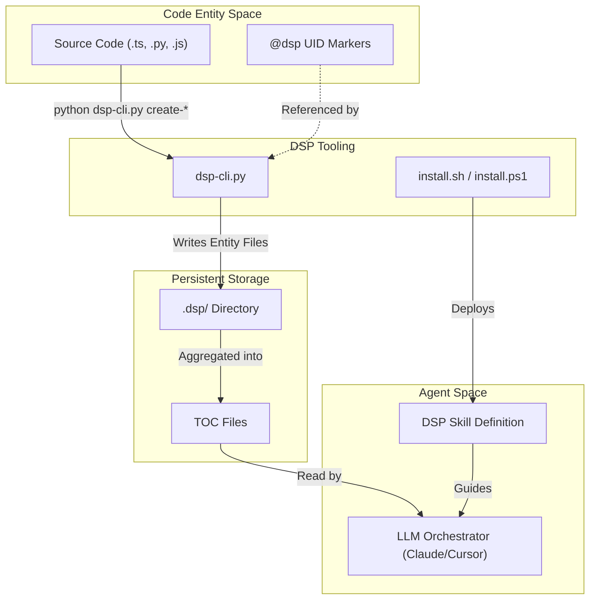
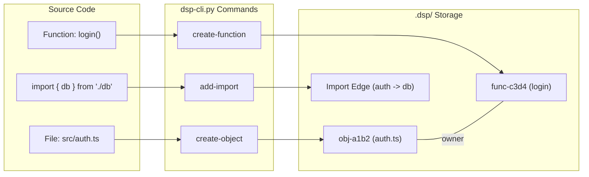

<!-- source: DeepWiki mcp.deepwiki.com · repo k-kolomeitsev/data-structure-protocol · page 1.1 Getting Started · fetched 2026-10-27 -->

# Getting Started

<details>
<summary>Relevant source files</summary>

The following files were used as context for generating this wiki page:

- [GETTING_STARTED.md](GETTING_STARTED.md)
- [README.md](README.md)
- [hooks/install-hooks.ps1](hooks/install-hooks.ps1)
- [install.ps1](install.ps1)
- [install.sh](install.sh)

</details>


The Data Structure Protocol (DSP) provides a persistent structural memory layer for AI coding agents. By maintaining a graph of entities and their dependencies in a versionable `.dsp/` directory, DSP eliminates the need for agents to re-scan and re-index codebases at the start of every session.

## Prerequisites

Before installing DSP, ensure your environment meets the following requirements:
*   **Python 3.10+**: Required to run the `dsp-cli.py` management tool [README.md:3-3]().
*   **Git**: Required for versioning the `.dsp/` directory and using automated hooks [README.md:55-55]().
*   **AI Agent**: One of the supported agents (Claude Code, Cursor, or Codex) [README.md:4-6]().

## Installation

DSP is installed as a "skill" that your AI agent can discover and use. The installation process copies the protocol definitions and scripts into the agent's configuration directory.

### Automated Installation (Recommended)

Use the one-liner scripts to install the DSP skill for all supported agents.

**macOS / Linux:**
```bash
curl -fsSL https://raw.githubusercontent.com/k-kolomeitsev/data-structure-protocol/main/install.sh | bash
```
[README.md:30-32]()

**Windows (PowerShell):**
```powershell
irm https://raw.githubusercontent.com/k-kolomeitsev/data-structure-protocol/main/install.ps1 | iex
```
[README.md:36-38]()

### Advanced Installation Options
You can target specific agents or perform a global installation using flags.

| Flag | Description |
|---|---|
| `--global` | Installs to the user-level directory (e.g., `~/.cursor/skills/`) instead of the current project [install.sh:17-17](), [install.ps1:19-19](). |
| `--branch [B]` | Installs from a specific GitHub branch (default: `main`) [install.sh:18-18](), [install.ps1:9-9](). |
| `[agent]` | Target specific agents: `cursor`, `claude`, or `codex` [install.sh:14-14](), [install.ps1:4-5](). |

**Sources:** [README.md:26-44](), [install.sh:8-27](), [install.ps1:1-10]()

---

## Data Flow and Integration

The following diagram illustrates how the DSP CLI interacts with your codebase and how the resulting `.dsp/` graph is consumed by the AI Agent.

### System Data Flow: Code to Agent Memory

**Sources:** [README.md:63-86](), [GETTING_STARTED.md:3-5]()

---

## Initializing the Project

Once the skill is installed, you must initialize the DSP graph in your project root. This creates the `.dsp/` directory structure.

```bash
python dsp-cli.py --root . init
```
[README.md:113-113]()

### The .dsp/ Structure
Initializing the project creates a flat-file database where each entity (Object or Function) is stored in its own directory.
*   **Objects**: Stored as `obj-<uuid>/` [README.md:119-120]().
*   **Functions**: Stored as `func-<uuid>/` [README.md:122-123]().
*   **TOC**: A Table of Contents file used as the entry point for agent navigation [GETTING_STARTED.md:122-122]().

**Sources:** [GETTING_STARTED.md:60-74](), [README.md:108-114]()

---

## Workflow Selection

### Greenfield Workflow (New Projects)
The fastest way to start a new project is using the **dsp-boilerplate**. It comes with a pre-initialized graph, pre-configured agent rules, and CI/CD pipelines.

```bash
git clone https://github.com/k-kolomeitsev/dsp-boilerplate.git my-project
cd my-project
docker-compose up -d
```
[README.md:96-104]()

### Brownfield Workflow (Existing Projects)
For existing codebases, you must perform a manual bootstrap. This is typically done via a Depth-First Search (DFS) traversal of your import tree:

1.  **Identify Roots**: Find entrypoints like `main.ts` or `index.js` [GETTING_STARTED.md:82-82]().
2.  **Create Root Entities**: Register these entrypoints using `create-object` [GETTING_STARTED.md:85-87]().
3.  **Trace Imports**: Recursively add dependencies using `add-import` and provide a "why" for each connection [GETTING_STARTED.md:89-94]().
4.  **External Deps**: Model third-party libraries as `kind: external` to avoid deep mapping [GETTING_STARTED.md:102-106]().

**Sources:** [GETTING_STARTED.md:9-28](), [GETTING_STARTED.md:78-110]()

---

## Core CLI Commands

The `dsp-cli.py` tool is the primary interface for managing the graph.

### Mapping Code to DSP Entities
The following diagram shows how specific CLI functions map source code structures to the DSP graph.



### Essential Commands Reference

| Action | Command Example |
|---|---|
| **Search** | `python dsp-cli.py --root . search "auth"` [README.md:131-131]() |
| **Find Entity** | `python dsp-cli.py --root . find-by-source "src/app.ts"` [README.md:132-132]() |
| **Inspect** | `python dsp-cli.py --root . get-entity obj-a1b2` [GETTING_STARTED.md:120-120]() |
| **Trace Parents** | `python dsp-cli.py --root . get-parents obj-a1b2 --depth inf` [README.md:139-139]() |
| **Trace Children** | `python dsp-cli.py --root . get-children obj-a1b2 --depth 2` [README.md:133-133]() |

**Sources:** [README.md:118-144](), [GETTING_STARTED.md:114-124]()

---

## Automating Consistency

To prevent the DSP graph from drifting away from the actual code, install the provided git hooks.

**Unix-like:**
```bash
./hooks/install-hooks.sh
```
[GETTING_STARTED.md:179-180]()

**Windows:**
```powershell
./hooks/install-hooks.ps1
```
[hooks/install-hooks.ps1:1-11]()

These hooks perform the following:
*   **Pre-commit**: Validates that new or deleted files are reflected in the `.dsp/` graph [GETTING_STARTED.md:173-173]().
*   **Pre-push**: Runs full graph health checks, including cycle and orphan detection [GETTING_STARTED.md:174-174]().

**Sources:** [GETTING_STARTED.md:169-183](), [hooks/install-hooks.ps1:1-17]()

---

