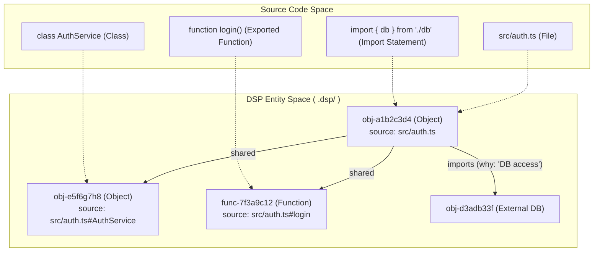
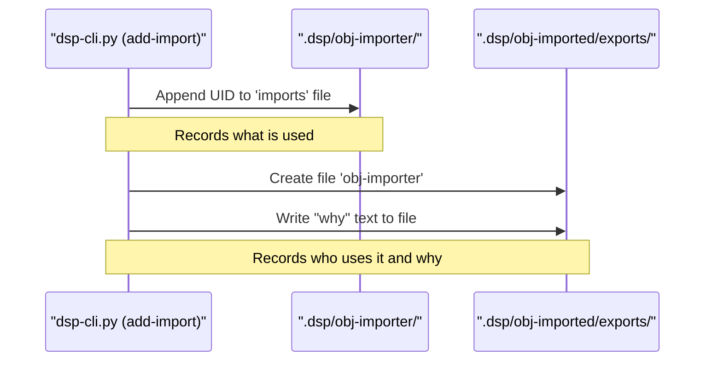

<!-- source: DeepWiki mcp.deepwiki.com · repo k-kolomeitsev/data-structure-protocol · page 1.2 Core Concepts and Architecture · fetched 2026-10-27 -->

# Core Concepts and Architecture

<details>
<summary>Relevant source files</summary>

The following files were used as context for generating this wiki page:

- [ARCHITECTURE.md](ARCHITECTURE.md)
- [README.md](README.md)
- [article.md](article.md)

</details>


This page explains the fundamental Data Structure Protocol (DSP) model, where a codebase is treated as a navigable graph of semantic entities. It covers the technical implementation of the `.dsp/` storage layer, the stability of UIDs, and the architectural philosophy that transforms code into persistent structural memory for AI agents.

## 1. The "Code = Graph" Philosophy

The core premise of DSP is that for an AI agent to be effective, it needs a map of the codebase that persists across sessions [README.md:16-22](). Instead of re-scanning files to rebuild context, the agent interacts with a directed graph where:
- **Nodes** represent logical entities (Files, Classes, Functions).
- **Edges** represent dependencies (Imports) and public APIs (Shared/Exports).
- **Metadata** explains the "Why" (Purpose) behind every entity and connection [ARCHITECTURE.md:45-57]().

### Entity Types
DSP simplifies code into two base entity kinds [ARCHITECTURE.md:76-78]():
1.  **Object (`obj-`)**: Any "thing" that is not a function. This includes modules, ES modules, classes, configs, resource files (images, CSS), and external dependencies [ARCHITECTURE.md:77-78]().
2.  **Function (`func-`)**: A discrete unit of logic, such as a method, handler, or pipeline [ARCHITECTURE.md:78-78]().

### Relationship Mapping: Code to Graph
The following diagram illustrates how standard code structures are mapped into the DSP entity model.

**Diagram: Mapping Source Code to DSP Entities**

Sources: [ARCHITECTURE.md:63-72](), [ARCHITECTURE.md:76-81](), [article.md:38-41]()

---

## 2. Identity and UID Stability

In DSP, a file path is merely an attribute. The true identity of a code element is its **UID** [ARCHITECTURE.md:64-64]().
- **Format**: `obj-<8 hex>` or `func-<8 hex>` (e.g., `obj-a1b2c3d4`) [ARCHITECTURE.md:92-95]().
- **Stability**: If a file is moved or renamed, the UID remains the same. The `move-entity` command updates the `source` attribute without breaking graph edges [ARCHITECTURE.md:16-16](), [article.md:49-51]().
- **In-code Anchors**: For entities inside a file (like functions or classes), a comment marker `@dsp <uid>` is placed before the declaration to anchor the UID to the symbol regardless of line number changes [ARCHITECTURE.md:99-111]().

```typescript
// @dsp func-7f3a9c12
export function start() { ... }
```
Sources: [ARCHITECTURE.md:92-114](), [article.md:47-53]()

---

## 3. Storage Architecture: The `.dsp/` Directory

The `.dsp/` directory acts as a flat-file graph database. Each entity is a directory named after its UID [ARCHITECTURE.md:88-90]().

### Entity Directory Structure
Each directory contains the following atomic files:
- **`description`**: Contains the `source` path, the `kind` (Object/Function), and the `purpose` (a natural language explanation of why it exists) [ARCHITECTURE.md:119-122]().
- **`imports`**: A list of UIDs that this entity depends on. If the import is through a "barrel" or specific exporter, the `via=UID` syntax is used [ARCHITECTURE.md:124-127]().
- **`shared`**: A list of UIDs that this entity "owns" and exposes to the outside world [ARCHITECTURE.md:129-130]().
- **`exports/` (The Reverse Index)**: A directory containing files named after the UIDs of *consumers*. Each file contains the `why`—the reason that specific consumer imports this entity [ARCHITECTURE.md:132-137]().

**Diagram: Data Flow for `add-import`**
This diagram shows how `dsp-cli.py` updates the filesystem when an import is created.


Sources: [ARCHITECTURE.md:117-137](), [article.md:27-32]()

---

## 4. The Reverse Index and Impact Analysis

One of DSP's most powerful features is the `exports/` directory. Unlike traditional codebases where you can see what a file imports but not easily see what imports *it* without a full-text search, DSP maintains a persistent reverse index [ARCHITECTURE.md:81-81]().

When an agent needs to refactor a function, it doesn't just look at the function; it queries:
1.  `get-parents <uid>`: To find direct consumers [ARCHITECTURE.md:34-34]().
2.  `get-recipients <uid>`: To find the ultimate beneficiaries of the logic [README.md:140-141]().

This allows for **Impact Analysis** before a single line of code is changed [README.md:52-53]().

| Command | Technical Action | Purpose |
| :--- | :--- | :--- |
| `get-children` | Reads `./imports` and `./shared` | Explore dependencies and internal structure [ARCHITECTURE.md:33-33](). |
| `get-parents` | Scans all `exports/` directories for the UID | Find immediate dependants [ARCHITECTURE.md:34-34](). |
| `get-recipients` | Recursive traversal of `exports/` | Determine the full blast radius of a change [README.md:140-141](). |

Sources: [ARCHITECTURE.md:32-39](), [article.md:71-75](), [README.md:136-143]()

---

## 5. The Table of Contents (TOC) and Multi-Root Projects

The **Table of Contents (TOC)** file serves as the entry point for the agent. It lists the high-level entry points (Roots) of the project [ARCHITECTURE.md:144-148]().

- **Single-Root**: A file named `TOC` in `.dsp/` listing the main application objects [ARCHITECTURE.md:144-145]().
- **Multi-Root**: For monorepos, multiple files like `TOC-backend` and `TOC-frontend` can exist, allowing agents to scope their traversal to specific sub-systems [ARCHITECTURE.md:147-148]().

### The "Why" Philosophy
Every edge in the DSP graph requires a `why` [ARCHITECTURE.md:70-70](). This metadata is stored in the reverse index of the imported entity.
- **Import**: `obj-A` imports `obj-B`.
- **Storage**: `.dsp/obj-B/exports/obj-A` contains: *"Used for user session validation in the auth middleware"* [ARCHITECTURE.md:135-137]().

This "Why" is what prevents agents from making incorrect assumptions about legacy code or complex couplings [article.md:34-35]().

Sources: [ARCHITECTURE.md:144-150](), [article.md:34-35](), [README.md:88-90]()

---

