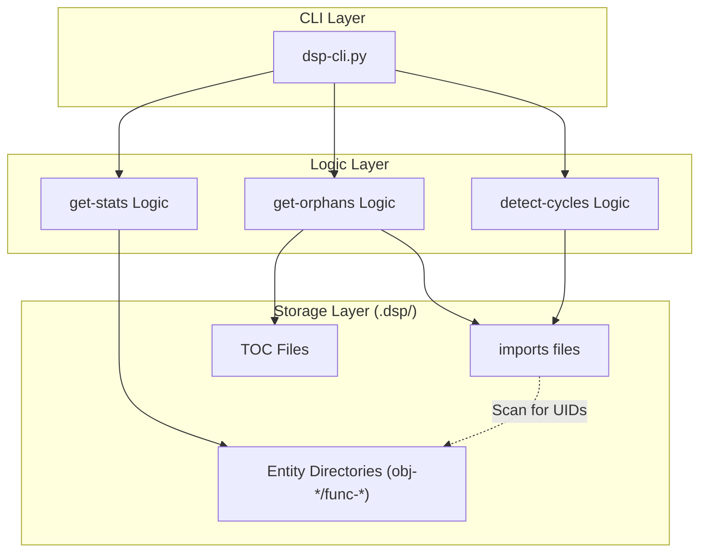
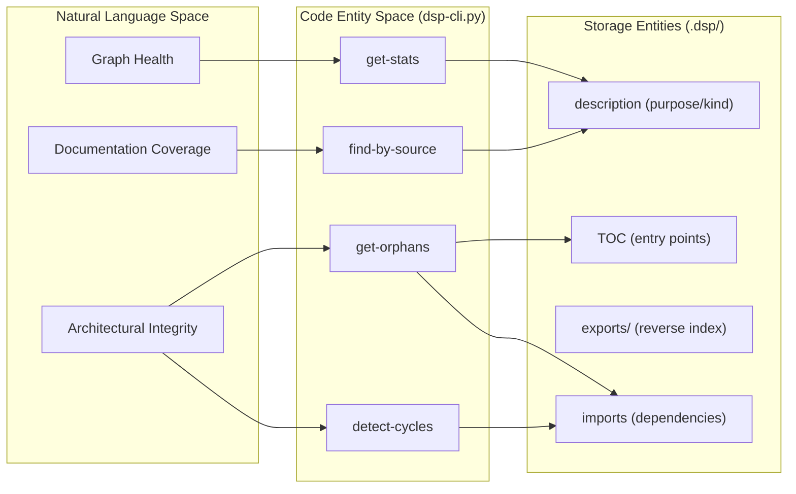

<!-- source: DeepWiki mcp.deepwiki.com · repo k-kolomeitsev/data-structure-protocol · page 2.3 Diagnostics and Health Checks · fetched 2026-10-27 -->

# Diagnostics and Health Checks

<details>
<summary>Relevant source files</summary>

The following files were used as context for generating this wiki page:

- [.github/workflows/dsp-consistency.yml](.github/workflows/dsp-consistency.yml)
- [skills/data-structure-protocol/SKILL.md](skills/data-structure-protocol/SKILL.md)
- [skills/data-structure-protocol/references/operations.md](skills/data-structure-protocol/references/operations.md)

</details>


The Data Structure Protocol (DSP) relies on a strictly maintained directed graph of entities and dependencies. Over time, manual updates or automated agent actions may introduce inconsistencies such as circular dependencies, orphaned entities, or missing registrations. The DSP CLI provides a suite of diagnostic tools to validate graph integrity, ensure structural health, and assist in identifying dead code.

## Diagnostic Command Overview

The diagnostic suite consists of three primary commands: `detect-cycles`, `get-orphans`, and `get-stats`. These commands analyze the `.dsp/` directory structure to provide a high-level view of project health [skills/data-structure-protocol/references/operations.md:230-255]().

### 1. Cycle Detection (`detect-cycles`)

Circular dependencies occur when two or more entities import each other, either directly or through a chain of intermediaries. In DSP, cycles often indicate architectural leakage or improper entity boundaries.

**Command:**
```bash
dsp-cli detect-cycles
```

**Validation Logic:**
The CLI performs a depth-first search (DFS) across the `imports` files of all entities registered in the `.dsp/` directory. It identifies any path that leads back to a previously visited node within the current traversal stack [skills/data-structure-protocol/references/operations.md:232-239]().

**Remediation:**
- **Refactor shared logic:** If `obj-A` and `obj-B` depend on each other, extract the shared logic into a third entity (`obj-C`) that both can import.
- **Review `why` fields:** Check the `exports/` reverse index of the involved entities to understand why the circularity was introduced [skills/data-structure-protocol/references/operations.md:88-91]().

### 2. Orphan Detection (`get-orphans`)

An "orphan" is an entity that is not imported by any other entity in the graph and is not explicitly listed as a root entry point in a Table of Contents (TOC) file [skills/data-structure-protocol/references/operations.md:241-247]().

**Command:**
```bash
dsp-cli get-orphans
```

**Validation Logic:**
1. Collect all UIDs listed in the project's TOC files (these are "entry points").
2. Scan all `imports` files in `.dsp/*/` to build a list of all "referenced" UIDs.
3. Identify UIDs that are neither in the TOC nor in the "referenced" list.

**Remediation:**
- **Register Missing Imports:** If the entity is actually used in the code, use `add-import` to register the relationship [skills/data-structure-protocol/references/operations.md:57-63]().
- **Dead Code Elimination:** If the entity is truly unused, use `remove-entity` to perform a cascading cleanup of the `.dsp/` directory [skills/data-structure-protocol/references/operations.md:139-150]().

### 3. Graph Statistics (`get-stats`)

This command provides a quantitative overview of the DSP graph, useful for tracking project growth and documentation coverage [skills/data-structure-protocol/references/operations.md:248-255]().

**Command:**
```bash
dsp-cli get-stats
```

**Output Metrics:**
- **Entity Counts:** Breakdown of Objects (`obj-*`) vs. Functions (`func-*`).
- **External Dependencies:** Count of entities marked with `--kind external`.
- **Edge Density:** Total number of imports and shared/exported relationships.
- **Health Indicators:** Summary count of detected cycles and orphans.

---

## Data Flow: Diagnostic Execution

The following diagram illustrates how the `dsp-cli.py` script interacts with the filesystem to generate diagnostic reports.

### Diagnostic Analysis Data Flow

**Sources:** [skills/data-structure-protocol/SKILL.md:34-53](), [skills/data-structure-protocol/references/operations.md:230-255]()

---

## CI/CD Integration and Enforcement

DSP diagnostics are designed to be run automatically in CI pipelines to prevent graph degradation. The `dsp-consistency.yml` workflow automates these checks on every pull request [.github/workflows/dsp-consistency.yml:1-7]().

### CI Validation Steps
1. **Integrity Check:** Runs `get-stats` to ensure the `.dsp/` directory is readable and non-empty [.github/workflows/dsp-consistency.yml:56-60]().
2. **Orphan Check:** Runs `get-orphans`. If orphans are found, they are listed in the GitHub Step Summary [.github/workflows/dsp-consistency.yml:62-68]().
3. **Cycle Check:** Runs `detect-cycles`. Circular dependencies trigger a warning or failure [.github/workflows/dsp-consistency.yml:70-76]().
4. **Coverage Analysis:** For Pull Requests, the workflow compares the list of changed files against the DSP graph using `find-by-source`. If a source file (e.g., `.py`, `.ts`) is modified but has no corresponding entry in DSP, it is flagged as "not in DSP" [.github/workflows/dsp-consistency.yml:78-95]().

### Code-to-System Mapping: Diagnostic Entities
The following diagram maps the CLI commands to their specific validation targets within the codebase and storage format.


**Sources:** [skills/data-structure-protocol/SKILL.md:131-136](), [skills/data-structure-protocol/references/operations.md:230-255](), [.github/workflows/dsp-consistency.yml:53-99]()

---

## Common Health Issues and Remediation

| Issue | Diagnostic Command | Typical Cause | Remediation |
| :--- | :--- | :--- | :--- |
| **Circular Dependency** | `detect-cycles` | Tight coupling between two modules. | Extract shared logic via `create-object` and update imports. |
| **Orphaned Entity** | `get-orphans` | File deleted without calling `remove-entity`. | Run `dsp-cli remove-entity <uid>` [skills/data-structure-protocol/references/operations.md:142-150](). |
| **Missing Import** | `get-orphans` | New code usage added but `add-import` not called. | Call `dsp-cli add-import` with specific `why` [skills/data-structure-protocol/references/operations.md:57-63](). |
| **Stale Description** | `get-stats` | Purpose of code changed but DSP not updated. | Run `update-description --purpose <new>` [skills/data-structure-protocol/references/operations.md:97-101](). |
| **Untracked File** | CI Workflow | New file created but `create-object` skipped. | Run `create-object <path> <purpose>` [skills/data-structure-protocol/references/operations.md:19-20](). |

**Sources:** [skills/data-structure-protocol/SKILL.md:138-150](), [skills/data-structure-protocol/references/operations.md:11-12]()

---

