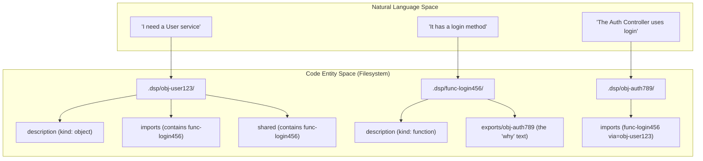
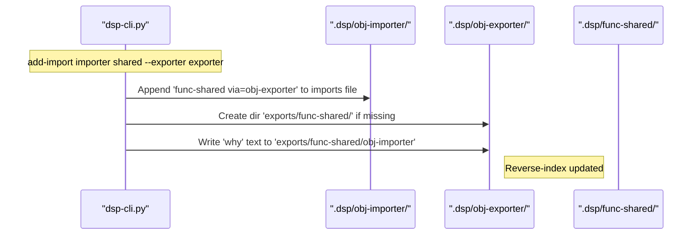

<!-- source: DeepWiki mcp.deepwiki.com · repo k-kolomeitsev/data-structure-protocol · page 3.1 Entity Directory Structure · fetched 2026-10-27 -->

# Entity Directory Structure

<details>
<summary>Relevant source files</summary>

The following files were used as context for generating this wiki page:

- [ARCHITECTURE.md](ARCHITECTURE.md)
- [skills/data-structure-protocol/references/operations.md](skills/data-structure-protocol/references/operations.md)
- [skills/data-structure-protocol/references/storage-format.md](skills/data-structure-protocol/references/storage-format.md)

</details>


The Data Structure Protocol (DSP) stores its graph database in a flat-file format within the `.dsp/` directory at the project root [ARCHITECTURE.md:84-86](). Each node in the graph (Object or Function) is represented by a dedicated directory named after its Unique Identifier (UID) [skills/data-structure-protocol/references/storage-format.md:19-33]().

## 1. Directory Layout and UID Format

Each entity is assigned a stable UID consisting of a type prefix and an 8-character hexadecimal string generated from `uuid4().hex` [ARCHITECTURE.md:92-98]().

*   **`obj-<8hex>`**: Used for Objects (modules, classes, configurations, external dependencies, or resource files) [skills/data-structure-protocol/references/storage-format.md:39-39]().
*   **`func-<8hex>`**: Used for Functions (methods, handlers, or pipelines) [skills/data-structure-protocol/references/storage-format.md:40-40]().

### Entity Directory Components
| File/Directory | Purpose | Required |
| :--- | :--- | :--- |
| `description` | Metadata including source path, kind, and purpose. | Yes |
| `imports` | List of UIDs this entity depends on. | Yes (can be empty) |
| `shared` | List of UIDs this entity exports to the public API. | Objects only |
| `exports/` | Reverse-index directory tracking importers and their "why". | Yes |

**Sources:** [ARCHITECTURE.md:88-98](), [skills/data-structure-protocol/references/storage-format.md:15-33]()

---

## 2. File Format Specifications

### 2.1 The `description` File
This file provides the primary context for the LLM. It contains three mandatory fields [skills/data-structure-protocol/references/storage-format.md:44-50]():
*   **`source`**: The repository-relative path to the file. For functions or symbols within a file, it uses the format `path/to/file#symbol` [skills/data-structure-protocol/references/storage-format.md:47-47]().
*   **`kind`**: Specifies if the entity is an `object`, `function`, or `external` [skills/data-structure-protocol/references/storage-format.md:48-48]().
*   **`purpose`**: A 1-3 sentence explanation of what the entity does and why it exists [skills/data-structure-protocol/references/storage-format.md:49-49]().

### 2.2 The `imports` File
This file lists dependencies one per line. It supports two formats [skills/data-structure-protocol/references/storage-format.md:56-68]():
1.  **Direct Import**: `<imported_uid>`
2.  **Via Exporter**: `<imported_uid> via=<exporter_obj_uid>` (used for barrel exports or members imported through a module) [skills/data-structure-protocol/references/storage-format.md:64-67]().

### 2.3 The `shared` File
Only relevant for Objects that act as containers or modules. It lists the UIDs of functions or sub-objects that are part of this entity's public API [skills/data-structure-protocol/references/storage-format.md:72-78]().

### 2.4 The `exports/` Directory (Reverse Index)
The `exports/` directory allows the system to answer "who uses this?" without scanning the entire graph.
*   **Direct Recipients**: A file named `<importer_uid>` containing the "why" text [skills/data-structure-protocol/references/storage-format.md:84-89]().
*   **Shared Recipients**: If an Object shares entities, a subdirectory `<shared_uid>/` is created. It contains a `description` (what is exported) and individual files for each `<importer_uid>` explaining why they use that specific export [skills/data-structure-protocol/references/storage-format.md:91-99]().

**Sources:** [skills/data-structure-protocol/references/storage-format.md:44-104]()

---

## 3. Implementation Logic: Object vs. Function

### Entity Relationship Logic
The following diagram illustrates how `dsp-cli` organizes the filesystem when an Object owns a Function and another Object imports it.

**Entity Filesystem and Logic Flow**

**Sources:** [skills/data-structure-protocol/references/operations.md:32-43](), [skills/data-structure-protocol/references/storage-format.md:15-33]()

---

## 4. Annotated Examples

### Example 1: Object Entity (Module)
An Object representing a database utility module.

**File: `.dsp/obj-db001122/description`**
```text
source: src/utils/db.ts
kind: object
purpose: Provides a singleton connection pool and query execution wrappers for PostgreSQL.
```

**File: `.dsp/obj-db001122/shared`**
```text
func-query88
func-connect99
```

**Directory: `.dsp/obj-db001122/exports/`**
```text
├── obj-api5566          # Content: "Used to initialize DB connection on server start"
└── func-query88/
    ├── description      # Content: "Async SQL query executor"
    └── obj-user7788     # Content: "Used to fetch user profiles by ID"
```

### Example 2: Function Entity (Method)
A Function owned by the database module above.

**File: `.dsp/func-query88/description`**
```text
source: src/utils/db.ts#executeQuery
kind: function
purpose: Sanitizes inputs and executes raw SQL strings against the primary pool.
```

**File: `.dsp/func-query88/exports/`**
```text
└── obj-db001122         # Content: "owner: method of this object"
```

**Sources:** [skills/data-structure-protocol/references/storage-format.md:44-104](), [skills/data-structure-protocol/references/operations.md:29-43]()

---

## 5. Data Flow: Registration Process

When an agent creates or updates entities, the `dsp-cli` ensures the filesystem remains a consistent graph.

**Data Flow for `add-import`**


**Sources:** [skills/data-structure-protocol/references/operations.md:57-91](), [skills/data-structure-protocol/references/storage-format.md:91-104]()

---

