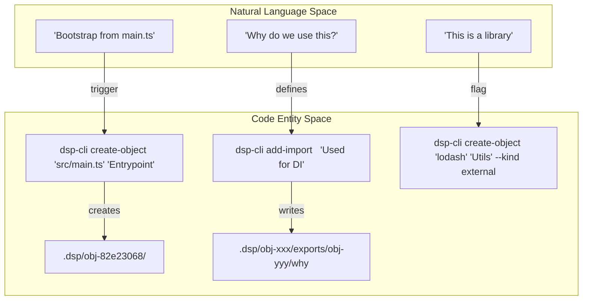
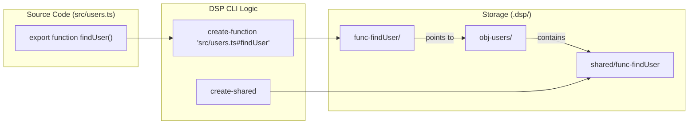

<!-- source: DeepWiki mcp.deepwiki.com · repo k-kolomeitsev/data-structure-protocol · page 4.1 Brownfield Workflow · fetched 2026-10-27 -->

# Brownfield Workflow

Relevant source files

The following files were used as context for generating this wiki page:

- [docs/workflows/brownfield.md](docs/workflows/brownfield.md)
- [skills/data-structure-protocol/SKILL.md](skills/data-structure-protocol/SKILL.md)
- [skills/data-structure-protocol/references/bootstrap.md](skills/data-structure-protocol/references/bootstrap.md)

The Brownfield Workflow describes the process of integrating the Data Structure Protocol (DSP) into an existing codebase. Unlike a greenfield project where DSP grows alongside the code, a brownfield project requires an initial **Bootstrap Procedure** to build a comprehensive structural map of the existing logic, dependencies, and architectural boundaries.

The core of this workflow is a recursive Depth-First Search (DFS) traversal starting from the project's entry points to populate the `.dsp/` directory with verified entities and relationships.

Sources: [docs/workflows/brownfield.md:1-4](), [skills/data-structure-protocol/references/bootstrap.md:1-13]()

---

## 1. Initialization and Root Identification

The process begins by preparing the environment and identifying where the application's execution starts.

### Setup
1. **Install the DSP Skill**: Use the provided installation scripts to add `dsp-cli.py` and the agent rules to your environment.
2. **Initialize**: Run `dsp-cli init` to create the `.dsp/` directory structure. This directory should be tracked by version control.

### Identifying Roots
The agent or developer must identify the "Root Entrypoints." These are the files that bootstrap the application or serve as the primary public API. 

| Project Type | Common Root Files |
| :--- | :--- |
| **Backend API** | `src/main.ts`, `app.module.ts`, `cmd/server/main.go` |
| **Frontend SPA** | `src/main.tsx`, `src/App.tsx`, `pages/_app.tsx` |
| **CLI Tool** | `src/cli.ts`, `__main__.py` |
| **Library** | `src/index.ts`, `lib.rs` |

For multi-root projects (e.g., a monorepo), each root generates its own Table of Contents (TOC) file (e.g., `TOC-<rootUid>`).

Sources: [docs/workflows/brownfield.md:11-53](), [skills/data-structure-protocol/SKILL.md:97-98](), [skills/data-structure-protocol/references/bootstrap.md:17-21]()

---

## 2. The Bootstrap Algorithm (DFS)

Bootstrap is a recursive traversal. The goal is to document every reachable file as a DSP entity.

### Step-by-Step Execution
1. **Document the Root**: Call `create-object` for the entrypoint. The description must include a brief project overview.
2. **Identify Imports**: Open the file and find all imported modules or functions.
3. **Import Verification**: Before registering an import, the agent **must** verify the symbol is actually used in the file body. Dead imports are not registered and should be removed from source code.
4. **Register and Recurse**: 
    - For **Local Imports**: Create the entity, add the import link with a specific `why` (explaining the usage in *this* file), and then descend into that file (Step 1).
    - For **External Dependencies**: Create the entity with `--kind external`, add the import link, but **do not** descend into its source (e.g., `node_modules`).
5. **Backtrack**: Once a file has no more unprocessed local imports, backtrack to the parent and continue.

### Natural Language to Code Entity Mapping: Bootstrap Phase
This diagram illustrates how the "Bootstrap" intent translates into specific CLI commands and file system changes.

Sources: [skills/data-structure-protocol/references/bootstrap.md:15-69](), [skills/data-structure-protocol/references/bootstrap.md:88-93](), [docs/workflows/brownfield.md:55-129]()

---

## 3. Registering Shared Entities and Functions

In an existing codebase, files often export specific functions that define the public API. During the DFS traversal, these must be registered to provide granular impact analysis.

1. **Functions**: Use `create-function` with the `--owner` flag pointing to the parent Object (file).
2. **Shared Index**: Use `create-shared` to mark these functions as part of the Object's public API.
3. **Specific Imports**: When an importer uses a specific function rather than the whole module, `add-import` should target the `func-xxx` UID and include the `--exporter` flag for the `obj-xxx` UID.

### Data Flow: Shared Entity Registration
This diagram shows how a function within a file becomes a first-class entity in the DSP graph.

Sources: [docs/workflows/brownfield.md:130-160](), [skills/data-structure-protocol/SKILL.md:104-106]()

---

## 4. Daily Navigate → Code → Update Cycle

Once the initial graph is built, the workflow shifts to maintenance during regular development.

### Navigate (Impact Analysis)
Before refactoring, use the CLI to understand the blast radius:
- `dsp-cli find-by-source <path>`: Find the UID for a file.
- `dsp-cli get-recipients <uid>`: Identify every entity that depends on this one.
- `dsp-cli get-children <uid> --depth 2`: See what this entity relies on.

### Code and Update
When modifying the codebase, the DSP graph must be updated immediately to prevent "structural drift."

| Action | Command |
| :--- | :--- |
| **New Module** | `create-object` |
| **New Dependency** | `add-import <importer> <imported> <why>` |
| **Renaming File** | `move-entity <uid> <new_source>` |
| **Changing Logic** | `update-description <uid> --purpose <new_purpose>` |
| **Deleting Code** | `remove-entity <uid>` (Triggers automatic cascading cleanup) |

Sources: [docs/workflows/brownfield.md:168-212](), [skills/data-structure-protocol/SKILL.md:109-130]()

---

## 5. Key Rules for Brownfield Projects

- **Verification**: Never register an import without verifying the symbol usage in the file body. This prevents "phantom dependencies". [skills/data-structure-protocol/references/bootstrap.md:35-55]()
- **External Boundaries**: Do not descend into external libraries. Record them as `kind: external` and stop the DFS. [skills/data-structure-protocol/references/bootstrap.md:89]()
- **Stability**: UIDs are stable. Use `move-entity` for renames so that the history and relationships are preserved. [skills/data-structure-protocol/SKILL.md:68]()
- **Incremental Growth**: Don't map the whole project at once. Start with the critical path and expand as you touch new modules. [docs/workflows/brownfield.md:163-164]()

Sources: [skills/data-structure-protocol/references/bootstrap.md:86-93](), [docs/workflows/brownfield.md:161-167]()

---

