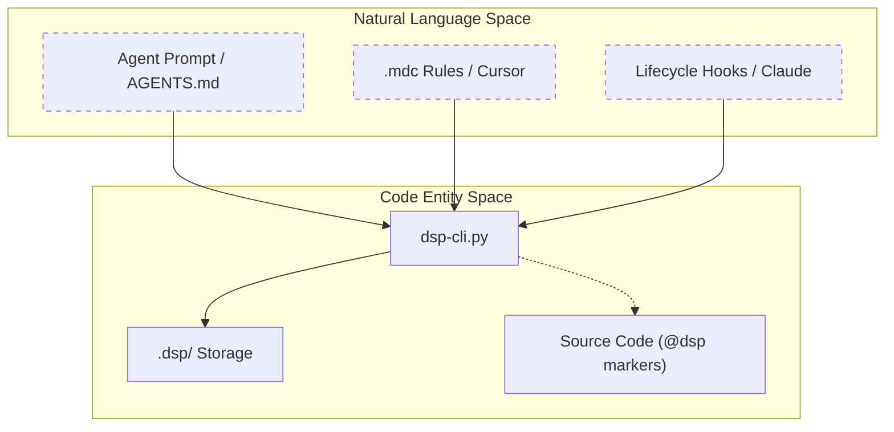
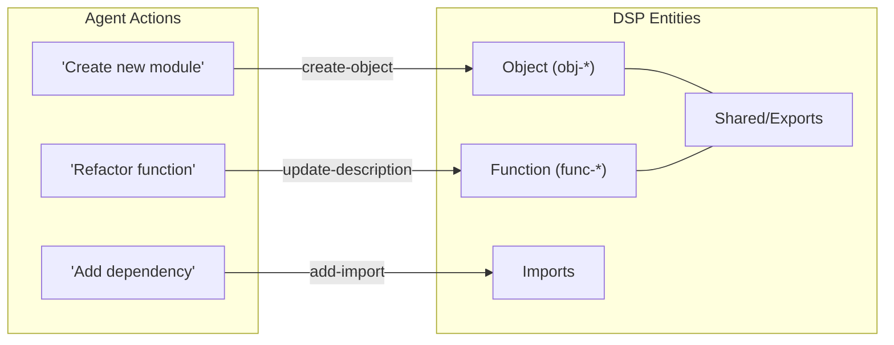

<!-- source: DeepWiki mcp.deepwiki.com · repo k-kolomeitsev/data-structure-protocol · page 5 Agent Integrations · fetched 2026-10-27 -->

# Agent Integrations

Relevant source files

The following files were used as context for generating this wiki page:

- [integrations/claude/README.md](integrations/claude/README.md)
- [integrations/codex/README.md](integrations/codex/README.md)
- [integrations/cursor/README.md](integrations/cursor/README.md)
- [skills/data-structure-protocol/SKILL.md](skills/data-structure-protocol/SKILL.md)

The Data Structure Protocol (DSP) is designed to function as the "long-term memory" for AI coding agents. While the `dsp-cli.py` provides the mechanical means to update the graph, the **Agent Integration Packs** provide the necessary behavioral guidance, lifecycle hooks, and rule-based enforcement to ensure agents actually use and maintain this memory during the development process [skills/data-structure-protocol/SKILL.md:1-8]().

## Skill Distribution Model

DSP uses a decentralized skill distribution model. Each supported agent (Cursor, Claude Code, Codex) has a dedicated integration pack that adapts the core DSP capabilities to that agent's specific extension mechanism (e.g., `.mdc` rules, lifecycle hooks, or `.codex/skills/` discovery).

### Core Components of an Integration Pack:
- **Agent Guidance**: Specialized prompts or rules (like `AGENTS.md` or `.mdc` files) that teach the agent the "Why" and "When" of DSP [integrations/cursor/README.md:7-16]().
- **Lifecycle Hooks**: Scripts that trigger automatically during agent sessions to summarize the graph or validate changes [integrations/claude/README.md:53-69]().
- **Workflow Examples**: Step-by-step guides for common tasks like "Brownfield Bootstrapping" or "Greenfield Growth" [integrations/codex/README.md:45-49]().

### AGENTS.md Fallback
For environments where automated hooks or rules cannot be installed, every integration pack includes an `AGENTS.md` file. This is a standalone, zero-config guidance file that can be placed in the project root. Most modern agents will read this file automatically and follow the DSP protocols defined within [integrations/claude/README.md:45-51]().

Sources: [skills/data-structure-protocol/SKILL.md:11-15](), [integrations/cursor/README.md:1-5](), [integrations/claude/README.md:1-15](), [integrations/codex/README.md:1-8]()

## Integration Architecture

The following diagram illustrates how the different integration components bridge the gap between the Natural Language Space (Agent prompts) and the Code Entity Space (the `.dsp/` graph).

**DSP Integration Flow**

Sources: [skills/data-structure-protocol/SKILL.md:17-53](), [integrations/claude/README.md:53-69](), [integrations/cursor/README.md:71-80]()

## Supported Agents

### [Cursor Integration](#5.1)
The Cursor integration relies on six specialized `.mdc` rule files located in `.cursor/rules/`. These rules manage everything from core awareness to refactor safety. Cursor can also leverage Claude Code hooks via the "Third-party hooks" feature for deeper session integration.

For details, see [Cursor Integration](#5.1).

### [Claude Code Integration](#5.2)
The Claude Code integration uses four lifecycle hooks configured in `.claude/settings.json`. These hooks (e.g., `dsp-session-start.sh`, `dsp-pre-write-check.sh`) provide non-blocking guidance and track file modifications to ensure the DSP graph remains synchronized with code changes.

For details, see [Claude Code Integration](#5.2).

### [Codex Integration](#5.3)
Codex integrates via the `.codex/skills/` auto-discovery mechanism. By installing the DSP skill, Codex gains direct access to the `dsp-cli.py` tool and uses the `SKILL.md` prompt to understand how to navigate and update the project's structural memory.

For details, see [Codex Integration](#5.3).

## Agent Interaction Mapping

This diagram maps specific agent behaviors to the underlying DSP entities they manipulate.

**Agent Action to Entity Mapping**

Sources: [skills/data-structure-protocol/SKILL.md:101-136](), [integrations/cursor/README.md:7-14]()

## Installation Summary

Most integrations can be installed using the unified `install.sh` or `install.ps1` scripts by passing the agent name as a parameter:

| Agent | Target Directory | Install Command |
| :--- | :--- | :--- |
| **Cursor** | `.cursor/rules/` | `./install.sh cursor` |
| **Claude** | `.claude/hooks/` | `./install.sh claude` |
| **Codex** | `.codex/skills/` | `./install.sh codex` |

Sources: [integrations/codex/README.md:13-19](), [integrations/cursor/README.md:20-35](), [integrations/claude/README.md:17-30]()

---

