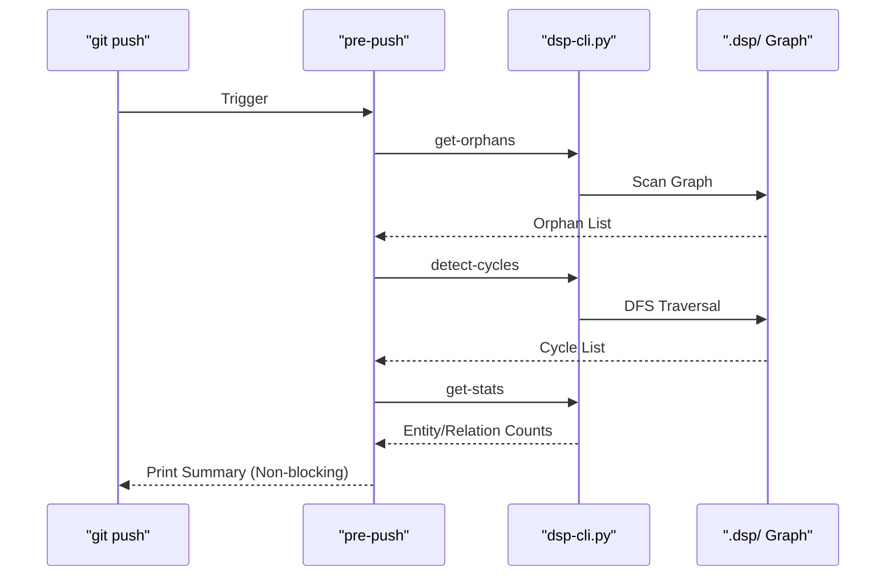

<!-- source: DeepWiki mcp.deepwiki.com · repo k-kolomeitsev/data-structure-protocol · page 6.1 Pre-commit and Pre-push Hooks · fetched 2026-10-27 -->

# Pre-commit and Pre-push Hooks

<details>
<summary>Relevant source files</summary>

The following files were used as context for generating this wiki page:

- [hooks/README.md](hooks/README.md)
- [hooks/dsp-check-staged.ps1](hooks/dsp-check-staged.ps1)
- [hooks/dsp-check-staged.sh](hooks/dsp-check-staged.sh)
- [hooks/install-hooks.ps1](hooks/install-hooks.ps1)
- [hooks/install-hooks.sh](hooks/install-hooks.sh)
- [hooks/pre-commit](hooks/pre-commit)
- [hooks/pre-push](hooks/pre-push)
- [install.ps1](install.ps1)

</details>


The Data Structure Protocol (DSP) provides a suite of Git hooks to ensure the integrity and consistency of the DSP graph relative to the source code. These hooks perform deterministic checks to prevent common synchronization issues, such as committing new code without registering it in DSP or leaving "ghost" entities in the graph after their corresponding source files have been deleted [hooks/README.md:1-15]().

### Overview of Hook Architecture

The system consists of Bash scripts for Unix-like environments (Linux, macOS, Git Bash) and PowerShell scripts for Windows environments. These scripts act as wrappers around the `dsp-cli.py` utility, leveraging its diagnostic capabilities to validate the state of the `.dsp/` directory during Git lifecycle events [hooks/README.md:104-118]().

#### Hook Logic Flow: Code to Entity Validation

The following diagram illustrates how the `pre-commit` hook bridges the gap between the filesystem (Staged Files) and the DSP Graph (Entities).

**Staged File Consistency Check**
```mermaid
graph TD
    subgraph "Git Stage"
        "A[git diff --cached]" -- "Filenames" --> "B[should_track()]"
    end

    subgraph "Logic: pre-commit / dsp-check-staged"
        "B" -- "Filter Extensions" --> "C{In DSP?}"
        "D[DSP_CLI find-by-source]" -- "Query" --> "C"
    end

    subgraph "DSP Graph Space (.dsp/)"
        "E[Object Entity]" 
        "F[Function Entity]"
    end

    "C" -- "Not Found (ACMR)" --> "G[Warning: Unregistered File]"
    "C" -- "Found (D filter)" --> "H[Error: Ghost Entity]"
    "C" -- "Exists" --> "I[OK]"
    "E" -.-> "D"
    "F" -.-> "D"
```
Sources: [hooks/pre-commit:44-60](), [hooks/dsp-check-staged.ps1:40-61](), [hooks/dsp-check-staged.sh:34-42]()

---

### Installation

Hooks are installed into the `.git/hooks/` directory of a repository using the provided installer scripts. These scripts detect the Git directory using `git rev-parse --git-dir` and copy the necessary hook files [hooks/install-hooks.sh:4-13](), [hooks/install-hooks.ps1:3-9]().

| Installer | Platform | Command |
| :--- | :--- | :--- |
| `install-hooks.sh` | Bash | `./hooks/install-hooks.sh` |
| `install-hooks.ps1` | PowerShell | `.\hooks\install-hooks.ps1` |

The installers deploy two primary hooks:
1.  **pre-commit**: Fast deterministic checks on staged changes.
2.  **pre-push**: Full graph integrity and statistics check.

Sources: [hooks/install-hooks.sh:1-21](), [hooks/install-hooks.ps1:1-17]()

---

### Configuration

Behavior is controlled via environment variables. If not set, the hooks use sensible defaults [hooks/README.md:34-41]().

| Variable | Values | Default | Description |
| :--- | :--- | :--- | :--- |
| `DSP_PRECOMMIT_MODE` | `warn` \| `block` | `warn` | `block` rejects commits if "Ghost Entities" (deleted files still in DSP) are found [hooks/pre-commit:84-87](). |
| `DSP_CLI` | Path | Auto-detected | Path to `dsp-cli.py`. Searches `.cursor/`, `.claude/`, `.codex/`, and `skills/` [hooks/pre-commit:8-17](). |
| `DSP_SKIP_PATTERNS` | Glob list | `*.md,*.txt...` | Comma-separated patterns to ignore during tracking checks [hooks/pre-commit:29](). |

Sources: [hooks/README.md:34-53](), [hooks/pre-commit:5-30]()

---

### Pre-commit Hook Details

The `pre-commit` hook (and its standalone equivalent `dsp-check-staged`) performs three primary validations before allowing a commit to proceed:

1.  **Registration Check**: Identifies new or modified files (`--diff-filter=ACMR`) with trackable extensions (e.g., `.ts`, `.py`, `.go`) that lack a corresponding DSP entity [hooks/pre-commit:44-52]().
2.  **Deletion Consistency**: Identifies files marked for deletion (`--diff-filter=D`) that still have an active entry in the DSP graph. This prevents "Ghost Entities" [hooks/pre-commit:54-60]().
3.  **Orphan Detection**: Runs `dsp-cli get-orphans` to find entities that have lost all parent connections, indicating a break in the graph structure [hooks/pre-commit:62-65]().

**Trackable Extensions**: `.ts`, `.tsx`, `.js`, `.jsx`, `.py`, `.go`, `.rs`, `.java`, `.rb`, `.vue`, `.svelte` [hooks/dsp-check-staged.sh:39-41]().

Sources: [hooks/pre-commit:1-94](), [hooks/dsp-check-staged.sh:1-80](), [hooks/dsp-check-staged.ps1:1-77]()

---

### Pre-push Hook Details

The `pre-push` hook performs a more intensive integrity check of the entire graph before data is sent to the remote. Unlike `pre-commit`, this hook is non-blocking and intended for visibility [hooks/README.md:67-75]().

**Pre-push Execution Sequence**

Sources: [hooks/pre-push:23-40](), [hooks/README.md:67-75]()

The hook specifically reports:
*   **Cycles**: Circular dependencies detected via DFS traversal [hooks/pre-push:31-35]().
*   **Orphans**: Entities with no incoming edges [hooks/pre-push:25-29]().
*   **Stats**: A summary of total entities and graph coverage [hooks/pre-push:37-39]().

Sources: [hooks/pre-push:1-43]()

---

### Agent-Assisted Review

While deterministic hooks check for file existence, the `dsp-agent-review` script prepares a context-rich document for LLM-based semantic validation [hooks/README.md:88-102]().

It aggregates:
1.  The current `git diff`.
2.  DSP entity details for all affected files.
3.  Global graph statistics and orphan reports.

This document allows an AI agent to verify if the *purpose* and *why* fields of changed entities still accurately reflect the implementation [hooks/README.md:97-102]().

Sources: [hooks/README.md:88-102](), [hooks/pre-commit:89-90]()

---

