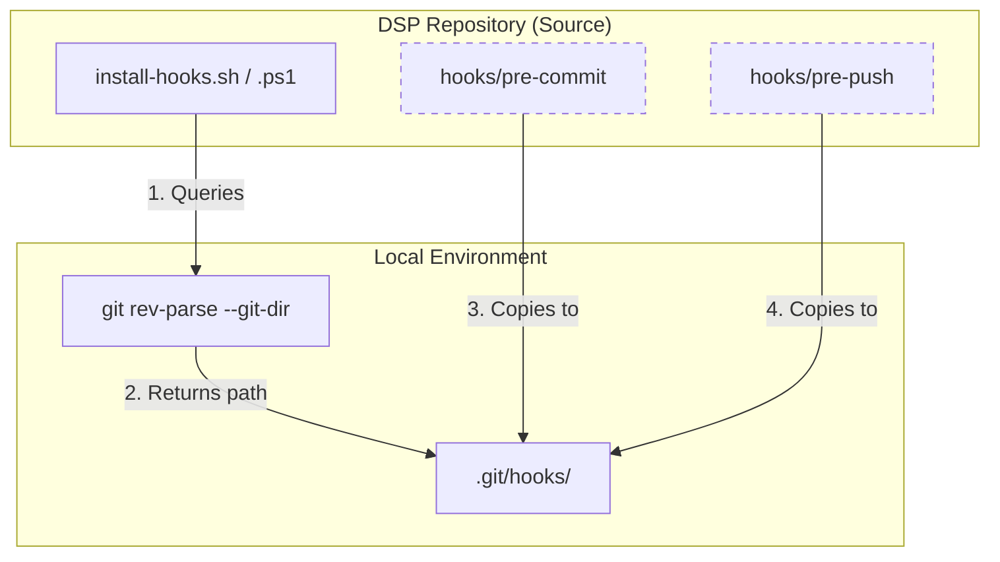
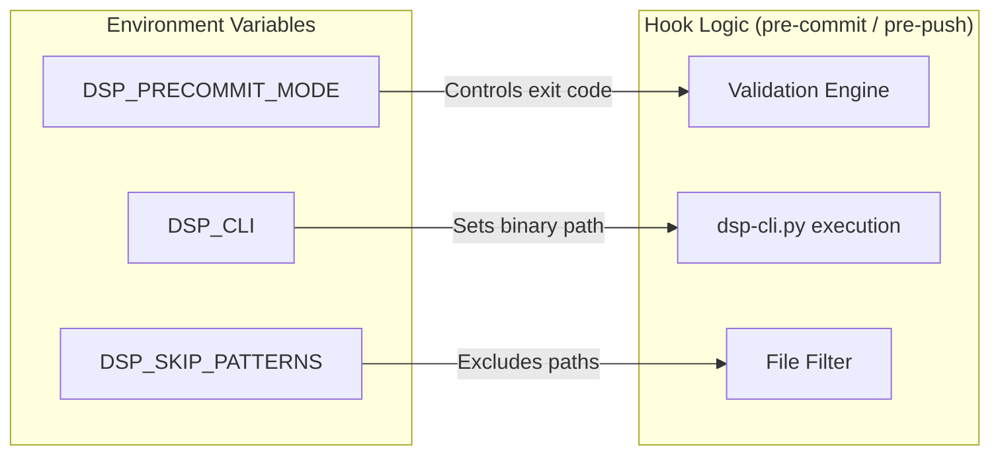

<!-- source: DeepWiki mcp.deepwiki.com · repo k-kolomeitsev/data-structure-protocol · page 7.2 Hook Installation (install-hooks.sh / install-hooks.ps1) · fetched 2026-10-27 -->

# Hook Installation (install-hooks.sh / install-hooks.ps1)

<details>
<summary>Relevant source files</summary>

The following files were used as context for generating this wiki page:

- [hooks/install-hooks.ps1](hooks/install-hooks.ps1)
- [hooks/install-hooks.sh](hooks/install-hooks.sh)
- [install.ps1](install.ps1)

</details>


The Data Structure Protocol (DSP) utilizes Git hooks to ensure the integrity of the structural graph during the development lifecycle. The hook installation scripts automate the deployment of `pre-commit` and `pre-push` scripts into the local repository's Git configuration. These hooks validate that changes to the codebase are correctly reflected in the `.dsp/` metadata, preventing structural drift and ensuring that AI agents always have an accurate map of the project.

## Overview of Installation Scripts

The repository provides two variants of the hook installer to support cross-platform development environments:
- `hooks/install-hooks.sh`: For Unix-like systems (Linux, macOS, WSL) [hooks/install-hooks.sh:1-21]().
- `hooks/install-hooks.ps1`: For Windows environments using PowerShell 5.1 or higher [hooks/install-hooks.ps1:1-17]().

Both scripts perform the same core function: identifying the local `.git` directory and copying the validation logic into the appropriate hooks folder.

### Git Directory Resolution
To ensure hooks are installed in the correct location regardless of the current working directory (as long as it is within a Git worktree), the scripts use the `git rev-parse --git-dir` command [hooks/install-hooks.sh:4](), [hooks/install-hooks.ps1:3](). This command dynamically locates the `.git` metadata folder, which is essential for monorepos or nested directory structures.

### Logic Flow: Hook Deployment
The following diagram illustrates the data flow from the DSP repository to the local developer environment during the installation process.

**Hook Installation Data Flow**

**Sources:** [hooks/install-hooks.sh:4-13](), [hooks/install-hooks.ps1:3-9]()

## Installed Hook Files

The installer deploys two primary validation scripts:

1.  **pre-commit**: Executes before a commit is finalized. It primarily checks if files staged for commit have corresponding entries in the DSP graph and validates that deletions are handled consistently [hooks/install-hooks.sh:9-10](), [hooks/install-hooks.ps1:8]().
2.  **pre-push**: Executes before code is pushed to a remote repository. It performs more intensive "Global Health" checks, such as cycle detection and orphan node identification, which might be too slow for every commit [hooks/install-hooks.sh:12-13](), [hooks/install-hooks.ps1:9]().

On Unix systems, the `install-hooks.sh` script explicitly applies execution permissions (`chmod +x`) to the copied files to ensure Git can trigger them [hooks/install-hooks.sh:10-13]().

**Sources:** [hooks/install-hooks.sh:9-13](), [hooks/install-hooks.ps1:8-9]()

## Configuration Environment Variables

The behavior of the installed hooks is governed by three environment variables. These allow developers to customize how strictly the protocol is enforced without modifying the hook scripts themselves.

| Variable | Values | Description |
| :--- | :--- | :--- |
| `DSP_PRECOMMIT_MODE` | `warn` (default), `block` | Determines if validation failures should stop the commit (`block`) or merely print a warning (`warn`) [hooks/install-hooks.sh:18](). |
| `DSP_CLI` | Path to `dsp-cli.py` | Overrides the auto-detection of the DSP CLI tool. Useful if the CLI is installed in a non-standard location [hooks/install-hooks.sh:19](). |
| `DSP_SKIP_PATTERNS` | Glob patterns (e.g., `*.md,*.txt`) | A comma-separated list of file patterns that the hooks should ignore during registration checks [hooks/install-hooks.sh:20](). |

### Implementation Mapping
The following diagram maps the configuration variables to the script entities they influence.

**Configuration Mapping**

**Sources:** [hooks/install-hooks.sh:17-20](), [hooks/install-hooks.ps1:13-16]()

## Execution Summary

### Bash (Linux/macOS)
```bash
# Navigate to the hooks directory in the DSP repo
cd hooks
# Run the installer
./install-hooks.sh
```
The script uses `set -euo pipefail` to ensure that any failure in the copy process (such as permission issues) results in an immediate exit with an error code [hooks/install-hooks.sh:2]().

### PowerShell (Windows)
```powershell
# Run the installer from the hooks directory
.\install-hooks.ps1
```
The script requires PowerShell 5.1 and uses `$ErrorActionPreference = 'Stop'` (implicitly via standard DSP script patterns) to handle copy failures [hooks/install-hooks.ps1:1]().

**Sources:** [hooks/install-hooks.sh:1-5](), [hooks/install-hooks.ps1:1-6]()

---

