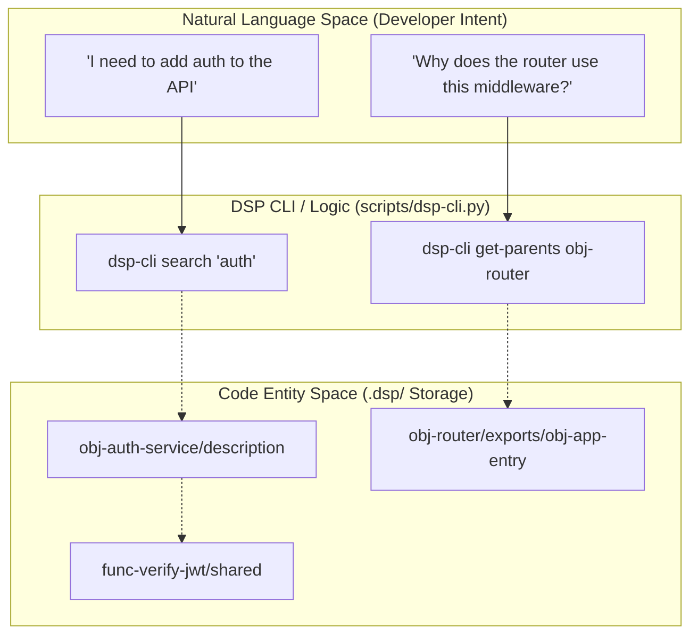
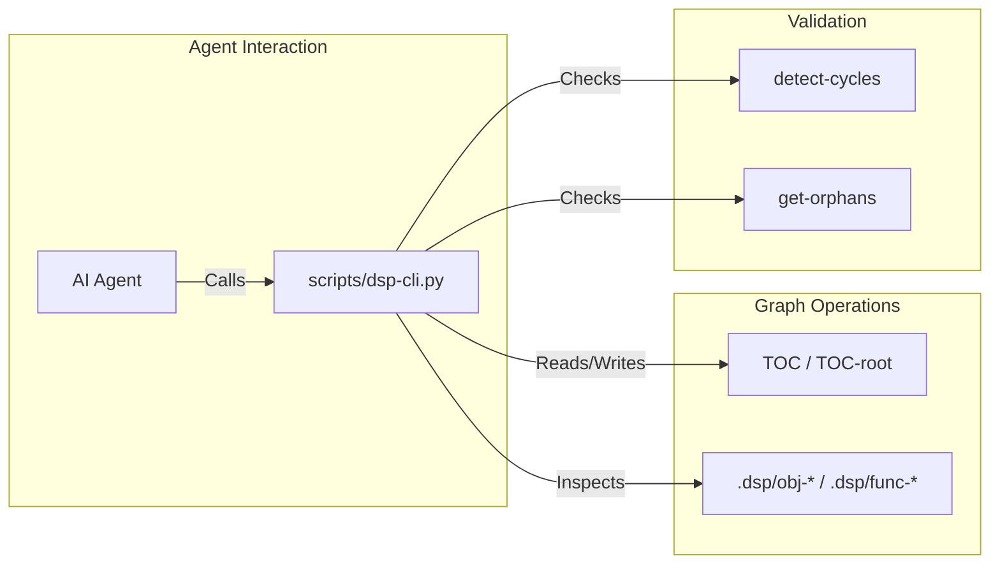

<!-- source: DeepWiki mcp.deepwiki.com · repo k-kolomeitsev/data-structure-protocol · page 8 Comparisons and Design Rationale · fetched 2026-10-27 -->

# Comparisons and Design Rationale

Relevant source files

The following files were used as context for generating this wiki page:

- [article.md](article.md)
- [docs/comparisons/dsp-vs-gsd.md](docs/comparisons/dsp-vs-gsd.md)
- [docs/comparisons/dsp-vs-superpowers.md](docs/comparisons/dsp-vs-superpowers.md)

The Data Structure Protocol (DSP) is designed to solve a specific, high-scale problem: the "orientation tax" that AI agents pay every time they start a new session in a large codebase. While existing tools focus on workflow management or engineering discipline, DSP focuses on **persistent structural memory**.

This page outlines the design philosophy of DSP and positions it relative to other popular agent-enhancement frameworks like GSD (Get Shit Done) and Superpowers.

## Design Philosophy: Memory over Process

The core premise of DSP is that modern LLMs (e.g., Claude 3.5 Sonnet, GPT-4o) are already proficient at planning, writing tests, and following engineering best practices [docs/comparisons/dsp-vs-gsd.md:5-11](). What they lack is the ability to remember a project's architecture, dependency graph, and the semantic "why" behind code connections across different chat sessions [article.md:3-5]().

### Core Pillars of the DSP Design:
*   **Identity by UID, not Path**: UIDs provide a stable anchor for the agent. If a file moves, the UID remains, preserving the history and "purpose" of that entity [article.md:47-51]().
*   **The "Why" of Connections**: DSP doesn't just track that `A` imports `B`; it requires a `why` description for every edge, drastically reducing agent guesswork during refactoring [article.md:32-34]().
*   **Language Agnosticism**: By using a flat-file graph in `.dsp/` and simple `@dsp` source markers, the protocol works across any language or asset type (TS, Python, YAML, SQL, etc.) [article.md:41-43]().
*   **Minimalism**: DSP provides only what the agent cannot discover on its own: the long-term structural map and the intent behind architectural decisions [article.md:12-19]().

### Bridge: Natural Language Intent to Code Entities
The following diagram illustrates how DSP maps high-level developer intent to specific code-level entities and their corresponding storage in the `.dsp/` directory.

**Intent-to-Entity Mapping**

Sources: [article.md:61-76](), [article.md:27-33]()

## DSP vs GSD (Get Shit Done)

GSD focuses on providing a **workflow wrapper**—imposing structured phases like `plan → execute → verify → ship` [docs/comparisons/dsp-vs-gsd.md:17-19](). 

DSP, by contrast, provides a **memory layer**. While GSD tells the agent *how* to work, DSP provides the *knowledge* the agent needs to work effectively in a specific codebase. DSP argues that modern agents handle planning natively but fail at remembering project structure between "waves" or sessions [docs/comparisons/dsp-vs-gsd.md:40-50]().

For a detailed breakdown of feature sets, token usage, and session continuity, see **[DSP vs GSD](#8.1)**.

Sources: [docs/comparisons/dsp-vs-gsd.md:13-21]()

## DSP vs Superpowers

Superpowers is built around **engineering discipline enforcement**, mandating TDD (Test-Driven Development), structured brainstorming, and subagent orchestration [docs/comparisons/dsp-vs-superpowers.md:5-6]().

The DSP rationale is that discipline (like "write a test first") can be enforced via a simple system prompt, but structural memory (like "which 12 modules break if I change this config fragment") cannot be "prompted" into existence—it must be stored [docs/comparisons/dsp-vs-superpowers.md:53-59](). DSP provides the impact analysis tools (`get-recipients`, `get-parents`) that Superpowers lacks [docs/comparisons/dsp-vs-superpowers.md:33]().

For a comparison of TDD workflows and how DSP's structural context improves agent brainstorming, see **[DSP vs Superpowers](#8.2)**.

Sources: [docs/comparisons/dsp-vs-superpowers.md:15-21](), [docs/comparisons/dsp-vs-superpowers.md:61-84]()

## Positioning the DSP CLI

The `dsp-cli.py` serves as the interface between the agent and the persistent memory. It translates the graph operations defined in the architecture into filesystem actions.

**CLI Operation Flow**

Sources: [article.md:87-91](), [article.md:68-76]()

## Summary Comparison Table

| Feature | DSP | GSD / Superpowers |
| :--- | :--- | :--- |
| **Primary Goal** | Persistent Structural Memory | Workflow / Discipline Enforcement |
| **Storage** | Git-versioned `.dsp/` graph | Session-based or ephemeral |
| **Brownfield Support** | DFS-based bootstrapping [article.md:101-103]() | Limited / One-time scan |
| **Impact Analysis** | Built-in (`get-recipients`) | Manual agent exploration |
| **Language Support** | Language Agnostic | Often tied to JS/TS or specific runtimes |
| **Overhead** | Low (background memory) | Medium (mandatory lifecycle phases) |

Sources: [docs/comparisons/dsp-vs-gsd.md:23-38](), [docs/comparisons/dsp-vs-superpowers.md:25-40]()

---

