# Page: Overview

# Overview

<details>
<summary>Relevant source files</summary>

The following files were used as context for generating this wiki page:

- [ARCHITECTURE.md](ARCHITECTURE.md)
- [GETTING_STARTED.md](GETTING_STARTED.md)
- [README.md](README.md)
- [article.md](article.md)

</details>


The **Data Structure Protocol (DSP)** is a graph-based long-term structural memory layer for AI-assisted development. It provides a persistent, versionable map of a codebase—entities, dependencies, public APIs, and the semantic "whys" behind every connection—stored directly within the repository in a `.dsp/` directory [README.md:10-20]().

By externalizing the project map into a language-agnostic graph, DSP eliminates the "orientation tax" where AI agents spend significant time and tokens re-scanning files to rebuild context at the start of every session [article.md:3-5]().

## The Core Problem: Agent Amnesia

Standard AI coding agents (like Cursor, Claude Code, or Codex) typically operate with a "short-term" view of the codebase. Every new task or session requires the agent to re-learn the structure:
*   **Token Waste:** Constant re-reading of entry points and import trees [README.md:18-18]().
*   **Context Fragmentation:** Loss of structural understanding between different tasks or team members [README.md:50-50]().
*   **Refactor Risk:** Difficulty in performing impact analysis on large, coupled systems without a global dependency map [README.md:52-53]().

DSP fixes this by providing a **persistent structural memory** that the agent can query and update, ensuring the "project map" is always available and up-to-date [README.md:20-22]().

## How It Works: Code as a Graph

DSP models a codebase as a directed graph where nodes are **Entities** and edges are **Relationships** [ARCHITECTURE.md:63-63]().

### 1. Entities (Nodes)
There are two primary entity types:
*   **Object (`obj-`):** Modules, files, classes, configs, resources, or external dependencies [ARCHITECTURE.md:77-77]().
*   **Function (`func-`):** Specific functions, methods, handlers, or pipelines [ARCHITECTURE.md:78-78]().

Entities are identified by stable **UIDs** (e.g., `obj-a1b2c3d4`), which remain constant even if the underlying file is renamed or moved [ARCHITECTURE.md:92-97]().

### 2. Relationships (Edges)
*   **Imports:** What an entity uses (including the specific reason "why") [ARCHITECTURE.md:79-79]().
*   **Shared/Exports:** What an entity exposes as a public API to the rest of the system [ARCHITECTURE.md:80-81]().

### Bridge: Natural Language to Code Entities
The following diagram illustrates how DSP maps high-level concepts to specific code artifacts and CLI management.

**DSP Entity Mapping**
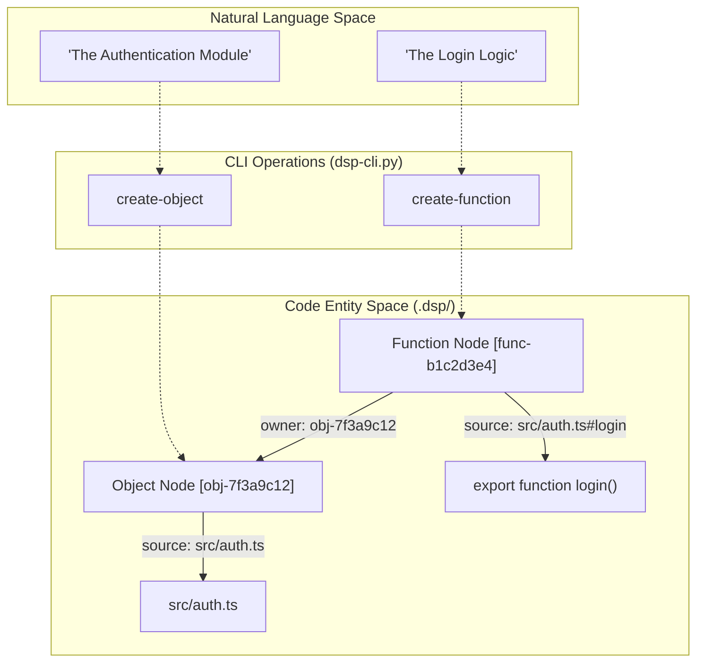
Sources: [ARCHITECTURE.md:63-82](), [ARCHITECTURE.md:92-114](), [ARCHITECTURE.md:23-24]()

## Repository Organization

The DSP repository is structured to provide both the protocol specification and the tooling required to implement it.

| Path | Purpose |
|:---|:---|
| `.dsp/` | The reference implementation's own structural memory [README.md:77-79](). |
| `dsp-cli.py` | The central management utility for building and querying the graph [README.md:71-73](). |
| `skills/` | Integration packages for AI agents (Cursor, Claude Code, Codex) [GETTING_STARTED.md:32-56](). |
| `hooks/` | Git hooks (pre-commit/pre-push) for graph consistency enforcement [GETTING_STARTED.md:169-183](). |
| `docs/` | Detailed architectural specifications and workflow guides [GETTING_STARTED.md:189-191](). |

### Workflow Integration
The following diagram shows how the `dsp-cli.py` acts as the bridge between the physical codebase and the LLM's memory.

**DSP Operational Flow**
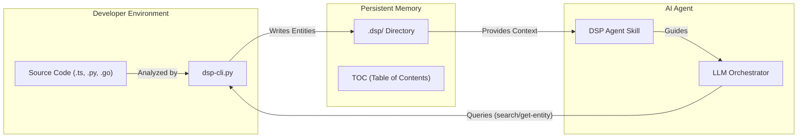
Sources: [README.md:63-86](), [ARCHITECTURE.md:45-51](), [GETTING_STARTED.md:3-5]()

## Navigation and Child Sections

To explore specific aspects of the protocol, refer to the following sections:

*   **[Getting Started](#1.1)**: Step-by-step onboarding, from installation to initializing your first `.dsp/` directory.
*   **[Core Concepts and Architecture](#1.2)**: Deep dive into the "Code = Graph" model, UID stability, and the storage format.
*   **[DSP CLI Reference](#2)**: Complete documentation for all entity management and graph traversal commands.
*   **[Storage Format](#3)**: Detailed specification of the `.dsp/` directory layout and file structures.
*   **[Bootstrap Procedure](#4)**: How to populate DSP for existing (brownfield) or new (greenfield) projects.
*   **[Agent Integrations](#5)**: Configuration guides for Cursor, Claude Code, and Codex.
*   **[Git Hooks and CI](#6)**: Automated enforcement of graph integrity and consistency.
*   **[Installation](#7)**: Reference for global and project-level installation scripts.
*   **[Comparisons and Design Rationale](#8)**: Why DSP focuses on memory rather than workflow wrappers.
*   **[Glossary](#9)**: Definitions of key terms like "Object", "Function", and "Reverse Index".

Sources: [README.md:94-144](), [GETTING_STARTED.md:1-191](), [ARCHITECTURE.md:1-114]()

---

# Page: Getting Started

# Getting Started

<details>
<summary>Relevant source files</summary>

The following files were used as context for generating this wiki page:

- [GETTING_STARTED.md](GETTING_STARTED.md)
- [README.md](README.md)
- [hooks/install-hooks.ps1](hooks/install-hooks.ps1)
- [install.ps1](install.ps1)
- [install.sh](install.sh)

</details>


The Data Structure Protocol (DSP) provides a persistent structural memory layer for AI coding agents. By maintaining a graph of entities and their dependencies in a versionable `.dsp/` directory, DSP eliminates the need for agents to re-scan and re-index codebases at the start of every session.

## Prerequisites

Before installing DSP, ensure your environment meets the following requirements:
*   **Python 3.10+**: Required to run the `dsp-cli.py` management tool [README.md:3-3]().
*   **Git**: Required for versioning the `.dsp/` directory and using automated hooks [README.md:55-55]().
*   **AI Agent**: One of the supported agents (Claude Code, Cursor, or Codex) [README.md:4-6]().

## Installation

DSP is installed as a "skill" that your AI agent can discover and use. The installation process copies the protocol definitions and scripts into the agent's configuration directory.

### Automated Installation (Recommended)

Use the one-liner scripts to install the DSP skill for all supported agents.

**macOS / Linux:**
```bash
curl -fsSL https://raw.githubusercontent.com/k-kolomeitsev/data-structure-protocol/main/install.sh | bash
```
[README.md:30-32]()

**Windows (PowerShell):**
```powershell
irm https://raw.githubusercontent.com/k-kolomeitsev/data-structure-protocol/main/install.ps1 | iex
```
[README.md:36-38]()

### Advanced Installation Options
You can target specific agents or perform a global installation using flags.

| Flag | Description |
|---|---|
| `--global` | Installs to the user-level directory (e.g., `~/.cursor/skills/`) instead of the current project [install.sh:17-17](), [install.ps1:19-19](). |
| `--branch [B]` | Installs from a specific GitHub branch (default: `main`) [install.sh:18-18](), [install.ps1:9-9](). |
| `[agent]` | Target specific agents: `cursor`, `claude`, or `codex` [install.sh:14-14](), [install.ps1:4-5](). |

**Sources:** [README.md:26-44](), [install.sh:8-27](), [install.ps1:1-10]()

---

## Data Flow and Integration

The following diagram illustrates how the DSP CLI interacts with your codebase and how the resulting `.dsp/` graph is consumed by the AI Agent.

### System Data Flow: Code to Agent Memory
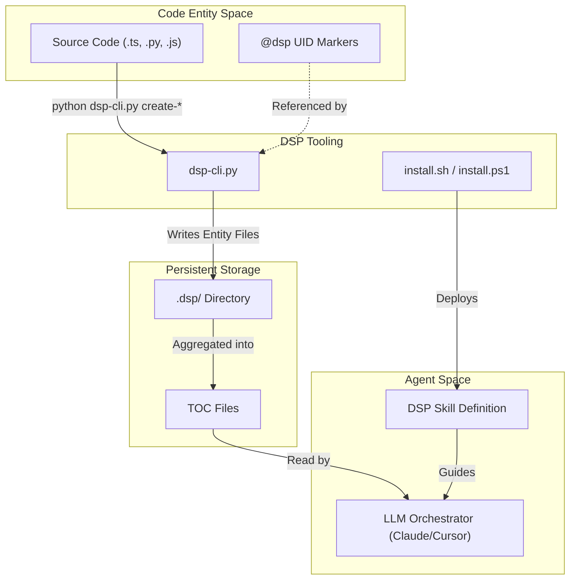
**Sources:** [README.md:63-86](), [GETTING_STARTED.md:3-5]()

---

## Initializing the Project

Once the skill is installed, you must initialize the DSP graph in your project root. This creates the `.dsp/` directory structure.

```bash
python dsp-cli.py --root . init
```
[README.md:113-113]()

### The .dsp/ Structure
Initializing the project creates a flat-file database where each entity (Object or Function) is stored in its own directory.
*   **Objects**: Stored as `obj-<uuid>/` [README.md:119-120]().
*   **Functions**: Stored as `func-<uuid>/` [README.md:122-123]().
*   **TOC**: A Table of Contents file used as the entry point for agent navigation [GETTING_STARTED.md:122-122]().

**Sources:** [GETTING_STARTED.md:60-74](), [README.md:108-114]()

---

## Workflow Selection

### Greenfield Workflow (New Projects)
The fastest way to start a new project is using the **dsp-boilerplate**. It comes with a pre-initialized graph, pre-configured agent rules, and CI/CD pipelines.

```bash
git clone https://github.com/k-kolomeitsev/dsp-boilerplate.git my-project
cd my-project
docker-compose up -d
```
[README.md:96-104]()

### Brownfield Workflow (Existing Projects)
For existing codebases, you must perform a manual bootstrap. This is typically done via a Depth-First Search (DFS) traversal of your import tree:

1.  **Identify Roots**: Find entrypoints like `main.ts` or `index.js` [GETTING_STARTED.md:82-82]().
2.  **Create Root Entities**: Register these entrypoints using `create-object` [GETTING_STARTED.md:85-87]().
3.  **Trace Imports**: Recursively add dependencies using `add-import` and provide a "why" for each connection [GETTING_STARTED.md:89-94]().
4.  **External Deps**: Model third-party libraries as `kind: external` to avoid deep mapping [GETTING_STARTED.md:102-106]().

**Sources:** [GETTING_STARTED.md:9-28](), [GETTING_STARTED.md:78-110]()

---

## Core CLI Commands

The `dsp-cli.py` tool is the primary interface for managing the graph.

### Mapping Code to DSP Entities
The following diagram shows how specific CLI functions map source code structures to the DSP graph.

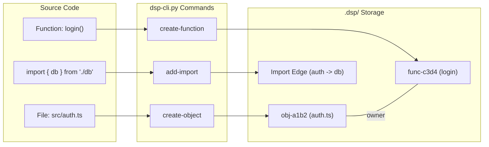

### Essential Commands Reference

| Action | Command Example |
|---|---|
| **Search** | `python dsp-cli.py --root . search "auth"` [README.md:131-131]() |
| **Find Entity** | `python dsp-cli.py --root . find-by-source "src/app.ts"` [README.md:132-132]() |
| **Inspect** | `python dsp-cli.py --root . get-entity obj-a1b2` [GETTING_STARTED.md:120-120]() |
| **Trace Parents** | `python dsp-cli.py --root . get-parents obj-a1b2 --depth inf` [README.md:139-139]() |
| **Trace Children** | `python dsp-cli.py --root . get-children obj-a1b2 --depth 2` [README.md:133-133]() |

**Sources:** [README.md:118-144](), [GETTING_STARTED.md:114-124]()

---

## Automating Consistency

To prevent the DSP graph from drifting away from the actual code, install the provided git hooks.

**Unix-like:**
```bash
./hooks/install-hooks.sh
```
[GETTING_STARTED.md:179-180]()

**Windows:**
```powershell
./hooks/install-hooks.ps1
```
[hooks/install-hooks.ps1:1-11]()

These hooks perform the following:
*   **Pre-commit**: Validates that new or deleted files are reflected in the `.dsp/` graph [GETTING_STARTED.md:173-173]().
*   **Pre-push**: Runs full graph health checks, including cycle and orphan detection [GETTING_STARTED.md:174-174]().

**Sources:** [GETTING_STARTED.md:169-183](), [hooks/install-hooks.ps1:1-17]()

---

# Page: Core Concepts and Architecture

# Core Concepts and Architecture

<details>
<summary>Relevant source files</summary>

The following files were used as context for generating this wiki page:

- [ARCHITECTURE.md](ARCHITECTURE.md)
- [README.md](README.md)
- [article.md](article.md)

</details>


This page explains the fundamental Data Structure Protocol (DSP) model, where a codebase is treated as a navigable graph of semantic entities. It covers the technical implementation of the `.dsp/` storage layer, the stability of UIDs, and the architectural philosophy that transforms code into persistent structural memory for AI agents.

## 1. The "Code = Graph" Philosophy

The core premise of DSP is that for an AI agent to be effective, it needs a map of the codebase that persists across sessions [README.md:16-22](). Instead of re-scanning files to rebuild context, the agent interacts with a directed graph where:
- **Nodes** represent logical entities (Files, Classes, Functions).
- **Edges** represent dependencies (Imports) and public APIs (Shared/Exports).
- **Metadata** explains the "Why" (Purpose) behind every entity and connection [ARCHITECTURE.md:45-57]().

### Entity Types
DSP simplifies code into two base entity kinds [ARCHITECTURE.md:76-78]():
1.  **Object (`obj-`)**: Any "thing" that is not a function. This includes modules, ES modules, classes, configs, resource files (images, CSS), and external dependencies [ARCHITECTURE.md:77-78]().
2.  **Function (`func-`)**: A discrete unit of logic, such as a method, handler, or pipeline [ARCHITECTURE.md:78-78]().

### Relationship Mapping: Code to Graph
The following diagram illustrates how standard code structures are mapped into the DSP entity model.

**Diagram: Mapping Source Code to DSP Entities**
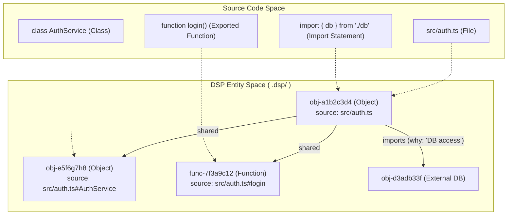
Sources: [ARCHITECTURE.md:63-72](), [ARCHITECTURE.md:76-81](), [article.md:38-41]()

---

## 2. Identity and UID Stability

In DSP, a file path is merely an attribute. The true identity of a code element is its **UID** [ARCHITECTURE.md:64-64]().
- **Format**: `obj-<8 hex>` or `func-<8 hex>` (e.g., `obj-a1b2c3d4`) [ARCHITECTURE.md:92-95]().
- **Stability**: If a file is moved or renamed, the UID remains the same. The `move-entity` command updates the `source` attribute without breaking graph edges [ARCHITECTURE.md:16-16](), [article.md:49-51]().
- **In-code Anchors**: For entities inside a file (like functions or classes), a comment marker `@dsp <uid>` is placed before the declaration to anchor the UID to the symbol regardless of line number changes [ARCHITECTURE.md:99-111]().

```typescript
// @dsp func-7f3a9c12
export function start() { ... }
```
Sources: [ARCHITECTURE.md:92-114](), [article.md:47-53]()

---

## 3. Storage Architecture: The `.dsp/` Directory

The `.dsp/` directory acts as a flat-file graph database. Each entity is a directory named after its UID [ARCHITECTURE.md:88-90]().

### Entity Directory Structure
Each directory contains the following atomic files:
- **`description`**: Contains the `source` path, the `kind` (Object/Function), and the `purpose` (a natural language explanation of why it exists) [ARCHITECTURE.md:119-122]().
- **`imports`**: A list of UIDs that this entity depends on. If the import is through a "barrel" or specific exporter, the `via=UID` syntax is used [ARCHITECTURE.md:124-127]().
- **`shared`**: A list of UIDs that this entity "owns" and exposes to the outside world [ARCHITECTURE.md:129-130]().
- **`exports/` (The Reverse Index)**: A directory containing files named after the UIDs of *consumers*. Each file contains the `why`—the reason that specific consumer imports this entity [ARCHITECTURE.md:132-137]().

**Diagram: Data Flow for `add-import`**
This diagram shows how `dsp-cli.py` updates the filesystem when an import is created.

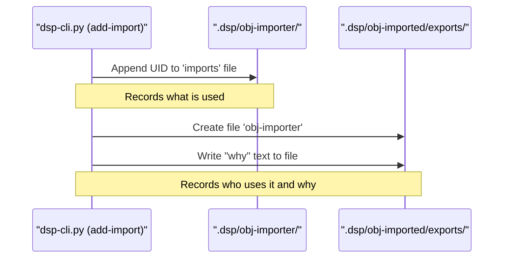
Sources: [ARCHITECTURE.md:117-137](), [article.md:27-32]()

---

## 4. The Reverse Index and Impact Analysis

One of DSP's most powerful features is the `exports/` directory. Unlike traditional codebases where you can see what a file imports but not easily see what imports *it* without a full-text search, DSP maintains a persistent reverse index [ARCHITECTURE.md:81-81]().

When an agent needs to refactor a function, it doesn't just look at the function; it queries:
1.  `get-parents <uid>`: To find direct consumers [ARCHITECTURE.md:34-34]().
2.  `get-recipients <uid>`: To find the ultimate beneficiaries of the logic [README.md:140-141]().

This allows for **Impact Analysis** before a single line of code is changed [README.md:52-53]().

| Command | Technical Action | Purpose |
| :--- | :--- | :--- |
| `get-children` | Reads `./imports` and `./shared` | Explore dependencies and internal structure [ARCHITECTURE.md:33-33](). |
| `get-parents` | Scans all `exports/` directories for the UID | Find immediate dependants [ARCHITECTURE.md:34-34](). |
| `get-recipients` | Recursive traversal of `exports/` | Determine the full blast radius of a change [README.md:140-141](). |

Sources: [ARCHITECTURE.md:32-39](), [article.md:71-75](), [README.md:136-143]()

---

## 5. The Table of Contents (TOC) and Multi-Root Projects

The **Table of Contents (TOC)** file serves as the entry point for the agent. It lists the high-level entry points (Roots) of the project [ARCHITECTURE.md:144-148]().

- **Single-Root**: A file named `TOC` in `.dsp/` listing the main application objects [ARCHITECTURE.md:144-145]().
- **Multi-Root**: For monorepos, multiple files like `TOC-backend` and `TOC-frontend` can exist, allowing agents to scope their traversal to specific sub-systems [ARCHITECTURE.md:147-148]().

### The "Why" Philosophy
Every edge in the DSP graph requires a `why` [ARCHITECTURE.md:70-70](). This metadata is stored in the reverse index of the imported entity.
- **Import**: `obj-A` imports `obj-B`.
- **Storage**: `.dsp/obj-B/exports/obj-A` contains: *"Used for user session validation in the auth middleware"* [ARCHITECTURE.md:135-137]().

This "Why" is what prevents agents from making incorrect assumptions about legacy code or complex couplings [article.md:34-35]().

Sources: [ARCHITECTURE.md:144-150](), [article.md:34-35](), [README.md:88-90]()

---

# Page: DSP CLI Reference

# DSP CLI Reference

<details>
<summary>Relevant source files</summary>

The following files were used as context for generating this wiki page:

- [skills/data-structure-protocol/SKILL.md](skills/data-structure-protocol/SKILL.md)
- [skills/data-structure-protocol/references/operations.md](skills/data-structure-protocol/references/operations.md)
- [skills/data-structure-protocol/scripts/dsp-cli.py](skills/data-structure-protocol/scripts/dsp-cli.py)

</details>


The `dsp-cli.py` tool is the central management utility for the Data Structure Protocol. It provides a production-ready interface for building, navigating, and maintaining the graph-based structural memory of a codebase within the `.dsp/` directory. 

The CLI is designed to be used primarily by AI agents (like Cursor, Claude Code, or Codex) to maintain context across long-term development sessions, but it is equally accessible to human developers for manual graph inspection and maintenance.

### Core CLI Usage
The script is located at `scripts/dsp-cli.py` within the DSP skill distribution. All paths provided as arguments are interpreted as relative to the project root.

```bash
python scripts/dsp-cli.py [--root <project-root>] <command> [args]
```

| Parameter | Description |
| :--- | :--- |
| `--root` | The project root directory. Defaults to the current working directory. [scripts/dsp-cli.py:60-63]() |
| `<command>` | The specific DSP operation to perform (e.g., `create-object`, `search`). [scripts/dsp-cli.py:495-535]() |

**Sources:** [skills/data-structure-protocol/scripts/dsp-cli.py:1-8](), [skills/data-structure-protocol/scripts/dsp-cli.py:57-63]()

---

## System Mapping: Code to Graph

The following diagrams illustrate how `dsp-cli.py` maps physical code entities and their relationships into the DSP graph structure stored in the filesystem.

### Entity Creation Mapping
This diagram shows how `create-object` and `create-function` calls transform source code symbols into persistent UIDs.

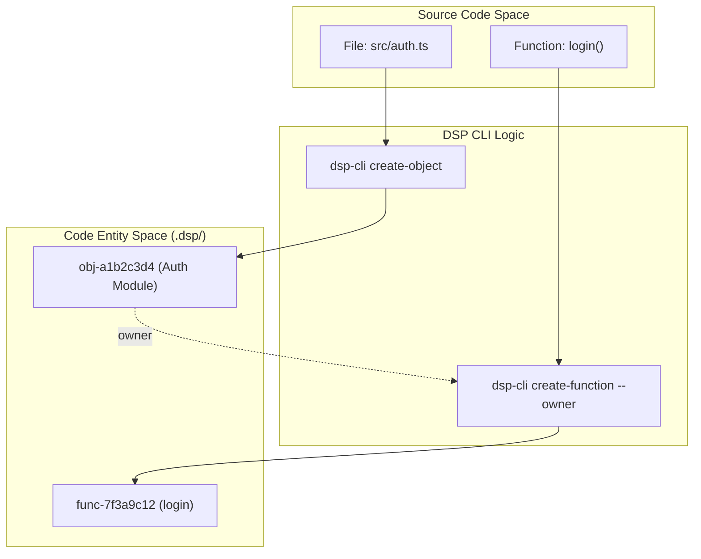
**Sources:** [skills/data-structure-protocol/references/operations.md:16-43](), [skills/data-structure-protocol/scripts/dsp-cli.py:44-46]()

### Dependency and "Why" Mapping
This diagram shows how an `import` statement in code is translated into a structured relationship with a mandatory justification using `add-import`.

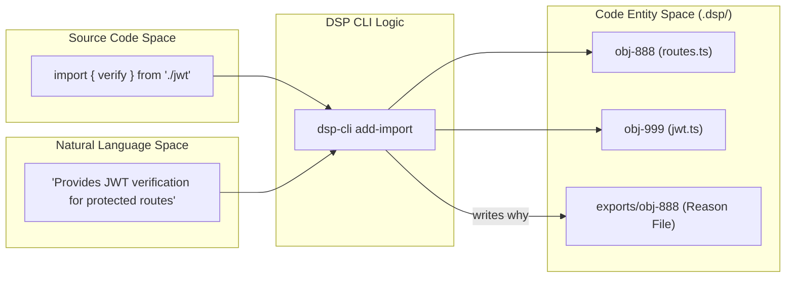
**Sources:** [skills/data-structure-protocol/references/operations.md:57-91](), [skills/data-structure-protocol/scripts/dsp-cli.py:232-234]()

---

## Command Categories

The CLI operations are grouped into three functional categories, each covered in detail on its respective child page.

### Entity Management
These commands handle the write-side of the protocol. They are used to initialize the graph, register new files and functions, and maintain the relationships as the code evolves. This includes handling cascading deletions to ensure graph integrity.
*   **Key Commands:** `init`, `create-object`, `create-function`, `add-import`, `remove-entity`, `move-entity`.
*   For details, see [Entity Management Commands](#2.1).

**Sources:** [skills/data-structure-protocol/references/operations.md:14-151]()

### Graph Traversal and Query
These commands provide the read-side of the protocol. They allow agents and developers to search the graph, discover dependencies, and perform impact analysis by looking "up" the graph (parents/recipients) or "down" the graph (children/dependencies).
*   **Key Commands:** `search`, `find-by-source`, `get-entity`, `get-children`, `get-parents`, `get-path`.
*   For details, see [Graph Traversal and Query Commands](#2.2).

**Sources:** [skills/data-structure-protocol/references/operations.md:152-229]()

### Diagnostics and Health
These commands are used to validate the structural integrity of the DSP graph. They detect issues like circular dependencies, orphaned entities (dead code), and provide high-level project statistics.
*   **Key Commands:** `detect-cycles`, `get-orphans`, `get-stats`.
*   For details, see [Diagnostics and Health Checks](#2.3).

**Sources:** [skills/data-structure-protocol/references/operations.md:230-255]()

---

# Page: Entity Management Commands

# Entity Management Commands

<details>
<summary>Relevant source files</summary>

The following files were used as context for generating this wiki page:

- [skills/data-structure-protocol/SKILL.md](skills/data-structure-protocol/SKILL.md)
- [skills/data-structure-protocol/references/operations.md](skills/data-structure-protocol/references/operations.md)
- [skills/data-structure-protocol/scripts/dsp-cli.py](skills/data-structure-protocol/scripts/dsp-cli.py)

</details>


This section provides a technical reference for the write-side operations of the Data Structure Protocol (DSP) CLI. These commands are responsible for maintaining the integrity of the `.dsp/` directory, which serves as the persistent structural memory for the codebase.

## Overview of Write Operations

Entity management in DSP follows a strict graph-based model where nodes (Objects and Functions) are identified by stable UIDs. Write operations ensure that every change in the physical codebase (file creation, symbol export, or dependency addition) is mirrored in the `.dsp/` metadata with an accompanying "why" context.

### Data Flow and Implementation
The CLI is implemented in `scripts/dsp-cli.py`. It uses a `Store` class [skills/data-structure-protocol/scripts/dsp-cli.py:159-232]() to abstract filesystem operations. Commands typically follow a three-step lifecycle:
1.  **Validation**: Check if the entity exists or if the pre-conditions (like usage of an import) are met.
2.  **Filesystem Update**: Create or modify directories and flat files (`description`, `imports`, `shared`, `exports/`).
3.  **Index Maintenance**: Update Table of Contents (TOC) files or reverse-index entries in the `exports/` directories of related entities.

**Sources:** [skills/data-structure-protocol/scripts/dsp-cli.py:1-157](), [skills/data-structure-protocol/references/operations.md:1-13]()

---

## Entity Creation

### create-object
Creates a new Object entity representing a module, class, configuration file, or external dependency.

*   **Syntax**: `dsp-cli create-object <source> <purpose> [--kind external] [--toc ROOT_UID]`
*   **UID Format**: Generates an `obj-<8hex>` identifier [skills/data-structure-protocol/scripts/dsp-cli.py:44-46]().
*   **Behavior**:
    1.  Creates the directory `.dsp/obj-.../`.
    2.  Writes the `description` file containing the source path, kind (default: `module`), and purpose [skills/data-structure-protocol/references/operations.md:25-26]().
    3.  Initializes empty `imports` and `shared` files.
    4.  Registers the UID in the specified TOC (or the default `TOC` file) [skills/data-structure-protocol/references/operations.md:27-27]().

### create-function
Creates a Function entity, typically representing an exported function or a class method.

*   **Syntax**: `dsp-cli create-function <source> <purpose> [--owner UID] [--toc ROOT_UID]`
*   **UID Format**: Generates a `func-<8hex>` identifier [skills/data-structure-protocol/scripts/dsp-cli.py:44-46]().
*   **Ownership**: If `--owner` (an Object UID) is provided, the CLI automatically establishes a bidirectional link:
    *   The function UID is added to the owner's `imports` (indicating the object "sees" its members).
    *   A reverse link is created in `.dsp/<funcUid>/exports/<ownerUid>` with the value `owner: method/member` [skills/data-structure-protocol/references/operations.md:40-43]().

### create-shared
Registers existing entities (usually functions) as the public API of an object.

*   **Syntax**: `dsp-cli create-shared <exporter_uid> <shared_uid> [<shared_uid> ...]`
*   **Actions**:
    1.  Appends the `shared_uid` to the `shared` file of the `exporter_uid`.
    2.  Creates a directory `.dsp/<exporter_uid>/exports/<shared_uid>/`.
    3.  Initializes a `description` file inside that export directory, mirroring the shared entity's purpose for easy discovery [skills/data-structure-protocol/references/operations.md:53-55]().

**Sources:** [skills/data-structure-protocol/references/operations.md:14-56](), [skills/data-structure-protocol/SKILL.md:101-108]()

---

## Relationship Management

### add-import
Records a dependency relationship between two entities. This is the most critical command for graph density.

*   **Syntax**: `dsp-cli add-import <importer_uid> <imported_uid> <why> [--exporter UID]`
*   **Pre-condition**: The user/agent must verify the symbol is actually used in the code body (not just the import statement) [skills/data-structure-protocol/references/operations.md:65-71]().
*   **The "Why" Field**: Must describe the concrete role of the import in the *importer's* context, not just restate the imported entity's purpose [skills/data-structure-protocol/references/operations.md:73-84]().
*   **The `via=` Syntax**: If an `--exporter` is provided (e.g., importing a function from a module), the link is stored as `imported_uid via=exporter_uid` in the `imports` file [skills/data-structure-protocol/scripts/dsp-cli.py:61-62]().

### Mapping Natural Language to Code Space (Import Flow)

The following diagram illustrates how a developer's intent to "use a utility" translates into DSP filesystem entities.

Title: Natural Language Intent to DSP Entity Space
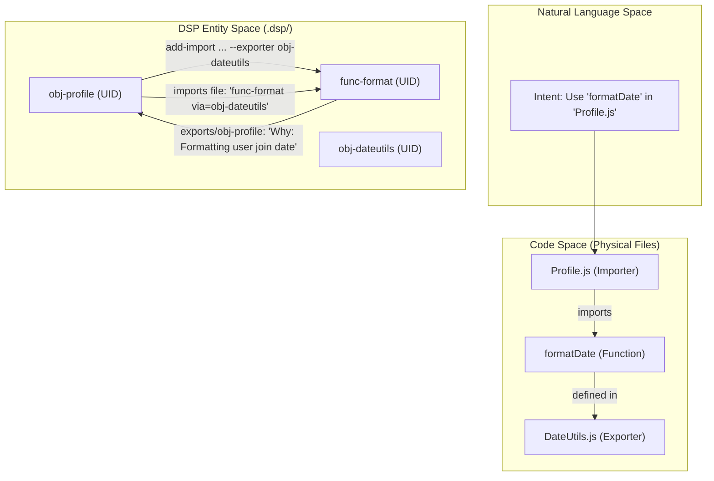

**Sources:** [skills/data-structure-protocol/references/operations.md:57-91](), [skills/data-structure-protocol/SKILL.md:67-74]()

---

## Update and Move Operations

| Command | Parameter | Effect |
| :--- | :--- | :--- |
| `update-description` | `<uid> [--source] [--purpose] [--kind]` | Modifies specific fields in the `description` file while preserving others [skills/data-structure-protocol/references/operations.md:94-100](). |
| `update-import-why` | `<importer> <imported> <new_why>` | Updates the text in the reverse-index (`exports/`) for a specific relationship [skills/data-structure-protocol/references/operations.md:102-108](). |
| `move-entity` | `<uid> <new_source>` | Updates the `source` field in the `description`. The **UID remains stable** [skills/data-structure-protocol/references/operations.md:110-116](). |

**Sources:** [skills/data-structure-protocol/references/operations.md:92-116](), [skills/data-structure-protocol/SKILL.md:119-124]()

---

## Deletion and Cascading Behavior

DSP maintains graph integrity by automatically cleaning up dangling references when entities or relationships are removed.

### remove-entity
The most destructive operation. It performs a full system-wide cleanup.
1.  **Inbound Links**: Scans all other entities' `imports` files and removes any line referencing the target UID (either as the direct import or as a `via=` provider).
2.  **Outbound Links**: Removes the reverse-index entries (`exports/`) in all entities that the target previously imported.
3.  **Shared/Exports**: Removes the entity from any `shared` lists and deletes its `exports/` directory.
4.  **TOC**: Removes the UID from all Table of Contents files.
5.  **Filesystem**: Deletes the `.dsp/<uid>/` directory [skills/data-structure-protocol/references/operations.md:139-150]().

### remove-shared
Unregisters a public API member. This triggers a cascade:
1.  The UID is removed from the exporter's `shared` file.
2.  The specific `exports/<shared_uid>/` directory is deleted.
3.  Every recipient that was importing this entity "via" the exporter has that specific line removed from their `imports` file [skills/data-structure-protocol/references/operations.md:128-137]().

### Entity Deletion Logic Flow

Title: Cascading Deletion Logic (remove-entity)
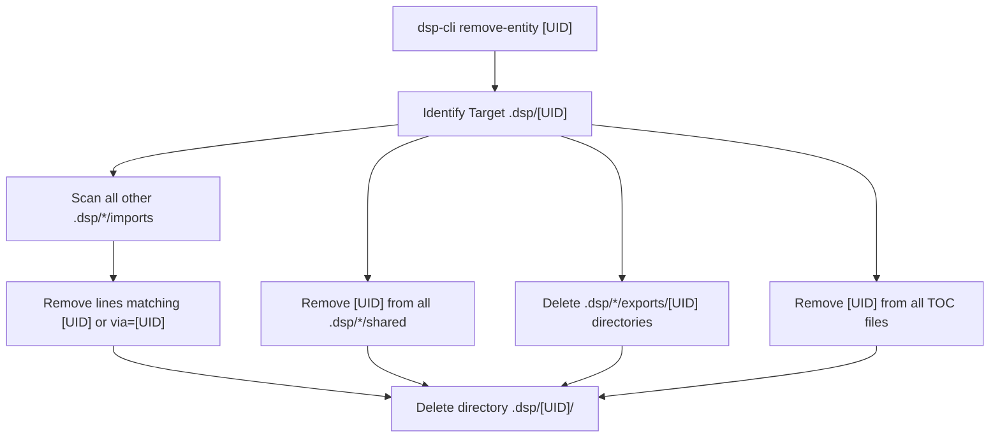

**Sources:** [skills/data-structure-protocol/references/operations.md:118-151](), [skills/data-structure-protocol/SKILL.md:125-130]()

---

# Page: Graph Traversal and Query Commands

# Graph Traversal and Query Commands

<details>
<summary>Relevant source files</summary>

The following files were used as context for generating this wiki page:

- [ARCHITECTURE.md](ARCHITECTURE.md)
- [skills/data-structure-protocol/SKILL.md](skills/data-structure-protocol/SKILL.md)
- [skills/data-structure-protocol/references/operations.md](skills/data-structure-protocol/references/operations.md)

</details>


This page provides a technical reference for the read-side operations of the Data Structure Protocol (DSP) CLI. These commands allow agents and developers to navigate the dependency graph, perform impact analysis, and discover entities within the `.dsp/` storage layer.

## Overview of Query Mechanisms

The DSP CLI implements graph traversal using the filesystem as a flat-file database. Every entity is a directory named by its UID (`obj-*` or `func-*`), and relationships are stored as lists of UIDs in `imports` files or reverse-indexed in `exports/` directories [ARCHITECTURE.md:84-96]().

### Traversal Logic
*   **Downward Traversal (Dependencies):** Follows the `imports` file within an entity directory [skills/data-structure-protocol/references/operations.md:183-187]().
*   **Upward Traversal (Dependents):** Follows the `exports/` subdirectories, which act as a reverse index of who imports the current entity [ARCHITECTURE.md:115-121]().
*   **Shortest Path:** Implemented via Breadth-First Search (BFS) across both import and export edges [skills/data-structure-protocol/references/operations.md:196-202]().

## Command Reference

### Entity Discovery

#### `search <query>`
Performs a case-insensitive full-text search across all `description` files and export record names within the `.dsp/` directory [skills/data-structure-protocol/references/operations.md:206-213](). Use this to find UIDs when only the functional purpose or a symbol name is known.

#### `find-by-source <source_path>`
Maps a repository-relative file path back to its DSP entities. Since a single file (Object) can contain multiple exported Functions, this command may return multiple UIDs [skills/data-structure-protocol/references/operations.md:214-220]().

#### `read-toc [--toc ROOT_UID]`
Reads the Table of Contents file. This is the primary entry point for an LLM to understand the high-level architecture of a project or a specific sub-root [skills/data-structure-protocol/references/operations.md:222-229]().

### Detailed Inspection

#### `get-entity <uid>`
Provides a complete snapshot of a specific node: its description (source, kind, purpose), its outgoing imports, its shared/public members, and a list of who exports it [skills/data-structure-protocol/references/operations.md:154-161]().

#### `get-recipients <uid>`
A specialized query for impact analysis. It performs a three-level search to find every entity that depends on the target UID:
1.  **Direct:** Entities listing the UID in their `imports`.
2.  **Via Shared:** Entities importing the UID through a "barrel" or exporter object.
3.  **Fallback:** A full scan of the `.dsp` directory if indices are inconsistent [skills/data-structure-protocol/references/operations.md:170-177]().

### Graph Navigation

#### `get-children <uid> [--depth N]`
Retrieves the dependency tree downward. 
*   **Depth 1:** Immediate imports.
*   **Depth `inf`:** The recursive dependency tree [skills/data-structure-protocol/references/operations.md:180-187]().

#### `get-parents <uid> [--depth N]`
Retrieves the dependency tree upward (the "inverse" tree). Useful for determining the blast radius of a breaking change in a low-level function [skills/data-structure-protocol/references/operations.md:188-194]().

#### `get-path <from_uid> <to_uid>`
Calculates the shortest path between two nodes using BFS. This is bidirectional, considering both `imports` (A depends on B) and `exports` (B is used by A) as valid edges [skills/data-structure-protocol/references/operations.md:196-202]().

### Diagnostics and Stats

#### `get-stats`
Returns high-level metrics of the graph health, including total counts of Objects vs. Functions, external dependency count, and counts of orphans or cycles [skills/data-structure-protocol/references/operations.md:248-255]().

---
**Sources:**
* [skills/data-structure-protocol/references/operations.md:152-255]()
* [ARCHITECTURE.md:43-82]()
* [skills/data-structure-protocol/SKILL.md:109-118]()

## Data Flow: From Natural Language to Code Entities

The following diagram illustrates how a developer's intent (Natural Language) is translated into specific code entities and CLI operations within the DSP ecosystem.

**Intent to Entity Mapping**
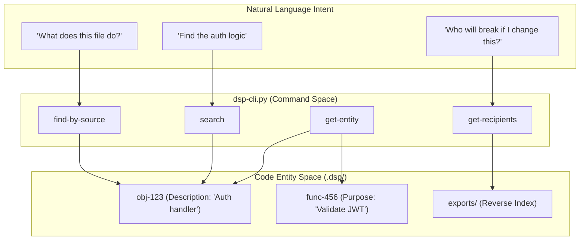
**Sources:**
* [skills/data-structure-protocol/SKILL.md:109-118]()
* [ARCHITECTURE.md:43-58]()

## Internal Traversal Architecture

The following diagram shows the internal logic of the `get-children` and `get-parents` operations, demonstrating how the CLI interacts with the filesystem structure to resolve graph edges.

**BFS Traversal Logic**
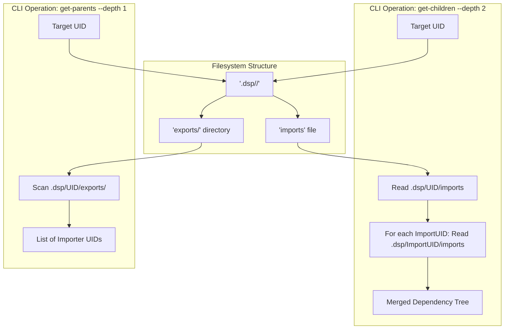
**Sources:**
* [skills/data-structure-protocol/references/operations.md:180-194]()
* [ARCHITECTURE.md:84-121]()

## Summary of Traversal Commands

| Command | Direction | Primary Source File | Use Case |
| :--- | :--- | :--- | :--- |
| `get-children` | Downward | `imports` | Understanding what a module needs to function. |
| `get-parents` | Upward | `exports/` | Impact analysis; identifying dependents. |
| `get-recipients` | Upward | `exports/` + scan | Exhaustive list of all users of an API. |
| `get-path` | Bidirectional | `imports` + `exports/` | Finding how two distant modules are connected. |
| `read-toc` | Entrypoint | `TOC` | Initial project orientation for agents. |

---
**Sources:**
* [skills/data-structure-protocol/references/operations.md:152-202]()
* [ARCHITECTURE.md:61-73]()

---

# Page: Diagnostics and Health Checks

# Diagnostics and Health Checks

<details>
<summary>Relevant source files</summary>

The following files were used as context for generating this wiki page:

- [.github/workflows/dsp-consistency.yml](.github/workflows/dsp-consistency.yml)
- [skills/data-structure-protocol/SKILL.md](skills/data-structure-protocol/SKILL.md)
- [skills/data-structure-protocol/references/operations.md](skills/data-structure-protocol/references/operations.md)

</details>


The Data Structure Protocol (DSP) relies on a strictly maintained directed graph of entities and dependencies. Over time, manual updates or automated agent actions may introduce inconsistencies such as circular dependencies, orphaned entities, or missing registrations. The DSP CLI provides a suite of diagnostic tools to validate graph integrity, ensure structural health, and assist in identifying dead code.

## Diagnostic Command Overview

The diagnostic suite consists of three primary commands: `detect-cycles`, `get-orphans`, and `get-stats`. These commands analyze the `.dsp/` directory structure to provide a high-level view of project health [skills/data-structure-protocol/references/operations.md:230-255]().

### 1. Cycle Detection (`detect-cycles`)

Circular dependencies occur when two or more entities import each other, either directly or through a chain of intermediaries. In DSP, cycles often indicate architectural leakage or improper entity boundaries.

**Command:**
```bash
dsp-cli detect-cycles
```

**Validation Logic:**
The CLI performs a depth-first search (DFS) across the `imports` files of all entities registered in the `.dsp/` directory. It identifies any path that leads back to a previously visited node within the current traversal stack [skills/data-structure-protocol/references/operations.md:232-239]().

**Remediation:**
- **Refactor shared logic:** If `obj-A` and `obj-B` depend on each other, extract the shared logic into a third entity (`obj-C`) that both can import.
- **Review `why` fields:** Check the `exports/` reverse index of the involved entities to understand why the circularity was introduced [skills/data-structure-protocol/references/operations.md:88-91]().

### 2. Orphan Detection (`get-orphans`)

An "orphan" is an entity that is not imported by any other entity in the graph and is not explicitly listed as a root entry point in a Table of Contents (TOC) file [skills/data-structure-protocol/references/operations.md:241-247]().

**Command:**
```bash
dsp-cli get-orphans
```

**Validation Logic:**
1. Collect all UIDs listed in the project's TOC files (these are "entry points").
2. Scan all `imports` files in `.dsp/*/` to build a list of all "referenced" UIDs.
3. Identify UIDs that are neither in the TOC nor in the "referenced" list.

**Remediation:**
- **Register Missing Imports:** If the entity is actually used in the code, use `add-import` to register the relationship [skills/data-structure-protocol/references/operations.md:57-63]().
- **Dead Code Elimination:** If the entity is truly unused, use `remove-entity` to perform a cascading cleanup of the `.dsp/` directory [skills/data-structure-protocol/references/operations.md:139-150]().

### 3. Graph Statistics (`get-stats`)

This command provides a quantitative overview of the DSP graph, useful for tracking project growth and documentation coverage [skills/data-structure-protocol/references/operations.md:248-255]().

**Command:**
```bash
dsp-cli get-stats
```

**Output Metrics:**
- **Entity Counts:** Breakdown of Objects (`obj-*`) vs. Functions (`func-*`).
- **External Dependencies:** Count of entities marked with `--kind external`.
- **Edge Density:** Total number of imports and shared/exported relationships.
- **Health Indicators:** Summary count of detected cycles and orphans.

---

## Data Flow: Diagnostic Execution

The following diagram illustrates how the `dsp-cli.py` script interacts with the filesystem to generate diagnostic reports.

### Diagnostic Analysis Data Flow
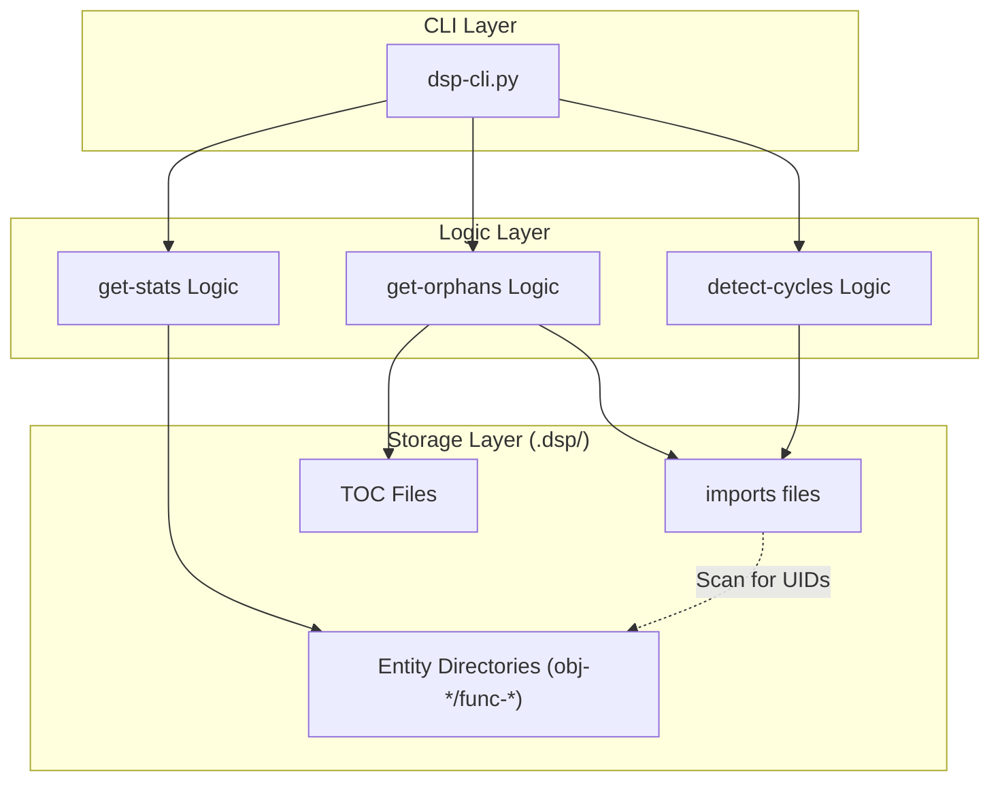
**Sources:** [skills/data-structure-protocol/SKILL.md:34-53](), [skills/data-structure-protocol/references/operations.md:230-255]()

---

## CI/CD Integration and Enforcement

DSP diagnostics are designed to be run automatically in CI pipelines to prevent graph degradation. The `dsp-consistency.yml` workflow automates these checks on every pull request [.github/workflows/dsp-consistency.yml:1-7]().

### CI Validation Steps
1. **Integrity Check:** Runs `get-stats` to ensure the `.dsp/` directory is readable and non-empty [.github/workflows/dsp-consistency.yml:56-60]().
2. **Orphan Check:** Runs `get-orphans`. If orphans are found, they are listed in the GitHub Step Summary [.github/workflows/dsp-consistency.yml:62-68]().
3. **Cycle Check:** Runs `detect-cycles`. Circular dependencies trigger a warning or failure [.github/workflows/dsp-consistency.yml:70-76]().
4. **Coverage Analysis:** For Pull Requests, the workflow compares the list of changed files against the DSP graph using `find-by-source`. If a source file (e.g., `.py`, `.ts`) is modified but has no corresponding entry in DSP, it is flagged as "not in DSP" [.github/workflows/dsp-consistency.yml:78-95]().

### Code-to-System Mapping: Diagnostic Entities
The following diagram maps the CLI commands to their specific validation targets within the codebase and storage format.

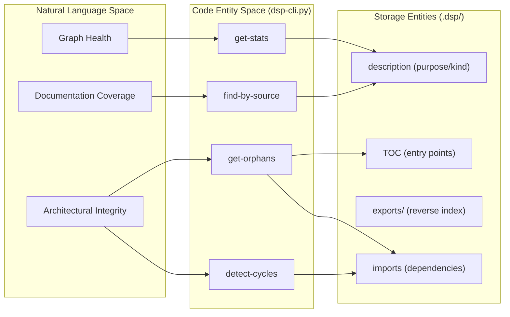
**Sources:** [skills/data-structure-protocol/SKILL.md:131-136](), [skills/data-structure-protocol/references/operations.md:230-255](), [.github/workflows/dsp-consistency.yml:53-99]()

---

## Common Health Issues and Remediation

| Issue | Diagnostic Command | Typical Cause | Remediation |
| :--- | :--- | :--- | :--- |
| **Circular Dependency** | `detect-cycles` | Tight coupling between two modules. | Extract shared logic via `create-object` and update imports. |
| **Orphaned Entity** | `get-orphans` | File deleted without calling `remove-entity`. | Run `dsp-cli remove-entity <uid>` [skills/data-structure-protocol/references/operations.md:142-150](). |
| **Missing Import** | `get-orphans` | New code usage added but `add-import` not called. | Call `dsp-cli add-import` with specific `why` [skills/data-structure-protocol/references/operations.md:57-63](). |
| **Stale Description** | `get-stats` | Purpose of code changed but DSP not updated. | Run `update-description --purpose <new>` [skills/data-structure-protocol/references/operations.md:97-101](). |
| **Untracked File** | CI Workflow | New file created but `create-object` skipped. | Run `create-object <path> <purpose>` [skills/data-structure-protocol/references/operations.md:19-20](). |

**Sources:** [skills/data-structure-protocol/SKILL.md:138-150](), [skills/data-structure-protocol/references/operations.md:11-12]()

---

# Page: Storage Format

# Storage Format

<details>
<summary>Relevant source files</summary>

The following files were used as context for generating this wiki page:

- [ARCHITECTURE.md](ARCHITECTURE.md)
- [README.md](README.md)
- [skills/data-structure-protocol/references/storage-format.md](skills/data-structure-protocol/references/storage-format.md)

</details>


The Data Structure Protocol (DSP) stores the codebase graph as a flat-file database within a `.dsp/` directory at the repository root [ARCHITECTURE.md:84-86](). This format is designed to be human-readable, git-friendly (for diffs and merges), and easily traversable by AI agents without requiring a specialized database engine [README.md:55-55]().

### The .dsp/ Directory Structure

The storage layout organizes information into entity-specific directories and Table of Contents (TOC) files that define the entry points into the graph.

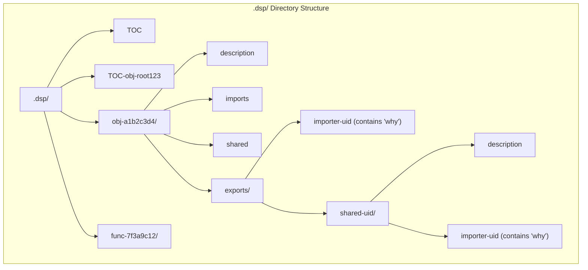
*Sources: [skills/data-structure-protocol/references/storage-format.md:13-33]()*

### Entity Directories
Every node in the DSP graph (Objects and Functions) is represented by a directory named after its unique identifier (UID). UIDs are 8-character hex strings derived from `uuid4()` and prefixed by the entity type [ARCHITECTURE.md:92-97]():
*   `obj-<hex>`: Modules, classes, configs, or external dependencies [skills/data-structure-protocol/references/storage-format.md:39-39]().
*   `func-<hex>`: Functions, methods, or handlers [skills/data-structure-protocol/references/storage-format.md:40-40]().

Inside each directory, four key files/folders define the entity's metadata and relationships:
1.  **`description`**: Contains the source path, entity kind, and a natural language purpose [skills/data-structure-protocol/references/storage-format.md:44-50]().
2.  **`imports`**: A list of UIDs that this entity depends on. It supports a `via=` syntax for tracking barrel exports (e.g., `imported_uid via=exporter_uid`) [skills/data-structure-protocol/references/storage-format.md:56-70]().
3.  **`shared`**: A list of UIDs representing internal elements (like functions in a module) that this entity exposes to the outside world [skills/data-structure-protocol/references/storage-format.md:72-78]().
4.  **`exports/`**: A reverse-index directory. It stores files named after *importer* UIDs; the content of these files explains **why** the dependency exists [skills/data-structure-protocol/references/storage-format.md:80-107]().

For details on the internal file schemas and annotated examples, see **[Entity Directory Structure](#3.1)**.

### Table of Contents (TOC)
The TOC files serve as the starting point for any agent or tool navigating the graph. They provide a linearized list of UIDs reachable from a specific root entrypoint [ARCHITECTURE.md:71-71]().

*   **Single-root**: Uses a file named `.dsp/TOC` [skills/data-structure-protocol/references/storage-format.md:111-111]().
*   **Multi-root**: Uses files named `.dsp/TOC-<rootUid>` for projects with multiple distinct entrypoints (e.g., a monorepo with `backend` and `frontend` roots) [skills/data-structure-protocol/references/storage-format.md:112-112]().

For details on TOC naming, multi-root support, and navigation rules, see **[Table of Contents (TOC) Files](#3.2)**.

### Mapping Code to Storage
DSP bridges the gap between the physical file system and the logical entity graph using `@dsp` markers in source code.

| Code Entity | DSP Storage Mapping |
| :--- | :--- |
| **File/Module** (`src/app.ts`) | `obj-<hex>/description` (source: src/app.ts) |
| **Function** (`function start()`) | `func-<hex>/description` (source: src/app.ts#start) |
| **Import Statement** (`import { x } from 'y'`) | `obj-y/exports/obj-app/` (contains "why") |
| **Export Statement** (`export const x`) | `obj-y/shared` (contains UID of x) |

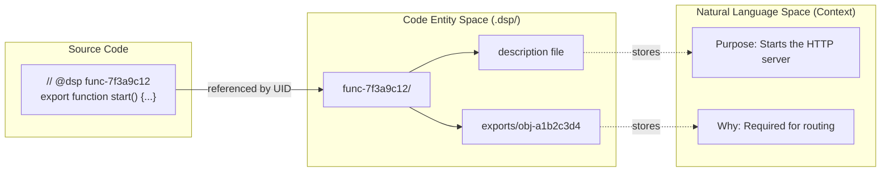
*Sources: [ARCHITECTURE.md:99-112](), [skills/data-structure-protocol/references/storage-format.md:44-50](), [skills/data-structure-protocol/references/storage-format.md:88-88]()*

### Child Pages
*   **[Entity Directory Structure](#3.1)**: Detailed breakdown of the `description`, `imports`, `shared`, and `exports/` file formats.
*   **[Table of Contents (TOC) Files](#3.2)**: Specification for TOC file naming, multi-root entrypoints, and graph entry rules.

**Sources:**
*   [README.md:55-55]()
*   [ARCHITECTURE.md:71-71]()
*   [ARCHITECTURE.md:84-86]()
*   [ARCHITECTURE.md:92-97]()
*   [ARCHITECTURE.md:99-112]()
*   [skills/data-structure-protocol/references/storage-format.md:13-33]()
*   [skills/data-structure-protocol/references/storage-format.md:39-40]()
*   [skills/data-structure-protocol/references/storage-format.md:44-50]()
*   [skills/data-structure-protocol/references/storage-format.md:56-70]()
*   [skills/data-structure-protocol/references/storage-format.md:72-78]()
*   [skills/data-structure-protocol/references/storage-format.md:80-107]()
*   [skills/data-structure-protocol/references/storage-format.md:111-112]()

---

# Page: Entity Directory Structure

# Entity Directory Structure

<details>
<summary>Relevant source files</summary>

The following files were used as context for generating this wiki page:

- [ARCHITECTURE.md](ARCHITECTURE.md)
- [skills/data-structure-protocol/references/operations.md](skills/data-structure-protocol/references/operations.md)
- [skills/data-structure-protocol/references/storage-format.md](skills/data-structure-protocol/references/storage-format.md)

</details>


The Data Structure Protocol (DSP) stores its graph database in a flat-file format within the `.dsp/` directory at the project root [ARCHITECTURE.md:84-86](). Each node in the graph (Object or Function) is represented by a dedicated directory named after its Unique Identifier (UID) [skills/data-structure-protocol/references/storage-format.md:19-33]().

## 1. Directory Layout and UID Format

Each entity is assigned a stable UID consisting of a type prefix and an 8-character hexadecimal string generated from `uuid4().hex` [ARCHITECTURE.md:92-98]().

*   **`obj-<8hex>`**: Used for Objects (modules, classes, configurations, external dependencies, or resource files) [skills/data-structure-protocol/references/storage-format.md:39-39]().
*   **`func-<8hex>`**: Used for Functions (methods, handlers, or pipelines) [skills/data-structure-protocol/references/storage-format.md:40-40]().

### Entity Directory Components
| File/Directory | Purpose | Required |
| :--- | :--- | :--- |
| `description` | Metadata including source path, kind, and purpose. | Yes |
| `imports` | List of UIDs this entity depends on. | Yes (can be empty) |
| `shared` | List of UIDs this entity exports to the public API. | Objects only |
| `exports/` | Reverse-index directory tracking importers and their "why". | Yes |

**Sources:** [ARCHITECTURE.md:88-98](), [skills/data-structure-protocol/references/storage-format.md:15-33]()

---

## 2. File Format Specifications

### 2.1 The `description` File
This file provides the primary context for the LLM. It contains three mandatory fields [skills/data-structure-protocol/references/storage-format.md:44-50]():
*   **`source`**: The repository-relative path to the file. For functions or symbols within a file, it uses the format `path/to/file#symbol` [skills/data-structure-protocol/references/storage-format.md:47-47]().
*   **`kind`**: Specifies if the entity is an `object`, `function`, or `external` [skills/data-structure-protocol/references/storage-format.md:48-48]().
*   **`purpose`**: A 1-3 sentence explanation of what the entity does and why it exists [skills/data-structure-protocol/references/storage-format.md:49-49]().

### 2.2 The `imports` File
This file lists dependencies one per line. It supports two formats [skills/data-structure-protocol/references/storage-format.md:56-68]():
1.  **Direct Import**: `<imported_uid>`
2.  **Via Exporter**: `<imported_uid> via=<exporter_obj_uid>` (used for barrel exports or members imported through a module) [skills/data-structure-protocol/references/storage-format.md:64-67]().

### 2.3 The `shared` File
Only relevant for Objects that act as containers or modules. It lists the UIDs of functions or sub-objects that are part of this entity's public API [skills/data-structure-protocol/references/storage-format.md:72-78]().

### 2.4 The `exports/` Directory (Reverse Index)
The `exports/` directory allows the system to answer "who uses this?" without scanning the entire graph.
*   **Direct Recipients**: A file named `<importer_uid>` containing the "why" text [skills/data-structure-protocol/references/storage-format.md:84-89]().
*   **Shared Recipients**: If an Object shares entities, a subdirectory `<shared_uid>/` is created. It contains a `description` (what is exported) and individual files for each `<importer_uid>` explaining why they use that specific export [skills/data-structure-protocol/references/storage-format.md:91-99]().

**Sources:** [skills/data-structure-protocol/references/storage-format.md:44-104]()

---

## 3. Implementation Logic: Object vs. Function

### Entity Relationship Logic
The following diagram illustrates how `dsp-cli` organizes the filesystem when an Object owns a Function and another Object imports it.

**Entity Filesystem and Logic Flow**
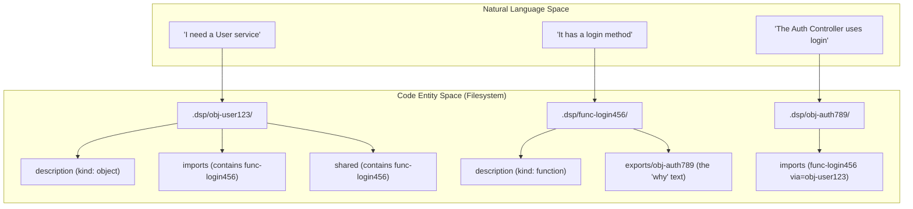
**Sources:** [skills/data-structure-protocol/references/operations.md:32-43](), [skills/data-structure-protocol/references/storage-format.md:15-33]()

---

## 4. Annotated Examples

### Example 1: Object Entity (Module)
An Object representing a database utility module.

**File: `.dsp/obj-db001122/description`**
```text
source: src/utils/db.ts
kind: object
purpose: Provides a singleton connection pool and query execution wrappers for PostgreSQL.
```

**File: `.dsp/obj-db001122/shared`**
```text
func-query88
func-connect99
```

**Directory: `.dsp/obj-db001122/exports/`**
```text
├── obj-api5566          # Content: "Used to initialize DB connection on server start"
└── func-query88/
    ├── description      # Content: "Async SQL query executor"
    └── obj-user7788     # Content: "Used to fetch user profiles by ID"
```

### Example 2: Function Entity (Method)
A Function owned by the database module above.

**File: `.dsp/func-query88/description`**
```text
source: src/utils/db.ts#executeQuery
kind: function
purpose: Sanitizes inputs and executes raw SQL strings against the primary pool.
```

**File: `.dsp/func-query88/exports/`**
```text
└── obj-db001122         # Content: "owner: method of this object"
```

**Sources:** [skills/data-structure-protocol/references/storage-format.md:44-104](), [skills/data-structure-protocol/references/operations.md:29-43]()

---

## 5. Data Flow: Registration Process

When an agent creates or updates entities, the `dsp-cli` ensures the filesystem remains a consistent graph.

**Data Flow for `add-import`**
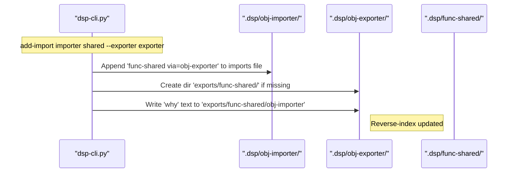

**Sources:** [skills/data-structure-protocol/references/operations.md:57-91](), [skills/data-structure-protocol/references/storage-format.md:91-104]()

---

# Page: Table of Contents (TOC) Files

# Table of Contents (TOC) Files

<details>
<summary>Relevant source files</summary>

The following files were used as context for generating this wiki page:

- [ARCHITECTURE.md](ARCHITECTURE.md)
- [skills/data-structure-protocol/references/bootstrap.md](skills/data-structure-protocol/references/bootstrap.md)
- [skills/data-structure-protocol/references/storage-format.md](skills/data-structure-protocol/references/storage-format.md)

</details>


The Table of Contents (TOC) files serve as the primary entry point for AI agents and LLMs to navigate the Data Structure Protocol (DSP) graph. While the `.dsp/` directory stores the granular entity data, the TOC files provide a structured, ordered sequence of entities that define the project's scope and reachability from specific entry points [skills/data-structure-protocol/references/bootstrap.md:13-13]().

## Purpose and Functionality

In the DSP model, the TOC is not just a list; it is a map of the "documented world" from a specific root [skills/data-structure-protocol/references/bootstrap.md:86-90]().

1.  **Entry Point Discovery**: LLMs use `read-toc` to identify the root of a project and the order in which entities were documented during the bootstrap procedure [ARCHITECTURE.md:37-37]().
2.  **Scope Definition**: The TOC distinguishes between entities that are part of the active project graph and orphaned entities that may still exist in the filesystem but are no longer reachable from a root [skills/data-structure-protocol/references/storage-format.md:123-128]().
3.  **Multi-Root Support**: Large repositories (monorepos) or projects with multiple entry points (e.g., a CLI tool and a Web Server) use separate TOC files to maintain distinct dependency trees [skills/data-structure-protocol/references/bootstrap.md:21-21]().

## File Naming and Location

TOC files are stored at the base of the `.dsp/` directory. The naming convention depends on whether the project has a single entry point or multiple roots [skills/data-structure-protocol/references/storage-format.md:110-112]().

| File Pattern | Context | Description |
| :--- | :--- | :--- |
| `.dsp/TOC` | Single-Root | The default TOC for projects with one primary entry point. |
| `.dsp/TOC-<rootUid>` | Multi-Root | Specific TOC files named after the UID of their respective root Object. |

### Multi-Root Projects
When a project has multiple entry points (e.g., `main.py` and `worker.py`), the bootstrap procedure creates a separate TOC for each [skills/data-structure-protocol/references/bootstrap.md:21-21](). An entity may appear in multiple TOC files if it is reachable from both roots [skills/data-structure-protocol/references/storage-format.md:127-127]().

## Format and Structure

The TOC file is a plain-text file containing one UID per line [skills/data-structure-protocol/references/storage-format.md:116-121]().

```text
obj-a1b2c3d4
func-7f3a9c12
obj-e5f6g7h8
...
```

### Key Rules
*   **Root Position**: The first line (`TOC[0]`) is always the UID of the root entrypoint for that specific tree [skills/data-structure-protocol/references/storage-format.md:124-124]().
*   **Documentation Order**: Entities are typically listed in the order they were encountered during the Depth-First Search (DFS) bootstrap [skills/data-structure-protocol/references/storage-format.md:125-125]().
*   **Uniqueness**: Each UID appears exactly once within a single TOC file [skills/data-structure-protocol/references/storage-format.md:126-126]().
*   **Appends**: When new entities are created via `create-object` or `create-function`, they are appended to the end of the specified TOC [skills/data-structure-protocol/references/storage-format.md:128-128]().

**Sources:** [skills/data-structure-protocol/references/storage-format.md:108-129](), [skills/data-structure-protocol/references/bootstrap.md:13-21]()

## TOC Data Flow and Navigation

The TOC acts as the bridge between the high-level project intent and the low-level entity relationships. When an agent starts a session, it reads the TOC to understand the "spine" of the codebase.

### Diagram: From Entry Point to Entity Graph
This diagram illustrates how the `TOC` file links the "Natural Language Space" (Project Purpose) to the "Code Entity Space" (specific UIDs and files).

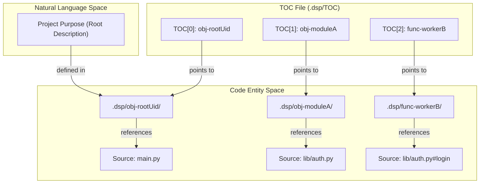
**Sources:** [skills/data-structure-protocol/references/storage-format.md:13-33](), [ARCHITECTURE.md:43-51]()

## CLI Interaction: The `--toc` Flag

Most write-side commands in the `dsp-cli` accept an optional `--toc` flag. This ensures that when an entity is created or modified, it is correctly registered in the appropriate project root [ARCHITECTURE.md:23-24]().

### Common Command Patterns
*   **Initialization**: `dsp-cli init` prepares the `.dsp/` directory but does not create a TOC until the first entity is registered [ARCHITECTURE.md:22-22]().
*   **Registration**: `dsp-cli create-object <source> <purpose> --toc obj-root123` adds the new object to the specified TOC file [ARCHITECTURE.md:23-23]().
*   **Reading**: `dsp-cli read-toc [--toc ROOT_UID]` allows the agent to list all entities in the graph for the specified root [ARCHITECTURE.md:37-37]().

### Diagram: TOC Update Logic
This diagram shows the logic used by `dsp-cli` (specifically within the `create-object` and `create-function` flows) to maintain TOC files.

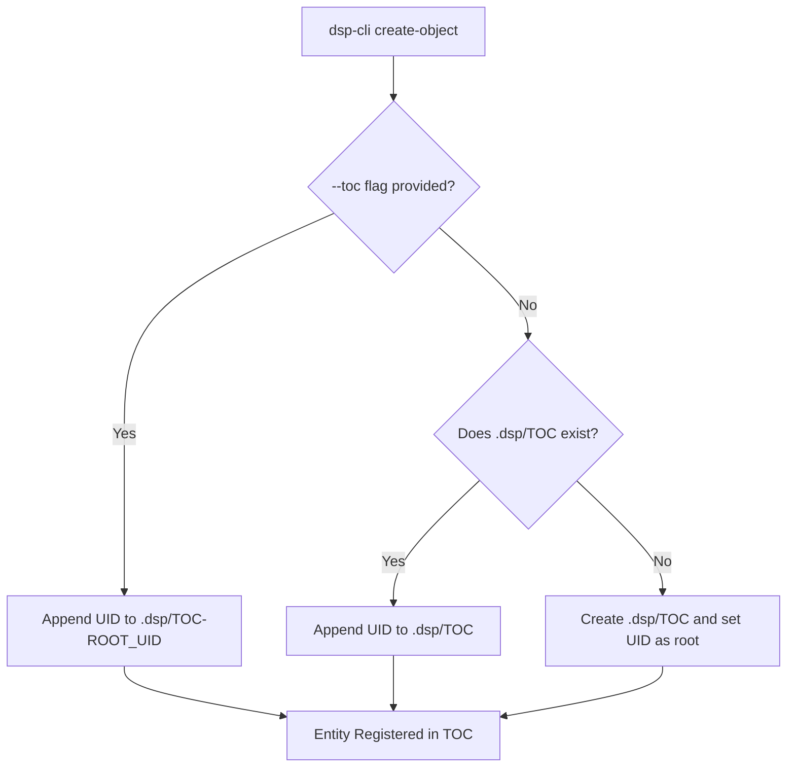
**Sources:** [ARCHITECTURE.md:21-39](), [skills/data-structure-protocol/references/storage-format.md:110-128]()

## Bootstrap and TOC Generation

During the **Bootstrap Procedure**, the TOC is generated dynamically as the agent performs a Depth-First Search (DFS) of the imports [skills/data-structure-protocol/references/bootstrap.md:13-13]().

1.  The agent identifies the root (e.g., `package.json` main) [skills/data-structure-protocol/references/bootstrap.md:19-19]().
2.  The root UID is written to the first line of the TOC [skills/data-structure-protocol/references/bootstrap.md:26-26]().
3.  As the agent descends into imports, each newly documented file's UID is appended to the TOC [skills/data-structure-protocol/references/bootstrap.md:59-59]().
4.  External dependencies are added to the TOC but are not traversed further (leaf nodes) [skills/data-structure-protocol/references/bootstrap.md:89-89]().

**Sources:** [skills/data-structure-protocol/references/bootstrap.md:1-94]()

---

# Page: Bootstrap Procedure

# Bootstrap Procedure

<details>
<summary>Relevant source files</summary>

The following files were used as context for generating this wiki page:

- [docs/workflows/brownfield.md](docs/workflows/brownfield.md)
- [docs/workflows/greenfield.md](docs/workflows/greenfield.md)
- [skills/data-structure-protocol/references/bootstrap.md](skills/data-structure-protocol/references/bootstrap.md)

</details>


The bootstrap procedure is the process of building the initial Data Structure Protocol (DSP) graph for a project. It involves a systematic traversal of the codebase to identify entities (files and functions), document their purposes, and map their interdependencies within the `.dsp/` directory.

Whether applying DSP to a mature codebase (Brownfield) or starting a fresh project (Greenfield), the goal is to create a persistent structural memory that AI agents can use for navigation and impact analysis.

## Core Bootstrap Algorithm

The foundational mechanism for bootstrapping is a **Depth-First Search (DFS)** traversal starting from the project's root entrypoints [skills/data-structure-protocol/references/bootstrap.md:13-15]().

### The DFS Process
1.  **Identify Roots**: Locate the primary entrypoints (e.g., `main.ts`, `app.py`, `index.js`) [skills/data-structure-protocol/references/bootstrap.md:17-21]().
2.  **Document Entity**: Create an object for the current file using `dsp-cli create-object` [skills/data-structure-protocol/references/bootstrap.md:23-26]().
3.  **Verify & Add Imports**: For every import in the file, verify it is actually used in the code body. If used, register the dependency with a `why` description explaining the specific usage [skills/data-structure-protocol/references/bootstrap.md:35-55]().
4.  **Recursive Descent**: Move to the first non-external imported file and repeat the process [skills/data-structure-protocol/references/bootstrap.md:57-60]().
5.  **Backtrack**: When a leaf node (no further local imports) is reached, backtrack to the previous level to process the next import [skills/data-structure-protocol/references/bootstrap.md:61-66]().

### Visualizing the Traversal
The following diagram illustrates how the bootstrap procedure bridges the gap between the filesystem (Code Space) and the DSP Graph (Memory Space).

**System Mapping: Codebase to DSP Graph**
```mermaid
graph TD
    subgraph "Code Entity Space (Filesystem)"
        R["src/main.ts (Root)"]
        A["src/auth/service.ts"]
        B["src/db/client.ts"]
        E["node_modules/express"]
    end

    subgraph "Natural Language / DSP Space (.dsp/)"
        direction TB
        TOC["TOC-rootUid"]
        OBJ_R["obj-root (App Entry)"]
        OBJ_A["obj-auth (Auth Logic)"]
        OBJ_B["obj-db (Persistence)"]
        OBJ_E["obj-ext-exp (External)"]
    end

    R -.->|"dsp-cli create-object"| OBJ_R
    A -.->|"dsp-cli create-object"| OBJ_A
    B -.->|"dsp-cli create-object"| OBJ_B
    E -.->|"kind=external"| OBJ_E

    OBJ_R -->|"imports"| OBJ_A
    OBJ_R -->|"imports"| OBJ_E
    OBJ_A -->|"imports"| OBJ_B
    
    TOC -->|"references"| OBJ_R
    TOC -->|"references"| OBJ_A
    TOC -->|"references"| OBJ_B
```
Sources: [skills/data-structure-protocol/references/bootstrap.md:71-85](), [docs/workflows/brownfield.md:104-122]()

---

## Workflow Variants

The bootstrap procedure adapts based on the current state of your project.

### Brownfield Workflow
The Brownfield workflow is designed for existing codebases where the primary challenge is capturing complex, pre-existing relationships. This is typically performed by an AI agent (like Claude Code or Cursor) guided by the DSP skill.

*   **Entrypoint Detection**: Automatic detection of roots via `package.json`, `main.py`, or framework-specific patterns [docs/workflows/brownfield.md:41-53]().
*   **External Handling**: Libraries are marked as `kind=external`. The agent records the dependency but does not descend into `node_modules` or vendor directories [skills/data-structure-protocol/references/bootstrap.md:89-89]().
*   **Incremental Mapping**: Projects can be mapped in stages, starting with critical paths and expanding to secondary modules [docs/workflows/brownfield.md:161-167]().

For detailed steps on mapping an existing project, see [Brownfield Workflow](#4.1).

### Greenfield Workflow
The Greenfield workflow focuses on "growing" the graph alongside the code. It emphasizes immediate registration to prevent "documentation debt."

*   **Boilerplate Start**: Using `dsp-boilerplate` provides a pre-initialized environment with dual roots (frontend/backend) [docs/workflows/greenfield.md:5-15]().
*   **Just-In-Time Registration**: Entities and public functions are registered as soon as the files are created [docs/workflows/greenfield.md:122-125]().
*   **Early Enforcement**: Git hooks and CI checks are enabled from day one to ensure every new file is accounted for in the graph [docs/workflows/greenfield.md:177-206]().

For detailed steps on starting a new project with DSP, see [Greenfield Workflow](#4.2).

---

## Key Rules for Bootstrapping

| Rule | Description | Source |
| :--- | :--- | :--- |
| **Import Verification** | Never register an import unless the symbol is used in the file body. | [bootstrap.md:93]() |
| **Contextual 'Why'** | The `why` field must describe the usage in *this* file, not the target's purpose. | [bootstrap.md:43]() |
| **External Boundaries** | Never analyze the internals of external dependencies or standard libraries. | [bootstrap.md:89]() |
| **Source Markers** | Place `@dsp <uid>` markers in source code to maintain the link to `.dsp/`. | [bootstrap.md:92]() |

**Relationship Mapping: Symbols to UIDs**
```mermaid
graph LR
    subgraph "Source Code (src/users.ts)"
        S1["function findUser()"]
        S2["function deleteUser()"]
    end

    subgraph "DSP CLI Commands"
        C1["create-function findUser"]
        C2["create-shared"]
    end

    subgraph "DSP Storage (.dsp/obj-users/)"
        F1["func-a1b2 (findUser)"]
        F2["func-c3d4 (deleteUser)"]
        SH["shared (exports list)"]
    end

    S1 --> C1
    C1 --> F1
    F1 --> SH
    F2 --> SH
```
Sources: [docs/workflows/brownfield.md:130-148](), [docs/workflows/greenfield.md:142-153]()

Sources:
- [skills/data-structure-protocol/references/bootstrap.md:1-94]()
- [docs/workflows/brownfield.md:1-167]()
- [docs/workflows/greenfield.md:1-206]()

---

# Page: Brownfield Workflow

# Brownfield Workflow

<details>
<summary>Relevant source files</summary>

The following files were used as context for generating this wiki page:

- [docs/workflows/brownfield.md](docs/workflows/brownfield.md)
- [skills/data-structure-protocol/SKILL.md](skills/data-structure-protocol/SKILL.md)
- [skills/data-structure-protocol/references/bootstrap.md](skills/data-structure-protocol/references/bootstrap.md)

</details>


The Brownfield Workflow describes the process of integrating the Data Structure Protocol (DSP) into an existing codebase. Unlike a greenfield project where DSP grows alongside the code, a brownfield project requires an initial **Bootstrap Procedure** to build a comprehensive structural map of the existing logic, dependencies, and architectural boundaries.

The core of this workflow is a recursive Depth-First Search (DFS) traversal starting from the project's entry points to populate the `.dsp/` directory with verified entities and relationships.

Sources: [docs/workflows/brownfield.md:1-4](), [skills/data-structure-protocol/references/bootstrap.md:1-13]()

---

## 1. Initialization and Root Identification

The process begins by preparing the environment and identifying where the application's execution starts.

### Setup
1. **Install the DSP Skill**: Use the provided installation scripts to add `dsp-cli.py` and the agent rules to your environment.
2. **Initialize**: Run `dsp-cli init` to create the `.dsp/` directory structure. This directory should be tracked by version control.

### Identifying Roots
The agent or developer must identify the "Root Entrypoints." These are the files that bootstrap the application or serve as the primary public API. 

| Project Type | Common Root Files |
| :--- | :--- |
| **Backend API** | `src/main.ts`, `app.module.ts`, `cmd/server/main.go` |
| **Frontend SPA** | `src/main.tsx`, `src/App.tsx`, `pages/_app.tsx` |
| **CLI Tool** | `src/cli.ts`, `__main__.py` |
| **Library** | `src/index.ts`, `lib.rs` |

For multi-root projects (e.g., a monorepo), each root generates its own Table of Contents (TOC) file (e.g., `TOC-<rootUid>`).

Sources: [docs/workflows/brownfield.md:11-53](), [skills/data-structure-protocol/SKILL.md:97-98](), [skills/data-structure-protocol/references/bootstrap.md:17-21]()

---

## 2. The Bootstrap Algorithm (DFS)

Bootstrap is a recursive traversal. The goal is to document every reachable file as a DSP entity.

### Step-by-Step Execution
1. **Document the Root**: Call `create-object` for the entrypoint. The description must include a brief project overview.
2. **Identify Imports**: Open the file and find all imported modules or functions.
3. **Import Verification**: Before registering an import, the agent **must** verify the symbol is actually used in the file body. Dead imports are not registered and should be removed from source code.
4. **Register and Recurse**: 
    - For **Local Imports**: Create the entity, add the import link with a specific `why` (explaining the usage in *this* file), and then descend into that file (Step 1).
    - For **External Dependencies**: Create the entity with `--kind external`, add the import link, but **do not** descend into its source (e.g., `node_modules`).
5. **Backtrack**: Once a file has no more unprocessed local imports, backtrack to the parent and continue.

### Natural Language to Code Entity Mapping: Bootstrap Phase
This diagram illustrates how the "Bootstrap" intent translates into specific CLI commands and file system changes.

```mermaid
graph TD
    subgraph "Natural Language Space"
        A["'Bootstrap from main.ts'"]
        B["'Why do we use this?'"]
        C["'This is a library'"]
    end

    subgraph "Code Entity Space"
        A -->|trigger| CMD1["dsp-cli create-object 'src/main.ts' 'Entrypoint'"]
        CMD1 -->|creates| DIR1[".dsp/obj-82e23068/"]
        
        B -->|defines| CMD2["dsp-cli add-import <importer> <imported> 'Used for DI'"]
        CMD2 -->|writes| FILE1[".dsp/obj-xxx/exports/obj-yyy/why"]

        C -->|flag| CMD3["dsp-cli create-object 'lodash' 'Utils' --kind external"]
    end
```

Sources: [skills/data-structure-protocol/references/bootstrap.md:15-69](), [skills/data-structure-protocol/references/bootstrap.md:88-93](), [docs/workflows/brownfield.md:55-129]()

---

## 3. Registering Shared Entities and Functions

In an existing codebase, files often export specific functions that define the public API. During the DFS traversal, these must be registered to provide granular impact analysis.

1. **Functions**: Use `create-function` with the `--owner` flag pointing to the parent Object (file).
2. **Shared Index**: Use `create-shared` to mark these functions as part of the Object's public API.
3. **Specific Imports**: When an importer uses a specific function rather than the whole module, `add-import` should target the `func-xxx` UID and include the `--exporter` flag for the `obj-xxx` UID.

### Data Flow: Shared Entity Registration
This diagram shows how a function within a file becomes a first-class entity in the DSP graph.

```mermaid
graph LR
    subgraph "Source Code (src/users.ts)"
        F["export function findUser()"]
    end

    subgraph "DSP CLI Logic"
        C1["create-function 'src/users.ts#findUser'"]
        C2["create-shared <obj_users> <func_findUser>"]
    end

    subgraph "Storage (.dsp/)"
        D1["obj-users/"]
        D2["func-findUser/"]
        D1 -->|contains| S["shared/func-findUser"]
        D2 -->|points to| D1
    end

    F --> C1
    C1 --> D2
    C2 --> S
```

Sources: [docs/workflows/brownfield.md:130-160](), [skills/data-structure-protocol/SKILL.md:104-106]()

---

## 4. Daily Navigate → Code → Update Cycle

Once the initial graph is built, the workflow shifts to maintenance during regular development.

### Navigate (Impact Analysis)
Before refactoring, use the CLI to understand the blast radius:
- `dsp-cli find-by-source <path>`: Find the UID for a file.
- `dsp-cli get-recipients <uid>`: Identify every entity that depends on this one.
- `dsp-cli get-children <uid> --depth 2`: See what this entity relies on.

### Code and Update
When modifying the codebase, the DSP graph must be updated immediately to prevent "structural drift."

| Action | Command |
| :--- | :--- |
| **New Module** | `create-object` |
| **New Dependency** | `add-import <importer> <imported> <why>` |
| **Renaming File** | `move-entity <uid> <new_source>` |
| **Changing Logic** | `update-description <uid> --purpose <new_purpose>` |
| **Deleting Code** | `remove-entity <uid>` (Triggers automatic cascading cleanup) |

Sources: [docs/workflows/brownfield.md:168-212](), [skills/data-structure-protocol/SKILL.md:109-130]()

---

## 5. Key Rules for Brownfield Projects

- **Verification**: Never register an import without verifying the symbol usage in the file body. This prevents "phantom dependencies". [skills/data-structure-protocol/references/bootstrap.md:35-55]()
- **External Boundaries**: Do not descend into external libraries. Record them as `kind: external` and stop the DFS. [skills/data-structure-protocol/references/bootstrap.md:89]()
- **Stability**: UIDs are stable. Use `move-entity` for renames so that the history and relationships are preserved. [skills/data-structure-protocol/SKILL.md:68]()
- **Incremental Growth**: Don't map the whole project at once. Start with the critical path and expand as you touch new modules. [docs/workflows/brownfield.md:163-164]()

Sources: [skills/data-structure-protocol/references/bootstrap.md:86-93](), [docs/workflows/brownfield.md:161-167]()

---

# Page: Greenfield Workflow

# Greenfield Workflow

<details>
<summary>Relevant source files</summary>

The following files were used as context for generating this wiki page:

- [docs/workflows/greenfield.md](docs/workflows/greenfield.md)
- [skills/data-structure-protocol/SKILL.md](skills/data-structure-protocol/SKILL.md)
- [skills/data-structure-protocol/references/bootstrap.md](skills/data-structure-protocol/references/bootstrap.md)

</details>


The Greenfield Workflow describes the process of integrating the Data Structure Protocol (DSP) into a new project from its inception. Unlike the brownfield approach, which requires a recursive bootstrap of an existing codebase, the greenfield workflow focuses on **incremental registration**. By creating DSP entities as code files are written, the structural graph grows organically alongside the implementation, ensuring the AI agent maintains a perfect mental model of the system from day one [docs/workflows/greenfield.md:1-4]().

## The `dsp-boilerplate` Reference
For the fastest start, the `dsp-boilerplate` repository serves as a production-ready reference implementation using NestJS, React, and Vite [docs/workflows/greenfield.md:7-13](). It demonstrates a pre-initialized DSP environment including:
*   **Multi-root configuration**: Separate TOC files for backend and frontend [docs/workflows/greenfield.md:15-15]().
*   **Integrated Hooks**: Pre-configured Git hooks and CI workflows for consistency [docs/workflows/greenfield.md:15-15]().
*   **Agent Rules**: Ready-to-use `.mdc` files for Cursor and lifecycle hooks for Claude Code [docs/workflows/greenfield.md:15-15]().

**Sources:** [docs/workflows/greenfield.md:1-17]()

---

## Initializing a New Project

The workflow begins immediately after project scaffolding. Once the basic directory structure is created, the DSP environment must be initialized to create the `.dsp/` storage directory [docs/workflows/greenfield.md:43-55]().

### Initialization Sequence
1.  **Install the DSP Skill**: Run the platform-specific installer (e.g., `install.sh` for macOS/Linux) to provide the agent with the `dsp-cli` and required rules [docs/workflows/greenfield.md:24-36]().
2.  **Initialize Storage**: Execute `dsp-cli init` in the project root [docs/workflows/greenfield.md:53-55]().
3.  **Define the Root**: Register the primary entry point (e.g., `app.module.ts` or `main.py`) as the first Object [docs/workflows/greenfield.md:64-67]().

### From Natural Language Intent to Code Entity
The following diagram illustrates how a developer's intent to create a "Health Check" feature translates into specific `dsp-cli` operations and filesystem entities.

**Diagram: Intent to Entity Mapping**
```mermaid
graph TD
    subgraph "Natural Language Space"
        A["Intent: 'Create a health check endpoint'"]
        B["Purpose: 'Exposes /health for load balancer probes'"]
    end

    subgraph "Code Entity Space (scripts/dsp-cli.py)"
        C["dsp-cli create-object"]
        D["dsp-cli create-shared"]
        E["Entity: obj-a1b2c3d4"]
        F["Source: src/health/health.module.ts"]
    end

    subgraph "DSP Storage (.dsp/)"
        G[".dsp/obj-a1b2c3d4/description"]
        H[".dsp/TOC"]
    end

    A --> C
    B --> G
    C --> E
    E --> F
    E --> H
    D --> E
```
**Sources:** [docs/workflows/greenfield.md:69-73](), [skills/data-structure-protocol/SKILL.md:11-16](), [skills/data-structure-protocol/SKILL.md:34-53]()

---

## Incremental Registration Pattern

The core principle of the greenfield workflow is **Register-as-you-Code**. Every time a new file is created or a public API is exposed, the agent should update the graph [docs/workflows/greenfield.md:122-124]().

### 1. Registering Modules (Objects)
When a new file is created, use `create-object`. This assigns a permanent UID to the file path [skills/data-structure-protocol/SKILL.md:101-103]().
```bash
dsp-cli create-object "src/users/users.service.ts" "Users service — CRUD operations and validation"
```

### 2. Registering Public APIs (Functions & Shared)
If the module exports specific functions, they are registered as child entities using the `--owner` flag and then "shared" to make them visible in the module's public API index [skills/data-structure-protocol/SKILL.md:104-105]().
```bash
dsp-cli create-function "src/users/users.service.ts#createUser" "Creates a new user" --owner obj-usr-svc
dsp-cli create-shared obj-usr-svc func-create-usr
```

### 3. Wiring Dependencies (Imports)
Every import must be registered with a `why` field. This field explains the **specific reason** for the dependency within the importer's context, rather than just repeating the target's description [skills/data-structure-protocol/references/bootstrap.md:35-53]().

**Diagram: Dependency Registration Flow**
```mermaid
graph LR
    subgraph "Importer: obj-auth-ctrl"
        CODE_A["import { createUser } from './users.service'"]
    end

    subgraph "Exporter: obj-usr-svc"
        CODE_B["export function createUser() { ... }"]
    end

    subgraph "DSP CLI Action"
        CMD["dsp-cli add-import obj-auth-ctrl func-create-usr --exporter obj-usr-svc"]
        WHY["'registration endpoint delegates user creation'"]
    end

    CODE_A -.-> CMD
    CODE_B -.-> CMD
    CMD --> WHY
```
**Sources:** [docs/workflows/greenfield.md:155-162](), [skills/data-structure-protocol/references/bootstrap.md:43-53]()

---

## Best Practices for "Why" and "Purpose"

In a greenfield project, the quality of the `purpose` and `why` fields determines the utility of the graph for the AI agent.

| Field | Requirement | Example (Good) | Example (Bad) |
| :--- | :--- | :--- | :--- |
| **Purpose** | High-level "reason for existence" [skills/data-structure-protocol/SKILL.md:15-16]() | "Exposes /health endpoint for load balancer probes" [docs/workflows/greenfield.md:71]() | "Health module" |
| **Why** | Impact of removal on the *importer* [skills/data-structure-protocol/references/bootstrap.md:43-44]() | "App module registers health module for uptime monitoring" [docs/workflows/greenfield.md:75-76]() | "Uses health module" |

### Verification Rule
Before calling `add-import`, the agent must verify that the imported symbol is **actually used** in the file body. If the symbol is only in the `import` statement but not the code, it is a "phantom dependency" and should not be registered [skills/data-structure-protocol/references/bootstrap.md:35-41]().

**Sources:** [skills/data-structure-protocol/references/bootstrap.md:35-55](), [docs/workflows/greenfield.md:218-230]()

---

## Multi-Root and Monorepo Setup

For monorepos or projects with distinct entry points (e.g., a Backend and a Frontend), DSP supports multiple roots. Each root maintains its own Table of Contents (TOC) file [skills/data-structure-protocol/references/bootstrap.md:17-21]().

*   **TOC Isolation**: Use the `--toc <ROOT_UID>` flag during creation to associate an entity with a specific tree [skills/data-structure-protocol/SKILL.md:37-38]().
*   **Shared Entities**: Entities can exist in multiple TOCs if they are shared across boundaries (e.g., shared types in a TypeScript monorepo) [skills/data-structure-protocol/SKILL.md:73-73]().

**Sources:** [skills/data-structure-protocol/references/bootstrap.md:17-21](), [skills/data-structure-protocol/SKILL.md:37-51]()

---

# Page: Agent Integrations

# Agent Integrations

<details>
<summary>Relevant source files</summary>

The following files were used as context for generating this wiki page:

- [integrations/claude/README.md](integrations/claude/README.md)
- [integrations/codex/README.md](integrations/codex/README.md)
- [integrations/cursor/README.md](integrations/cursor/README.md)
- [skills/data-structure-protocol/SKILL.md](skills/data-structure-protocol/SKILL.md)

</details>


The Data Structure Protocol (DSP) is designed to function as the "long-term memory" for AI coding agents. While the `dsp-cli.py` provides the mechanical means to update the graph, the **Agent Integration Packs** provide the necessary behavioral guidance, lifecycle hooks, and rule-based enforcement to ensure agents actually use and maintain this memory during the development process [skills/data-structure-protocol/SKILL.md:1-8]().

## Skill Distribution Model

DSP uses a decentralized skill distribution model. Each supported agent (Cursor, Claude Code, Codex) has a dedicated integration pack that adapts the core DSP capabilities to that agent's specific extension mechanism (e.g., `.mdc` rules, lifecycle hooks, or `.codex/skills/` discovery).

### Core Components of an Integration Pack:
- **Agent Guidance**: Specialized prompts or rules (like `AGENTS.md` or `.mdc` files) that teach the agent the "Why" and "When" of DSP [integrations/cursor/README.md:7-16]().
- **Lifecycle Hooks**: Scripts that trigger automatically during agent sessions to summarize the graph or validate changes [integrations/claude/README.md:53-69]().
- **Workflow Examples**: Step-by-step guides for common tasks like "Brownfield Bootstrapping" or "Greenfield Growth" [integrations/codex/README.md:45-49]().

### AGENTS.md Fallback
For environments where automated hooks or rules cannot be installed, every integration pack includes an `AGENTS.md` file. This is a standalone, zero-config guidance file that can be placed in the project root. Most modern agents will read this file automatically and follow the DSP protocols defined within [integrations/claude/README.md:45-51]().

Sources: [skills/data-structure-protocol/SKILL.md:11-15](), [integrations/cursor/README.md:1-5](), [integrations/claude/README.md:1-15](), [integrations/codex/README.md:1-8]()

## Integration Architecture

The following diagram illustrates how the different integration components bridge the gap between the Natural Language Space (Agent prompts) and the Code Entity Space (the `.dsp/` graph).

**DSP Integration Flow**
```mermaid
graph TD
    subgraph "Natural Language Space"
        A["Agent Prompt / AGENTS.md"]
        B[".mdc Rules / Cursor"]
        C["Lifecycle Hooks / Claude"]
    end

    subgraph "Code Entity Space"
        D["dsp-cli.py"]
        E[".dsp/ Storage"]
        F["Source Code (@dsp markers)"]
    end

    A --> D
    B --> D
    C --> D
    D --> E
    D -.-> F
    
    style A stroke-dasharray: 5 5
    style B stroke-dasharray: 5 5
    style C stroke-dasharray: 5 5
```
Sources: [skills/data-structure-protocol/SKILL.md:17-53](), [integrations/claude/README.md:53-69](), [integrations/cursor/README.md:71-80]()

## Supported Agents

### [Cursor Integration](#5.1)
The Cursor integration relies on six specialized `.mdc` rule files located in `.cursor/rules/`. These rules manage everything from core awareness to refactor safety. Cursor can also leverage Claude Code hooks via the "Third-party hooks" feature for deeper session integration.

For details, see [Cursor Integration](#5.1).

### [Claude Code Integration](#5.2)
The Claude Code integration uses four lifecycle hooks configured in `.claude/settings.json`. These hooks (e.g., `dsp-session-start.sh`, `dsp-pre-write-check.sh`) provide non-blocking guidance and track file modifications to ensure the DSP graph remains synchronized with code changes.

For details, see [Claude Code Integration](#5.2).

### [Codex Integration](#5.3)
Codex integrates via the `.codex/skills/` auto-discovery mechanism. By installing the DSP skill, Codex gains direct access to the `dsp-cli.py` tool and uses the `SKILL.md` prompt to understand how to navigate and update the project's structural memory.

For details, see [Codex Integration](#5.3).

## Agent Interaction Mapping

This diagram maps specific agent behaviors to the underlying DSP entities they manipulate.

**Agent Action to Entity Mapping**
```mermaid
graph LR
    subgraph "Agent Actions"
        Action1["'Create new module'"]
        Action2["'Add dependency'"]
        Action3["'Refactor function'"]
    end

    subgraph "DSP Entities"
        Obj["Object (obj-*)"]
        Func["Function (func-*)"]
        Imp["Imports"]
        Sha["Shared/Exports"]
    end

    Action1 -->|"create-object"| Obj
    Action2 -->|"add-import"| Imp
    Action3 -->|"update-description"| Func
    Obj --- Sha
    Func --- Sha
```
Sources: [skills/data-structure-protocol/SKILL.md:101-136](), [integrations/cursor/README.md:7-14]()

## Installation Summary

Most integrations can be installed using the unified `install.sh` or `install.ps1` scripts by passing the agent name as a parameter:

| Agent | Target Directory | Install Command |
| :--- | :--- | :--- |
| **Cursor** | `.cursor/rules/` | `./install.sh cursor` |
| **Claude** | `.claude/hooks/` | `./install.sh claude` |
| **Codex** | `.codex/skills/` | `./install.sh codex` |

Sources: [integrations/codex/README.md:13-19](), [integrations/cursor/README.md:20-35](), [integrations/claude/README.md:17-30]()

---

# Page: Cursor Integration

# Cursor Integration

<details>
<summary>Relevant source files</summary>

The following files were used as context for generating this wiki page:

- [integrations/cursor/.cursor/rules/dsp-brownfield.mdc](integrations/cursor/.cursor/rules/dsp-brownfield.mdc)
- [integrations/cursor/.cursor/rules/dsp-core.mdc](integrations/cursor/.cursor/rules/dsp-core.mdc)
- [integrations/cursor/.cursor/rules/dsp-new-file.mdc](integrations/cursor/.cursor/rules/dsp-new-file.mdc)
- [integrations/cursor/.cursor/rules/dsp-public-api-changes.mdc](integrations/cursor/.cursor/rules/dsp-public-api-changes.mdc)
- [integrations/cursor/.cursor/rules/dsp-refactor-safety.mdc](integrations/cursor/.cursor/rules/dsp-refactor-safety.mdc)
- [integrations/cursor/.cursor/rules/dsp-when-not-to-update.mdc](integrations/cursor/.cursor/rules/dsp-when-not-to-update.mdc)
- [integrations/cursor/AGENTS.md](integrations/cursor/AGENTS.md)
- [integrations/cursor/README.md](integrations/cursor/README.md)
- [integrations/cursor/examples/brownfield-workflow.md](integrations/cursor/examples/brownfield-workflow.md)
- [integrations/cursor/examples/greenfield-workflow.md](integrations/cursor/examples/greenfield-workflow.md)

</details>


The Cursor Integration pack connects the Data Structure Protocol (DSP) with the Cursor AI editor. It utilizes Cursor's **Rules** (.mdc files) to provide the AI agent with contextual awareness of the structural memory stored in `.dsp/`. This integration ensures the agent follows a "read-before-modify" and "update-after-change" discipline, maintaining graph integrity throughout the development lifecycle.

## Integration Architecture

The integration relies on three layers of agent guidance:
1.  **Rules (.mdc)**: Files that define when the agent should trigger specific DSP behaviors based on file patterns or manual context.
2.  **CLI (dsp-cli.py)**: The underlying engine the agent calls to query or update the graph.
3.  **Third-Party Hooks**: An optional layer that allows Cursor to reuse Claude Code lifecycle hooks for session-based tracking.

### Data Flow and Agent Logic

The following diagram illustrates how a Cursor agent interacts with the DSP ecosystem during a typical coding task.

**Cursor Agent DSP Interaction Flow**

```mermaid
graph TD
    subgraph "Natural Language Space"
        UserPrompt["User Prompt: 'Add wishlist feature'"]
        AgentPlan["Agent Planning Phase"]
    end

    subgraph "Code Entity Space"
        DSP_Core["dsp-core.mdc (Always Active)"]
        DSP_CLI["dsp-cli.py"]
        DSP_Storage[".dsp/ Storage"]
        SourceCode["Source Files (*.ts, *.py, etc)"]
    end

    UserPrompt --> DSP_Core
    DSP_Core --> AgentPlan
    AgentPlan -- "1. read-toc / search" --> DSP_CLI
    DSP_CLI -- "Reads" --> DSP_Storage
    AgentPlan -- "2. get-parents (Impact Analysis)" --> DSP_CLI
    AgentPlan -- "3. Modify/Create" --> SourceCode
    SourceCode -- "Triggers dsp-new-file.mdc" --> DSP_CLI
    DSP_CLI -- "4. create-object / add-import" --> DSP_Storage
```

**Sources:** [integrations/cursor/README.md:71-80](), [integrations/cursor/examples/brownfield-workflow.md:15-121]()

---

## Rule Configuration and Trigger Modes

The Cursor integration includes six specialized `.mdc` files located in `.cursor/rules/`. These rules instruct the agent on how to handle different scenarios.

| Rule File | Trigger Mode | Purpose |
| :--- | :--- | :--- |
| `dsp-core.mdc` | **Always** | Mandates reading DSP before modifications and updating after changes. |
| `dsp-when-not-to-update.mdc` | **Always** | Defines "noise" changes (formatting, comments) that should skip DSP updates. |
| `dsp-new-file.mdc` | **Auto** | Triggers on file extensions (e.g., `.ts`, `.py`, `.go`) to prompt registration. |
| `dsp-brownfield.mdc` | **Manual** | Provides a step-by-step guide for bootstrapping DSP into existing code. |
| `dsp-refactor-safety.mdc` | **Manual** | Instructions for impact analysis using `get-parents` and `get-recipients`. |
| `dsp-public-api-changes.mdc` | **Manual** | Guidance for updating `shared/` and `exports/` when public interfaces change. |

**Sources:** [integrations/cursor/README.md:7-14](), [integrations/cursor/.cursor/rules/dsp-new-file.mdc:1-5]()

---

## Implementation Detail: Core Workflows

### 1. The "Read-Before-Modify" Cycle
Before any code change, `dsp-core.mdc` requires the agent to perform discovery to prevent breaking dependencies.

*   **Discovery**: `dsp-cli read-toc` or `dsp-cli find-by-source <path>` [integrations/cursor/.cursor/rules/dsp-core.mdc:11-14]()
*   **Context**: `dsp-cli get-entity <uid>` to understand the entity's purpose and existing imports [integrations/cursor/.cursor/rules/dsp-core.mdc:15]()
*   **Impact Analysis**: `dsp-cli get-parents <uid>` to identify which other modules depend on the file being changed [integrations/cursor/.cursor/rules/dsp-core.mdc:16]()

### 2. New File Registration
When `dsp-new-file.mdc` detects a new source file, it directs the agent to:
1.  Determine if it's a module (`create-object`) or a standalone function (`create-function`). [integrations/cursor/.cursor/rules/dsp-new-file.mdc:11-21]()
2.  Find the owner UID using `dsp-cli find-by-source <parent-path>`. [integrations/cursor/.cursor/rules/dsp-new-file.mdc:23-27]()
3.  Record the dependency reason using `add-import --why "<reason>"`. [integrations/cursor/.cursor/rules/dsp-new-file.mdc:31-35]()

### 3. Refactor Safety and API Changes
When refactoring, the agent uses `dsp-refactor-safety.mdc` to check `get-recipients <uid>`. This identifies consumers of specific public exports stored in the `shared/` file of an entity.

**Refactor Impact Mapping**

```mermaid
graph LR
    subgraph "Entity: obj-auth (src/auth/)"
        Shared["Shared: 'AuthService'"]
        Exports["Exports/ (Reverse Index)"]
    end

    subgraph "Consumer: obj-api (src/api/)"
        Import["Imports: obj-auth"]
    end

    DSP_CLI["dsp-cli get-recipients obj-auth"]
    
    Shared -- "Referenced by" --> Import
    Import -- "Indexed in" --> Exports
    DSP_CLI -- "Queries" --> Exports
    DSP_CLI -- "Returns" --> Result["Result: obj-api uses AuthService"]
```

**Sources:** [integrations/cursor/.cursor/rules/dsp-refactor-safety.mdc:17-32](), [integrations/cursor/.cursor/rules/dsp-public-api-changes.mdc:21-29]()

---

## Installation

### Standard Rule Installation
To install the rules, copy the `.cursor/rules/` directory from the DSP repository to your project root.

```bash
# From the DSP repository root
cp -r integrations/cursor/.cursor/rules/ /path/to/your-project/.cursor/rules/
```
[integrations/cursor/README.md:20-27]()

### Third-Party Hook Integration
Cursor supports the "Third-party hooks" feature, which allows it to execute scripts compatible with Claude Code's lifecycle. This enables features like `dsp-track-write` and `dsp-session-start`.

1.  Enable **Third-party hooks** in Cursor Settings -> Features. [integrations/cursor/README.md:58-60]()
2.  Copy the `.claude/` configuration and hooks from the Claude integration pack. [integrations/cursor/README.md:61-67]()
3.  Ensure `dsp-cli.py` is in the system `PATH`. [integrations/cursor/README.md:81-86]()

---

## Filtering Logic: When NOT to Update
To minimize graph churn and token usage, `dsp-when-not-to-update.mdc` defines specific scenarios where the agent must **not** invoke `dsp-cli`.

*   **Formatting**: Whitespace, indentation, or linting fixes. [integrations/cursor/.cursor/rules/dsp-when-not-to-update.mdc:13]()
*   **Documentation**: Changes limited to comments or docstrings. [integrations/cursor/.cursor/rules/dsp-when-not-to-update.mdc:14]()
*   **Internal Logic**: Refactoring a private function body without changing its signature or purpose. [integrations/cursor/.cursor/rules/dsp-when-not-to-update.mdc:15]()
*   **Config/Meta**: Changes to `.env`, `package.json` versions, or CI pipelines. [integrations/cursor/.cursor/rules/dsp-when-not-to-update.mdc:16-17]()

**Sources:** [integrations/cursor/.cursor/rules/dsp-when-not-to-update.mdc:7-21](), [integrations/cursor/AGENTS.md:54-62]()

---

# Page: Claude Code Integration

# Claude Code Integration

<details>
<summary>Relevant source files</summary>

The following files were used as context for generating this wiki page:

- [integrations/claude/.claude/settings.json](integrations/claude/.claude/settings.json)
- [integrations/claude/AGENTS.md](integrations/claude/AGENTS.md)
- [integrations/claude/README.md](integrations/claude/README.md)
- [integrations/claude/examples/brownfield-workflow.md](integrations/claude/examples/brownfield-workflow.md)
- [integrations/claude/examples/greenfield-workflow.md](integrations/claude/examples/greenfield-workflow.md)
- [integrations/claude/hooks/dsp-pre-write-check.sh](integrations/claude/hooks/dsp-pre-write-check.sh)
- [integrations/claude/hooks/dsp-session-end-check.sh](integrations/claude/hooks/dsp-session-end-check.sh)
- [integrations/claude/hooks/dsp-session-start.sh](integrations/claude/hooks/dsp-session-start.sh)
- [integrations/claude/hooks/dsp-track-write.sh](integrations/claude/hooks/dsp-track-write.sh)

</details>


The Claude Code integration pack connects the Data Structure Protocol (DSP) with the Claude Code CLI via lifecycle hooks and agent guidance. It ensures that the AI agent maintains structural awareness of the codebase throughout a session, from initialization to final cleanup.

## Overview and Purpose

The integration serves three primary purposes:
1.  **Context Loading**: Automatically presenting the DSP graph state when a session begins [integrations/claude/hooks/dsp-session-start.sh:33-36]().
2.  **Safety Checks**: Warning the agent if it attempts to modify files that are not yet registered in the DSP graph [integrations/claude/hooks/dsp-pre-write-check.sh:42-45]().
3.  **Consistency Reminders**: Tracking modified files and reminding the agent to update the structural memory before the session ends [integrations/claude/hooks/dsp-session-end-check.sh:17-26]().

Sources: [integrations/claude/README.md:1-13](), [integrations/claude/README.md:53-69]()

## Hook Configuration

Claude Code uses a `settings.json` file located in the `.claude/` directory to manage lifecycle hooks. The DSP integration utilizes four specific hook types.

### Hook Registration Table

| Hook Type | Trigger | Script | Purpose |
| :--- | :--- | :--- | :--- |
| `SessionStart` | Session init | `dsp-session-start.sh` | Prints DSP stats and status [integrations/claude/hooks/dsp-session-start.sh:33-36]() |
| `PreToolUse` | Write/Edit tool | `dsp-pre-write-check.sh` | Checks if `file_path` exists in DSP [integrations/claude/hooks/dsp-pre-write-check.sh:40-45]() |
| `PostToolUse` | Write/Edit tool | `dsp-track-write.sh` | Records the file to `.dsp-touched` [integrations/claude/hooks/dsp-track-write.sh:19-27]() |
| `SessionEnd` | Session exit | `dsp-session-end-check.sh` | Lists touched files and reminds to sync [integrations/claude/hooks/dsp-session-end-check.sh:17-26]() |

Sources: [integrations/claude/.claude/settings.json:1-48](), [integrations/claude/README.md:7-13]()

## Lifecycle and Data Flow

The integration follows a non-blocking design. All scripts are designed to exit with code `0` even if DSP is missing or an error occurs, ensuring the agent's workflow is never interrupted [integrations/claude/README.md:77-83]().

### Integration Lifecycle Diagram

"This diagram illustrates how Claude Code lifecycle events trigger specific DSP shell scripts and how they interact with the DSP CLI and the filesystem."

```mermaid
graph TD
    subgraph "Claude Code Lifecycle"
        START["SessionStart"]
        PRE["PreToolUse (Write/Edit)"]
        POST["PostToolUse (Write/Edit)"]
        END["SessionEnd"]
    end

    subgraph "DSP Integration Hooks"
        H_START["dsp-session-start.sh"]
        H_PRE["dsp-pre-write-check.sh"]
        H_POST["dsp-track-write.sh"]
        H_END["dsp-session-end-check.sh"]
    end

    subgraph "Storage & Tools"
        CLI["dsp-cli.py"]
        TOUCHED[".dsp-touched (temp file)"]
        DSP_DIR[".dsp/ (Graph Store)"]
    end

    START --> H_START
    H_START -- "calls get-stats" --> CLI
    CLI -- "reads" --> DSP_DIR

    PRE --> H_PRE
    H_PRE -- "calls find-by-source" --> CLI

    POST --> H_POST
    H_POST -- "appends path" --> TOUCHED

    END --> H_END
    H_END -- "reads & deletes" --> TOUCHED
```

Sources: [integrations/claude/README.md:53-69](), [integrations/claude/hooks/dsp-track-write.sh:19-27](), [integrations/claude/hooks/dsp-session-end-check.sh:28-30]()

## Implementation Details

### CLI Discovery
The hooks utilize a `find_dsp_cli` function to locate the `dsp-cli.py` script across various possible installation paths (Cursor, Claude, or generic skill directories) [integrations/claude/hooks/dsp-session-start.sh:4-18](). This allows the integration to function regardless of how the DSP protocol was installed.

### Tracking Mechanism
The `dsp-track-write.sh` script parses the JSON input from Claude Code to extract the `file_path` [integrations/claude/hooks/dsp-track-write.sh:12-13](). It then appends this path to a temporary file named `.dsp-touched` [integrations/claude/hooks/dsp-track-write.sh:19-27]().

### Session Cleanup
Upon session termination, `dsp-session-end-check.sh` reads the `.dsp-touched` file. If files were modified, it prints a summary and provides the agent with commands to verify the graph (e.g., `get-orphans`) [integrations/claude/hooks/dsp-session-end-check.sh:17-26](). Finally, it deletes the `.dsp-touched` file to ensure a clean state for the next session [integrations/claude/hooks/dsp-session-end-check.sh:28-30]().

Sources: [integrations/claude/hooks/dsp-session-start.sh:4-18](), [integrations/claude/hooks/dsp-track-write.sh:12-27](), [integrations/claude/hooks/dsp-session-end-check.sh:4-30]()

## Natural Language to Code Mapping

"This diagram maps the conceptual agent instructions found in AGENTS.md to the specific dsp-cli.py commands and filesystem entities they manipulate."

```mermaid
graph LR
    subgraph "Natural Language Guidance (AGENTS.md)"
        G1["'Before modifying code'"]
        G2["'When creating files'"]
        G3["'When deleting/moving'"]
        G4["'Check impact'"]
    end

    subgraph "Code Entity Space (dsp-cli.py)"
        C1["find-by-source"]
        C2["create-object / create-function"]
        C3["remove-entity / move-entity"]
        C4["get-parents / get-recipients"]
    end

    subgraph "Filesystem (DSP Store)"
        F1[".dsp/obj-*/"]
        F2[".dsp/func-*/"]
        F3["exports/ (Reverse Index)"]
    end

    G1 -.-> C1
    G2 -.-> C2
    G3 -.-> C3
    G4 -.-> C4

    C2 --> F1
    C2 --> F2
    C4 --> F3
```

Sources: [integrations/claude/AGENTS.md:7-12](), [integrations/claude/AGENTS.md:16-38]()

## Installation

The integration can be installed in three ways:

1.  **Full Install**: Copying the `.claude/` directory and `hooks/` folder to the project root and setting execution permissions [integrations/claude/README.md:19-30]().
2.  **Selective Install**: Manually adding specific hooks to an existing `settings.json` [integrations/claude/README.md:32-43]().
3.  **Zero-Config (AGENTS.md only)**: Copying `AGENTS.md` to the project root. Claude Code automatically reads this file to gain context on how to interact with the DSP CLI without requiring active hooks [integrations/claude/README.md:45-51]().

### Requirements
-   `python3` or `python` available in the system `PATH` [integrations/claude/hooks/dsp-pre-write-check.sh:29-31]().
-   An initialized `.dsp/` directory in the project root [integrations/claude/hooks/dsp-session-start.sh:20-22]().

Sources: [integrations/claude/README.md:17-51](), [integrations/claude/README.md:71-76]()

---

# Page: Codex Integration

# Codex Integration

<details>
<summary>Relevant source files</summary>

The following files were used as context for generating this wiki page:

- [integrations/codex/AGENTS.md](integrations/codex/AGENTS.md)
- [integrations/codex/README.md](integrations/codex/README.md)
- [integrations/codex/examples/brownfield-workflow.md](integrations/codex/examples/brownfield-workflow.md)
- [integrations/codex/examples/greenfield-workflow.md](integrations/codex/examples/greenfield-workflow.md)

</details>


The Codex Integration pack enables OpenAI Codex to natively interact with the Data Structure Protocol (DSP). By leveraging Codex's skill discovery mechanism, the integration allows the agent to maintain a persistent structural memory of the codebase in the `.dsp/` directory, facilitating better architectural awareness during both brownfield and greenfield development.

## Discovery and Architecture

Codex discovers the DSP integration through its automated skill-loading mechanism. When a project contains a `.codex/skills/` directory, Codex parses the `SKILL.md` file within the `data-structure-protocol` subdirectory to understand available commands and their usage [integrations/codex/README.md:5-7]().

### Data Flow: Natural Language to Code Entity Space

The following diagram illustrates how a natural language request from a user is translated by Codex into specific `dsp-cli` operations that interact with the filesystem-backed graph.

**Codex Skill Execution Flow**

```mermaid
graph TD
    subgraph "Natural Language Space"
        User["User Prompt: 'Add wishlist feature'"]
    end

    subgraph "Codex Agent Logic"
        Codex["OpenAI Codex"]
        SkillMD["SKILL.md (Instructions)"]
    end

    subgraph "Code Entity Space (DSP)"
        CLI["dsp-cli.py"]
        DSP_Dir[".dsp/ storage"]
        SourceFiles["Source Code (e.g., src/wishlist/)"]
    end

    User --> Codex
    Codex -- "Reads" --> SkillMD
    Codex -- "1. read-toc" --> CLI
    Codex -- "2. search 'product'" --> CLI
    CLI -- "Queries" --> DSP_Dir
    Codex -- "3. Writes Code" --> SourceFiles
    Codex -- "4. create-object / add-import" --> CLI
    CLI -- "Updates" --> DSP_Dir
```

**Sources:** [integrations/codex/README.md:5-7](), [integrations/codex/examples/brownfield-workflow.md:14-118]()

## Installation

There are three primary methods to install the Codex integration pack. All methods aim to place the DSP skill into the `.codex/skills/data-structure-protocol/` directory of your project [integrations/codex/README.md:9-41]().

### 1. Automated Install Script
The recommended method uses the central DSP installer, targeting the `codex` agent specifically.
- **Unix:** `curl -fsSL https://raw.githubusercontent.com/k-kolomeitsev/data-structure-protocol/main/install.sh | bash -s -- codex` [integrations/codex/README.md:13-15]()
- **Windows:** `irm https://raw.githubusercontent.com/k-kolomeitsev/data-structure-protocol/main/install.ps1 | iex` [integrations/codex/README.md:17-18]()

### 2. Codex Skill Installer
If the environment has the `$skill-installer` utility:
```bash
$skill-installer install https://github.com/k-kolomeitsev/data-structure-protocol/tree/main/skills/data-structure-protocol
```
[integrations/codex/README.md:21-27]()

### 3. Manual Installation
Manual setup involves cloning the repository and copying the skill files:
1. `mkdir -p .codex/skills/data-structure-protocol` [integrations/codex/README.md:36]()
2. `cp -r skills/data-structure-protocol/* .codex/skills/data-structure-protocol/` [integrations/codex/README.md:37]()

## Agent Guidance (AGENTS.md)

The `AGENTS.md` file serves as a standalone reference for the agent. It defines the core rules for interacting with the graph and provides a command reference for `dsp-cli` [integrations/codex/AGENTS.md:1-5]().

### Core Rules for Codex
- **Look up first:** Use `search`, `find-by-source`, or `read-toc` before modifying code [integrations/codex/AGENTS.md:9]().
- **Register changes:** Use `create-object` or `create-function` for new files [integrations/codex/AGENTS.md:10]().
- **Link dependencies:** Use `add-import` with a `--why` description for every new dependency [integrations/codex/AGENTS.md:32]().
- **Cleanup:** Use `remove-entity` or `move-entity` to maintain graph integrity [integrations/codex/AGENTS.md:11]().

### What NOT to Update
To minimize noise, Codex is instructed to skip DSP updates for:
- Formatting/whitespace [integrations/codex/AGENTS.md:56]().
- Comment-only edits [integrations/codex/AGENTS.md:57]().
- Private function body refactors that don't change signatures [integrations/codex/AGENTS.md:58]().
- Dependency version bumps [integrations/codex/AGENTS.md:59]().

**Sources:** [integrations/codex/AGENTS.md:7-62]()

## Workflow Examples

### Brownfield: Feature Addition
In an existing project, Codex uses DSP to perform impact analysis before writing code.

**Entity Relationship Discovery**

```mermaid
sequenceDiagram
    participant Codex
    participant CLI as dsp-cli.py
    participant DSP as .dsp/ Graph

    Codex->>CLI: read-toc
    CLI-->>Codex: List of Root Objects (e.g., obj-1a2b3c4d)
    Codex->>CLI: get-parents obj-1a2b3c4d
    CLI-->>Codex: List of dependents (Impact Analysis)
    Codex->>CLI: create-object --source src/wishlist/
    CLI->>DSP: Create obj-aa11bb22
    Codex->>CLI: add-import obj-aa11bb22 obj-1a2b3c4d --why "validates product"
    CLI->>DSP: Register Edge
```

1. **Discovery:** `read-toc` to see the module map [integrations/codex/examples/brownfield-workflow.md:23]().
2. **Context:** `get-entity` and `get-children` to understand the internal API of a module [integrations/codex/examples/brownfield-workflow.md:47-48]().
3. **Impact Analysis:** `get-parents` and `get-recipients` to see who consumes the target module [integrations/codex/examples/brownfield-workflow.md:58-59]().
4. **Registration:** `create-object` and `add-import` to document the new feature [integrations/codex/examples/brownfield-workflow.md:75-90]().

### Greenfield: New Project
In a new project, Codex initializes the protocol immediately via `dsp-cli init` [integrations/codex/examples/greenfield-workflow.md:15](). As it builds the architecture (Database layer, User management, etc.), it registers each `Object` and `Function` and links them with `add-import` [integrations/codex/examples/greenfield-workflow.md:34-93]().

**Sources:** [integrations/codex/examples/brownfield-workflow.md:1-118](), [integrations/codex/examples/greenfield-workflow.md:1-135]()

---

# Page: Git Hooks and CI

# Git Hooks and CI

<details>
<summary>Relevant source files</summary>

The following files were used as context for generating this wiki page:

- [.github/workflows/dsp-consistency.yml](.github/workflows/dsp-consistency.yml)
- [hooks/README.md](hooks/README.md)
- [hooks/pre-commit](hooks/pre-commit)
- [hooks/pre-push](hooks/pre-push)

</details>


The Data Structure Protocol (DSP) includes an automated enforcement layer designed to ensure the `.dsp/` graph remains synchronized with the underlying codebase. This layer consists of local Git hooks for immediate feedback during development and a GitHub Actions workflow for centralized validation during the CI/CD process [hooks/README.md:1-14]().

### Overview of Automated Checks

The enforcement layer operates in two distinct modes to balance speed and depth:

| Mode | Speed | LLM Required | Mechanism | Use Case |
|:---|:---|:---|:---|:---|
| **Deterministic** | Fast (< 1s) | No | `pre-commit`, `pre-push`, CI | Validates file presence, orphans, and cycles [hooks/README.md:11-11](). |
| **Agent-assisted** | Slower (10-30s) | Yes | `dsp-agent-review.sh` | Semantic analysis of changes against DSP entities [hooks/README.md:12-12](). |

#### Automated Enforcement Architecture
The following diagram illustrates how the various scripts and workflows interact with the DSP CLI and the repository state.

**System Integration Diagram**
```mermaid
graph TD
    subgraph "Local Development"
        PC["pre-commit hook"] -- "checks staged" --> CLI["dsp-cli.py"]
        PP["pre-push hook"] -- "checks graph" --> CLI
        AR["dsp-agent-review.sh"] -- "prepares review" --> CLI
    end

    subgraph "GitHub Actions"
        CI[".github/workflows/dsp-consistency.yml"] -- "runs integrity" --> CLI
    end

    subgraph "Data Layer"
        CLI -- "queries" --> DSP[".dsp/ directory"]
        CLI -- "resolves" --> SRC["Source Code Files"]
    end

    PC -.-> |"find-by-source"| CLI
    PP -.-> |"detect-cycles / get-orphans"| CLI
    CI -.-> |"get-stats / find-by-source"| CLI
```
Sources: [hooks/pre-commit:47-62](), [hooks/pre-push:25-37](), [.github/workflows/dsp-consistency.yml:56-83]()

---

### Pre-commit and Pre-push Hooks

Local hooks provide the first line of defense against graph drift. The `pre-commit` hook focuses on the delta of the current commit, ensuring that new files are registered and deleted files are removed from the protocol [hooks/pre-commit:44-60](). The `pre-push` hook performs a global integrity check, looking for circular dependencies and orphaned nodes across the entire graph [hooks/pre-push:23-35]().

Configuration is handled via environment variables such as `DSP_PRECOMMIT_MODE` (which can be set to `warn` or `block`) and `DSP_SKIP_PATTERNS` to exclude non-code assets [hooks/README.md:36-40]().

For details, see [Pre-commit and Pre-push Hooks](#6.1).

**Sources:** [hooks/README.md:57-75](), [hooks/pre-commit:5-30]()

---

### Agent-Assisted Review Hook

While deterministic hooks catch structural errors, they cannot validate if the *content* of a DSP description accurately reflects a logic change in the code. The `dsp-agent-review.sh` (and `.ps1` variant) bridges this gap by generating a comprehensive context package for an LLM [hooks/README.md:88-91]().

This script aggregates:
1. The `git diff` of affected files [hooks/README.md:90-90]().
2. The current DSP entity definitions for those files [hooks/README.md:90-90]().
3. Global graph statistics and orphan reports [hooks/README.md:90-90]().

The resulting document allows an AI agent to perform a "semantic diff," suggesting updates to `purpose` or `why` fields that a regex-based hook would miss [hooks/README.md:97-102]().

For details, see [Agent-Assisted Review Hook](#6.2).

**Sources:** [hooks/README.md:88-102]()

---

### GitHub Actions CI Workflow

The CI workflow, defined in `.github/workflows/dsp-consistency.yml`, ensures that no inconsistent DSP state is merged into protected branches. It automatically detects the location of the `dsp-cli.py` within the repository (supporting `.cursor/`, `.claude/`, or `.codex/` skill paths) and runs a suite of integrity tests [.github/workflows/dsp-consistency.yml:20-32]().

On Pull Requests, the workflow specifically checks "DSP Coverage" for changed files, flagging any supported source files (e.g., `.ts`, `.py`, `.go`) that lack a corresponding entry in the `.dsp/` directory [.github/workflows/dsp-consistency.yml:78-95]().

**CI Logic Flow**
```mermaid
flowchart TD
    START["PR Trigger"] --> DETECT["Detect dsp-cli.py Location"]
    DETECT --> STATS["Generate get-stats"]
    STATS --> INTEGRITY["Run detect-cycles & get-orphans"]
    INTEGRITY --> COVERAGE["Check changed files coverage"]
    COVERAGE --> SUMMARY["Post GitHub Step Summary"]

    subgraph "CLI Commands Used"
        direction LR
        C1["get-stats"]
        C2["detect-cycles"]
        C3["get-orphans"]
        C4["find-by-source"]
    end

    STATS -.-> C1
    INTEGRITY -.-> C2
    INTEGRITY -.-> C3
    COVERAGE -.-> C4
```
Sources: [.github/workflows/dsp-consistency.yml:44-96]()

For details, see [GitHub Actions CI Workflow](#6.3).

**Sources:** [.github/workflows/dsp-consistency.yml:1-100]()

---

# Page: Pre-commit and Pre-push Hooks

# Pre-commit and Pre-push Hooks

<details>
<summary>Relevant source files</summary>

The following files were used as context for generating this wiki page:

- [hooks/README.md](hooks/README.md)
- [hooks/dsp-check-staged.ps1](hooks/dsp-check-staged.ps1)
- [hooks/dsp-check-staged.sh](hooks/dsp-check-staged.sh)
- [hooks/install-hooks.ps1](hooks/install-hooks.ps1)
- [hooks/install-hooks.sh](hooks/install-hooks.sh)
- [hooks/pre-commit](hooks/pre-commit)
- [hooks/pre-push](hooks/pre-push)
- [install.ps1](install.ps1)

</details>


The Data Structure Protocol (DSP) provides a suite of Git hooks to ensure the integrity and consistency of the DSP graph relative to the source code. These hooks perform deterministic checks to prevent common synchronization issues, such as committing new code without registering it in DSP or leaving "ghost" entities in the graph after their corresponding source files have been deleted [hooks/README.md:1-15]().

### Overview of Hook Architecture

The system consists of Bash scripts for Unix-like environments (Linux, macOS, Git Bash) and PowerShell scripts for Windows environments. These scripts act as wrappers around the `dsp-cli.py` utility, leveraging its diagnostic capabilities to validate the state of the `.dsp/` directory during Git lifecycle events [hooks/README.md:104-118]().

#### Hook Logic Flow: Code to Entity Validation

The following diagram illustrates how the `pre-commit` hook bridges the gap between the filesystem (Staged Files) and the DSP Graph (Entities).

**Staged File Consistency Check**
```mermaid
graph TD
    subgraph "Git Stage"
        "A[git diff --cached]" -- "Filenames" --> "B[should_track()]"
    end

    subgraph "Logic: pre-commit / dsp-check-staged"
        "B" -- "Filter Extensions" --> "C{In DSP?}"
        "D[DSP_CLI find-by-source]" -- "Query" --> "C"
    end

    subgraph "DSP Graph Space (.dsp/)"
        "E[Object Entity]" 
        "F[Function Entity]"
    end

    "C" -- "Not Found (ACMR)" --> "G[Warning: Unregistered File]"
    "C" -- "Found (D filter)" --> "H[Error: Ghost Entity]"
    "C" -- "Exists" --> "I[OK]"
    "E" -.-> "D"
    "F" -.-> "D"
```
Sources: [hooks/pre-commit:44-60](), [hooks/dsp-check-staged.ps1:40-61](), [hooks/dsp-check-staged.sh:34-42]()

---

### Installation

Hooks are installed into the `.git/hooks/` directory of a repository using the provided installer scripts. These scripts detect the Git directory using `git rev-parse --git-dir` and copy the necessary hook files [hooks/install-hooks.sh:4-13](), [hooks/install-hooks.ps1:3-9]().

| Installer | Platform | Command |
| :--- | :--- | :--- |
| `install-hooks.sh` | Bash | `./hooks/install-hooks.sh` |
| `install-hooks.ps1` | PowerShell | `.\hooks\install-hooks.ps1` |

The installers deploy two primary hooks:
1.  **pre-commit**: Fast deterministic checks on staged changes.
2.  **pre-push**: Full graph integrity and statistics check.

Sources: [hooks/install-hooks.sh:1-21](), [hooks/install-hooks.ps1:1-17]()

---

### Configuration

Behavior is controlled via environment variables. If not set, the hooks use sensible defaults [hooks/README.md:34-41]().

| Variable | Values | Default | Description |
| :--- | :--- | :--- | :--- |
| `DSP_PRECOMMIT_MODE` | `warn` \| `block` | `warn` | `block` rejects commits if "Ghost Entities" (deleted files still in DSP) are found [hooks/pre-commit:84-87](). |
| `DSP_CLI` | Path | Auto-detected | Path to `dsp-cli.py`. Searches `.cursor/`, `.claude/`, `.codex/`, and `skills/` [hooks/pre-commit:8-17](). |
| `DSP_SKIP_PATTERNS` | Glob list | `*.md,*.txt...` | Comma-separated patterns to ignore during tracking checks [hooks/pre-commit:29](). |

Sources: [hooks/README.md:34-53](), [hooks/pre-commit:5-30]()

---

### Pre-commit Hook Details

The `pre-commit` hook (and its standalone equivalent `dsp-check-staged`) performs three primary validations before allowing a commit to proceed:

1.  **Registration Check**: Identifies new or modified files (`--diff-filter=ACMR`) with trackable extensions (e.g., `.ts`, `.py`, `.go`) that lack a corresponding DSP entity [hooks/pre-commit:44-52]().
2.  **Deletion Consistency**: Identifies files marked for deletion (`--diff-filter=D`) that still have an active entry in the DSP graph. This prevents "Ghost Entities" [hooks/pre-commit:54-60]().
3.  **Orphan Detection**: Runs `dsp-cli get-orphans` to find entities that have lost all parent connections, indicating a break in the graph structure [hooks/pre-commit:62-65]().

**Trackable Extensions**: `.ts`, `.tsx`, `.js`, `.jsx`, `.py`, `.go`, `.rs`, `.java`, `.rb`, `.vue`, `.svelte` [hooks/dsp-check-staged.sh:39-41]().

Sources: [hooks/pre-commit:1-94](), [hooks/dsp-check-staged.sh:1-80](), [hooks/dsp-check-staged.ps1:1-77]()

---

### Pre-push Hook Details

The `pre-push` hook performs a more intensive integrity check of the entire graph before data is sent to the remote. Unlike `pre-commit`, this hook is non-blocking and intended for visibility [hooks/README.md:67-75]().

**Pre-push Execution Sequence**
```mermaid
sequenceDiagram
    participant Git as "git push"
    participant Hook as "pre-push"
    participant CLI as "dsp-cli.py"
    participant FS as ".dsp/ Graph"

    Git->>Hook: Trigger
    Hook->>CLI: get-orphans
    CLI->>FS: Scan Graph
    FS-->>Hook: Orphan List
    Hook->>CLI: detect-cycles
    CLI->>FS: DFS Traversal
    FS-->>Hook: Cycle List
    Hook->>CLI: get-stats
    CLI-->>Hook: Entity/Relation Counts
    Hook-->>Git: Print Summary (Non-blocking)
```
Sources: [hooks/pre-push:23-40](), [hooks/README.md:67-75]()

The hook specifically reports:
*   **Cycles**: Circular dependencies detected via DFS traversal [hooks/pre-push:31-35]().
*   **Orphans**: Entities with no incoming edges [hooks/pre-push:25-29]().
*   **Stats**: A summary of total entities and graph coverage [hooks/pre-push:37-39]().

Sources: [hooks/pre-push:1-43]()

---

### Agent-Assisted Review

While deterministic hooks check for file existence, the `dsp-agent-review` script prepares a context-rich document for LLM-based semantic validation [hooks/README.md:88-102]().

It aggregates:
1.  The current `git diff`.
2.  DSP entity details for all affected files.
3.  Global graph statistics and orphan reports.

This document allows an AI agent to verify if the *purpose* and *why* fields of changed entities still accurately reflect the implementation [hooks/README.md:97-102]().

Sources: [hooks/README.md:88-102](), [hooks/pre-commit:89-90]()

---

# Page: Agent-Assisted Review Hook

# Agent-Assisted Review Hook

<details>
<summary>Relevant source files</summary>

The following files were used as context for generating this wiki page:

- [hooks/README.md](hooks/README.md)
- [hooks/dsp-agent-review.ps1](hooks/dsp-agent-review.ps1)
- [hooks/dsp-agent-review.sh](hooks/dsp-agent-review.sh)

</details>


The Agent-Assisted Review Hook provides a mechanism for performing deep semantic validation of the Data Structure Protocol (DSP) graph using Large Language Models (LLMs). While deterministic hooks (pre-commit/pre-push) focus on structural integrity—such as file existence and cycle detection—the agent-assisted review analyzes the relationship between code changes and the DSP metadata.

## Overview and Purpose

The agent-assisted review is implemented via `dsp-agent-review.sh` (Bash) and `dsp-agent-review.ps1` (PowerShell). Unlike the deterministic hooks that run automatically on every commit, this review is typically invoked manually for significant changes [hooks/README.md:12-14]().

The primary goal is to bridge the gap between raw code changes (`git diff`) and the persistent structural memory stored in `.dsp/`. It generates a comprehensive review document that an AI agent (Claude Code, Cursor, or Codex) can consume to identify:
* Missing DSP entity updates for modified code [hooks/README.md:99-100]().
* Required new abstractions or entities [hooks/README.md:101]().
* Indirect impact on dependent entities [hooks/README.md:102]().
* Inconsistencies in "why" descriptions or import relationships.

### Comparison of Hook Modes

| Feature | Deterministic Hooks | Agent-Assisted Review |
| :--- | :--- | :--- |
| **Trigger** | `git commit` / `git push` | Manual invocation |
| **Speed** | Fast (< 1s) | Slower (10-30s) |
| **Logic** | Boolean/Structural checks | Semantic/Contextual analysis |
| **Output** | Exit code (0/1) | Markdown Review Document |

Sources: [hooks/README.md:7-14]()

## Data Flow and Implementation

The review script aggregates data from the local Git environment and the DSP CLI to build a context-rich prompt.

### Review Generation Logic
1. **Change Detection**: The script identifies changes using `git diff --staged` or falls back to the previous commit (`HEAD~1`) [hooks/dsp-agent-review.sh:12-18]().
2. **Context Retrieval**: For every modified file, it calls `dsp-cli.py find-by-source` to locate the corresponding UID [hooks/dsp-agent-review.sh:21-24]().
3. **Entity Hydration**: If a UID is found, it retrieves the full entity metadata via `get-entity` [hooks/dsp-agent-review.sh:26-27]().
4. **Global Health Snapshot**: It appends global graph statistics and a list of current orphans [hooks/dsp-agent-review.sh:34-35]().
5. **Report Generation**: All data is written to a temporary Markdown file (`/tmp/dsp-review-XXXXXX.md` or `$env:TEMP`) [hooks/dsp-agent-review.sh:37-63]().

### Diagram: From Code Changes to LLM Context
This diagram illustrates how the review script maps physical file changes to DSP entities and prepares the LLM prompt.

**DSP Context Aggregation Flow**
```mermaid
graph TD
    subgraph "Natural Language Space (LLM)"
        Agent["AI Agent (Claude/Cursor)"]
        ReviewDoc["Markdown Review Request"]
    end

    subgraph "Code Entity Space (Local Environment)"
        GitDiff["git diff --staged"]
        StagedFiles["STAGED_FILES"]
        
        subgraph "DSP CLI (dsp-cli.py)"
            FindBySource["find-by-source"]
            GetEntity["get-entity"]
            GetStats["get-stats"]
            GetOrphans["get-orphans"]
        end

        subgraph "Storage (.dsp/)"
            Entities["obj-* / func-*"]
        end
    end

    GitDiff --> StagedFiles
    StagedFiles --> FindBySource
    FindBySource -- "Maps path to UID" --> GetEntity
    GetEntity -- "Reads" --> Entities
    
    GetEntity --> ReviewDoc
    GitDiff --> ReviewDoc
    GetStats --> ReviewDoc
    GetOrphans --> ReviewDoc
    
    ReviewDoc --> Agent
    Agent -- "Suggests Fixes" --> FixCmds["dsp-cli update-..."]
```
Sources: [hooks/dsp-agent-review.sh:12-63](), [hooks/dsp-agent-review.ps1:15-74]()

## Integration Workflow

The scripts are designed to be used in conjunction with modern AI coding tools. After the script generates the review file, it provides platform-specific instructions for passing that context to an agent.

### Usage Examples

**Bash (Linux/macOS):**
```bash
./hooks/dsp-agent-review.sh
# To send to Claude Code:
claude "Review DSP consistency: $(cat /tmp/dsp-review-XXXXXX.md)"
```
[hooks/dsp-agent-review.sh:65-72]()

**PowerShell (Windows):**
```powershell
.\hooks\dsp-agent-review.ps1
# Copy to clipboard for Cursor/Codex:
Get-Content $reviewFile | Set-Clipboard
```
[hooks/dsp-agent-review.ps1:76-80]()

### Logic Flow of dsp-agent-review.sh
The following diagram details the internal execution logic of the bash implementation.

**Execution Logic**
```mermaid
flowchart TD
    Start["Start Script"] --> CheckDsp[".dsp/ directory exists?"]
    CheckDsp -- "No" --> Exit["Exit 0"]
    CheckDsp -- "Yes" --> GetDiff["Capture git diff"]
    
    GetDiff --> GetFiles["Identify changed file paths"]
    GetFiles --> LoopStart["For each file path"]
    
    LoopStart --> FindUID["dsp-cli find-by-source path"]
    FindUID -- "Found" --> FetchEntity["dsp-cli get-entity UID"]
    FindUID -- "Not Found" --> MarkMissing["Mark as NOT in DSP"]
    
    FetchEntity --> LoopNext["Next file?"]
    MarkMissing --> LoopNext
    
    LoopNext -- "Yes" --> LoopStart
    LoopNext -- "No" --> Finalize["Append get-stats & get-orphans"]
    
    Finalize --> WriteFile["Write to temporary .md file"]
    WriteFile --> Output["Print instructions to console"]
```
Sources: [hooks/dsp-agent-review.sh:4-73]()

## Key Functions and Variables

| Component | Role | Source |
| :--- | :--- | :--- |
| `DSP_CLI` | Path to the `dsp-cli.py` executable. | [hooks/dsp-agent-review.sh:4]() |
| `STAGED_FILES` | List of files filtered by `ACMRD` (Added, Copied, Modified, Renamed, Deleted). | [hooks/dsp-agent-review.sh:18]() |
| `DSP_CONTEXT` | Buffer containing the hydrated metadata for all affected entities. | [hooks/dsp-agent-review.sh:20]() |
| `find-by-source` | CLI command used to resolve file paths to DSP UIDs. | [hooks/dsp-agent-review.sh:22]() |
| `get-entity` | CLI command used to extract full JSON/Text representation of an entity. | [hooks/dsp-agent-review.sh:26]() |

Sources: [hooks/dsp-agent-review.sh:4-32](), [hooks/dsp-agent-review.ps1:4-42]()

---

# Page: GitHub Actions CI Workflow

# GitHub Actions CI Workflow

<details>
<summary>Relevant source files</summary>

The following files were used as context for generating this wiki page:

- [.github/workflows/dsp-consistency.yml](.github/workflows/dsp-consistency.yml)
- [hooks/README.md](hooks/README.md)

</details>


The GitHub Actions CI workflow provides an automated enforcement layer for the Data Structure Protocol (DSP). It ensures that every Pull Request and push to main branches maintains graph integrity, detects circular dependencies, and monitors the coverage of DSP entities relative to modified source code.

## Purpose and Scope

The `.github/workflows/dsp-consistency.yml` workflow is designed to complement local [6.1 Pre-commit and Pre-push Hooks]() by providing a centralized, "source of truth" validation during the CI/CD pipeline [.github/workflows/dsp-consistency.yml:1-6](). It serves three primary functions:
1.  **Integrity Validation**: Runs deterministic checks (orphans and cycles) on the entire graph [.github/workflows/dsp-consistency.yml:62-76]().
2.  **Coverage Tracking**: Specifically identifies if new or modified source files in a PR are missing corresponding DSP entities [.github/workflows/dsp-consistency.yml:78-96]().
3.  **Visibility**: Generates a "DSP Consistency Report" directly in the GitHub Step Summary for easy reviewer auditing [.github/workflows/dsp-consistency.yml:53-60]().

### Sources:
- [.github/workflows/dsp-consistency.yml:1-99]()
- [hooks/README.md:5-15]()

## Workflow Implementation

The workflow is implemented as a single job `dsp-check` running on `ubuntu-latest` [.github/workflows/dsp-consistency.yml:9-10](). It utilizes a multi-stage detection logic to find the `dsp-cli.py` tool across various integration paths (Cursor, Claude, Codex, or local skills) [.github/workflows/dsp-consistency.yml:20-32]().

### CI Data Flow and Logic

The following diagram illustrates how the CI workflow interacts with the repository state and the `dsp-cli.py` to generate the consistency report.

**CI Consistency Check Process**
```mermaid
graph TD
    subgraph "GitHub Action Environment"
        START["Trigger: PR or Push"] --> CHECKOUT["actions/checkout (fetch-depth: 0)"]
        CHECKOUT --> DETECT_CLI["Detect dsp-cli.py Path"]
        DETECT_CLI --> CHECK_DSP_DIR{"Is .dsp/ present?"}
        
        CHECK_DSP_DIR -- "No" --> EXIT["Skip Check"]
        CHECK_DSP_DIR -- "Yes" --> RUN_STATS["dsp-cli.py get-stats"]
        
        RUN_STATS --> RUN_ORPHANS["dsp-cli.py get-orphans"]
        RUN_ORPHANS --> RUN_CYCLES["dsp-cli.py detect-cycles"]
        
        RUN_CYCLES --> IS_PR{"Is Event Pull Request?"}
        
        IS_PR -- "Yes" --> DIFF_CHECK["git diff --name-only"]
        DIFF_CHECK --> COVERAGE["dsp-cli.py find-by-source"]
        COVERAGE --> SUMMARY["Generate GITHUB_STEP_SUMMARY"]
        
        IS_PR -- "No" --> SUMMARY
    end

    subgraph "DSP CLI Entities"
        RUN_STATS -.-> dsp_cli_stats["get-stats"]
        RUN_ORPHANS -.-> dsp_cli_orphans["get-orphans"]
        RUN_CYCLES -.-> dsp_cli_cycles["detect-cycles"]
        COVERAGE -.-> dsp_cli_find["find-by-source"]
    end
```

### Sources:
- [.github/workflows/dsp-consistency.yml:11-51]()
- [.github/workflows/dsp-consistency.yml:56-96]()

## Automated Checks

The workflow executes four primary diagnostic commands to validate the state of the `.dsp/` directory.

### 1. Graph Statistics
The workflow calls `get-stats` to provide a high-level overview of the graph's health (entity counts, relation density) [.github/workflows/dsp-consistency.yml:56-60]().

### 2. Orphan Detection
The workflow identifies entities that have no valid connections (parents) in the graph using `get-orphans` [.github/workflows/dsp-consistency.yml:62-68](). This ensures that the structural memory remains a connected graph rather than a collection of disconnected notes.

### 3. Cycle Detection
Using `detect-cycles`, the CI prevents the introduction of circular dependencies within the DSP graph [.github/workflows/dsp-consistency.yml:70-76](). While circular dependencies may exist in some codebases, DSP encourages a Directed Acyclic Graph (DAG) structure for better LLM reasoning.

### 4. PR Coverage Check (Changed Files)
For Pull Requests, the workflow performs a "Gap Analysis" [.github/workflows/dsp-consistency.yml:78-96]():
- It fetches the list of changed files via `git diff` [.github/workflows/dsp-consistency.yml:79]().
- For each file with a trackable extension (e.g., `.ts`, `.py`, `.go`, `.rs`), it checks if a corresponding DSP entity exists via `find-by-source` [.github/workflows/dsp-consistency.yml:83-91]().
- Files missing from DSP are flagged with a warning symbol (⚠) in the summary [.github/workflows/dsp-consistency.yml:90]().

### Sources:
- [.github/workflows/dsp-consistency.yml:56-96]()
- [hooks/README.md:57-75]()

## Integration with Local Hooks

The CI workflow is the final gate in a tiered validation strategy. While local hooks focus on developer velocity, the CI focuses on repository-wide consistency.

| Feature | Local Pre-commit | Local Pre-push | GitHub CI Workflow |
| :--- | :--- | :--- | :--- |
| **Scope** | Staged files only | Full Graph | Full Graph + PR Diff |
| **Failure Mode** | Can `block` commit | `warn` only | `warn` (Step Summary) |
| **Environment** | Developer machine | Developer machine | GitHub Runner |
| **Primary Goal** | Prevent dirty commits | Prevent broken pushes | Audit & PR Review |

**Code Entity Mapping: Hooks vs CI**
```mermaid
graph LR
    subgraph "Local Environment"
        PRE_COMMIT["hooks/pre-commit"] -- "checks" --> STAGED["Staged Files"]
        PRE_PUSH["hooks/pre-push"] -- "checks" --> FULL_GRAPH["Full .dsp/ Graph"]
    end

    subgraph "CI Environment (.github/workflows/)"
        DSP_YML["dsp-consistency.yml"] -- "uses" --> CLI_DETECT["Detect CLI Step"]
        CLI_DETECT -- "invokes" --> DSP_CLI["dsp-cli.py"]
        DSP_YML -- "compares" --> BASE_SHA["PR Base SHA"]
    end

    DSP_CLI -- "provides" --> STATS["get-stats"]
    DSP_CLI -- "provides" --> ORPHANS["get-orphans"]
    DSP_CLI -- "provides" --> CYCLES["detect-cycles"]
```

### Sources:
- [hooks/README.md:9-14]()
- [hooks/README.md:38-40]()
- [.github/workflows/dsp-consistency.yml:20-32]()
- [.github/workflows/dsp-consistency.yml:78-80]()

## Adding to a Project

To add the DSP CI workflow to a repository:

1.  **Ensure DSP is initialized**: The workflow requires a `.dsp/` directory to exist, or it will exit silently [.github/workflows/dsp-consistency.yml:37-41]().
2.  **Install the CLI**: The workflow automatically searches for `dsp-cli.py` in common skill directories [.github/workflows/dsp-consistency.yml:23-27](). If using a custom path, ensure the detection logic in the `Detect DSP CLI` step is updated.
3.  **Copy Workflow**: Place the content of `.github/workflows/dsp-consistency.yml` into your repository.
4.  **Configure Permissions**: The workflow requires `fetch-depth: 0` to accurately calculate diffs between the PR branch and the base branch [.github/workflows/dsp-consistency.yml:14]().

### Sources:
- [.github/workflows/dsp-consistency.yml:1-43]()

---

# Page: Installation

# Installation

<details>
<summary>Relevant source files</summary>

The following files were used as context for generating this wiki page:

- [hooks/install-hooks.ps1](hooks/install-hooks.ps1)
- [hooks/install-hooks.sh](hooks/install-hooks.sh)
- [install.ps1](install.ps1)
- [install.sh](install.sh)

</details>


The Data Structure Protocol (DSP) provides automated installation scripts to streamline the setup of AI agent skills and repository-level enforcement hooks. Installation is divided into two primary components: the **Skill Installer**, which provides the LLM with the DSP "brain," and the **Hook Installer**, which ensures graph consistency via Git lifecycle events.

### Installation Architecture

The following diagram illustrates how the installation scripts bridge the gap between the remote repository and your local development environment.

**Installation Flow: Remote to Local Agent/Git Space**
```mermaid
graph TD
    subgraph "Remote (GitHub)"
        [Repo] --> [install.sh/ps1]
        [Repo] --> [install-hooks.sh/ps1]
    end

    subgraph "Local Codebase (Natural Language Space)"
        [install.sh/ps1] -- "Downloads Skill" --> [Agent_Skills_Dir]
        [install-hooks.sh/ps1] -- "Copies Hooks" --> [Git_Hooks_Dir]
    end

    subgraph "Code Entity Space (Implementation)"
        [Agent_Skills_Dir] --> ".cursor/skills/data-structure-protocol"
        [Agent_Skills_Dir] --> ".claude/skills/data-structure-protocol"
        [Agent_Skills_Dir] --> ".codex/skills/data-structure-protocol"
        [Git_Hooks_Dir] --> ".git/hooks/pre-commit"
        [Git_Hooks_Dir] --> ".git/hooks/pre-push"
    end
```
**Sources:** [install.ps1:13-32](), [install.sh:43-60](), [hooks/install-hooks.sh:4-13]()

---

### Skill Installation

The main installer scripts (`install.sh` for Unix-like systems and `install.ps1` for Windows) are designed to deploy the DSP skill to specific AI agents. These scripts automate the download, extraction, and placement of the protocol definition files into the directories where agents like Cursor, Claude Code, and Codex expect to find them.

The installer supports three primary parameters:
- **Agent Targeting**: You can specify `cursor`, `claude`, `codex`, or `all` to target specific tools [install.ps1:4-5](), [install.sh:14]().
- **Global vs Local**: By default, skills are installed locally within the current project. The `--global` (or `$Global`) flag redirects installation to the user's home directory (e.g., `~/.cursor/skills/`) to make DSP available across all projects [install.ps1:19-24](), [install.sh:46-51]().
- **Branch Selection**: The `--branch` parameter allows users to install from `main` or experimental development branches [install.ps1:9](), [install.sh:18]().

For detailed usage instructions and a breakdown of the `Install-ForAgent` logic, see **[Skill Installation (install.sh / install.ps1)](#7.1)**.

**Sources:** [install.ps1:3-10](), [install.ps1:34-65](), [install.sh:8-27](), [install.sh:62-79]()

---

### Hook Installation

While the skill allows the agent to read and write the DSP graph, the Git hooks ensure that the graph remains healthy and synchronized with the actual source code. The hook installers (`hooks/install-hooks.sh` and `hooks/install-hooks.ps1`) locate the local `.git` directory and install scripts that run during `git commit` and `git push` events.

**Hook Deployment Logic**
```mermaid
graph LR
    subgraph "Installer Logic"
        [git_rev_parse] -- "Locates" --> [hooksDir]
        [SCRIPT_DIR] -- "Source" --> [pre_commit_script]
    end

    subgraph "Git Lifecycle"
        [hooksDir] --> [pre_commit]
        [hooksDir] --> [pre_push]
    end

    subgraph "Environment Configuration"
        [pre_commit] -. "Reads" .-> [DSP_PRECOMMIT_MODE]
        [pre_commit] -. "Reads" .-> [DSP_SKIP_PATTERNS]
    end
```
**Sources:** [hooks/install-hooks.ps1:3-9](), [hooks/install-hooks.sh:4-13]()

These hooks are configurable via environment variables:
- `DSP_PRECOMMIT_MODE`: Set to `warn` (default) or `block` to determine if consistency errors should stop a commit [hooks/install-hooks.sh:18]().
- `DSP_SKIP_PATTERNS`: A comma-separated list of globs to ignore during validation [hooks/install-hooks.sh:20]().

For configuration details and environment variable mapping, see **[Hook Installation (install-hooks.sh / install-hooks.ps1)](#7.2)**.

**Sources:** [hooks/install-hooks.ps1:13-16](), [hooks/install-hooks.sh:16-21]()

---

### Installation Methods Summary

| Method | Target | Command (Unix) | Command (Windows) |
| :--- | :--- | :--- | :--- |
| **Local Skill** | Current Project | `./install.sh` | `.\install.ps1` |
| **Global Skill** | User Home | `./install.sh --global` | `.\install.ps1 -Global` |
| **Git Hooks** | `.git/hooks/` | `./hooks/install-hooks.sh` | `.\hooks\install-hooks.ps1` |

**Sources:** [install.sh:21-25](), [install.ps1:3-10](), [hooks/install-hooks.sh:7-15](), [hooks/install-hooks.ps1:6-11]()

---

# Page: Skill Installation (install.sh / install.ps1)

# Skill Installation (install.sh / install.ps1)

<details>
<summary>Relevant source files</summary>

The following files were used as context for generating this wiki page:

- [hooks/install-hooks.ps1](hooks/install-hooks.ps1)
- [install.ps1](install.ps1)
- [install.sh](install.sh)

</details>


The Skill Installation scripts provide a streamlined mechanism for deploying the Data Structure Protocol (DSP) integration packs to various AI agents. These scripts automate the retrieval of the protocol's rule-sets and hooks from the repository and place them into the specific filesystem locations required by Cursor, Claude Code, and Codex.

### Installation Overview

The installation process is handled by two primary scripts: `install.sh` for Unix-based systems (macOS/Linux) and `install.ps1` for Windows environments. Both scripts share a common logic: they resolve the target agent, determine the installation path (local vs. global), download the source archive from GitHub, and extract the `skills/data-structure-protocol` directory to the target destination.

#### Parameters and Configuration

The scripts accept the following parameters to control the installation behavior:

| Parameter | Type | Default | Description |
| :--- | :--- | :--- | :--- |
| `$Agent` / `AGENT` | Array/String | `all` | Target agents for installation. Valid values: `cursor`, `claude`, `codex`, `all`. |
| `$Global` / `--global` | Switch/Flag | `false` | If set, installs to user-level home directories. Otherwise, installs to the current working directory. |
| `$Branch` / `--branch` | String | `main` | The GitHub branch to pull the skill source from. |

**Sources:** [install.ps1:3-10](), [install.sh:32-41]()

---

### Target Path Resolution

The scripts use a path resolution function (`Get-TargetPath` in PowerShell, `get_targets` in Bash) to map agent names to their respective skill directories. DSP supports three primary agent targets, each with a specific directory convention.

#### Target Directory Mapping

| Agent | Local Path (Project Root) | Global Path (Home Dir) |
| :--- | :--- | :--- |
| **Cursor** | `.cursor/skills/data-structure-protocol` | `~/.cursor/skills/data-structure-protocol` |
| **Claude** | `.claude/skills/data-structure-protocol` | `~/.claude/skills/data-structure-protocol` |
| **Codex** | `.codex/skills/data-structure-protocol` | `~/.codex/skills/data-structure-protocol` |

**Code Entity Mapping: Path Resolution**

The following diagram illustrates how the `Get-TargetPath` logic associates input parameters with filesystem entities.

"Natural Language Space to Code Entity Space: Target Resolution"
```mermaid
graph TD
    subgraph "Input Space"
        A["Agent Name ('cursor', 'claude', 'codex')"]
        B["Global Switch (--global / $Global)"]
    end

    subgraph "Logic: Get-TargetPath / get_targets"
        direction TB
        C{"Is Global?"}
        D["Join-Path $HOME"]
        E["Current Directory"]
    end

    subgraph "Code Entities (Target Paths)"
        F[".cursor/skills/data-structure-protocol"]
        G[".claude/skills/data-structure-protocol"]
        H[".codex/skills/data-structure-protocol"]
    end

    A --> C
    B --> C
    C -- "True" --> D
    C -- "False" --> E
    D --> F
    D --> G
    D --> H
    E --> F
    E --> G
    E --> H
```
**Sources:** [install.ps1:16-32](), [install.sh:43-60]()

---

### Installation Lifecycle

The `Install-ForAgent` (PowerShell) and `install_for_agent` (Bash) functions manage the lifecycle of the installation, from environment preparation to cleanup.

#### Download-Extract-Cleanup Flow

1.  **Directory Creation**: The script ensures the target directory exists using `mkdir -p` or `New-Item -ItemType Directory` [install.sh:68](), [install.ps1:40]().
2.  **Temporary Workspace**: A temporary directory is created to avoid polluting the workspace during extraction [install.sh:71](), [install.ps1:42]().
3.  **Archive Retrieval**:
    *   **Unix**: Uses `curl` to fetch the `.tar.gz` and pipes it to `tar` with `--strip-components=1` [install.sh:74-75]().
    *   **Windows**: Uses `Invoke-WebRequest` to download a `.zip` and `Expand-Archive` to extract it [install.ps1:46-49]().
4.  **Selective Copy**: Only the contents of the `skills/data-structure-protocol` folder from the repository are copied to the target agent directory [install.sh:77](), [install.ps1:58]().
5.  **Cleanup**: Temporary files and zip archives are removed regardless of success or failure using `trap` (Bash) or `finally` (PowerShell) [install.sh:72](), [install.ps1:61-64]().

**Code Entity Mapping: Installation Lifecycle**

"Natural Language Space to Code Entity Space: Installation Flow"
```mermaid
sequenceDiagram
    participant User
    participant Script as "install.ps1 / install.sh"
    participant FS as "Filesystem / Temp"
    participant GH as "GitHub API"

    User->>Script: Run with --global cursor
    Script->>Script: Call Get-TargetPath("cursor")
    Script->>FS: New-Item -Path $target (mkdir)
    Script->>GH: Download archive (Branch: main)
    GH-->>FS: Save to $tmp.zip / $tmp.tar.gz
    Script->>FS: Expand-Archive / tar -xz
    Script->>FS: Copy-Item $sourcePath/* to $target
    Script->>FS: Remove-Item $tmp (Cleanup)
    Script-->>User: [OK] DSP skill installed
```
**Sources:** [install.ps1:34-65](), [install.sh:62-79]()

---

### Hook Installation Complement

While the main install scripts handle the agent rules (skills), the `hooks/install-hooks.ps1` (and its shell equivalent) script handles the automation of DSP graph validation during the Git lifecycle.

The hook installer:
1.  Locates the local `.git/hooks` directory using `git rev-parse --git-dir` [hooks/install-hooks.ps1:3]().
2.  Copies the `pre-commit` and `pre-push` scripts from the repository's `hooks/` directory to the local Git configuration [hooks/install-hooks.ps1:8-9]().
3.  Informs the user about environment variables used by the hooks, such as `DSP_PRECOMMIT_MODE` and `DSP_SKIP_PATTERNS` [hooks/install-hooks.ps1:14-16]().

**Sources:** [hooks/install-hooks.ps1:1-17]()

---

# Page: Hook Installation (install-hooks.sh / install-hooks.ps1)

# Hook Installation (install-hooks.sh / install-hooks.ps1)

<details>
<summary>Relevant source files</summary>

The following files were used as context for generating this wiki page:

- [hooks/install-hooks.ps1](hooks/install-hooks.ps1)
- [hooks/install-hooks.sh](hooks/install-hooks.sh)
- [install.ps1](install.ps1)

</details>


The Data Structure Protocol (DSP) utilizes Git hooks to ensure the integrity of the structural graph during the development lifecycle. The hook installation scripts automate the deployment of `pre-commit` and `pre-push` scripts into the local repository's Git configuration. These hooks validate that changes to the codebase are correctly reflected in the `.dsp/` metadata, preventing structural drift and ensuring that AI agents always have an accurate map of the project.

## Overview of Installation Scripts

The repository provides two variants of the hook installer to support cross-platform development environments:
- `hooks/install-hooks.sh`: For Unix-like systems (Linux, macOS, WSL) [hooks/install-hooks.sh:1-21]().
- `hooks/install-hooks.ps1`: For Windows environments using PowerShell 5.1 or higher [hooks/install-hooks.ps1:1-17]().

Both scripts perform the same core function: identifying the local `.git` directory and copying the validation logic into the appropriate hooks folder.

### Git Directory Resolution
To ensure hooks are installed in the correct location regardless of the current working directory (as long as it is within a Git worktree), the scripts use the `git rev-parse --git-dir` command [hooks/install-hooks.sh:4](), [hooks/install-hooks.ps1:3](). This command dynamically locates the `.git` metadata folder, which is essential for monorepos or nested directory structures.

### Logic Flow: Hook Deployment
The following diagram illustrates the data flow from the DSP repository to the local developer environment during the installation process.

**Hook Installation Data Flow**
```mermaid
graph TD
    subgraph "DSP Repository (Source)"
        SRC_PRE_COMMIT["hooks/pre-commit"]
        SRC_PRE_PUSH["hooks/pre-push"]
        INSTALLER["install-hooks.sh / .ps1"]
    end

    subgraph "Local Environment"
        GIT_CMD["git rev-parse --git-dir"]
        HOOKS_DIR[".git/hooks/"]
    end

    INSTALLER -->|"1. Queries"| GIT_CMD
    GIT_CMD -->|"2. Returns path"| HOOKS_DIR
    SRC_PRE_COMMIT -->|"3. Copies to"| HOOKS_DIR
    SRC_PRE_PUSH -->|"4. Copies to"| HOOKS_DIR
    
    style SRC_PRE_COMMIT stroke-dasharray: 5 5
    style SRC_PRE_PUSH stroke-dasharray: 5 5
```
**Sources:** [hooks/install-hooks.sh:4-13](), [hooks/install-hooks.ps1:3-9]()

## Installed Hook Files

The installer deploys two primary validation scripts:

1.  **pre-commit**: Executes before a commit is finalized. It primarily checks if files staged for commit have corresponding entries in the DSP graph and validates that deletions are handled consistently [hooks/install-hooks.sh:9-10](), [hooks/install-hooks.ps1:8]().
2.  **pre-push**: Executes before code is pushed to a remote repository. It performs more intensive "Global Health" checks, such as cycle detection and orphan node identification, which might be too slow for every commit [hooks/install-hooks.sh:12-13](), [hooks/install-hooks.ps1:9]().

On Unix systems, the `install-hooks.sh` script explicitly applies execution permissions (`chmod +x`) to the copied files to ensure Git can trigger them [hooks/install-hooks.sh:10-13]().

**Sources:** [hooks/install-hooks.sh:9-13](), [hooks/install-hooks.ps1:8-9]()

## Configuration Environment Variables

The behavior of the installed hooks is governed by three environment variables. These allow developers to customize how strictly the protocol is enforced without modifying the hook scripts themselves.

| Variable | Values | Description |
| :--- | :--- | :--- |
| `DSP_PRECOMMIT_MODE` | `warn` (default), `block` | Determines if validation failures should stop the commit (`block`) or merely print a warning (`warn`) [hooks/install-hooks.sh:18](). |
| `DSP_CLI` | Path to `dsp-cli.py` | Overrides the auto-detection of the DSP CLI tool. Useful if the CLI is installed in a non-standard location [hooks/install-hooks.sh:19](). |
| `DSP_SKIP_PATTERNS` | Glob patterns (e.g., `*.md,*.txt`) | A comma-separated list of file patterns that the hooks should ignore during registration checks [hooks/install-hooks.sh:20](). |

### Implementation Mapping
The following diagram maps the configuration variables to the script entities they influence.

**Configuration Mapping**
```mermaid
graph LR
    subgraph "Environment Variables"
        ENV_MODE["DSP_PRECOMMIT_MODE"]
        ENV_CLI["DSP_CLI"]
        ENV_SKIP["DSP_SKIP_PATTERNS"]
    end

    subgraph "Hook Logic (pre-commit / pre-push)"
        VALIDATOR["Validation Engine"]
        CLI_CALL["dsp-cli.py execution"]
        FILTER["File Filter"]
    end

    ENV_MODE -->|"Controls exit code"| VALIDATOR
    ENV_CLI -->|"Sets binary path"| CLI_CALL
    ENV_SKIP -->|"Excludes paths"| FILTER
```
**Sources:** [hooks/install-hooks.sh:17-20](), [hooks/install-hooks.ps1:13-16]()

## Execution Summary

### Bash (Linux/macOS)
```bash
# Navigate to the hooks directory in the DSP repo
cd hooks
# Run the installer
./install-hooks.sh
```
The script uses `set -euo pipefail` to ensure that any failure in the copy process (such as permission issues) results in an immediate exit with an error code [hooks/install-hooks.sh:2]().

### PowerShell (Windows)
```powershell
# Run the installer from the hooks directory
.\install-hooks.ps1
```
The script requires PowerShell 5.1 and uses `$ErrorActionPreference = 'Stop'` (implicitly via standard DSP script patterns) to handle copy failures [hooks/install-hooks.ps1:1]().

**Sources:** [hooks/install-hooks.sh:1-5](), [hooks/install-hooks.ps1:1-6]()

---

# Page: Comparisons and Design Rationale

# Comparisons and Design Rationale

<details>
<summary>Relevant source files</summary>

The following files were used as context for generating this wiki page:

- [article.md](article.md)
- [docs/comparisons/dsp-vs-gsd.md](docs/comparisons/dsp-vs-gsd.md)
- [docs/comparisons/dsp-vs-superpowers.md](docs/comparisons/dsp-vs-superpowers.md)

</details>


The Data Structure Protocol (DSP) is designed to solve a specific, high-scale problem: the "orientation tax" that AI agents pay every time they start a new session in a large codebase. While existing tools focus on workflow management or engineering discipline, DSP focuses on **persistent structural memory**.

This page outlines the design philosophy of DSP and positions it relative to other popular agent-enhancement frameworks like GSD (Get Shit Done) and Superpowers.

## Design Philosophy: Memory over Process

The core premise of DSP is that modern LLMs (e.g., Claude 3.5 Sonnet, GPT-4o) are already proficient at planning, writing tests, and following engineering best practices [docs/comparisons/dsp-vs-gsd.md:5-11](). What they lack is the ability to remember a project's architecture, dependency graph, and the semantic "why" behind code connections across different chat sessions [article.md:3-5]().

### Core Pillars of the DSP Design:
*   **Identity by UID, not Path**: UIDs provide a stable anchor for the agent. If a file moves, the UID remains, preserving the history and "purpose" of that entity [article.md:47-51]().
*   **The "Why" of Connections**: DSP doesn't just track that `A` imports `B`; it requires a `why` description for every edge, drastically reducing agent guesswork during refactoring [article.md:32-34]().
*   **Language Agnosticism**: By using a flat-file graph in `.dsp/` and simple `@dsp` source markers, the protocol works across any language or asset type (TS, Python, YAML, SQL, etc.) [article.md:41-43]().
*   **Minimalism**: DSP provides only what the agent cannot discover on its own: the long-term structural map and the intent behind architectural decisions [article.md:12-19]().

### Bridge: Natural Language Intent to Code Entities
The following diagram illustrates how DSP maps high-level developer intent to specific code-level entities and their corresponding storage in the `.dsp/` directory.

**Intent-to-Entity Mapping**
```mermaid
graph TD
    subgraph "Natural Language Space (Developer Intent)"
        A["'I need to add auth to the API'"]
        B["'Why does the router use this middleware?'"]
    end

    subgraph "DSP CLI / Logic (scripts/dsp-cli.py)"
        C["dsp-cli search 'auth'"]
        D["dsp-cli get-parents obj-router"]
    end

    subgraph "Code Entity Space (.dsp/ Storage)"
        E["obj-auth-service/description"]
        F["obj-router/exports/obj-app-entry"]
        G["func-verify-jwt/shared"]
    end

    A --> C
    B --> D
    C -.-> E
    D -.-> F
    E -.-> G
```
Sources: [article.md:61-76](), [article.md:27-33]()

## DSP vs GSD (Get Shit Done)

GSD focuses on providing a **workflow wrapper**—imposing structured phases like `plan → execute → verify → ship` [docs/comparisons/dsp-vs-gsd.md:17-19](). 

DSP, by contrast, provides a **memory layer**. While GSD tells the agent *how* to work, DSP provides the *knowledge* the agent needs to work effectively in a specific codebase. DSP argues that modern agents handle planning natively but fail at remembering project structure between "waves" or sessions [docs/comparisons/dsp-vs-gsd.md:40-50]().

For a detailed breakdown of feature sets, token usage, and session continuity, see **[DSP vs GSD](#8.1)**.

Sources: [docs/comparisons/dsp-vs-gsd.md:13-21]()

## DSP vs Superpowers

Superpowers is built around **engineering discipline enforcement**, mandating TDD (Test-Driven Development), structured brainstorming, and subagent orchestration [docs/comparisons/dsp-vs-superpowers.md:5-6]().

The DSP rationale is that discipline (like "write a test first") can be enforced via a simple system prompt, but structural memory (like "which 12 modules break if I change this config fragment") cannot be "prompted" into existence—it must be stored [docs/comparisons/dsp-vs-superpowers.md:53-59](). DSP provides the impact analysis tools (`get-recipients`, `get-parents`) that Superpowers lacks [docs/comparisons/dsp-vs-superpowers.md:33]().

For a comparison of TDD workflows and how DSP's structural context improves agent brainstorming, see **[DSP vs Superpowers](#8.2)**.

Sources: [docs/comparisons/dsp-vs-superpowers.md:15-21](), [docs/comparisons/dsp-vs-superpowers.md:61-84]()

## Positioning the DSP CLI

The `dsp-cli.py` serves as the interface between the agent and the persistent memory. It translates the graph operations defined in the architecture into filesystem actions.

**CLI Operation Flow**
```mermaid
graph LR
    subgraph "Agent Interaction"
        Agent["AI Agent"] -- "Calls" --> CLI["scripts/dsp-cli.py"]
    end

    subgraph "Graph Operations"
        CLI -- "Reads/Writes" --> TOC["TOC / TOC-root"]
        CLI -- "Inspects" --> Entities[".dsp/obj-* / .dsp/func-*"]
    end

    subgraph "Validation"
        CLI -- "Checks" --> Cycles["detect-cycles"]
        CLI -- "Checks" --> Orphans["get-orphans"]
    end
```
Sources: [article.md:87-91](), [article.md:68-76]()

## Summary Comparison Table

| Feature | DSP | GSD / Superpowers |
| :--- | :--- | :--- |
| **Primary Goal** | Persistent Structural Memory | Workflow / Discipline Enforcement |
| **Storage** | Git-versioned `.dsp/` graph | Session-based or ephemeral |
| **Brownfield Support** | DFS-based bootstrapping [article.md:101-103]() | Limited / One-time scan |
| **Impact Analysis** | Built-in (`get-recipients`) | Manual agent exploration |
| **Language Support** | Language Agnostic | Often tied to JS/TS or specific runtimes |
| **Overhead** | Low (background memory) | Medium (mandatory lifecycle phases) |

Sources: [docs/comparisons/dsp-vs-gsd.md:23-38](), [docs/comparisons/dsp-vs-superpowers.md:25-40]()

---

# Page: DSP vs GSD

# DSP vs GSD

<details>
<summary>Relevant source files</summary>

The following files were used as context for generating this wiki page:

- [article.md](article.md)
- [docs/comparisons/dsp-vs-gsd.md](docs/comparisons/dsp-vs-gsd.md)

</details>


This section provides a detailed technical comparison between the **Data Structure Protocol (DSP)** and **Get Shit Done (GSD)**. While both tools aim to improve AI agent performance in software engineering, they address fundamentally different problems: DSP focuses on **persistent structural memory**, while GSD focuses on **workflow orchestration**.

### The Core Problem: Memory vs. Process

The fundamental premise of DSP is that modern Large Language Models (LLMs) like Claude 3.5 Sonnet or GPT-4o have become highly proficient at planning and executing tasks but still suffer from a "blank slate" problem every time a new session begins [docs/comparisons/dsp-vs-gsd.md:5-9]().

| Aspect | Data Structure Protocol (DSP) | Get Shit Done (GSD) |
| :--- | :--- | :--- |
| **Primary Goal** | Persistent structural memory [docs/comparisons/dsp-vs-gsd.md:15-16]() | Workflow/Process wrapper [docs/comparisons/dsp-vs-gsd.md:17-18]() |
| **Core Mechanism** | A versioned graph in `.dsp/` [article.md:27-32]() | Lifecycle phases (Plan → Execute → Verify) [docs/comparisons/dsp-vs-gsd.md:17-18]() |
| **Problem Solved** | "Orientation tax" and token waste [article.md:3-5]() | Chaotic or undisciplined agent output [docs/comparisons/dsp-vs-gsd.md:42-43]() |
| **Persistence** | Full graph persists across sessions and tools [docs/comparisons/dsp-vs-gsd.md:28]() | No persistent project memory; often starts fresh [docs/comparisons/dsp-vs-gsd.md:28]() |
| **Impact Analysis** | Native (`get-parents`, `get-recipients`) [article.md:74-75]() | Not available [docs/comparisons/dsp-vs-gsd.md:30]() |
| **Overhead** | Low: simple memory layer [docs/comparisons/dsp-vs-gsd.md:31]() | Medium: mandatory lifecycle ceremony [docs/comparisons/dsp-vs-gsd.md:31]() |

**Sources:** [article.md:3-32](), [docs/comparisons/dsp-vs-gsd.md:5-43]()

---

### Implementation and Data Flow

The following diagram illustrates how DSP bridges the gap between the agent's natural language reasoning and the actual code entities by providing a stable, queryable index.

**Diagram: DSP Entity Mapping and Data Flow**
```mermaid
graph TD
    subgraph "Natural Language Space (Agent Reasoning)"
        A["Agent Prompt"] -- "search / find-by-source" --> B["Semantic Intent"]
        B -- "Impact Analysis" --> C["Refactoring Plan"]
    end

    subgraph "DSP Registry (.dsp/)"
        D["dsp-cli.py"] -- "queries" --> E["Entity Directory"]
        E --> F["description (Purpose)"]
        E --> G["imports (Dependencies)"]
        E --> H["exports/ (Reverse Index)"]
    end

    subgraph "Code Entity Space (Source Files)"
        I["Source File"] -- "contains" --> J["@dsp <UID> marker"]
        K["Function Entity"] -- "mapped to" --> J
        L["Object Entity"] -- "mapped to" --> I
    end

    B -.-> D
    D -.-> J
    F -.-> I
    G -.-> K
```
**Sources:** [article.md:27-32](), [article.md:53-54](), [article.md:66-76]()

---

### Why Modern LLMs No Longer Need Lifecycle Wrappers

DSP is built on the observation that as of 2025-2026, LLMs have evolved to handle engineering discipline natively [docs/comparisons/dsp-vs-gsd.md:44-45]().

1.  **Planning:** Agents can generate plans without an external `/gsd:plan-phase` command [docs/comparisons/dsp-vs-gsd.md:46-47]().
2.  **Verification:** Modern models natively run tests and linting without being forced by a wrapper [docs/comparisons/dsp-vs-gsd.md:48-49]().
3.  **Context Management:** While GSD uses "waves" to manage context, DSP allows the agent to surgically pull only the required nodes and their immediate neighbors, reducing the need for complex orchestration [article.md:63-64](), [docs/comparisons/dsp-vs-gsd.md:49-50]().

What agents **cannot** do natively is remember that a specific service was refactored last week or know that seven modules depend on a specific middleware before they attempt to change it [docs/comparisons/dsp-vs-gsd.md:51-56]().

**Sources:** [article.md:63-64](), [docs/comparisons/dsp-vs-gsd.md:44-56]()

---

### Token Usage and Session Continuity Example

Consider the task: *"Add authentication to an existing Express.js project."*

#### DSP Workflow
The agent uses the `dsp-cli.py` tool to navigate the graph. It identifies the entry point and recipients in seconds without reading every file in the directory [docs/comparisons/dsp-vs-gsd.md:63-75]().

**Diagram: DSP Session Continuity**
```mermaid
sequenceDiagram
    participant A as AI Agent
    participant CLI as dsp-cli.py
    participant DSP as .dsp/ Storage
    participant FS as Filesystem

    Note over A, FS: Session 1: Discovery
    A->>CLI: search "express app"
    CLI->>DSP: Read description files
    DSP-->>A: obj-a1b2c3d4 (Express Entry Point)
    
    A->>CLI: get-children obj-a1b2c3d4 --depth 2
    CLI->>DSP: Traverse imports
    DSP-->>A: Full dependency tree (routes -> controllers)
    
    Note over A, FS: Session 2: Implementation
    A->>FS: Write src/middleware/auth.ts
    A->>CLI: create-object "src/middleware/auth.ts"
    A->>CLI: add-import obj-a1b2c3d4 obj-NEW_AUTH "applies JWT auth"
    
    Note over A, FS: Session 3: Future Task
    A->>CLI: get-recipients obj-NEW_AUTH
    DSP-->>A: obj-a1b2c3d4 (Context preserved!)
```

#### GSD Workflow
The agent must re-scan the codebase or rely on a "fresh-context" wave that discards previous discovery, leading to repeated token expenditure for the same structural information [docs/comparisons/dsp-vs-gsd.md:85-94]().

**Sources:** [article.md:66-76](), [docs/comparisons/dsp-vs-gsd.md:63-100]()

### Summary of Differences

| Metric | DSP | GSD |
| :--- | :--- | :--- |
| **Reason Tracking** | Every import has a `why`; every export tracks usage [article.md:32-34]() | Not tracked [docs/comparisons/dsp-vs-gsd.md:36]() |
| **Brownfield Support** | First-class DFS bootstrap [article.md:101-105]() | One-time `map-codebase` scan [docs/comparisons/dsp-vs-gsd.md:29]() |
| **Git Integration** | Pre-commit/Pre-push graph validation [docs/comparisons/dsp-vs-gsd.md:37]() | Workflow enforcement hooks [docs/comparisons/dsp-vs-gsd.md:37]() |

**The bottom line:** DSP provides the "long-term memory" that agents lack, whereas GSD provides a "process" that agents have largely outgrown.

**Sources:** [article.md:32-34](), [article.md:101-105](), [docs/comparisons/dsp-vs-gsd.md:29-37]()

---

# Page: DSP vs Superpowers

# DSP vs Superpowers

<details>
<summary>Relevant source files</summary>

The following files were used as context for generating this wiki page:

- [article.md](article.md)
- [docs/comparisons/dsp-vs-superpowers.md](docs/comparisons/dsp-vs-superpowers.md)

</details>


This page provides a detailed technical comparison between the **Data Structure Protocol (DSP)** and the **Superpowers** framework. It explores the fundamental shift from enforcing engineering discipline (TDD, planning, review) to providing **persistent structural memory**. While Superpowers focuses on *how* an agent should work, DSP focuses on *what* the agent knows about the project architecture across sessions.

## The Real Question: Discipline vs. Memory

The core thesis of DSP is that modern Large Language Models (LLMs) like Claude 3.5 Sonnet or GPT-4o already possess inherent engineering discipline. They understand TDD (Red-Green-Refactor), planning, and self-review natively from their training data [docs/comparisons/dsp-vs-superpowers.md:7-13]().

What these models lack is **project-specific memory**. Every new chat session is a "blank slate" where the agent must re-discover the entry points, dependency graphs, and architectural decisions of a codebase [docs/comparisons/dsp-vs-superpowers.md:11-13](). DSP solves this by externalizing the project map into a versioned, language-agnostic graph in the `.dsp/` directory [article.md:4-5]().

### Conceptual Mapping: Natural Language to Code Entities

The following diagram illustrates how DSP bridges the gap between high-level architectural understanding (Natural Language Space) and the actual implementation (Code Entity Space) using the `dsp-cli.py` tool.

**Diagram: DSP Structural Context Bridge**
```mermaid
graph TD
    subgraph "Natural Language Space (Agent Reasoning)"
        A["'How does auth work?'"] -- "Query" --> B["Search Keywords"]
        C["'What breaks if I change this?'"] -- "Impact Analysis" --> D["Traverse Graph"]
    end

    subgraph "DSP Registry (.dsp/)"
        E["obj-auth-service"]
        F["func-verify-token"]
        G["exports/ (Reverse Index)"]
    end

    subgraph "Code Entity Space (Source Files)"
        H["src/auth/service.ts"]
        I["@dsp func-verify-token"]
        J["src/middleware/guard.ts"]
    end

    B -- "dsp-cli search" --> E
    E -- "source path" --> H
    D -- "dsp-cli get-recipients" --> G
    G -- "points to" --> J
    F -- "@dsp marker" --> I
```
Sources: [article.md:27-33](), [article.md:61-65](), [article.md:53-54]()

## Feature Comparison Table

| Feature | Data Structure Protocol (DSP) | Superpowers |
| :--- | :--- | :--- |
| **Core Philosophy** | Persistent structural memory [docs/comparisons/dsp-vs-superpowers.md:27]() | Engineering discipline enforcement [docs/comparisons/dsp-vs-superpowers.md:27]() |
| **Primary Artifact** | Graph database in `.dsp/` [article.md:27]() | Composable skill/rule files [docs/comparisons/dsp-vs-superpowers.md:30]() |
| **Persistence** | Full graph persists across sessions/tools [article.md:18]() | No persistent project memory [docs/comparisons/dsp-vs-superpowers.md:31]() |
| **Brownfield Support** | DFS bootstrap for existing code [article.md:96-102]() | No explicit bootstrap workflow [docs/comparisons/dsp-vs-superpowers.md:32]() |
| **Impact Analysis** | Built-in via `get-recipients` [article.md:74]() | Not available [docs/comparisons/dsp-vs-superpowers.md:33]() |
| **TDD** | Agent handles natively [docs/comparisons/dsp-vs-superpowers.md:34]() | Core selling point (Enforced) [docs/comparisons/dsp-vs-superpowers.md:34]() |
| **Overhead** | Low (Update on change) [docs/comparisons/dsp-vs-superpowers.md:35]() | Medium (Mandatory cycles) [docs/comparisons/dsp-vs-superpowers.md:35]() |
| **Tool Support** | Claude Code, Cursor, Codex [article.md:80-91]() | Primarily Claude Code and Cursor [docs/comparisons/dsp-vs-superpowers.md:40]() |

Sources: [docs/comparisons/dsp-vs-superpowers.md:25-41](), [article.md:27-41]()

## Implementation and Data Flow

In DSP, the agent interacts with the `scripts/dsp-cli.py` utility to maintain the graph. This creates a feedback loop where every code change is reflected in the structural memory.

**Diagram: Data Flow - DSP vs Superpowers Workflow**
```mermaid
sequenceDiagram
    participant Agent as AI Agent
    participant DSP as .dsp/ (Graph Memory)
    participant SP as Superpowers (Rules/Skills)
    participant FS as File System (Code)

    Note over Agent, FS: Scenario: Add new API Endpoint
    
    rect rgb(240, 240, 240)
    Note right of Agent: DSP Workflow
    Agent->>DSP: dsp-cli search "api router"
    DSP-->>Agent: obj-router-01 (src/api/router.ts)
    Agent->>DSP: dsp-cli get-children obj-router-01
    DSP-->>Agent: [List of existing routes/middleware]
    Agent->>FS: Create src/api/new-endpoint.ts
    Agent->>DSP: dsp-cli create-object ...
    Agent->>DSP: dsp-cli add-import obj-router-01 obj-new-ep "register route"
    end

    rect rgb(220, 220, 220)
    Note right of Agent: Superpowers Workflow
    Agent->>SP: Trigger "Plan" Skill
    Agent->>FS: Manual grep/scan to find router
    Agent->>SP: Trigger "TDD" Skill
    Agent->>FS: Write Test -> Write Code
    Agent->>SP: Trigger "Review" Skill
    Note over Agent: Next session: Memory is lost.
    end
```
Sources: [docs/comparisons/dsp-vs-superpowers.md:65-105](), [article.md:59-65]()

## The Argument Against Mandatory Discipline

DSP argues that "discipline enforcement" (the core of Superpowers) is increasingly redundant for high-tier models [docs/comparisons/dsp-vs-superpowers.md:42-52]():

1.  **TDD**: A single line in a system prompt ("Follow TDD") is often as effective as a complex skill framework [docs/comparisons/dsp-vs-superpowers.md:48]().
2.  **Planning**: Agents plan naturally for complex tasks; forcing it for trivial changes (like fixing a typo) creates unnecessary token overhead [docs/comparisons/dsp-vs-superpowers.md:49]().
3.  **Review**: Modern agents can execute linters and tests directly. An external "review skill" adds latency for checks the agent is already performing [docs/comparisons/dsp-vs-superpowers.md:50-51]().

### What Agents Genuinely Cannot Do
Without DSP, agents struggle with:
*   **Dependency Recall**: Knowing that `PaymentService` depends on `StripeClient` without reading both files [docs/comparisons/dsp-vs-superpowers.md:54]().
*   **Change Impact**: Understanding that a change in a common config fragment affects 12 specific modules [docs/comparisons/dsp-vs-superpowers.md:55]().
*   **Multi-root Navigation**: Moving between backend and frontend codebases in a monorepo without reading hundreds of files to find the connection [docs/comparisons/dsp-vs-superpowers.md:57]().

## Synergy: Using Both Together

While DSP positions itself as a more critical infrastructure layer than Superpowers, they are not mutually exclusive. If a team requires strict TDD enforcement, Superpowers can provide the workflow, while DSP provides the **structural context** to make those skills more accurate [docs/comparisons/dsp-vs-superpowers.md:113-118]().

*   **Brainstorming Skill**: Becomes more effective when it knows the existing architecture via `dsp-cli search` [docs/comparisons/dsp-vs-superpowers.md:115]().
*   **Planning Skill**: Can perform real impact analysis using `get-recipients` before proposing changes [docs/comparisons/dsp-vs-superpowers.md:115]().

Sources: [docs/comparisons/dsp-vs-superpowers.md:113-118]()

---

# Page: Glossary

# Glossary

<details>
<summary>Relevant source files</summary>

The following files were used as context for generating this wiki page:

- [ARCHITECTURE.md](ARCHITECTURE.md)
- [README.md](README.md)
- [article.md](article.md)
- [hooks/dsp-check-staged.ps1](hooks/dsp-check-staged.ps1)
- [skills/data-structure-protocol/SKILL.md](skills/data-structure-protocol/SKILL.md)
- [skills/data-structure-protocol/references/bootstrap.md](skills/data-structure-protocol/references/bootstrap.md)
- [skills/data-structure-protocol/references/operations.md](skills/data-structure-protocol/references/operations.md)
- [skills/data-structure-protocol/references/storage-format.md](skills/data-structure-protocol/references/storage-format.md)

</details>


This page defines the core terminology, abbreviations, and concepts of the Data Structure Protocol (DSP). DSP is a graph-based persistent memory layer designed to provide AI agents with a stable, versionable map of a codebase, reducing the need for repetitive repository scanning.

## Core Entities

The DSP graph consists of nodes called **Entities**. Every entity is uniquely identified by a stable UID and stored as a directory within the `.dsp/` folder.

| Term | Definition | Code Pointer |
|:---|:---|:---|
| **Entity** | A generic term for any node in the DSP graph. | [skills/data-structure-protocol/SKILL.md:13-13]() |
| **Object** | Any "thing" with a UID that is not a function. Includes modules, classes, configs, resource files, and external dependencies. | [ARCHITECTURE.md:77-78]() |
| **Function** | A specific entity representing a function, method, handler, or pipeline that performs work. | [ARCHITECTURE.md:78-78]() |
| **External** | A special kind of Object representing a dependency outside the project (e.g., `npm` packages, `pip` modules). DSP records their existence but does not traverse their internals. | [skills/data-structure-protocol/references/bootstrap.md:89-89]() |

**Sources:** [ARCHITECTURE.md:74-78](), [skills/data-structure-protocol/SKILL.md:13-15](), [skills/data-structure-protocol/references/bootstrap.md:89-89]()

---

## Identity and Addressing

DSP prioritizes stable identity over filesystem paths to ensure the graph remains valid after refactoring.

### UID (Unique Identifier)
A 10-character string consisting of a type prefix and 8 hexadecimal characters (derived from the first 8 characters of a UUID4).
*   **Object UID:** `obj-<8hex>` (e.g., `obj-a1b2c3d4`)
*   **Function UID:** `func-<8hex>` (e.g., `func-7f3a9c12`)

### @dsp Marker
A comment placed in source code immediately before an entity declaration to "anchor" the UID to the implementation. This allows the CLI and agents to find code entities regardless of line number changes.
*   **JS/TS:** `// @dsp func-7f3a9c12`
*   **Python:** `# @dsp obj-a1b2c3d4`

### Source Reference
The `source` field in an entity's description. For Objects, it is a repo-relative path (e.g., `src/app.ts`). For Functions, it includes a symbol anchor (e.g., `src/app.ts#start`).

**Sources:** [skills/data-structure-protocol/references/storage-format.md:37-43](), [ARCHITECTURE.md:92-111](), [skills/data-structure-protocol/SKILL.md:76-92]()

---

## Relationship Concepts

The DSP graph is defined by directed edges representing usage and visibility.

### Imports
A list of UIDs that the current entity **uses**. This includes external libraries, other local modules, or specific functions. For an Object, it also includes its own owned functions (composition).
*   **Implementation:** Stored in `.dsp/<uid>/imports`.

### Shared
A list of UIDs that the current entity **exposes** to the outside world (public API).
*   **Implementation:** Stored in `.dsp/<uid>/shared`.

### Exports (Reverse Index)
A directory structure that tracks **who** uses an entity and **why**. This is the inverse of the `imports` relationship.
*   **Implementation:** Stored in `.dsp/<uid>/exports/<importer_uid>`.

### The "Why"
A mandatory 1-3 sentence explanation for every import edge. It answers: *"What would break in THIS file if this import were removed?"* It describes the specific usage site rather than restating the imported entity's purpose.

**Sources:** [ARCHITECTURE.md:79-82](), [skills/data-structure-protocol/references/storage-format.md:56-107](), [skills/data-structure-protocol/references/bootstrap.md:35-53]()

---

## Structural Components

### .dsp/ Directory
The root storage for the DSP graph. It is a flat-file database where each subdirectory name is an entity UID.
*   **Path:** `root/.dsp/`

### Table of Contents (TOC)
A file listing all UIDs reachable from a specific root entrypoint in documentation order.
*   **Single-root:** `.dsp/TOC`
*   **Multi-root:** `.dsp/TOC-<rootUid>`

### Root Entrypoint
The starting file for a DSP traversal (e.g., `main.ts`, `index.js`, `app.py`). The first UID in a TOC is always the root.

**Sources:** [skills/data-structure-protocol/references/storage-format.md:13-33](), [skills/data-structure-protocol/references/storage-format.md:108-129]()

---

## Architecture Diagrams

### From Natural Language to Code Entities
This diagram maps conceptual developer goals to the specific code entities and CLI operations used to manage them.

```mermaid
graph TD
    subgraph "Natural Language Space"
        A["'I created a new module'"]
        B["'I need to use a library'"]
        C["'What happens if I delete this?'"]
        D["'Where do I start reading?'"]
    end

    subgraph "Code Entity Space (dsp-cli.py)"
        A -->| "create-object" | E["Object Entity (obj-*)"]
        B -->| "add-import" | F["Import Edge (imports file)"]
        C -->| "get-recipients" | G["Reverse Index (exports/ dir)"]
        D -->| "read-toc" | H["TOC File (.dsp/TOC)"]
    end

    E --- I["description file"]
    F --- J["'why' text"]
    G --- K["importer_uid file"]
```
**Sources:** [skills/data-structure-protocol/SKILL.md:34-53](), [skills/data-structure-protocol/references/operations.md:1-11](), [ARCHITECTURE.md:43-60]()

### System Data Flow: Code to Graph
This diagram shows how source code markers and file structures are transformed into the persistent DSP storage format.

```mermaid
graph LR
    subgraph "Source Code"
        Marker["@dsp func-7f3a"]
        Impl["export function calculate()"]
    end

    subgraph "DSP Builder (dsp-cli.py)"
        Parser["find-by-source"]
        Writer["create-function"]
    end

    subgraph "Storage (.dsp/)"
        Dir["func-7f3a9c12/"]
        Desc["description"]
        ImpFile["imports"]
        ExpDir["exports/"]
    end

    Marker -.-> Parser
    Impl --> Writer
    Writer --> Dir
    Dir --> Desc
    Dir --> ImpFile
    Dir --> ExpDir
```
**Sources:** [README.md:61-86](), [skills/data-structure-protocol/references/storage-format.md:13-33](), [ARCHITECTURE.md:92-115]()

---

## Command & Storage Summary Table

| Term | CLI Command | Storage Path | Purpose |
|:---|:---|:---|:---|
| **Initialize** | `init` | `.dsp/` | Creates the graph root. |
| **Search** | `search <query>` | `.dsp/*/description` | Full-text search of purposes. |
| **Dependency Down** | `get-children` | `.dsp/<uid>/imports` | Shows what an entity uses. |
| **Dependency Up** | `get-parents` | `.dsp/*/imports` | Shows what uses an entity. |
| **Public API** | `get-shared` | `.dsp/<uid>/shared` | Lists exported entities. |
| **Impact Analysis** | `get-recipients` | `.dsp/<uid>/exports/` | Lists all importers + reasons. |
| **Health Check** | `get-orphans` | `N/A` | Finds unused entities. |

**Sources:** [skills/data-structure-protocol/references/operations.md:14-255](), [skills/data-structure-protocol/references/storage-format.md:1-129]()