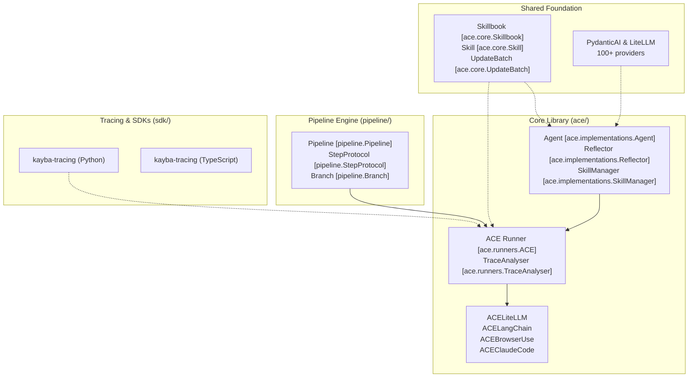
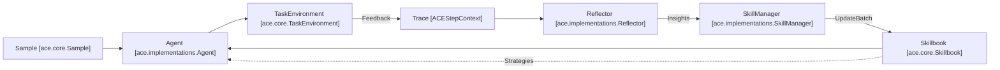

<!-- source: DeepWiki mcp.deepwiki.com · repo kayba-ai/agentic-context-engine · page 1 ACE Framework Overview · fetched 2026-10-27 -->

# ACE Framework Overview

Relevant source files

The following files were used as context for generating this wiki page:

- [CHANGELOG.md](CHANGELOG.md)
- [CLAUDE.md](CLAUDE.md)
- [README.md](README.md)
- [ace/__init__.py](ace/__init__.py)
- [ace/runners/litellm.py](ace/runners/litellm.py)
- [assets/kayba-banner.png](assets/kayba-banner.png)
- [examples/ace/ace_demo.py](examples/ace/ace_demo.py)
- [pyproject.toml](pyproject.toml)
- [tests/test_pipeline_exports.py](tests/test_pipeline_exports.py)
- [uv.lock](uv.lock)

## Purpose and Scope

This page provides a high-level introduction to the ACE Framework: its purpose, architecture, and main components. For detailed explanations of core concepts like the learning loop and skillbook, see [Core Concepts](#2). For installation and setup, see [Getting Started](#5). For architecture details, see [Architecture](#3).

**Sources:** [README.md:3-22](), [pyproject.toml:5-11]()

---

## What is ACE?

ACE (Agentic Context Engine) is a framework that enables AI agents to **learn from experience** and continuously improve. Instead of requiring fine-tuning or manual prompt engineering, ACE adds a persistent learning loop to agents. The framework maintains a **Skillbook** — a dynamic collection of strategies that evolves with each task [README.md:16-17](), [README.md:78-80]().

The core insight: AI agents repeat mistakes because they lack memory of what worked and what failed. ACE bridges this gap by maintaining a persistent context that is updated through reflection on execution traces [README.md:16-22]().

**Key metrics from production use:**
- **2x consistency**: Doubles pass rates on benchmarks like Tau2 [README.md:28]().
- **49% token reduction**: Browser automation costs cut nearly in half via learned shortcuts [README.md:29]().
- **Zero build errors**: Demonstrated in complex tasks like 14k line code translations [README.md:30]().

**Sources:** [README.md:16-31](), [README.md:78-89]()

---

## Repository Architecture

The ACE repository is organized into three primary functional areas: the core learning library, a generic pipeline engine, and observability SDKs.

### Core Library (`ace/`)
The primary package containing the implementation of the three-role architecture. It includes `Agent`, `Reflector`, and `SkillManager` [ace/__init__.py:84-86](). It also provides high-level runners like `ACE` for live execution and `TraceAnalyser` for learning from logs [ace/__init__.py:97-103]().

### Pipeline Engine (`pipeline/`)
A generic, immutable execution engine that ACE uses to compose its learning loops. It defines the `StepProtocol` and the `Pipeline` class used to sequence operations [pipeline/pipeline.py:1-50]().

### Tracing SDK (`sdk/`)
Contains the `kayba-tracing` packages used for instrumenting agents to collect the traces that ACE needs for reflection [pyproject.toml:72-74]().

**Sources:** [ace/__init__.py:1-121](), [CLAUDE.md:45-56](), [pyproject.toml:155-156]()

---

## The Learning Loop

ACE implements a closed-loop learning system where specialized roles collaborate to update the Skillbook.

### The Three Specialized Roles
1.  **Agent**: Executes the task. It is enhanced with strategies retrieved from the `Skillbook` [README.md:84]().
2.  **Reflector**: Analyzes the execution trace. It identifies what went wrong and what worked [README.md:85](). The **Recursive Reflector** (`RRStep`) is a key innovation that uses a sandboxed REPL to programmatically analyze traces [README.md:88-89]().
3.  **SkillManager**: Curates the `Skillbook`. It applies updates, deduplicates skills, and ensures strategies are generalized across different tasks [README.md:86](), [CHANGELOG.md:13-20]().

**Sources:** [README.md:78-99](), [CHANGELOG.md:58-65](), [ace/__init__.py:83-86]()

---

## Key Capabilities

### Recursive Reflector (RR)
Instead of a single-pass summary, the RR uses a `RecursiveAgent` to write and execute Python code in a `TraceSandbox` [CHANGELOG.md:58](), [ace/__init__.py:117-118](). It can iterate, use sub-agents, and perform deep-dive analysis of large traces [CHANGELOG.md:68-70]().

### Skillbook System (v2)
The `Skillbook` stores strategies using a schema that supports section-grouped storage and BM25-backed retrieval for high-relevance strategy injection [CHANGELOG.md:59](), [ace/__init__.py:75]().

### Multi-Framework Integrations
ACE provides ready-to-use runners for major agent frameworks:
- **`ACELiteLLM`**: For simple PydanticAI-powered conversational agents [ace/runners/litellm.py:35-55]().
- **`BrowserUse`**: For self-improving web automation [ace/__init__.py:100]().
- **`LangChain`**: For adding learning to LangChain chains and LangGraph [ace/__init__.py:102]().
- **`ClaudeCode`**: For self-improving coding loops [ace/__init__.py:101]().
- **`MCP Server`**: Exposes ACE tools (ask, learn, skillbook) via the Model Context Protocol [ace/integrations/mcp/server.py:1-50]().

### Observability
ACE integrates with **Logfire** for enterprise-grade tracing and uses the **Kayba Tracing SDK** to track performance metrics, token usage, and costs across the learning loop [CHANGELOG.md:63](), [pyproject.toml:69-74]().

**Sources:** [CHANGELOG.md:55-74](), [ace/__init__.py:96-103](), [README.md:101-105]()

---

## Next Steps

- [Repository Structure](#1.1) — Detailed breakdown of directories and modules.
- [Key Features and Capabilities](#1.2) — Summary of the self-learning loop and integrations.
- [Core Concepts](#2) — Deep dive into the learning loop and Skillbook.
- [Architecture](#3) — Technical details of the pipeline engine and core library.
- [Installation](#5.1) — Getting started with `pip install ace-framework`.

**Sources:** [Wiki Table of Contents]()

---

