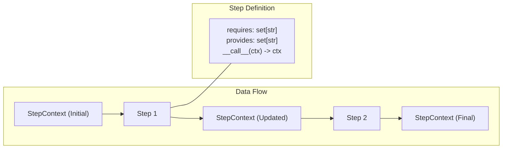
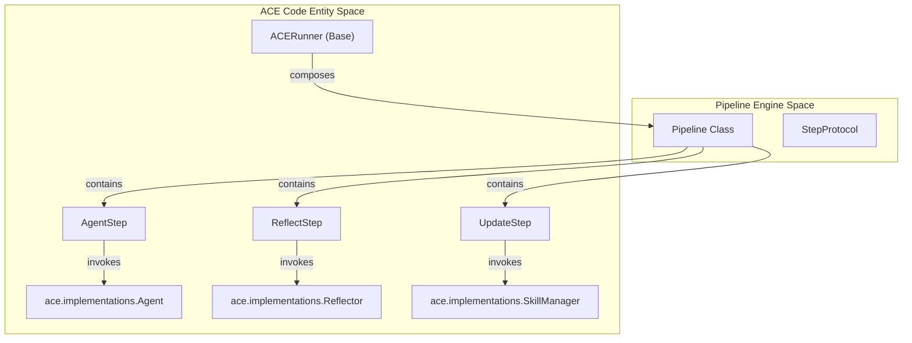
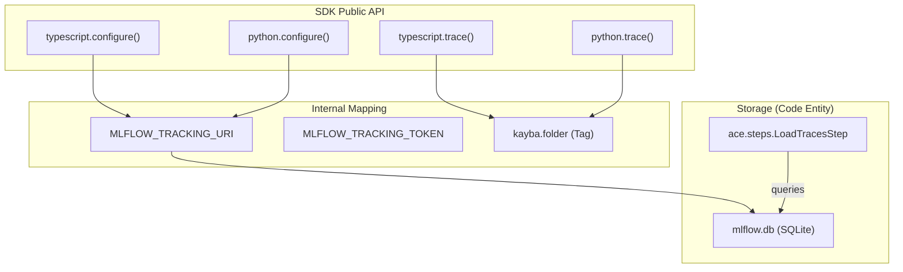

<!-- source: DeepWiki mcp.deepwiki.com · repo kayba-ai/agentic-context-engine · page 11.1 Package Structure · fetched 2026-10-27 -->

# Package Structure

Relevant source files

The following files were used as context for generating this wiki page:

- [ace/__init__.py](ace/__init__.py)
- [mlflow.db](mlflow.db)
- [pipeline/__init__.py](pipeline/__init__.py)
- [pipeline/errors.py](pipeline/errors.py)
- [pipeline/protocol.py](pipeline/protocol.py)
- [sdk/python/pyproject.toml](sdk/python/pyproject.toml)
- [sdk/python/src/kayba_tracing/__init__.py](sdk/python/src/kayba_tracing/__init__.py)
- [sdk/python/src/kayba_tracing/_wrapper.py](sdk/python/src/kayba_tracing/_wrapper.py)
- [sdk/typescript/.gitignore](sdk/typescript/.gitignore)
- [sdk/typescript/package-lock.json](sdk/typescript/package-lock.json)
- [sdk/typescript/package.json](sdk/typescript/package.json)
- [sdk/typescript/src/index.ts](sdk/typescript/src/index.ts)
- [tests/test_pipeline_exports.py](tests/test_pipeline_exports.py)
- [tests/test_pipeline_hooks.py](tests/test_pipeline_hooks.py)

## Purpose and Scope

This page provides a detailed breakdown of the ACE Framework repository structure and module organization. It covers the core `ace/` library, the generic `pipeline/` engine, and the multi-language `sdk/` directories. This document is intended for developers onboarding to the codebase or contributing to its architectural evolution.

**Sources:** [ace/__init__.py:1-6](), [pipeline/__init__.py:1-20]()

## High-Level Directory Overview

The repository is structured into three primary functional areas: the core library, the pipeline engine, and tracing SDKs for external instrumentation.

| Directory | Purpose | Primary Language |
| :--- | :--- | :--- |
| `ace/` | The core Agentic Context Engine implementation, including roles and integrations. | Python |
| `pipeline/` | A generic, domain-agnostic execution engine for composing step-based workflows. | Python |
| `sdk/` | Client libraries (Python/TypeScript) for sending execution traces to the Kayba platform. | Python, TypeScript |
| `tests/` | Comprehensive test suite covering all package components. | Python |

**Sources:** [ace/__init__.py:1-121](), [pipeline/__init__.py:22-42](), [sdk/python/pyproject.toml:5-15](), [sdk/typescript/package.json:1-10]()

## The pipeline/ Engine

The `pipeline/` directory contains the foundation of the ACE Framework. It is a standalone engine designed for composing complex AI workflows into reproducible steps.

### Architecture and Data Flow
The engine uses a structural protocol (`StepProtocol`) where each step defines its data requirements and provisions. Data is carried through an immutable `StepContext`.

### Key Components
- **`Pipeline`**: The orchestrator that executes a sequence of steps. [pipeline/pipeline.py:25]()
- **`Branch`**: Enables parallel execution of multiple sub-pipelines with configurable `MergeStrategy`. [pipeline/branch.py:22]()
- **`StepProtocol`**: A runtime-checkable protocol that ensures steps implement `requires`, `provides`, and `__call__`. [pipeline/protocol.py:33-47]()
- **`CancellationToken`**: A thread-safe primitive for interrupting long-running pipelines. [pipeline/errors.py:46-68]()

**Sources:** [pipeline/__init__.py:22-42](), [pipeline/protocol.py:1-72](), [pipeline/errors.py:9-41]()

## The ace/ Library

The `ace/` package implements the ACE Framework logic by building on top of the `pipeline/` engine. It provides the roles, data structures, and specialized steps required for agentic self-improvement.

### Package Initialization and Lazy Loading
The `ace/` package uses a lazy-loading mechanism in `__init__.py` to ensure fast imports. Public symbols are mapped to their underlying modules and loaded only on first access.

**Sources:** [ace/__init__.py:1-135]()

### Implementation Structure
The library is organized into functional sub-modules:
- **`ace.core`**: Fundamental data types like `Skill`, `Skillbook`, `UpdateBatch`, and `ACEStepContext`. [ace/__init__.py:70-82]()
- **`ace.implementations`**: Concrete implementations of the three-role architecture: `Agent`, `Reflector`, and `SkillManager`. [ace/__init__.py:84-86]()
- **`ace.steps`**: Specialized pipeline steps including `AgentStep`, `ReflectStep`, `UpdateStep`, and `RRStep` (Recursive Reflector). [ace/__init__.py:105-118]()
- **`ace.runners`**: High-level entry points like `ACE`, `TraceAnalyser`, and framework-specific runners (e.g., `BrowserUse`, `ClaudeCode`). [ace/__init__.py:97-103]()

### Bridge: Pipeline to ACE Entities
The following diagram illustrates how high-level system roles are mapped to concrete code entities within the pipeline structure.

**Sources:** [ace/__init__.py:62-121](), [tests/test_pipeline_exports.py:156-182]()

## The sdk/ Packages

The `sdk/` directory contains multi-language client libraries for the Kayba platform. These SDKs allow developers to instrument any agentic system to generate traces compatible with the ACE `TraceAnalyser`.

### Python SDK (`sdk/python/`)
The `kayba-tracing` package provides decorators and context managers for Python agents.
- **Core Entity**: `kayba_tracing.configure` for setup. [sdk/python/src/kayba_tracing/__init__.py]()
- **Instrumentation**: `@trace` decorator for automatic span creation. [sdk/python/src/kayba_tracing/_wrapper.py]()

### TypeScript SDK (`sdk/typescript/`)
The `@kayba_ai/tracing` package provides equivalent functionality for Node.js environments.
- **`configure()`**: Sets up MLflow tracking URI and API keys. [sdk/typescript/src/index.ts:130-155]()
- **`trace()`**: Wraps functions to generate spans with Kayba-specific metadata. [sdk/typescript/src/index.ts:236-240]()
- **Metadata Injection**: Automatically injects `kayba.folder`, `mlflow.trace.session`, and `mlflow.trace.user`. [sdk/typescript/src/index.ts:100-120]()

### Bridge: Trace Instrumentation to MLflow
This diagram shows how the SDK interfaces map to the underlying MLflow-based storage used by the ACE `LoadTracesStep`.

**Sources:** [sdk/typescript/src/index.ts:130-155](), [sdk/typescript/src/index.ts:100-120](), [ace/__init__.py:111](), [mlflow.db:1]()

## Module Organization Table

| Module Path | Responsibility | Key Symbols |
| :--- | :--- | :--- |
| `ace.core` | Data models and state | `Skill`, `Skillbook`, `UpdateBatch` |
| `ace.runners` | Execution entry points | `ACE`, `TraceAnalyser`, `ACELiteLLM` |
| `ace.steps` | Pipeline step logic | `AgentStep`, `RRStep`, `PersistStep` |
| `pipeline.context` | Execution state container | `StepContext` |
| `pipeline.branch` | Parallel execution | `Branch`, `MergeStrategy` |
| `sdk.typescript` | Node.js instrumentation | `configure`, `trace`, `setFolder` |

**Sources:** [ace/__init__.py:62-121](), [pipeline/__init__.py:22-42](), [sdk/typescript/src/index.ts:124-240]()

---

